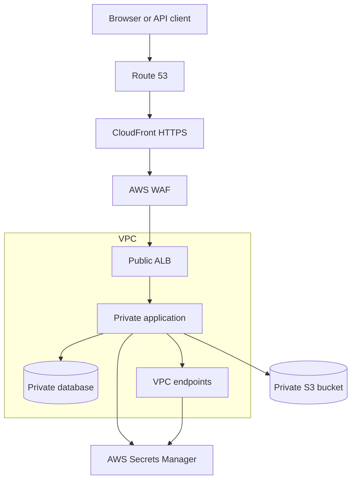

# Designing Layered Protection from Edge to Data

An AWS application needs multiple layers of control because each component faces a different set of risks. At the edge, the system filters requests and mitigates malicious traffic. At the network layer, the VPC and subnets constrain traffic paths. At the workload and application layers, IAM, authentication, authorization, and input validation protect business actions. At the data layer, encryption, access policies, and backups protect confidentiality, integrity, and recoverability.

Designing layered protection (defense in depth) is not about stacking as many security services as possible. The goal is to establish boundaries with clear responsibilities, reduce default permissions, limit blast radius when a layer is bypassed, and generate signals to detect incidents.

After this lesson, learners can analyze request flows; design protection from CloudFront/WAF through VPC and workloads to APIs, databases, and object storage; select appropriate IAM, TLS, KMS, and detection services; and build testing and response procedures.

## 1. Layered Thinking and Threat Modeling

A request can pass through DNS, CDN, Web Application Firewall (WAF), load balancer, application service, database, and object storage. Each layer has its own responsibility:

| Layer | Typical Risks | Common Controls |
|---|---|---|
| Edge and DNS | DDoS, bots, anomalous requests, direct origin access | Route 53, CloudFront, AWS WAF, AWS Shield, TLS |
| Network ingress/egress | Overly permissive ports, lateral movement, uncontrolled egress | Route tables, security groups, network ACLs, Network Firewall, VPC endpoints |
| Workload | OS vulnerabilities, malicious images, exposed credentials | IAM roles, patching, image scanning, runtime hardening, secrets |
| Application/API | Broken access control, injection, SSRF, credential stuffing | Authentication, authorization, validation, throttling |
| Data | Data exposure, unauthorized modification/deletion, ransomware | IAM/resource policies, KMS, TLS, backups, versioning |
| Detection/response | Undetected attacks, slow response | CloudTrail, VPC Flow Logs, WAF logs, GuardDuty, Security Hub, Config |

WAF filters HTTP(S) requests but does not authenticate users and does not replace permission checks inside the service. Security groups restrict network connections but do not prevent a valid user from mistakenly reading another customer's record. Disk encryption protects data at rest but does not prevent a principal with valid permissions from reading plaintext after the application decrypts it.

Before choosing services, identify assets, principals, allowed access paths, and the impact if a layer is compromised. A trust boundary is where the system transitions from one trust domain to another—such as the Internet to CloudFront, load balancer to service, or application role to database. Each boundary needs source authentication, permission boundaries, and appropriate activity logging.

### Reference Flow



A simplified diagram cannot show every route table, security group, IAM policy, or log destination. When implementing, inspect every hop as well as alternative paths that could bypass controls, such as direct origin access.

## 2. Edge Protection: DNS, CDN, WAF, and DDoS

### 2.1. Route 53 and Domains

Amazon Route 53 provides DNS hosting, health checks, and routing policies. Permissions to modify hosted zones and records can affect availability or redirect users to spoofed endpoints.

- Restrict permissions to modify hosted zones and registrars to designated admin groups; enable MFA and use temporary roles.
- Use health checks and routing policies when failover or latency/geolocation-based routing is needed.
- Consider DNSSEC for public hosted zones so resolvers can verify the authenticity and integrity of signed DNS data.
- Monitor record, delegation, and health check changes using CloudTrail.

DNSSEC does not encrypt DNS queries and does not replace HTTPS.

### 2.2. CloudFront in Front of Origins

Amazon CloudFront distributes content via edge locations, reducing latency and helping absorb traffic close to users. CloudFront is also the client-side TLS termination point and the appropriate place to apply cache behaviors, origin selection, and AWS WAF.

- Allow HTTPS only in the viewer protocol policy; use HTTPS-only from CloudFront to the origin when the origin supports TLS.
- Forward only the headers, cookies, and query strings the application actually needs. Forwarding excessive data lowers the cache hit ratio and can forward sensitive information.
- Design cache keys deliberately. Do not cache personalized responses unless the cache policy properly isolates users/tenants.
- For S3 origins, use Origin Access Control (OAC) and a bucket policy that limits read permissions to the required distribution; enable S3 Block Public Access.
- For ALB/custom origins, restrict ingress to accept traffic only from CloudFront using an appropriate mechanism, such as the CloudFront origin-facing managed prefix list in the security group. Test to ensure clients cannot bypass WAF by calling the origin directly.
- Use access logs as needed for investigation; control read permissions because URLs, headers, or query strings may contain sensitive data.

ACM certificates for CloudFront alternate domain names must be issued/imported in the us-east-1 Region. Certificates for ALBs are managed in the same Region as the load balancer.

### 2.3. AWS WAF

AWS WAF is an HTTP(S) firewall. A Web ACL can be associated with CloudFront, Application Load Balancer, and supported services such as API Gateway REST APIs. WAF evaluates requests by rule priority; rules can allow, block, count, or apply CAPTCHA/Challenge depending on configuration.

Common rules:

- AWS Managed Rules detect common attack pattern groups such as SQL injection and cross-site scripting.
- Rate-based rules limit request rates by IP or supported aggregate keys.
- IP sets block/allow address ranges; geo match enforces justified geographic policies.
- Regex/pattern matching inspects URIs, headers, or query strings against endpoint schemas.
- Bot Control, CAPTCHA, or Challenge help control automation.

Rate-based rules mitigate abuse and request bursts; they are not exact counters for calculating business quotas or billing. IP-based rate limiting can affect multiple users behind the same NAT; choose appropriate aggregate keys and scope-down statements.

Example of two rule fragments for a Web ACL:

```json
{
  "Name": "CommonManagedRules",
  "Priority": 10,
  "OverrideAction": {"None": {}},
  "Statement": {
    "ManagedRuleGroupStatement": {
      "VendorName": "AWS",
      "Name": "AWSManagedRulesCommonRuleSet"
    }
  },
  "VisibilityConfig": {
    "SampledRequestsEnabled": true,
    "CloudWatchMetricsEnabled": true,
    "MetricName": "CommonManagedRules"
  }
}
```

```json
{
  "Name": "LimitRequestsByClientIp",
  "Priority": 20,
  "Action": {"Block": {}},
  "Statement": {
    "RateBasedStatement": {
      "Limit": 2000,
      "AggregateKeyType": "IP"
    }
  },
  "VisibilityConfig": {
    "SampledRequestsEnabled": true,
    "CloudWatchMetricsEnabled": true,
    "MetricName": "LimitRequestsByClientIp"
  }
}
```

These are rule fragments, not a complete Web ACL. The ACL still requires scope, default action, rule list, and ACL-level visibility configuration. The 2,000 threshold is only an example value; measure legitimate traffic and test before enabling Block.

Safe rollout workflow: start in Count mode, analyze sampled requests and logs, tune exceptions/scope, switch to Block rule by rule, then monitor blocked requests and application error rates. Managed Rules do not fully understand business logic; the backend must still check resource ownership, schemas, and business state.

### 2.4. AWS Shield and DDoS

AWS Shield Standard provides automatic DDoS protection for AWS customers against many network- and transport-layer attack types. AWS Shield Advanced adds enhanced protection for supported resources, visibility, and response support under service terms.

Combine Shield with CloudFront, Route 53, load balancers, and WAF. Identify which endpoints need to be public; cache static content safely; set appropriate autoscaling, capacity limits, queues, and timeouts; monitor request rate, latency, error rate, origin load, and cost; and prepare response runbooks. Unbounded autoscaling can turn an attack into massive costs.

DDoS protection does not prevent all application-layer abuse. Login requests that are valid HTTP but consume heavy CPU or database queries still require rate limiting, throttling, per-account quotas, and business-logic optimization.

## 3. TLS and Transport Protection

TLS protects the confidentiality and integrity of data in transit. HTTPS on the viewer side does not automatically guarantee that the CloudFront-to-origin or service-to-service path is also encrypted.

| Connection | Recommended Control |
|---|---|
| Browser → CloudFront | HTTPS, valid certificate, current TLS policy, redirect HTTP to HTTPS |
| CloudFront → ALB/origin | HTTPS-only, valid origin certificate, origin access controls to prevent bypass |
| ALB → application | Use HTTPS when required by the threat model and supported by the platform |
| Application → database/cache | Enable TLS and verify certificates according to driver/engine |
| Application → AWS service | AWS SDK uses TLS; VPC endpoints when a private path is needed |
| Operator → management endpoint | SSM Session Manager or controlled administrative channel |

AWS Certificate Manager (ACM) issues, deploys, and automatically renews public certificates for integrated services. Private certificates can use ACM Private CA. Define who has permissions to request, import, renew, and attach certificates to listeners.

At the application layer, do not send session tokens/API keys/secrets in URLs; use cookies with appropriate `Secure`, `HttpOnly`, and `SameSite` flags; enable HSTS once the entire domain is HTTPS-ready; do not disable certificate verification in production; and do not write authorization headers or secrets to logs.

TLS does not replace authorization. An HTTPS connection can still carry a request from an unauthorized user.

## 4. VPC Segmentation and Network Flow Control

### 4.1. Splitting Subnets by Function

Amazon VPC provides an isolated logical network. A subnet is an IP range within an Availability Zone; route tables determine traffic paths. Multi-tier architectures typically include:

- **Public subnet:** internet-facing load balancers or NAT Gateways; route to an Internet Gateway. Individual resources still need public addressing and appropriate security groups.
- **Private application subnet:** EC2, ECS tasks, EKS workloads; do not assign public IPs without a specific reason.
- **Isolated data subnet:** databases and data services that do not need direct Internet routes; keep only internal and required routes.
- **Management/inspection subnet:** endpoints or inspection components per architecture.

A subnet's name is not a security control. A subnet named private whose resources have public IPs and open security groups can still be accessed externally. Inspect route tables, public IPs, gateways, and security groups together.

### 4.2. Security Groups and Network ACLs

A security group is a stateful firewall attached to supported network interfaces/resources. When a connection is allowed, return traffic for that connection is automatically allowed. Security groups only support allow rules.

A Network ACL (NACL) is a stateless firewall at the subnet level. Inbound and outbound rules are evaluated independently; both directions must be opened, including required ephemeral ports. NACLs support allow/deny rules and are processed in ascending rule number order.

| Property | Security Group | Network ACL |
|---|---|---|
| Scope | Network interface/resource | Subnet |
| State | Stateful | Stateless |
| Rules | Allow | Allow and deny |
| Evaluation | Set of rules for the resource | By rule number, stops at the first matching rule |
| Role | Controls sources/ports for each tier | Additional subnet layer, blocking CIDRs or special traffic |

Security groups should be the primary control between tiers. NACLs are suited for subnet-wide rules, but complex configurations can easily block legitimate return traffic by mistake.

| Security Group | Inbound | Outbound |
|---|---|---|
| `sg-alb` | TCP 443 from Internet or designed edge ranges | TCP 8080 to `sg-app` |
| `sg-app` | TCP 8080 only from `sg-alb` | TCP 5432 to `sg-db`; HTTPS to required endpoints |
| `sg-db` | TCP 5432 only from `sg-app` | Return traffic and required flows only |

Example of adding an inbound rule to an application security group from a load balancer security group:

```bash
aws ec2 authorize-security-group-ingress --group-id sg-0app123456789abcd --protocol tcp --port 8080 --source-group sg-0alb123456789abcd
```

The IDs are placeholders. Before applying, verify the correct VPC, security groups, target group port, and existing rules.

### 4.3. Egress, VPC Endpoints, and Network Firewall

Uncontrolled egress can allow a compromised workload to download tools, exfiltrate data, or call unwanted APIs.

- Restrict outbound security groups to appropriate ports/destinations; security groups do not filter by domain name.
- Use a NAT Gateway for private subnets that require outbound Internet access; NAT does not natively provide URL filtering.
- Use AWS Network Firewall or an egress proxy to inspect traffic as required by the architecture.
- Use gateway endpoints for S3/DynamoDB where appropriate; use interface endpoints/PrivateLink for supported services.
- Attach endpoint policies to restrict which APIs/resources can be accessed via the endpoint; IAM and resource policies are still required.
- Monitor VPC Flow Logs, Network Firewall logs, and DNS query logs when needed for investigation.

VPC endpoints keep service traffic on a private path, but they do not automatically grant resource access permissions. IAM policies, resource policies, KMS key policies, and endpoint policies can all affect an access decision together.

AWS Network Firewall provides a stateful firewall for traffic routed through firewall endpoints. Stateless and stateful rules can be used to filter network traffic according to supported features. For egress inspection, route tables in the source subnet, firewall subnet, and NAT subnet must form symmetric paths. If traffic bypasses the firewall or the return path is asymmetric, inspection may not apply as intended.

WAF inspects HTTP(S); Network Firewall controls network traffic routed through its endpoints; security groups restrict connections to workloads; NACLs perform stateless filtering at the subnet level. Choose services based on threat model, routing, operational capability, and cost.

## 5. Load Balancer and Workload Protection

### 5.1. Load Balancers

Application Load Balancer (ALB) is suited for HTTP/HTTPS and host/path-based routing. Network Load Balancer (NLB) is suited for TCP/UDP/TLS and transport-level requirements.

- Make load balancers public only when they must receive Internet traffic; place application targets in private subnets.
- Use separate security groups for the load balancer and targets; targets should accept traffic only from the load balancer's security group.
- Open only required listeners and target ports; enable appropriate access logs and metrics.
- Configure health checks so they do not leak internal details or secrets.
- If terminating TLS at the ALB, evaluate whether traffic must remain encrypted all the way to the target.
- When using `X-Forwarded-For`, trust only proxies/load balancers in a controlled chain. Clients can send a header with the same name; never use it as proof of identity.

### 5.2. EC2, Containers, and Lambda

For EC2: assign a least-privilege IAM instance profile; require IMDSv2 where appropriate; patch the OS/packages; use Systems Manager Session Manager instead of wide-open SSH/RDP; disable unnecessary services/ports; encrypt EBS volumes/snapshots and control sharing permissions.

For ECS/EKS:

- Scan images, update base images, and pin digests for critical releases.
- Run containers as non-root when possible; drop unnecessary Linux capabilities and use a read-only root filesystem where appropriate.
- Never embed secrets in images or source code.
- Separate ECS task roles, execution roles, EKS workload identities, and node roles; each workload receives only the permissions it needs.
- For EKS, use Pod Identity or IRSA depending on the deployment model; restrict permissions on node roles and the Kubernetes API.
- Use network policies/security groups for pods when supported by the platform; control permissions for deploy, exec, and reading secrets.
- Enable audit logs and monitor the control plane/workloads.

For Lambda: assign a least-privilege execution role; restrict resource-based invoke policies; place functions in a VPC when accessing private resources is required. VPC attachment does not automatically create private endpoints and may require NAT or VPC endpoints to call services outside the VPC. Manage secrets via a secret store, limit concurrency/timeout/payload size, and enable code signing when publisher verification is required.

## 6. Application and API Protection

### 6.1. Authentication and Authorization

Authentication determines who the principal is; authorization determines what the principal is allowed to do on a specific resource.

You can use Amazon Cognito User Pools, an OIDC/OAuth 2.0 identity provider, IAM authentication, or API Gateway authorizers. Mutual TLS suits clients/partners requiring certificates. For JWTs, validate signature, issuer, audience, expiration (`exp`), not-before (`nbf` if present), algorithm, and scopes/claims. Do not trust a token merely because it parses.

After authentication, check permissions on each object and action. An authenticated user must still only read invoices belonging to their own tenant. Do not rely solely on a client-supplied ID to determine ownership.

### 6.2. API Gateway and Common Application Vulnerabilities

API Gateway provides authorizers, request validation, throttling, usage plans, and logging depending on the API type. API keys/usage plans primarily identify clients and throttle usage; an API key is not strong user authentication. Throttling mitigates bursts; the backend must still validate permissions and business invariants. Use timeouts, payload limits, pagination, concurrency limits, and idempotency for retryable operations.

| Risk | Primary Controls |
|---|---|
| SQL/NoSQL injection | Parameterized queries, schema and data type validation |
| Broken access control | Per-object/action authorization, tenant isolation, deny by default |
| XSS | Context-aware output encoding, CSP, avoid rendering untrusted HTML |
| CSRF | CSRF tokens, SameSite cookies, origin checks per model |
| SSRF | Destination allowlists, block unnecessary metadata endpoints, egress controls |
| Credential stuffing | MFA, rate limiting by account/IP/device, anomaly detection |
| Path traversal | Path normalization, file/resource allowlists |
| Mass assignment | DTOs/allowlists of updatable fields |
| Business logic abuse | Per-user/tenant quotas, concurrency limits, queues, timeouts |

CORS only governs whether a browser is allowed to read responses from another origin. CORS does not authenticate users and does not prevent non-browser clients from calling the API.

### 6.3. Secrets and Credentials

Use AWS Secrets Manager for secrets needing rotation/service integration; use Systems Manager Parameter Store for configuration and SecureString parameters as needed.

- Grant secret read permissions only to the exact workload role and ARN/secret path.
- Use resource policies when sharing secrets across accounts; coordinate IAM policies and KMS key policies.
- Enable rotation when supported by the credential type and application; test the transition phase.
- Never write secrets to logs, exceptions, tracing attributes, metric dimensions, or URLs.
- Never pass secrets via user data or container images.
- Rotate exposed credentials and review logs to determine blast radius.

## 7. Data Protection and Encryption Keys

### 7.1. Classification and Access Control

Classify data by sensitivity and retention requirements. For each category, define principals, intended use, retention period, storage location, and encryption requirements.

- Private by default; make public only with an approved business need.
- Separate read, write, delete, and administrative permissions; separate application permissions from operations/security permissions.
- Restrict access by tenant, account, tag, or prefix when the policy model supports it and has been tested.
- Maintain audit logs for sensitive data operations; do not store more personal data than necessary.

### 7.2. Amazon S3

For application buckets:

- Enable S3 Block Public Access at the account and bucket levels; audit ACLs and bucket policies.
- Use Bucket owner enforced Object Ownership to disable ACLs when the model does not require ACLs.
- Use bucket policies scoped to required principals/actions; enforce TLS via `aws:SecureTransport`.
- Use CloudFront OAC for private content distributed via CDN.
- Enable SSE-S3 or SSE-KMS based on key management and audit requirements.
- Enable versioning to support recovery of overwritten/deleted objects; use lifecycle rules to control cost.
- Use Object Lock when WORM/immutable retention is required; understand retention modes and legal holds.
- Enable CloudTrail data events or server access logging when needed for investigation; consider cost.
- Use replication and backups aligned with RPO/RTO; versioning alone does not replace backups.

Example bucket policy enforcing HTTPS:

```json
{
  "Version": "2012-10-17",
  "Statement": [{
    "Sid": "DenyInsecureTransport",
    "Effect": "Deny",
    "Principal": "*",
    "Action": "s3:*",
    "Resource": [
      "arn:aws:s3:::example-private-data",
      "arn:aws:s3:::example-private-data/*"
    ],
    "Condition": {
      "Bool": {"aws:SecureTransport": "false"}
    }
  }]
}
```

This is an additive statement. Merge it into the existing bucket policy and verify it does not disrupt legitimate principals or service integrations.

### 7.3. Databases and Caches

For RDS/Aurora: place the DB in a private DB subnet group; configure SGs to allow the database port only from the application SG; enable KMS encryption at rest when creating the resource; enable TLS and verify certificates in the driver; use a dedicated database user for the service rather than the master user; use Secrets Manager rotation or IAM database authentication where supported by the engine; enable backup retention and point-in-time recovery; and test restores.

For DynamoDB, enforce IAM/resource policies, encryption at rest, VPC endpoints, and point-in-time recovery as needed. For ElastiCache, place caches in private subnets, enable TLS/authentication as supported by the engine, and allow access only from the application tier.

### 7.4. AWS KMS

Encryption is only effective if permissions to use the key are properly restricted.

- Key policies are the foundation of authorization for KMS keys; IAM policies only take effect when the key policy allows the account to use IAM for delegation or directly grants permissions to the principal.
- Separate keys by environment/data domain when administrative boundaries are clear; do not create keys without operational processes.
- Choose rotation based on key type and compliance requirements; rotation does not automatically re-encrypt all existing data.
- Use grants for permissions with a clear lifecycle or integrations that require grants; restrict principals allowed to call `kms:CreateGrant`.
- Encryption context binds ciphertext to business context when using symmetric KMS keys; context is not secret and may appear in CloudTrail.
- Control `kms:Decrypt`, `kms:GenerateDataKey`, `kms:CreateGrant`, `kms:ScheduleKeyDeletion`, and key administration permissions under separate roles.
- Never schedule key deletion before verifying all dependent data, backups, snapshots, and workloads.

When data spans multiple accounts, coordinate key policies, IAM policies, grants, service resource policies, and endpoint policies if present. Test both allowed access and cases that must be denied.

## 8. IAM and Multi-Account Guardrails

IAM determines which principals can call AWS APIs. Distinguish between identity policies, resource policies, permission boundaries, session policies, and Service Control Policies (SCPs).

### 8.1. Workload Identity

Use IAM roles for EC2, ECS tasks, EKS workloads, Lambda, and CI/CD; avoid long-lived access keys; separate deploy, runtime, audit, and security administration roles; scope actions/resources using specific ARNs; use conditions such as source VPC endpoint, principal tags, resource tags, or encryption context where appropriate; and audit wildcards and unused policies.

### 8.2. Organizational Guardrails

AWS Organizations SCPs set the maximum permission ceiling for member accounts; SCPs do not grant permissions and do not replace IAM policies. SCPs can be used to prevent accounts from disabling security services or performing dangerous actions outside approved workflows. AWS Control Tower, AWS Config conformance packs, and Security Hub help govern multi-account/Region posture.

Account structures typically separate management accounts, security accounts, log archive accounts, and workload accounts by environment/product. Use cross-account roles with ExternalId when partner integrations require assuming a role; internal workloads should use appropriate federation/role chaining.

### 8.3. Example IAM Policy Restricting an S3 Prefix

```json
{
  "Version": "2012-10-17",
  "Statement": [
    {
      "Sid": "ListInvoicePrefix",
      "Effect": "Allow",
      "Action": "s3:ListBucket",
      "Resource": "arn:aws:s3:::example-private-data",
      "Condition": {
        "StringLike": {"s3:prefix": ["invoices/*"]}
      }
    },
    {
      "Sid": "ReadInvoiceObjects",
      "Effect": "Allow",
      "Action": "s3:GetObject",
      "Resource": "arn:aws:s3:::example-private-data/invoices/*"
    }
  ]
}
```

Effective permissions still depend on bucket policies, SCPs, permission boundaries, KMS key policies, and other applicable policies. Replace ARNs and test before use.

## 9. Detection, Logging, and Response

| Service | Role |
|---|---|
| AWS CloudTrail | Records API/control-plane activity; data events for supported resources when enabled |
| Amazon VPC Flow Logs | IP flow metadata to/from network interfaces, subnets, or VPCs |
| AWS WAF logs | Requests evaluated by WAF, rule matches, and actions |
| CloudFront access logs | Requests to distributions and responses |
| Amazon GuardDuty | Detects threat indicators from supported logs/telemetry |
| AWS Security Hub | Aggregates security findings and posture |
| Amazon Inspector | Detects vulnerabilities in supported workloads/packages/containers/images |
| Amazon Macie | Discovers sensitive data in S3 |
| AWS Config | Records resource configurations and evaluates compliance |
| Amazon CloudWatch | Metrics, logs, alarms, and dashboards |

Logging design:

- Enable an organization trail or multi-Region trail as required; store logs in a centralized account.
- Selectively enable data events for sensitive buckets/resources; data events can incur significant cost.
- Enable VPC Flow Logs for critical VPCs/subnets/ENIs.
- Enable WAF logging and redact sensitive fields if supported by configuration.
- Use correlation IDs end-to-end across CloudFront, load balancers, APIs, and applications.
- Restrict log deletion/modification permissions; use retention, versioning, Object Lock, or appropriate protective mechanisms.
- Create alarms for changes to security groups, bucket policies, KMS key policies, IAM privileges, WAF ACLs, and disabling of logging/security services.
- Periodically test that logs are queryable when an incident occurs.

VPC Flow Logs do not record application payloads. They provide connection metadata, not a replacement for application logs or WAF logs.

### 9.1. Basic Response Procedure

1. Identify affected resources, accounts, Regions, timestamps, and principals.
2. Verify using CloudTrail, VPC Flow Logs, WAF logs, application logs, and source findings.
3. Mitigate: revoke credentials, disable access keys, isolate security groups/subnets, or block IPs per runbook.
4. Preserve evidence: snapshots, logs, images/disks, and timelines per forensic procedures.
5. Recover from verified artifacts/backups; rotate secrets and verify integrity.
6. Confirm services are operational, permissions are narrowed, and no persistence remains.
7. Document root cause, impact, detection/recovery times, and preventive actions.

Do not immediately delete resources or logs upon detecting anomalies if they may serve as investigative evidence.

## 10. Reference Architecture: Online Store

| Component | Location/Path | Controls |
|---|---|---|
| Domain | Route 53 | Restricted DNS permissions, CloudTrail, health checks |
| Web ingress | CloudFront | HTTPS, cache policies, OAC for S3 |
| Request filter | AWS WAF, Shield | Managed rules, rate limits, DDoS protection |
| API ingress | Public ALB or API Gateway | TLS, WAF association, listener/access logs |
| Application | ECS/EC2 in private subnets | SG accepting only from ingress, IAM role, patching/image scans |
| Database | RDS/Aurora private subnet | SG only from app, TLS, KMS encryption, backups |
| Product images | Private S3 bucket | Block Public Access, OAC, SSE, versioning |
| Secrets | Secrets Manager | IAM role reading exact secret, rotation |
| Key management | KMS | Key policies, rotation, CloudTrail |
| AWS API access | VPC endpoints | Endpoint policies, SGs for interface endpoints |
| Detection | CloudTrail, GuardDuty, Security Hub, Config, CloudWatch | Centralized logs, alarms, and incident runbooks |

Read requests for product pages can be cached at CloudFront. Order creation requests must pass through WAF, API authorization, application validation, and transaction logic. The application role only holds the necessary permissions for its database secret and corresponding bucket prefix.

If the application is compromised, security groups restrict connections to other workloads; the IAM role limits callable AWS APIs; the database user limits operations; the KMS policy restricts decryption rights; and logs help identify executed actions. Combined layers reduce blast radius.

## 11. Lifecycle Implementation Process

**Pre-deployment:** diagram data flows/trust boundaries; classify data; inventory public endpoints, ports, protocols, identities, and owners; define RTO/RPO, logging, alerts, budget, and responsible owners.

**During deployment:** use IaC for VPCs, routes, SGs, WAF, IAM, KMS, and storage policies; use a secret store; enable baselines before exposing workloads publicly; test WAF in Count mode before switching to Block; review wildcards; test both valid requests and requests that must be blocked; test restores and rotation.

**Post-deployment:** monitor findings, error rates, latency, WAF actions, and network flows; review IAM/resource policies; patch workloads and dependencies; conduct failover/restore/incident response drills; evaluate costs of WAF, logging, NAT, Network Firewall, and data transfer; revoke unneeded endpoints/credentials/rules.

## 12. Common Design Mistakes

| Mistake | Consequence | Fix |
|---|---|---|
| Public ALB allows direct access while WAF is attached only to CloudFront | Clients bypass WAF | Restrict ALB ingress using the CloudFront origin-facing prefix list or another origin access mechanism |
| Database has public accessibility | Increases attack surface | Place DB in a private subnet, SG allowing only the app tier |
| App SG allows inbound `0.0.0.0/0` | Any source can attempt connections | Accept only from the ingress SG |
| Using NACLs instead of SGs | Stateless rules easily block return traffic | Use SGs for resources; NACLs as an additional subnet layer |
| Allowing all outbound traffic | Compromised workloads have wide exfiltration paths | Restrict egress, use endpoints, proxies, or Network Firewall |
| Relying only on WAF, skipping backend authorization | Valid users read other users' data | Enforce object/tenant permissions in the application |
| Treating API keys as user identity | Shared/leaked credentials, unclear permissions | Use OAuth/OIDC/JWT/IAM and proper authorization |
| Caching personalized responses without isolated cache keys | Data leaks between users | Bypass cache or isolate cache keys by verified identity/tenant |
| Writing tokens/PII to logs | Logs become a leak source | Redact/mask and restrict read access |
| Storing secrets in images/source | Secrets persist in artifact history | Use a secret store and rotate if exposed |
| Granting `Decrypt` to too many principals | Unnecessary principals can read data | Separate keys/roles, restrict decrypt, and audit |
| Not testing restores | Backups may be unusable | Conduct restore drills and measure RTO/RPO |
| Enabling security services without anyone handling findings | Findings pile up unaddressed | Assign owners, SLAs, triage, and escalation |

## 13. Hands-On Lab: Protecting an Orders API

A team deploys an orders API on AWS. Clients call `api.shop.example`; the API runs on an application service in private subnets and stores data in RDS. Product images reside in S3.

Tasks:

1. Point the Route 53 record to CloudFront; configure HTTPS and origin HTTPS to the ALB.
2. Attach an AWS WAF Web ACL at the edge; start in Count mode for managed rules.
3. Place the ALB in public subnets, the app in private subnets, and the DB in isolated/private subnets.
4. Create three separate security groups for ALB, app, and DB; app accepts traffic only from ALB, and DB accepts traffic only from app.
5. Use an IAM task role for the app to read one specific secret and the required object prefix.
6. Enable RDS encryption, TLS, backups, and S3 Block Public Access/SSE.
7. Enable CloudTrail, VPC Flow Logs, WAF logs, and CloudWatch alarms.
8. Test valid requests, requests exceeding the rate limit, direct origin access, direct DB connections, and access to objects outside the prefix.
9. Perform a test restore and record recovery time.

Completion criteria: DB is unreachable from the Internet or workloads outside the app tier; edge policies cannot be bypassed; WAF has logs/metrics and false positives have been evaluated; the app role has only necessary permissions; TLS is enabled on hops within the threat model; requests are traceable via correlation IDs; backups have been test-restored.

## 14. Self-Check Questions

1. Why can WAF not replace authorization in the application?
2. How do security groups differ from network ACLs in scope and state tracking?
3. Why can a private subnet still have outbound Internet egress?
4. When placing CloudFront in front of an ALB, what must be done to prevent clients from accessing the origin directly?
5. What types of risks do AWS Shield and AWS WAF protect against?
6. Why should an API key not be treated as a user authentication mechanism?
7. Why is CORS not an API access control mechanism?
8. When should VPC endpoints be used instead of a NAT Gateway?
9. Why is encryption at rest insufficient if an IAM role has overly broad Decrypt permissions?
10. Which policies interact when sharing S3 SSE-KMS data across accounts?
11. What do VPC Flow Logs show and what do they not show?
12. Why must backup restores be tested instead of just checking that backup status is Enabled?

### Suggested Answers

1. WAF filters request patterns; the application verifies whether a principal has permission for the object/action.
2. Security groups attach to network interfaces/resources and are stateful; NACLs apply to subnets, are stateless, and have ordered allow/deny rules.
3. A private subnet can route outbound traffic through a NAT Gateway or firewall/proxy; having no direct route to an Internet Gateway does not mean there is no egress.
4. Restrict origin ingress to accept traffic only from CloudFront via prefix lists or origin access mechanisms and test bypass paths.
5. Shield focuses on DDoS; WAF filters HTTP(S) based on application rules.
6. API keys typically identify a client/usage; they do not prove user identity or resource permissions.
7. CORS is a browser policy; non-browser clients can still call the API.
8. Endpoints provide a private path and reduce Internet/NAT dependency; you must still evaluate service support, endpoint policies, and cost.
9. A principal with decryption permissions can read plaintext; you must restrict Decrypt and control identities.
10. Bucket policies, IAM policies, KMS key policies/grants, endpoint policies if present, and account/Region permissions.
11. Flow Logs record flow metadata; they do not record HTTP payloads or application content.
12. Restore drills verify actual data, permissions, keys, and RTO.

## 15. Architecture Review Checklist

- [ ] Domains, DNS, and certificates have owners and change processes.
- [ ] Public endpoints are inventoried; origins have no unprotected bypass paths.
- [ ] HTTPS is enabled on required hops.
- [ ] WAF rules have been observed for false positives and have active monitoring.
- [ ] DDoS, rate limiting, quotas, and autoscaling have cost guardrails.
- [ ] Public/private/data/inspection subnets have clear routing.
- [ ] Security groups allow only necessary flows; NACLs do not block valid return traffic.
- [ ] Egress and endpoint policies are reviewed against the threat model.
- [ ] Workloads use temporary IAM roles and least privilege.
- [ ] OS, images, dependencies, and function packages are patched/scanned.
- [ ] APIs implement authentication, object-level authorization, and input validation.
- [ ] Secrets are stored in a secret store and have a rotation process.
- [ ] S3, databases, caches, and backups have appropriate policies, encryption, TLS, and retention.
- [ ] KMS key policies, grants, and Decrypt permissions are restricted.
- [ ] CloudTrail, VPC Flow Logs, WAF logs, and application logs have retention/owners.
- [ ] Findings have triage, escalation processes, and incident runbooks.
- [ ] Backup restores, failovers, and recovery have been drilled.
- [ ] Costs of security services and logging are monitored.

## 16. References

- [AWS Well-Architected Framework - Security Pillar](https://docs.aws.amazon.com/wellarchitected/latest/security-pillar/welcome.html)
- [AWS Security Best Practices](https://docs.aws.amazon.com/prescriptive-guidance/latest/security-reference-architecture/welcome.html)
- [Amazon CloudFront security](https://docs.aws.amazon.com/AmazonCloudFront/latest/DeveloperGuide/SecurityAndPrivateContent.html)
- [AWS WAF Developer Guide](https://docs.aws.amazon.com/waf/latest/developerguide/what-is-aws-waf.html)
- [AWS Shield](https://docs.aws.amazon.com/waf/latest/developerguide/shield-chapter.html)
- [Amazon VPC security](https://docs.aws.amazon.com/vpc/latest/userguide/VPC_Security.html)
- [Security groups](https://docs.aws.amazon.com/vpc/latest/userguide/vpc-security-groups.html)
- [Network ACLs](https://docs.aws.amazon.com/vpc/latest/userguide/vpc-network-acls.html)
- [AWS Network Firewall](https://docs.aws.amazon.com/network-firewall/latest/developerguide/what-is-aws-network-firewall.html)
- [VPC endpoints](https://docs.aws.amazon.com/vpc/latest/privatelink/vpc-endpoints.html)
- [Elastic Load Balancing security](https://docs.aws.amazon.com/elasticloadbalancing/latest/userguide/security.html)
- [AWS Certificate Manager](https://docs.aws.amazon.com/acm/latest/userguide/acm-overview.html)
- [IAM best practices](https://docs.aws.amazon.com/IAM/latest/UserGuide/best-practices.html)
- [Amazon S3 security best practices](https://docs.aws.amazon.com/AmazonS3/latest/userguide/security-best-practices.html)
- [Amazon RDS security](https://docs.aws.amazon.com/AmazonRDS/latest/UserGuide/UsingWithRDS.html)
- [AWS KMS best practices](https://docs.aws.amazon.com/kms/latest/developerguide/best-practices.html)
- [AWS CloudTrail](https://docs.aws.amazon.com/awscloudtrail/latest/userguide/cloudtrail-user-guide.html)
- [Amazon GuardDuty](https://docs.aws.amazon.com/guardduty/latest/ug/what-is-guardduty.html)
- [AWS Security Hub](https://docs.aws.amazon.com/securityhub/latest/userguide/what-is-securityhub.html)