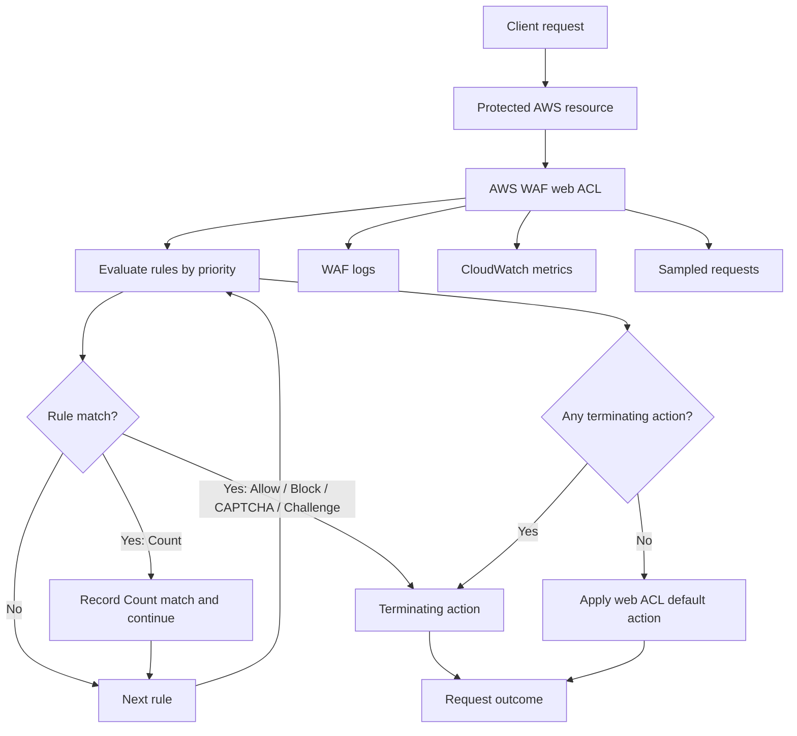
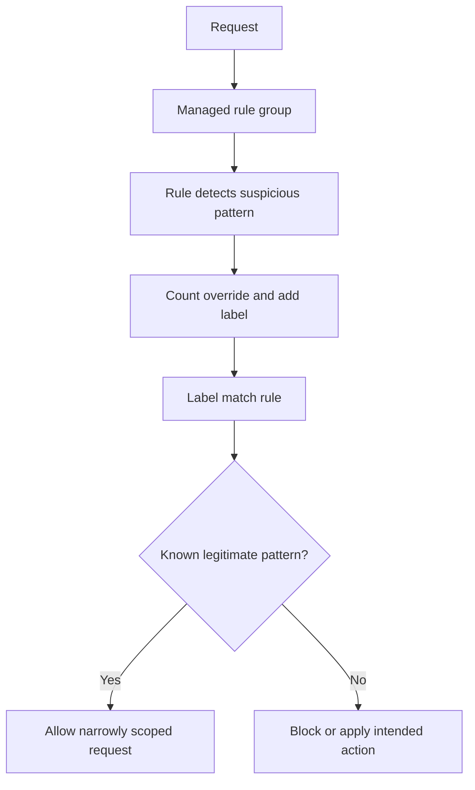

# Testing WAF with Count Mode and Log Analysis

## 1. Why Test AWS WAF Before Enabling Blocking?

AWS WAF protects web applications by evaluating requests against rules configured in a web ACL (protection pack). A rule can detect SQL injection, cross-site scripting (XSS), suspicious IP addresses, bots, threshold-exceeding traffic, or request patterns violating policy.

If you enable the Block action immediately when deploying a new rule, legitimate requests can be blocked due to false-positive matches. This commonly happens when an application uses specialized payloads, APIs accept free-form input, third-party integrations exist, or headers/query strings differ from expected formats.

AWS WAF provides the **Count** action to observe rule matches without letting that rule decide whether to block or allow the request. This lets the security team inspect behavior on live traffic, analyze logs, identify false positives, and tune conditions before enabling production actions.

Count mode is an essential testing phase in the WAF deployment lifecycle:

1. Build rules or select a managed rule group.
2. Test in staging with representative data.
3. Set new rules to Count to observe production traffic.
4. Analyze metrics, logs, and sampled requests.
5. Tune conditions, exceptions, or scope.
6. Switch verified rules to Block, CAPTCHA, or Challenge as intended.
7. Continue monitoring after rollout.

This lesson belongs to the **CLOUD_PROVIDERS_AWS** module, where learners develop the ability to select services, design, and deploy secure applications with observability, resilience, and cost control. The focus here is using real data to validate application protection policies before applying actions that can impact users.

## 2. Learning Objectives

After this lesson, learners can:

1. Explain why Count is a non-terminating action and distinguish it from Allow, Block, CAPTCHA, and Challenge.
2. Explain rule evaluation order and the impact of the web ACL default action.
3. Switch custom rules and managed rule groups to Count properly.
4. Distinguish RuleActionOverrides from a rule group's OverrideAction.
5. Set up a staging environment, logging, CloudWatch metrics, and request sampling.
6. Read key fields in AWS WAF logs to locate rule matches, terminating actions, and request context.
7. Use CloudWatch Logs Insights to analyze Count matches, Block events, URIs, client IPs, and rule groups.
8. Detect false positives, adjust inspection criteria, and create narrowly scoped exceptions.
9. Transition rules from Count to production actions with a rollout and rollback plan.
10. Protect sensitive data, manage costs, and build a WAF testing checklist.

## 3. Architecture and Request Evaluation Flow

AWS WAF can protect supported resources such as Amazon CloudFront, Application Load Balancer, API Gateway REST API, AppSync, Cognito user pools, App Runner, and Verified Access. Association scope depends on the resource type and web ACL configuration.

When a request arrives at a protected resource:

1. The resource forwards the request to AWS WAF for evaluation.
2. AWS WAF evaluates rules in ascending numerical priority order, starting from the lowest priority number.
3. A rule may not match, match with Count, or match with a terminating action.
4. When a terminating action occurs, evaluation stops.
5. If no rule terminates evaluation, the web ACL applies its default action.
6. AWS WAF can emit logs, publish metrics, and provide sampled requests for evaluated requests.

Overview diagram:



Count mode enables observing match outcomes during evaluation. Logs and metrics show which rules matched; the final request outcome still depends on subsequent rules and the default action.

## 4. Understanding the Count Action Precisely

### 4.1. Count Is a Non-Terminating Action

When a rule with the Count action matches a request:

- AWS WAF records that the request matched the rule.
- The rule does not itself decide to allow or block.
- AWS WAF continues evaluating subsequent rules in the web ACL.
- The rule may attach labels to the request.
- The request may ultimately be Allowed, Blocked, CAPTCHA'd, or Challenged by another rule or the default action.

Count differs from terminating actions:

| Action | Type | Behavior |
|---|---|---|
| Allow | Terminating | Lets the request proceed to the protected resource and stops rule evaluation |
| Block | Terminating | Blocks the request; typically returns HTTP 403 by default unless a custom response is configured |
| Count | Non-terminating | Records the match and continues evaluating remaining rules |
| CAPTCHA | Can be terminating or non-terminating | If token is valid, continues; if token is missing, invalid, or expired, terminates and requires solving a CAPTCHA |
| Challenge | Can be terminating or non-terminating | If token is valid, continues; if invalid, terminates and requires the client to complete a challenge |

### 4.2. Count Does Not Mean Allow

Suppose a web ACL has three rules:

| Priority | Rule | Action |
|---:|---|---|
| 10 | Detect SQL injection | Count |
| 20 | Block IPs in deny list | Block |
| 30 | Detect suspicious user agent | Count |
| Default | Default action | Allow |

A request containing a string detected by the SQL injection rule and also coming from an IP in the deny list:

1. Rule priority 10 matches and records Count.
2. AWS WAF proceeds to rule priority 20.
3. Rule priority 20 matches and Blocks.
4. Rule priority 30 is not evaluated because the request encountered a terminating action.
5. The request is blocked.

In logs, the request may show a Count match in the non-terminating list, yet the final `action` field is still `BLOCK` and `terminatingRuleId` points to the deny-list rule.

If a request matches only Count rules and encounters no other terminating action, the web ACL applies the default action. With default Allow, the request passes through. With default Block, the request is blocked.

### 4.3. Count Mode Can Produce More Matches Than Production

When multiple rules are set to Count, requests continue through subsequent rules. Thus, a single request can match multiple rules during one evaluation.

When rules are switched to Block or Allow, a terminating action can stop evaluation before the request reaches later rules. Therefore:

- Count matches during testing are often higher than rule matches observed after enabling production actions.
- Do not directly compare Count metrics against post-rollout blocked request counts.
- Read priority, `terminatingRuleId`, and `nonTerminatingMatchingRules` together.

### 4.4. Priority Affects Test Data

AWS WAF evaluates rules from lowest priority number to highest. An Allow or Block rule at a lower priority number can terminate evaluation before a downstream Count rule runs.

If you want to measure a new rule against traffic that other rules might terminate early, design an appropriate priority placement in your test environment. However, changing rule order can impact production policy; test the entire flow and preserve the approved protection order.

## 5. Levels of Switching to Count

There are three common cases.

### 5.1. Custom Rule in a Web ACL

For an organization-authored rule, set the action to Count in the rule configuration. The rule records matches and continues evaluation.

Simplified JSON example:

This structure illustrates a rule in a web ACL. If submitting the configuration via AWS CLI v2 with `SearchString` as plain text, add `--cli-binary-format raw-in-base64-out`; the CLI handles the blob per the input format. If calling the AWS WAF API directly, `SearchString` must be base64-encoded.

```json
{
  "Name": "DetectSuspiciousQuery",
  "Priority": 20,
  "Action": {
    "Count": {}
  },
  "Statement": {
    "ByteMatchStatement": {
      "SearchString": "union select",
      "FieldToMatch": {
        "QueryString": {}
      },
      "TextTransformations": [
        {
          "Priority": 0,
          "Type": "URL_DECODE"
        },
        {
          "Priority": 1,
          "Type": "LOWERCASE"
        }
      ],
      "PositionalConstraint": "CONTAINS"
    }
  },
  "VisibilityConfig": {
    "SampledRequestsEnabled": true,
    "CloudWatchMetricsEnabled": true,
    "MetricName": "DetectSuspiciousQuery"
  }
}
```

This is an illustrative rule structure example. Production rules must be tested against valid and malicious requests, evaluated for normalization behavior, and checked to see whether matching common SQL strings causes false positives.

### 5.2. Managed Rule Group: Overriding Individual Rules to Count

AWS Managed Rules and other managed rule groups contain many inner rules. You can override the action of one or more inner rules to Count in the web ACL's rule group reference configuration.

This is the right approach when you want to know exactly which inner rule in a managed rule group matches traffic without letting that rule block requests yet.

Simplified example:

```json
{
  "Name": "AWSManagedRulesCommonRuleSet",
  "Priority": 100,
  "Statement": {
    "ManagedRuleGroupStatement": {
      "VendorName": "AWS",
      "Name": "AWSManagedRulesCommonRuleSet",
      "RuleActionOverrides": [
        {
          "Name": "SizeRestrictions_BODY",
          "ActionToUse": {
            "Count": {}
          }
        },
        {
          "Name": "CrossSiteScripting_BODY",
          "ActionToUse": {
            "Count": {}
          }
        }
      ]
    }
  },
  "OverrideAction": {
    "None": {}
  },
  "VisibilityConfig": {
    "SampledRequestsEnabled": true,
    "CloudWatchMetricsEnabled": true,
    "MetricName": "CommonRuleSet"
  }
}
```

Inner rule names must be exact and case-sensitive. With managed rule groups, AWS WAF may ignore an override if the rule name does not exist or does not match exactly; the configuration can still save, so verify actual results in logs and metrics.

### 5.3. Overriding an Entire Rule Group to Count

The console provides an option to override all rule actions in a rule group to Count. This is useful when testing an entire group, but note that none of its inner rules will enforce their original actions.

When testing a managed rule group, it is usually better to override only the inner rules under evaluation while keeping trusted rules at their active actions. If testing an entire group, do so in staging first and assess the impact of running Count on production traffic.

### 5.4. Distinguishing RuleActionOverrides and OverrideAction.Count

This is the easiest setting to misconfigure.

| Configuration | Effect | Suitable for Testing Individual Inner Rules? |
|---|---|---|
| `RuleActionOverrides` with `ActionToUse.Count` | Changes the inner rule's action to Count | Yes |
| `OverrideAction.Count` at rule group level | Only changes the final action returned by the rule group upon a terminating match | No |
| `Action.Count` on a custom rule | Sets that rule to Count | Yes |

`OverrideAction.Count` does not switch inner rules inside the group to Count. The rule group still evaluates normally and may stop at the first blocking inner rule; only the group's final result is converted to Count when returned to the web ACL. Consequently, this setting will not reveal all inner rules that might match during testing.

AWS recommends using `RuleActionOverrides` when the goal is to test individual rule behavior inside a rule group.

### 5.5. Organization-Managed Rule Groups

If multiple web ACLs share a custom rule group, do not modify rule actions directly inside the rule group just to test one web ACL. That change can affect every referencing web ACL.

Instead, set `RuleActionOverrides` on the rule group reference in the specific web ACL under test. This scopes the change safely and preserves testing metrics/artifacts.

## 6. Phased Testing Strategy

AWS recommends testing WAF changes in a test/staging environment first, then testing in Count mode against production traffic before enabling production actions.

A practical workflow:

| Phase | Environment | Action | Expected Outcome |
|---|---|---|---|
| 1. Design | Dev | Build rules, identify match components and priorities | Rules have clear targets |
| 2. Functional testing | Staging | Send valid requests and simulated attack requests | Confirm rules match as expected without mis-matching |
| 3. Observation | Staging | Enable Count, logs, metrics, and sampling | Gather sufficient data for tuning |
| 4. Live validation | Production | Set new rules to Count, monitor representative traffic | Detect false positives and potential impact |
| 5. Activation | Production | Switch rules or rule groups to target actions | Protection increases in a controlled manner |
| 6. Monitoring | Production | Observe metrics, logs, application, and user feedback | Confirm rules behave as expected |

In a new web ACL under test, you can set the default action to Allow and new rules to Count to observe without disrupting traffic. When testing on an active production web ACL, keep verified protection rules intact and set only the new rules under test to Count.

Never switch an entire production web ACL to default Allow just to observe a single new rule.

## 7. Preparing the Test Dataset

A WAF test suite must include both legitimate traffic and attack-like traffic.

### 7.1. Valid Requests

Collect from the application:

- Login, registration, and password recovery pages.
- Search and filtering APIs.
- APIs accepting large JSON bodies or payloads with special characters.
- Upload/download flows if supported by the application.
- Webhook APIs and partner integrations.
- Requests with specific query strings, cookies, and headers.
- Mobile app, SPA, background job, and health check flows.

### 7.2. Simulated Attack Requests in Staging

Safe examples to test SQLi/XSS rules in an organization-controlled environment:

```bash
curl -i "https://staging.example.com/search?q=hello"

curl -i "https://staging.example.com/search?q=1%20OR%201%3D1"

curl -i \
  -H "Content-Type: application/json" \
  -d '{"comment":"<script>alert(1)</script>"}' \
  "https://staging.example.com/api/comments"
```

Use these payloads only against authorized staging endpoints. Never send test payloads to third-party systems or production endpoints without proper planning and authorization.

### 7.3. Expected Outcome Matrix

| Request Group | Expected Matching Rule | Outcome in Count Mode | Additional Check |
|---|---|---|---|
| Normal search | No SQLi match | No Count match | Application returns normal results |
| Search with simulated SQLi string | SQLi rule | Count | Log shows rule and match details |
| Comment containing valid markup | May trigger XSS rule | Count for analysis | Determine if business logic must allow markup |
| Request missing required header | Header inspection rule | Count or no match per condition | Inspect real client behavior |
| Threshold-exceeding requests | Rate-based rule | Count | Verify aggregation key and time window |

Do not expect every simulated payload to match a specific managed rule. The rule group, version, and inspection settings determine the outcome; check logs to confirm.

## 8. Enabling Metrics, Logging, and Request Sampling

AWS recommends preparing all three observability sources together:

- **CloudWatch metrics**: measure request counts by action, rule, rule group, and label.
- **AWS WAF logs**: store request details, rule matches, and evaluation outcomes.
- **Sampled requests**: provide a sample of requests for quick inspection of content and rule matches in the console.

These three sources complement each other. Metrics show trends, logs provide per-request details, and sampled requests support quick spot-checks.

### 8.1. CloudWatch Metrics

AWS WAF publishes metrics in the `AWS/WAFV2` namespace roughly once per minute.

Common metrics:

| Metric | Meaning |
|---|---|
| `AllowedRequests` | Number of Allowed requests |
| `BlockedRequests` | Number of Blocked requests |
| `CountedRequests` | Number of requests matched by at least one Count rule |
| `CaptchaRequests` | Number of requests with CAPTCHA action |
| `ChallengeRequests` | Number of requests with Challenge action |
| `PassedRequests` | Requests passing a rule group without matching any inner rule |

Use the `Sum` statistic when viewing request counts over a time interval. Filter by WebACL, Rule, RuleGroup, Region, and resource dimensions as appropriate.

Important caveats:

- Metrics are emitted only when the value is non-zero.
- Count rules inside a managed rule group may not emit metrics under the `WebACL` dimension; only `Rule`, `RuleGroup`, and `Region` dimensions are emitted per AWS documentation.
- Rule groups owned by another account typically have separate owner-managed metrics; overriding actions in the web ACL can surface the rule's metrics under the web ACL's metrics.
- Label metrics help observe labels added by rule groups or custom rules.

### 8.2. Request Sampling

AWS WAF can sample evaluated requests. The `GetSampledRequests` API returns up to 500 requests from up to the first 5,000 requests received by the resource within the selected time range, within the last three hours.

Sampling limitations:

- It is a random sample, not complete traffic.
- Sampled requests cannot replace full logging for trend analysis or investigation.
- Request sampling data is affected by web ACL data protection settings.
- Logging redaction does not automatically apply to sampled requests.

Use sampling to verify a few representative requests, then use logs for deeper analysis.

## 9. AWS WAF Logging Destinations

AWS WAF supports three logging destinations:

| Destination | Best For | Key Considerations |
|---|---|---|
| CloudWatch Logs | Fast analysis, Logs Insights, dashboards, and alarms | Log group must be in the same account/Region as the web ACL |
| Amazon S3 | Long-term retention, Athena, data lakes, and historical investigation | Bucket in the same account, name starts with `aws-waf-logs-`, compressed files |
| Amazon Data Firehose | Streaming to S3 or downstream analytics targets | Delivery stream in the same account/Region, Direct PUT |

A web ACL can configure only one logging destination at a time. To distribute to multiple systems, use Firehose or a downstream pipeline to fan out data.

### 9.1. Destination Naming Rules

Destination names must begin with the prefix:

- CloudWatch Logs log group: `aws-waf-logs-`
- S3 bucket: `aws-waf-logs-`
- Data Firehose delivery stream: `aws-waf-logs-`

For CloudWatch Logs, the log group must be in the same account and Region managing the web ACL. For CloudFront web ACLs, the global configuration is managed via the US East (N. Virginia) Region, so verify the corresponding destination Region.

### 9.2. CloudWatch Logs

When logging is enabled, AWS WAF writes logs to log streams inside the log group. You can open the web ACL's Logging insights tab or use CloudWatch Logs Insights.

The log group must be created beforehand with a name starting with `aws-waf-logs-`. Once logging is enabled successfully, AWS WAF creates the required service-linked role/log delivery permissions.

CloudWatch Logs has shared per-Region throughput quotas. If log volume is high, monitor `PutLogEvents` throttling and request quota increases as needed.

### 9.3. Amazon S3

AWS WAF delivers log files to S3 at five-minute intervals. Files are compressed; decompress them to read after downloading. One interval may produce multiple files, and log delivery is best effort.

Typical prefix structure:

```text
AWSLogs/<account-id>/WAFLogs/<region>/<web-acl-name>/YYYY/MM/dd/HH/mm/
```

S3 is well suited for long-term retention and Athena queries. Lifecycle rules can transition storage classes or expire objects per policy. With SSE-KMS, AWS WAF requires permission to use the customer managed key per logging destination documentation.

### 9.4. Amazon Data Firehose

Firehose is suited for streaming to S3, OpenSearch, or supported analytics destinations. AWS WAF requires the delivery stream to be in the same account and Region as the web ACL; for CloudFront, Firehose must be in us-east-1. The delivery stream must be configured with Direct PUT, not Kinesis Data Streams as the source.

Estimate throughput from real request rates. One WAF log equals one Firehose record; if Firehose lacks sufficient throughput, logs may be dropped.

## 10. Enabling Logging with the AWS CLI

First create the CloudWatch Logs log group:

```bash
aws logs create-log-group \
  --log-group-name aws-waf-logs-orders-staging \
  --region ap-southeast-1
```

Create `waf-logging.json`:

```json
{
  "ResourceArn": "arn:aws:wafv2:ap-southeast-1:111122223333:regional/webacl/orders-staging/11111111-2222-3333-4444-555555555555",
  "LogDestinationConfigs": [
    "arn:aws:logs:ap-southeast-1:111122223333:log-group:aws-waf-logs-orders-staging"
  ],
  "RedactedFields": [
    {
      "SingleHeader": {
        "Name": "authorization"
      }
    }
  ]
}
```

Enable logging:

```bash
aws wafv2 put-logging-configuration \
  --logging-configuration file://waf-logging.json \
  --region ap-southeast-1
```

Verify the configuration:

```bash
aws wafv2 get-logging-configuration \
  --resource-arn arn:aws:wafv2:ap-southeast-1:111122223333:regional/webacl/orders-staging/11111111-2222-3333-4444-555555555555 \
  --region ap-southeast-1
```

Account ID, Region, web ACL ARN, and log group values in the example are placeholders. For CloudFront web ACLs, scope and Region must follow AWS WAF's global configuration. The IAM principal configuring logging needs WAF logging permissions and the corresponding log delivery/resource policy permissions.

## 11. AWS WAF Log Structure and Key Fields

A log record is typically JSON. Key fields:

| Field | Meaning |
|---|---|
| `timestamp` | Time AWS WAF recorded the request, in milliseconds |
| `webaclId` | ARN/ID of the web ACL |
| `action` | Final terminating action applied to the request |
| `terminatingRuleId` | Rule that terminated evaluation; if no terminating rule matched, `Default_Action` |
| `terminatingRuleType` | Type of terminating rule: `REGULAR`, `GROUP`, `RATE_BASED`, or `MANAGED_RULE_GROUP` |
| `terminatingRuleMatchDetails` | Match details for the terminating rule; primarily populated for SQLi/XSS |
| `nonTerminatingMatchingRules` | Rules that matched without terminating evaluation, including Count |
| `ruleGroupList` | Evaluated rule groups and inner match results |
| `labels` | Labels added during evaluation |
| `httpRequest.clientIp` | Client IP |
| `httpRequest.country` | Source country of the request |
| `httpRequest.uri` | URI path |
| `httpRequest.args` | Query string |
| `httpRequest.httpMethod` | HTTP method |
| `httpRequest.headers` | Recorded headers |
| `httpRequest.requestId` | Request ID from the protected resource |
| `oversizeFields` | Request components exceeding the inspection limit when inspected by a rule |
| `rateBasedRuleList` | Evaluated rate-based rules and related info |

Not every field appears in every log record. For example, `clientAsn` appears only when an ASN match statement is present; `terminatingRuleMatchDetails` is populated only for SQL injection and XSS match rule statements.

### 11.1. Where Do Count Matches Appear?

Rules with the Count action are non-terminating. Matches are recorded in `nonTerminatingMatchingRules`, for example:

```json
{
  "timestamp": 1795152000000,
  "formatVersion": 1,
  "webaclId": "arn:aws:wafv2:ap-southeast-1:111122223333:regional/webacl/orders-staging/example",
  "terminatingRuleId": "Default_Action",
  "terminatingRuleType": "REGULAR",
  "action": "ALLOW",
  "nonTerminatingMatchingRules": [
    {
      "ruleId": "DetectSQLiCount",
      "action": "COUNT",
      "ruleMatchDetails": [
        {
          "conditionType": "SQL_INJECTION",
          "location": "QUERY_STRING",
          "matchedData": ["union", "select"]
        }
      ]
    }
  ],
  "httpRequest": {
    "clientIp": "203.0.113.25",
    "country": "-",
    "uri": "/search",
    "args": "q=example",
    "httpMethod": "GET",
    "requestId": "request-example"
  },
  "labels": []
}
```

This example illustrates a Count rule match with no other terminating rule. Because the default action is Allow, the final `action` is `ALLOW` and `terminatingRuleId` is `Default_Action`.

### 11.2. Count Match That Still Ends in Block

A request may match a Count rule first and then be Blocked by a later rule. In that case:

- `nonTerminatingMatchingRules` contains the Count rule.
- `action` is `BLOCK`.
- `terminatingRuleId` identifies the blocking rule.
- The request is not forwarded to the application.

Do not rely solely on the `action` field to determine which rule is under test. Inspect both `nonTerminatingMatchingRules` and `terminatingRuleId`.

### 11.3. Managed Rule Groups in Logs

For rule groups, logs may contain `ruleGroupList`. Inside each group are `terminatingRule` and `nonTerminatingMatchingRules`.

If an inner rule is overridden to Count, look for `ruleId` and action `COUNT` inside the non-terminating list. With newer overrides, the `overriddenAction` field may record the rule group rule's original configured action. Legacy `ExcludedRules` configurations may appear via `excludedRules`; for new management, AWS recommends `RuleActionOverrides`.

## 12. Analyzing Logs with CloudWatch Logs Insights

CloudWatch Logs Insights automatically discovers many JSON log fields and supports dot notation for querying nested fields.

Before querying:

1. Select the correct log group prefixed with `aws-waf-logs-`.
2. Choose the shortest time range sufficient to answer the question.
3. Confirm the right web ACL, Region, and resource.
4. Run queries with a small `limit` first.
5. Save frequently used queries as query definitions for reuse.

### 12.1. Viewing Recent Requests with Count Matches

```text
fields @timestamp,
       action,
       terminatingRuleId,
       httpRequest.clientIp,
       httpRequest.httpMethod,
       httpRequest.uri,
       nonTerminatingMatchingRules
| filter ispresent(nonTerminatingMatchingRules)
| sort @timestamp desc
| limit 100
```

This query returns requests with at least one non-terminating match. That list can include Count as well as CAPTCHA/Challenge matches that did not terminate when a valid token was present. Inspect `action` inside each element to identify Count matches.

### 12.2. Counting Matches by Count Rule

Use `jsonParse` and `unnest` to expand each element of `nonTerminatingMatchingRules` into its own record:

```text
fields jsonParse(@message) as waf
| unnest waf.nonTerminatingMatchingRules into match
| filter match.action = "COUNT"
| stats count() as matches by match.ruleId
| sort matches desc
| limit 50
```

This query ranks the rules with the most matches over the selected time range. If a rule has high volume, inspect endpoints and request context next to determine whether it reflects valid traffic or an attack.

### 12.3. Viewing URIs Commonly Matched by Count Rules

```text
fields jsonParse(@message) as waf
| unnest waf.nonTerminatingMatchingRules into match
| filter match.action = "COUNT"
| stats count() as matches by match.ruleId, waf.httpRequest.uri
| sort matches desc
| limit 50
```

Use the results to pinpoint specific endpoints experiencing false positives. For example, an SQLi rule matching heavily on a search endpoint where payloads are actually valid search terms.

### 12.4. Analyzing Blocked Requests by Terminating Rule

```text
fields @timestamp,
       action,
       terminatingRuleId,
       terminatingRuleType,
       httpRequest.clientIp,
       httpRequest.country,
       httpRequest.httpMethod,
       httpRequest.uri
| filter action = "BLOCK"
| stats count() as blocked by terminatingRuleId
| sort blocked desc
```

This query identifies which rules are blocking the most requests. Then run a detailed query:

```text
fields @timestamp,
       terminatingRuleId,
       httpRequest.clientIp,
       httpRequest.httpMethod,
       httpRequest.uri,
       httpRequest.args,
       terminatingRuleMatchDetails
| filter action = "BLOCK"
| sort @timestamp desc
| limit 100
```

### 12.5. Tracking Count Matches Over Time

```text
fields jsonParse(@message) as waf
| unnest waf.nonTerminatingMatchingRules into match
| filter match.action = "COUNT"
| stats count() as matches by match.ruleId, bin(5m) as interval
| sort interval asc
```

Use charts to spot spikes in matches per rule. Correlate timestamps with deployments, marketing campaigns, legitimate crawlers, or attack waves.

### 12.6. Finding Requests with Fields Exceeding Inspection Limits

```text
fields @timestamp,
       httpRequest.clientIp,
       httpRequest.uri,
       oversizeFields,
       terminatingRuleId,
       action
| filter ispresent(oversizeFields)
| sort @timestamp desc
| limit 100
```

If a body/header/cookie exceeds the inspection limit, check how the rule is configured to handle oversize components. Never conclude a request was fully inspected just because the rule did not match.

## 13. Analyzing S3-Stored Logs with Amazon Athena

If logs are stored in S3, Athena can query them directly via SQL after creating a table matching the AWS WAF log schema.

General steps:

1. Store logs in a bucket prefixed with `aws-waf-logs-`.
2. Create a database and table matching the current log schema.
3. Partition by account, Region, web ACL, and date using partition projection or an appropriate crawler.
4. Run queries scoped by partition and time range.
5. Store query results and restrict data access permissions.

Example SQL once a table named `waf_logs` exists:

```sql
SELECT
    terminatingruleid,
    action,
    COUNT(*) AS request_count
FROM waf_logs
WHERE year = '2026'
  AND month = '11'
  AND day = '20'
  AND action = 'BLOCK'
GROUP BY terminatingruleid, action
ORDER BY request_count DESC;
```

Column names, data types, and partition keys must match the actual DDL. Do not copy queries blindly without verifying the table schema; some JSON structures may be declared as arrays or structs.

Athena is well suited for long-term historical analysis, multi-day comparisons, and reporting. Logs Insights is more convenient for interactive investigation on CloudWatch Logs.

## 14. Detecting and Handling False Positives

A false positive occurs when a rule flags a legitimate request as suspicious. During the Count phase, determine the root cause before switching to Block.

### 14.1. Per-Request Analysis

For each notable match, record:

- Rule ID and rule group.
- Match component: URI, query string, body, cookie, or header.
- Text transformations and transformation order.
- Matched data, if provided.
- Endpoint, method, and business operation type.
- Client IP, country, and user agent.
- Request ID for correlating with application/access logs.
- Final web ACL outcome.
- Whether `oversizeFields` is present.

Matched data is not always present. AWS WAF provides match details only for certain rule types, particularly SQLi and XSS. When match details are absent, use sampled requests and application logs to investigate.

### 14.2. Tuning Inspection Criteria

For custom rules, consider:

- Inspecting the exact request component.
- Adjusting text transformations to normalize encoding and casing.
- Using narrowly scoped regex pattern sets.
- Changing positional constraints.
- Restricting method or URI when only one endpoint needs inspection.
- Adjusting oversize handling to fit application data.
- Checking forwarded IP configuration when using IP match or rate-based rules.

Do not loosen an entire rule just because one endpoint has a false positive. Pinpoint the part of the request causing the match and narrow the scope as tightly as possible.

### 14.3. Mitigating Rules and Exceptions

Common approaches:

- Add a lower-priority Allow rule (evaluated earlier) to allow a specific group of legitimate requests.
- Combine logical statements to exclude the false-positive pattern from detection conditions.
- Use a scope-down statement in a managed rule group or rate-based rule to restrict evaluated requests.
- Use a label match rule after a managed rule group to classify and handle a specific match group separately.
- Keep an inner rule of a managed group permanently in Count mode if justified and approved.
- For versioned managed rule groups, consider rolling back to a verified version while testing the new version in staging.

Every exception needs an owner, rationale, scope, expiration date, or review schedule. Avoid creating broad Allow rules by IP or URI just to silence a false positive.

### 14.4. Scope-Down Statements

A scope-down statement narrows the set of requests evaluated by a managed rule group or rate-based rule. Requests that do not match the scope-down statement are excluded from inner evaluation.

Example: evaluate a managed rule group only on login and public API endpoints instead of all static assets.

A scope-down statement is not a request preprocessor for the rule group. Text transformations inside a scope-down apply only when evaluating the scope-down itself; inner rules still use their own inspection settings.

## 15. Labels and Custom Rules After a Managed Rule Group

Managed rule groups can attach labels describing the type of match. Labels can be consumed by subsequent rules in the same web ACL provided the rule group did not terminate evaluation.

A common pattern:

1. Override an inner rule of a managed group to Count.
2. Observe the labels emitted by that inner rule.
3. Add a label match rule after the rule group.
4. Classify requests according to business logic.
5. Allow a very specific false-positive pattern or Block the rest.
6. Keep the Count override on the inner rule if continuing to manage enforcement via the label rule.

Diagram:



Labels are classification signals during request evaluation; a label does not act as an Allow/Block decision on its own. Rule actions and priority order still govern request handling.

## 16. Transitioning from Count to Production Actions

Promote rules to production only after collecting representative data and obtaining owner approval.

### 16.1. Readiness Criteria

- Observed across a representative traffic cycle, including peak hours and batch jobs.
- Tested with both legitimate request samples and simulated attack samples.
- False positives have been analyzed and addressed.
- Exceptions have narrow scope, owners, and expiration dates.
- Application owners confirm no impact to business workflows.
- Metrics/logs can detect unexpected spikes in Blocks.
- Rollback plan and on-call owner are ready.

Do not use a single Count-match threshold number as the sole go-live criterion. Match rates must be evaluated by endpoint, rule, client type, and business impact.

### 16.2. Enabling Production Actions

When transitioning:

- Custom rules: change `Action.Count` to `Block` or the target action.
- Managed rule groups: remove `RuleActionOverrides` for rules that should use their native action; retain Count overrides for intentionally exempted inner rules.
- New web ACLs: switch default action from test Allow to the production default action.
- Remove unneeded test rules.
- Retain label match rules if they are part of the production design.

Enable changes in controlled batches. If possible, start with a single application or small endpoint scope, then expand once metrics and application health stabilize.

### 16.3. After Enabling Block

Monitor:

- `BlockedRequests` by WebACL and Rule.
- Application and load balancer 4xx/5xx rates.
- Login/search/checkout failure rates.
- Request IDs and URIs of blocked cases.
- Feedback from users and integrated systems.
- Remaining Count metrics from other rules.
- Spikes by country, ASN, client IP, or user agent.

WAF metrics reflect decisions at the WAF layer. Combine them with application metrics and access logs to understand end-to-end impact.

## 17. Rollback and Post-Rollout Incident Handling

If a rule causes unintended blocking:

1. Identify the rule and impact scope using WAF logs.
2. Correlate request IDs with resource/application logs.
3. If a new rule caused it, revert that rule to Count or restore the appropriate action override.
4. If needed, add a tightly scoped, controlled exception.
5. Wait for the WAF configuration to propagate to enforcement points.
6. Verify legitimate requests pass through.
7. Document the incident, root cause, timeline, and changes requiring review.

AWS WAF propagation takes anywhere from a few seconds to a few minutes after creating or editing a web ACL/rule. During that window, some locations may temporarily run the old configuration while others run the new one. Do not evaluate outcomes immediately after clicking Save; wait for propagation and re-verify.

Rollback does not mean disabling WAF entirely. Revert the action of the problematic rule while keeping verified protection rules active.

## 18. Protecting Sensitive Data in Logs

WAF logs can contain:

- IP addresses and source countries.
- URI paths and query strings.
- HTTP headers and user agents.
- Request IDs.
- Matched data from certain SQLi/XSS rules.
- Labels and rule group details.

Some of this data may contain tokens, emails, account info, or personal data. Design data protection before enabling broad logging.

### 18.1. Logging Redaction

AWS WAF logging redaction supports these components:

- URI path.
- Query string.
- Single header.
- HTTP method.

Redaction applies only to the component configured in the matching `FieldToMatch`. For example, redacting a `SingleHeader` does not automatically mask data if a rule inspects the `Headers` component.

Logging redaction affects only data sent to the logging destination; it does not automatically apply to sampled requests or Security Lake collection.

### 18.2. Web ACL Data Protection

Data protection at the web ACL level can apply to logging, request sampling, and Security Lake per configuration. Sensitive data can be replaced with a static string or a hashed value.

When designing:

- Mask `Authorization`, `Cookie`, or sensitive headers.
- Avoid storing query strings if they contain identifying data.
- Inspect `matchedData` in SQLi/XSS logs.
- Separate log read permissions from web ACL administration permissions.
- Set retention appropriate for investigative needs.
- Encrypt log destinations and restrict decryption permissions.
- Avoid writing logs to public or overly shared buckets/log groups.

## 19. Log Filtering and Preserving Investigation Capability

AWS WAF lets you filter logs to keep or drop requests by rule action or fully qualified label.

Examples:

- Keep only requests with action `BLOCK`.
- Keep both `COUNT` and `BLOCK` during testing.
- Drop logs for noisy labels if another observation method is in place.
- Focus logs on high-value security labels.

When multiple filters exist, AWS WAF evaluates them top-down. The first matching filter decides whether to keep or drop per configuration; design the default logging behavior accordingly.

Do not filter out all Count logs during testing. Doing so discards evidence of false positives and makes test metrics unreliable.

AWS WAF log delivery is best effort, not 100% guaranteed. Under certain throttling conditions, records may be dropped. AWS prioritizes protecting the application over guaranteeing every log is delivered. Therefore:

- Use CloudWatch metrics as a complementary aggregate signal.
- Do not treat WAF logs as the sole audit record for every request.
- If widespread missing logs occur, check throttling/quotas and contact AWS Support as needed.
- Combine CloudFront/ALB/API Gateway access logs and application logs.

## 20. Costs During Testing and Log Analysis

Cost components to evaluate:

| Component | Cost Drivers |
|---|---|
| AWS WAF | Web ACLs, rules, request volume, managed rule groups, and enabled features |
| CloudWatch Logs | Log ingestion, storage, query scanned data, and retention |
| Amazon S3 | Storage, requests, lifecycle transitions, and downstream queries |
| Data Firehose | Record throughput, processing, and destination |
| Athena | Data scanned per query |
| KMS | Encryption/decryption requests and key policies when using SSE-KMS |
| Application observability | Metrics/logs/traces used to correlate impact |

Optimizations:

1. Enable logging only on web ACLs requiring analysis.
2. Use deliberate log filtering, while retaining sufficient data during Count phases.
3. Set CloudWatch Logs retention to match investigative windows.
4. Use S3 lifecycle policies for long-term historical data.
5. Limit time ranges and log groups when running Logs Insights.
6. Use Athena partitioning to reduce scanned data.
7. Avoid overly frequent dashboard refreshes because each refresh can trigger queries.
8. Estimate volume and throughput before enabling full logging on high-traffic workloads.

Logging is billed separately from AWS WAF charges. Estimate request volume and retention before enabling full logging on high-traffic workloads.

## 21. Troubleshooting Common Issues

### 21.1. Count Rule Has No Metrics

Check:

- Is `CloudWatchMetricsEnabled` enabled?
- Is `MetricName` valid and unique within the required scope?
- Did the rule actually match any requests?
- Are you checking the right `AWS/WAFV2` namespace, Region, WebACL, and Rule dimensions?
- Does a managed rule group rule have a Count override where metrics are restricted by dimension?
- Did a lower-priority Allow/Block rule terminate evaluation before the Count rule?

AWS WAF emits metrics roughly every minute and does not emit metrics when the value is 0. Wait long enough for datapoints to appear.

### 21.2. Count Matches Not Appearing in Logs

Check:

- Is logging enabled on the right web ACL?
- Is the destination in the same account/Region and prefixed with `aws-waf-logs-`?
- Is a log filter dropping the `Count` action?
- Does the rule sit after another terminating rule?
- Is traffic actually passing through the resource associated with the web ACL?
- Do IAM and the service-linked role have log delivery permissions?
- Is there throttling or a delivery issue?

### 21.3. Log Action Is ALLOW Even Though a Count Rule Matched

This can be normal. The `action` field is the final terminating action. Check `nonTerminatingMatchingRules` to see the Count rule; if no other terminating rule matched, `Default_Action` may be Allow.

### 21.4. Log Action Is BLOCK While a Count Rule Also Matched

The request matched one or more Count rules and was then Blocked by a subsequent terminating rule. Inspect `terminatingRuleId` to identify the rule that determined the final outcome.

### 21.5. Managed Rule Override Has No Effect

Check:

- Is the rule name in `RuleActionOverrides` exact and case-sensitive?
- Are you editing the right web ACL and managed rule group?
- Did you accidentally use `OverrideAction.Count` instead of `RuleActionOverrides`?
- Does the inner rule actually exist in the provider's active version of the rule group?
- Has the change propagated to the resource?

Managed rule groups may ignore overrides with invalid rule names. Inspect logs and metrics after updating to confirm.

### 21.6. Requests Missing from Sampled Requests

Check:

- Is sampling enabled in the visibility configuration?
- Are you checking the right web ACL, resource, and rule metric name?
- Is the time range within the last three hours?
- Did the request fall within the API's sample limits?
- Did web ACL data protection strip the data you expected to inspect?

Sampling is random and bounded, so it cannot be used to prove a request did not occur.

### 21.7. CloudWatch Logs Not Receiving All Logs

Check:

- CloudWatch Logs `PutLogEvents` throttling metrics.
- Service-linked role and resource policies.
- Log group retention and quotas.
- Whether actual traffic exceeds current throughput.
- Whether log filtering is dropping records.

For high traffic, consider requesting a quota increase or using Firehose/S3 for an appropriate storage architecture.

## 22. Hands-On Lab: Testing an SQLi Rule with Count and Logs Insights

### 22.1. Objective

Set up a rule inspecting SQLi strings in the query string of a staging search endpoint. Learners must:

- Enable logging and metrics.
- Switch the rule to Count.
- Send valid and simulated requests.
- Locate Count matches in logs.
- Distinguish Count matches from the final action.
- Tune the rule if valid requests are matched erroneously.

### 22.2. Prerequisites

- Test AWS account.
- Staging web ACL attached to a supported CloudFront distribution, ALB, or API Gateway REST API.
- Staging endpoint authorized for testing.
- CloudWatch Logs log group prefixed with `aws-waf-logs-`.
- IAM role with permissions to edit web ACLs, configure logging, and query logs.
- Application logs containing request IDs for correlation.
- Do not use production endpoints for test payloads.

### 22.3. Steps

1. Confirm the web ACL and resource association.
2. Enable CloudWatch metrics, request sampling, and logging.
3. Create a custom SQLi detection rule with action `Count`.
4. Place its priority after baseline rules the organization needs to preserve.
5. Send valid requests to the search endpoint.
6. Send simulated SQLi requests in staging.
7. Wait for metrics and logs to appear.
8. Open WAF Logging insights or CloudWatch Logs Insights.
9. Run a query searching `nonTerminatingMatchingRules` with action `COUNT`.
10. Inspect `ruleId`, match details, URI, query string, and client IP.
11. Correlate request IDs with application logs.
12. Test additional valid search strings to uncover false positives.
13. Tune `FieldToMatch`, text transformations, or scope.
14. Repeat until the rule matches only intended patterns.
15. Document criteria for switching to Block and the rollback plan.

### 22.4. Completion Criteria

- The rule matches simulated attack requests as expected.
- Valid requests are not matched unintentionally or have clear exceptions.
- Logs show `Count` inside `nonTerminatingMatchingRules`.
- Learners can explain why the final action can be `ALLOW` or `BLOCK`.
- `CountedRequests` metrics show datapoints when the rule matches.
- A reusable Logs Insights query is saved.
- False positives, changes, and approvers are documented.

## 23. Common Misconceptions

| Misconception | Correct Understanding |
|---|---|
| Count means Allow | Count only records and continues evaluation; later rules or the default action decide the outcome |
| The `action` field in logs lists every matching rule | `action` is the final terminating action; Count matches live in `nonTerminatingMatchingRules` |
| `OverrideAction.Count` is the best way to test a managed rule group | Use `RuleActionOverrides` to set individual inner rules to Count |
| Count mode produces the same match counts as production | Count often produces more matches because requests continue to later rules |
| No Blocks in Count mode means the rule isn't detecting attacks | The rule may be matching in Count mode; inspect `nonTerminatingMatchingRules` and metrics |
| Request sampling alone is enough | Sampling is a bounded sample; logs are required for broad traffic analysis |
| Logging redaction also masks sampled requests | Redaction only affects logging; use web ACL data protection or disable sampling to control samples |
| Missing logs mean requests bypassed WAF | May be due to log filters, wrong destination, propagation, throttling, or best-effort delivery |
| A Count rule inside a managed group always has a `WebACL` metric | Some rule group Count metrics only emit `Rule`, `RuleGroup`, and `Region` dimensions |
| You can edit a shared rule group directly to test one web ACL | Override on the web ACL to isolate impact and preserve test metrics |
| Fixing false positives just means allowlisting an IP | Identify the request component, endpoint, and matching condition; exceptions must be narrow |
| Count metrics dropping after enabling Block means the rule stopped working | Terminating actions stop requests early so downstream rules may no longer be evaluated |

## 24. Self-Check Questions

### Question 1

Is Count a terminating or non-terminating action?

**Answer:** Non-terminating. AWS WAF records the match and continues evaluating subsequent rules.

### Question 2

A request matches a Count rule and then matches a Block rule. What is the final outcome?

**Answer:** The request is Blocked by the terminating rule. Logs may still record the Count match in `nonTerminatingMatchingRules`.

### Question 3

In WAF logs, what does the `action` field mean?

**Answer:** It is the final terminating action applied to the request. To find Count matches, inspect `nonTerminatingMatchingRules`.

### Question 4

Which setting is used to override an inner rule of an AWS Managed Rule Group to Count?

**Answer:** `RuleActionOverrides` with `ActionToUse.Count`.

### Question 5

Does `OverrideAction.Count` at the rule group level convert all inner rules to Count?

**Answer:** No. It only overrides the final action returned by the rule group upon a terminating match; it does not change how inner rules evaluate.

### Question 6

Why can Count mode produce more matches than production?

**Answer:** Because Count does not terminate evaluation. Requests continue through subsequent rules, whereas Block/Allow can halt evaluation.

### Question 7

A request has a Count match yet its final action is `ALLOW`. Is this valid?

**Answer:** Yes. If no other terminating rule matched, the web ACL applies the default action Allow.

### Question 8

A managed rule overridden to Count produces no metrics under the `WebACL` dimension. What could cause this?

**Answer:** Count rules inside managed rule groups have dimension limits; metrics may only appear under `Rule`, `RuleGroup`, and `Region`.

### Question 9

What prefix is required on a CloudWatch Logs log group used as an AWS WAF logging destination?

**Answer:** `aws-waf-logs-`.

### Question 10

Does logging redaction automatically apply to sampled requests?

**Answer:** No. Use web ACL data protection or disable sampling to control sampled request data.

### Question 11

An SQLi rule matches valid search requests. What should you do before switching to Block?

**Answer:** Inspect the match component, text transformations, endpoint, and request context; tune conditions or create a narrow exception; retest with valid traffic and simulated attacks.

### Question 12

Does AWS WAF log delivery guarantee every request is logged?

**Answer:** No. Log delivery is best effort. Combine with metrics and access/application logs, and check for throttling when gaps appear.

## 25. Production Testing and Deployment Checklist

### Before Testing

- [ ] Identify resource, web ACL, scope, and Region.
- [ ] Document current rules, priorities, and default action.
- [ ] Identify critical valid requests and high-risk endpoints.
- [ ] Prepare representative staging traffic.
- [ ] Prepare valid request suites and simulated payloads in authorized environments.
- [ ] Define owners, testing schedule, and stop criteria.

### Observability Setup

- [ ] Enable CloudWatch metrics with clear metric names.
- [ ] Enable request sampling if needed for quick inspection.
- [ ] Create a logging destination prefixed with `aws-waf-logs-`.
- [ ] Choose CloudWatch Logs, S3, or Firehose appropriately.
- [ ] Configure IAM permissions and the service-linked role.
- [ ] Enable data protection/redaction for sensitive data.
- [ ] Configure log filtering to retain Count matches during testing.
- [ ] Verify log delivery and quotas.

### Count Testing

- [ ] New custom rules use `Action.Count`.
- [ ] Managed rule groups use `RuleActionOverrides` for inner rules under test.
- [ ] Do not confuse `RuleActionOverrides` with `OverrideAction.Count`.
- [ ] Preserve verified production rules.
- [ ] Verify priorities and terminating actions.
- [ ] Observe staging before running Count on production traffic.
- [ ] Analyze `nonTerminatingMatchingRules`, labels, and metrics.
- [ ] Check false positives by endpoint and business flow.
- [ ] Document exceptions and owners.

### Production Cutover

- [ ] Obtain security and application owner approvals.
- [ ] Transition rules or rule groups in controlled stages.
- [ ] Remove unneeded test rules.
- [ ] Remove Count overrides to restore native actions where appropriate.
- [ ] Retain Count overrides for approved exceptions.
- [ ] Monitor `BlockedRequests` and application error rates.
- [ ] Have rollback to Count and an on-call responder ready.
- [ ] Continue periodic reviews of false positives and traffic shifts.

## 26. Official References

The AWS documents below are primary sources for implementation and detailed verification. UI labels, limits, log fields, and features may evolve; cross-check the documentation at deployment time.

### Testing and Rule Actions

- [Testing and tuning your AWS WAF protections](https://docs.aws.amazon.com/waf/latest/developerguide/web-acl-testing.html)
- [Testing and tuning high-level steps](https://docs.aws.amazon.com/waf/latest/developerguide/web-acl-testing-high-level.html)
- [Preparing for testing your AWS WAF protections](https://docs.aws.amazon.com/waf/latest/developerguide/web-acl-testing-prep.html)
- [Monitoring and tuning your AWS WAF protections](https://docs.aws.amazon.com/waf/latest/developerguide/web-acl-testing-activities.html)
- [Enabling your protections in production](https://docs.aws.amazon.com/waf/latest/developerguide/web-acl-testing-enable-production.html)
- [Using rule actions in AWS WAF](https://docs.aws.amazon.com/waf/latest/developerguide/waf-rule-action.html)
- [Overriding rule group actions in AWS WAF](https://docs.aws.amazon.com/waf/latest/developerguide/web-acl-rule-group-override-options.html)
- [Using managed rule groups](https://docs.aws.amazon.com/waf/latest/developerguide/waf-using-managed-rule-groups.html)
- [Using scope-down statements](https://docs.aws.amazon.com/waf/latest/developerguide/waf-rule-scope-down-statements.html)
- [Setting rule priority](https://docs.aws.amazon.com/waf/latest/developerguide/web-acl-processing-order.html)

### Logging and Analysis

- [Logging AWS WAF protection pack traffic](https://docs.aws.amazon.com/waf/latest/developerguide/logging.html)
- [AWS WAF logging destinations](https://docs.aws.amazon.com/waf/latest/developerguide/logging-destinations.html)
- [Configuring logging for a web ACL](https://docs.aws.amazon.com/waf/latest/developerguide/logging-management-configure.html)
- [Log fields for AWS WAF traffic](https://docs.aws.amazon.com/waf/latest/developerguide/logging-fields.html)
- [Log examples for AWS WAF traffic](https://docs.aws.amazon.com/waf/latest/developerguide/logging-examples.html)
- [Finding AWS WAF log records](https://docs.aws.amazon.com/waf/latest/developerguide/logging-management.html)
- [CloudWatch Logs Insights query syntax](https://docs.aws.amazon.com/AmazonCloudWatch/latest/logs/CWL_QuerySyntax.html)
- [CloudWatch Logs Insights unnest command](https://docs.aws.amazon.com/AmazonCloudWatch/latest/logs/CWL_QuerySyntax-Unnest.html)
- [Querying AWS WAF logs in Athena](https://docs.aws.amazon.com/athena/latest/ug/querying-waf-logs.html)

### Metrics and Data Protection

- [AWS WAF metrics and dimensions](https://docs.aws.amazon.com/waf/latest/developerguide/waf-metrics.html)
- [Viewing sampled web requests](https://docs.aws.amazon.com/waf/latest/developerguide/web-acl-testing-view-sample.html)
- [Data protection and logging for AWS WAF traffic](https://docs.aws.amazon.com/waf/latest/developerguide/waf-data-protection-and-logging.html)
- [AWS WAF pricing](https://aws.amazon.com/waf/pricing/)
