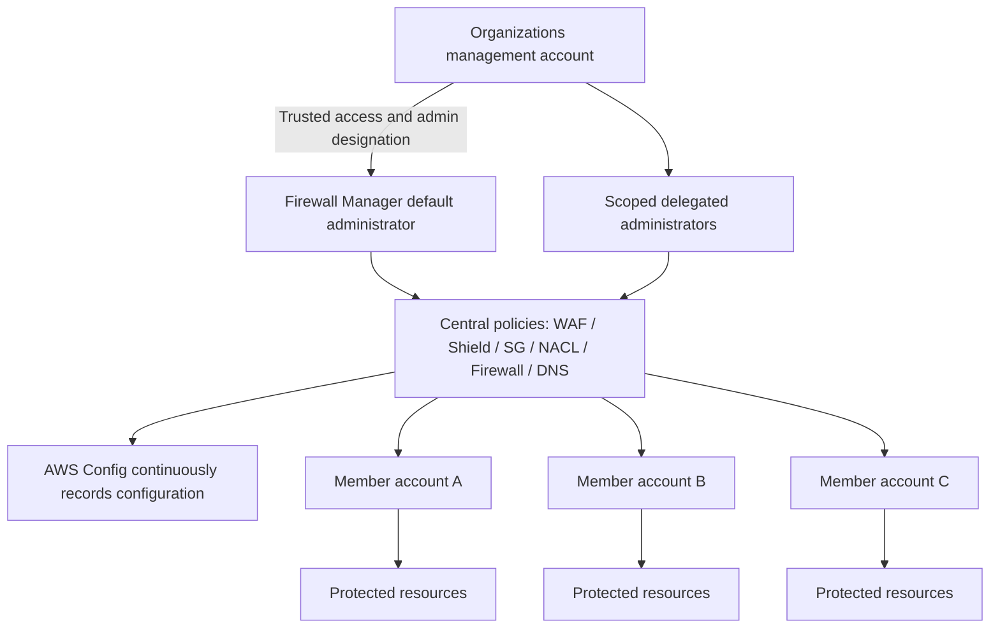

# Firewall Manager and Centralized Protection Policy Management

In a multi-account AWS organization, security teams need consistent protection standards across applications, VPCs, load balancers, and network resources. When each team configures AWS WAF, security groups, network ACLs, or firewalls independently within its own account, policies drift and unprotected resources become difficult to spot.

**AWS Firewall Manager (FMS)** centrally governs protection policies across multiple accounts and Regions within a single AWS Organization. Administrators define a policy in an administrator account, select an application scope, and Firewall Manager evaluates and maintains protections for resources within that scope. When new accounts or resources enter scope, the service can automatically apply the corresponding policy.

Firewall Manager is the orchestration and policy management layer. It deploys, associates, or audits protection services such as AWS WAF, AWS Shield Advanced, AWS Network Firewall, Route 53 Resolver DNS Firewall, and security groups. Actual data traffic is still processed by each underlying protection service.

## Learning Objectives

After this lesson, you can:

- Explain the role of Firewall Manager in a multi-account AWS security model.
- Design the default administrator account, delegated administrators, and administrative scope.
- Identify prerequisites for AWS Organizations, AWS Config, IAM, and AWS RAM.
- Distinguish Firewall Manager policy types and select policies suited to each risk.
- Design policy scope by OU, account, Region, resource type, and tag.
- Roll out in stages from audit-only evaluation to automatic remediation.
- Interpret compliance status, resolve violations, avoid policy conflicts, and control costs.

## 1. The Multi-Account Centralized Protection Problem

Suppose an enterprise has OUs named `Production`, `Development`, `SharedServices`, and `Sandbox`. Each OU contains many AWS accounts. Application teams provision their own VPCs, EC2 instances, Application Load Balancers, and API Gateways. Some accounts have WAF enabled while others do not; some security groups expose SSH from the Internet; DNS Firewall and Network Firewall are deployed inconsistently.

Managing each account manually creates several problems:

- Protection standards diverge across teams and environments.
- New accounts or new resources can be missed.
- Security teams struggle to see which accounts are noncompliant and which resources violate policy.
- Updating policies account by account is time-consuming and error-prone.
- IaC tools, operations teams, and security teams can modify the same resource without visibility into one another's configurations.

Firewall Manager provides a single central policy management point. Security teams can apply a uniform baseline across the organization or scope policies by OU, account, Region, and tags. The service continuously evaluates new accounts and resources against the defined scope.

### Firewall Manager Does Not Replace Protection Services

Firewall Manager is not an inline proxy or firewall data plane through which every packet passes. It orchestrates the creation and management of protection configurations:

- AWS WAF inspects HTTP(S) requests to supported web resources.
- AWS Shield Advanced provides enhanced DDoS protection for supported resources.
- Amazon VPC security groups control traffic at network interfaces.
- Network ACLs control inbound/outbound traffic at subnets.
- AWS Network Firewall inspects and filters network traffic per firewall policy.
- Route 53 Resolver DNS Firewall filters DNS queries from VPCs.
- Third-party firewalls integrated with Firewall Manager provide capabilities per their respective products.

Firewall Manager maintains central policies and ensures these services are applied consistently. Networking design, routing, rules, and traffic handling still need to be understood for each underlying service.

## 2. Governance Architecture with AWS Organizations

Firewall Manager manages accounts belonging to an AWS Organization. The organization must have **All features** enabled in AWS Organizations; consolidated billing only does not meet Firewall Manager integration requirements.

The model typically includes these components:

| Component | Responsibility |
|---|---|
| Organizations management account | Enables trusted access integration and designates the Firewall Manager administrator |
| Firewall Manager default administrator | Manages protection policies across granted scope; the first administrator holds full scope |
| Additional delegated administrators | Manage a restricted subset of OUs/accounts, Regions, or policy types |
| Member accounts | Host VPCs, load balancers, APIs, EC2 instances, and protected resources |
| AWS Config | Records resource configurations so Firewall Manager can evaluate compliance |
| AWS RAM | Shares required resources for Network Firewall and DNS Firewall policies across accounts |
| `AWSServiceRoleForFMS` | Service-linked role enabling Firewall Manager to perform required actions in accounts |



Use a dedicated security member account as the Firewall Manager administrator. Keep the management account focused on Organizations administration and delegation. Separating these roles limits direct operational privileges over application resources and establishes clear accountability boundaries.

## 3. Prerequisites

Before creating policies, complete the following prerequisites.

### AWS Organizations and Delegated Administrator

1. Managed accounts must belong to the same AWS Organization.
2. The Organization must have All features enabled.
3. The management account designates a member account as the Firewall Manager default administrator.
4. Enable trusted access between Firewall Manager and Organizations.
5. If delegating across multiple security teams, add additional Firewall Manager administrators and restrict their administrative scope.

The default administrator has full administrative scope and can manage third-party policy types. Additional administrators can be scoped by OU/account, Region, and policy type. Apply least privilege instead of granting full scope to every team.

### AWS Config

AWS Config must be enabled in member accounts, including the administrator account, and in every Region containing resources to protect. For Firewall Manager to track compliance, AWS Config must record configuration changes in **Continuous** mode. This is the default recorder setting.

If you do not record all resource types, enable the specific resource types used by your policies. For example:

| Policy Type | AWS Config Resource Types Typically Required |
|---|---|
| WAF | Corresponding CloudFront Distribution, Application Load Balancer, API Gateway, and WAF WebACL |
| Shield Advanced | Corresponding Shield Protection, Application Load Balancer, EC2 EIP, and WAF WebACL |
| Common security group | EC2 SecurityGroup, VPC, and in-scope resource types such as EC2 Instance/NetworkInterface |
| Security group content audit | EC2 SecurityGroup, NetworkInterface, and Instance |
| Security group usage audit | EC2 SecurityGroup |
| Network ACL | EC2 Subnet and Network ACL |
| Network Firewall | NetworkFirewall FirewallPolicy, RuleGroup, VPC, InternetGateway, RouteTable, and Subnet |
| DNS Firewall | VPC and Route 53 FirewallRuleGroupAssociation |
| Third-party firewall | VPC, InternetGateway, RouteTable, Subnet, and VPCEndpoint |

The exact list depends on policy type, chosen resource types, and updates in AWS documentation. If using a custom IAM role for the AWS Config recorder, the role must have permissions to record all required resource types. Missing recording permissions can prevent Firewall Manager from seeing some resources.

### AWS Resource Access Manager and Marketplace

To manage Network Firewall or DNS Firewall policies across accounts, enable resource sharing with AWS Organizations in AWS Resource Access Manager (AWS RAM). Firewall Manager uses this sharing mechanism to deploy protections into in-scope accounts.

If using a third-party firewall policy, subscribe to the product in AWS Marketplace and complete tenant/deployment setup per the vendor's documentation. Current examples include Palo Alto Networks Cloud NGFW and Fortigate Cloud Native Firewall as a Service.

### Service-Linked Role

Firewall Manager uses the service-linked role named `AWSServiceRoleForFMS`. Enabling trusted access creates the role in Organization member accounts. The role permits the service to perform defined operations on account resources. Do not delete the role while Firewall Manager policies or dependent resources still exist.

## 4. Firewall Manager Policy Types

Each Firewall Manager policy applies to a single policy type. If an organization needs multiple defense layers, create separate policies with dedicated scopes and objectives.

| Policy Type | Purpose | Usage Example |
|---|---|---|
| AWS WAF | Centrally apply web ACLs and rule groups to web resources | Protect ALBs, API Gateways, or CloudFront from web exploits and anomalous requests |
| AWS Shield Advanced | Apply Shield Advanced protection to supported resources | Protect Internet-facing applications from DDoS |
| VPC security group | Apply a common security group or audit SG content/usage | Baseline admin ports, audit overly broad rules, clean up unused SGs |
| VPC network ACL | Manage baseline inbound/outbound rules for subnets | Ensure subnets enforce mandatory allow/deny rules |
| AWS Network Firewall | Deploy firewall policies and firewall endpoints to in-scope VPCs | Filter inter-subnet, egress, and ingress traffic per routing architecture |
| Route 53 Resolver DNS Firewall | Associate DNS Firewall rule groups with VPCs | Block queries to malicious or unapproved domains |
| Third-party firewall | Orchestrate integrated firewalls via Marketplace | Use Palo Alto Cloud NGFW or Fortigate CNF |

Firewall Manager still supports AWS WAF Classic policies in current documentation, but new deployments should prioritize current AWS WAF (WAFv2) and plan migrations away from any legacy Classic dependencies.

### AWS WAF Policy

Firewall Manager can centrally manage web ACLs and rule groups. With an AWS WAF policy, organizations define first and last rule groups in the web ACL; resource-owning accounts can insert their own rules/rule groups in the middle if permitted by policy configuration. This preserves a mandatory security baseline while allowing application teams to add targeted rules.

For example, the central policy enforces AWS Managed Rules and a high-risk IP blocking rule group at the start; a central logging or final blocking rule group sits at the end; application teams insert approved allowlists or app-specific rules in the middle.

CloudFront is a global resource. When creating a WAF policy to protect CloudFront distributions, note the administrative Region requirement for WAF/CloudFront—typically US East (N. Virginia) (`us-east-1`). Regional resources such as ALBs and API Gateways are managed in the Region hosting the resources.

### AWS Shield Advanced Policy

A Shield Advanced policy applies Shield Advanced protection across supported resources within the Organization. This policy requires a Shield Advanced subscription. FMS tracks and applies protection across accounts, but it does not replace anti-DDoS architecture design, scaling, caching, logging, and incident response processes.

### Security Group Policy

Firewall Manager provides three common security group management modes:

1. **Common security group policy**: applies an organization-managed baseline security group to matching resources in selected accounts. For instance, security defines a baseline SG allowing HTTPS from load balancers or administrative flows only from corporate networks.
2. **Content audit policy**: compares rules on in-scope security groups against a reference audit security group, flags noncompliant rules, and can remediate violating rules when remediation is enabled.
3. **Usage audit policy**: identifies unused or redundant security groups; when remediation is enabled with matching actions, FMS can consolidate redundant SGs or delete unused ones.

For common security groups, understand how the policy attaches the shared SG to ENIs/resources and how it interacts with existing SGs. For content audits, standardize the audit security group and review rules before allowing FMS to modify them. For usage audits, never delete SGs based solely on name or intuition; verify usage relationships and configured grace periods.

AWS recommends starting with automatic remediation disabled for content audit and usage audit policies. Review violation lists and planned actions before turning on auto-remediation.

### Network ACL Policy

Network ACLs apply at the subnet level and control inbound/outbound traffic using numbered rules. Firewall Manager lets you define mandatory first and last rules; in-scope accounts can insert custom rules in the middle per policy settings.

When designing NACLs, remember that NACLs are stateless. Allowing inbound traffic requires matching outbound rules for return traffic and ephemeral ports. Overly restrictive NACLs can break valid connections, especially for services using dynamic ports or bidirectional flows.

### Network Firewall Policy

A Network Firewall policy enables Firewall Manager to deploy AWS Network Firewall into in-scope VPCs and manage dependent settings such as firewall policies, subnets, and routes. This network protection layer filters traffic at the VPC level. Deployment can directly alter traffic paths; design firewall subnets, CIDRs, Availability Zones, route tables, and ingress/egress flows beforehand.

Network Firewall policies have specific deployment/remediation behaviors; do not assume they share the exact same audit-only mode as every other policy type. Current policy creation documentation states that Network Firewall policies automatically perform required remediation. For policies using Monitor mode, Firewall Manager can detect misconfigured routes and offer remediation recommendations. Thoroughly inspect routing models and states before deploying to production.

### DNS Firewall Policy

A Route 53 Resolver DNS Firewall policy associates DNS Firewall rule groups with in-scope VPCs. Rule groups can allow, block, or alert on queries by domain list and rule action. This serves as a DNS egress control, useful for curbing access to malicious or unapproved domains.

When deploying, define rule group ordering, domain lists, default behavior, and handling for false-positive blocks. Enable logging and monitor DNS Firewall queries to tune policies against real traffic.

### Third-Party Firewall Policy

Firewall Manager can orchestrate certain third-party firewalls via AWS Marketplace. Current documentation cites Palo Alto Networks Cloud NGFW and Fortigate Cloud Native Firewall as a Service. These offerings carry their own subscription, tenant, and deployment requirements. Firewall Manager acts as the integration/governance layer; vendor product and usage fees apply under the corresponding Marketplace terms.

## 5. Policy Scope: Defining Where Policies Take Effect

Policy scope determines which accounts and resources must comply with a policy. This is the most critical setting for avoiding accidental enforcement in the wrong environment.

### Account and OU Scope

Policies can apply to:

- All accounts in the Organization.
- One or more specific OUs.
- A designated set of accounts.
- All accounts except excluded accounts or OUs.

If a policy targets an OU, accounts newly created in or moved into that OU are automatically evaluated. If a policy lists only explicit account IDs, new accounts are not automatically added to that list.

### Resource Type and Tag Scope

After selecting accounts/OUs, further narrow scope by resource type and tags. For example, a WAF policy might apply only to ALBs tagged `Exposure=Public`; a common security group policy might apply only to EC2 instances or ENIs tagged `Environment=Production`.

Firewall Manager supports including or excluding resources by tag. Within a single scope configuration, choose either include or exclude; do not assume both lists can be combined arbitrarily. Matching relies on exact tag keys and values. Maintain consistent tagging conventions across the Organization.

### Region

Most policies apply to the Region containing the resources. Global resources such as CloudFront follow separate Region rules. Confirm both policy Region and resource Region before creating a policy. Never create a policy in Region A expecting it to protect regional resources in Region B automatically.

### Resources Leaving Scope

When an account or resource leaves a policy's scope, Firewall Manager does not automatically remove every protection or delete every FMS-managed resource by default. Some policies let you opt into automatically removing protections when resources leave scope. If enabled, understand precisely which resources will be disassociated or deleted.

For example, if an ALB leaves a WAF policy's scope, auto-removing the web ACL could strip that protection layer from the ALB. Conversely, leaving protections attached after leaving scope can leave orphaned protection resources incurring charges. Define lifecycle behavior for accounts moving OUs, closing, or leaving the Organization.

## 6. Audit-Only and Automatic Remediation

Many policy types let you choose between two operating modes:

- **Identify noncompliant resources**: evaluates and reports violations only. Administrators review impact before making changes.
- **Auto remediate**: Firewall Manager automatically applies required configurations to bring resources into policy compliance.

Do not enable remediation immediately when creating a new policy. A rule that looks safe on paper can disrupt workloads if applied to imperfectly classified resources. Start in audit-only mode, review violations, check exceptions, and test in a non-production OU. After validating behavior, enable auto-remediation for the verified scope.

Some policy types have specialized auto-deployment or remediation behavior. For instance, Network Firewall policies automatically execute required deployment operations. Always read the policy-type-specific documentation rather than assuming a uniform audit-only rule across all types.

### Example: WAF Baseline for Public Resources

1. Select AWS WAF policy and the target Region.
2. Select the Production OU and protected resource types such as ALB/API Gateway; select CloudFront in the corresponding global policy.
3. Choose central rule groups, rule order, and logging destination.
4. Select audit-only if supported by the policy type, create the policy, and wait for FMS evaluation.
5. Inspect noncompliant accounts/resources, verifying actual resources and exceptions.
6. Test legitimate and malicious requests in a test environment.
7. Enable remediation and continue monitoring newly created resources.

## 7. Compliance and Interpreting Results

Firewall Manager evaluates policy compliance per account and resource. Common statuses include:

- **Compliant**: resource configuration meets policy requirements.
- **Noncompliant**: one or more resources in the account fail to meet the policy.
- **Pending** or in-progress status: policy was recently created or edited and FMS has not finished evaluating.
- **Out of scope**: account/resource falls outside policy scope.

In policy details, you can view in-scope and out-of-scope accounts, violating resource counts, resource IDs/types, and violation reasons. For some policies, the violation detail view shows mismatched rules, reference rules, causes, and suggested remediation actions.

Compliance is not instantaneous. After modifying a policy or resource, it can take several minutes for updated statuses to appear. AWS Config must record changes continuously. If statuses look stale, verify the Config recorder and recording permissions before concluding Firewall Manager is broken.

Avoid rapidly toggling associations or protection states from multiple tools at once. AWS Config can fall behind rapid-fire changes, causing missing or inaccurate compliance/remediation data. If an evaluation refresh is needed, verify Config settings and reevaluate the relevant rule per AWS guidance.

## 8. Organizational Policy Rollout Process

A controlled rollout process should follow these steps.

### Step 1: Define Objectives and Owners

Every policy needs an owner, security objective, resource scope, impact level, and exception workflow. For example, WAF policies are owned by AppSec; Network Firewall by Network Security; common security groups by Cloud Platform.

### Step 2: Prepare the Organization Foundation

Enable All features, trusted access, designate the default administrator, and set up delegated administrators per duty. Configure continuous AWS Config recorders across managed accounts/Regions. Enable AWS RAM organization sharing if deploying Network Firewall or DNS Firewall.

### Step 3: Define Policy Scope

Select OUs/accounts, Regions, resource types, tag inclusions/exclusions, and account/resource exceptions. Pay special attention to the Firewall Manager administrator account's inclusion in scope. For security group policies, AWS recommends excluding the Firewall Manager administrator account from scope where documented.

### Step 4: Create the Policy in Evaluation Mode

Choose policy type, baseline configuration, logging, rule groups, and remediation behavior. Where supported, start in identify-only mode. For policies with auto-deployment behavior, review change plans and routing before creation.

### Step 5: Review Violations and Impact

Assess each noncompliant resource. Verify rules, live traffic, dependencies, owners, and exceptions. Test on a Development OU or representative account before expanding.

### Step 6: Enable Controlled Remediation

Once results are validated, enable auto-remediation on supported policy types. Monitor CloudTrail, AWS Config, Firewall Manager compliance, and underlying service metrics/logs. Prepare a rollback or policy-disable plan if unexpected impact occurs.

### Step 7: Maintain Policies as the Organization Evolves

When accounts are created, moved across OUs, new Regions are added, or tags change, confirm policy scope still matches design intent. Periodically review out-of-scope accounts, noncompliant resources, ownerless policies, and expired exceptions.

## 9. CLI Commands to Check Firewall Manager Status

The AWS CLI is useful for querying governance and compliance status in validation pipelines or operational runbooks.

```bash
# View the Firewall Manager administrator account and role status.
aws fms get-admin-account

# List member accounts in the Organization managed by the admin.
aws fms list-member-accounts

# List policies in the target Region.
aws fms list-policies --region us-east-1

# Retrieve compliance details for a policy in a member account.
aws fms get-compliance-detail \
  --policy-id 11111111-2222-3333-4444-555555555555 \
  --member-account 123456789012 \
  --region us-east-1
```

Replace policy ID, account ID, and Region with your environment values. These commands are read-only queries; they do not create or modify policies. In automation, paginate list APIs and record query timestamps to track compliance over time.

## 10. Example: Designing a Baseline for a Multi-OU Enterprise

Suppose an organization has these OUs:

| OU | Purpose | Proposed Baseline |
|---|---|---|
| Production | Customer-facing workloads | WAF on public resources, Shield Advanced if subscribed, SG audits, DNS Firewall, and Network Firewall per network design |
| Development | Testing and development | SG baseline, WAF on public endpoints, DNS Firewall; audit-only before remediation |
| SharedServices | Shared services | Network Firewall/DNS Firewall, SG baseline, WAF policy for admin portals |
| Sandbox | Short-term experimentation | Limited scope, mandatory tags, audit policies to avoid disrupting test workloads |

The central security team owns the default administrator. Network Security holds a delegated administrator scoped strictly to Network Firewall and DNS Firewall policies in Production/SharedServices OUs. AppSec manages WAF policies across application OUs. Permissions are scoped by Region and policy type so one team cannot accidentally alter another team's configurations.

Public resources must follow standard tagging, such as `Exposure=Public`, `Environment=Production`, and `Owner=payments`. WAF policies apply by tag and OU. Common security group policies apply to ENIs carrying matching tags. Exempted resources require an owner, rationale, expiration date, and approval record.

## 11. Managing Security Groups Without Conflicts

Security groups may be managed by Firewall Manager, CloudFormation, Terraform, Kubernetes controllers, or other automation systems. If two tools manage the same SG or association with conflicting goals, they can continuously overwrite each other.

For instance, Firewall Manager requires every in-scope ENI to attach a common security group. An external controller removes any SG missing from its manifest. The two systems endlessly add and remove the association, creating a remediation loop and making steady state impossible to determine.

To prevent this:

- Designate a single owning system for each SG and association.
- Use tags to exclude resources managed by another tool from FMS scope when needed.
- Configure external tools to ignore Firewall Manager–managed SGs.
- Start content/usage audits with remediation disabled.
- Avoid rapid-fire association changes in a short window; usage audit policies may miss events if state changes too rapidly.
- Verify limits across ENI types, ECS deployment controllers, and resource types before broad rollout.

## 12. Common Troubleshooting

| Symptom | Possible Cause | How to Check |
|---|---|---|
| Account missing from scope | Account outside Organization, trusted access disabled, or admin misconfigured | Check Organizations, default administrator, and delegated administrators |
| Policy does not evaluate resources | AWS Config disabled in account/Region or missing resource types | Check recorder, continuous frequency, and Config IAM role |
| New resource remains unprotected | Account/resource out of scope, tag mismatch, or policy Pending | Check OU, account inclusion/exclusion, tag key/value, and Region |
| FMS reports Noncompliant after fix | AWS Config has not recorded the change or evaluation is stale | Check Config timeline/recorder and wait for refresh; reevaluate rule if needed |
| Network/DNS Firewall fails cross-account | AWS RAM organization sharing disabled or policy prerequisites missing | Check RAM sharing, Region, resource shares, and service-linked role |
| Lambda/service fails to update protection | IAM/service-linked role lacks permissions or integration unready | Check roles, CloudTrail events, and policy status |
| SGs repeatedly added/removed | FMS and external tool both manage associations | Verify ownership, tag exclusions, and external automation |
| WAF policy misses CloudFront | Policy created in wrong Region or global resource misconfigured | Check `us-east-1` requirement and CloudFront scope |
| Resource loses protection after OU move | Policy scope and leave-scope cleanup option | Check new scope, remove-protection setting, and current associations |

## 13. Securing the Administrator Account and Policies

Firewall Manager holds broad authority to deploy or modify protections across the Organization. Protect the administrator account and access rigorously.

- Use IAM Identity Center or centrally managed federation; restrict root usage.
- Enforce MFA for privileged administrators.
- Separate Organizations management, policy authoring, and compliance viewing permissions.
- Use delegated administrator scopes to bound OUs, Regions, and policy types.
- Protect policy changes with code review, approvals, and change management.
- Record CloudTrail management events to audit who created, modified, or deleted policies.
- Audit service-linked roles; never arbitrarily alter or delete AWS-managed service roles.
- Manage exceptions with expiration dates, owners, and approval evidence.

Treat central policies like source code: versioned, peer-reviewed, tested in narrow environments, rolled out in waves, and backed by rollback plans. For IaC-managed configurations, avoid direct console edits that bypass the source of truth.

## 14. Costs and Optimization

Firewall Manager protection policies are billed monthly per Region according to the pricing schedule for each policy type. For Shield Advanced customers, Firewall Manager policy fees are included in the Shield Advanced subscription; AWS Config rules created by FMS can still incur charges. Beyond policy fees, costs can arise from:

- AWS Config configuration items and rule evaluations.
- AWS WAF Web ACLs, rule groups, and request inspection.
- AWS Network Firewall endpoint-hours and traffic processing.
- Route 53 Resolver DNS Firewall rule groups, domain lists, and DNS queries.
- AWS Shield Advanced subscriptions and related usage.
- AWS Marketplace fees for third-party firewalls.
- Protection service logging, storage, and data transfer.

Policy pricing varies by Region and over time; underlying protection services often cost far more than the policy fee itself—such as Network Firewall endpoint-hours/traffic processing or DNS Firewall queries/domain lists. Before rollout, use the AWS Pricing Calculator and official pricing pages to estimate costs across Regions, policies, accounts, and real traffic volumes.

Cost control practices:

- Avoid creating duplicate policies with identical goals and scopes without clear justification.
- Scope resource types and tags precisely to avoid protecting unintended resources.
- Clean up unused policies and orphaned protection resources.
- Monitor AWS Config recording and rule evaluations, as they carry separate costs.
- Manage log retention, WAF request volume, Network Firewall endpoints, and DNS query volume.
- Audit Marketplace subscriptions and third-party components.

## 15. Hands-On Lab: Deploying a Common Security Group Policy

The objective is to apply a baseline security group to production EC2 instances in an OU, observing compliance before enabling remediation.

### Preparation

1. An AWS Organization with All features enabled.
2. Firewall Manager administrator and trusted access configured.
3. AWS Config continuously recording required resource types in target accounts/Regions.
4. Create a standard audit/common security group in the administrator account matching network design.
5. Identify the Production OU and target resource tags.

### Execution

1. Open Firewall Manager in the administrator account.
2. Choose create new policy, policy type Security group.
3. Select common security group policy and the Region containing resources.
4. Select the Production OU, matching resource types, and tag scope such as `Environment=Production`.
5. Configure the policy action in identify-only mode if available.
6. Create the policy, wait for FMS evaluation, then inspect each account for noncompliant resources.
7. Verify baseline rules do not block valid traffic and do not conflict with existing IaC/controllers.
8. In a test environment, enable remediation and observe security group associations.
9. Verify CloudTrail, AWS Config, and post-change compliance status.

### Expected Results

- In-scope resources are accurately identified.
- Out-of-scope resources remain untouched.
- Violations have clear explanations.
- Remediation performs only reviewed actions.
- When new accounts or EC2 instances enter the matching OU/tags, the policy evaluates them automatically.

## 16. Common Misconceptions

- **Firewall Manager filters every packet itself**: FMS orchestrates policies; WAF, Shield, Network Firewall, DNS Firewall, and security groups enforce the actual protections.
- **Enabling Organizations alone is enough**: All features, trusted access, administrator accounts, and proper AWS Config setup are required.
- **One policy covers all resource types**: each policy binds to one policy type; multiple defense layers require multiple policies.
- **Auto-remediation is always safe to enable**: remediation can alter SGs, web ACLs, routing, or associations; assess impact first.
- **New accounts are always protected even when scope lists explicit accounts**: new accounts are covered automatically only when scope targets OUs or the whole Organization; explicit account lists do not auto-add new accounts.
- **Compliance updates instantaneously**: FMS depends on AWS Config and needs evaluation time.
- **Resources leaving scope always lose protections**: by default many protections persist; cleanup behavior depends on policy type and options.
- **Delegated administrators always have full permissions**: administrators can be constrained by OU/account, Region, and policy type.
- **FMS removes the need to manage individual services**: operations teams still must understand rules, routes, logging, and limits of underlying services.
- **Multiple tools can manage the same security group safely**: competing remediation systems can create configuration loops.

## 17. Production Operations Checklist

Before placing Firewall Manager into production operations, confirm:

- [ ] Organization has All features and trusted access enabled.
- [ ] Default administrator is a dedicated member account protected by MFA and least privilege.
- [ ] Delegated administrators have administrative scopes matching OUs/accounts, Regions, and policy types.
- [ ] AWS Config continuous recording is enabled in all accounts/Regions needing protection.
- [ ] Config recorders capture all required resource types with appropriate IAM permissions.
- [ ] AWS RAM organization sharing is enabled for Network Firewall/DNS Firewall if used.
- [ ] Third-party firewalls have valid Marketplace subscriptions and tenant/deployment setups if used.
- [ ] Policy scopes have verified accounts/OUs, Regions, resource types, and tags.
- [ ] Exceptions have owners, rationales, expiration dates, and approval workflows.
- [ ] Policies are tested in audit-only mode before remediation where supported.
- [ ] Network Firewall routing, subnets, and CIDRs are designed prior to deployment.
- [ ] SG policies do not conflict with Terraform, CloudFormation, or other controllers.
- [ ] Compliance, CloudTrail, AWS Config, and underlying protection service logs are monitored.
- [ ] Runbooks exist for false positives, erroneous remediation, and out-of-scope transitions.
- [ ] Cost estimates cover FMS, Config, and underlying protection services.

## Conclusion

AWS Firewall Manager helps enterprises apply and maintain protection policies across multiple accounts, OUs, and Regions in AWS Organizations. Its primary value lies in centralized governance, automatic evaluation of new resources, and per-account/resource compliance visibility.

To deploy effectively, establish Organizations, delegated administrators, AWS Config, and resource sharing first. Then select policy types aligned with risks, define precise scopes, start with evaluation mode where supported, verify impact, and only then enable remediation. Combine versioned policy management, least privilege, monitoring, and exception governance to maintain consistent protection standards as the Organization grows.

## References

- [AWS Firewall Manager – User Guide](https://docs.aws.amazon.com/waf/latest/developerguide/fms-chapter.html)
- [AWS Firewall Manager prerequisites](https://docs.aws.amazon.com/waf/latest/developerguide/fms-prereq.html)
- [Joining and configuring AWS Organizations](https://docs.aws.amazon.com/waf/latest/developerguide/join-aws-orgs.html)
- [Enabling AWS Config for Firewall Manager](https://docs.aws.amazon.com/waf/latest/developerguide/enable-config.html)
- [Enabling AWS RAM resource sharing](https://docs.aws.amazon.com/waf/latest/developerguide/enable-ram.html)
- [Using AWS Firewall Manager policies](https://docs.aws.amazon.com/waf/latest/developerguide/working-with-policies.html)
- [Using Firewall Manager administrators](https://docs.aws.amazon.com/waf/latest/developerguide/fms-administrators.html)
- [Using the Firewall Manager policy scope](https://docs.aws.amazon.com/waf/latest/developerguide/policy-scope.html)
- [Creating a Firewall Manager policy](https://docs.aws.amazon.com/waf/latest/developerguide/create-policy.html)
- [Viewing Firewall Manager compliance information](https://docs.aws.amazon.com/waf/latest/developerguide/fms-compliance.html)
- [Firewall Manager service-linked roles](https://docs.aws.amazon.com/waf/latest/developerguide/fms-using-service-linked-roles.html)
- [Security group policies in Firewall Manager](https://docs.aws.amazon.com/waf/latest/developerguide/security-group-policies.html)
- [Usage audit security group policies](https://docs.aws.amazon.com/waf/latest/developerguide/security-group-policies-usage.html)
- [Third-party firewall policy prerequisites](https://docs.aws.amazon.com/waf/latest/developerguide/fms-third-party-prerequisites.html)
- [AWS Firewall Manager pricing](https://aws.amazon.com/firewall-manager/pricing/)
- [AWS Config pricing](https://aws.amazon.com/config/pricing/)
- [AWS Firewall Manager CLI examples](https://docs.aws.amazon.com/cli/latest/userguide/cli_fms_code_examples.html)
