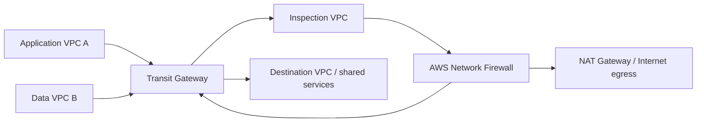

# Workload Isolation, East-West Traffic Control, and Zero Trust Principles

In an AWS system, workloads typically communicate across multiple layers: the web tier calls APIs, APIs query databases, processing services push messages to queues, workers read objects from S3, and internal components call AWS service APIs. Traffic flowing between internal components is called **east-west traffic**. If the internal network allows broad connectivity among all workloads, a single compromised host can become a launchpad for scanning and lateral movement to other services.

Workload isolation limits allowed connection paths and reduces blast radius when a component suffers a security incident. **Zero trust** principles complement this with an identity-driven approach: every connection and request must be authenticated, authorized for its intended purpose, constrained by context, and logged for monitoring. Being located inside a VPC or private subnet does not automatically make a workload trustworthy.

In the `CLOUD_PROVIDERS_AWS` module, this topic integrates VPC, subnet, route table, security group, network ACL, AWS Network Firewall, IAM, and private connectivity services such as AWS PrivateLink and VPC Lattice. The goal is to design only necessary communication paths, control who can call whom, protect data in transit, and detect anomalous behavior.

After this lesson, you can:

- Distinguish isolation at the account, VPC, subnet, network interface, and application levels.
- Design security groups aligned with application flows and least privilege.
- Distinguish the roles of security groups, network ACLs, route tables, and AWS Network Firewall.
- Control east-west traffic within a single VPC and across multiple VPCs or accounts.
- Combine workload identity, IAM, TLS/mTLS, and application-layer authorization under zero trust.
- Use VPC endpoints, PrivateLink, and VPC Lattice to provide controlled private connectivity.
- Monitor and test network paths using VPC Flow Logs, CloudTrail, GuardDuty, and Reachability Analyzer.

## 1. East-West Traffic and Lateral Movement Risk

In network architecture, north-south traffic typically describes traffic entering or leaving the system boundary, such as Internet users accessing a website. East-west traffic is traffic between internal components: between two subnets, two VPCs, two services, or two workloads in the same cluster.

Consider an e-commerce system with these components:

- Web frontend receiving HTTPS connections from users.
- API service handling business logic and querying data.
- Database storing order records.
- Worker reading messages from a queue and processing background tasks.
- Monitoring agent sending telemetry to the observability system.

Required flows might be frontend → API, API → database, API → queue, worker → queue, worker → database, and workloads → AWS service endpoints. If all workloads sit in the same subnet sharing broad security groups, a compromised component could attempt connections to databases, metadata services, management ports, or internal APIs it has no business using.

**Lateral movement** is when an attacker uses an initial foothold to reach other workloads or resources in the environment. Factors that heighten this risk include:

- Allowing entire subnets or internal CIDRs to access all ports.
- Sharing a single security group across frontend, API, workers, and databases.
- Allowing administrative access from any internal IP instead of via bastion or Systems Manager.
- Sharing identical static credentials across multiple workloads.
- Skipping application-layer identity authentication under the assumption that VPC traffic is trusted.
- Lacking logs to spot anomalous connections between components.

The goal of workload isolation is to restrict connectivity to genuinely required paths. If the frontend is compromised, it should only be able to call the API on its designated port; it should never be able to connect directly to databases, worker management ports, or administrative services.

## 2. Zero Trust Is a Design Principle, Not a Network Appliance

Zero trust is a security model assuming no connection is inherently trustworthy merely because it originates from an internal network, a corporate device, or a supposedly safe subnet. Every access request must be evaluated based on identity, permissions, context, and policy.

Core principles:

1. **Verify explicitly**: authenticate users, workloads, or services using appropriate identities.
2. **Least privilege**: grant permissions only for required resources, actions, and durations.
3. **Assume breach**: design so a compromised workload cannot easily reach the entire system.
4. **Purpose-driven segmentation**: constrain connections at both network and application layers.
5. **Continuous evaluation**: monitor posture, behavior, and access events; revoke access when risk signals emerge.
6. **Encrypt and protect identity**: use TLS, mTLS, or appropriate service authentication; manage credentials securely.
7. **Log and verify**: retain logs, audit configurations, and test access paths.

Zero trust does not mean encrypting everything with a single product or blocking all internal communication. It means combining layered controls so every access path has a clear rationale and can be verified.

### 2.1. Questions to Answer for Every Flow

For each connection between workload A and workload B, determine:

- Which identity is workload A? Is it running on EC2, ECS, EKS, or Lambda?
- Why does A need to call B? Reading data, writing data, publishing messages, or calling an API?
- Which ports and protocols must B expose?
- Must the connection traverse a private endpoint or inspection firewall?
- How does B authenticate A: IAM/SigV4, OAuth/OIDC, mTLS, or application tokens?
- At what resource and action granularity does B check permissions?
- Which logs prove whether a request was accepted or denied?
- If A is compromised, which resources remain reachable?

If no business justification exists for a connection path, treat it as a candidate for removal or restriction.

## 3. Multi-Layer Workload Isolation

No single network boundary suits every system. AWS provides multiple isolation layers; choose boundaries based on sensitivity, ownership, lifecycle, and communication requirements.

| Isolation Layer | Common AWS Mechanisms | Objective |
|---|---|---|
| Organization/account | AWS Organizations, account boundaries, SCPs | Separate production, non-production, security, and log archives; enforce guardrails |
| Network | VPC, subnets, route tables, Transit Gateway | Separate network domains, control routing and connectivity |
| Workload/interface | Security groups, network ACLs | Restrict sources, destinations, protocols, and ports |
| Service egress | VPC endpoints, PrivateLink, NAT, Network Firewall | Control which external/AWS services workloads can call |
| Application | Authentication, authorization, mTLS, API policies | Verify identity and permissions on each request |
| Operations | IAM roles, Systems Manager, CloudTrail, Flow Logs | Eliminate static credentials, monitor, and trace |

### 3.1. Account Separation for Critical Boundaries

In larger environments, separate production and non-production using dedicated AWS accounts. Separate accounts shrink blast radius, isolate administrative privileges, and enable organization-level guardrails. Security, log archive, and shared services accounts can host shared functions with tightly controlled access.

SCPs in AWS Organizations set the maximum permission ceiling for member accounts. SCPs do not themselves grant permissions to IAM principals; roles still need identity policies, resource policies, and matching conditions. Do not treat SCPs as policies granting applications access to services.

Separating accounts does not eliminate the need for segmentation inside each VPC. A production account can still host multiple workloads of differing sensitivity. Combine account boundaries with VPCs, subnets, security groups, and application authorization.

### 3.2. Subnet Tiering

A common pattern divides subnets by role:

- **Public/edge subnets**: host components requiring inbound Internet connectivity such as public load balancers or NAT Gateways.
- **Application private subnets**: run APIs, services, and workers that do not need public IPs.
- **Data private subnets**: host databases or storage tiers with strict access rules.
- **Inspection subnets**: host AWS Network Firewall endpoints or traffic inspection appliances.
- **Management subnets**: dedicated to internal administrative tooling if required by architecture.

The names public and private primarily reflect routing paths. A subnet called private can still have outbound Internet access via a NAT Gateway. Always inspect route tables and egress policies rather than inferring security posture solely from subnet names.

Do not lump every database into the same subnet as APIs merely to simplify routing. Databases require dedicated security groups and should accept connections only from required application roles or services.

## 4. Security Groups: Controlling Traffic at Network Interfaces

A security group (SG) is a stateful firewall attached to an AWS resource's network interface. It controls inbound and outbound traffic by protocol, port, and source/destination.

Key characteristics:

- SGs support Allow rules only; explicit Deny rules cannot be defined.
- Inbound traffic not matched by an Allow rule is blocked.
- SGs are stateful: once an allowed connection is established, return traffic for that connection is permitted automatically.
- Multiple SGs can attach to one network interface; Allow rules are aggregated.
- Another SG can be referenced as a source or destination in AWS-supported connectivity scenarios.
- SGs operate at the network interface level, not as HTTP URL or path filters.

For example, a database SG allows TCP 5432 only from the API SG. Even if a frontend EC2 instance sits in the same VPC with a different SG, it cannot connect to the database.

### 4.1. Layered Application Security Group Model

Suppose there are three groups:

| Security Group | Allowed Inbound | Required Outbound |
|---|---|---|
| `sg-web` | TCP 443 from Internet or CloudFront origin-facing managed prefix list per architecture | TCP 8080 to `sg-api` |
| `sg-api` | TCP 8080 from `sg-web` or load balancer SG | TCP 5432 to `sg-db`; required endpoints |
| `sg-db` | TCP 5432 only from `sg-api` | Only required outbound-initiated flows; responses to allowed connections are handled automatically by the SG |

This pattern illustrates modeling, not a complete rule set for every architecture. If an ALB terminates TLS, frontend services may accept traffic from the ALB's SG on the application port, while the ALB SG accepts 443 from approved sources. If web and API are independent services, reference the exact source SG of the real network interface.

### 4.2. Referencing Security Groups Instead of Broad CIDRs

When workloads reside in the same VPC, referencing a source SG is easier to maintain than entering subnet IP ranges. If task or instance IP addresses change, the rule continues applying to ENIs attached to the referenced SG.

Example allowing the API to access the database:

```bash
aws ec2 authorize-security-group-ingress \
  --group-id sg-db1234567890 \
  --protocol tcp \
  --port 5432 \
  --source-group sg-api1234567890 \
  --region ap-southeast-1
```

This command illustrates adding an inbound rule to the database SG. Replace sample IDs with real SG IDs and verify account/Region before running. SG references are solely a network condition: the application still must authenticate to the database with credentials or an appropriate identity mechanism, and the database still enforces user/schema permissions.

SG references have topology and service limitations. Across VPC peering, Transit Gateway, or accounts, check AWS support conditions and SG sharing permissions. Never assume SG references work across every connectivity type.

### 4.3. Egress Also Requires Least Privilege

New SGs are often created with an outbound rule allowing all traffic. Left unreviewed, a workload can connect to unnecessary addresses or ports. For tightly controlled workloads, remove broad outbound rules and add only required rules such as:

- API service to database SG on TCP 5432.
- Worker to required queue or endpoint on TCP 443.
- Workload to VPC interface endpoints on TCP 443.
- Workload to DNS resolver and required infrastructure services per network config.

When tightening egress, verify DNS, telemetry, OS updates, AWS endpoints, and external dependencies. Overly tight rules can break health checks, logging, or certificate renewal mechanisms.

## 5. Network ACLs and Route Tables Complementing Security Groups

A Network ACL (NACL) is a stateless firewall attached to a subnet. NACLs support both Allow and Deny rules, evaluate in ascending rule number order, and stop at the first matching rule. Traffic matching no rule is denied.

| Characteristic | Security Group | Network ACL |
|---|---|---|
| Scope | Network interface | Subnet |
| State | Stateful | Stateless |
| Rules | Allow | Allow and Deny |
| Ordering | Allow rules are aggregated | Numbered rules; first match applies |
| Connection return traffic | Automatically permits response traffic | Must explicitly permit return direction |
| Best fit | Specific workload/service control | Subnet-boundary guardrails or blocking IP ranges |

With stateless NACLs, allowing inbound TCP to an application port requires allowing outbound ephemeral ports for response traffic. Ephemeral port ranges depend on OS/client; overly narrow ranges cause hard-to-diagnose connection failures. Because SGs are usually sufficient for workload-to-workload traffic control, reserve NACLs for clear subnet-level needs such as blocking a CIDR or adding a guardrail layer.

Route tables determine the next hop for traffic. SGs and NACLs do not replace routing: if a route table lacks a route to a destination, connections fail; if a route table exposes broad routes over peering or Transit Gateway, use other policy layers to restrict who may connect.

## 6. AWS Network Firewall and Traffic Inspection Architectures

AWS Network Firewall is a managed VPC firewall service supporting multi-layer traffic inspection and filtering. It provides firewall policies, stateless rule groups, and stateful rule groups. It can inspect egress, ingress, and east-west traffic when routes steer traffic through firewall endpoints.

Common capabilities:

- Filtering by IP address, protocol, and port.
- Stateful inspection to evaluate connection flows.
- Domain name filtering in supported scenarios.
- Rules using Suricata-compatible stateful rules.
- Alert/flow logging to CloudWatch Logs, S3, or Kinesis Data Firehose per configuration.

### 6.1. Centralized Inspection Model

With multiple VPCs, an organization can deploy an inspection VPC as a central checkpoint. Transit Gateway connects the VPCs; route tables steer inspected flows through firewall endpoints in the inspection VPC before reaching destinations or the Internet.



This diagram is conceptual. Real route tables must guarantee forward and return paths traverse the same firewall endpoint when using stateful inspection. Asymmetric paths can prevent the firewall from seeing both directions of a flow. In multi-AZ deployments, place endpoints and routes per AZ to minimize cross-AZ dependencies and avoid single points of failure.

Not every internal flow needs to traverse a central firewall. Hairpinning all traffic through an inspection VPC increases latency, cost, and routing complexity. Identify which flows require deep inspection and which are effectively controlled via SGs, NACLs, endpoint policies, and application authorization.

### 6.2. Choosing Network Firewall or AWS WAF?

The two services address different layers:

- AWS Network Firewall inspects network traffic routed through firewall endpoints, suited for L3/L4 controls and select L7 capabilities.
- AWS WAF filters HTTP(S) requests using web ACLs, rules, managed rule groups, and web-layer conditions; typically attached to CloudFront, ALB, API Gateway, and supported services.

WAF helps mitigate SQL injection, cross-site scripting, bots, and malicious web requests. It does not replace SGs or Network Firewall for database connections, SSH, RDP, or other internal protocols. Conversely, Network Firewall does not replace API authorization and business logic.

## 7. Controlling Inter-VPC and Cross-Account Connectivity

As systems grow, east-west traffic spans beyond one VPC. Services may reside in different VPCs, accounts, or Regions. Connectivity requires both routing paths and access policies.

### 7.1. VPC Peering and Transit Gateway

VPC peering establishes private network connectivity between two VPCs. Peering is non-transitive: if VPC A peers with B and B peers with C, A does not automatically gain a route to C through B. Route tables and non-overlapping CIDRs are required per peering constraints.

Transit Gateway acts as a routing hub across many VPCs and network connections. Transit Gateway route tables control which VPCs can exchange traffic with which others. TGW can be paired with an inspection VPC to inspect inter-VPC flows.

Whether using peering or TGW, network connectivity never grants application permissions. SGs, NACLs, Network Firewall, endpoint policies, and service authorization must still constrain access. Avoid overly broad route propagation or associations that let unrelated VPCs reach one another.

### 7.2. AWS PrivateLink for Private Service Connectivity

AWS PrivateLink lets consumers access services via interface VPC endpoints and private connectivity. With an endpoint service published by a provider behind a Network Load Balancer, consumers do not need full network peering to the provider VPC. This is ideal for sharing a specific service across accounts or VPCs without opening the entire network.

Control points:

- Providers manage endpoint services, allowed caller principals, and acceptance state if manual acceptance is enabled.
- Consumers create interface endpoints in subnets and attach SGs restricting traffic to the endpoint.
- Endpoint policies can limit accessible APIs or resources for AWS services supporting endpoint policies.
- IAM policies and service resource policies still govern whether a principal can execute actions.
- Private DNS and private hosted zones must be designed so clients resolve endpoints accurately.

PrivateLink narrows network connectivity, but it does not replace service-layer authentication and authorization. If a client is permitted to reach an endpoint, the service must still validate request identity and permissions.

### 7.3. VPC Lattice for Service-to-Service Connectivity

Amazon VPC Lattice provides a connectivity and governance layer for service-to-service communication across VPCs and accounts. A service network groups services and VPC associations, while auth policies define who may access each service.

VPC Lattice is valuable when you need to:

- Publish services behind a stable endpoint without managing individual VPC peering links.
- Connect workloads across multiple VPCs or accounts under a service network model.
- Enforce IAM-based authentication on service-to-service requests.
- Observe connections and traffic at the service layer.

Connections via VPC Lattice still require proper SGs, routes, DNS, and policies. IAM auth policies control callers by principal and action, while applications must still enforce business, data, and tenant permissions. Do not grant broad invoke permissions to every principal in an organization when a service serves only one group of workloads.

## 8. Controlling Access to AWS Services with VPC Endpoints

Workloads frequently call S3, DynamoDB, Secrets Manager, Systems Manager, ECR, CloudWatch, or STS. Routing all those requests through the Internet or NAT Gateways increases egress exposure and costs.

VPC endpoints let workloads reach many AWS services over the AWS network:

- **Gateway endpoints**: used for S3 and DynamoDB, configured via route tables.
- **Interface endpoints**: use AWS PrivateLink to provision ENIs in subnets for many other AWS services.

For interface endpoints, the SG attached to the endpoint ENI must permit inbound traffic on the required port, typically TCP 443 from workload SGs. Endpoint policies can restrict APIs or resources when supported by the service. IAM policies and resource policies still apply; an endpoint policy acts as an additional layer.

For example, a worker role needs only to read one prefix in an S3 bucket. You can combine:

1. An S3 Gateway endpoint in the route table.
2. An endpoint policy restricting accessible buckets.
3. A worker IAM policy permitting only `s3:GetObject` on the required prefix.
4. A bucket policy verifying principals and access conditions.
5. SGs and route tables constraining the worker's network path.

VPC endpoints do not automatically make all traffic secure. Check DNS, endpoint policies, IAM, bucket/resource policies, and encryption policies. When using private endpoints, conditions such as `aws:SourceVpce` can be used in resource policies for supported services, but test carefully to avoid accidentally blocking valid access from pipelines, backups, or operational principals.

## 9. Zero Trust at the Workload Identity Layer

Network policies answer "which packets can reach this network interface?" Zero trust adds "who is calling this service and what are they allowed to do?" Do not rely on IP addresses or SGs as an application's sole identity.

### 9.1. Using IAM Roles Instead of Static Access Keys

AWS workloads can obtain temporary credentials via roles:

| Platform | Common Identity Mechanism |
|---|---|
| Amazon EC2 | IAM role attached via instance profile |
| Amazon ECS | Task role used by containers to call AWS APIs |
| Amazon EKS | EKS Pod Identity or IAM Roles for Service Accounts (IRSA) |
| AWS Lambda | Function execution role |

Each workload should have a dedicated role scoped to its duties. For example, an invoice-processing worker has permissions to read one queue and write objects to one prefix; it needs neither VPC admin rights nor full database read access. AWS-issued temporary credentials avoid embedding long-lived access keys in images, config files, or environment variables.

Distinguish task roles from execution roles in ECS: the task role is the identity code inside containers uses to call AWS APIs; the execution role authorizes the ECS agent to perform tasks such as pulling images or writing logs per configuration. Grant application permissions to the right role to minimize access scope.

### 9.2. Service Authentication and Authorization

For internal APIs, use appropriate mechanisms such as IAM authentication/SigV4, OAuth 2.0/OIDC, JWT, API keys combined with stronger auth, or mTLS. After authentication, the service must enforce authorization by action and resource: which orders the caller can read, which accounts it can update, or which endpoints it can call.

An authenticated request does not imply permission to perform every action. For instance, a service may verify the `OrderWorker` role yet allow that role only to update order status, never to alter payment details.

Design policies by resource and action, verify token audience/issuer/expiry, and avoid sharing one static secret across all services. Credentials require clear lifecycles, rotation, and revocation processes.

## 10. Encrypting East-West Traffic with TLS and mTLS

TLS encrypts data in transit and lets clients verify servers. For service-to-service communication, mutual TLS (mTLS) requires both client and server to present certificates to authenticate both sides.

mTLS helps:

- Authenticate client workloads via certificates.
- Authenticate servers that clients connect to.
- Encrypt data between services.
- Reduce reliance on IP addresses for identity.
- Support lifecycle-based certificate revocation or replacement.

AWS Certificate Manager Private CA can issue private workload certificates; ACM public certificates typically serve public endpoints. Design trust chains, SANs, lifetimes, certificate distribution, private key protection, and rotation. Never embed private keys in container images or source repositories.

mTLS does not replace authorization. A client holding a valid certificate must still be authorized by the server to access specific endpoints and data. When a certificate is revoked or a workload is decommissioned, update trust and revoke the corresponding identity.

## 11. Controlling DNS and Egress

DNS is often overlooked in zero trust designs. Workloads can reach external services via domain names; without DNS and egress controls, a compromised workload can exfiltrate data or contact malicious infrastructure.

Amazon Route 53 Resolver DNS Firewall enables rule groups controlling VPC DNS queries via domain lists. Use allowlists or blocklists matching requirements. DNS Firewall does not replace IP-layer firewalls and does not block every DNS-over-HTTPS path or hardcoded IP; combine it with egress controls, SGs, and Network Firewall.

A controlled egress design can include:

- Private subnet workloads permitted to call only required VPC endpoints.
- Internet outbound routed via NAT Gateway and AWS Network Firewall.
- SGs restricting destination ports/protocols per workload.
- DNS Firewall blocking disallowed domains.
- Network Firewall inspecting flows and domains per rule capabilities.
- VPC Flow Logs and Network Firewall logs supporting investigation.

Do not block DNS or egress before mapping workload dependencies. Observe traffic during testing, build owner-backed allowlists, and maintain an update process as applications evolve.

## 12. Administrative Access Should Not Be Broadly Open Internally

SSH, RDP, and management ports frequently become lateral movement vectors when opened to an entire VPC CIDR. Instead of allowing every host in a subnet to reach management ports, prefer AWS Systems Manager Session Manager for properly configured EC2 instances.

Session Manager provides instance administration without opening inbound SSH/RDP or maintaining bastion hosts for every scenario. Instances need the SSM Agent, an appropriate IAM instance profile, and connectivity to Systems Manager endpoints via Internet or VPC endpoints. Session logs can be sent to S3 or CloudWatch Logs, and IAM restricts who can start sessions.

If a bastion or jump host is still required, place it in a dedicated management subnet, restrict source IPs, enforce MFA/SSO, log sessions, and never allow the bastion broad access across all subnets. Separate network administration, host administration, and data access permissions.

## 13. Observing East-West Traffic and Detecting Anomalies

Isolation is effective only when operations teams know which flows exist and when anomalous connections occur.

| Tool | Data / Capability | Questions Answered |
|---|---|---|
| VPC Flow Logs | Metadata on IP, port, protocol, interface, action, and bytes/packets | Which workloads connect where? Is traffic `ACCEPT` or `REJECT`? |
| AWS CloudTrail | API activity and AWS configuration changes | Who modified an SG, route table, NACL, endpoint, or firewall policy? |
| Amazon GuardDuty | Threat detection across supported telemetry sources | Are there signs of reconnaissance, credential abuse, or suspicious connections? |
| Route 53 Resolver query logs | DNS queries from VPCs | Which workload queried which domain? |
| Network Firewall logs | Flows and alerts per policy | Which flows were blocked by rules or triggered alerts? |
| Reachability Analyzer | Path analysis based on network configuration | Why can't a source reach a destination, or which path permits it? |
| Network Access Analyzer | Network access path analysis against intended scope | Are there unintended network paths to sensitive resources? |

VPC Flow Logs record network flow metadata, not full packet captures or application payloads. Inspecting payloads requires appropriate capture mechanisms aligned with data protection policies. Flow Logs can be sent to CloudWatch Logs, S3, or Firehose per configuration.

GuardDuty can analyze VPC Flow Logs and other telemetry to detect suspicious behavior. It is a detection service, not a firewall that automatically modifies SGs in every case. Response workflows can use EventBridge, Lambda, or Systems Manager Automation to orchestrate isolation actions after proper evaluation and guardrails.

## 14. Testing Policies and Access Paths

Policies on paper can differ from runtime behavior due to routes, SGs, NACLs, endpoint policies, DNS, or application logic. Test both allowed paths and paths that must be denied.

A test plan includes:

1. Confirm frontend reaches API on the designated port.
2. Confirm API reaches database on the designated port.
3. Confirm frontend cannot connect directly to the database.
4. Confirm workers reach only required queues and endpoints.
5. Confirm workloads cannot SSH/RDP into one another unnecessarily.
6. Confirm requests lacking valid tokens or certificates are rejected by the application.
7. Confirm valid roles lacking required actions are still denied by authorization.
8. Confirm unnecessary egress is blocked.
9. Confirm logs capture both accepted and rejected flows per configuration.
10. Confirm health checks, monitoring, backups, and OS update flows continue working.

Reachability Analyzer evaluates paths from AWS network configuration without sending live test packets. It excels at pinpointing routes, SGs, NACLs, or components blocking connectivity. Network Access Analyzer helps uncover unintended access paths within an analysis scope. Neither replaces authentication and authorization testing at the application layer.

## 15. Real-World Scenario: Isolating an Order-Processing System

A company deploys a system inside one production account. VPC `10.20.0.0/16` spans three AZs, each with edge, application, and data subnets. Frontend traffic flows through CloudFront and an ALB; the API runs on ECS; the database is Amazon RDS; workers run as a separate ECS service reading SQS.

Boundary design:

- ALB accepts HTTPS from CloudFront or designed Internet sources; ALB SG opens only port 443.
- ECS frontend/API accepts traffic only from the ALB SG or corresponding caller service SG.
- API task role can invoke only required AWS APIs and access API business resources.
- Database SG accepts TCP 5432 only from the API SG.
- Workers have a dedicated task role that reads only the queue and writes results to a designated S3 prefix.
- Interface endpoints exist for ECR, CloudWatch Logs, Secrets Manager, and required services; endpoint SGs accept TCP 443 only from workload SGs.
- Internet egress routes through Network Firewall per designed routes; DNS Firewall blocks unapproved domains.
- VPC Flow Logs, CloudTrail, GuardDuty, and Network Firewall logs flow to centralized monitoring.
- Session Manager handles EC2 administration; SSH is never opened across the VPC.

### 15.1. Allowed and Blocked Flows

| Source | Destination | Expected Outcome | Rationale |
|---|---|---|---|
| CloudFront/edge | ALB HTTPS 443 | Allow | Application entry point |
| ALB | ECS API app port | Allow | Forward requests to targets |
| ECS API | RDS TCP 5432 | Allow | Business data queries |
| ECS frontend | RDS TCP 5432 | Block | Frontend has no need to access the database |
| ECS worker | SQS via HTTPS endpoint | Allow | Consume background jobs |
| ECS worker | API EC2 management port | Block | No cross-component administration needed |
| ECS API | AWS Secrets Manager endpoint 443 | Allow | Fetch secrets per IAM role |
| Workload | Domain outside allowlist | Block or alert | Policy-based egress restriction |

### 15.2. When an API Task Is Compromised

If an API task is compromised, SGs and route tables limit network reach; the task role constrains AWS APIs; the database user holds permissions only on required schemas; mTLS or internal tokens constrain service identity; Network Firewall and DNS Firewall govern egress; Flow Logs and GuardDuty help detect anomalous behavior.

Responders can swap the task or service SG to isolate connections, revoke/narrow role permissions, rotate secrets, stop tasks, and deploy clean images. Isolation must coordinate with ECS, load balancers, and incident procedures to avoid destroying evidence or causing widespread outages.

## 16. Zero Trust Adoption Roadmap

You do not need to overhaul the entire network at once. Roll out in measurable phases:

**Phase 1 — Flow Discovery**

- Inventory workloads, owners, data, and sensitivity levels.
- Collect Flow Logs, dependency maps, and actual traffic.
- Identify mandatory business flows, administrative flows, and egress flows.

**Phase 2 — Network Segmentation**

- Split SGs by workload and role.
- Replace broad CIDRs with SG references where supported.
- Constrain inbound and outbound rules; isolate database subnets.
- Audit route tables, peering, and TGW propagation.

**Phase 3 — Service Identity Protection**

- Assign dedicated IAM roles per workload.
- Replace static access keys with temporary credentials.
- Enable TLS/mTLS and API authentication.
- Enforce resource/action-level authorization.

**Phase 4 — Egress and Shared Connectivity Controls**

- Deploy VPC endpoints for eligible AWS services.
- Implement egress policies, DNS Firewall, and Network Firewall if required.
- Use PrivateLink or VPC Lattice when exposing narrowly scoped services.

**Phase 5 — Monitoring and Continuous Improvement**

- Enable Flow Logs, CloudTrail, GuardDuty, and firewall logs.
- Alert on overly broad SGs, anomalous routes, and spikes in rejected flows.
- Run periodic checks with Reachability Analyzer and Network Access Analyzer.
- Conduct compromised-workload tabletop exercises and verify blast radius.

## 17. Common Misconceptions

| Misconception | Correct Understanding |
|---|---|
| Workloads in the same VPC are trustworthy | Every workload must be verified and authorized individually |
| Private subnets cannot reach the Internet | Private subnets can still exit via NAT Gateways or other egress paths |
| Security groups have Deny rules | SGs only have Allow rules; unmatched inbound traffic is blocked |
| Network ACLs are stateful like SGs | NACLs are stateless and must permit both forward and return traffic |
| Having SGs eliminates the need for app authorization | SGs control network reachability; apps still require authentication and authorization |
| VPC peering routes transitively | VPC peering does not support transitive routing |
| VPC endpoints grant service access automatically | Endpoints only provide connectivity; IAM/resource/endpoint policies still apply |
| Network Firewall replaces WAF | Network Firewall and WAF inspect different layers and use cases |
| Flow Logs capture full payloads | Flow Logs record flow metadata, not packet captures |
| SCPs grant permissions to roles | SCPs set maximum permission boundaries; IAM/resource policies grant actual permissions |
| mTLS means the client can do anything | mTLS authenticates both sides; business authorization must still be checked |
| VPC Lattice or PrivateLink eliminates network layers | SGs, routes, DNS, IAM, and app authorization still require configuration |

## 18. Knowledge Summary

Workload isolation limits communication paths and blast radius when a component is compromised. Segment across multiple layers: account, VPC, subnet, security group, endpoint, and application. Stateful security groups allow specific workload-to-workload flows; stateless NACLs add subnet guardrails; route tables select next hops; AWS Network Firewall inspects traffic routed through firewall endpoints.

Zero trust adds identity- and context-driven controls. Every workload should have its own IAM role using temporary credentials, authenticate service-to-service calls, and enforce authorization on every API. TLS/mTLS protects data and identities in transit. PrivateLink and VPC Lattice provide narrowly scoped service connectivity; VPC endpoints reduce public egress to AWS services.

Finally, measure and test. VPC Flow Logs, CloudTrail, GuardDuty, DNS query logs, Network Firewall logs, and reachability analysis tools verify actual access paths. A design is complete only when legitimate flows work, unnecessary flows are blocked, and operations teams can detect, investigate, and isolate incidents.

## References

- [Security groups for your VPC](https://docs.aws.amazon.com/vpc/latest/userguide/vpc-security-groups.html)
- [Control subnet traffic with network ACLs](https://docs.aws.amazon.com/vpc/latest/userguide/vpc-network-acls.html)
- [AWS Network Firewall](https://docs.aws.amazon.com/network-firewall/latest/developerguide/what-is-aws-network-firewall.html)
- [AWS PrivateLink concepts](https://docs.aws.amazon.com/vpc/latest/privatelink/privatelink-share-your-services.html)
- [Amazon VPC Lattice](https://docs.aws.amazon.com/vpc-lattice/latest/ug/what-is-vpc-lattice.html)
- [VPC endpoints](https://docs.aws.amazon.com/vpc/latest/privatelink/vpc-endpoints.html)
- [VPC Flow Logs](https://docs.aws.amazon.com/vpc/latest/userguide/flow-logs.html)
- [Amazon GuardDuty](https://docs.aws.amazon.com/guardduty/latest/ug/what-is-guardduty.html)
- [Reachability Analyzer](https://docs.aws.amazon.com/vpc/latest/reachability/what-is-reachability-analyzer.html)
- [Network Access Analyzer](https://docs.aws.amazon.com/vpc/latest/network-access-analyzer/what-is-network-access-analyzer.html)
- [AWS Systems Manager Session Manager](https://docs.aws.amazon.com/systems-manager/latest/userguide/session-manager.html)
- [Zero Trust architecture in AWS](https://docs.aws.amazon.com/whitepapers/latest/implementing-zero-trust-architectures/implementing-zero-trust-architectures.html)
