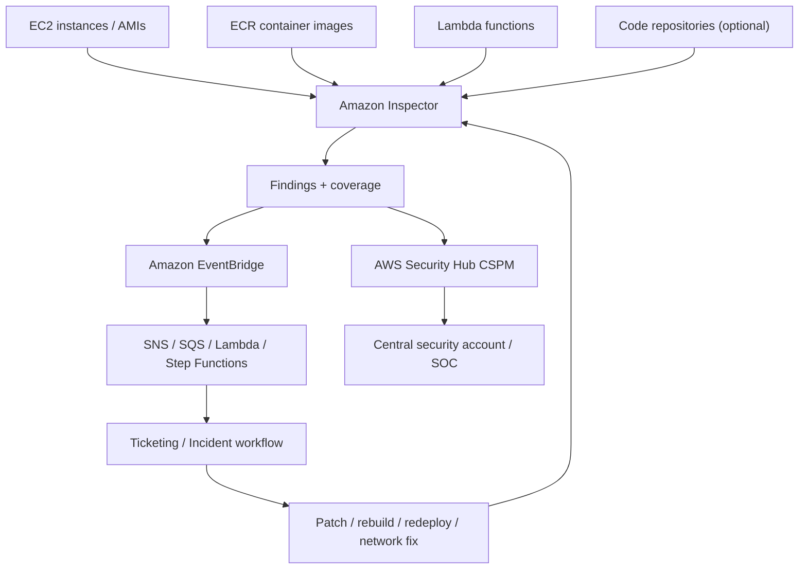
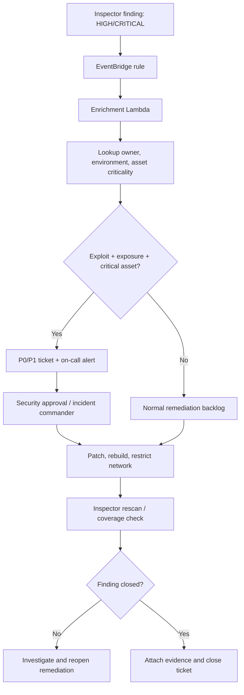

# Amazon Inspector and Workload Vulnerability Management

> **Chapter:** Security Monitoring and Response  
> **Module:** CLOUD_PROVIDERS_AWS  
> **Objective:** deploy Amazon Inspector to continuously detect software vulnerabilities and unintended network exposure paths; manage workload coverage; and prioritize, remediate, verify, and report findings in a multi-account AWS environment.

## 1. Why Is Continuous Vulnerability Management Necessary?

An AWS workload can change every day:

- EC2 instances are launched from new AMIs or have packages modified after boot.
- Container images are built, pushed, and deployed continuously.
- Lambda functions have their dependencies or layers updated.
- A new CVE is disclosed months after a workload has been running stably.
- A Security Group, route table, or load balancer changes, making a service port reachable from the Internet.
- A new account is created in AWS Organizations without scanning enabled.

Scanning once before go-live is insufficient to track those changes. Vulnerability management requires a continuous lifecycle:

1. **Discover:** know which workloads exist.
2. **Assess:** collect inventory and compare against security advisories/CVEs.
3. **Prioritize:** evaluate severity alongside exploitability and exposure.
4. **Remediate:** update packages/images/code or fix network configurations.
5. **Verify:** rescan and confirm the finding is closed.
6. **Govern:** track coverage, SLAs, exceptions, and risk trends.

Amazon Inspector supports the discover, assess, and continuous finding tracking steps. Workload teams remain responsible for deciding remediation approaches, deploying patches, testing applications, and accepting risk per organizational processes.

## 2. What Is Amazon Inspector?

Amazon Inspector is an automated vulnerability management service. It discovers eligible workloads within an account/Region, collects software inventory or required data, evaluates against vulnerability intelligence, and creates findings when issues are detected.

Core capability groups:

- **EC2 scanning:** package vulnerabilities on EC2 and network reachability issues.
- **ECR scanning:** vulnerabilities in operating system packages and programming-language dependencies inside container images.
- **Lambda standard scanning:** vulnerabilities in dependencies packaged with functions and layers.
- **Lambda code scanning:** detects code vulnerabilities in Lambda function source code; this is an optional layer.
- **Machine image scanning:** scans AMIs to detect package vulnerabilities before using images to launch EC2 instances; must be enabled separately.
- **Code Security:** scans source repositories, third-party dependencies, and Infrastructure as Code; must be enabled and configured separately.

Inspector generates findings with details about the resource, vulnerability, severity, package/version, fix availability, exploit intelligence, and remediation guidance. Some findings also describe affected network paths or code locations.

### 2.1. Where Does Inspector Fit in Security Architecture?



Inspector does not replace every security layer:

| Service | Primary Role |
|---|---|
| Amazon Inspector | Detects software vulnerabilities and network reachability issues |
| AWS Systems Manager Patch Manager | Schedules and deploys OS patches to managed nodes |
| AWS Security Hub CSPM | Aggregates findings and checks security posture |
| Amazon GuardDuty | Detects threat behavior via threat signals |
| AWS Config | Tracks resource configurations and evaluates rules |
| AWS WAF / Network Firewall | Controls traffic according to policy |
| Amazon ECR | Stores container images and configures enhanced scanning |
| AWS CodeBuild / CodePipeline | Builds, tests, and deploys artifacts |

Inspector answers the question "which vulnerabilities or risky network paths does the workload have?". Patch Manager or deployment pipelines are responsible for rolling out changes to fix the issues.

## 3. Choosing Scan Types by Workload

| Workload | Scan Type | Detection Scope |
|---|---|---|
| EC2 | EC2 scanning | OS/application packages and network reachability |
| ECR | Enhanced scanning | OS packages and language dependencies in images |
| Lambda | Standard scanning | Dependencies uploaded with functions/layers |
| Lambda | Code scanning (optional) | Code vulnerabilities such as injection, data leaks, weak cryptography |
| AMI | Machine image scanning (optional) | Package vulnerabilities in EBS snapshots backing AMIs |
| Source repository | Code Security (optional) | First-party code (SAST), third-party dependencies (SCA), IaC |

When activating Inspector for the first time, core scan types typically include EC2, ECR, and Lambda standard per the current onboarding flow. Lambda code scanning is an optional layer; machine image scanning and Code Security require separate activation. Check Region support and coverage after enabling, as not every feature is available in every Region.

### 3.1. Distinguishing Vulnerability Findings and Network Reachability Findings

- **Package vulnerability:** a package version matches a vulnerability advisory/CVE.
- **Network reachability:** a network path allows a port/protocol to reach an EC2 instance from a VPC edge or associated network connection.
- **Code vulnerability:** source code contains a pattern that could lead to injection, data leaks, missing encryption, or weak cryptography.

An instance with a vulnerable package but no direct network path from the Internet still needs handling based on asset criticality and threat model. Conversely, an Internet-reachable service is not automatically a vulnerability if there is no package/code issue; it is a network exposure finding requiring separate evaluation.

## 4. EC2 Scanning: Agent-Based and Agentless

Amazon Inspector collects EC2 instance inventory and compares package versions against security advisories. There are two scanning methods for package vulnerabilities.

### 4.1. Agent-Based Scanning

Agent-based scanning uses SSM Agent and the Inspector VM Scanner/SSM associations mechanism to collect software inventory on instances.

Operational prerequisites:

- The instance must be an SSM managed node meeting OS/architecture support requirements.
- SSM Agent must be running and authorized to communicate with Systems Manager endpoints.
- Instance profile or service permissions must be properly configured.
- Inspector SSM associations/plugins must be created and maintained.
- Network egress/VPC endpoints must allow traffic to required AWS service endpoints.

Enhanced EC2 scanning uses Inspector VM Scanner, installed/updated via SSM associations. This mechanism collects inventory more consistently across supported operating systems; inspect association status and scanner health when coverage is missing.

Advantages of agent-based scanning:

- Tracks package changes on managed instances.
- Supports deep inspection for certain Linux application-language packages and paths.
- Can rescan when new CVEs are published or inventory changes.
- Does not require Inspector to create EBS snapshots solely to collect inventory.

Limitations:

- Instances not managed by SSM may be ineligible in agent-based-only mode.
- Agent/association failures leave inventory stale or incomplete.
- Custom package paths must be configured if outside default deep inspection paths.

### 4.2. Agentless Scanning

Agentless scanning collects inventory from EBS snapshots backing the instance, without requiring SSM Agent on the instance.

This mechanism is useful when:

- Instances are not managed by SSM.
- Agents cannot be installed due to OS/application constraints.
- Additional coverage is desired for eligible EBS-backed instances.

Agentless scanning has eligibility conditions regarding instances, EBS volumes, file systems, snapshot access, and storage limits. Do not assume every EC2 instance receives agentless scanning. Check scan status and coverage reasons for each instance.

The agentless method may detect Linux application-language packages on different paths than the agent-based method. As a result, the two methods can produce different sets of findings on the same instance.

### 4.3. Hybrid Scanning

Hybrid scanning combines agent-based and agentless scanning:

- SSM-managed instances: use agent-based scanning.
- Non-SSM-managed but eligible instances: use agentless scanning.
- Instances ineligible for both methods: may not be scanned.

Hybrid scanning increases coverage across heterogeneous fleets. Once enabled, continue monitoring coverage; do not rely solely on the count of running EC2 instances.

### 4.4. Network Reachability

Inspector evaluates network configurations to find access paths to EC2 instances via VPC edges, such as Internet Gateways, load balancers, VPC peering, or VPN/gateway paths.

The service analyzes configurations including:

- Security Groups.
- Network ACLs.
- Route Tables and Subnets.
- Internet Gateways and Virtual Private Gateways.
- Elastic Network Interfaces.
- Load Balancers and VPC peering connections.

Network reachability findings apply only to EC2. Inspector runs reachability scans approximately every 12 hours; this is neither packet capture nor a real-time IDS. After modifying a security group or route, wait for the next scan cycle or verify updated coverage/findings.

## 5. ECR Enhanced Scanning for Container Images

Amazon ECR provides basic scanning and enhanced scanning. Enhanced scanning integrates Amazon Inspector to scan both OS packages and programming-language dependencies.

| Criterion | ECR Basic Scanning | ECR Enhanced Scanning |
|---|---|---|
| Engine | ECR native scanning | Amazon Inspector |
| OS package vulnerabilities | Yes | Yes |
| Language package vulnerabilities | Not as comprehensive as enhanced | Yes |
| Scan on push | Yes | Yes |
| Continuous rescanning on new CVEs | Not like Inspector enhanced | Yes |
| Findings integration with Inspector/Security Hub/EventBridge | Limited | Yes |

### 5.1. Choosing Scan Frequency

Enhanced scanning supports:

- **Scan on push:** scans an image when a new image is pushed to the repository.
- **Continuous scanning:** monitors images during the eligibility window and rescans when relevant new vulnerability intelligence emerges.

Continuous scanning suits images actively in use or with long lifecycles. Scan on push suits pipelines requiring an initial scan result before promoting an artifact; however, the image is not continuously monitored afterward.

### 5.2. Image Eligibility and Re-Scan Duration

Inspector only scans images with `ACTIVE` status in ECR; archived images are not scanned until restored. Continuous scanning uses time windows based on push date and last-in-use/last-pull date.

As of November 2026, the default re-scan duration for accounts newly enabling ECR scanning from October 15, 2026 onward is 7 days. Accounts enabled earlier retain their existing configuration. This is the default eligibility window, not a guarantee that every image is scanned only once every 7 days.

Platform teams should choose a duration aligned with actual image lifecycles. Long-lived production images require appropriate monitoring windows; ephemeral or no-longer-deployed images can use shorter windows to reduce cost and noise.

### 5.3. Remediating Container Findings

Safe workflow:

1. Identify the image digest, repository, tag, build ID, and deployments using that image.
2. Identify the vulnerable package and fixed version.
3. Update the base image or dependency lockfile.
4. Rebuild the image from reproducible source.
5. Run unit/integration/security tests.
6. Push the new image and wait for Inspector scanning.
7. Promote the exact tested digest through staging/production.
8. Redeploy the service and verify runtime uses the new digest.
9. Verify the old finding is closed and the new image has coverage.

Do not merely repoint a tag to a new digest and assume the issue is fixed. Deployments must actually run the built, tested, and scanned image digest.

## 6. Lambda Scanning and Code Security

### 6.1. Lambda Standard Scanning

Lambda standard scanning checks software package dependencies packaged with function code and layers.

Examples:

- A Python function packaging `requests` or `cryptography`.
- A Node.js function packaging `lodash` or `jsonwebtoken`.
- A Java function bundling libraries in its deployment package or layer.

Inspector generates a Package Vulnerability finding if a dependency has a vulnerable version.

An important limitation: Lambda standard scanning does not scan the AWS SDK dependency pre-provided in the runtime environment; it focuses on dependencies uploaded with your function code or inherited from layers.

### 6.1.1. Lambda Eligibility and Limits

Inspector only scans eligible Lambda functions, including:

- Functions with a runtime supported for the corresponding scan type.
- The function version under evaluation is `$LATEST`.
- Functions invoked or updated within the last 90 days.
- Functions not excluded via exclusion tags.

Functions not invoked or updated for 90 days can automatically lose scan eligibility; when invoked again or updated, Inspector can bring the function back into coverage. At the time of writing, Inspector does not support scanning Lambda functions encrypted with customer-managed KMS keys; verify Region/runtime support and encryption configuration before setting coverage targets.

### 6.2. Lambda Code Scanning

Lambda code scanning is an optional layer to detect flaws in developer-written application code, such as:

- Injection flaws.
- Data leaks.
- Hardcoded credentials.
- Missing encryption.
- Weak cryptography.

Findings may include code snippets, file paths, line locations, and remediation suggestions. Snippets can inadvertently contain credentials or sensitive data if hardcoded in source. Therefore, restrict access to findings/code snippets. The delegated administrator cannot view code snippets belonging to member accounts; member account owners must coordinate to provide appropriate evidence per organizational procedures.

Remediation suggestions may be assisted by automated reasoning; developers must review and test patches before merging/deploying.

### 6.3. Code Security for Repositories

Amazon Inspector Code Security extends scanning to source repositories:

- **SAST:** analyzes first-party source code.
- **SCA:** detects vulnerabilities in third-party dependencies.
- **IaC scanning:** identifies risky Infrastructure as Code configurations.

You can configure scans on push or pull request/merge request and integrate supported repository providers. Certain SAST findings can generate pull requests suggesting fixes based on severity thresholds and scan configurations.

Code Security must be activated separately, with repositories connected and scan configurations created. It does not replace code reviews, unit tests, dependency policies, or pipeline quality gates.

## 7. Machine Image Scanning: Finding Vulnerabilities Before Launch

Machine image scanning is an optional scan type for Amazon Machine Images (AMIs). Inspector reads software inventory from EBS snapshots backing an AMI and compares package versions against vulnerability intelligence.

Benefits:

- Detects package vulnerabilities before an AMI is used to launch EC2 instances.
- Rescans when Inspector adds new CVEs relevant to AMIs in scope.
- Supports golden image validation and image promotion pipelines.
- Eliminates the need to launch an instance from an AMI solely to collect inventory.

### 7.1. Conditions and Eligibility

Inspector only scans machine images meeting support criteria, such as:

- The account owns the AMI and its backing EBS snapshots.
- The AMI is EBS-backed, in an appropriate state, and uses a supported OS.
- Snapshot file systems and storage layouts fall within scanning limits.
- The AMI is within scan eligibility windows and not excluded by exclusion rules.

Public/shared AMIs owned by another account are not automatically scanned like account-owned images. To inspect such an image, copy the image into your own account to create account-owned snapshots and scan the copy.

### 7.2. Continuous and On-Demand Scans

- **Continuous machine image scanning:** monitors AMIs in scope, scans new images, and rescans when vulnerability intelligence adds relevant CVEs.
- **On-demand scan:** runs once for a specific AMI without enabling continuous machine image scanning.

An important operational distinction: on-demand AMI scan results are delivered via EventBridge. They do not appear in the Inspector console, are not returned by ListFindings, and are not sent to Security Hub CSPM as standard findings. Persist EventBridge events/scan IDs if build pipeline evidence is needed.

### 7.3. Integrating with a Golden AMI Pipeline

1. Build the AMI from an approved base image.
2. Wait until the AMI reaches available state.
3. Run an Inspector machine image scan or on-demand scan.
4. Retrieve findings by AMI ID and scan ID.
5. Block promotion if Critical/High findings exceed policy thresholds.
6. Fix packages in the build recipe, create a new AMI, and rescan.
7. Publish only AMI IDs that pass the security gate.
8. Track older AMIs still used by EC2 instances and retire them per change plans.

## 8. Coverage: Knowing Which Workloads Are Actually Scanned

An empty findings list does not mean the fleet is fully scanned. If a resource lacks coverage, Inspector cannot report vulnerabilities for it.

Coverage reviews should answer:

- Which accounts and Regions have Inspector enabled?
- Which scan types are enabled?
- How many EC2 instances are eligible?
- Are instances using agent-based or agentless scanning?
- Are SSM Agent/Inspector VM Scanner associations healthy?
- Do ECR repositories use Enhanced Scanning and are images in ACTIVE state?
- Are Lambda functions eligible for scanning or excluded via tags?
- Are AMIs and code repositories within scope?
- Are any resources experiencing access denied, unsupported status, or scan errors?

### 8.1. Common Sources of Coverage Gaps

| Resource | Common Coverage Gap | Resolution Direction |
|---|---|---|
| EC2 | SSM Agent inactive, unsupported OS, incompatible scan mode | Check SSM managed status, scan mode, and eligibility |
| EC2 agentless | Instance lacks eligible EBS volumes, volume/file system exceeds limits | Verify agentless eligibility or switch to agent-based |
| ECR | Repository uses basic scanning, image archived/inactive, or eligibility expired | Enable Enhanced Scanning and check scan frequency/window |
| Lambda | Function not yet scanned, layer/package out of scope, or unsupported Region | Check scan type, invocation/update eligibility, and layers |
| AMI | Image not owned by account or outside eligibility window | Copy image into account, adjust scan scope |
| Code repository | Repository not connected or scan configuration not applied | Check integration, permissions, and scan configuration |

### 8.2. Coverage Inventory and KPIs

Maintain an inventory independent of findings:

| Metric | Interpretation |
|---|---|
| Eligible EC2 instances | EC2 instances meeting scan eligibility conditions |
| Covered EC2 instances | EC2 instances with valid scan coverage |
| SSM managed ratio | Percentage of instances managed by SSM |
| Agentless coverage ratio | Percentage of eligible instances covered by agentless scanning |
| ECR active image coverage | Percentage of active images covered by enhanced scanning |
| Lambda coverage | Percentage of eligible functions with standard/code scanning |
| Unsupported/error resources | Resources that cannot be scanned or encounter errors |
| Last scanned age | Time elapsed since the most recent scan |
| Accounts/Regions enabled | Number of accounts/Regions with policy-compliant scan types |

Example formulas:

```text
EC2 coverage % =
  covered eligible EC2 instances
  / eligible EC2 instances
  * 100

ECR coverage % =
  active in-scope images monitored by Inspector
  / active in-scope images
  * 100
```

Do not use total running EC2 instances as the denominator if the inventory includes out-of-scope or unsupported instances. Document explicit eligibility criteria so KPIs are verifiable.

## 9. Understanding Findings and Statuses

A finding is a record describing an issue detected on a resource. Inspector has three primary finding types:

| Finding Type | Example |
|---|---|
| PACKAGE_VULNERABILITY | OpenSSL package or library version affected by a CVE |
| NETWORK_REACHABILITY | EC2 port reachable from a VPC edge or Internet path |
| CODE_VULNERABILITY | Lambda/source code containing injection, hardcoded secret, or weak cryptography |

A package vulnerability finding typically includes:

- Finding ARN and account/Region.
- Resource ARN/ID and resource type.
- Vulnerability ID/CVE, title, and description.
- Severity and Inspector score.
- CVSS vector/score, EPSS probability, and exploit availability when available.
- Affected package name, installed version, and fixed version.
- First observed/last observed/updated timestamps.
- Remediation guidance and references.

### 9.1. Severity Is Not Total Risk

Severity typically spans Informational, Low, Medium, High, and Critical. Inspector can provide an Inspector score adjusted for resource context.

For example, a vulnerability with a high CVSS score on an EC2 instance with no network reachability from a VPC edge may be scored differently from the same vulnerability on a public-facing instance. The Inspector score is a helpful prioritization signal; security teams must still factor in asset criticality, business impact, and exploit context.

### 9.2. Exploit Available Does Not Mean Exploited

The Exploit available field indicates a known exploit exists according to threat intelligence used by Inspector. It does not prove an exploit was executed in your account.

To investigate actual exploitation, correlate findings with:

- GuardDuty findings.
- CloudTrail API events.
- VPC Flow Logs and load balancer access logs.
- Application/authentication logs.
- EDR/runtime telemetry if available.
- Incident timelines and identity/session events.

### 9.3. Finding States

| State | Meaning |
|---|---|
| Active | Finding has not yet been remediated |
| Suppressed | Finding matches a suppression rule and is hidden from default lists |
| Closed | Finding was closed after remediation or resource is no longer eligible |

Suppressed does not mean Closed. Suppression only changes how findings are displayed/prioritized; the vulnerability remains until remediated.

### 9.4. Findings and Coverage Must Be Read Together

If finding counts drop suddenly, check:

- Was the resource terminated/deleted?
- Was the ECR image archived or did scan eligibility expire?
- Was the Lambda function excluded or did it lose eligibility?
- Was Inspector disabled in the account/Region?
- Were findings suppressed by a new rule?
- Were Security Hub/EventBridge integrations modified?

Never report "vulnerability count = 0" if coverage also dropped or resources show scan errors.

## 10. Prioritizing Remediation by Real Risk

Do not queue remediation purely by CVSS. Prioritize each finding by combining:

1. Severity/CVSS and Inspector score.
2. Known exploit availability and EPSS.
3. Network reachability or public exposure.
4. Business criticality of the workload.
5. Data sensitivity and blast radius.
6. Fix availability and effort.
7. Age/recurrence and committed SLAs.
8. Existing compensating controls.

### 10.1. Reference Prioritization Matrix

| Priority | Indicators | Action |
|---|---|---|
| P0 / Emergency | Critical, known exploit, publicly reachable, critical asset | Immediate incident/security escalation; containment and emergency patch |
| P1 / High | Critical/High in production, fix available, or critical asset | Prioritize remediation in nearest change window |
| P2 / Medium | Medium/High with limited exposure or no known exploit | Place in sprint/patch cycle with an owner |
| P3 / Planned | Low, non-production, or strong compensating controls | Track and address per maintenance schedule |

This is an example internal policy; AWS does not enforce these P0/P1/P2/P3 SLAs. Organizations must define deadlines based on regulatory obligations, customer contracts, business criticality, and operational capacity.

### 10.2. Comparison Example

**Finding A:** CVSS 9.8, public-facing EC2 instance, known exploit, package has a fixed version, workload handles payment traffic.

**Finding B:** CVSS 9.8, EC2 instance isolated in a private subnet, no reachability path from VPC edge, no known exploit, package has no fix yet.

Finding A generally requires higher priority due to exploit intelligence, network exposure, and business criticality. Finding B still requires an owner, risk acceptance, or a mitigation plan; it must not be ignored solely because it sits in a private subnet.

### 10.3. Building an Actionable Backlog

Each finding/ticket should capture:

- Finding ARN, CVE, and resource ID.
- Account, Region, environment, and application owner.
- Installed package/version and fixed version.
- Inspector score, severity, EPSS/exploit details.
- Network exposure and business criticality.
- Remediation action, change ticket, and target date.
- Exception/approval if it cannot be fixed yet.
- Verification evidence after remediation.

Deduplicate by CVE + package + resource/image digest when needed, while retaining mappings to every affected resource so no workload is missed.

## 11. Suppression Rules and Risk Exceptions

Suppression rules help reduce noise in findings views. Rules can match on severity, resource, vulnerability, or other supported finding attributes.

Understand clearly:

- Suppression **hides findings from default lists**; it neither patches packages nor fixes network settings.
- Suppressed findings remain in Inspector until remediated.
- Rules can take up to 24 hours to apply.
- Only standalone accounts or the delegated administrator can create/manage suppression rules in an organization environment.
- Deleting a suppression rule can return matching findings to Active and surface/publish events.

### 11.1. When Is Suppression Justified?

An exception may be reasonable when:

- The finding is a verified false positive.
- The package is unused in any runtime path, backed by evidence.
- The workload is isolated by tested compensating controls.
- The vendor has not yet released a fix and a mitigation plan is in place.
- The resource is scheduled for retirement with owner/approver sign-off.

Do not suppress simply because a finding has low severity, the team lacks bandwidth, or a dashboard has too many alerts.

### 11.2. Required Exception Fields

| Field | Content |
|---|---|
| Finding/CVE | ARN, CVE, or finding criteria |
| Resource scope | Specific resource/account/Region/image digest |
| Reason | Justification for suppression/risk acceptance |
| Evidence | Test results, network path, vendor advisory, or compensating control |
| Owner | Responsible team |
| Approver | Approving security/risk owner |
| Created/expiry date | Creation date and expiration date |
| Review cadence | When to re-evaluate |
| Exit criteria | Conditions to close the exception and remove suppression |

Prefer time-bound exceptions. Reopen for review upon expiration; never leave permanent suppressions without owners and evidence.

## 12. Managing Inspector Across Multiple AWS Accounts and Regions

Amazon Inspector is a Regional service. Each Region must be checked individually for activation, delegated administrator, scan types, coverage, and integrations.

### 12.1. Delegated Administrator

In AWS Organizations, an account can be designated as the Inspector delegated administrator to manage member accounts.

This role can:

- Monitor scan coverage and findings across member accounts.
- Enable/disable scan types for accounts according to the governance model used.
- Manage suppression rules and centralized settings.
- Export findings/SBOMs for organization scope per supported permissions.
- Integrate Security Hub and EventBridge to orchestrate findings.

Delegated administrator configuration is Regional; perform setup in every Region requiring management. An Organization has only one delegated administrator for Amazon Inspector, and the chosen account must be consistent across Regions. AWS Organizations must have all features enabled.

### 12.2. Organization Policies

AWS Organizations policies are AWS's recommended centralized governance method to automatically enable Inspector for accounts in an Organization, including newly added accounts.

When an organization policy manages a scan type:

- The policy governs which scan types are enabled.
- Member accounts/delegated administrators cannot override policy-managed scan types using standard enable/disable APIs.
- The delegated administrator can still manage certain scan settings such as scan mode/deep inspection paths depending on permissions and setting type.
- Account onboarding/offboarding must be checked so coverage is never broken.

If organization policies are not used, the delegated administrator can activate scanning for member accounts via console/API. Regardless of the model, verify every Region and account state.

### 12.3. Account/Region Onboarding Checklist

When creating an account or enabling a new Region:

1. Verify the account belongs to the right Organization/OU.
2. Verify organization policies apply.
3. Verify the delegated administrator is registered in the Region.
4. Enable required EC2/ECR/Lambda scan types.
5. Enable Lambda code scanning, machine image scanning, or Code Security if required by scope.
6. Verify Security Hub integration and EventBridge rules.
7. Verify coverage status and scan errors.
8. Record the account/Region in the vulnerability coverage inventory.

Do not treat the count of accounts registered with the delegated administrator as proof that all accounts/Regions are scanned. An organization policy may cover more accounts than the delegated administrator console/API displays; cross-check actual coverage.

## 13. Integrating Findings with Security Hub and EventBridge

### 13.1. AWS Security Hub CSPM

When Security Hub CSPM is enabled, Amazon Inspector integration activates automatically and Inspector sends findings to Security Hub in the AWS Security Finding Format (ASFF).

Security Hub supports:

- Aggregating Inspector findings with findings from GuardDuty, Config, and other security products.
- Central configuration/aggregation across multiple accounts and Regions.
- Correlation and workflow status tracking.
- Creating custom insights by severity, resource, account, or finding type.
- Forwarding findings to EventBridge and ticketing/SOC integrations.

Security Hub aggregates posture/findings; Inspector remains the source for scan coverage and vulnerability details. When an investigation needs package/version/fix details, open the original finding in Inspector or via its API.

### 13.2. EventBridge Event Flow

Inspector emits events directly to EventBridge, including:

- `Inspector2 Finding`: finding created, updated, or closed.
- `Inspector2 Scan`: initial scan completion status.
- `Inspector2 Coverage`: resource coverage changes.
- Additional events related to account/scan configuration.

EventBridge service events are delivered on a best-effort basis, and event buses are Regional. Create rules in every Region where Inspector is enabled. For cross-Region/cross-account centralization, route to a central event bus with appropriate permissions.

### 13.3. EventBridge Rule for High/Critical Findings

Example pattern:

```json
{
  "source": ["aws.inspector2"],
  "detail-type": ["Inspector2 Finding"],
  "detail": {
    "severity": ["HIGH", "CRITICAL"],
    "status": ["ACTIVE"]
  }
}
```

Events can be routed to:

- SNS to notify security/on-call teams.
- SQS to buffer queues and process with retries.
- Lambda to enrich asset owners, create tickets, or call internal APIs.
- Step Functions to run approval/containment workflows.
- A central EventBridge bus in the security account.

Do not automatically isolate instances, terminate resources, or deploy patches solely because a finding event arrived. First verify the finding/resource and design approval, rollback, and exception controls.

### 13.4. Example Response Workflow



### 13.5. Suppression and Security Hub Workflows

Inspector suppression rules affect finding visibility in Inspector. Security Hub maintains its own workflow status and automation. Do not assume changing a suppression rule automatically deletes findings across all downstream systems. Design status/ticket closure synchronization using finding ARNs and workflow metadata.

## 14. EC2 Remediation: From Finding to Patch

Inspector detects vulnerable packages but does not install OS patches itself. AWS Systems Manager Patch Manager or configuration-management tooling performs patching.

### 14.1. Identifying the Package and Fix

For each finding, identify:

- EC2 instance ID, account, Region, and environment.
- OS/platform and package manager.
- Package name, installed version, and fixed version.
- CVE/advisory and exploit availability.
- Whether the instance has public/network reachability.
- Application owner, maintenance window, and dependency impact.

Do not apply package updates blindly. A package update can alter ABIs, dependency trees, or application behavior.

### 14.2. Patch Manager Workflow

A common workflow:

1. Ensure the EC2 instance is an SSM managed node.
2. Verify the Patch Baseline/patch policy matches the OS.
3. Select a maintenance window and target tags.
4. Run a scan to identify missing patches.
5. Test Install in dev/staging.
6. Take backups/snapshots when required by the workload.
7. Deploy in batches/canary waves.
8. Monitor application health and reboot requirements.
9. Run an Inspector rescan/wait for inventory refresh.
10. Verify the finding closes and store patch compliance evidence.

### 14.3. Run Command Example

Illustrative command running the Patch Manager document against managed instances tagged `PatchGroup=prod-linux`:

```bash
aws ssm send-command \
  --region ap-southeast-1 \
  --document-name "AWS-RunPatchBaseline" \
  --targets "Key=tag:PatchGroup,Values=prod-linux" \
  --parameters '{"Operation":["Install"],"RebootOption":["RebootIfNeeded"]}' \
  --comment "Approved security patch wave CHG-2026-042"
```

This is a mutating operation: it can install patches and reboot instances. Run it only inside an approved maintenance window; check the command ID, per-instance status, reboot behavior, and application health before considering remediation complete.

### 14.4. When No Fix Exists Yet

When a vendor has not released a fixed version:

- Determine whether the package is actually exercised in a workload path.
- Assess exploit availability and network exposure.
- Apply compensating controls such as restricting ingress, disabling features, or isolating the workload.
- Monitor vendor advisories and patch availability.
- Record an exception with owner, approver, expiry date, and review cadence.
- Reassess when a fixed version or new threat intelligence becomes available.

Do not mark a finding as fixed merely because a network control was added. Network mitigation reduces risk, yet the package vulnerability still exists.

## 15. Remediating ECR, Lambda, AMI, and Source Code

### 15.1. Container Images

- Fix the Dockerfile/base image and dependency lockfiles.
- Pin package versions explicitly.
- Rebuild from source; avoid modifying running containers in place.
- Scan the new digest and inspect findings.
- Promote the digest across environments.
- Redeploy and verify ECS/EKS workloads run the approved digest.
- Retire old images per image retention policy once the rollback window has passed.

### 15.2. Lambda Dependencies and Code

For package vulnerabilities:

1. Identify whether the dependency lives in the deployment package or a Lambda layer.
2. Update to a vendor-fixed version.
3. Rebuild the artifact/layer.
4. Run tests and security checks.
5. Publish a new version and update alias/traffic routing.
6. Verify Inspector findings on the new function/layer.

For code vulnerabilities:

- Review file path, line number, detector/CWE, and code snippet.
- Fix input validation, output encoding, secret handling, cryptography, or data flow.
- Never copy remediation suggestions without review.
- Remove hardcoded credentials from code and rotate any potentially exposed credentials.
- Run tests, deploy the new version, and confirm the finding closes.

If a code snippet may contain a secret, restrict access to the finding and follow proper secret rotation procedures.

### 15.3. Golden AMIs

If a finding resides in an AMI:

- Fix the image build pipeline/package manifest.
- Create a new AMI and scan before publishing.
- Update launch templates/Auto Scaling Groups to use the approved AMI.
- Roll the instance fleet via rolling update or blue/green deployment.
- Verify neither the new AMI nor running EC2 instances carry the old finding.
- Retire old AMIs per retention policy, keeping rollback images if needed.

### 15.4. Network Reachability

For NETWORK_REACHABILITY findings:

- Inspect the open port/protocol and network path in the finding.
- Identify the reachability source: Internet Gateway, load balancer, peering, VPN, or VPC path.
- Review Security Group ingress/egress and NACL rules.
- Inspect route tables, public IPs, load balancer listeners, and targets.
- Open ports only to required CIDRs/sources.
- Use Systems Manager Session Manager instead of public SSH/RDP where appropriate.
- Rescan after modifying network configuration.

A port may need to remain public for business reasons; in that case, enforce appropriate authentication, TLS, WAF/rate limiting, patching cadence, and monitoring.

## 16. AWS CLI: Enablement, Coverage, and Findings

The commands below illustrate operations in a lab account/Region. Substitute account IDs, Regions, buckets, KMS keys, and filters for your actual environment.

### 16.1. Enable Scan Types

Example enabling EC2, ECR, Lambda standard, Lambda code, and Code Security scan types for the current account:

```bash
aws inspector2 enable \
  --region ap-southeast-1 \
  --resource-types EC2 ECR LAMBDA LAMBDA_CODE CODE_REPOSITORY
```

CODE_REPOSITORY enables Code Security repository scanning; LAMBDA_CODE is Lambda's code scanning layer and requires Lambda standard scanning. Machine image scanning is configured separately in Inspector; do not assume enabling EC2 scanning automatically brings all AMIs into machine image scan scope.

In an Organization environment, enablement may be governed by an organization policy or delegated administrator. Do not use member account APIs to override scan types managed by an organization policy.

### 16.2. Check Coverage

```bash
aws inspector2 list-coverage \
  --region ap-southeast-1 \
  --max-items 100 \
  --output json
```

ListCoverage is a paginated API. The CLI paginates automatically by default; if scripting with an SDK, iterate over NextToken until all results are retrieved. Analyze coverage by resource type, account, Region, scan status, and last scanned timestamp.

### 16.3. Retrieve Active High/Critical Findings

```bash
aws inspector2 list-findings \
  --region ap-southeast-1 \
  --filter-criteria '{"findingStatus":[{"comparison":"EQUALS","value":"ACTIVE"}],"severity":[{"comparison":"EQUALS","value":"CRITICAL"},{"comparison":"EQUALS","value":"HIGH"}]}' \
  --sort-criteria '{"field":"INSPECTOR_SCORE","sortOrder":"DESC"}' \
  --max-items 100 \
  --output json
```

Filter attributes within the same field use OR logic across values; different filter fields combine to narrow results. ListFindings is a paginated operation, so scripts must handle pagination.

### 16.4. Export Findings Report

```bash
aws inspector2 create-findings-report \
  --region ap-southeast-1 \
  --report-format CSV \
  --s3-destination bucketName=security-findings-archive,keyPrefix=inspector/2026-11,kmsKeyArn=arn:aws:kms:ap-southeast-1:111122223333:key/EXAMPLE-KEY-ID
```

You can choose JSON if all finding fields are required. The S3 bucket policy must allow Inspector to write reports; the KMS key policy must allow encryption. Record the report ID/status and export metadata in your evidence manifest.

### 16.5. Check Account/Scan Settings

Use the Inspector console's Account management, General settings, and Scan settings to verify:

- Delegated administrator and member account status.
- Enabled scan types.
- EC2 scan mode.
- ECR re-scan duration.
- Lambda code scanning.
- Machine image scan scope.
- Exclusion tags and coverage status.

CLI command/API names may vary across AWS CLI versions; check **aws inspector2 help** and the API reference before putting scripts into production.

## 17. SBOMs and Software Supply Chain Evidence

A Software Bill of Materials (SBOM) is an inventory of software components in a workload/image. SBOMs help:

- Identify which packages/dependencies exist in production.
- Cross-check when new CVEs are disclosed.
- Support software supply chain reviews.
- Share component inventories with security/compliance teams.
- Investigate transitive dependencies and version drift.

Amazon Inspector can export SBOMs for monitored resources as JSON compatible with:

- CycloneDX 1.4.
- SPDX 2.3.

### 17.1. Exporting SBOMs to S3

Prerequisites:

- Resources have active Inspector scan coverage.
- S3 bucket policy allows Inspector to write reports.
- KMS key policy allows Inspector to encrypt reports.
- Roles reading reports have appropriate S3/KMS permissions.
- Bucket retention, versioning, and access logging align with evidence policies.

Example:

```bash
aws inspector2 create-sbom-export \
  --region ap-southeast-1 \
  --report-format CYCLONEDX_1_4 \
  --s3-destination bucketName=security-sbom-archive,keyPrefix=inspector/sbom,kmsKeyArn=arn:aws:kms:ap-southeast-1:111122223333:key/EXAMPLE-KEY-ID
```

SPDX_2_3 can be used instead of CYCLONEDX_1_4. When exporting across multiple accounts, run from the delegated administrator context per AWS guidance.

### 17.2. SBOM Limitations

An SBOM reflects the inventory recognized by the scanner; some dynamic dependencies or unresolved hashes may not map to package names/versions for vulnerability detection. Therefore:

- Do not treat an SBOM as absolute proof that no other components exist.
- Retain source build manifests/lockfiles and artifact digests.
- Record export timestamp, resource ID, account/Region, format, and report status.
- Compare SBOMs across image releases to detect dependency drift.

## 18. Cost and Capacity Planning

Amazon Inspector bills by workload/scan usage type, not by number of findings. Cost categories may include:

| Scan Type | Primary Billing Factor |
|---|---|
| EC2 instance scans | Average number of instances assessed per month; intermittently running instances may be prorated |
| ECR image scans | Number of initial image scans and rescans per month |
| Lambda standard/code scans | Number of functions and coverage hours |
| Machine image scans | Number of scanned AMIs/scan runs per pricing model |
| Code Security | Number of scans across repositories/code changes and SAST/SCA/IaC scan types |

Eligible new accounts may receive a 15-day free trial per AWS-published terms. Review the current pricing page before enabling large-scale scope.

### 18.1. Cost Controls

- Choose ECR continuous scanning for repositories/images needing ongoing monitoring.
- Align re-scan duration with image lifecycles.
- Retire/archive old images and AMIs no longer needing monitoring.
- Use tags/exclusion controls with approval to exclude out-of-scope workloads.
- Monitor coverage before and after scope changes so security is not reduced inadvertently.
- Enable higher-value scan types first based on threat model; evaluate Code Security and machine image scans per use case.
- Track AWS Cost Explorer/CUR by account, Region, and service.

Do not reduce coverage solely to cut costs without formal risk acceptance. Before altering scope, document affected resources and approvers.

## 19. Troubleshooting Amazon Inspector

| Symptom | Possible Cause | Inspection Direction |
|---|---|---|
| EC2 instance lacks coverage | Unsupported OS, incompatible scan mode/eligibility | Coverage tab, supported OS, scan mode |
| EC2 agent-based not scanning | SSM Agent/association error or instance unmanaged | SSM managed node, associations, instance profile |
| EC2 agentless not scanning | Instance/EBS layout ineligible or snapshot access blocked | EBS volumes, file systems, KMS/resource policies |
| Missing package findings | Stale inventory, unconfigured deep inspection paths, or unsupported package manager | Last scanned, scanner status, package paths |
| Network finding not updated | Reachability scans run periodically | Wait for scan cycle, check coverage and network paths |
| ECR shows no findings | Registry uses basic scanning, image archived/inactive, or eligibility expired | ECR enhanced scanning, image status, rescan duration |
| ECR image not rescanning on new CVE | Repository uses scan on push only or continuous window expired | Scan frequency, push/last-in-use/last-pull window |
| Lambda standard misses dependency | Dependency is runtime-managed AWS SDK or absent from package/layer | Deployment artifact and layer inventory |
| Lambda code scan inactive | Lambda standard not enabled, code scan disabled, or unsupported Region | Scan type settings and Region availability |
| AMI not scanned | AMI not owned by account, not EBS-backed, or unsupported OS/storage | AMI ownership, snapshots, eligibility |
| Code repository shows no findings | Repository not connected or scan configuration has not run | Integration, permissions, scan configuration |
| Finding stays Active after patching | Instance unpatched, old image digest still running, or inventory not refreshed | Runtime version/digest, last scanned, rescan |
| Finding disappears suddenly | Resource no longer eligible, excluded, or Inspector disabled | Coverage, exclusion tags, account/Region state |
| Security Hub not receiving findings | Integration disabled or wrong Region/account | Security Hub integration and delegated admin |
| EventBridge not creating tickets | Wrong rule pattern, missing target permissions, or best-effort delivery | Source/detail-type, target policy, DLQ/retry |
| Suppression not applied | New rule still propagating or wrong delegated admin scope | Rule criteria, account role, wait for propagation |
| SBOM export AccessDenied | S3 bucket policy/KMS key policy blocks Inspector | Destination policy, KMS key policy, and role |
| Member account not scanned | Organization policy/delegated admin/Region unconfigured | AWS Organizations policy and account management |

### 19.1. Checking Findings After Remediation

If a finding remains Active after patching:

1. Verify the exact resource ID/account/Region.
2. Check the actual package version on the instance or artifact.
3. For containers, verify the deployment runs the new image digest.
4. For Lambda, verify the new function version/alias and layer are published.
5. Check Inspector coverage and last scanned timestamp.
6. Wait for the inventory/rescan cycle or trigger an AWS-supported rescan flow.
7. Check whether the finding references a different package or resource with the same CVE.
8. Close tickets only after the Inspector finding is Closed and runtime evidence confirms remediation.

### 19.2. Finding Closed but Workload Still at Risk?

A finding can close when a resource is terminated, deleted, or loses scan eligibility. This does not prove the vulnerability was fixed. Before closing a risk ticket, verify the workload was retired or replaced with a scanned resource.

## 20. Runbook: Handling a Critical Vulnerability on Production EC2

Scenario: Inspector detects a Critical CVE on an EC2 instance serving a production API, and the finding indicates an exploit is available.

### Step 1 — Determine Scope

- Gather finding ARN, CVE, package, installed/fixed versions.
- Record account, Region, instance ID, AMI ID, VPC/subnet, and application owner.
- Determine Inspector score, CVSS, EPSS, and exploit availability.
- Check network reachability, public IP/load balancer, and exposed ports.

### Step 2 — Assess Threat

- Check GuardDuty findings and related threat signals.
- Search for anomalous CloudTrail events by principal/time range.
- Review VPC Flow Logs, ALB access logs, and application/auth logs.
- Determine whether there are signs of exploitation or only exposure/vulnerability.
- If exploitation evidence exists, initiate the incident response process in parallel with remediation.

### Step 3 — Containment

- Restrict ingress/egress per incident commander/security approval.
- If needed, deregister the instance from target groups or isolate with a security group.
- Preserve forensic evidence and logs before modifying the resource.
- Do not terminate the instance if memory/disk evidence is needed and termination has not been approved.

### Step 4 — Remediation

- Confirm the fixed package/version and vendor advisory.
- Test the patch in staging or canary.
- Use Patch Manager/maintenance windows to install the patch.
- Reboot if necessary and verify application health.
- If the patch causes failures, roll back per the approved AMI/snapshot/application recovery plan.

### Step 5 — Verify

- Verify the package version has been updated.
- Check SSM compliance and application health.
- Wait for Inspector rescan and confirm the finding is Closed.
- Verify network exposure has been addressed if the finding included reachability.
- Check for duplicate findings on other instances sharing the same AMI/package.

### Step 6 — Close and Learn from Incident

- Archive the finding ARN, CVE, timeline, patch command ID, and approvals.
- Archive Inspector rescan evidence, package version, and test results.
- Record an exception if full remediation is not yet possible.
- Update golden AMIs/base images so the vulnerability is not reintroduced.
- Add policies/automation to detect similarly configured instances early.

## 21. Scenario Exercises and Answers

### Exercise 1 — Inspector and Patch Manager

An EC2 instance has a vulnerable package. Does Amazon Inspector install the patch automatically?

**Answer:** No. Inspector detects and describes the finding; Patch Manager or configuration-management tools deploy the patch. Afterward, rescan and verify the finding closes.

### Exercise 2 — Agent-Based Coverage

An EC2 instance does not appear in agent-based coverage. What should you check first?

**Answer:** Check SSM managed-node status, SSM Agent, instance profile, SSM associations/Inspector VM Scanner, OS support, and network endpoints. If an agent cannot be used, evaluate agentless eligibility.

### Exercise 3 — Hybrid Scanning

A fleet contains both SSM-managed instances and legacy instances without agents. Which scan mode helps maximize coverage?

**Answer:** Hybrid scanning combines agent-based scanning for SSM-managed instances and agentless scanning for eligible non-SSM-managed EBS-backed instances. Eligibility and coverage errors still require monitoring.

### Exercise 4 — Network Reachability

Inspector detects an EC2 port reachable from the Internet. Does this finding prove the instance has been compromised?

**Answer:** No. It only describes a network path that can reach the resource. Check logs/GuardDuty/runtime telemetry to determine actual exploitation.

### Exercise 5 — ECR Basic vs. Enhanced

A team only sees OS package findings and wants to track language dependencies and new CVEs. What should they check?

**Answer:** Verify the repository uses ECR Enhanced Scanning integrated with Inspector. Enhanced scanning supports OS and programming-language package vulnerabilities along with scan on push/continuous scanning.

### Exercise 6 — ECR Image No Longer Scanned

An image is no longer monitored by Inspector even though the repository still exists. What could be the cause?

**Answer:** The image may be Archived/inactive or past its push/last-in-use/last-pull eligibility window. Check image status and ECR re-scan duration; do not assume every image is monitored indefinitely.

### Exercise 7 — Lambda Standard Scanning

A Lambda function uses the AWS SDK built into the runtime without packaging the SDK in its artifact. Why does Inspector standard scanning not report that dependency?

**Answer:** Lambda standard scanning focuses on dependencies uploaded with function code or layers; the runtime-provided AWS SDK is outside the standard dependency scan scope.

### Exercise 8 — Lambda Code Scanning

A code vulnerability finding displays a snippet containing a hardcoded token. What actions are required?

**Answer:** Restrict access to the finding/snippet, remove the credential from source, rotate the credential since it may be exposed, fix the code, test, and deploy a new version. Review any remediation suggestion before applying it.

### Exercise 9 — On-Demand AMI Scan

An on-demand AMI scan finishes, but no findings appear in the Inspector console or Security Hub. Is this an error?

**Answer:** Not necessarily. On-demand AMI scan findings are delivered via EventBridge; they do not appear in the console, ListFindings, or Security Hub CSPM. Use EventBridge events and the scan ID to correlate results.

### Exercise 10 — Zero Findings

The Inspector dashboard reports 0 findings. Can you conclude the entire workload is secure?

**Answer:** No. First check coverage, account/Region enablement, unsupported resources, scan errors, ECR image eligibility, and exclusions. Zero findings alongside incomplete coverage is not proof of security.

### Exercise 11 — Risk Score

Two findings share the same CVSS score, but one EC2 instance is public-facing while the other is isolated. Should they receive identical priority?

**Answer:** Not necessarily. Combine Inspector score, network reachability, exploit availability, EPSS, asset criticality, and business impact to rank them.

### Exercise 12 — Exploit Available

A finding lists Exploit available = YES. Can you report an incident stating an attacker successfully exploited it?

**Answer:** No. That field indicates a known exploit exists in threat intelligence; it does not prove exploitation occurred. Correlate GuardDuty, CloudTrail, VPC Flow Logs, and application telemetry.

### Exercise 13 — Suppression Rules

A team creates a suppression rule for a Critical finding. Has the vulnerability been fixed?

**Answer:** No. Suppression only hides the finding from default lists; the finding still exists and only closes when remediated or when the resource loses eligibility. Exceptions require an owner, evidence, and expiry.

### Exercise 14 — Delegated Administrator

A delegated administrator is configured in ap-southeast-1. Does it automatically manage Inspector in every Region?

**Answer:** No. Inspector is a Regional service. You must configure the delegated administrator and scan configurations in each Region requiring management, using the same delegated admin account.

### Exercise 15 — Organization Policies

A member account tries to disable an Inspector scan type, but the API returns policy-managed. Why?

**Answer:** An organization policy manages enablement and takes precedence over member/delegated administrator enablement APIs. Changes must go through the governance policy owner.

### Exercise 16 — EventBridge Events

A Region has Inspector findings, yet no tickets are created. What should you inspect?

**Answer:** Check the EventBridge rule source aws.inspector2, detail-type Inspector2 Finding, severity/status filters, target permissions, DLQ/retries, and whether the rule resides in the right Region. Service events are delivered best-effort.

### Exercise 17 — Patching and Reboots

Patch Manager reports command success, yet the Inspector finding remains Active. What should you do?

**Answer:** Verify the actual package version, reboot requirements, per-instance SSM command status, application health, Inspector last scanned timestamp, and rescan. Command success alone does not prove the finding closed.

### Exercise 18 — Container Digests

A team rebuilds an image fixing a CVE, yet the ECS service still shows the old finding. What is the common cause?

**Answer:** The service is still running the old digest or the updated tag has not been deployed. Verify the runtime image digest, redeploy the scanned artifact, and check findings by digest/resource.

### Exercise 19 — SBOMs

An SBOM omits a package with a dynamic version reference. Can you conclude the package does not exist?

**Answer:** No. Some dynamic dependencies/unresolved hashes do not map to package names/versions for vulnerability detection. Retain manifests/lockfiles and artifact digests as supplemental evidence.

### Exercise 20 — Cost and Coverage

A team wants to cut costs by disabling continuous ECR scanning across all production repositories. What must be evaluated?

**Answer:** Evaluate image lifecycles, rescan duration, active deployments, CVE update cadence, and risk acceptance. Scan on push may fit certain repositories, while continuous scanning should be kept where long-running images need ongoing tracking.

## 22. Production Checklist for Amazon Inspector

1. **Scope:** Have EC2, ECR, Lambda, AMIs, and code repositories been classified?
2. **Accounts:** Are new Organization accounts automatically covered by scan policies?
3. **Regions:** Are delegated administrators and scan types configured in every Region?
4. **EC2 mode:** Is agent-based, agentless, or hybrid appropriate for the fleet?
5. **SSM:** Are SSM Agent, instance profiles, associations, and VM Scanner health monitored?
6. **EC2 eligibility:** Have unsupported OSes, unmanaged instances, and EBS limitations been addressed?
7. **Network:** Are reachability findings triaged by source path/port/protocol?
8. **ECR:** Is Enhanced Scanning enabled for required repositories?
9. **ECR frequency:** Do on push/continuous settings and re-scan durations match lifecycles?
10. **ECR images:** Are archived/inactive/expired images clearly distinguished from scanned images?
11. **Lambda:** Are standard scanning and Lambda code scanning properly selected?
12. **Lambda layers:** Are layer dependencies managed and kept current?
13. **AMI:** Are golden images scanned before publishing and launching?
14. **Code Security:** Are repository connections, SAST/SCA/IaC scan configurations, and PR workflows set up?
15. **Coverage:** Do coverage metrics have explicit denominators/eligibility rules?
16. **Findings:** Are Inspector score, severity, EPSS, exploit availability, and fix availability used for prioritization?
17. **SLA:** Do P0/P1/P2 deadlines have owners and escalation paths?
18. **Suppression:** Do exceptions include reasons, evidence, approvers, owners, and expirations?
19. **Security Hub:** Are integration and delegated administration operating properly?
20. **EventBridge:** Are rules deployed in every Region with verified target permissions/DLQs?
21. **Remediation:** Are runbooks in place for Patch Manager, image rebuilds, Lambda deployments, and network changes?
22. **Verification:** Are tickets closed only after runtime/resource evidence confirms resolution?
23. **SBOM:** Are export formats, S3 buckets, KMS keys, and retention managed?
24. **Cost:** Are EC2, ECR, Lambda, AMI, and Code Security costs monitored?
25. **Audit:** Are finding ARNs, CVEs, resources, owners, change tickets, scan evidence, and approvals retained?

**Lesson Takeaway:** Amazon Inspector helps organizations continuously detect package vulnerabilities, code vulnerabilities, and network reachability issues across eligible workloads. Its value depends on complete coverage, risk-based prioritization, controlled remediation, and post-change verification. Combine Inspector with Patch Manager, ECR/Lambda deployment pipelines, Security Hub, EventBridge, and SBOMs to turn vulnerability findings into accountable, evidence-backed workflows.

## Official AWS Documentation

- [What is Amazon Inspector?](https://docs.aws.amazon.com/inspector/latest/user/)
- [Automated scan types in Amazon Inspector](https://docs.aws.amazon.com/inspector/latest/user/scanning-resources.html)
- [Getting started with Amazon Inspector](https://docs.aws.amazon.com/inspector/latest/user/getting_started.html)
- [Scanning Amazon EC2 instances](https://docs.aws.amazon.com/inspector/latest/user/scanning-ec2.html)
- [Assessing Inspector coverage](https://docs.aws.amazon.com/inspector/latest/user/assessing-coverage.html)
- [Scanning machine images](https://docs.aws.amazon.com/inspector/latest/user/scanning-machine-images.html)
- [Configuring machine image scanning](https://docs.aws.amazon.com/inspector/latest/user/machine-image-scan-configuration.html)
- [Scanning Amazon ECR container images](https://docs.aws.amazon.com/inspector/latest/user/scanning-ecr.html)
- [ECR enhanced scanning](https://docs.aws.amazon.com/AmazonECR/latest/userguide/image-scanning-enhanced.html)
- [Configuring ECR re-scan duration](https://docs.aws.amazon.com/inspector/latest/user/scanning_resources_configure_duration_setting_ecr.html)
- [Lambda standard scanning](https://docs.aws.amazon.com/inspector/latest/user/scanning_resources_lambda.html)
- [Lambda code scanning](https://docs.aws.amazon.com/inspector/latest/user/scanning_resources_lambda_code.html)
- [Amazon Inspector Code Security](https://docs.aws.amazon.com/inspector/latest/user/code-security-assessments.html)
- [Understanding Inspector findings](https://docs.aws.amazon.com/inspector/latest/user/findings-understanding.html)
- [Finding types](https://docs.aws.amazon.com/inspector/latest/user/findings-types.html)
- [Finding details](https://docs.aws.amazon.com/inspector/latest/user/findings-understanding-details.html)
- [Suppressing Inspector findings](https://docs.aws.amazon.com/inspector/latest/user/findings-managing-supression-rules.html)
- [EventBridge integration and event schemas](https://docs.aws.amazon.com/inspector/latest/user/eventbridge-integration.html)
- [Custom responses with EventBridge](https://docs.aws.amazon.com/inspector/latest/user/findings-managing-automating-responses.html)
- [Security Hub CSPM integration](https://docs.aws.amazon.com/inspector/latest/user/securityhub-integration.html)
- [Managing multiple accounts with AWS Organizations](https://docs.aws.amazon.com/inspector/latest/user/managing-multiple-accounts.html)
- [Exporting SBOMs](https://docs.aws.amazon.com/inspector/latest/user/sbom-export.html)
- [Exporting findings reports](https://docs.aws.amazon.com/inspector/latest/user/findings-managing-exporting-reports.html)
- [Amazon Inspector pricing](https://aws.amazon.com/inspector/pricing/)
- [AWS CLI: inspector2 enable](https://docs.aws.amazon.com/cli/latest/reference/inspector2/enable.html)
- [AWS CLI: inspector2 list-coverage](https://docs.aws.amazon.com/cli/latest/reference/inspector2/list-coverage.html)
- [AWS CLI: inspector2 list-findings](https://docs.aws.amazon.com/cli/latest/reference/inspector2/list-findings.html)
- [AWS Systems Manager Patch Manager](https://docs.aws.amazon.com/systems-manager/latest/userguide/systems-manager-patch.html)
- [AWS Pricing Calculator](https://calculator.aws/)
