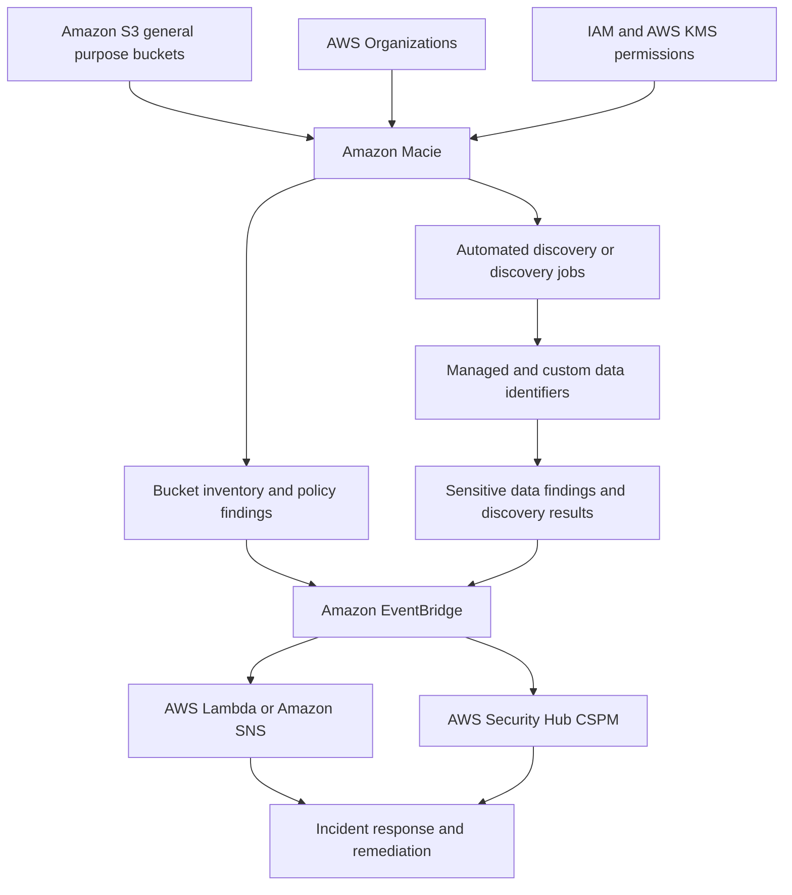

# Amazon Macie and Sensitive Data Discovery on S3

Amazon S3 commonly stores application exports, backups, customer records, financial reports, and analytics files. As bucket and object counts grow, operations teams struggle to know where sensitive data resides, who can access it, and which buckets have risky configurations. An overly broadly shared bucket or one accidentally allowing public access can expose personal data, payment information, or credentials.

Amazon Macie addresses this problem by inventorying S3 buckets, monitoring certain access permission risks, and analyzing object contents to detect sensitive data. Macie uses machine learning and pattern matching, providing findings for security teams to investigate and act upon. Within the AWS ecosystem, Macie commonly works alongside IAM, Amazon S3, AWS KMS, AWS Organizations, Amazon EventBridge, and AWS Security Hub CSPM to form a monitoring and response workflow.

## Learning Objectives

After this lesson, you will be able to:

- Explain the role, scope, and how Amazon Macie discovers sensitive data in S3.
- Distinguish automated sensitive data discovery from sensitive data discovery jobs.
- Select appropriate managed data identifiers, custom data identifiers, and allow lists.
- Read policy findings and sensitive data findings, then route them to response workflows.
- Plan a Macie deployment for a single account or multi-account environment while controlling scan scope and cost.

## What Problems Does Amazon Macie Solve?

Amazon Macie is a data security service focused on Amazon S3 general purpose buckets. When enabled in an AWS Region, Macie creates and maintains an inventory of buckets in that Region, evaluates certain security and access properties, and can analyze objects to identify sensitive data.

Macie provides two related but distinct capability groups:

1. **Bucket security evaluation:** monitors configuration or policy changes that reduce bucket privacy and security, such as a bucket becoming public or being shared outside intended boundaries.
2. **Sensitive data discovery:** analyzes S3 object contents using built-in or organization-defined identifiers, then generates findings when matching data is detected.

Macie helps answer questions such as:

- Which buckets exist in the Region, and which have noteworthy access configurations?
- Which buckets might contain personal data, financial data, or credentials?
- Which S3 objects show signs of containing sensitive data, and which identifiers detected them?
- Which findings should be prioritized for investigation, and which event-handling systems can receive them?

Macie focuses on data in S3. If data resides in RDS, Aurora, or DynamoDB, you may need to export data or snapshots to S3 in a supported format before analyzing with Macie. Macie also does not replace access control mechanisms, encryption, endpoint data loss prevention, or organizational data classification processes.

## Two Approaches to Sensitive Data Discovery

Macie offers two primary mechanisms. Choose based on monitoring goals: gaining broad visibility across the entire data estate, or deeply analyzing an identified dataset.

| Criterion | Automated Sensitive Data Discovery | Sensitive Data Discovery Job |
|---|---|---|
| Goal | Gain an overview of where sensitive data may exist | Purposefully analyze selected buckets or bucket criteria |
| Object selection | Macie evaluates inventory and samples representative objects | Operators select buckets or bucket criteria, then refine object scope |
| Execution schedule | Macie continuously evaluates inventory and analyzes on a daily cadence | Run once or recur on a daily, weekly, or monthly schedule |
| Best suited when | Mapping data sensitivity across many buckets | Investigating a specific bucket, prefix, object group, or audit requirement |
| Caveat | Results rely on sampling; does not prove every object was scanned | Offers tighter control over scope and analysis depth; requires managing job schedules and scope |

### Automated Sensitive Data Discovery

Once enabled, Macie evaluates the S3 bucket inventory and uses sampling techniques to select representative objects. Sampling considers groups of objects sharing similar metadata, such as bucket name, prefix, storage class, file extension, and modification timestamp. Macie retrieves selected objects to inspect their contents, then produces details on detected sensitive data and analysis results.

By default, scope can include the account's S3 general purpose buckets. In an organization environment, the Macie administrator can manage enablement across member accounts and adjust excluded buckets. Administrators can also tailor the managed data identifiers, custom data identifiers, and allow lists used during analysis.

Sampling helps Macie distribute analysis across many buckets to quickly provide an overview. However, the absence of findings in a bucket must not be interpreted as proof that no objects in that bucket contain sensitive data. When deep inspection of a specific dataset is required, create a discovery job with an appropriate scope and schedule.

### Sensitive Data Discovery Jobs

A discovery job is an automated analysis workflow that you configure. When creating a job, you choose one or more specific buckets or define criteria for Macie to identify target buckets when the job runs. You can narrow scope using object attributes such as prefixes, object tags, and modification timestamps.

Jobs can run once for an assessment or investigation, or run periodically to inspect new and modified data over time. You also select the managed data identifiers, custom data identifiers, and allow lists the job will use. This configuration determines what data types are searched for and which exceptions are ignored.

A sensible workflow is to use automated discovery to pinpoint areas likely holding sensitive data, then run targeted jobs on high-risk buckets or prefixes. This approach balances coverage, inspection depth, and cost.

## Data Identifiers

Macie uses three configuration components to decide what content counts as sensitive data and what should be ignored.

### Managed Data Identifiers

A managed data identifier is a built-in set of criteria and techniques provided by AWS to detect a specific data type. Data categories can include:

- Personally identifiable information (PII), such as passport numbers or certain national identification numbers.
- Financial information, such as payment card numbers or bank account numbers.
- Credentials, such as AWS secret access keys.
- Certain types of protected health information (PHI).

The catalog is maintained by AWS and may evolve over time. When creating a job, you can use the recommended set of managed identifiers, select specific identifiers, or customize the set for your audit objectives. The recommended set is usually a good starting point for a broad assessment because AWS selects identifiers aimed at common data types while limiting noise.

### Custom Data Identifiers

Custom data identifiers allow organizations to define proprietary data patterns. An identifier uses a regular expression (regex) to describe the target string; you can add keywords, phrases that must appear near a match, or terms to ignore.

For example, an organization uses customer IDs formatted as `CUS-` followed by eight digits. The identifier might use the illustrative regex `CUS-[0-9]{8}`. If this ID is only meaningful near the `customer_id` field, configure appropriate keywords and proximity rules to reduce unrelated matches.

Custom identifiers are useful for:

- Internal employee IDs or customer IDs.
- Proprietary case numbers, contract numbers, or transaction IDs.
- Data classification labels or intellectual property markers.

Test regex patterns against representative sample data before deploying broadly. Overly broad patterns increase false positives; overly narrow patterns can miss real data. Have business owners validate the format and meaning of the data field.

### Allow Lists

An allow list defines text or text patterns that Macie should ignore during analysis. For example, an organization might exclude public call-center phone numbers, published representative names, or synthetic test data.

Allow lists reduce false positives, yet must be governed as security configurations. Only add verified exceptions, restrict who can modify the list, and review periodically to avoid overlooking genuine sensitive data. Test allow lists on a small job before applying them to broad scans.

## Findings and Discovery Results

Macie generates findings to report issues requiring review. There are two main categories:

| Finding Category | When Generated | Investigation Examples |
|---|---|---|
| Policy finding | An S3 general purpose bucket's configuration or policy changes in a way that reduces security or privacy | S3 Block Public Access disabled, bucket becomes public, bucket shared with external account, or bucket encryption disabled |
| Sensitive data finding | Macie detects sensitive content in an S3 object during automated discovery or a discovery job | CSV file containing personal ID numbers, data export containing card numbers, or object containing an AWS secret access key |

Each finding has a type, severity level, affected resource details, and metadata describing when and how it was detected. Macie assigns Low, Medium, or High severity based on characteristics of the finding type and detected data. Severity helps prioritize investigations; it does not by itself reflect the business value of a bucket. A bucket holding copies of critical customer data may demand higher priority than a test bucket, even if both display the same severity.

When investigating a sensitive data finding, check the bucket, object key, detected data type, matched identifier, analysis timestamp, and related discovery results. Verify whether the object holds real or synthetic data, who owns the data, who can access it, and whether it is shared beyond authorized boundaries.

Macie also creates **sensitive data discovery results** to record per-object analysis details, including cases where an object could not be analyzed due to errors or unsupported conditions. Findings and discovery results are two distinct artifacts: a finding flags a noteworthy discovery, while a discovery result provides a record of the object analysis process.

Macie retains findings and sensitive data discovery results for a limited 90-day period. If long-term evidence is required for audits, extended investigations, or reporting, configure an S3 repository to store discovery results and design appropriate lifecycle policies, encryption, access controls, and retention periods. Long-term retention of findings must also be designed via APIs or event integrations into your organization's storage systems.

## Integration Architecture and Processing Flow

Macie detects and describes risks; other services handle routing, permission management, and response. A typical architecture can be implemented as follows:

In this model:

- **Amazon S3** stores the data to be inventoried and analyzed.
- **Amazon Macie** tracks inventory, evaluates buckets, and searches for sensitive data.
- **AWS Organizations** supports centralized Macie management across multiple accounts.
- **IAM and AWS KMS** control administrative permissions, bucket access, and encryption key usage when Macie needs to analyze objects.
- **Amazon EventBridge** receives findings as events and routes them to appropriate targets.
- **AWS Lambda or Amazon SNS** can trigger remediation workflows, notify owning teams, or open tickets via integrated systems.
- **AWS Security Hub CSPM** aggregates Macie findings with other security signals to evaluate overall security posture.

Do not automatically delete or move objects immediately upon receiving a finding. An event might be a false positive, test data, or data with specific owners and retention requirements. If automating remediation, define conditions, blast radius, approval mechanisms, and rollback procedures beforehand.

## Step-by-Step Macie Implementation

### 1. Define Scope and Responsibilities

List the AWS Regions storing S3 data, the accounts owning buckets, and the data groups requiring protection. Identify who serves as the Macie administrator, who manages buckets, who owns business data, and who receives findings. Macie is enabled per Region, so verify every Region containing relevant data.

### 2. Enable Macie and Inspect Inventory

Sign in to the AWS Management Console with an IAM identity holding Macie administrative permissions, select the target Region, and enable Macie. Upon activation, Macie creates the required service-linked role and begins building an inventory of S3 general purpose buckets in that Region. Check bucket counts, public access attributes, encryption, object counts, and generated policy findings.

### 3. Configure for a Multi-Account Environment

With AWS Organizations, the organization management account designates a member account as the delegated Macie administrator. The administrator then associates member accounts and enables Macie in each Region to monitor. You can configure automatic Macie enablement for new accounts, yet existing accounts and other Regions must still be verified individually. Organizations integration does not mean every account and Region is enabled automatically.

### 4. Configure Automated Sensitive Data Discovery

Enable automated discovery to obtain an overview. Inspect included buckets, exclude buckets that do not need analysis when justified clearly, and choose appropriate identifiers and allow lists. Monitor coverage to see which buckets or objects are ineligible for analysis.

### 5. Create Discovery Jobs for Priority Data

Create one-time jobs for initial assessments or scheduled jobs for data requiring ongoing monitoring. Select buckets or bucket criteria, narrow by prefix or object attributes when appropriate, and choose managed/custom identifiers and allow lists. Before running, confirm Macie can access the buckets and use required KMS keys to decrypt encrypted objects.

### 6. Configure Result Storage and Finding Routing

If long-term evidence is required, configure an S3 repository for sensitive data discovery results. Next, create EventBridge rules based on finding type, severity, account, or bucket. Route events to Lambda, SNS, Security Hub CSPM, or incident management systems per internal procedures.

### 7. Test with Sample Findings and Run Response Drills

You can generate sample findings in Macie to test filtering rules and integrations without waiting for real sensitive data to be discovered. Drill the full path from receiving an event to identifying owners, verifying data, tightening permissions, and documenting outcomes. After drills, refine priority thresholds, allow lists, and handling guides.

## Real-World Scenario: Detecting Customer Data in a Shared Bucket

An e-commerce application exports daily customer reports into the bucket `customer-export-prod`. CSV files may contain names, email addresses, phone numbers, and customer IDs. The data team needs to know whether these files are exposed outside the organization.

Implementation workflow:

1. Enable Macie in the bucket's Region and verify the bucket appears in inventory.
2. Check Block Public Access, bucket policy, encryption settings, and cross-account access permissions.
3. Enable automated discovery for an overview of buckets potentially holding personal data.
4. Create a discovery job focused on `customer-export-prod` and the report prefix. Use managed identifiers for relevant PII types; create a custom identifier if customer IDs follow a proprietary format.
5. Inspect findings and discovery results. Verify the object key, detected data types, owner, and current access permissions.
6. If findings show the bucket is unexpectedly shared externally, check bucket policy, access point policies, any legacy ACLs in use, and Block Public Access settings. Narrow access to required identities or roles.
7. If sensitive data was exposed outside intended boundaries, trigger incident response: preserve logs and evidence, determine exposure window/scope, notify responsible teams, and execute remediation steps per organizational policy.
8. Route findings to EventBridge and Security Hub CSPM for centralized monitoring. Set up recurring jobs and review settings whenever data formats or business requirements change.

The key takeaway in this scenario is that Macie findings provide investigative signals. Teams must still verify the data and access permissions before deciding on actions, and document results for auditability.

## Limitations, Permissions, and Costs

**Data scope:** Macie analyzes objects in S3 general purpose buckets with supported storage classes and formats. Certain storage classes such as S3 Glacier Deep Archive and S3 Express One Zone, S3 directory buckets, as well as image, audio, and video content are not analyzed as standard text data. Objects using unsupported formats or storage classes are treated as unclassifiable and skipped during analysis. Check unclassifiable object statistics in inventory so the absence of findings is not mistaken for verified clean data.

**Encryption and bucket policies:** If objects are encrypted, Macie needs permission to access and use the corresponding encryption keys. Overly restrictive bucket policies can also prevent Macie from reading objects. When planning, inspect IAM permissions, AWS KMS key policies, and bucket policies against current AWS guidance. Never broaden permissions excessively just to make a job run; grant only the required permissions.

**Accuracy:** Managed identifiers and custom identifiers rely on patterns and detection techniques, so results must be verified in business context. Allow lists reduce noise but can mask real data if configured too broadly. Periodically test against sample datasets containing both matching and non-matching cases.

**Sampling scope:** Automated discovery provides an overview based on representative objects. For targeted audit requirements, use discovery jobs and check coverage reports. Never use a sampling result to assert that every object in a bucket is clean.

**Cost:** Macie pricing includes components tied to maintaining bucket inventory and monitoring, as well as the number of objects or volume of data evaluated by sensitive data discovery features. Costs depend on S3 scale, job scope, schedules, and discovery settings. Before scaling out, estimate costs by Region and account, bound job scope, exclude data that does not require scanning, and monitor usage costs in Macie and AWS Billing.

## Best Practices

- Enable Macie in every Region containing data requiring protection and verify enablement status for each account in an Organizations environment.
- Use automated discovery for broad mapping; use jobs for deep audits or high-risk datasets.
- Start with recommended managed identifiers, then supplement with custom identifiers for proprietary data formats.
- Govern allow lists with approvals, owners, and review schedules; avoid overly broad exceptions.
- Monitor both policy findings and sensitive data findings. An object holding sensitive data inside a public bucket demands prioritized investigation.
- Store sensitive data discovery results in S3 if long-term evidence is required; configure encryption, access controls, and lifecycle rules for the repository.
- Route findings through EventBridge and Security Hub CSPM to centralize monitoring while ensuring every finding category has an owning team.
- Pair Macie with S3 Block Public Access, bucket policies, IAM least privilege, AWS KMS, and logging. Macie detects issues; those controls enforce access and protect data.
- Re-evaluate coverage, identifiers, job schedules, and costs whenever buckets, data formats, or compliance requirements change.

## Conclusion

Amazon Macie helps organizations understand where sensitive data resides in S3 and detect changes that could weaken bucket security or privacy. Automated sensitive data discovery fits broad sampling-based visibility; discovery jobs fit deep analysis of a selected scope. Managed identifiers, custom identifiers, and allow lists determine detection quality. When combined with EventBridge, Security Hub CSPM, IAM, KMS, and response procedures, Macie becomes an essential component of security monitoring and data protection on AWS.

## References

- [What is Amazon Macie?](https://docs.aws.amazon.com/macie/latest/user/what-is-macie.html)
- [Performing automated sensitive data discovery](https://docs.aws.amazon.com/macie/latest/user/discovery-asdd.html)
- [Creating a sensitive data discovery job](https://docs.aws.amazon.com/macie/latest/user/discovery-jobs-create.html)
- [Building custom data identifiers](https://docs.aws.amazon.com/macie/latest/user/custom-data-identifiers.html)
- [Types of Macie findings](https://docs.aws.amazon.com/macie/latest/user/findings-types.html)
- [Supported storage classes and formats](https://docs.aws.amazon.com/macie/latest/user/discovery-supported-storage.html)
- [Getting started with Macie](https://docs.aws.amazon.com/macie/latest/user/getting-started.html)
