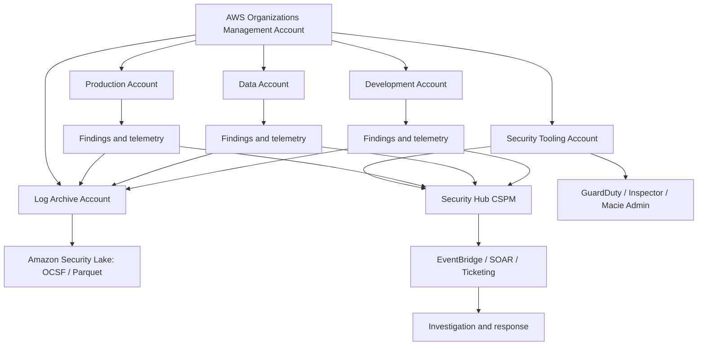
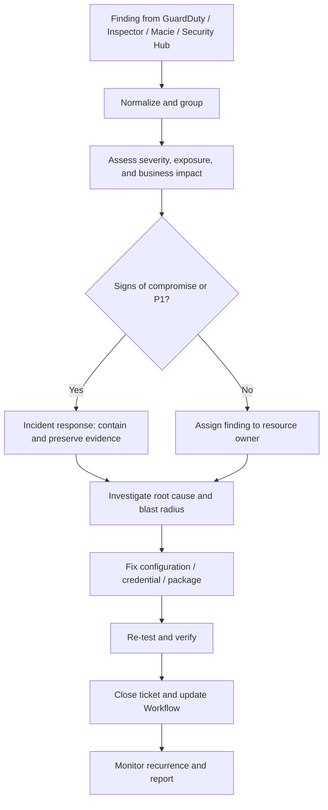

# Centralizing Security Findings in a Multi-Account Model

In an AWS organization spanning multiple accounts and Regions, security events surface across many places: GuardDuty detects suspicious behavior, Inspector identifies software vulnerabilities, Macie discovers sensitive data in Amazon S3, and Security Hub CSPM evaluates configurations against security standards. If every team must sign in to individual accounts to view results, the organization struggles to spot multi-workload attacks, prioritize risk, and avoid missing newly created accounts.

A centralized detection model solves this by organizing dedicated accounts, delegating security service administration, enabling detection across the entire Organization, aggregating findings, and routing them into a unified investigation workflow. AWS Organizations provides administrative boundaries; detection services continue running in each workload's account/Region; AWS Security Hub CSPM collects and normalizes findings; and Amazon EventBridge plus response tools route findings to the right owning teams. When large-scale log analytics is needed, Amazon Security Lake centralizes security data in OCSF schema for querying and threat hunting.

## Learning Objectives

After this lesson, you will be able to:

- Design a Security Tooling, Log Archive, and member account model in AWS Organizations.
- Distinguish the roles of Security Hub CSPM, GuardDuty, Inspector, Macie, Detective, and Security Lake.
- Set up delegated administrators and automatically enable detection services for new accounts.
- Distinguish Security Hub CSPM central configuration, declarative policies, and cross-Region aggregation.
- Read the AWS Security Finding Format (ASFF), assess priority levels, and manage finding workflows.
- Design EventBridge flows, automation, ticketing, and controlled remediation.
- Build workflows for triage, investigation, response, finding closure, and coverage monitoring.

## 1. The Security Detection Challenge in an Organization

Suppose an enterprise has `Production`, `Development`, `Data`, and `Sandbox` OUs spanning multiple Regions. An EC2 instance in a Production account could be exploited, a container image in ECR could have a vulnerable package, an S3 bucket in a Data account could contain personal data, and a security group in a Development account could expose an administrative port to the Internet.

Problems emerge when every service and account is managed separately:

- Security teams must constantly switch accounts/Regions to view findings.
- Each service uses different naming, severity scales, statuses, and data formats.
- A newly created account may lack GuardDuty, Inspector, Macie, or Security Hub CSPM enabled.
- Duplicate findings across sources waste operations teams' triage time.
- There is no unified place showing which findings are under investigation, who owns them, and when they must be addressed.
- Logs needed for investigation may reside across multiple accounts and disparate storage systems.

A sound architecture must satisfy four objectives:

1. **Coverage**: every account and Region requiring protection has appropriate detection services enabled.
2. **Visibility**: security teams can view centralized findings and see the associated source, account, Region, and resource.
3. **Prioritization**: distinguish critical issues requiring immediate action from informational alerts or acceptable risks.
4. **Response**: findings are assigned to owners, investigated, remediated, verified, and backed by evidence.

## 2. Centralized Security Account Architecture

In AWS Organizations, accounts should be separated by responsibility. A common model includes:

| Account | Role |
|---|---|
| Management account | Administers Organizations, OUs, SCPs, and registers delegated administrators for services |
| Security Tooling account | Security Operations team manages findings, security service configurations, and response workflows |
| Log Archive account | Stores centralized logs, supporting audits and long-term investigations |
| Member accounts | Runs applications, data, and workloads across OUs such as Production, Development, and Data |

The Security Tooling account is commonly designated as the delegated administrator for Security Hub CSPM, GuardDuty, Inspector, and Macie. For Security Lake, AWS recommends using the Log Archive account as delegated administrator so security data is centralized in the archival account. These registrations are independent: designating an account as delegated administrator for Security Hub does not automatically make it administrator for GuardDuty, Inspector, Macie, or Security Lake.



The management account should retain Organizations administration privileges and only perform actions needed to enable trusted access or register/deregister delegated administrators. Daily operations teams work via roles in the Security Tooling account. This separates Organization structure governance from incident investigation and response permissions.

## 3. Roles of AWS Detection Services

No single service detects every type of risk. The services below observe different dimensions and complement one another with findings.

| Service | Primary Detection | Example Finding |
|---|---|---|
| AWS Security Hub CSPM | Evaluates posture, security controls, and aggregates findings from integrations | S3 bucket lacks public access block; EC2 security group opens an inappropriate port |
| Amazon GuardDuty | Threat detection based on AWS logs and telemetry | Credentials used from a suspicious IP address; EC2 communicating with a command-and-control domain |
| Amazon Inspector | Software vulnerabilities and risks in EC2, ECR, and Lambda per supported configurations | Package with a critical CVE in an EC2 instance or container image |
| Amazon Macie | Sensitive data in Amazon S3 | Bucket contains personally identifiable information or financial data |
| Amazon Detective | Analyzes relationships and related activity to investigate findings | Traces roles, IPs, instances, and API calls linked to suspicious activity |
| AWS IAM Access Analyzer | Detects external access or policies potentially granting unintended permissions | S3 bucket or KMS key shared with an external account |
| AWS Firewall Manager | Governs protection policies and detects non-compliant resources | Resource missing a WAF Web ACL or security group drifting from baseline |
| Amazon Security Lake | Collects, normalizes, and stores security logs/events for analytics | VPC Flow Logs, CloudTrail, WAF logs, Security Hub findings in OCSF |

### Security Hub CSPM: Posture and Findings Hub

AWS Security Hub CSPM provides a centralized view of security posture and findings. It runs security checks against enabled standards and controls while ingesting findings from integrated AWS services and partner products. Findings are normalized into the AWS Security Finding Format (ASFF), enabling querying and automation over a unified structure.

Security Hub CSPM is well-suited to answer questions such as:

- Which accounts currently have many Critical or High findings?
- Which resources fail AWS Foundational Security Best Practices controls?
- Which findings have been assigned to an owner but remain unresolved?
- Does a vulnerability from Inspector affect a public resource or one holding sensitive data?
- Which accounts/Regions lack detection services enabled or lack coverage?

Security Hub CSPM only ingests findings created after an integration is enabled. Do not assume it will automatically backfill all historical findings from source services. During onboarding, enable integrations and verify the finding stream starts flowing.

### GuardDuty: Threat Behavior Detection

GuardDuty analyzes telemetry sources such as CloudTrail management events, VPC Flow Logs, and DNS logs to detect anomalous activity. Depending on enabled protection plans, GuardDuty can also analyze data from S3, EKS, runtime, RDS, Lambda, or malware protection.

GuardDuty answers the question: *Are there signs an account, workload, or data is being used suspiciously?* For example, an IAM credential used from an unusual location, an EC2 instance communicating with malicious infrastructure, or a workload exhibiting crypto-mining behavior.

### Inspector: Software Vulnerabilities and Exposure

Inspector assesses vulnerabilities in supported workloads such as EC2, container images in ECR, and Lambda. Scan scope and support conditions vary by workload type, Region, and configuration. Inspector findings help security teams identify packages, CVEs, exploitation paths, and affected resources.

Not every Critical CVE carries identical real-world risk. When prioritizing remediation, weigh exploitability, public exposure, network access paths, workload permissions, processed data sensitivity, and image/package lifetime.

### Macie: Sensitive Data Discovery

Macie analyzes Amazon S3 to detect sensitive data using managed data identifiers and custom data identifiers. Results identify buckets holding personal data, financial data, credentials, or special-category data.

Macie findings should be combined with access permissions, encryption, public access settings, replication, and bucket ownership. A bucket containing sensitive data with tightly locked-down permissions carries very different risk than a similar bucket permitting public access.

### Detective and Security Lake: Deep Investigation

Amazon Detective helps analyze entities and activities connected to findings by correlating security data over time. Security Lake centralizes logs/events from multiple sources into an S3-based data lake, converting supported AWS data to Apache Parquet and the OCSF schema.

Security Hub CSPM answers *which findings exist and what is the posture?* Security Lake helps answer *what happened in the logs, at what time, and involving which entities?* Detective connects entities and activities so investigators better understand an incident.

## 4. Delegated Administrators and Organizations

A delegated administrator is a member account authorized by Organizations to administer an AWS service across the Organization. Each service has its own registration process and scope. Only the management account can register or deregister a delegated administrator at the Organization level, while subsequent operational tasks are performed from the delegated administrator account.

### Design Principles

- Choose a dedicated, stable account for each service; do not pick a workload account that might be deleted or moved across OUs arbitrarily.
- Use the same Security Tooling account for Security Hub CSPM, GuardDuty, Inspector, and Macie if aligned with your operating model.
- Use the Log Archive account for Security Lake if you want to separate long-term log data from incident handling accounts.
- Record account IDs, Regions, services, owners, and change procedures for delegated administrators.
- Enable trusted access per each service's guidance and protect service-linked roles.

### Each Service Manages Accounts Differently

| Service | Organization Configuration | Important Notes |
|---|---|---|
| Security Hub CSPM | Management account registers delegated admin; delegated admin manages accounts, policies, and findings | Cannot use the Organizations management account as delegated administrator for central configuration |
| GuardDuty | Designates delegated admin; admin manages member accounts per Region | Use the same delegated admin account across all Regions with GuardDuty enabled |
| Inspector | Delegated administrator manages scans; AWS Organizations policies are now the recommended way to centrally enable Inspector | Verify account and Region coverage, especially new accounts |
| Macie | Management account designates delegated admin in each Region | Must repeat in each Region; use the same admin account across integrated Regions |
| Security Lake | Management account calls `RegisterDataLakeDelegatedAdministrator` to designate admin | One delegated admin per Organization; AWS recommends the Log Archive account |

Do not treat `Enabled` status in one Region as proof a service is enabled across the entire Organization. GuardDuty, Macie, Inspector, and Security Hub CSPM maintain separate Regional configurations; check every Region where workloads are permitted to run.

## 5. Security Hub CSPM: Managing Multi-Account Configuration

Security Hub CSPM can enable and configure standards, controls, integrations, and findings across multiple accounts. Security teams must choose the management mechanism suited to their current Organization setup.

### Declarative Policies vs. Central Configuration

Current AWS documentation recommends **Security Hub CSPM declarative policies** for centrally managing Security Hub CSPM within AWS Organizations. A declarative policy is an Organizations policy attached to the organization root, an OU, or an account. The policy defines which Regions have Security Hub CSPM enabled/disabled, which standards and controls are enabled, and supported control parameters.

Security Hub CSPM **central configuration** is an older mechanism where the delegated administrator creates configuration policies from a home Region and associates them with the root, OUs, or accounts. Central configuration and declarative policies cannot operate simultaneously within the same Organization. When attaching the first declarative policy, Security Hub CSPM disables central configuration across the entire Organization. If currently using central configuration, use the import tool in the Security Hub console to migrate before attaching a declarative policy, avoiding lost coverage or unexpected member overrides.

For new deployments, evaluate declarative policies first. For Organizations currently using central configuration, do not switch mechanisms without a migration plan and verification of existing associations.

### Home Region and Linked Regions

When using central configuration, the delegated administrator creates and manages configuration policies solely from the **home Region**. These policies take effect in the home Region and linked Regions. The home Region also aggregates findings, insights, and data from linked Regions.

Cross-Region aggregation and enabling Security Hub CSPM are two distinct operations:

- Enabling cross-Region aggregation only configures where data is aggregated; it does not automatically enable Security Hub CSPM in those Regions.
- Security Hub CSPM only aggregates data from accounts/Regions where the service is already enabled.
- With declarative policies, enabling the service in a Region and adding that Region to cross-Region aggregation are managed independently.
- An opt-in Region must be enabled in the account before Security Hub CSPM can operate there; an opt-in Region cannot serve as the home Region.

When adding a linked Region, central configuration policies begin applying in the new Region. When removing a linked Region, policies are no longer centrally managed in that Region; prior account configurations are retained and must be managed individually. Changing or deleting the home Region can delete central configuration policies and associations. Evaluate the impact carefully before making changes.

Some findings existing before a Region was linked may not immediately appear in the home Region until updated or expired. Resource inventory may also take time to synchronize. Therefore, after configuring aggregation, verify actual data rather than assuming immediate synchronization.

### Standards and Controls

Security Hub CSPM can evaluate environments against standards such as AWS Foundational Security Best Practices, CIS AWS Foundations Benchmark, PCI DSS, and other Region-supported standards. Each standard contains controls, and each control tests a specific requirement.

When selecting standards:

- Choose baselines matching compliance and architectural requirements.
- Avoid enabling every standard without evaluating cost, check scope, and overlapping controls.
- Check which controls require AWS Config recorders and which resource types must be recorded.
- Use control IDs as stable keys for automation; titles or descriptions may change.
- Use exceptions with owners, justifications, and expiration dates rather than disabling controls indefinitely.

## 6. Enabling Coverage for Detection Services

After registering delegated administrators, enable services for existing accounts and auto-apply to new accounts. These steps generally must be performed per Region.

### GuardDuty

GuardDuty supports auto-enabling organization members with three values:

- `ALL`: enables for all existing member accounts and new accounts.
- `NEW`: automatically enables only for new accounts joining the Organization.
- `NONE`: does not auto-enable; admin manages accounts individually.

Configuration can be applied separately for GuardDuty and each supported protection plan. For example, an organization may enable GuardDuty across all accounts while enabling certain protection plans only for the Production OU. Repeat configuration in every Region and check opt-in Regions. Updates may take time to propagate to all member accounts.

### Inspector

Inspector can be managed by a delegated administrator. Current documentation recommends using AWS Organizations policies to automatically enable Inspector across the Organization and apply to new accounts. If Organizations policies are not yet used, the delegated administrator can activate Inspector for existing accounts via console/API.

Check each scan type: EC2, ECR, and Lambda. An account showing Inspector enabled does not guarantee every scan type is configured and producing data. Coverage depends on workloads, agents/SSM, image pushes, runtimes, permissions, and service conditions.

### Macie

The management account designates a delegated Macie administrator in each Region. The delegated administrator then adds existing accounts as member accounts and can enable auto-enable for new accounts. Auto-enable does not automatically enroll all pre-existing accounts; existing accounts must be added/verified individually. Automated sensitive data discovery is also a separate setting that can be enabled for appropriate accounts.

### Security Hub CSPM

With declarative policies, attach policies to the organization root or OUs to manage Security Hub CSPM coverage by Region. New accounts and accounts moved between OUs inherit the effective policy based on their placement. If an account or Region is not governed by a policy, existing configurations may remain and must be monitored as self-managed scope.

With legacy local configuration, auto-enable primarily applies to new accounts in the current Region; it does not replace checking existing accounts and other Regions. Do not mix local configuration instructions with declarative policies or central configuration.

### Security Lake

The Security Lake delegated administrator can enable collection for member accounts and configure data sources for new accounts. For Security Lake, invoke `RegisterDataLakeDelegatedAdministrator` from the management account to register the delegated administrator per service guidance; do not substitute a generic Organizations command.

## 7. AWS Security Finding Format (ASFF)

Security Hub CSPM converts findings from integrated services into the AWS Security Finding Format. ASFF gives different sources a shared structure while retaining details about the finding provider and specific resource.

An ASFF finding typically includes these field groups:

| Field | Meaning |
|---|---|
| `Id` | Provider-generated finding identifier |
| `ProductArn` | Service or product generating the finding |
| `GeneratorId` | Component or rule generating the finding |
| `AwsAccountId` | Account containing the resource/finding |
| `Region` | Region associated with the finding |
| `Types` | Finding category classification |
| `CreatedAt`, `UpdatedAt`, `FirstObservedAt`, `LastObservedAt` | Finding timestamps |
| `Severity` | Provider-supplied or normalized severity level |
| `Resources` | Affected resources and identifying metadata |
| `Compliance` | Compliance status for compliance-type findings |
| `Workflow` | Internal investigation progress |
| `RecordState` | Whether the finding is active or archived |
| `Remediation` | Remediation guidance if supplied by the provider |
| `FindingProviderFields` | Additional provider-specific fields |

Abbreviated example:

```json
{
  "SchemaVersion": "2018-10-08",
  "Id": "example-finding-id",
  "ProductArn": "arn:aws:securityhub:us-east-1::product/aws/guardduty",
  "GeneratorId": "example-detector",
  "AwsAccountId": "123456789012",
  "Region": "us-east-1",
  "Types": ["TTPs/Command and Control"],
  "CreatedAt": "2026-11-20T08:00:00Z",
  "UpdatedAt": "2026-11-20T08:15:00Z",
  "Severity": {"Label": "HIGH", "Normalized": 70},
  "Resources": [
    {
      "Type": "AwsEc2Instance",
      "Id": "arn:aws:ec2:us-east-1:123456789012:instance/i-example"
    }
  ],
  "Workflow": {"Status": "NEW"},
  "RecordState": "ACTIVE"
}
```

This is a condensed structural example for learning how to read ASFF; real findings can contain many more fields and must conform to the current ASFF schema.

### Workflow Status and Record State

These two fields carry distinct meanings:

- `Workflow.Status` reflects investigation progress: `NEW`, `NOTIFIED`, `SUPPRESSED`, or `RESOLVED`.
- `RecordState` reflects whether the finding is active or archived: typically `ACTIVE` or `ARCHIVED`.

Marking a finding `RESOLVED` does not prevent Security Hub CSPM from generating a new finding for the same issue if the control continues detecting non-compliance. If compliance transitions from `PASSED` to `FAILED`, `WARNING`, or `NOT_AVAILABLE`, workflow status may revert to `NEW`. Therefore, fix the root cause and verify the resource is compliant rather than merely changing the finding status.

## 8. Aggregating Findings and Avoiding Duplication

Security Hub CSPM aggregates findings from multiple integrations. A single resource may simultaneously have:

- An Inspector finding for a package CVE.
- A GuardDuty finding for suspicious network behavior.
- A Security Hub control finding for a security group or IAM configuration.
- A Macie finding for sensitive data in a bucket.

These may be multiple signals concerning the same resource rather than duplicates. Retain the source, finding ID, and timestamp for investigation. When grouping, keys such as account, Region, resource ARN, finding type, CVE ID, detector ID, and time window can be used.

### Automation Rules

Security Hub CSPM automation rules can update ASFF fields or suppress findings based on conditions. For example:

- Mark `SUPPRESSED` for findings with a time-bound approved exception.
- Normalize severity from third-party integrations to organizational criteria.
- Add notes or user-defined fields to record owners or ticket IDs.
- Adjust workflow status once a finding has been handed off to another process.

Automation rules modify finding metadata inside Security Hub CSPM. They do not modify AWS resource configurations themselves. When actions outside Security Hub are needed, use EventBridge or response systems.

When writing rules for security controls, prefer filtering on control IDs rather than titles or descriptions because display text can change across updates.

### Cross-Region Aggregation

The home Region can receive findings, resources, and trends from linked Regions. When configuring, clarify which Regions should be aggregated and which have separate data residency requirements. Cross-Region aggregation does not automatically enable Security Hub CSPM in linked Regions and does not replace enabling the service in each account.

## 9. Prioritizing Findings by Real Risk

Never handle findings based solely on severity labels. Severity is one signal; actual risk also depends on the asset, exploitability, and access paths.

Evaluate these factors:

1. **Severity and confidence**: severity level and finding confidence.
2. **Exposure**: does the resource have a public endpoint, public IP, or broad trust relationship?
3. **Exploitability**: does the CVE have a known exploit and feasible exploitation conditions?
4. **Identity privilege**: does the associated role or credential hold administrative permissions or access to sensitive data?
5. **Data sensitivity**: does the resource contain personal data, financial records, or business secrets?
6. **Blast radius**: could the resource impact multiple accounts, services, or customers?
7. **Threat context**: do GuardDuty, threat intelligence, or other findings indicate active exploitation?
8. **Business criticality**: does the workload belong to payment systems, identity, customer data, or core services?

For instance, a High CVE on an isolated private EC2 instance running a test workload may rank lower than a Medium GuardDuty finding involving an IAM access key showing signs of unauthorized use in a production account. Conversely, a publicly exposed service with a CVE that has a public exploit may require emergency response.

### Suggested Prioritization Matrix

| Priority | Suggested Criteria | Handling Goal |
|---|---|---|
| P1 – Critical | Signs of active compromise, exposed privileged credentials, public exposure plus exploit, or unauthorized sensitive data access | Trigger incident response immediately, contain, and preserve evidence |
| P2 – High | Easily exploitable vulnerability on a critical resource, dangerous public configuration, or unintended access | Assign owner and remediate within short SLA |
| P3 – Medium | Baseline violation, conditionally exploitable vulnerability, or resource with limited exposure | Schedule remediation and track deadline |
| P4 – Low/Informational | Low risk, observational information, or posture improvement | Place in backlog, review periodically |

This is an illustrative internal matrix, not an official AWS severity mapping. Organizations must define their own SLAs and thresholds per risk governance policies.

## 10. Triage and Response Workflow

A finding-handling workflow should have clear statuses, owners, and evidence.



### Step 1: Intake and Validation

Record the finding ID, source, account, Region, resource ARN, timestamp, severity, finding type, and related findings. Verify the finding is still active and latest data has updated. Never suppress a finding simply because a resource owner claims it is a test environment.

### Step 2: Identify Owner

Use account inventory, resource tags, CMDB, or ownership systems to locate the responsible team. If ownership is unclear, route to Security Operations or Cloud Platform to determine ownership. Record the ticket ID and assignment timestamp.

### Step 3: Containment When Compromise Is Suspected

For active incidents, prioritize halting harmful activity and preserving evidence. For example:

- Revoke or disable an exposed access key after assessing impact.
- Isolate an EC2 instance using a tested runbook.
- Block malicious IP addresses or domains using appropriate control layers.
- Restrict S3 or KMS access when unauthorized access is suspected.
- Preserve snapshots, CloudTrail, VPC Flow Logs, and application logs before making changes that could destroy traces.

Containment must follow approved playbooks; automated actions can disrupt workloads or destroy evidence if misapplied.

### Step 4: Investigation and Remediation

Combine GuardDuty, Detective, CloudTrail, VPC Flow Logs, Security Hub CSPM, Inspector, and application logs to build a timeline. Identify initial access, persistence, privilege escalation, lateral movement, data access, and exfiltration if present.

Remediate the root cause—for example, update packages, rotate credentials, tighten IAM policies, fix security groups, enable encryption, or adjust S3 bucket policies. Never close a finding without verifying the actual configuration.

### Step 5: Verification and Closure

Re-run checks or wait for the source service to update the finding. Confirm controls are `PASSED`, packages no longer carry the CVE, old credentials are invalidated, or resources are protected. Update the ticket, evidence, owner, and `Workflow.Status` appropriately. If the issue recurs, the finding may return to `NEW`; address the underlying cause of recurrence.

## 11. EventBridge and Response Automation

Security Hub CSPM automation rules are suited for normalizing or updating finding metadata. Amazon EventBridge is suited for triggering actions outside Security Hub CSPM.

A response flow may include:

1. Security Hub CSPM emits a finding event.
2. An EventBridge rule filters by account, Region, product, severity, resource type, or control ID.
3. EventBridge sends the event to Lambda, Step Functions, SNS, SQS, or a ticketing integration.
4. The workflow validates the finding, checks idempotency, and enriches context.
5. If the action is low-risk and pre-approved, the workflow remediates automatically.
6. If the action could cause disruption, require on-call or owner approval.
7. The workflow verifies the result, updates the ticket, and logs the action.

Automation rules in Security Hub CSPM execute before EventBridge rules. Consequently, EventBridge may receive findings after automation rules have updated relevant fields.

### Example EventBridge Event Pattern

The following example illustrates filtering findings with severity label HIGH or CRITICAL. Adjust the pattern to match your event envelope and organizational goals.

```json
{
  "source": ["aws.securityhub"],
  "detail-type": ["Security Hub Findings - Imported"],
  "detail": {
    "findings": {
      "Severity": {
        "Label": ["HIGH", "CRITICAL"]
      },
      "RecordState": ["ACTIVE"]
    }
  }
}
```

For security control findings, filter by `Compliance.SecurityControlId` or the appropriate ASFF control ID field. For GuardDuty/Inspector/Macie findings, filter by `ProductArn`, `Types`, resource type, and account. Never filter solely by title because titles can change.

### Automation Guardrails

- **Idempotency**: the same finding may be redelivered; workflows must not execute destructive actions repeatedly.
- **Least privilege**: Lambda/Step Functions hold permissions only for the resources and accounts they must handle.
- **Approval**: isolating production workloads, deleting resources, rotating credentials, or modifying privileged permissions require risk-appropriate approval.
- **Rate limiting**: prevent hundreds of findings from triggering hundreds of simultaneous remediations.
- **Timeouts and retries**: bound retries, apply backoff, and route failures to dead-letter queues when needed.
- **Audit trail**: log finding ID, principal, action, resource, approval, and outcome.
- **Rollback**: prepare configuration recovery procedures if remediation causes unintended impact.
- **Data protection**: never place secrets or sensitive data into unprotected event payloads, logs, or tickets.

## 12. Security Lake and Threat Hunting

While Security Hub CSPM centralizes findings, Security Lake collects security logs and events from multiple sources. Security Lake stores data in S3 owned by the data lake account, converting supported AWS sources into Apache Parquet and the Open Cybersecurity Schema Framework (OCSF).

Sources can include:

- CloudTrail management events and selected data events.
- Amazon VPC Flow Logs.
- Route 53 Resolver query logs.
- AWS WAF logs.
- Amazon EKS audit logs.
- Security Hub CSPM findings.
- Integrated custom or third-party sources.

Security Lake supports two primary subscriber types:

- **Data access subscriber**: receives notifications of new objects or accesses source data via granted mechanisms.
- **Query access subscriber**: queries data through AWS Lake Formation and services such as Amazon Athena.

Subscribers should only access required sources and Regions. The Security Tooling account can act as an analytics subscriber, while the Log Archive account retains data lake management permissions. When enabling Security Lake, explicitly define sources, Regions, rollup Regions, retention, encryption, access policies, and subscribers.

When enabling Security Hub CSPM findings as a source, Security Lake receives an independent finding stream and converts ASFF to OCSF. Security Lake does not manage findings or alter Security Hub CSPM configurations; updating workflows and investigating findings still occur in Security Hub CSPM or source services.

### Example Investigation Queries

An investigation may need to answer:

- Which source IP connected to EC2 prior to GuardDuty's detection timestamp?
- Which IAM principal called the API that altered a bucket policy?
- Were there DNS queries to domains linked to threat intelligence?
- Was any S3 data accessed or downloaded abnormally?
- Did the same IP or principal appear across multiple accounts?

Answering these questions typically requires combining Security Hub findings with CloudTrail, VPC Flow Logs, Route 53 logs, and S3 data events. Security Lake normalizes data for cross-source analysis, though collecting each source must be explicitly enabled and can incur costs.

## 13. Coverage and New Account Controls

One of the most common mistakes is checking only existing accounts while neglecting new ones. When an account is created or moved across OUs, onboarding must enable security services and confirm findings reach the hub.

### Coverage Matrix

| Account/OU | Security Hub CSPM | GuardDuty | Inspector | Macie | Security Lake |
|---|---|---|---|---|---|
| Production | Declarative policy enabled by Region | `ALL` or `NEW` per protection plan | Organizations policy enables required scans | Enabled per S3 data needs | Collects logs and findings |
| Data | Declarative policy with data controls | Threat detection enabled | Workload scans enabled | Discovery enabled for target buckets | Collects CloudTrail/S3/VPC/Macie/SH findings |
| Development | Dedicated policy, may relax appropriate controls | Baseline enabled | Scans ECR/EC2/Lambda | Per data classification | Collects with appropriate retention |
| Sandbox | Explicit scope and time-bound exceptions | Enabled or disabled per risk policy | Enabled if running supported workloads | Enabled only if S3 holds data requiring inspection | May limit sources to control cost |

This is an example matrix. Final decisions must reflect data classification, threat models, compliance obligations, and costs.

### Account Onboarding Workflow

1. Account is created in the intended OU.
2. AWS Organizations policies/SCPs apply baseline IAM and Region guardrails.
3. Each service's delegated administrator picks up the account and enables the service in required Regions.
4. Security Hub CSPM declarative policies manage standards, controls, and enablement.
5. GuardDuty auto-enable and protection plans are verified.
6. Inspector scan coverage is verified across EC2/ECR/Lambda.
7. Macie is enabled if the account hosts S3 buckets with sensitive data.
8. Security Lake collects sources per Organization configuration.
9. EventBridge and ticketing receive a test sample finding.
10. Coverage dashboards confirm the account no longer shows missing or unknown status.

### Periodic Checks

- Compare accounts in Organizations against member account lists in each service.
- Check every Region, including opt-in Regions.
- Confirm GuardDuty auto-enable has not unexpectedly reverted to `NONE`.
- Check whether GuardDuty protection plans were disabled individually.
- Confirm Inspector has recent scan data rather than merely enabled status.
- Check Macie discovery jobs/automated discovery and S3 inventory.
- Confirm Security Hub CSPM is receiving findings from integrations.
- Confirm Security Lake sources and subscribers remain active.

### CLI Checks for Findings and Aggregation

The commands below are read-only query examples. Run them using an authorized role in the delegated administrator account in the appropriate Region.

```bash
# Retrieve a sample of active High findings in the Region.
aws securityhub get-findings \
  --region us-east-1 \
  --filters '{"SeverityLabel":[{"Value":"HIGH","Comparison":"EQUALS"}],"RecordState":[{"Value":"ACTIVE","Comparison":"EQUALS"}]}' \
  --max-results 10

# Check home Region and linked Regions configuration.
aws securityhub get-finding-aggregator --region us-east-1

# Check GuardDuty auto-enable configuration in the Region.
aws guardduty describe-organization-configuration \
  --detector-id <detector-id> \
  --region us-east-1
```

Replace `<detector-id>` with the delegated GuardDuty administrator's detector ID in the corresponding Region. List APIs may return `NextToken`; automation must paginate to avoid missing findings. Never write raw finding payloads containing sensitive details to public logs.

## 14. Dashboards, Metrics, and Operational SLAs

A good dashboard reflects both security outcomes and pipeline operational health.

| Metric | Meaning |
|---|---|
| Account coverage | Percentage of accounts with required services enabled |
| Region coverage | Percentage of Regions with active detectors/scans/policies |
| New Critical/High findings | New critical/high findings within the period |
| Mean time to acknowledge (MTTA) | Time from finding appearance to owner acknowledgment |
| Mean time to remediate (MTTR) | Time from acknowledgment to remediation and verification |
| Overdue findings | Findings breaching priority SLAs |
| Reopened findings | Findings recurring after closure |
| Suppressed findings | Suppressed findings requiring exception review |
| EventBridge delivery failures | Failures in response or ticketing pipelines |
| Security Lake source freshness | Latency of log/event arrival in the data lake |

Never report total finding count in isolation. Finding counts may rise due to improved coverage, added accounts, or newly enabled standards; counts may drop due to remediation or accidentally disabling controls. Always view alongside coverage, time to detect, and recurrence trends.

Set SLAs by priority and workload tier. For example, P1 requires acknowledgment within minutes and incident response activation; P2 requires owner confirmation within the shift; P3 carries a policy remediation deadline; P4 enters the backlog. Exact numbers are internal decisions aligned with operational capacity.

## 15. IAM and Protecting Security Data

Security Tooling and Log Archive accounts hold data capable of revealing organizational architecture, identities, vulnerabilities, and activity. Access must be strictly controlled.

- Use IAM Identity Center/federation and MFA for operators.
- Separate permissions to view findings, update workflows, alter configuration policies, and execute remediation.
- Permit only delegated administrators to manage respective Organization configurations.
- Apply least-privilege resource policies and cross-account roles.
- Protect the S3 data lake with encryption, bucket policies, Lake Formation permissions, and retention controls.
- Use customer-managed KMS keys when key policy control, auditing, and separation of duties are required.
- Do not forward findings containing sensitive data into ticketing systems lacking proper access controls.
- Protect EventBridge, Lambda, and Step Functions using dedicated resource policies and execution roles.
- Monitor CloudTrail management events for changes to delegated administrators, policies, integrations, and data access.
- Review service-linked roles; never delete roles while services still depend on them.

## 16. Cost and Optimization

Centralized detection incurs costs across multiple layers. Evaluate costs for source services, Security Hub CSPM, Security Lake, AWS Config, log storage, queries, and response automation.

| Component | Cost-Driving Factors |
|---|---|
| GuardDuty | Analysis volume across data sources and enabled protection plans |
| Inspector | Number of scanned workloads/resources, scan duration, and scan types |
| Macie | Number of analyzed objects, discovery, and classification jobs |
| Security Hub CSPM | Number of security checks/controls, finding volume, and integration settings per current pricing |
| AWS Config | Configuration items, rule evaluations, and recorder coverage |
| Security Lake | Ingestion, transformation, S3 storage, queries, and replication |
| Athena | Data scanned per query; partition pruning reduces data read |
| EventBridge/SOAR | Events, invocations, workflow executions, logs, and ticket integrations |

Optimization measures:

- Select standards and controls based on requirements; avoid enabling controls without clear purpose.
- Use Security Hub CSPM declarative policies to maintain consistent configurations and avoid manual account drift.
- Select GuardDuty protection plans aligned with your threat model and workload types.
- Enable Inspector scans for the right resource types and exclude out-of-scope workloads where policy permits.
- Scope Macie discovery to data classification and S3 requirements.
- Design Security Lake sources, retention, and subscribers around actual needs; avoid collecting all logs indefinitely.
- Use partitions and filters in Athena; query only needed Regions/sources.
- Filter EventBridge events before launching expensive workflows.
- Track costs by account, Region, OU, and owner.

Service pricing varies by Region and usage. Before broad rollout, use the AWS Pricing Calculator and official pricing pages for each service to estimate across account count, Regions, workloads, and data volumes.

## 17. Hands-On Lab: Centralizing GuardDuty and Security Hub CSPM

The objective is to build a finding pipeline from a member account to the Security Tooling account.

### Preparation

1. An AWS Organization with a Security Tooling account.
2. Management account permissions to register delegated administrators.
3. Security Hub CSPM and GuardDuty supported in target Regions.
4. A member account with a test EC2 instance or ability to generate sample findings.
5. An IAM role for the security team to access findings.

### Execution

1. Register the Security Tooling account as delegated administrator for Security Hub CSPM.
2. Set up declarative policies for the organization root or a test OU, enabling Security Hub CSPM and required standards.
3. Configure home/linked Regions for cross-Region aggregation per plan.
4. Register the Security Tooling account as delegated GuardDuty administrator.
5. Enable GuardDuty for existing accounts and configure `NEW` or `ALL` auto-enable appropriately per Region.
6. Generate a sample GuardDuty finding in the member account.
7. Verify the finding appears in the GuardDuty administrator and Security Hub CSPM.
8. Create an automation rule that only updates metadata on the test finding.
9. Create an EventBridge rule routing the finding to SNS or a non-mutating Lambda.
10. Verify account ID, Region, resource ID, severity, workflow status, and event delivery.

### Expected Outcomes

- The delegated administrator manages member accounts.
- Security Hub CSPM is enabled accurately per declarative policy.
- GuardDuty detects and forwards findings from member accounts.
- Findings are visible in the home Region once aggregation is active.
- EventBridge triggers only for findings matching conditions.
- Workflows perform no unintended remediation.

## 18. Real-World Design Scenarios

### Scenario A: Compromised Credential Detected

GuardDuty detects anomalous IAM access key behavior in Production. Security Hub CSPM receives the finding, and EventBridge filters by account and severity to create an incident ticket. Security Operations verifies the principal, CloudTrail timeline, and accessed resources. If compromise is confirmed, responders disable the credential, rotate related secrets, inspect permissions, and check for lateral movement.

### Scenario B: CVE in a Public Container Image

Inspector detects a critical CVE in an ECR image deployed to a public service. The security team checks the image digest, workload, exposure, exploitability, and owner. The CI/CD pipeline rebuilds the image with the patched package, rescans, signs the artifact if required by policy, and deploys the new version. The finding is closed only after Inspector confirms the vulnerable package is gone from the workload.

### Scenario C: S3 Bucket Containing Personal Data

Macie detects a bucket holding sensitive data. Security Hub CSPM adds a finding regarding the bucket policy or encryption. The Data Security team inspects the owner, public access, cross-account access, KMS key, and access logs. If exposure exists, restrict access immediately, preserve CloudTrail data events, and assess potential data access.

### Scenario D: New Account Shows Zero Findings

A new Production account is provisioned, yet the Security Hub dashboard shows no data. Operations checks Organizations, effective declarative policies, Region opt-in, GuardDuty auto-enable, Inspector policies, and finding integrations. An account with zero findings does not mean the account is secure; services may not be enabled or telemetry may not be flowing yet.

## 19. Common Design Pitfalls

- **Registering delegated administrator only for Security Hub**: GuardDuty, Inspector, Macie, and Security Lake require separate registrations.
- **Enabling a service in one Region and assuming full Organization coverage**: most administrative configurations and enablement apply per Region.
- **Confusing cross-Region aggregation with enablement**: aggregation does not automatically enable Security Hub CSPM in linked Regions.
- **Enabling central configuration and declarative policies simultaneously**: the two mechanisms are mutually exclusive; migrate using the appropriate import tool.
- **Failing to auto-enable new accounts**: new accounts may miss detectors or scans without organization policies/auto-enable.
- **Treating a RESOLVED finding as permanently fixed**: findings can reappear when controls continue detecting non-compliance.
- **Suppressing findings just to tidy dashboards**: suppression does not replace remediation and requires justification, owner, and expiry.
- **Prioritizing solely by severity**: also evaluate exposure, exploitability, identity privilege, data sensitivity, and business impact.
- **Automatically isolating every EC2 instance with a GuardDuty finding**: can cause outages or destroy evidence on false positives.
- **Treating Security Lake as a finding workflow manager**: Security Lake serves log storage/analytics; finding management remains in source services/Security Hub CSPM.
- **Skipping sample finding tests after onboarding**: enabled settings alone do not prove the pipeline works end-to-end.
- **Ignoring AWS Config and data ingestion costs**: costs accrue across posture, logging, and querying layers.

## 20. Production Operational Checklist

Before moving a centralized detection model to production, verify:

- [ ] Security Tooling account and Log Archive account have clear owners and permission boundaries.
- [ ] Management account retains only necessary Organizations permissions.
- [ ] Delegated administrators are registered separately for Security Hub CSPM, GuardDuty, Inspector, Macie, and Security Lake when used.
- [ ] GuardDuty delegated administrator is consistent across all enabled Regions.
- [ ] Inspector Organizations policies or activation procedures cover existing and new accounts.
- [ ] Macie is enabled in the right Regions and accounts containing S3 buckets with sensitive data.
- [ ] Security Hub CSPM declarative policies are evaluated/applied; if central configuration remains, a clear migration plan exists.
- [ ] Home Region and linked Regions reflect data residency and operational requirements.
- [ ] Opt-in Regions are enabled before deploying required services.
- [ ] AWS Config records sufficient resource types for Security Hub CSPM controls.
- [ ] Finding integrations are enabled and verified with sample findings.
- [ ] EventBridge rules include proper filters, retries, DLQs, and idempotency.
- [ ] Automation requires approval for high-risk actions.
- [ ] Findings have owners, priorities, SLAs, and exception processes.
- [ ] Security Lake sources, retention, encryption, and subscribers follow least privilege.
- [ ] Dashboards measure coverage, MTTA, MTTR, overdue, reopened, and pipeline failures.
- [ ] CloudTrail monitors changes to admins, policies, integrations, and data access.
- [ ] Incident response drills and end-to-end new account onboarding tests have been completed.
- [ ] Costs have been estimated for detectors, scans, controls, Config, ingestion, storage, and queries.

## Conclusion

Centralizing security detection in AWS requires coordinated layers. GuardDuty spots threat signals, Inspector uncovers vulnerabilities, Macie locates sensitive data, Security Hub CSPM evaluates posture and normalizes findings, and Detective plus Security Lake support deeper investigation. AWS Organizations and delegated administrators manage these services across accounts; home Regions and linked Regions support multi-Region aggregation.

For reliability, manage coverage as a continuous operational requirement: new accounts must get required services enabled, Regions must be audited, findings must reach the hub, and every critical finding must have an owner and response workflow. Combine guardrailed automation, protected investigative data, response-time dashboards, and periodic testing to detect risks early across the entire Organization.

## References

- [AWS Security Hub CSPM User Guide](https://docs.aws.amazon.com/securityhub/latest/userguide/what-is-securityhub.html)
- [Managing accounts with declarative policies in Security Hub CSPM](https://docs.aws.amazon.com/securityhub/latest/userguide/accounts-orgs-policies.html)
- [Declarative policies and central configuration in Security Hub CSPM](https://docs.aws.amazon.com/securityhub/latest/userguide/orgs-policies-and-central-config.html)
- [Understanding central configuration in Security Hub CSPM](https://docs.aws.amazon.com/securityhub/latest/userguide/central-configuration-intro.html)
- [Impact of central configuration on cross-Region aggregation](https://docs.aws.amazon.com/securityhub/latest/userguide/aggregation-central-configuration.html)
- [Understanding cross-Region aggregation in Security Hub CSPM](https://docs.aws.amazon.com/securityhub/latest/userguide/security-hub-region-aggregation.html)
- [AWS Security Finding Format (ASFF)](https://docs.aws.amazon.com/securityhub/latest/userguide/securityhub-findings-format.html)
- [Automatically modifying and acting on findings in Security Hub CSPM](https://docs.aws.amazon.com/securityhub/latest/userguide/automations.html)
- [Setting the workflow status of findings in Security Hub CSPM](https://docs.aws.amazon.com/securityhub/latest/userguide/findings-workflow-status.html)
- [Managing GuardDuty accounts with AWS Organizations](https://docs.aws.amazon.com/guardduty/latest/ug/guardduty_organizations.html)
- [Setting GuardDuty organization auto-enable preferences](https://docs.aws.amazon.com/guardduty/latest/ug/set-guardduty-auto-enable-preferences.html)
- [Activating Amazon Inspector scans for member accounts](https://docs.aws.amazon.com/inspector/latest/user/adding-member-accounts.html)
- [Amazon Inspector integration with Security Hub CSPM](https://docs.aws.amazon.com/inspector/latest/user/securityhub-integration.html)
- [Integrating and configuring an organization in Macie](https://docs.aws.amazon.com/macie/latest/user/accounts-mgmt-ao-integrate.html)
- [Managing Macie member accounts for an organization](https://docs.aws.amazon.com/macie/latest/user/accounts-mgmt-ao-administer.html)
- [Managing multiple accounts with AWS Organizations in Security Lake](https://docs.aws.amazon.com/security-lake/latest/userguide/multi-account-management.html)
- [What is Amazon Security Lake?](https://docs.aws.amazon.com/security-lake/latest/userguide/)
- [Open Cybersecurity Schema Framework (OCSF) in Security Lake](https://docs.aws.amazon.com/security-lake/latest/userguide/open-cybersecurity-schema-framework.html)
- [Security Hub CSPM findings in Security Lake](https://docs.aws.amazon.com/security-lake/latest/userguide/security-hub-findings.html)
