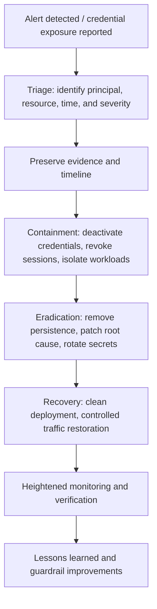
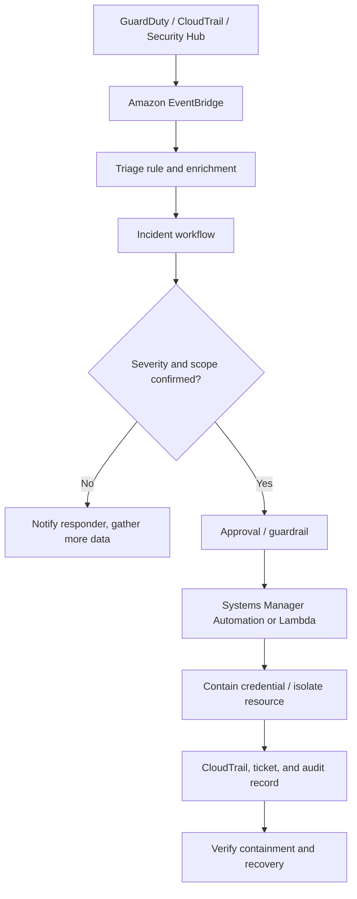

# Playbook for Compromised Credentials and Compromised Resources

An exposed AWS credential can allow an unauthorized actor to call APIs under a legitimate identity, read data, provision resources, alter network configurations, or seize administrative control. A compromised workload can likewise become a launchpad to steal temporary credentials, move laterally, and access other resources. Therefore, upon detecting signs of exposure or compromise, operations teams must rapidly identify affected identities and resources, block attacker access, preserve evidence, eradicate root causes, and restore services safely.

This playbook guides response to common AWS scenarios: publicly exposed IAM access keys, stolen role sessions, secrets leaked in source code, compromised EC2 instances or containers, unauthorized database or S3 access, and misused KMS permissions. The workflow builds upon the principles of the `CLOUD_PROVIDERS_AWS` module: IAM and authorization, VPC and network isolation, encryption, monitoring, recovery, and cost control.

After this lesson, you will be able to:

- Distinguish AWS credential types and understand the limits of each revocation method.
- Execute the sequence of detection, assessment, containment, eradication, and recovery.
- Deactivate exposed access keys, revoke role sessions, and rotate secrets safely.
- Isolate compromised EC2 instances, ECS/EKS workloads, and data resources.
- Collect CloudTrail, VPC Flow Logs, GuardDuty, and related evidence.
- Establish CLI commands, guardrails, and change-control workflows for repeatable incident response.
- Verify clean resources, fresh credentials, and least-privilege access before reopening services.

## 1. Understanding Credential Exposure and Workload Compromise

A **credential** is information or an identity carrier used to prove access rights. In AWS, credentials include access keys, temporary security credentials, console passwords, application tokens, database secrets, SSH keys, or certificate private keys.

**Credential exposure** occurs when a credential becomes public or leaves the boundary of authorized personnel, such as:

- Access keys committed to a Git repository or written to logs.
- Secrets appearing in tickets, chat messages, build artifacts, or container images.
- Credentials stolen via phishing, malware, or a compromised developer machine.
- Temporary tokens read from an application's runtime environment.
- Private keys or database passwords stored in unprotected files.

**Workload compromise** occurs when a server, container, function, or application component falls under unauthorized control. Attackers may exploit vulnerabilities, execute code, establish persistence, extract environment credentials, or leverage the workload's existing permissions.

These two incident types are often intertwined. A compromised EC2 instance can access instance profile credentials; an exposed IAM access key can be used to assume roles, open security groups, or read secrets. Consequently, merely patching a server or rotating a single password may fail to end the incident.

### 1.1. Assets to Protect

When scoping an incident, identify which of the following assets may be affected:

| Asset Group | Examples | Potential Impact |
|---|---|---|
| Identities | IAM users, roles, root user, Identity Center permission sets | Unauthorized access, privilege escalation, persistence creation |
| Credentials | Access keys, STS tokens, passwords, API tokens, SSH keys | Identity impersonation, API calls, or sign-in |
| Compute | EC2, ECS tasks, EKS pods/nodes, Lambda | Code execution, crypto-mining, pivoting to other systems |
| Data | S3 objects, EBS volumes, RDS, DynamoDB | Reading, modifying, deleting, or exfiltrating data |
| Network | VPC, route tables, security groups, NACLs, firewalls | Opening access paths, tunneling, or bypassing controls |
| Encryption | KMS keys, key policies, Secrets Manager | Decrypting data, altering permissions, or disrupting services |
| Audit | CloudTrail, Config, Flow Logs, application logs | Loss of detection and forensic capability if logs are altered/deleted |

Do not assume every resource in an account is compromised. However, treat every resource accessible to the exposed credential as in scope for inspection until ruled out by evidence.

## 2. Response Principles

During incident handling, balance speed of blocking the attack, preserving evidence, and maintaining service continuity.

1. **Protect people and data first**: prioritize halting ongoing sensitive data exfiltration, destruction, and unauthorized access.
2. **Targeted containment**: restrict affected credentials, roles, network paths, or workloads; avoid accidentally locking out the entire system unless necessary.
3. **Preserve evidence**: save logs, snapshots, and timelines before deleting or terminating resources that may hold forensic traces.
4. **Assume credentials were copied**: removing a secret from Git does not invalidate the old credential; you must revoke or rotate it.
5. **Verify the actual identity**: analyze principal ARN, session name, source IP, user agent, Region, and called APIs.
6. **Never assume clean state merely because an alert closed**: inspect for persistence, newly created resources, trust policies, access keys, and unusual permissions.
7. **Recover from trusted sources**: use verified images, artifacts, backups, and configurations.
8. **Log every change**: who executed it, when, why, target resource, and outcome.

A containment action can disrupt production. The incident commander must specify the objective, scope, and rollback criteria before making broad configuration changes.

## 3. Incident Handling Lifecycle

A practical workflow divides into six phases. Phases may iterate as additional compromised credentials or resources are discovered.



| Phase | Goal | Required Outcome |
|---|---|---|
| Detect | Recognize anomalous indicators | Finding, alert, or report logged |
| Triage | Determine scope and severity | Principal, resource, timestamp, account/Region |
| Contain | Stop ongoing unauthorized access | Credentials deactivated, sessions revoked, workloads isolated |
| Eradicate | Remove root cause and persistence | Fresh secrets, clean images, repaired policies and configurations |
| Recover | Restore service safely | Health checks passing, permissions verified, data consistent |
| Learn | Prevent recurrence | Report, action items, detections, and runbooks updated |

### 3.1. Incident Severity Classification

This is a suggested operational scale; organizations must tailor it to internal SLAs and procedures.

| Severity | Examples | Handling Approach |
|---|---|---|
| Critical | Root credential exposed; admin access seized; sensitive data actively exfiltrating; multiple accounts impacted | Engage incident commander, security, cloud platform, and data owners immediately; emergency containment |
| High | Broadly privileged IAM key used from unfamiliar location; production EC2 compromised; KMS key policy altered without authorization | Isolate principal/workload, investigate linked accounts/Regions, assess data impact |
| Medium | Low-privilege application secret exposed with no observed abnormal activity | Revoke and rotate, inspect logs and resource access, verify scope |
| Low | Expired test secret found in a private repository with no effective access permissions | Handle per credential exposure process, check history, and improve secret scanning |

Do not downgrade severity simply because no usage evidence has been found yet. Credentials may have been copied without being exercised yet; still revoke and investigate.

## 4. Triage: Determining What Was Exposed

In the initial minutes, answer these questions:

- What credential type is involved: IAM user access key, role session, root, secret, token, or private key?
- Who owns it and which workload uses the credential?
- What permissions does the credential hold, and which accounts/Regions can it reach?
- Where and when did the credential first appear?
- Are there signs of use from unfamiliar IPs, ASNs, devices, or Regions?
- Which APIs were called? Were users/keys/roles created, policies changed, SGs opened, or data read?
- Were any new resources, snapshots, AMIs, Lambda layers, container images, or access keys created?
- Are there signs of log deletion or tampering with CloudTrail, GuardDuty, or security controls?

### 4.1. Verifying the Active Principal

Use AWS STS to identify the current CLI session's identity:

```bash
aws sts get-caller-identity
```

The output displays account, user ID, and ARN. For a role session, the ARN typically looks like:

```text
arn:aws:sts::111122223333:assumed-role/OrderService/session-name
```

Cross-check this ARN against CloudTrail `userIdentity`, specifically `type`, `principalId`, `arn`, `accessKeyId`, `sessionContext`, and `sessionIssuer`. Never infer identity solely from the session name, since callers can choose arbitrary session names.

### 4.2. Establishing Timeline and Scope

Build a UTC timeline including:

- When the credential was created or issued.
- When credential exposure was discovered.
- Timestamp of the first suspicious API call.
- Timestamps of IAM, network, compute, or storage modifications.
- When containment began and its outcome.
- When credentials were revoked or replaced.

Inspect every Region permitted in the account. CloudTrail Event history provides management events for the past 90 days per Region; longer-term investigations require pre-configured trails or CloudTrail Lake. Data events such as S3 object-level access are unavailable in full unless the trail explicitly logged those event types.

## 5. Preserving Evidence Before Making Changes

Do not delay containment during active exfiltration or imminent destructive risk. However, whenever feasible, capture evidence before terminating instances, deleting users, deleting keys, or altering configurations that erase traces.

Valuable evidence includes:

- CloudTrail management/data events and digest files if log file integrity validation is enabled.
- VPC Flow Logs, Route 53 Resolver query logs, and Network Firewall logs.
- GuardDuty findings, Security Hub findings, and AWS Config timelines.
- CloudWatch application/system logs, ECS/EKS audit logs, and Lambda logs.
- EBS snapshots, AMIs, container image digests, and task/pod metadata.
- S3 object versions, access logs, replication metadata, and bucket policies.
- RDS snapshots, database audit logs, and connection history.
- IAM policies, trust policies, access key metadata, credential reports, and recent changes.

### 5.1. Protecting Evidence Copies

Store logs and snapshots in a dedicated security/log archive account with separated write and read permissions. S3 versioning, Object Lock, and bucket policies help protect audit data from deletion or overwrite. Restrict principals permitted to alter retention or Object Lock governance/compliance settings.

For files collected from compromised hosts, record:

- Source name, instance ID/task ID/pod UID, and account/Region.
- Collection timestamp and collector identity.
- Collection method and exact commands run.
- Artifact cryptographic hash where appropriate.
- Storage location of original and analysis copies.

Never paste raw secrets, tokens, or customer data into tickets, chat channels, or general reports. Use ARNs, IDs, hashes, or redacted values.

## 6. Credential Types and Revocation Methods

Each credential type has a distinct lifecycle. The table below helps select the right action.

| Credential Type | Common Locations | Primary Containment Action |
|---|---|---|
| IAM user access key | CLI, SDK, CI/CD, config files | Deactivate key, create clean replacement key if needed, update workloads, delete old key |
| Root access key/password | Account root | Deactivate/delete root access keys, secure password, MFA, and recovery channels |
| STS temporary credentials | AssumeRole, GetSessionToken, workload roles | Revoke role sessions via appropriate deny policy; fix trust and session issuance permissions |
| EC2 instance profile | EC2 metadata service | Isolate instance, restrict/revoke role permissions, replace instance or role if needed |
| ECS task role | Container tasks | Isolate task/service, restrict task role, stop or replace task after preserving evidence |
| EKS Pod Identity/IRSA | Pod service accounts | Isolate workload, restrict IAM role/trust, revoke sessions, and inspect node/pod |
| Secrets Manager/Parameter Store secret | Applications, CI/CD, runtime | Rotate secret at source, update consumers, confirm old secret is rejected |
| Database credential | Connection strings, env vars, secret stores | Disable/reset user or password, restrict network access, inspect query/audit logs |
| SSH/TLS private key | Bastions, servers, service identities | Revoke or replace certificate/key, update trust and client/server configurations |

### 6.1. Exposed IAM User Access Key

An IAM user can have at most two access keys. When a key is exposed:

1. Identify the IAM user, access key ID, account, and workloads using the key.
2. Deactivate the exposed key as soon as you have verified details so you do not disable the wrong key.
3. Create a new key only if the workload still requires an IAM user access key; prefer migrating to IAM roles or federation.
4. Update secret stores or pipelines with the new key through secure channels.
5. Deploy and verify workloads use the new credential.
6. Delete the old key after confirming zero remaining dependencies.
7. Inspect CloudTrail for unauthorized activity before and after discovery.

Example listing a user's keys:

```bash
aws iam list-access-keys \
  --user-name legacy-integration
```

Deactivate the identified key:

```bash
aws iam update-access-key \
  --user-name legacy-integration \
  --access-key-id $COMPROMISED_ACCESS_KEY_ID \
  --status Inactive
```

The `$COMPROMISED_ACCESS_KEY_ID` value is an illustrative variable; load the ID from a protected source and do not print it to logs. Run the command only after matching the user and access key ID against inventory. Deactivating a key blocks new requests signed directly with that key; however, if the key was already used to obtain STS credentials, issued temporary sessions remain valid until expiration. Separately inspect and revoke any related role sessions.

Avoid deleting the old key before knowing which workloads depend on it if performing a controlled rotation. When a key is under active exploitation, prioritize immediate deactivation and handle service disruption via the incident process.

### 6.2. Exposed Root Credential

The root user holds broad privileges in an account and should not be used for daily operations. If the root password, MFA, or a root access key is exposed:

- Trigger the Critical incident workflow and notify the account administration team.
- If root access keys exist, deactivate and then delete any unneeded keys.
- Change the root password via official account recovery procedures.
- Verify and restore MFA, email, phone number, and alternate contacts.
- Inspect changes to IAM, Organizations, billing, support plans, account settings, CloudTrail, and all Regions.
- Check for newly created users, roles, access keys, identity providers, trust policies, and resource policies.
- Review CloudTrail, GuardDuty, and data activity across the entire account.
- Contact AWS Support via official channels if account control is lost or severe unauthorized activity is detected.

Do not rely on changing the password to assume all access keys or sessions were revoked. Root password, MFA, root access keys, and active sessions are separate mechanisms; verify each one individually.

## 7. Stolen Role Sessions and Temporary Credentials

Temporary security credentials typically comprise an access key ID, secret access key, and session token. They are issued by AWS STS or workload identity mechanisms with finite lifetimes. Temporary credentials reduce risk compared to long-lived access keys, yet if stolen, attackers can use them until expiration or until blocked by policy.

### 7.1. Revoking IAM Role Sessions

For already-issued role sessions, attach an explicit Deny policy conditioned on `aws:TokenIssueTime` to block sessions issued before a cutoff timestamp. AWS can generate a policy like `AWSRevokeOlderSessions` when using the revoke active sessions action in the IAM console.

Illustrative policy example:

```json
{
  "Version": "2012-10-17",
  "Statement": [
    {
      "Sid": "DenySessionsIssuedBeforeIncidentCutoff",
      "Effect": "Deny",
      "Action": "*",
      "Resource": "*",
      "Condition": {
        "DateLessThan": {
          "aws:TokenIssueTime": "2026-11-20T10:00:00Z"
        }
      }
    }
  ]
}
```

The UTC timestamp in the example is illustrative only; substitute the cutoff determined by the incident commander. This policy blocks sessions issued before the cutoff and may disrupt every workload currently using that role. Sessions issued after the cutoff are not blocked by this condition, so fix the underlying credential issuance cause, trust policy, or permissions boundary before allowing new sessions.

When applying it, check which services use the role, whether an independent break-glass role exists, and which permissions responders need to continue operating. After the incident ends, remove the revocation policy under change approval and re-verify effective permissions.

### 7.2. Fixing the Session Issuance Source

In addition to revoking active sessions, address the credential issuance source:

- Fix the role trust policy so only intended principals and conditions can assume it.
- Revoke or restrict `sts:AssumeRole` permissions on source principals.
- Verify external IDs, OIDC audience/subject claims, SAML trust, and conditions.
- For EC2/ECS/EKS/Lambda, review workload-attached roles and access to metadata/credential endpoints.
- Check session policies, permissions boundaries, and SCPs.
- Review `DurationSeconds`; shorter lifetimes shrink exposure windows but do not replace revocation capability.

A session-revocation policy attached to an IAM role targets only sessions of that role. If the exposed credential is an IAM user, federated user, or Identity Center session, use the revocation/sign-out mechanism appropriate for that principal type and identity provider. Simply removing an IAM Allow may leave an already-issued role session able to act depending on policy types and evaluation. For serious incidents, apply an explicit Deny or appropriate session-revocation mechanism, then verify with a controlled test request.

## 8. Secret Committed to Git or Leaked in Logs

When a secret is discovered in a repository, artifact, container image, or log:

1. Identify which service owns the secret and its permissions.
2. Treat the secret as compromised if any unauthorized person could ever access the repository or artifact.
3. Revoke or rotate the secret at the issuing system.
4. Update the secret store and all consumers.
5. Inspect logs/API usage to determine whether the secret was already used.
6. Remove the secret from the working tree, future commits, and release artifacts.
7. If needed, scrub Git history per repository owner procedures and notify users who cloned it.
8. Enable secret scanning/pre-commit scanning to prevent recurrence.

**Removing a secret from Git history does not invalidate the old secret.** Attackers may have already cloned the repository or saved a copy. Revoking the credential must come first.

With AWS Secrets Manager, create a new secret version and execute rotation via service or application workflows. With Parameter Store SecureString, write a new version and update consumers. After rotation, verify applications switched to the new version and the old secret is no longer accepted.

## 9. Compromised EC2 Workloads

A compromised EC2 instance may hold sensitive data, in-memory credentials, logs, disk artifacts, or instance profile credentials. The goal is to sever the instance's network connections and credentials while preserving evidence.

### 9.1. Isolating the Instance

Common actions:

- Replace security groups with a quarantine SG permitting only approved forensic paths; avoid broad inbound/outbound rules.
- Inspect route tables, NACLs, and Network Firewall if isolation at the subnet or VPC layer is required.
- Detach or restrict permissions on the instance profile role when credential abuse is a risk.
- Block connections to sensitive endpoints and resources the instance should no longer reach.
- If necessary, stop the instance after evaluating impact on volatile evidence and business needs.

Security groups are stateful and rule edits may not immediately sever all established connections; monitor Flow Logs and verify connection paths after containment. For critical egress, NACLs or Network Firewall rules may be needed to block active flows, after assessing blast radius.

### 9.2. Preservation and Analysis

Before terminating:

- Record instance ID, AMI ID, subnet, ENI, SG, IAM instance profile, and tags.
- Collect relevant system/application logs and metadata.
- Create EBS snapshots for volumes requiring preservation; tag descriptions with the incident ID.
- Save CloudTrail, Flow Logs, GuardDuty findings, and related events.
- Capture processes, network connections, and volatile evidence if forensic procedures allow.
- Keep original copies read-only for analysis; never boot suspect images inside production networks.

Do not treat disk snapshots as complete evidence for memory or runtime state. Volatile data can be lost upon stopping an instance; balance collection decisions against urgency and forensic capabilities.

### 9.3. EC2 Recovery

Do not merely reinstall packages on a compromised instance and return it to production. Instead:

1. Identify the initial vector: vulnerability, credential, open configuration, or untrusted image.
2. Patch the image/base AMI and dependencies.
3. Launch a new instance from a verified image.
4. Attach a new or permission-reviewed IAM role.
5. Attach SGs and subnets adhering to least privilege.
6. Rotate any secrets the old instance could access.
7. Verify logging, SSM, endpoints, and monitoring.
8. Restore traffic incrementally with heightened monitoring.

## 10. Compromised Containers, EKS, and Lambda

Containers can be compromised at the application, task/pod, node, or image registry layer. Determine the impacted boundary before halting an entire cluster.

### 10.1. Amazon ECS

For ECS:

- Identify the cluster, service, task ARN, task definition revision, image digest, and task role.
- If a task shows signs of compromise, drain or halt traffic via the load balancer/service discovery.
- For tasks using `awsvpc`, identify the task ENI and security group to restrict network connectivity.
- Review task role and execution role separately; container application code typically uses the task role.
- Inspect ECS Exec, CloudWatch Logs, image pull history, and injected secrets.
- Collect logs and metadata before stopping tasks when circumstances permit.
- Deploy fresh tasks from clean images, reviewed task definitions, and least-privilege roles.

If a task role is shared across multiple tasks, altering permissions can affect every workload using that role. Identify consumers before revoking and prepare replacement roles. Task ENIs are managed by ECS; apply security group changes through service/task configuration and controlled ECS rollouts rather than directly mutating service-managed ENIs.

### 10.2. Amazon EKS

For EKS, determine whether compromise affects a pod, service account, node, control-plane integration, or image:

- Cordon nodes to prevent scheduling new workloads onto suspect nodes; drain only after impact assessment and evidence preservation.
- Use Kubernetes NetworkPolicy or security groups for pods if supported by the cluster architecture to isolate pods.
- Review service accounts, IRSA trust policies, or EKS Pod Identity associations.
- Revoke IAM role permissions bound to the workload and inspect issued sessions.
- Inspect Kubernetes audit logs, control-plane logs, CloudTrail, and image digests.
- Audit DaemonSets, admission webhooks, privileged containers, hostPath mounts, secrets, and service account tokens.
- Rebuild workloads from clean images and replace node groups if nodes were compromised.

NetworkPolicy takes effect only when the CNI and cluster are configured to enforce it. Never assume every EKS cluster enforces NetworkPolicy by default. When rapid isolation is needed, combine verified security groups, node groups, and network controls.

### 10.3. AWS Lambda

When a Lambda function is suspected of unauthorized code execution:

- Identify function ARN, versions/aliases, execution role, event source mappings, and triggers.
- Pause triggers or set reserved concurrency to 0 when needed to block new invocations; assess impacts on event backlogs and retries.
- Revoke or restrict the execution role, especially permissions to read secrets, write S3, call STS, or modify configurations.
- Inspect CloudTrail, CloudWatch Logs, deployment packages, layers, environment variables, and dependencies.
- Check whether event payloads contained credentials or sensitive data.
- Deploy a clean version, verify aliases and traffic shifting before re-enabling triggers.

Never simply delete a function before understanding its event sources, dead-letter queues, retries, and queued data. Preserve required events and logs for investigation.

## 11. Unauthorized Access to S3 Data and Databases

Exposed credentials can be used to read or delete data without compromising any server.

### 11.1. Amazon S3

When unauthorized S3 access is suspected:

- Identify the bucket, prefix, objects, and principals involved.
- Inspect S3 data events if enabled in CloudTrail; review server access logs or other configured logs.
- Check bucket policies, access point policies, ACLs, Block Public Access, replication, and access points.
- Tighten IAM/resource policies; block public access where permitted without breaking legitimate use cases.
- Preserve object versions, delete markers, replication metadata, and audit logs.
- Determine whether objects were downloaded, modified, deleted, or shared via presigned URLs.
- Rotate secrets or credentials capable of accessing the bucket.

Versioning helps recover some overwritten/deleted objects, yet does not replace backups and does not prevent exfiltration. A presigned URL is a time-bound bearer token; when URL leakage is suspected, evaluate expiration, signing credentials, and resource permissions, and use policies to block access if needed.

### 11.2. Amazon RDS and Databases

When database credentials or a database are compromised:

- Restrict SG inbound rules strictly to required applications/services.
- Disable or rotate exposed database users/passwords.
- Inspect database audit logs, connection logs, query history, and CloudTrail for RDS administrative APIs.
- Identify queries reading/exporting data, altering schemas, creating users, or changing privileges.
- Take snapshots per preservation procedures; protect snapshots and copies.
- Verify encryption, backup retention, automated backups, and cross-account snapshot sharing.
- Deploy new credentials via Secrets Manager or an appropriate management mechanism.
- Verify connection pools and all consumers switched to the new credentials.

Do not delete database users or snapshots before assessing investigative and recovery impacts. If data tampering is suspected, establish a known-clean point in time and coordinate with data owners to verify integrity.

## 12. Misused KMS Keys and Secret Stores

KMS key material managed by AWS KMS cannot be exported like a standard private key. Therefore, distinguish between:

- **Exposed credentials or KMS permissions**: attackers can call KMS APIs such as Decrypt, GenerateDataKey, or PutKeyPolicy using granted permissions.
- **Altered key policy**: unauthorized principals may have been granted key usage or administrative rights.
- **Exposed plaintext secret**: decrypted data may already have been copied externally; rotating the underlying secret or credential is essential.
- **Customer-managed/imported private keys**: handle per corresponding PKI and key custody procedures.

When anomalous KMS access is detected:

1. Identify the key ARN, principal, API, and encryption context in CloudTrail.
2. Inspect key policies, grants, IAM policies, and recent changes.
3. Revoke permissions of exposed principals or sessions.
4. If the key policy was altered, restore a reviewed policy while retaining trusted administrative paths.
5. If plaintext exposure is suspected, assess exposed data and rotate secrets/data encryption keys per architecture.
6. Consider disabling the key when cryptographic operations must stop immediately; carefully weigh impact because applications may fail to read/write data.
7. Create replacement keys and re-encrypt data under a formal plan if a key or its usage rights are no longer trustworthy.

Disabling a KMS key does not erase ciphertext and does not revoke plaintext copied earlier. Scheduling permanent key deletion can render data permanently unreadable; never use key deletion as routine containment. Key replacement requires a re-encryption plan, backup verification, and data owner approval.

For Secrets Manager, inspect rotation status, version staging labels, and consumers. When rotating, ensure applications actually pick up the new version and the old credential is invalidated at the target system; creating a new version in a secret store alone does not disable the old password.

## 13. Containment at the Network and AWS Organizations Layers

Credential containment and network containment must work in tandem. A principal may be disabled while a compromised workload uses an alternate path; conversely, isolating the network without revoking credentials leaves attackers able to call AWS APIs externally.

### 13.1. Quarantine Security Group

Create a quarantine SG with minimal inbound/outbound rules, keeping only approved forensic paths. Before swapping SGs:

- Identify exact resources and ENIs.
- Check dependencies for health checks, logging, SSM, and forensic collection.
- Record current SGs and rules so you can restore them later.
- Permit only required forensic workstations or management endpoints.
- Check Flow Logs and test connectivity after switching.

Avoid sharing one quarantine SG across multiple sensitive resources without scoping impact. If a resource belongs to an Auto Scaling Group or ECS service, controllers may launch replacement instances/tasks; also manage desired capacity, deployments, and controllers so containment holds.

### 13.2. Temporary SCPs or Deny Policies

SCPs can enforce guardrails at the OU/account level, such as blocking dangerous administrative actions in member accounts. However:

- SCPs do not grant permissions and do not replace identity/resource policies.
- SCPs do not apply to the management account.
- SCPs can affect incident responders and service recovery too.
- Never apply broad Denies without a tested break-glass path.
- Explicitly identify resources and services requiring exemptions.

For incidents limited to a single role or resource, contain at the principal/resource level before applying broad SCPs. If quarantining an entire account is necessary, coordinate with the Organizations administrator and incident commander to control change sequencing.

## 14. Investigating with CloudTrail, GuardDuty, and Log Sources

### 14.1. CloudTrail

CloudTrail traces API activity. Notable events when investigating credential compromise include:

| Event or Event Group | What to Inspect |
|---|---|
| `ConsoleLogin` | Console sign-in, source IP, MFA, and outcome |
| `CreateAccessKey`, `UpdateAccessKey`, `DeleteAccessKey` | Creation, activation/deactivation, or deletion of access keys |
| `CreateUser`, `CreateRole`, `AttachRolePolicy`, `PutRolePolicy` | Identity creation or privilege expansion |
| `UpdateAssumeRolePolicy`, `AssumeRole` | Trust modifications or role session issuance |
| `CreateLoginProfile`, `UpdateLoginProfile` | Creation or modification of console login credentials |
| `AuthorizeSecurityGroupIngress`, `ModifyNetworkInterfaceAttribute` | Opening network paths or modifying interfaces |
| `PutBucketPolicy`, `PutPublicAccessBlock`, `GetObject` | Permission changes or S3 access; requires data events enabled |
| `GetSecretValue`, `PutSecretValue`, `RotateSecret` | Secret access or modification |
| `Decrypt`, `GenerateDataKey`, `PutKeyPolicy`, `CreateGrant` | KMS key usage or permission changes |
| `StopLogging`, `DeleteTrail`, `UpdateTrail` | Actions potentially degrading audit capability |

Event names are search hints, not an exhaustive list. Certain data-plane APIs appear only if trails log the corresponding data events. Inspect both successful and failed events, cross-checking event source, principal, source IP, user agent, Region, request parameters, and response elements.

### 14.2. GuardDuty

GuardDuty analyzes telemetry and generates findings on potentially suspicious behavior, such as anomalous credentials, reconnaissance, malware, or unusual data access. When a finding arrives:

1. Record finding ID, type, severity, account, Region, and resource.
2. Correlate principal and APIs with CloudTrail.
3. Determine whether the finding reflects legitimate activity, a false positive, or a real incident.
4. If confirmed, contain the principal/workload per playbook.
5. Monitor related findings and confirm no new suspicious activity appears.

GuardDuty is a detection service; never assume an archived/resolved finding means credentials have been revoked. Use EventBridge to route findings to incident management or automation systems.

### 14.3. AWS Config, Security Hub, and Network Logs

AWS Config provides configuration history and compliance evaluations for recorded resources. Security Hub CSPM aggregates findings across sources to aid risk prioritization. VPC Flow Logs provide network flow metadata, while Route 53 Resolver query logs reveal domains queried by workloads.

Combining multiple sources yields a fuller picture:

- CloudTrail: who called which API?
- GuardDuty: what behavior signals a threat?
- Config: how did resource configurations change?
- Flow Logs: which IPs/ports did workloads connect to?
- Application logs: which business requests and data were affected?
- S3/RDS audits: which data was read, modified, or deleted?

## 15. Checking for Persistence and Privilege Escalation

After revoking initial credentials, search for changes an attacker may have planted to regain access.

Inspect:

- New IAM users, roles, groups, and policies.
- New access keys or reactivated keys.
- Trust policies allowing external principals to assume roles.
- Identity providers, OIDC providers, SAML providers, and federation mappings.
- Modified inline policies, managed policy versions, or permissions boundaries.
- New Lambda functions, layers, event source mappings, schedules, or EventBridge rules.
- EC2 instances, AMIs, EBS snapshots, launch templates, and Auto Scaling configurations.
- New ECS task definitions, EKS DaemonSets, privileged pods, admission webhooks, or images.
- S3 bucket policies, access points, replication rules, ACLs, and public access settings.
- KMS key policies, grants, aliases, and key states.
- Disabled or altered CloudTrail trails, log buckets, EventBridge rules, and GuardDuty configurations.

Do not search only for resources with strange names. Attackers may modify existing resources or use normal-looking names. Compare against baselines, change records, and configuration history.

## 16. Eradication: Eliminating Root Causes

Eradication must address both credentials and the compromise vector.

- Rotate or revoke every potentially exposed credential.
- Patch vulnerabilities, update dependencies, and remove infected images/packages.
- Remove persistence such as unauthorized users/keys/roles, Lambda layers, scheduled tasks, or startup scripts.
- Restore modified IAM trust policies, resource policies, SGs, route tables, and endpoint policies.
- Verify CI/CD pipelines, build agents, repository secrets, and artifacts.
- Replace shared credentials or credentials read from compromised workloads.
- Inspect developer/admin endpoints if credentials could have been stolen from an endpoint.
- Strengthen secret scanning, MFA, federation, workload identities, and guardrails.

If the initial vector cannot be determined, maintain heightened monitoring and consider replacing workloads from trusted images rather than attempting in-place cleanup. Never return a resource to production solely because a malware scanner reports clean.

## 17. Recovery: Restoring Services Safely

Recovery requires clear criteria and phased execution.

### 17.1. Preconditions Before Reopening

- Old credentials are revoked/deactivated or confirmed expired.
- New credentials live in a secret store and do not appear in source/images/logs.
- Roles and policies have been reviewed; permissions are scoped strictly to the workload.
- Workloads run from verified images or artifacts.
- Security groups, NACLs, route tables, and firewall policies match approved designs.
- Database, S3, and KMS access have been verified.
- Logging and detection are active, delivering logs to trusted storage.
- Health checks, backups, and dependencies are verified.
- Data owners have confirmed data integrity if tampering was possible.

### 17.2. Phased Traffic Restoration

1. Launch fresh workloads in a controlled scope.
2. Verify startup, health checks, IAM calls, and secret retrieval.
3. Route test traffic or a small traffic percentage.
4. Monitor error rates, latency, denied APIs, GuardDuty, and Flow Logs.
5. Ramp traffic gradually as criteria are met.
6. Retain quarantine artifacts and snapshots for investigation per retention policies.

If new anomalous activity appears, return to containment. Never delete evidence or close an incident solely because the service is running again.

## 18. CLI Commands for Investigation and Containment

The commands below are operational templates. Replace accounts, Regions, ARNs, usernames, and IDs with verified values. Use an appropriately authorized response profile/role; never store new credentials directly in shell history or plaintext files.

List an IAM user's access keys:

```bash
aws iam list-access-keys \
  --user-name legacy-integration
```

Check key status and last-used metadata:

```bash
aws iam get-access-key-last-used \
  --access-key-id $COMPROMISED_ACCESS_KEY_ID
```

Deactivate an access key:

```bash
aws iam update-access-key \
  --user-name legacy-integration \
  --access-key-id $COMPROMISED_ACCESS_KEY_ID \
  --status Inactive
```

Check the current profile's caller identity:

```bash
aws sts get-caller-identity
```

Describe an EC2 instance to record configuration prior to containment:

```bash
aws ec2 describe-instances \
  --instance-ids i-0123456789abcdef0 \
  --region ap-southeast-1
```

List GuardDuty findings in a Region:

```bash
aws guardduty list-findings \
  --detector-id 12abc34d567e8f901234567890abcdef \
  --region ap-southeast-1
```

Look up certificates/secrets/roles or other resources using their respective APIs. Before running mutating commands, record current state and verify production impact. For actions that could destroy evidence or cause downtime, obtain incident commander approval.

## 19. Guardrailed Containment Automation

EventBridge can ingest GuardDuty findings or CloudTrail events and orchestrate Lambda or Systems Manager Automation. For example, an EC2 finding can open an incident ticket, gather instance metadata, request approval, and attach a quarantine SG.

Reference flow:



Automation requires guardrails:

- Operate only on allowlisted accounts, Regions, and resource types.
- Verify principal and resource owners before making changes.
- Include dry-run modes or approval gates for high-risk actions.
- Exempt break-glass, logging, security tooling, and recovery roles.
- Record inputs, outputs, caller, timestamp, and outcomes.
- Enforce timeouts, bounded retries, and idempotent handling.
- Never automatically delete instances, buckets, keys, or snapshots.
- Never embed secrets in event payloads, logs, or notifications.
- Test in non-production environments before enabling in production.

Not every finding warrants automatic isolation. A false positive can take down a critical service; automation must weigh severity, confidence, resource criticality, and context.

## 20. Real-World Scenario: CI/CD Access Key Leaked Publicly

A development team discovers an access key for IAM user `legacy-deploy` in a public commit. The user holds permissions to update ECS services, read ECR, and fetch deployment secrets. CloudTrail reveals the key called `AssumeRole` from an IP outside the pipeline.

### 20.1. Triage

- Record the access key ID, user ARN, commit hash, public exposure timestamp, and source IP.
- Query CloudTrail for `AssumeRole`, `GetSecretValue`, `UpdateService`, `RegisterTaskDefinition`, `CreateAccessKey`, and related APIs.
- Identify created role sessions, expiration times, policies, and reachable resources.
- Inspect ECS task definition revisions, image digests, ECR repositories, and related secrets.
- Preserve CloudTrail, pipeline logs, and artifacts before making changes.

### 20.2. Containment

1. Deactivate the exposed access key.
2. Revoke role sessions issued from that key using an appropriate session-revocation policy.
3. Pause the pipeline or deploy role until integrity is verified.
4. Check for and block any unauthorized access keys/roles/policies created.
5. If ECS workloads show signs of tampering, halt rollouts and isolate affected tasks/services.
6. Rotate secrets readable by the pipeline.

### 20.3. Eradication and Recovery

- Migrate the pipeline to OIDC federation or role assumption from trusted runners, eliminating long-lived IAM user keys.
- Build a deploy role with trust conditions restricting repository, branch, audience, and provider.
- Scope deploy permissions strictly to required ECS clusters/services and ECR repositories.
- Create clean task definitions, verifying image digests and configurations.
- Run test pipelines, confirming CloudTrail shows the expected principal and source.
- Delete the old access key once zero dependencies remain.
- Enable secret scanning and commit rules detecting access keys.
- Audit other repositories, artifacts, and runners that might have received the same secret.

The incident closes only when the old key is unusable, role sessions are controlled, pipelines use fresh identities, workloads are clean, and no signs of persistence remain.

## 21. Quick Operational Checklist

When alerted to a credential exposure or workload compromise, follow this checklist so no step is missed:

- [ ] Record incident ID, incident commander, UTC timestamp, and severity.
- [ ] Identify account, Region, principal ARN, credential type, and resources.
- [ ] Inspect source IP, user agent, API events, and potentially accessed data.
- [ ] Preserve CloudTrail, Flow Logs, application logs, snapshots, and findings.
- [ ] Deactivate exposed long-lived credentials.
- [ ] Revoke role sessions/temporary credentials if needed.
- [ ] Rotate secrets and credentials at target systems.
- [ ] Isolate workloads or resources via SG, firewall, service controls, or trigger pauses.
- [ ] Check IAM users/roles/keys/trust policies and persistence mechanisms.
- [ ] Check S3, RDS, KMS, ECR, Lambda, ECS/EKS, and network changes.
- [ ] Recover from verified images/artifacts/backups.
- [ ] Verify logging, detection, IAM least privilege, and health checks.
- [ ] Maintain heightened monitoring after restoring traffic.
- [ ] Document root cause, impact, response timings, and action items.

## 22. Mistakes to Avoid

| Mistake | Consequence | Right Approach |
|---|---|---|
| Only deleting the key from Git | Old key may still work | Deactivate/revoke and rotate at the issuing system |
| Only disabling the IAM access key | Already-issued STS sessions may remain valid | Check and revoke related role sessions |
| Terminating EC2 immediately | Loses volatile evidence and investigative state | Isolate, snapshot, and collect evidence before termination when feasible |
| Only changing a database password | Attacker may still hold active sessions or other users | Inspect sessions, users, grants, audit logs, and secret consumers |
| Applying account-wide Deny with no exceptions | Responders and recovery may get locked out | Clear containment scope, break-glass, and approvals |
| Deleting a KMS key to block access | Data may become permanently undecryptable | Revoke permissions, consider controlled disablement, plan key replacement |
| Relying solely on GuardDuty | May miss activity without findings | Cross-check CloudTrail, Flow Logs, Config, and application logs |
| Assuming private subnets are safe | Workloads may still reach out via NAT/peering/TGW | Check routes, SGs, NACLs, endpoints, and egress |
| Returning a patched instance immediately | Persistence or backdoors may remain | Rebuild from clean image, rotate credentials, and verify |
| Closing the incident once service is up | Persistence or exfiltration may remain unaddressed | Verify scope, credentials, logs, and monitoring window |

## 23. Post-Incident Improvements

After recovery, turn lessons into concrete changes:

- Replace IAM user access keys with IAM roles, OIDC federation, or workload identities.
- Enforce MFA for privileged users and secure the root account.
- Enable a CloudTrail organization trail, centralize logs in a security account, and protect retention.
- Enable critical data events such as S3 object access per risk requirements.
- Enable GuardDuty, Security Hub, and AWS Config per governance model.
- Scan for secrets across repositories, CI/CD, container images, and artifacts.
- Right-size IAM permissions using Access Analyzer, last-accessed data, and actual use cases.
- Use Secrets Manager rotation and secret lifecycle procedures.
- Apply workload-scoped SGs, egress controls, and VPC endpoints.
- Build containment automation with approvals and audit trails.
- Run periodic incident drills covering credential leaks, role session theft, EC2 compromise, and data exfiltration.
- Measure Mean Time to Detect (MTTD), Mean Time to Contain (MTTC), and Mean Time to Recover (MTTR).

Every action item needs an owner, deadline, completion criteria, and verification evidence. Never conclude a report with a vague note like "reminded staff to be careful"; require verifiable technical or procedural changes.

## 24. Knowledge Summary

Handling credential exposure and workload compromise requires a unified workflow: detect, triage, preserve evidence, contain, eradicate, recover, and improve. Identify the exact credential type because deactivating an IAM access key does not automatically revoke issued STS sessions. Role sessions must be controlled via session revocation or an appropriate explicit Deny; secrets must be rotated at the issuing system with all consumers switched to the new version.

When a workload is compromised, isolate both network and IAM permissions in parallel while preserving evidence before termination whenever conditions permit. EC2, ECS/EKS, Lambda, S3, RDS, and KMS each have unique traits; verify exact resources, roles, data paths, and controllers before acting. CloudTrail, GuardDuty, Config, Flow Logs, and application logs reveal activity and scope. Recovery is complete only when old credentials are invalidated, persistence is eradicated, workloads are clean, permissions follow least privilege, and logging/detection are operating.

## References

- [AWS Security Incident Response Guide](https://docs.aws.amazon.com/whitepapers/latest/aws-security-incident-response-guide/welcome.html)
- [Responding to compromised AWS credentials](https://docs.aws.amazon.com/IAM/latest/UserGuide/id_credentials_temp_control-access_disable-perms.html)
- [Deactivate or delete access keys for IAM users](https://docs.aws.amazon.com/IAM/latest/UserGuide/id_credentials_access-keys.html)
- [Revoke IAM role temporary security credentials](https://docs.aws.amazon.com/IAM/latest/UserGuide/id_roles_use_revoke-sessions.html)
- [Best practices for managing AWS access keys](https://docs.aws.amazon.com/general/latest/gr/aws-access-keys-best-practices.html)
- [AWS CloudTrail user guide](https://docs.aws.amazon.com/awscloudtrail/latest/userguide/cloudtrail-user-guide.html)
- [Amazon GuardDuty user guide](https://docs.aws.amazon.com/guardduty/latest/ug/what-is-guardduty.html)
- [AWS Systems Manager Automation](https://docs.aws.amazon.com/systems-manager/latest/userguide/systems-manager-automation.html)
- [Amazon EC2 security groups](https://docs.aws.amazon.com/AWSEC2/latest/UserGuide/ec2-security-groups.html)
- [AWS Secrets Manager rotation](https://docs.aws.amazon.com/secretsmanager/latest/userguide/rotating-secrets.html)
- [AWS KMS key policies](https://docs.aws.amazon.com/kms/latest/developerguide/key-policies.html)
- [AWS Security Incident Response](https://aws.amazon.com/security/incident-response/)
