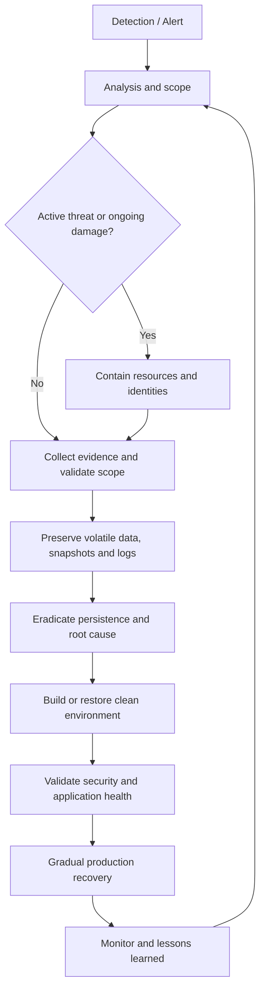
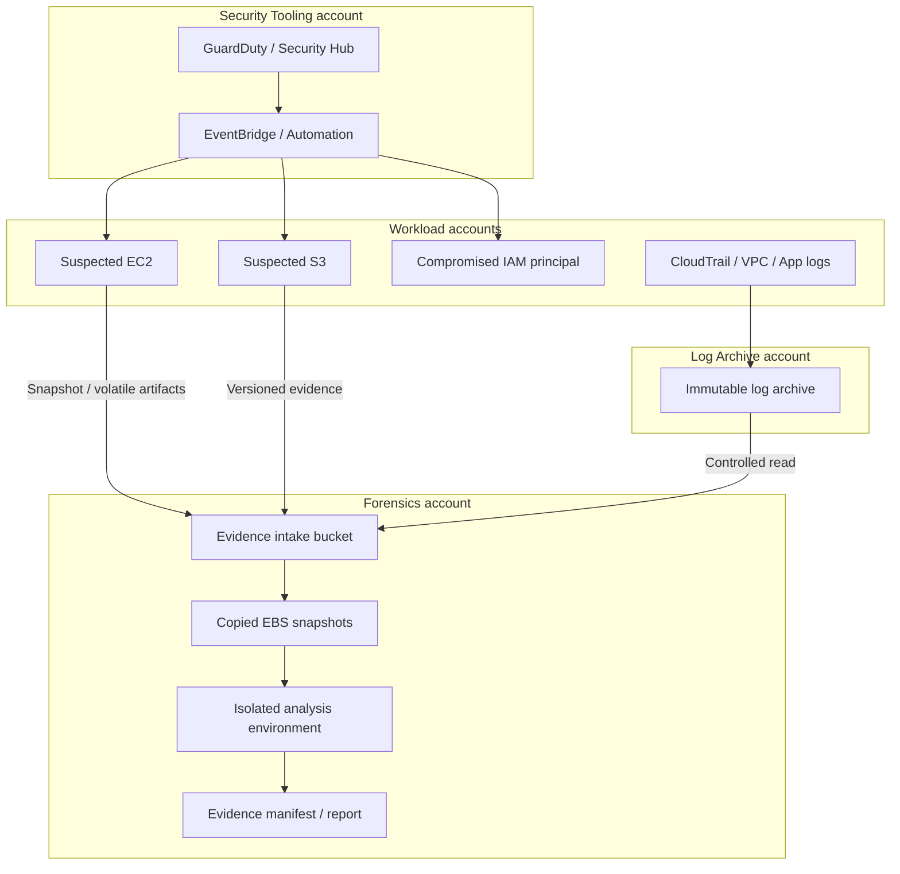

# Resource Isolation, Evidence Preservation, and Safe Recovery

## 1. Why Must Isolation, Investigation, and Recovery Be Coordinated?

When an AWS resource shows signs of compromise, operations teams must pursue three goals simultaneously:

- **Prevent further spread:** stop attackers from continuing access, exfiltrating data, planting persistence, or moving laterally to other resources.
- **Preserve evidence:** retain data needed to identify root cause, blast radius, identities, and actions taken.
- **Restore services safely:** return workloads to a trusted state while eliminating the exploited vulnerability and access paths.

These three goals can conflict. Stopping an EC2 instance halts malware execution but destroys RAM contents, process lists, and active network connections. Swapping a Security Group restricts new connections while existing tracked connections may persist. Restoring immediately from the latest backup can reintroduce ransomware or compromised configurations into production.

Therefore, incident response requires prioritization and risk-based decisions. If data exfiltration or destruction is actively underway, containment may need to happen immediately. If the situation is under control and volatile evidence is valuable, investigators should collect it before rebooting or stopping instances.

This lesson belongs to the **CLOUD_PROVIDERS_AWS** module, where learners explore designing and operating secure, observable, resilient, and risk-controlled AWS systems. The focus is building a repeatable workflow across EC2, IAM, S3, and multi-account workloads.

## 2. Learning Objectives

After this lesson, learners will be able to:

1. Distinguish detection, analysis, containment, eradication, recovery, and post-incident review.
2. Choose appropriate isolation methods for EC2, IAM principals, S3 buckets, and container workloads.
3. Explain the limitations of Security Groups, Network ACLs, and stopping EC2 instances during containment.
4. Collect volatile evidence, EBS snapshots, logs, and resource configurations via an auditable workflow.
5. Maintain chain of custody, hashes, metadata, access controls, and retention for evidence.
6. Use Systems Manager Automation, GuardDuty, CloudTrail, AWS Config, and AWS Backup in response workflows.
7. Build a dedicated forensic environment and protect artifacts with S3 Object Lock, KMS, and cross-account controls.
8. Distinguish eradication from recovery and select trustworthy recovery points.
9. Recover workloads from a known-good state and validate security before returning to production.
10. Build runbooks, stop criteria, rollbacks, and post-incident checklists.

## 3. Incident Response Lifecycle

An incident response workflow typically comprises the following phases:

| Phase | Goal | Required Outcome |
|---|---|---|
| Preparation | Prepare people, permissions, logs, backups, automation, and forensic environment | Tested runbooks, contact lists, evidence plan |
| Detection | Detect anomalous indicators | Finding, alert, incident ticket |
| Analysis | Verify incident and determine scope | Timeline, resource list, severity, hypothesis |
| Containment | Curb dangerous activity and prevent spread | Resources/identities isolated, risky connections blocked |
| Eradication | Remove malware, persistence, credentials, and root cause | No identified malicious access paths or components remain |
| Recovery | Restore a trusted state and verify | Clean workload operating stably |
| Lessons learned | Improve controls, processes, and detection capability | Action items with owners and deadlines |

Phases do not always run linearly. If additional compromised accounts are uncovered during recovery, responders may loop back to analysis and containment. In ransomware incidents, containment and backup preservation typically outweigh rapid restoration. For a publicly exposed bucket, containment may require only updating policies and auditing access history.

Overview diagram:



## 4. Decision-Making Principles in Incident Response

### 4.1. Prioritize by Risk Severity

Before acting, assess:

- Is data currently being exfiltrated or destroyed?
- Does the attacker still hold valid sessions or credentials?
- Can the resource reach other workloads?
- Is the service critical or depended upon by many components?
- Will stopping or isolating destroy volatile data?
- Are there legal, contractual, or regulatory evidence preservation mandates?
- Can temporary, reversible containment be applied?

If damage is actively unfolding, prioritize stopping it first. If connections can be controlled without destroying state, collect volatile evidence before shutdown. Document reasons whenever a collection step must be skipped due to urgent containment demands.

### 4.2. Use Reversible Actions When Appropriate

Examples:

- Attach an Isolation Security Group instead of terminating an instance immediately.
- Deactivate an access key instead of deleting an IAM user.
- Attach a controlled deny policy instead of deleting a role with many dependencies.
- Restrict bucket access via policy while preserving objects/versions.
- Place an EC2 instance into Standby in an Auto Scaling group if runbooks and architecture permit.

Reversible actions shorten recovery time and retain original configurations for investigation. However, reversible does not mean completely risk-free: a deny policy can disrupt applications, and restoring old configurations could reopen the very path that was exploited.

### 4.3. Identify Decision-Making Authority

Each incident should have an incident commander or designated coordinator. Clarify roles:

- Security responder: assesses threats, IOCs, and scope.
- Cloud/platform operator: executes containment and snapshots.
- Application owner: assesses service impact and confirms health.
- Forensics analyst: collects, preserves, and analyzes evidence.
- Legal/compliance: defines retention, notification, and chain-of-custody requirements.
- Business owner: decides acceptable service disruption tolerance.

Never let multiple teams simultaneously alter Security Groups, IAM policies, or backup policies without a shared incident timeline.

## 5. Preparing Response Environments and Permissions

### 5.1. Separating Accounts by Function

For AWS Organizations environments, prepare accounts with clear responsibilities:

| Account | Role |
|---|---|
| Workload accounts | Run business applications and data |
| Security Tooling account | Centralize GuardDuty, Security Hub CSPM, automation, and orchestration |
| Log Archive account | Store CloudTrail, VPC Flow Logs, WAF, DNS, and application/security logs |
| Forensics account | Store and analyze snapshots, disk images, memory dumps, and investigative artifacts |

Separating Security Tooling and Forensics accounts enforces separation of duties, prevents malware analysis from affecting monitoring systems, and shields artifacts from workload admins. Establish this account structure before incidents occur—do not wait until an incident to create a forensics account.

### 5.2. Preparing Break-Glass Permissions

Prepare response roles with sufficient permissions to:

- Read findings, CloudTrail, Config, VPC Flow Logs, and resource metadata.
- Modify Security Groups, Network ACLs, or resource policies per runbooks.
- Capture snapshots and copy artifacts.
- Manage IAM credentials/sessions within approved scope.
- Write outputs to evidence repositories.
- Restore configurations post-containment.

Apply least privilege, MFA, short session durations, approvals, and CloudTrail logging. Avoid routinely using root credentials to handle incidents. Protect break-glass roles from compromised workload accounts.

### 5.3. Preparing Logging Before Incidents

Valuable data sources:

- AWS CloudTrail management events and appropriate data events.
- AWS Config configuration history and compliance.
- VPC Flow Logs.
- Amazon GuardDuty findings.
- AWS Security Hub CSPM findings.
- Amazon CloudWatch Logs and metrics.
- CloudFront, Application Load Balancer, and AWS WAF logs.
- Route 53 Resolver query logs.
- EKS control-plane audit logs and container/application logs.
- Database audit logs, application logs, and OS authentication logs.

Standardize timestamps in UTC across reports. Ensure logs ship to an archival account independent of workloads, with controlled access and appropriate retention.

## 6. Verifying Incidents and Determining Scope

A finding is not always a confirmed incident. Before containment, gather minimum facts:

1. Finding ID, finding type, severity, and timestamp.
2. Account, Region, resource ARN/ID, and owner tags.
3. Detection source: GuardDuty, Security Hub CSPM, WAF, EDR, or third-party tool.
4. IOCs: IPs, domains, hashes, processes, user agents, IAM principals, or API calls.
5. Activity before and after detection time.
6. Connected resources via IAM roles, security groups, ENIs, subnets, buckets, KMS keys, and network paths.
7. Signs of persistence or lateral movement.
8. Impact on confidentiality, integrity, and availability of data/services.

Use CloudTrail to determine who called which API and when; AWS Config to inspect configuration state and changes; VPC Flow Logs for network traffic metadata; GuardDuty and application logs for added context. Never identify an actor solely from one IP or session name.

### 6.1. Building an Incident Timeline

A minimum timeline should include:

| UTC Time | Event | Resource/Identity | Evidence Reference | Action/Owner |
|---|---|---|---|---|
| 02:10 | GuardDuty finding | EC2 i-... | Finding ID | Security |
| 02:14 | Unusual API call | Role session ... | CloudTrail event ID | Analyst |
| 02:18 | ENI isolated | eni-... | Change record | Cloud operator |
| 02:25 | EBS snapshot requested | vol-... | Snapshot ID | Forensics |
| 03:00 | Staging restored | Recovery account | Restore job ID | Platform |

Normalize all timestamps to UTC, keep original timestamps intact, and record both collection time and event occurrence time.

## 7. Isolating Amazon EC2

### 7.1. Isolation Security Group

For an EC2 instance suspected of compromise, GuardDuty recommends creating a dedicated Isolation Security Group:

- No broad inbound rules.
- No outbound rules permitting 0.0.0.0/0 or ::/0.
- Add restricted access paths only if a pre-designed forensic channel is needed.
- Attach the Isolation Security Group to every network interface requiring isolation.
- Remove old Security Groups from the interfaces so other rules do not continue allowing traffic.

Example replacing Security Groups on an ENI using the AWS CLI:

```bash
aws ec2 modify-network-interface-attribute \
  --network-interface-id eni-0123456789abcdef0 \
  --groups sg-0a1b2c3d4e5f67890 \
  --region ap-southeast-1
```

This example illustrates an operation on a single ENI. For multi-ENI instances, inspect and handle each ENI appropriately. Security Group sg-0a1b2c3d4e5f67890 must be pre-created with verified isolation rules.

**Critical limitation:** Security Groups are stateful. Modifying a Security Group does not terminate already-tracked connections; it primarily blocks new connections. If an active connection must be severed immediately, an appropriate Network ACL or stopping the instance may be required.

### 7.2. Network ACLs to Block Existing Connections

Network ACLs are stateless and apply at the subnet level. NACLs can block specific IOCs or traffic, including active flows not terminated by Security Group edits.

Considerations:

- NACLs affect every ENI in the subnet, not just one instance.
- NACLs evaluate rules in rule-number order; new rules must be placed in the right sequence.
- Because NACLs are stateless, both inbound and outbound directions must be controlled.
- Overly broad changes can disrupt other workloads.
- Record original configurations and prepare rollback commands before making edits.

Do not alter an entire shared subnet's NACL just to isolate one EC2 instance when ENI/instance-level isolation is more appropriate.

### 7.3. When to Stop an Instance?

Stopping an EC2 instance can be a stronger containment step when:

- Active exfiltration or destruction occurs and network isolation is insufficient.
- Existing connections must terminate immediately.
- Malicious activity on the instance cannot otherwise be halted.
- Response policy requires halting compute.

However, stopping or rebooting can destroy RAM, process state, active connections, and volatile data. Whenever feasible, collect volatile evidence beforehand. Data on instance store volumes is lost when an instance is stopped or terminated; rebooting does not carry that same lifecycle effect.

### 7.4. Load Balancers and Auto Scaling

If the instance belongs to an Auto Scaling group or target group:

- Evaluate deregistering it from the load balancer to stop incoming traffic.
- Consider placing the instance into Standby so Auto Scaling does not unexpectedly replace it during investigation.
- Check health checks and desired/min/max capacity.
- Ensure isolation does not cause the group to launch new instances from a compromised AMI.
- Save ASG, launch template, and target group configurations before making changes.

Do not merely remove an instance from a load balancer and consider it isolated. The instance can still initiate outbound connections or reach internal services.

### 7.5. Systems Manager Automation Runbooks

AWS provides **AWSSupport-ContainEC2Instance** for reversible network containment. The runbook can:

- Save current Security Group configurations to S3 for restoration.
- Create an interim Security Group during transition, then apply a containment Security Group.
- Create an AMI backup if requested.
- Handle instances inside Auto Scaling groups and place them into Standby.
- Support DryRun to preview actions.
- Support Restore to attempt restoring original configurations.

The runbook requires elevated permissions and can impact networking/Auto Scaling. Carefully review the IAM role, S3 bucket, parameters, and outputs. Current documentation defaults DryRun=true; keep preview mode enabled during validation. Note that the runbook transitions through a temporary Security Group permitting traffic, so evaluate whether that sequence fits your incident's urgency and threat model. Never run production automation without understanding its impact.

## 8. Isolating IAM Users, Roles, and Identity Center

### 8.1. IAM User with Suspected Credential Exposure

Actions commonly considered:

- Deactivate exposed access keys.
- Remove or change console passwords if password exposure is suspected.
- Revoke active sessions where supported mechanisms exist.
- Attach a temporary deny policy or run containment runbooks.
- Inspect IAM policies, group memberships, MFA devices, access key metadata, and CloudTrail history.
- Identify other secrets or tokens that principal may have accessed.

Do not delete the user immediately before collecting necessary metadata and history. Retain the identity for investigation and delete only after evaluating dependencies, evidence, and approval procedures.

### 8.2. IAM Roles and Temporary Credentials

Temporary role credentials remain valid until expiration unless revoked. IAM supports **Revoke active sessions**, attaching policy AWSRevokeOlderSessions to deny sessions created before the revocation timestamp.

Notes:

- Revocation applies to all older sessions of that role, not solely the suspect session.
- Legitimate applications sharing the role may be disrupted.
- Legitimate users must re-assume the role to obtain fresh credentials.
- Do not apply this action to service-linked roles; follow service-specific procedures.
- For roles backed by IAM Identity Center permission sets, revoke sessions using the corresponding IAM Identity Center mechanism.

If a role serves multiple applications, evaluate blast radius before revoking. If an instance profile is suspected of abuse, inspect other workloads using the same role as well.

### 8.3. Systems Manager Containment for IAM Principals

**AWSSupport-ContainIAMPrincipal** supports reversible containment for IAM users, roles, and Identity Center users:

- IAM user: deactivates access keys, removes console access, and attaches a deny policy.
- IAM role: attaches a deny policy revoking permissions for sessions created before containment.
- Identity Center user: can remove permission sets, group memberships, and apply a deny policy.
- The runbook saves pre-containment configurations to S3 for restoration.
- Includes a DryRun option.

This operation broadly impacts every workload depending on the identity. Review the principal, policies, sessions, and dependencies prior to execution.

## 9. Isolating S3 Buckets and Data

When a bucket shows signs of public exposure, unauthorized object deletion, or data staging/distribution:

1. Identify affected buckets, object prefixes, access points, and replication destinations.
2. Save bucket policies, ACLs, Block Public Access, Object Ownership, versioning, lifecycle, replication, and access logging settings.
3. Identify API events such as PutBucketPolicy, PutPublicAccessBlock, DeleteObject, PutObjectAcl, or GetObject.
4. Isolate external access via bucket/access point policies or an approved runbook.
5. Preserve objects and versions required for investigation.
6. Inspect CloudTrail S3 data events and server access logs if enabled.
7. Check replication, lifecycle rules, and copies that may have been affected.

AWS provides **AWSSupport-ContainS3Resource** to isolate buckets or objects with a restrictive policy while preserving objects. For general-purpose buckets, the runbook blocks S3 actions except for roles listed in an allowlist parameter; it also backs up original settings to an S3 backup bucket. The runbook defaults DryRun to true and includes a Restore mode. Before running, identify legitimate principals requiring continued access, such as backup services or forensic roles. An overly broad deny policy can break applications, replication, or backups.

Never delete suspected malicious objects before preserving versions, metadata, and access history. If client writes must be halted, consider policy/role containment and record the original policy.

## 10. Isolating Other Resource Types

| Resource | Containment Actions Commonly Considered | Evidence to Preserve |
|---|---|---|
| RDS/Aurora | Narrow Security Groups, disable public access, rotate credentials, consider snapshots | DB logs, audit logs, snapshots, parameter/option groups |
| EKS | Cordon nodes, isolate network paths, restrict service accounts/roles, review network policies | Control-plane audit logs, pod logs, image digests, node metadata |
| Lambda | Restrict invocations/triggers, isolate IAM role, inspect event source mappings | Function configuration, code package/version, CloudTrail, invocation logs |
| API Gateway | Restrict routes/stages or authorizers, rotate API keys/secrets | Access logs, execution logs, stage/config history |
| KMS | Narrow key policies/grants, disable key if required by process and impact understood | Key policies, grants, CloudTrail KMS events |
| SQS/SNS | Restrict policies and publish/consume principals, inspect subscriptions | Queue/topic policies, relevant message metadata, CloudTrail |
| Secrets Manager | Rotate/revoke secrets, inspect resource policies and access history | Secret version metadata, CloudTrail, rotation logs |

No single containment action fits all services. For databases, disabling a key or blocking networking can render workloads unavailable; for KMS, disabling a key can make encrypted data undecryptable. Assess dependencies and recovery plans before making changes.

## 11. Collecting Volatile Evidence

Volatile evidence is data that disappears when an instance shuts down, reboots, or a process exits, such as:

- RAM contents and memory pages.
- Process lists, command lines, and process trees.
- Active network connections, sockets, and listening ports.
- Logged-in users and sessions.
- Mount points, open files, and temporary files.
- Kernel modules, loaded drivers, and runtime state.
- Container processes and ephemeral filesystems.
- Tokens or credentials residing in memory.

### 11.1. Collection Order

If conditions permit without elevating risk:

1. Record UTC timestamp, instance ID, hostname, private/public IPs, and ENIs.
2. Capture process lists and network connection state.
3. Capture logged-in sessions, listening ports, and mount information.
4. Capture memory dumps using pre-prepared forensic tools.
5. Record commands, tool versions, operator, and outputs.
6. Compute cryptographic hashes for exported artifacts.
7. Only then stop/reboot or perform steps that destroy volatile state.

If an active threat is causing severe harm, containment may need to take precedence. Record which evidence could not be collected and why.

### 11.2. Collecting via Systems Manager

SSM Run Command can run collection commands on online managed EC2 instances. However:

- Running commands alters system state and creates new logs/processes.
- Never install arbitrary tools onto suspected compromised hosts.
- Use pre-vetted scripts, recording checksums and versions.
- Record command IDs, document versions, parameters, and execution output.
- Verify SSM Agent and endpoints have not been compromised by attackers.
- If networking is completely isolated, SSM Agent may be unable to reach endpoints; design a dedicated forensic channel beforehand.

AWS Security Incident Response offers an optional EC2 Triage role to gather volatile forensic data from running EC2 instances via Systems Manager, such as running processes, network connections, and logged-in users. This feature is neither a memory dump nor full endpoint forensics. Security Incident Response primarily triages findings, investigates logs, and assists with containment; it does not replace full disk imaging or endpoint forensic suites.

## 12. Preserving Disk Evidence and EBS Snapshots

### 12.1. Snapshots Are Not Memory Dumps

An EBS snapshot is a point-in-time copy of blocks written to a volume. Snapshots exclude data still sitting in application or OS caches. They do not capture RAM, process state, or active network connections.

AWS recommends pausing writes before taking a snapshot; if infeasible, unmount the volume inside the guest OS and remount after the snapshot reaches pending state. For root volumes, AWS recommends stopping the instance before snapshotting to improve consistency. Stopping can destroy volatile evidence, so decide sequencing based on the scenario.

### 12.2. Multi-Volume and Application Consistency

If an instance has multiple EBS volumes, document mappings across instance, ENIs, volumes, and mount points. Multi-volume snapshots can capture a group of volumes in one request, yet application consistency still requires quiescing or an appropriate backup mechanism.

A snapshot in pending state does not mean all data has finished transferring. Wait for completed state before using snapshots for analysis or restoration.

### 12.3. Creating Snapshots via AWS CLI

Example snapshotting an EBS volume with incident tags:

```bash
aws ec2 create-snapshot \
  --volume-id vol-0123456789abcdef0 \
  --description "Incident INC-2026-0042 forensic evidence" \
  --tag-specifications 'ResourceType=snapshot,Tags=[{Key=IncidentId,Value=INC-2026-0042},{Key=EvidenceType,Value=Disk}]' \
  --region ap-southeast-1
```

Record SnapshotId, VolumeId, StartTime, Description, KmsKeyId, Encrypted, and tags in the incident record. Wait for snapshot completion:

```bash
aws ec2 wait snapshot-completed \
  --snapshot-ids snap-0123456789abcdef0 \
  --region ap-southeast-1
```

The IDs above are placeholders. Execute with an approved role and store output in the incident evidence manifest.

### 12.4. Protecting Snapshots

- Keep original snapshots in the source account and restrict deletion permissions.
- Copy snapshots to the Forensics account when permission separation is needed.
- For encrypted snapshots, verify KMS key permissions.
- Sharing encrypted snapshots cross-account requires a customer-managed KMS key and policies/grants for the target account.
- Consider copying/re-encrypting with a key owned by the Forensics account to minimize reliance on source keys.
- Never share snapshots publicly.
- Tag snapshots with incident ID, resource ID, timestamp, and owner.
- Monitor CloudTrail for snapshot create/copy/share/delete and KMS key operations.

An EBS snapshot can contain all data on the volume, including secrets, PII, and business data. Share only with approved forensic accounts/principals.

## 13. Preserving Logs, Configurations, and Control-Plane Evidence

### 13.1. CloudTrail

Collect management events and data events relevant to the incident:

- EC2: RunInstances, ModifyInstanceAttribute, AuthorizeSecurityGroupIngress, CreateSnapshot, ModifySnapshotAttribute.
- IAM: CreateAccessKey, UpdateAccessKey, AttachRolePolicy, PutRolePolicy, AssumeRole.
- S3: PutBucketPolicy, PutPublicAccessBlock, GetObject, PutObject, DeleteObject.
- KMS: DisableKey, ScheduleKeyDeletion, CreateGrant, Decrypt.
- Systems Manager: SendCommand, StartAutomationExecution, UpdateDocument.

Event history displays only management events from the past 90 days for a single Region; it does not replace long-term storage. For extended investigations, query trails stored in S3 or designed log repositories. Preserve event records, event IDs, Regions, accounts, and query parameters.

### 13.2. AWS Config

AWS Config reveals resource configurations at specific points in time:

- Security Groups and NACLs.
- Supported IAM resources.
- S3 bucket configurations.
- EC2 instances and network interfaces.
- KMS key metadata/configurations where resource types are supported.
- Related compliance changes.

Save relevant configuration histories and snapshots. AWS Config does not replace CloudTrail: Config shows resource state, whereas CloudTrail shows API activity and the calling identity.

### 13.3. Network and Application Logs

Additional sources:

- VPC Flow Logs: source/destination IPs, ports, protocols, actions, and flow metadata.
- CloudFront/ALB access logs: requests, status codes, URIs, and client metadata.
- AWS WAF logs: rule matches and actions.
- Route 53 Resolver query logs: DNS queries.
- CloudWatch application logs: errors, processes, and business behaviors.
- EKS audit logs: Kubernetes control-plane API activity.
- Database audit logs: database-layer queries and actions.

Ensure retention has not expired and never overwrite raw logs with processed data.

## 14. Chain of Custody and Evidence Integrity

Chain of custody is the tracking record of evidence from collection through storage, access, copying, and analysis. Its purpose is to prove provenance and document all handling actions.

Each evidence item should include:

| Field | Content |
|---|---|
| Evidence ID | Unique identifier |
| Incident ID | Associated incident identifier |
| Source | Account, Region, resource ID, log group, or bucket |
| Collected at | UTC collection start/end timestamps |
| Collector | Person or role performing collection |
| Tool/method | CLI, SSM document, API, forensic tool, and version |
| Original identifier | Snapshot ID, object version ID, CloudTrail event ID |
| Hash | SHA-256 of exported file artifacts |
| Storage location | S3 bucket/key, version ID, or forensic repository |
| Access history | Who read/copied/analyzed and when |
| Notes | Limitations, errors, modifications, or reasons for omission |

### 14.1. Hashing Evidence Files

For files exported to an investigative workstation, compute SHA-256:

Linux:

```bash
sha256sum evidence-file.bin
```

Windows PowerShell:

```powershell
Get-FileHash -Algorithm SHA256 -LiteralPath .\evidence-file.bin
```

Store hashes in a separate manifest and re-verify after copying. A hash proves a file has not changed since computation; a hash alone does not prove origin or legal validity of data.

Do not compute an arbitrary hash and call it the hash of an EBS snapshot. For AWS snapshots, record Snapshot ID, Volume ID, encryption key, and API metadata. Hashes apply only to artifacts/files the team can actually read and hash.

### 14.2. Storing Evidence with S3 Object Lock

S3 Object Lock supports WORM retention:

- **Governance mode:** users with special permissions can bypass certain protections.
- **Compliance mode:** protected object versions cannot be deleted or overwritten during the retention period, even by the account root user.
- **Legal hold:** retains an object version until explicitly removed.

Object Lock requires S3 Versioning. Locks apply to specific object versions; a new version or delete marker can still be created under the same key. Therefore, record version IDs and protect bucket policies, versioning, KMS keys, lifecycle rules, and administrative permissions.

Do not choose long retentions or Compliance mode arbitrarily. Retention must align with legal policies, contracts, and organizational data regulations.

## 15. Forensics Account and Safe Analysis Workflow

A Forensics account provides an isolated environment to ingest, inspect, and analyze evidence.

Reference architecture:



### 15.1. Separating Originals from Analysis Copies

- Keep original artifacts in an intake zone with restricted write access.
- Create copies for analysis.
- Mount forensic volumes read-only where tools support it.
- Never boot suspect disk images directly inside corporate networks.
- Use an isolated VPC with no routes to production or the Internet unless an explicit sandbox is designed.
- Prevent malware samples from accessing metadata endpoints or credential sources.
- Record tools, commands, analyst, timestamps, and hashes.
- Restrict KMS decrypt and data access permissions.

### 15.2. Copying Encrypted Snapshots to the Investigation Account

Encrypted snapshots are accessible only if the principal holds permissions on the corresponding KMS key. When sharing an encrypted snapshot, the destination account needs permission to use the customer-managed key; both the key policy and the principal's IAM policy must allow access.

Copy snapshots using a key managed by the Forensics account to isolate access rights. Copying/re-encrypting can incur storage and transfer charges; maintain links between original snapshots and copies in the manifest.

### 15.3. Limitations of AWS Security Incident Response

AWS Security Incident Response ingests findings from sources such as GuardDuty and Security Hub CSPM, assisting with triage, log investigation, and containment. This service is not a detection source replacing GuardDuty, does not perform full disk imaging or endpoint forensics, and does not directly execute recovery on customer workloads.

If EC2 Triage is configured, the service can collect volatile forensic data from running EC2 instances via Systems Manager. Customers remain responsible for preserving disk evidence, deep endpoint analysis, recovery decisions, and executing recovery changes.

## 16. Eradication: Eliminating Root Causes and Persistence

Containment halts short-term spread. Eradication eliminates root causes so attackers cannot return.

Inspect for:

- Malware, web shells, scheduled tasks, cron jobs, and startup services.
- Unauthorized IAM users, roles, access keys, trust policies, and permission sets.
- SSH keys, RDP accounts, local administrators, and service accounts.
- Lambda layers, container images, deployment packages, and CI/CD secrets.
- Security Groups, NACLs, route tables, VPC endpoint policies, and public exposures.
- S3 bucket policies, access points, ACLs, replication, and lifecycle rules.
- KMS key policies, grants, secret resource policies, and key rotation.
- Persistence in EKS DaemonSets, Deployments, CronJobs, admission webhooks, or service accounts.
- Application vulnerabilities, outdated packages, weak configurations, or exposed secrets.

Credential rotation may need to occur before forensic analysis finishes if attackers could still use those credentials. Record metadata needed for investigation, but never store plaintext secrets in incident tickets or logs.

If persistence cannot be definitively identified and removed from a host, the safest choice is typically keeping the host for forensics and replacing it with a new instance built from a trusted image.

## 17. Selecting a Trustworthy Recovery Point

Not every latest backup is clean. Evaluate recovery points against:

- Estimated compromise time.
- Time attackers gained initial access.
- Time ransomware or destructive activity began.
- Backup creation timestamp and likelihood the backup contains malware.
- CloudTrail, GuardDuty, Config, and application logs around the recovery point.
- Data integrity and decryption capability.
- Whether KMS keys, backup vaults, or access permissions were compromised.

Against ransomware, backups must be shielded from attacker deletion or encryption. Use dedicated backup accounts/vaults, immutable retention, and periodic restore testing.

### 17.1. Never Restore a Compromised Host As-Is

Snapshots/AMIs of compromised hosts are useful for investigation. Launching production directly from those snapshots can reintroduce malware, persistence, backdoors, and stolen credentials.

Recovery should typically:

1. Provision a new instance from a verified golden AMI or trusted image.
2. Apply patches and hardening.
3. Create fresh IAM roles and secrets.
4. Restore business data from a recovery point assessed as clean.
5. Run vulnerability scans, malware scans, and configuration validation.
6. Verify network egress and IAM permissions.
7. Validate in staging before opening production traffic.

Reuse an old image only if an explicit inspection and persistence-removal process proves the image trustworthy.

## 18. Safe Recovery with AWS Backup and Related Services

### 18.1. AWS Backup

AWS Backup manages recovery points across many AWS services. When recovering after an incident:

- Select a recovery point prior to the high-probability compromise time.
- Verify backup vaults, KMS keys, retention, and restore permissions.
- Restore into an isolated account/Region/VPC when appropriate.
- Never automatically connect restored resources to production networks.
- Verify application consistency, database recovery, and data integrity.
- Record restore job ID, recovery point ARN, resource ARN, and completion time.

### 18.2. Restore Testing

AWS Backup Restore Testing schedules restore tests, selects resources/recovery points, and measures restore times. A dedicated account can be used for restore tests. After the validation window ends, test resources are cleaned up by the service.

Restore testing proves recovery procedures execute and measures duration. It does not prove a recovery point is free of malware. Supplement with malware scanning, data checks, application tests, and security baseline validation.

### 18.3. Databases

For RDS/Aurora or other databases:

- Identify a snapshot/PITR point prior to compromise.
- Inspect transaction logs and audit logs if available.
- Restore to a new DB instance/cluster inside an isolated subnet.
- Rotate credentials and review users/roles and access permissions.
- Verify schemas, row counts, integrity constraints, and business data.
- Reconnect applications only after confirming security and data correctness.

Never restore an encrypted or tampered database from a recovery point postdating attacker control.

## 19. Checks Before Returning Workloads to Production

Enforce an explicit release gate:

| Check Group | Criteria |
|---|---|
| Identity | No exposed credentials remain; roles and trust policies reviewed |
| Compute | Verified images, patched OS, no known persistence |
| Network | Security Groups, NACLs, routes, and egress match baseline |
| Storage | Restored data verified for integrity, encryption, and proper permissions |
| Application | Smoke tests, API tests, and dependency health pass |
| Observability | CloudTrail, CloudWatch, GuardDuty, and alerting active |
| Backup | Fresh backups created and restorable |
| Compliance | AWS Config/security controls meet required baseline |
| Evidence | Original snapshots/logs/artifacts preserved with complete manifest |
| Approval | Security, application owner, and incident commander sign-off |

### 19.1. Phased Cutover

- Start with staging or canary.
- Open a small fraction of traffic.
- Monitor error rates, latency, authentication, network flows, and GuardDuty findings.
- Expand traffic in waves.
- Retain capability to revert to containment if IOCs appear.
- Remove quarantine only after owner and security confirmation.

Do not delete compromised instances immediately once new workloads run. Retain original artifacts and resources for the approved investigative/retention period; decommission afterward per standard procedures.

## 20. Sample Runbook: Suspected Compromised EC2 Instance

### 20.1. Scenario

GuardDuty detects an EC2 instance communicating with a suspicious IP. The instance runs a production API inside an Auto Scaling group.

### 20.2. Handling Sequence

1. Create an incident ID and designate an incident commander.
2. Record finding ID, instance ID, ENIs, subnet, Security Groups, IAM instance profile, ASG, and target group.
3. Collect CloudTrail, GuardDuty, VPC Flow Logs, application logs, and Config history.
4. Where feasible, collect volatile evidence using pre-prepared procedures.
5. Consider deregistering from target groups and placing the instance into ASG Standby.
6. Attach an Isolation Security Group to each ENI; evaluate NACLs if active connections must be severed.
7. If risk persists, stop the instance per incident commander decision.
8. Create EBS snapshots of volumes and record metadata.
9. Copy artifacts to the Forensics account, protected with appropriate KMS keys and Object Lock.
10. Analyze copies in an isolated environment.
11. Identify root cause, rotate credentials, and patch vulnerabilities.
12. Provision a new instance from a golden AMI and restore clean data.
13. Verify application health, GuardDuty, logs, and compliance.
14. Ramp traffic in waves and monitor.
15. Retain original instances/snapshots per evidence retention policy.
16. Conduct post-incident review and update runbooks.

### 20.3. Stop Criteria

Halt traffic ramp or revert to containment if:

- GuardDuty detects similar IOCs on the new instance.
- Old roles or secrets are still being used.
- Application logs reveal unexplained behavior.
- Network egress shows unusual connections.
- Backups/recovery points come under suspicion.
- Integrity of restored data cannot be proven.

## 21. AWS CLI: Querying, Snapshots, and Evidence Checks

### 21.1. Finding API Activity in CloudTrail Event History

Example searching for Security Group changes:

```bash
aws cloudtrail lookup-events \
  --lookup-attributes AttributeKey=EventName,AttributeValue=AuthorizeSecurityGroupIngress \
  --max-results 50 \
  --region ap-southeast-1
```

Event history is limited by time window and event type. For extended investigations, query trail logs in S3 or centralized analytics systems.

### 21.2. Inspecting EC2 Metadata Before Containment

```bash
aws ec2 describe-instances \
  --instance-ids i-0123456789abcdef0 \
  --region ap-southeast-1 \
  --query "Reservations[].Instances[].{State:State.Name,PrivateIp:PrivateIpAddress,PublicIp:PublicIpAddress,Subnet:SubnetId,Vpc:VpcId,Groups:SecurityGroups,Profile:IamInstanceProfile,NetworkInterfaces:NetworkInterfaces[].NetworkInterfaceId}"
```

Save output to the incident manifest. Do not record only the instance ID; capture ENI, IAM profile, ASG, and volume dependencies.

### 21.3. Listing EBS Volumes Attached to an Instance

```bash
aws ec2 describe-volumes \
  --filters Name=attachment.instance-id,Values=i-0123456789abcdef0 \
  --region ap-southeast-1 \
  --query "Volumes[].{VolumeId:VolumeId,Device:Attachments[0].Device,State:State,Encrypted:Encrypted,KmsKeyId:KmsKeyId}"
```

Use the output to build the list of snapshots to create and identify corresponding KMS keys.

### 21.4. Inspecting Snapshots

```bash
aws ec2 describe-snapshots \
  --snapshot-ids snap-0123456789abcdef0 \
  --region ap-southeast-1 \
  --query "Snapshots[].{SnapshotId:SnapshotId,VolumeId:VolumeId,State:State,StartTime:StartTime,Encrypted:Encrypted,KmsKeyId:KmsKeyId,Tags:Tags}"
```

Preserve output alongside incident ID and collector identity. Never treat a snapshot ID as proof that a disk image has been analyzed or is clean.

## 22. Common Misconceptions

| Misconception | Correct Understanding |
|---|---|
| Attaching an Isolation Security Group immediately drops all connections | Security Groups are stateful; existing tracked connections can continue |
| Stopping EC2 is always the first step | Stopping can destroy volatile evidence; assess threat severity and collect data if feasible |
| An EBS snapshot contains full machine state | Snapshots exclude RAM and cached data; collect volatile evidence separately |
| Once a snapshot call returns, the snapshot is complete | Snapshots are asynchronous; wait for completed status |
| Having snapshots means having forensic chain of custody | Metadata, artifact file hashes, access logs, and an evidence manifest are required |
| Object Lock locks an object name forever | Object Lock applies to specific object versions; new versions or delete markers can still be created |
| Revoking role sessions affects only the attacker | It affects all prior sessions of that role and may disrupt legitimate workloads |
| Blocking an IAM principal means deleting it | Containment can retain the identity while attaching a deny policy for investigation |
| The newest backup is always clean | Backups may already contain malware or encrypted data |
| Restoring from a compromised host's AMI is safe recovery | The AMI may contain malware and persistence; prefer clean images and verified data |
| A GuardDuty finding proves compromise on its own | Findings must be analyzed and correlated in context before concluding |
| AWS Security Incident Response replaces the entire forensic team | The service assists with triage, log investigation, and containment; customers own full disk/endpoint forensics and recovery execution |

## 23. Hands-On Exercise: Isolation and Evidence Preservation for a Lab EC2

### 23.1. Objective

Practice safe workflows on a lab EC2 instance containing no production data:

- Record metadata.
- Prepare an Isolation Security Group.
- Test containment with DryRun.
- Create an EBS snapshot.
- Inspect snapshot metadata.
- Write an evidence manifest.
- Build a test recovery environment.

### 23.2. Prerequisites

- Dedicated lab AWS account.
- EC2 instance with an EBS root volume.
- No real secrets or personal data.
- Least-privilege IAM role.
- Lab VPC/subnet for analysis.
- S3 evidence bucket with encryption, versioning, and Object Lock if needed.
- Owner supervising actions.

Do not practice on production EC2 instances. Never run containment runbooks on live instances merely for testing.

### 23.3. Steps

1. Record instance ID, ENI, subnet, Security Groups, IAM profile, and EBS volumes.
2. Create an Isolation Security Group with no broad ingress/egress.
3. Check impacts on SSM Agent and investigative channels.
4. Open AWSSupport-ContainEC2Instance, choose Action=Contain and DryRun=true.
5. Review outputs, IAM permissions, S3 backup location, and ASG impacts.
6. Execute actual containment only on the lab instance after supervisor confirmation.
7. Create an EBS snapshot and wait for completed state.
8. Record Snapshot ID, Volume ID, encryption key, timestamp, and incident ID.
9. Copy the snapshot to the forensics account if the lab has cross-account setup.
10. Create an analysis volume from the copied snapshot and mount read-only where tools support it.
11. Compute SHA-256 hashes for exported artifact files.
12. Record chain of custody and check S3 access permissions.
13. Launch a new instance from a clean image and restore test data.
14. Run smoke tests and verify monitoring.
15. Clean up lab resources per cleanup procedures after retaining required evidence.

### 23.4. Completion Criteria

- Relevant resources and identities are identified.
- DryRun output is captured and containment actions are understood.
- Isolation Security Group permits no unrequired traffic.
- Snapshot reaches completed state and metadata is recorded.
- Evidence manifest contains incident ID, source, timestamp, collector, and storage path.
- Artifact files have verifiable SHA-256 hashes.
- Recovery environment is built from clean sources and tested before opening traffic.

## 24. Self-Check Questions

### Question 1

Why shouldn't you stop an EC2 instance immediately in every suspected compromise?

**Answer:** Stopping can destroy RAM, process lists, active connections, and volatile data. When risk permits, collect volatile evidence first; if active threats are causing damage, containment may take priority.

### Question 2

Does changing an EC2 instance's Security Group terminate existing tracked connections?

**Answer:** No. Security Groups are stateful; changes primarily block new connections. An appropriate NACL or stopping the instance may be needed to sever existing connections.

### Question 3

Does an EBS snapshot contain a memory dump?

**Answer:** No. EBS snapshots store blocks written to the volume, not RAM or cached data.

### Question 4

Why must you wait for a snapshot to reach completed state?

**Answer:** Snapshots are created asynchronously and remain pending until all data finishes transferring. Request metadata alone does not prove snapshot completion.

### Question 5

What does AWSSupport-ContainEC2Instance support?

**Answer:** The runbook can back up Security Group configurations to S3, create a containment Security Group, handle certain Auto Scaling scenarios, optionally create an AMI, and support DryRun and Restore.

### Question 6

Who is affected by revoking active sessions on an IAM role?

**Answer:** All sessions created before the revocation timestamp for that role, not just the attacker's session. Legitimate applications sharing the role may be disrupted.

### Question 7

Does S3 Object Lock lock all object versions under a key permanently?

**Answer:** Locks apply to specific object versions. New versions or delete markers can still be created; record version IDs and protect the bucket.

### Question 8

Why shouldn't you analyze the original snapshot directly?

**Answer:** Keeping originals intact preserves evidence. Create a copy for analysis and log every action, hash, and access.

### Question 9

Can you use an AMI from a compromised EC2 instance to restore production?

**Answer:** Not by default. The AMI may contain malware and persistence. Prefer clean images, patching/hardening, and restoring data from a verified recovery point.

### Question 10

What does AWS Backup Restore Testing prove?

**Answer:** It tests restore execution capability and measures restore time. It does not by itself prove recovery points are free of malware or data tampering.

### Question 11

Does AWS Security Incident Response perform full disk forensics and recovery execution?

**Answer:** No. The service assists with triage, log investigation, containment, and guidance; customers remain responsible for full disk/endpoint forensics and executing recovery.

### Question 12

What does a SHA-256 hash of an evidence file prove?

**Answer:** A hash detects whether a file changed relative to the recorded value. It does not prove provenance, collection timestamp, or legal admissibility on its own.

## 25. Production and Post-Incident Checklists

### Pre-Incident Preparation

- [ ] Incident commander, on-call rotation, and escalation paths exist.
- [ ] Runbooks exist for EC2, IAM, S3, databases, and container workloads.
- [ ] Isolation Security Group and NACL templates are tested.
- [ ] Log archive and forensics accounts exist.
- [ ] Break-glass roles use MFA and least privilege.
- [ ] CloudTrail, GuardDuty, VPC Flow Logs, and required application logs are enabled.
- [ ] EBS/RDS/S3 backups and periodic restore tests exist.
- [ ] S3 Object Lock, KMS, and retention policies exist for evidence.
- [ ] Automated collection and evidence manifest templates exist.
- [ ] Containment and recovery drills have been conducted.

### During an Incident

- [ ] Create incident ID and UTC timeline.
- [ ] Verify findings and scope.
- [ ] Record resource metadata, IAM identities, and network context.
- [ ] Decide sequencing between containment and volatile evidence collection.
- [ ] Isolate resources following runbooks.
- [ ] Save original configurations before making edits.
- [ ] Collect appropriate snapshots, logs, memory, and artifacts.
- [ ] Protect evidence with KMS, versioning, Object Lock, and access controls.
- [ ] Record collector, tools, commands, hashes, and evidence locations.
- [ ] Check for lateral movement and connected principals/resources.

### Before Recovery

- [ ] Identify root cause and IOCs.
- [ ] Eradicate persistence and rotate credentials.
- [ ] Select an evaluated recovery point.
- [ ] Build an isolated environment for restoration and testing.
- [ ] Use clean images, patches, and hardening.
- [ ] Verify data integrity and application health.
- [ ] Verify IAM, networking, encryption, and logging.
- [ ] Obtain Security and Application owner approvals.

### After Recovery

- [ ] Cut over via canary/waves.
- [ ] Monitor GuardDuty, CloudTrail, CloudWatch, and application logs.
- [ ] Retain quarantine/evidence per approved retention.
- [ ] Verify fresh backups and restore tests.
- [ ] Close temporary exceptions.
- [ ] Review costs, snapshots, and containment resources.
- [ ] Complete post-incident review.
- [ ] Assign action items with owners and deadlines.

## 26. Official References

The AWS pages below provide technical procedures and limitations to verify before applying in production. Legal requirements for chain of custody and admissibility must be evaluated with your organization's legal counsel or appropriate specialists.

### AWS Security Incident Response and Incident Lifecycle

- [AWS Security Incident Response User Guide](https://docs.aws.amazon.com/security-ir/latest/userguide/)
- [Contain](https://docs.aws.amazon.com/security-ir/latest/userguide/contain.html)
- [Eradicate](https://docs.aws.amazon.com/security-ir/latest/userguide/eradicate.html)
- [Recover](https://docs.aws.amazon.com/security-ir/latest/userguide/recover.html)
- [Security Incident Response containment only template](https://docs.aws.amazon.com/security-ir/latest/userguide/containment-only-template.html)
- [Security Incident Response containment with EC2 triage](https://docs.aws.amazon.com/security-ir/latest/userguide/containment-with-ec2-triage-template.html)

### EC2, GuardDuty, and Systems Manager

- [Remediating a potentially compromised EC2 instance](https://docs.aws.amazon.com/guardduty/latest/ug/compromised-ec2.html)
- [AWSSupport-ContainEC2Instance runbook](https://docs.aws.amazon.com/systems-manager-automation-runbooks/latest/userguide/automation-awssupport-containec2instance.html)
- [AWSSupport-ContainIAMPrincipal runbook](https://docs.aws.amazon.com/systems-manager-automation-runbooks/latest/userguide/awssupport-contain-iam-principal.html)
- [AWSSupport-ContainS3Resource runbook](https://docs.aws.amazon.com/systems-manager-automation-runbooks/latest/userguide/automation-awssupport-contains3resource.html)
- [AWS-QuarantineEC2Instance runbook](https://docs.aws.amazon.com/systems-manager-automation-runbooks/latest/userguide/aws-quarantineec2instance.html)
- [Revoke IAM role temporary security credentials](https://docs.aws.amazon.com/IAM/latest/UserGuide/id_roles_use_revoke-sessions.html)

### Forensics, Logging, and Evidence Preservation

- [SEC10-BP03 Prepare forensic capabilities](https://docs.aws.amazon.com/wellarchitected/latest/security-pillar/sec_incident_response_prepare_forensic.html)
- [AWS Prescriptive Guidance: Forensics account](https://docs.aws.amazon.com/prescriptive-guidance/latest/security-reference-architecture-cyber-forensics/forensics-account.html)
- [AWS Prescriptive Guidance: Log Archive account](https://docs.aws.amazon.com/prescriptive-guidance/latest/security-reference-architecture/log-archive.html)
- [Create Amazon EBS snapshots](https://docs.aws.amazon.com/ebs/latest/userguide/ebs-creating-snapshot.html)
- [Share an Amazon EBS snapshot with other accounts](https://docs.aws.amazon.com/ebs/latest/userguide/ebs-modifying-snapshot-permissions.html)
- [Share the KMS key used to encrypt a shared EBS snapshot](https://docs.aws.amazon.com/ebs/latest/userguide/share-kms-key.html)
- [S3 Object Lock](https://docs.aws.amazon.com/AmazonS3/latest/userguide/object-lock.html)
- [CloudTrail log file integrity validation](https://docs.aws.amazon.com/awscloudtrail/latest/userguide/cloudtrail-log-file-validation-intro.html)

### Backup and Recovery

- [AWS Backup restore testing](https://docs.aws.amazon.com/aws-backup/latest/devguide/restore-testing.html)
- [AWS Backup security best practices](https://docs.aws.amazon.com/aws-backup/latest/devguide/security-best-practices.html)
- [AWS Backup](https://docs.aws.amazon.com/aws-backup/latest/devguide/whatisbackup.html)
