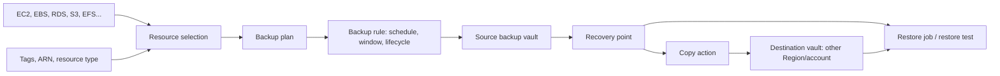

# AWS Backup Plans, Selections, and Backup Vaults

AWS Backup provides a centralized management point for scheduling, retaining, copying, and restoring data across multiple AWS services. To design it properly, separate three related decisions that carry distinct responsibilities: a **backup plan** defines when and how backups are created; a **resource selection** defines which resources participate in the plan; and a **backup vault** defines where recovery points are stored along with their encryption, access, and data-protection boundaries.

A successfully created plan does not prove that data is protected. Resources must fall within the selection, the resource type must be properly opted in within the Region, the IAM role must have permissions, the backup job must complete, and the recovery point must be restorable. This lesson walks from that conceptual model to AWS CLI configuration, job verification, backup copy design, and restore testing.

## 1. Objectives and Scope

After this lesson, you will be able to:

- Distinguish between a backup plan, backup rule, resource selection, backup vault, recovery point, and job types.
- Design backup schedules, execution windows, retention periods, cold storage transitions, and copy actions aligned with RPO/RTO.
- Select resources by ARN, resource type, tags, and conditions; understand account- and Region-level service opt-in.
- Create vaults with appropriate KMS keys, control access permissions, and evaluate when to use AWS Backup Vault Lock or a logically air-gapped vault.
- Create plans and selections using the AWS CLI, then verify backup jobs and recovery points.
- Design cross-Region/cross-account copies, verify KMS permissions, and execute restore tests.

AWS Backup supports many AWS services as well as certain non-AWS workloads. However, support is not uniform: a resource type may support snapshots without supporting continuous backups, cold storage, cross-account copies, or restore testing. Before designing, always check the **Feature availability by resource** matrix in the AWS Backup documentation for your specific resource types and deployment Regions.

## 2. Operating Model: Plan, Selection, and Vault

| Component | Question Answered | Primary Responsibility |
|---|---|---|
| Backup plan | When and under what rules are backups created? | Contains one or more rules, schedules, target vaults, lifecycles, and copy actions |
| Backup rule | How does a specific protection run operate? | Defines the schedule, start/completion windows, vault, retention, copies, and continuous backup option |
| Resource selection | Which resources does the plan apply to? | Selects by ARN, resource type, tags, include/exclude conditions, and IAM role |
| Backup vault | Where are recovery points stored and protected? | Organizes recovery points, configures encryption keys, vault access policies, and Vault Lock |
| Recovery point | From what point in time can data be restored? | Specific backup created by AWS Backup or the source service |
| Backup/copy/restore job | How far has the protection operation actually progressed? | Records status, timestamps, errors, and outcomes of each operation |

A backup plan can contain multiple rules. A plan can also have multiple selections; each selection has its own name, set of resources, and IAM role. Each rule specifies one target vault for the primary recovery point. If copies are needed in another Region or account, the rule can declare copy actions to the corresponding destination vaults.



The practical workflow can be understood as follows:

1. An administrator creates a vault and decides on the encryption key, policy, and retention guardrails.
2. An administrator creates a backup plan with one or more rules.
3. Resource selection attaches matching resources to the plan and specifies an IAM role.
4. When the schedule triggers, AWS Backup evaluates the selection, creates backup jobs, and instructs source services to create recovery points.
5. Recovery points are stored in the rule's target vault; copy actions can create additional copies in other vaults.
6. Operators check jobs and recovery points, then run restores or scheduled restore tests.

**Key distinction:** a plan is the desired configuration; a selection is the scope; a vault is the storage container; jobs and recovery points are operational evidence. You cannot conclude a workload is protected just by seeing a plan name in the console.

## 3. Designing Around RPO and RTO

Two recovery objectives dictate schedules and backup storage:

- **Recovery Point Objective (RPO)** is the maximum amount of data loss an organization accepts, typically expressed in time. Backing up every 24 hours can result in nearly 24 hours of data loss if an incident occurs right before the next backup.
- **Recovery Time Objective (RTO)** is the maximum duration to restore a service to an acceptable level. An existing recovery point does not guarantee RTO if restoring takes many hours, lacks KMS permissions, lacks subnets, lacks application configuration, or lacks a runbook.

For instance, an order-processing system may set a 15-minute RPO for a database supporting continuous backup/PITR, while using scheduled snapshots for other resources. An analytics workload may accept a 24-hour RPO with longer retention. Decisions should weigh business impact, cost, source service limits, and measured restore durations.

Avoid setting schedules purely by habit such as "back up everything daily." Build a matrix for each data group:

| Resource Group | Target RPO | Protection Type to Evaluate | RTO to Verify |
|---|---:|---|---|
| Transactional databases | Minutes to one hour | Continuous backup/PITR if supported, plus periodic snapshots | DB restore time, log replay, and data verification |
| Application server volumes | One day or shorter | Periodic snapshots, copied to standby Region | Volume/instance creation and application startup time |
| Shared file systems | One hour to one day | Periodic or continuous backup if resource type supports it | File recovery time and access permissions |
| Long-term archive data | Per retention policy | Snapshots/copies with long retention, cold tier if supported | Retrieval time from storage tier and verification procedure |

RPO/RTO must be measured through drills. If backups succeed but a restore takes 8 hours against a 2-hour RTO, the architecture does not meet requirements.

## 4. Structure of a Backup Plan and Rule

### 4.1 Backup Plan

A backup plan is a named set of rules that can be tagged for management. AWS Backup lets you create plans from built-in templates, from scratch in the console, or via API/CLI/CloudFormation. One plan can be shared across a group of resources with similar policies; workloads with distinct requirements should be separated into plans that are easy to operate and audit.

When naming plans, reflect purpose and scope—such as `prod-critical-daily`, `nonprod-weekly`, or `finance-retention`. Avoid naming plans solely after the person who created them. Tags on a plan help categorize configuration; tags on resources are one of the signals used by selections to match resources.

### 4.2 Backup Rule

A rule typically defines the following attributes:

| Attribute | Meaning |
|---|---|
| `RuleName` | Name of the rule within the plan |
| `TargetBackupVaultName` | Vault receiving the primary recovery point |
| `ScheduleExpression` | Backup run schedule, typically an AWS cron expression |
| `ScheduleExpressionTimezone` | Schedule timezone; if omitted in the API, the schedule defaults to UTC |
| `StartWindowMinutes` | Duration after the scheduled time within which the job may start |
| `CompletionWindowMinutes` | Time limit for the job to finish after starting |
| `Lifecycle` | When to transition to cold storage and when to delete the recovery point |
| `CopyActions` | Copies created to destination vaults |
| `EnableContinuousBackup` | Enables continuous backup/PITR for supported resource types |

### 4.3 Cron Schedules and Timezones

AWS Backup uses six-field cron expressions following AWS syntax:

```text
cron(minutes hours day-of-month month day-of-week year)
```

Examples:

```text
cron(0 2 ? * * *)       # Every day at 02:00 UTC
cron(30 1 ? * SUN *)    # Every Sunday at 01:30 UTC
cron(0 3 1 * ? *)       # First day of every month at 03:00 UTC
```

In these examples, `?` indicates no specific value for that day field; in AWS cron syntax, you cannot specify concrete values for both day-of-month and day-of-week simultaneously. Verify expressions against the AWS schedule documentation before applying.

If your organization operates on local time, set `ScheduleExpressionTimezone` using an appropriate IANA timezone name, such as `Asia/Ho_Chi_Minh`. Do not manually convert local time to UTC and risk forgetting Daylight Saving Time shifts in regions that observe DST. For multinational systems, UTC schedules are often easier to compare across accounts and Regions; for systems with local maintenance windows, explicit timezones can be easier to operate.

A cron schedule indicates when AWS Backup may initiate jobs, not a guarantee that every resource finishes at that exact minute. Actual timing depends on the source service, data size, load, service quotas, queuing delays, and copy actions.

### 4.4 Start Window and Completion Window

`StartWindowMinutes` allows AWS Backup to attempt starting a job over a time range rather than requiring an exact instant. If a job is in the `CREATED` state, AWS Backup can retry recoverable errors within the start window. The specified value must be at least 60 minutes. When the window expires before the job starts successfully, the job can transition to `EXPIRED`.

`CompletionWindowMinutes` bounds how long a job has to complete once started. For large workloads, an overly short window can cause jobs to be canceled or fail to finish as expected. Measure actual backup durations—including starting near the end of the start window—before selecting a completion window. Some resource types have specific restrictions; for example, the completion window option does not apply to Amazon FSx.

Do not configure tiny start and completion windows merely to make the schedule look neat. The goal is to allow enough time for jobs to finish under heavy load, service maintenance, or retries.

### 4.5 Multiple Rules and Overlapping Schedules

A plan can contain multiple rules, such as a daily snapshot rule and a weekly snapshot rule with different retentions. However, if rules have overlapping start windows, AWS Backup applies schedule and retention consolidation logic; do not assume every rule always creates a separate recovery point on every overlapping run. When schedules overlap, the rule with the longer retention period can govern the recovery point created during that window.

Use the schedule preview in the backup plan summary to inspect upcoming runs, execution types, and copy actions. Avoid conflicting rule schedules unless you understand how they interact. If the goal is short-term daily backups and long-term weekend backups, test the configuration on a representative resource group, inspect the preview, and verify actual recovery points before scaling out.

### 4.6 Lifecycle and Cold Storage

Lifecycle defines when a recovery point transitions to cold storage and when it is deleted:

- `MoveToColdStorageAfterDays`: number of days from recovery point creation until moving to cold storage.
- `DeleteAfterDays`: number of days from recovery point creation until expiration and deletion.

Backups moved to cold storage must remain in cold storage for a minimum of 90 days. Consequently, `DeleteAfterDays` must exceed `MoveToColdStorageAfterDays` by at least 90 days. For example, transitioning after 30 days requires a retention of at least 120 days. Once a recovery point has transitioned to cold storage, the transition timing already applied to that recovery point cannot be altered.

Not all resource types support cold storage. AWS Backup ignores cold transition settings for resource types that do not support this feature. Check the feature matrix before adding lifecycle transitions to a plan. For some resource types supporting incremental backups, at least one full backup must remain in the warm tier; moving a full backup to cold too early can trigger another warm full backup and increase costs.

Indefinite retention may fit certain legal requirements, but it requires explicit approval because storage charges continue accumulating. When using Vault Lock compliance mode, a recovery point with `Always` retention may become impossible to delete once the lock becomes immutable.

### 4.7 Copy Actions

Copy actions create a copy of a recovery point in a backup vault in another Region or account, depending on configuration and resource type. A copy action can specify its own lifecycle for the copy. If no separate lifecycle is specified, the copy can inherit the lifecycle from the source recovery point per supported behavior.

Example `CopyActions` field in a rule:

```json
{
  "CopyActions": [
    {
      "DestinationBackupVaultArn": "arn:aws:backup:us-west-2:111122223333:backup-vault:dr-copy-vault",
      "Lifecycle": {
        "DeleteAfterDays": 90
      }
    }
  ]
}
```

The vault `dr-copy-vault` must already exist in the destination Region before the job runs. For cross-account copies, the ARN must point to the destination account and the vault policy/KMS in that account must allow the operation. The 90-day retention in this example is illustrative only; select retention based on requirements and resource type limits.

A copy action is a separate step from the primary backup. Monitor both backup jobs and copy jobs; a primary backup marked `COMPLETED` does not mean the copy has finished. For cross-account copies, configure AWS Organizations/AWS Backup cross-account backup, destination vault policies, KMS permissions, and copy role permissions. For certain resource types not fully managed by AWS Backup, the cross-account destination vault must use a customer managed KMS key because AWS managed keys cannot be shared across accounts.

### 4.8 Continuous Backup and PITR

Some services support continuous backup and point-in-time recovery (PITR). This mechanism typically takes an initial full backup and continuously records changes or transaction logs to enable restoring to a chosen timestamp. For supported services, PITR can restore to a second-level timestamp within a window of up to 35 days.

Continuous backups are not scheduled via cron like periodic snapshots. They have different lifecycles and constraints than snapshots. Periodic snapshots can be kept longer (subject to service and quota limits), whereas continuous backup/PITR has a shorter recovery window. Therefore, if you need a low RPO alongside long-term retention, evaluate combining continuous backup with a snapshot rule.

Do not infer that enabling `EnableContinuousBackup` turns every resource in the selection into PITR. Only supported resource types receive continuous backups; other resources still need a snapshot rule. Check the feature availability table and backup plan summary to see whether the execution type is `CONTINUOUS`, `SNAPSHOTS`, or `CONTINUOUS_AND_SNAPSHOTS`.

## 5. Resource Selection: Selecting the Right Resources

Resource selection bridges a backup plan and real resources. If a selection does not match, the plan can exist without errors while creating zero backups for the intended resources.

### 5.1 Account- and Region-Level Service Opt-In

AWS Backup has a **Service opt-in** setting for resource types it is permitted to manage. This setting applies per account and per Region. You can toggle it in the AWS Backup console under Settings or via the CLI:

```bash
aws backup describe-region-settings --region ap-southeast-1

aws backup update-region-settings \
  --region ap-southeast-1 \
  --resource-type-opt-in-preference '{"EFS":true,"EC2":true,"RDS":true}'
```

The example above illustrates passing a few resource types; before running it, retrieve the current configuration, preserve existing values, and update only the resource types your organization intends to enable. Do not pass a truncated JSON object that inadvertently disables already-enabled types.

Key rules to remember:

1. If a selection relies solely on tags, Service opt-in still applies.
2. If you explicitly specify resource types in the selection, many resource types can still be included in a plan even if their corresponding service opt-in is not enabled.
3. Aurora, Neptune, and Amazon DocumentDB are important exceptions: opt-in must be enabled for those services for AWS Backup to protect them.
4. If both resource types and tags are specified, AWS Backup filters by resource type first, then by tags.
5. Opt-in applies only to the specific account and Region. When AWS Backup adds new resource types, accounts are not automatically opted in for those new types in all cases; review Settings periodically.

For FSx for NetApp ONTAP, when using tag-based selection, tags must be applied to individual volumes rather than only to the overall file system. This example underscores why you must read resource-type-specific notes.

### 5.2 Selecting by ARN or Resource Type

You can select individual resource ARNs directly or use ARN patterns to cover a group. Examples:

```text
arn:aws:ec2:ap-southeast-1:111122223333:instance/i-0123456789abcdef0
arn:aws:ec2:ap-southeast-1:111122223333:instance/*
arn:aws:rds:ap-southeast-1:111122223333:db:orders-prod
```

Selecting by ARN suits small, static groups with unique requirements. Selecting by resource type or ARN wildcard fits when applying a policy across all resources of a type in an account/Region. Wildcards in backup selection ARN patterns must appear at the end of the string; patterns like `arn:aws:s3:::logs-*` can be valid, whereas wildcards in the middle or start of an ARN are not supported by selection rules.

A single resource assignment has ARN limits: up to 500 non-wildcard ARNs or 30 wildcard ARNs. If the list of resources to protect grows frequently, use resource types and tags/conditions rather than maintaining a manual ARN list.

### 5.3 Selecting by Tags

Tags group resources by protection intent, for example:

| Key | Value | Meaning |
|---|---|---|
| `Backup` | `daily` | Daily backup |
| `Backup` | `weekly` | Weekly backup |
| `Environment` | `production` | Production environment |
| `DataClass` | `critical` | Critical data |
| `Owner` | `payments` | Accountable team |

A tag policy needs an owner, an approval workflow, and an auditing mechanism. If anyone can arbitrarily delete a `Backup` tag, a resource can drop out of selection unnoticed. Track tag drift using AWS Config, inventory reports, or infrastructure change controls.

### 5.4 `ListOfTags` and `Conditions`

AWS Backup supports `ListOfTags` and `Conditions` for tag filtering. `ListOfTags` only supports `STRINGEQUALS`; when multiple entries exist, a resource matching any entry is included (OR). AWS recommends `Conditions` for new setups because it supports `StringEquals`, `StringLike`, `StringNotEquals`, and `StringNotLike`.

When specifying multiple conditions inside `Conditions`, a resource must satisfy all conditions (AND). For example, to back up resources tagged `Backup=daily` and `Environment=production`:

```json
{
  "Conditions": {
    "StringEquals": [
      {
        "ConditionKey": "aws:ResourceTag/Backup",
        "ConditionValue": "daily"
      },
      {
        "ConditionKey": "aws:ResourceTag/Environment",
        "ConditionValue": "production"
      }
    ]
  }
}
```

In this example, the two conditions are combined with AND. A resource with `Backup=daily` but without `Environment=production` will not be selected.

If you need multiple OR options, express them using appropriate conditions or split selections by purpose. Do not confuse the OR behavior of `ListOfTags` with the AND behavior across multiple conditions in `Conditions`. Condition operators are case-sensitive; tag keys and values must also match how resources are actually tagged.

### 5.5 Inclusion and Exclusion

`Resources` specifies ARNs included in the selection. `NotResources` excludes ARNs from the selected scope. This explicitly expresses exceptions, though static exclusion lists can quickly become stale as new resources are created. Whenever possible, design tags and resource types so the inclusion scope reflects policy accurately, then reserve `NotResources` for controlled exceptions.

For example, you might select all EC2 instances in a Region and exclude one sandbox instance from the selection. Record the exception rationale and approver; otherwise, an important resource could remain excluded indefinitely.

### 5.6 Selection Limits

A resource assignment has notable quotas: up to 500 non-wildcard ARNs, 30 wildcard ARNs, 30 conditions, and 30 tag conditions per configuration type. The number of resources matched by tags is not constrained in the same way as explicit ARN lists. At larger scale, split selections by ownership group or use AWS Organizations backup policies to enforce broad policies across multiple accounts.

## 6. IAM Roles and Permissions for Creating Backups

AWS Backup needs permissions to invoke source services to create recovery points. Resource selections include `IamRoleArn`, identifying the role AWS Backup assumes for those operations. The role needs a trust policy allowing AWS Backup (`backup.amazonaws.com`) to assume it and a permissions policy sufficient for the protected resource types.

In many scenarios, the console can create a default role `AWSBackupDefaultServiceRole` with managed policies such as `AWSBackupServiceRolePolicyForBackup` and `AWSBackupServiceRolePolicyForRestores`. Organizations can use self-managed roles with narrower permissions scoped to specific resource types. Treat these as permissions for the backup/restore service itself, not end-user data read permissions.

AWS Backup also uses the service-linked role `AWSServiceRoleForBackup` for service-required backup and copy operations. Service-linked roles are AWS-defined and can only be assumed by AWS Backup per the configured trust policy. Do not delete this role while dependent resources still rely on it.

Example minimal trust policy principal for a role assumed by AWS Backup:

```json
{
  "Version": "2012-10-17",
  "Statement": [
    {
      "Effect": "Allow",
      "Principal": {"Service": "backup.amazonaws.com"},
      "Action": "sts:AssumeRole"
    }
  ]
}
```

A trust policy only allows assuming the role; it grants no backup permissions. The permissions policy must still allow required source service, AWS Backup, and KMS APIs. Restore roles may need different permissions than backup roles. Restore testing also uses its own service-linked role with principal `restore-testing.backup.amazonaws.com`; do not copy a backup role's trust policy to a restore testing role without checking the documentation.

Practical principles:

- Separate permissions to create plans/selections from permissions to delete recovery points and perform restores.
- Use separate IAM roles per workload or resource type if blast-radius isolation is needed.
- Inspect IAM policies, vault resource policies, and KMS key policies together.
- Audit explicit `Deny` statements, SCPs, and permission boundaries because an `Allow` on a role cannot override an effective `Deny`.
- Monitor changes to roles, trust policies, and managed policies because they directly affect protection and recovery capabilities.

## 7. Backup Vaults: Where Recovery Points Live

A backup vault is a container within an AWS account and Region used to organize recovery points. You can create multiple vaults by application, environment, data classification, or retention requirement. Separating vaults enables applying policies and Vault Lock along clear boundaries.

### 7.1 Creating a Vault and Choosing an Encryption Key

When creating a backup vault, AWS Backup lets you select an AWS KMS key. By default, the service can create and use the `aws/backup` key; you can also choose a customer managed key (CMK) in the account. **You cannot change the encryption key selected for a vault after the vault is created.** Therefore, decide on the key, usage permissions, and recovery strategy before storing production data in the vault.

Not all backup types are encrypted directly with the vault's key. For resource types fully managed by AWS Backup, AWS Backup can use the key associated with the vault to encrypt recovery points. For certain other resource types, backups continue using the source resource's encryption key. Check the encryption-by-resource-type table; do not assume changing a vault's key changes the key of every recovery point.

Example creating a vault via CLI:

```bash
aws backup create-backup-vault \
  --backup-vault-name prod-critical-vault \
  --encryption-key-arn arn:aws:kms:ap-southeast-1:111122223333:key/00000000-1111-2222-3333-444444444444 \
  --region ap-southeast-1
```

If `--encryption-key-arn` is omitted, AWS Backup uses the default `aws/backup` key per service configuration. Record the vault ARN and key ARN for use in plans, copy actions, policies, and runbooks.

### 7.2 Vault Access Policies

A vault has a resource-based access policy. This policy can grant or restrict access to recovery points—for example, allowing another account to copy backups into the vault, restricting who can restore, or preventing a principal from deleting recovery points. Vault policies work alongside IAM identity policies, SCPs, and KMS key policies; an allow in one layer does not automatically override a deny in another layer.

A common pattern is separation of duties:

- Backup operations engineers create plans, selections, and monitor jobs.
- Recovery engineers read recovery points and execute restores per runbook.
- Security administrators control deletion rights, Vault Lock, and KMS keys.
- Backup archive accounts receive copies without granting production administrative rights to source principals.

Policies can restrict `backup:DeleteRecoveryPoint` or vault management actions to a small group. Verify the specific APIs needed for backups, copies, restores, tagging, and lifecycle management before applying broad denies; an overly broad deny can break backup/copy jobs or block legitimate operations.

### 7.3 AWS Backup Vault Lock

Vault Lock is an added protection layer that enforces recovery point retention periods. There are two modes:

| Mode | Behavior | Use Case |
|---|---|---|
| Governance | Principals with appropriate IAM permissions can still modify or remove the lock | Governance-process protection where controlled adjustments remain necessary |
| Compliance | After a waiting period, the vault lock becomes immutable; no principal, including root or AWS, can modify/remove it while recovery points exist in the vault | Strict immutability requirements or mandatory retention compliance |

Vault Lock can set `MinRetentionDays` and `MaxRetentionDays`. New backup/copy jobs targeting the vault fail if retention falls outside those bounds. Existing recovery points created before enabling the lock are not retroactively altered by new min/max values.

In compliance mode, `ChangeableForDays` defines the grace/cooling-off period before the lock becomes immutable. The value must be at least 3 days (72 hours). During this window, lock settings can be adjusted or removed. Once the grace period expires, neither the lock nor the vault can be altered; if the vault still holds recovery points, the vault cannot be deleted. Recovery points are retained until their lifecycle expires. Before locking compliance mode, carefully verify min/max retention, lifecycles, copies, and any recovery points with `Always` retention.

Vault Lock is not a data-cleanup tool. It is a commitment that data will not be deleted prematurely. Misconfigured retention can create long-lived costs that are hard to reverse. Test on a dedicated sandbox vault before applying to a production vault.

### 7.4 Standard Backup Vaults vs. Logically Air-Gapped Vaults

AWS Backup offers a specialized vault type called a **logically air-gapped vault**. It strengthens backup protection with additional controls:

- Uses an AWS owned KMS key by default; a customer managed key can be chosen in supported cases.
- Pre-configured with Vault Lock in compliance mode.
- Can be shared with other accounts via AWS Resource Access Manager (RAM) so a recovery account can restore directly if authorized.
- Can integrate with Multi-party approval (MPA) to support recovery access when the vault-owning account is unavailable under supported scenarios.

| Criterion | Standard Backup Vault | Logically Air-Gapped Vault |
|---|---|---|
| Role | Primary vault, commonly used for recovery points and copies | Specialized vault increasing isolation and recoverability |
| Vault Lock | Optional; governance or compliance | Configured with compliance mode by default |
| Encryption | AWS managed or customer managed key depending on backup type | AWS owned key by default or supported customer managed key |
| Cross-account restore sharing | Typically managed via vault policy/cross-account backup; not directly shared via RAM like air-gapped vaults | Can be shared via RAM so another account can restore directly |
| Purpose | Day-to-day backup operations | Protection layer for scenarios where the source account or environment is compromised |

A logically air-gapped vault does not mean data sits on a physically offline device. It is an AWS-managed storage model with dedicated protection boundaries and sharing/recovery mechanisms. This feature is not available in all Regions and does not support all resource types. Check the feature matrix before designing around it.

One operational detail to note: for certain EBS backups in a logically air-gapped vault, once a recovery point transitions to the archive tier, it cannot be copied to another vault or Region. If you need copies in another account/Region, create the copy while the recovery point is still in warm storage per service rules.

## 8. Creating a Backup Plan and Selection with the AWS CLI

The following example creates a vault, a daily EC2 backup plan, and a selection targeting EC2 instances tagged `Backup=daily` in the Region. This is an illustrative configuration; replace account ID, Region, KMS key, retention, IAM role, and vault ARN for your actual environment.

### 8.1 Create the Vault

```bash
aws backup create-backup-vault \
  --backup-vault-name prod-daily-vault \
  --encryption-key-arn arn:aws:kms:ap-southeast-1:111122223333:key/00000000-1111-2222-3333-444444444444 \
  --region ap-southeast-1
```

### 8.2 Create `backup-plan.json`

```json
{
  "BackupPlan": {
    "BackupPlanName": "prod-daily-35d",
    "Rules": [
      {
        "RuleName": "daily-0200-utc",
        "TargetBackupVaultName": "prod-daily-vault",
        "ScheduleExpression": "cron(0 2 ? * * *)",
        "ScheduleExpressionTimezone": "UTC",
        "StartWindowMinutes": 120,
        "CompletionWindowMinutes": 720,
        "Lifecycle": {
          "DeleteAfterDays": 35
        }
      }
    ]
  }
}
```

This plan creates a daily schedule at 02:00 UTC, allows jobs to start within a 120-minute window, and allows up to 720 minutes for completion. Recovery points are retained for 35 days. Cold storage is omitted from the example to avoid applying lifecycle rules incompatible with unverified resource types.

Create the plan:

```bash
aws backup create-backup-plan \
  --cli-input-json file://backup-plan.json \
  --region ap-southeast-1
```

Save `BackupPlanId` from the response. The plan protects no resources until a resource selection is created.

### 8.3 Create `backup-selection.json`

```json
{
  "BackupSelection": {
    "SelectionName": "prod-ec2-daily-tagged",
    "IamRoleArn": "arn:aws:iam::111122223333:role/AWSBackupDefaultServiceRole",
    "Resources": [
      "arn:aws:ec2:ap-southeast-1:111122223333:instance/*"
    ],
    "Conditions": {
      "StringEquals": [
        {
          "ConditionKey": "aws:ResourceTag/Backup",
          "ConditionValue": "daily"
        },
        {
          "ConditionKey": "aws:ResourceTag/Environment",
          "ConditionValue": "production"
        }
      ]
    }
  }
}
```

This selection targets only EC2 instances in the account/Region having both tags `Backup=daily` and `Environment=production`. If the default role does not yet exist, create the role per AWS Backup documentation or use an organization-approved role with an appropriate trust policy and permissions.

Create the selection using the ID returned in the previous step:

```bash
aws backup create-backup-selection \
  --backup-plan-id BACKUP_PLAN_ID \
  --cli-input-json file://backup-selection.json \
  --region ap-southeast-1
```

The CLI returns `SelectionId`. Store both `BackupPlanId` and `SelectionId` in your configuration management system or IaC state—do not publish them in public shared documents if internal policy restricts account identifiers.

### 8.4 Verify Configuration After Creation

```bash
aws backup get-backup-plan \
  --backup-plan-id BACKUP_PLAN_ID \
  --region ap-southeast-1

aws backup list-backup-selections \
  --backup-plan-id BACKUP_PLAN_ID \
  --region ap-southeast-1

aws backup list-protected-resources \
  --region ap-southeast-1

aws backup describe-backup-vault \
  --backup-vault-name prod-daily-vault \
  --region ap-southeast-1
```

Confirm that the selection was created, which resources are recognized as protected resources, and that the vault has the expected encryption key and Vault Lock state. Then wait for a scheduled run or trigger an on-demand backup in a test environment to verify jobs end-to-end.

## 9. Copying Backups to Another Region or Account

A backup stored in the same account and Region as the workload handles everyday operational errors, but may be insufficient for disasters affecting an entire account or Region. Copy actions create additional recovery points in a separate boundary.

### 9.1 Cross-Region Copy

Cross-Region copying enables recovery when the source Region is disrupted or data in the source Region becomes inaccessible. When designing:

1. Choose a destination Region that supports the needed resource types and copy features.
2. Create the destination vault beforehand with an appropriate key and policy.
3. Add a copy action to the rule specifying the destination vault ARN.
4. Set copy retention independently from the source backup when requirements differ.
5. Monitor copy jobs and perform restore tests from the destination Region.

Not every resource type supports cross-Region copying or copying after moving to cold/archive tiers. Never base RTO on a copy job that has never been tested.

### 9.2 Cross-Account Copy

Cross-account backup separates workload administrative privileges from backup copy administrative privileges. A common pattern is having the production account create recovery points and copy them to an isolated backup/security account. The destination account can enforce stricter vault policies, KMS key policies, and Vault Lock than the source account.

Prerequisites to verify include:

- Enable cross-account backup in the appropriate AWS Backup/Organizations settings.
- Confirm the destination account is within allowed scope and the destination vault permits copy operations from the source account.
- Ensure the IAM role performing the copy has required permissions and AWS Backup can assume it.
- Verify KMS key policies allow AWS Backup and relevant principals to use the key; check `kms:CreateGrant`, `kms:GenerateDataKey`, and `kms:Decrypt` per resource type and action.
- For resource types not fully managed by AWS Backup, the cross-account destination vault needs a customer managed KMS key; the AWS managed key `aws/backup` cannot be shared across accounts.
- Check SCPs, explicit Denies, permission boundaries, and destination vault policies.

For resource types fully managed by AWS Backup, copies are typically encrypted using the destination vault's key. For resource types not fully managed, encryption behavior depends on resource type, account/Region, and source/destination keys. Check the per-type encryption table rather than assuming every copy uses the same key.

### 9.3 Backup Policies in AWS Organizations

AWS Organizations backup policies allow enforcing backup plans at the root, OU, or account level. A policy combines schedules, Regions, vaults, resource selections, and IAM roles into a JSON document inherited across the organization hierarchy. This fits standardizing protection across many accounts.

Backup policies support selection by resource type or tag, but cannot target individual ARNs directly. If you need to back up a specific resource by ARN, use a local AWS Backup resource assignment. When a plan is managed by Organizations, the management account's opt-in settings can override member account opt-in configurations for that plan; govern centrally so member accounts do not mistakenly assume local settings control behavior.

AWS Backup also offers cross-account monitoring to track backup, copy, and restore jobs across accounts in an Organization. This is a centralized observability capability; enable the feature and configure a delegated administrator per AWS guidance.

## 10. Inspecting Backup Jobs and Recovery Points

Once a plan hits its schedule, inspect the jobs. Common states include:

| State | Operational Meaning |
|---|---|
| `CREATED` | Job has been created but has not started executing |
| `PENDING` | Job is waiting on resources or conditions to run |
| `RUNNING` | Job is currently executing |
| `COMPLETED` | Job completed successfully |
| `PARTIAL` | Job only partially completed; inspect resource/error details |
| `FAILED` | Job failed; read the status message and fix the root cause |
| `EXPIRED` | Job did not start or meet conditions within the configured window |
| `ABORTED` | Job was canceled |

States and state transitions can vary by job type; inspect job details for root causes rather than relying solely on status colors in the console.

CLI commands to inspect backup jobs and recovery points:

```bash
aws backup list-backup-jobs \
  --by-state FAILED \
  --region ap-southeast-1

aws backup list-backup-jobs \
  --by-resource-arn arn:aws:ec2:ap-southeast-1:111122223333:instance/i-0123456789abcdef0 \
  --region ap-southeast-1

aws backup list-recovery-points-by-backup-vault \
  --backup-vault-name prod-daily-vault \
  --region ap-southeast-1
```

For failed jobs, run `describe-backup-job` by `BackupJobId` to view `StatusMessage`, `PercentDone`, timestamps, resource ARN, and recovery point ARN if present. Check copy jobs and restore jobs in their respective lists; do not conflate them with the primary backup status.

Trigger alerts when:

- No new recovery point exists within an interval exceeding the RPO threshold.
- Any backup job or copy job transitions to `FAILED`, `EXPIRED`, or `PARTIAL`.
- The count of protected resources drops unexpectedly.
- Vaults, KMS keys, IAM roles, or resource selections are modified.
- Recovery points approach expiration while retention obligations remain unmet.

You can use EventBridge to capture job state-change events, CloudWatch for metrics/alarms, and AWS Backup Audit Manager to evaluate compliance against backup controls. Tie alerts to an owner, a runbook, and an expected response SLA.

## 11. Restoring Data and Testing Recoverability

### 11.1 Restore Jobs

Restoring creates new resources or data from a recovery point. How recovery works depends on the resource type: EC2 restores to a new instance; EBS creates a volume; RDS/Aurora follows database/cluster restore workflows; S3 or EFS follows service-specific data recovery workflows. Restore parameters, subnets, security groups, instance types, KMS keys, IAM roles, and networking vary by service.

A restore procedure should include:

1. Identify a recovery point matching RPO and confirm the vault/Region/account holding it.
2. Verify permissions to read the recovery point, decrypt with KMS, and create new resources.
3. Choose restore settings compatible with the current architecture; verify VPC, subnets, security groups, DNS, routes, and quotas.
4. Start the restore job, monitor status, and record the job ID.
5. Validate data at the application layer: schema, record counts, checksums, consistency, and business workflows.
6. Cut over traffic per the runbook, monitor post-recovery stability, and record actual elapsed time.

A service-level restore success does not guarantee the application works. For instance, a database may be recreated yet the application fails to connect because secrets, security groups, DNS, or certificates have not been restored.

### 11.2 Continuous Backup and PITR

For supported resource types, PITR lets you choose a timestamp within the recovery window. When investigating data incidents, select a timestamp right before the data was corrupted or deleted, then validate the restored copy in an isolated environment before replacing the live system.

Continuous backup typically has a maximum retention of 35 days. If longer retention is needed, add a snapshot rule with appropriate retention. Do not confuse PITR with snapshots: PITR relies on continuous backups and transaction logs; a snapshot is a periodic point-in-time capture.

### 11.3 Restore Testing

AWS Backup Restore Testing lets you schedule automated periodic restore verification. A restore testing plan has its own schedule and selection. Each time the plan runs, AWS Backup selects protected resources; for each selected resource, the service restores up to one eligible recovery point within the configured time range and vault. Resources can be selected via ARNs or tag conditions.

Restore testing requires a role that the AWS Backup restore testing service can assume. When a test runs, AWS Backup creates temporary restored resources; configure test cleanup/retention appropriately to avoid leaving behind stray resources and unintended charges. Monitor restore testing jobs separately and verify restored attributes.

A thorough test does more than verify a successful job status. Verify that:

- Data can be decrypted with the expected KMS key and role.
- Resources launch in the expected subnet, VPC, and security group.
- Databases start up, accept queries, and pass consistency checks.
- Applications can connect, read/write, and process a synthetic transaction.
- Measured restore duration meets RTO.
- Copies in a standby account/Region are accessible in a scenario where the source account loses access.

AWS Backup Audit Manager provides a control to evaluate restore time against defined targets. Combine scheduled restore tests with disaster recovery drills to validate technology, people, processes, and access controls together.

## 12. Security and Backup Lifecycle Governance

Backups hold production data, so they must be protected with the same rigor as source data. Key principles:

- Use a dedicated backup account when isolation from operational accounts is required.
- Use cross-account copies and vault policies to restrict permissions from the source account.
- Apply Vault Lock only after verifying retention and grace periods; never enable compliance mode casually.
- Use customer managed KMS keys when policy control, auditing, or cross-account copying is needed; monitor key state and key policies.
- Restrict recovery point deletion permissions; require dual approval for sensitive actions if organizational workflows support it.
- Log changes to backup plans, selections, vault policies, KMS keys, and IAM roles via CloudTrail.
- Protect tags used for selection with IAM permissions and change-management processes.
- Review backup jobs, copy jobs, and restore jobs via centralized reporting.
- Run restore tests from copies in the standby account/Region, not solely from the source vault.

Backups do not replace replication, high availability, or Multi-AZ deployments. Replication maintains service availability; backups provide historical recovery points. A logic bug or deletion can be replicated to a replica almost instantaneously, whereas older recovery points let you roll back to a pre-error state.

AWS Backup does not automatically manage backups created outside AWS Backup. If a workload also relies on native snapshots, exports, replication, or third-party backup tools, maintain a separate inventory so you do not mistakenly assume a central backup plan governs all data.

## 13. Reference Design for an E-Commerce Application

Suppose an application comprises EC2 instances running web services, EBS volumes holding application data, RDS/Aurora storing orders, S3 storing invoices, and EFS storing shared files. The objective is recovering from accidental deletion, production account compromise, or a Region outage.

### 13.1 Resource Grouping

| Group | Example Tag | Recommended Protection | Items to Verify |
|---|---|---|---|
| Orders database | `Backup=critical` | PITR if supported plus long-term snapshots | Region, engine, PITR retention, KMS, restore duration |
| Production EC2/EBS | `Backup=daily` | Periodic snapshots, copied to DR Region | Incremental behavior, consistency, AMI/instance restore procedure |
| S3 invoices | `Backup=longterm` | AWS Backup or suitable protection feature, policy-based retention | Versioning, object-level recovery, continuous/periodic support, KMS |
| Shared EFS | `Backup=daily` | Periodic backups, lifecycle, and copies if needed | Incremental behavior, cold storage, mount targets, and restore access permissions |
| Test environments | `Backup=weekly` | Less frequent schedule, short retention | Ensure production tags are not misapplied or missing |

### 13.2 Vault Organization

- `prod-operational-vault`: recovery points for operational recovery in the primary Region.
- `dr-copy-vault`: copies in the DR Region with its own KMS key and policy.
- `security-archive-vault`: vault in a dedicated security account with Vault Lock matching approved retention.
- `prod-airgap-vault`: logically air-gapped vault for supported workloads/resource types requiring high isolation.

Creating many vaults is unnecessary unless there are distinct requirements for policies, retention, encryption, or administrative boundaries. Each vault adds configuration surface to govern; split vaults only for concrete operational needs.

### 13.3 Recovery Workflow

During a primary Region outage, operations switches to the DR account/Region, verifies the latest copy job, restores the database first, and then restores the application tier and file systems. After verifying data consistency and connectivity, operations shifts traffic following the DNS/load balancer runbook. Step timings are measured in restore tests to validate RTO.

If the production account is compromised, copies in a dedicated backup account and vaults with immutable retention mitigate the risk of attackers wiping out backups too. The runbook must identify authorized principals for the backup account, break-glass elevation procedures, and how to validate trustworthy recovery points.

## 14. Cost and Optimization

AWS Backup costs depend on resource type, backup size, incremental behavior, Region, storage tier, copy/transfer, restores, and enabled features. Do not estimate cost solely from source data volume because backups grow with churn, resource types, and service billing models.

Ways to control costs:

1. Align RPO/retention with data classification; do not keep non-production environments as long as production.
2. Use tag selections to avoid backing up ephemeral or non-essential resources.
3. Check whether a resource type supports incremental backups; some types create a full backup on every run.
4. Transition to cold storage only when the resource type supports it and the 90-day minimum storage duration fits requirements.
5. Evaluate cross-Region/cross-account copy costs, especially with frequent recovery points and large datasets.
6. Clean up unused plans/selections/vaults after confirming recovery points can expire per policy.
7. Avoid indefinite retention unless explicitly justified.
8. Schedule restore testing with sensible scope; clean up test resources after verification.
9. Track costs by account, Region, resource type, and vault; configure budgets/anomaly alerts.

Never slash retention or disable copies merely to lower the bill without first assessing impacts on RPO, RTO, compliance retention, and ransomware recovery.

## 15. Common Troubleshooting

| Symptom | Possible Cause | Investigation Steps |
|---|---|---|
| Plan exists but no recovery points | Selection mismatch; missing tags; resource type not opted in; schedule has not fired yet | `list-backup-selections`, `list-protected-resources`, Region settings, actual tags, and schedule preview |
| Resource not selected | Wrong ARN; invalid wildcard; case mismatch in tag condition; unsupported resource type | Compare full ARN, condition key/value, resource type, and feature matrix |
| Job `FAILED` with AccessDenied | IAM role lacks permissions; wrong trust policy; SCP/explicit Deny | `describe-backup-job`, IAM policy simulator, trust policy, SCPs, and resource policies |
| Job `EXPIRED` | Failed to start within start window or source service unavailable | Start window, maintenance windows, quotas, source service health, and job message |
| Copy job failed | Destination vault missing; policy denies access; unsupported Region/resource; invalid KMS key | Destination vault ARN, account/Region, vault access policy, KMS key policy, and copy job details |
| Cross-account copy fails with KMS error | Destination vault uses an AWS managed key for an unsupported resource type; missing grant/decrypt/data key | Use a CMK where required; check key policy, grants, roles, and deny statements |
| Cannot delete recovery point | Vault Lock; IAM/vault policy deny; retention not expired | `DescribeBackupVault`, Vault Lock mode, grace/lock dates, and lifecycle |
| Restore failed | Restore role lacks permissions; KMS key inaccessible; missing subnet/security group or quota | Restore job details, role trust, KMS key policy, network config, and service quotas |
| PITR unavailable | Resource type unsupported or continuous backup not enabled | Feature availability, plan rules, opt-in, and backup plan summary |
| Cannot transition to cold storage | Resource type unsupported or invalid lifecycle | Feature matrix, `MoveToColdStorageAfterDays`, 90-day minimum retention in cold tier |

When troubleshooting, record `BackupJobId`, `CopyJobId`, or `RestoreJobId`, resource ARN, Region, account, timestamp, and `StatusMessage`. These details are essential when comparing successful and failing runs.

## 16. Common Misconceptions to Avoid

1. **Having a backup plan means resources are backed up.** Only resources matching the selection and meeting service prerequisites are protected.
2. **Simply attaching a tag is enough.** Service opt-in, resource types, selection conditions, and IAM can still block resource selection.
3. **Every service supports PITR.** Continuous backup/PITR applies only to supported resource types.
4. **Every recovery point uses the vault's KMS key.** Some backups continue using the source resource's key.
5. **Backup completion means copies are complete.** Copy jobs have independent statuses.
6. **A recovery point existing guarantees restore success.** KMS, IAM, networking, quotas, and application configs can still block recovery.
7. **Cold storage is always cheaper.** The 90-day minimum in cold tier and resource-type constraints can raise total cost beyond expectations.
8. **Vault Lock can be removed anytime.** Compliance mode becomes immutable after the grace period.
9. **Cross-account copying only needs the destination vault ARN.** You also need the feature enabled, policies, IAM, and KMS permissions.
10. **AWS Backup manages all snapshots in the account.** Backups created outside AWS Backup are not automatically managed by AWS Backup.
11. **Backup and replication are the same.** Replication supports availability; backups provide historical recovery points.
12. **Restore tests only need to check job status.** You must validate data and applications at the business level and measure RTO.

## 17. Hands-On Exercise: Protecting a Group of Production EC2 Instances

Objective: create a vault, a daily plan, a tag-based selection, verify protected resources, and inspect recovery points. Run this in a lab account or authorized environment; do not apply directly to production before reviewing retention and cost.

### Step 1: Prepare Resources

1. Pick a test EC2 instance in Region `ap-southeast-1`.
2. Attach tags `Backup=daily` and `Environment=production` (if your lab uses these tag names).
3. Confirm the account has permissions to use AWS Backup and the required IAM role.
4. Check Service opt-in and the EC2 resource type in the Region.

### Step 2: Create the Vault

Create `lab-daily-vault` via console or CLI. If choosing a CMK, verify the key policy and AWS Backup permissions. Record the vault ARN, encryption key ARN, and Region.

### Step 3: Create the Plan and Selection

Create a plan following Section 8 named `lab-daily-plan`. Create a selection targeting only EC2 instances with the two prepared tags. Save `BackupPlanId` and `SelectionId`.

### Step 4: Verify Scope

Run `list-backup-selections` and `list-protected-resources`. If the EC2 instance does not appear, inspect ARNs, tags, account/Region, and the role. Never assume a plan works solely from the `create-backup-plan` response.

### Step 5: Run a Test Backup and Inspect Recovery Points

Wait for the schedule or trigger an on-demand backup for the test instance. Monitor the backup job to a terminal state. Once completed, list recovery points in `lab-daily-vault`, verifying the resource ARN, creation time, and lifecycle.

### Step 6: Test Restore

Restore into an isolated lab environment without overwriting running resources. Verify the new instance/volume, data, and application startup. Record the time from restore initiation to completed business validation.

### Step 7: Clean Up the Lab

Delete the test-restored resources and unneeded lab resources. Clean up recovery points per vault lifecycle and policy. Never test Vault Lock compliance mode on a vault holding data you need to keep; use a dedicated lab vault if practicing lock operations.

## 18. Self-Check Questions

**Question 1.** What three questions do a backup plan, selection, and vault answer?

**Answer:** A plan defines when and under what rules backups are created; a selection defines which resources participate; a vault stores recovery points and enforces encryption, access controls, and Vault Lock.

**Question 2.** Why might a plan exist without creating backups for an EC2 instance?

**Answer:** The instance does not match the selection, is missing tags/ARN, is in the wrong account or Region, the role lacks permissions, the schedule has not run yet, or the source service is unavailable.

**Question 3.** What scope does Service opt-in apply to?

**Answer:** Per account and Region. Tag-only selections are still governed by opt-in. Aurora, Neptune, and DocumentDB require opt-in even when the resource type is explicitly specified.

**Question 4.** How are two conditions inside `Conditions.StringEquals` combined?

**Answer:** AND; the resource must satisfy all conditions. Multiple entries in `ListOfTags` are combined with OR and only support `STRINGEQUALS`.

**Question 5.** How does `StartWindowMinutes` differ from `CompletionWindowMinutes`?

**Answer:** The start window is how long a job is allowed to wait to start after the scheduled time; the completion window limits how long the job has to finish once started.

**Question 6.** If a backup transitions to cold storage after 30 days, what is the minimum retention?

**Answer:** At least 120 days from recovery point creation, because cold storage must retain backups for at least 90 days after transition.

**Question 7.** Can you change a backup vault's KMS key after creation?

**Answer:** No. Choose the right key when creating the vault; if a different key is needed, design a new vault and an appropriate copy/migration plan.

**Question 8.** Can Vault Lock compliance mode be removed after the grace period expires?

**Answer:** No. After the grace time, the lock becomes immutable; if the vault still contains recovery points, the vault itself cannot be deleted either.

**Question 9.** Why can a cross-account copy fail even when the role has AWS Backup permissions?

**Answer:** The destination vault policy or KMS key policy may lack permissions; the destination vault may use an unshareable AWS managed key; or an SCP or explicit Deny may block it.

**Question 10.** Does continuous backup/PITR replace long-term snapshots?

**Answer:** No. PITR has a maximum recovery window of 35 days for supported services; periodic snapshots can be kept longer. You may need to combine both.

**Question 11.** Does a `COMPLETED` backup job prove the copy in the DR Region is ready?

**Answer:** No. Copy jobs are independent and must be checked separately, followed by restore tests from the destination vault.

**Question 12.** Is a job-level restore test success enough to prove RTO?

**Answer:** Not yet. You must measure application recovery time, verify data, connectivity, KMS, networking, and business flows.

**Question 13.** When should you use Organizations backup policies?

**Answer:** When enforcing consistent backup policies across multiple accounts/OUs/root. Policies select by resource type or tag, not individual ARNs.

**Question 14.** How does backup differ from replication?

**Answer:** Replication maintains a near-real-time copy to improve availability; backups retain historical recovery points to roll back before logic bugs or destructive actions.

**Question 15.** What are the first three checks when a plan creates no recovery points?

**Answer:** Check resource selection and protected resources; check account/Region service opt-in and tags/ARNs; check backup jobs along with IAM/KMS permissions.

## 19. Pre-Production Checklist

- [ ] RPO, RTO, and retention are approved by data owners.
- [ ] Required resource types and features are supported in the chosen Region.
- [ ] Service opt-in is properly enabled for the account/Region.
- [ ] Selection covers the intended resources; tags are governed and monitored for drift.
- [ ] IAM roles have least-privilege trust and permissions policies.
- [ ] Schedules, timezones, start windows, and completion windows have been tested.
- [ ] Overlapping rules have been previewed via backup plan summary.
- [ ] Lifecycle/cold storage is valid; retention is not shorter than required.
- [ ] Vault has appropriate KMS key, vault access policy, and tags.
- [ ] Vault Lock has been evaluated; compliance grace time and min/max retention are carefully checked.
- [ ] Copy actions have valid destination vaults, IAM, KMS, and policies.
- [ ] Backup jobs, copy jobs, and recovery points are monitored.
- [ ] Restore tests have verified data, applications, and RTO.
- [ ] Runbooks include standby account/Region, break-glass principals, and recovery sequence.
- [ ] Storage, copy, cold tier, and restore costs are tracked.
- [ ] Changes to plans, selections, vaults, KMS, and IAM are audited.

## 20. Official References

AWS Backup limits and features depend on resource type, Region, and release updates. When implementing in production, consult current documentation and the feature matrix for your exact resource types.

1. [AWS Backup plans](https://docs.aws.amazon.com/aws-backup/latest/devguide/about-backup-plans.html) — backup plan and rule model.
2. [Backup plan options and configuration](https://docs.aws.amazon.com/aws-backup/latest/devguide/plan-options-and-configuration.html) — schedules, backup windows, lifecycles, and copies.
3. [Create a backup plan](https://docs.aws.amazon.com/aws-backup/latest/devguide/creating-a-backup-plan.html) — creating plans via console/CLI.
4. [Select AWS services to backup](https://docs.aws.amazon.com/aws-backup/latest/devguide/assigning-resources.html) — service opt-in and resource assignment.
5. [Assign resources with AWS CLI](https://docs.aws.amazon.com/aws-backup/latest/devguide/assigning-resources-json.html) — JSON selection configuration.
6. [BackupSelection API](https://docs.aws.amazon.com/aws-backup/latest/devguide/API_BackupSelection.html) — ARNs, tags, conditions, and limits.
7. [Backup vaults](https://docs.aws.amazon.com/aws-backup/latest/devguide/vaults.html) — vault model.
8. [Create a backup vault](https://docs.aws.amazon.com/aws-backup/latest/devguide/create-a-vault.html) — creating vaults and selecting KMS keys.
9. [Vault access policies](https://docs.aws.amazon.com/aws-backup/latest/devguide/create-a-vault-access-policy.html) — resource policies for vaults.
10. [AWS Backup Vault Lock](https://docs.aws.amazon.com/aws-backup/latest/devguide/vault-lock.html) — governance/compliance modes and retention guardrails.
11. [Encryption for backups](https://docs.aws.amazon.com/aws-backup/latest/devguide/encryption.html) — encryption behavior by resource type and copy.
12. [Logically air-gapped vault](https://docs.aws.amazon.com/aws-backup/latest/devguide/logicallyairgappedvault.html) — logically air-gapped vaults, RAM, and MPA.
13. [Continuous backups and PITR](https://docs.aws.amazon.com/aws-backup/latest/devguide/point-in-time-recovery.html) — continuous backup and PITR windows.
14. [Lifecycle API](https://docs.aws.amazon.com/aws-backup/latest/APIReference/API_Lifecycle.html) — cold storage transitions and minimum retention.
15. [Using roles to back up and copy](https://docs.aws.amazon.com/aws-backup/latest/devguide/using-service-linked-roles-AWSServiceRoleForBackup.html) — service-linked role.
16. [Managing AWS Backup resources across multiple accounts](https://docs.aws.amazon.com/aws-backup/latest/devguide/manage-cross-account.html) — cross-account management and backup policies.
17. [Backup policies in AWS Organizations](https://docs.aws.amazon.com/organizations/latest/userguide/orgs_manage_policies_backup.html) — enforcing policies by root/OU/account.
18. [Restore testing](https://docs.aws.amazon.com/aws-backup/latest/devguide/restore-testing.html) — scheduling and selecting recovery points for restore testing.
19. [Using roles for restore testing](https://docs.aws.amazon.com/aws-backup/latest/devguide/using-service-linked-roles-AWSServiceRoleForBackupRestoreTesting.html) — role for restore testing.
20. [AWS Backup feature availability](https://docs.aws.amazon.com/aws-backup/latest/devguide/backup-feature-availability.html) — support matrix by resource type and Region.
21. [Understanding backup plan summaries](https://docs.aws.amazon.com/aws-backup/latest/devguide/understanding-backup-plan-summaries.html) — previewing schedules and how multiple rules interact.

---

**Conclusion:** An AWS Backup strategy is trustworthy only when plans accurately reflect schedules and retention, selections cover the right resources, vaults enforce proper encryption and access boundaries, copies are verified independently, and restore procedures are rehearsed. Treat recovery points like an operational product: with clear owners, RPO/RTO metrics, alerts, audits, and a testing cadence.
