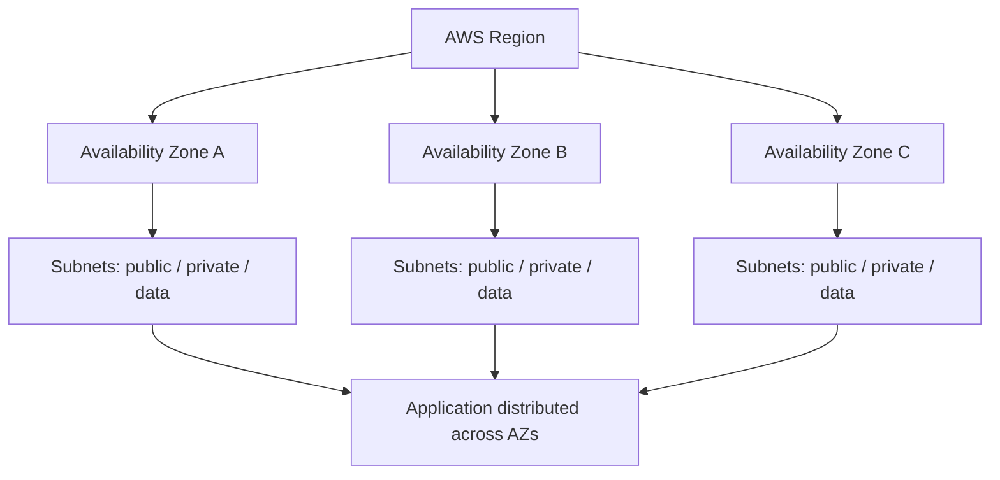
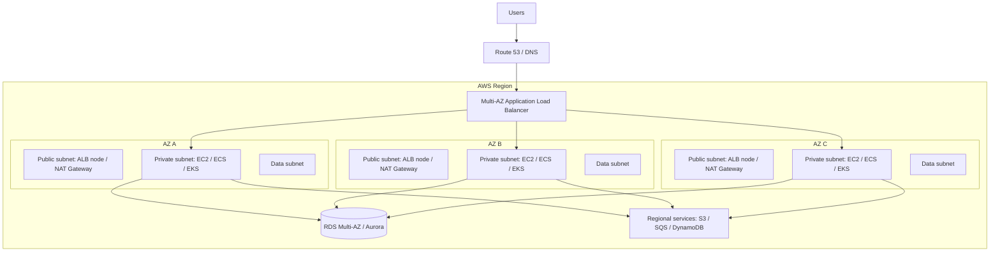

# Multi-AZ Redundancy Design and Handling Single-AZ Failures

An application running on AWS can still experience outages even when every individual server is properly configured. Power, networking, cooling, or infrastructure issues within a single Availability Zone (AZ) can impact many co-located resources. If all application servers, databases, or internet egress paths are concentrated in that AZ, a localized failure can escalate into a system-wide outage.

Multi-AZ design distributes application components across independent fault domains within the same AWS Region. When one AZ degrades or becomes unavailable, the remaining AZs continue serving traffic. Achieving this requires distributing compute, data, networking, and dependencies; maintaining sufficient spare capacity; detecting failures; shifting traffic; and verifying recoverability. Amazon EC2 Auto Scaling, Elastic Load Balancing, Amazon RDS Multi-AZ, Amazon Aurora, Amazon Route 53 Application Recovery Controller (ARC), AWS Fault Injection Service (FIS), and AWS Backup can all work together in this design.

Within the AWS ecosystem, Multi-AZ redundancy is part of operating Regional/AZ infrastructure, VPC networking, compute, storage, databases, and integrations. The goal is choosing the right services for availability targets while designing for security, observability, controlled recovery, and cost balance.

## Learning Objectives

After this lesson, you will be able to:

- Explain how an AZ acts as a fault boundary and distinguish Multi-AZ redundancy from Multi-Region recovery.
- Design VPCs, subnets, load balancers, and compute tiers to keep serving traffic when an AZ is lost.
- Choose appropriate data redundancy mechanisms for EC2, EBS, EFS, S3, RDS, Aurora, and managed services.
- Calculate remaining capacity after losing an AZ and apply the principle of static stability.
- Define procedures for detection, traffic shifting, failover, verification, and recovery after an AZ impairment.
- Use ARC zonal shift or zonal autoshift and test failure scenarios safely with AWS FIS.

## Availability Zones as Fault Boundaries

An AWS Region is an independent geographic area composed of multiple Availability Zones. Each AZ has isolated physical infrastructure, including power, backup power systems, cooling, and network connectivity. AZs within the same Region are close enough to support low-latency networking and data replication, yet engineered to isolate failures in one AZ from propagating to others.

An AZ typically consists of one or more data centers. AZ names like `ap-southeast-1a` are account-specific mappings to physical AZs. In several Regions, AZ names map differently across accounts. An **AZ ID** like `apse1-az1` identifies the exact same physical location across AWS accounts. When coordinating subnets or shared resources across multiple accounts, use the AZ ID to verify all parties reference the same physical AZ.

A subnet belongs to exactly one AZ. When creating a subnet, you pick an AZ and a CIDR; resources launched in that subnet reside in that AZ. Consequently, to build a three-AZ architecture, create matching subnets across all three AZs for each network tier.



### How Can an AZ Failure Manifest?

Not every outage shuts down all resources in an AZ simultaneously. An AZ can experience power loss, network partitions, performance degradation, dependent service errors, or conditions where new resource launches fail. Some running resources may keep operating while the control plane or part of the data plane is impacted.

When designing, account for these scenarios:

- **Compute loss:** EC2 instances, ECS tasks, or EKS worker nodes in the AZ stop or cannot accept requests.
- **Network loss:** subnets, NAT Gateways, or AZ-specific endpoints become unreachable.
- **AZ-scoped storage loss:** EBS volumes or data stored in single-AZ storage services become inaccessible.
- **Data failover:** Multi-AZ database services shift the writer or primary role to another AZ; applications must reconnect.
- **Partial degradation:** resources report healthy status while latency, timeouts, or error rates spike.

Applications must handle both hard failures and gray/partial degradations. Relying solely on an instance's `running` state is insufficient; measure actual request-serving health per AZ.

## Multi-AZ and Multi-Region Serve Different Goals

Multi-AZ distributes workloads within the same Region to withstand localized single-AZ failures. Multi-Region places workloads and data across distinct Regions to address broader disruptions—such as a Regional outage, serving users closer to another geography, or data residency compliance.

| Criterion | Multi-AZ | Multi-Region |
|---|---|---|
| Primary protection scope | Infrastructure or networking faults within one AZ | Regional-scale outages or broader geographic requirements |
| Placement | Multiple AZs within one Region | Multiple Regions |
| Replication latency | Typically low; synchronous replication possible depending on service | Typically higher; most architectures use asynchronous replication |
| Complexity | Typically lower | Higher due to routing, data, synchronization, and cross-Region operations |
| Best fit | Standard HA requirements for production workloads | Regional DR mandates or specialized business objectives |

Multi-AZ does not replace backups. If a user accidentally deletes data, an application writes corrupted records, or ransomware encrypts data, those changes can replicate to standby copies in other AZs. Pair Multi-AZ with AWS Backup, snapshots, versioning, retention, and cross-Region backups when recovery targets demand it.

## Defining Recovery Objectives Before Designing

Two metrics must be agreed upon with business owners: Recovery Time Objective (RTO) and Recovery Point Objective (RPO):

- **RTO** is the maximum duration a service can remain down before impact exceeds acceptable limits.
- **RPO** is the maximum acceptable data loss, expressed as the time interval between the recovery point and the incident timestamp.

For instance, a system targeting a 5-minute RTO and 1-minute RPO requires a very different architecture, detection mechanism, and testing regimen than one with a 4-hour RTO and 24-hour RPO. You cannot infer RTO/RPO merely by toggling Multi-AZ; actual failover time depends on the service, load, data state, application connections, and configuration.

Before selecting services, answer:

1. Must the application continue processing requests seamlessly during an incident, or can it tolerate a brief interruption?
2. How much in-flight write data can be lost?
3. What peak traffic must be served when one AZ is removed from the pool?
4. Which components must fail over together, such as writer databases, caches, queue consumers, and egress paths?
5. Who is authorized to trigger traffic shifts and who signs off that the service has stabilized?

## Multi-AZ Reference Architecture

A standard pattern places load balancers in front, runs compute in private subnets across multiple AZs, uses AZ-resilient data services, and isolates network dependencies per AZ.



This diagram shows logical components; placement of load balancers, databases, and Regional services depends on each service's deployment model. Not every service requires customers to provision a dedicated instance in each AZ.

### VPC and Subnet Distribution

Use at least two AZs for production workloads requiring HA; consider three AZs when supported by the Region and resource types, budget permits, and higher resilience is required. In each AZ, typically create separate subnets for public, application/private, and data tiers. Size CIDRs generously enough for ENIs, load balancer nodes, pods, tasks, instances, and future growth.

Never place all private subnets or data subnets in a single AZ. When one AZ fails, the remaining AZs must hold enough free IP addresses to replace or scale resources. Verify subnet IP availability and service quotas before running drills.

### Redundant Internet Egress and Endpoints

A NAT Gateway is an AZ-scoped resource. A single NAT Gateway becomes a single point of failure if every private subnet routes through it. For HA, deploy a NAT Gateway in each AZ and configure that AZ's private route table to use its local NAT Gateway. When one AZ fails, workloads in other AZs retain independent egress.

For VPC interface endpoints, provision endpoint network interfaces in all AZs where workloads access them to eliminate single-AZ dependencies. Inspect DNS settings and endpoint policies. Gateway endpoints for S3 and DynamoDB operate differently from interface endpoints; select the proper endpoint type per service.

Avoid routing designs where all traffic from AZ B traverses a NAT Gateway or proxy in AZ A. That creates cross-AZ dependencies, increases latency and data transfer costs, and widens blast radius when AZ A fails.

## Designing an AZ-Resilient Compute Tier

### Amazon EC2 and Auto Scaling

Span Auto Scaling groups across subnets in multiple AZs. Maintain balanced instance distribution across AZs, attach load balancer health checks when application-level checks are needed, and enable automatic replacement of unhealthy instances. Understand Auto Scaling's AZ balancing strategies:

- **Balanced best effort:** attempts to keep instance counts balanced across AZs; if launches fail in one AZ, Auto Scaling can try other healthy AZs.
- **Balanced only:** strictly continues attempting to maintain balance across designated AZs. This suits workloads requiring specific distribution/quorum that already maintain sufficient spare capacity for losing an AZ.

Balancing behavior varies with instance types, available capacity, and AZ state. Inspect your actual Auto Scaling group, subnet, and instance requirement settings; never assume every launch succeeds.

### ECS and EKS

For Amazon ECS, place capacity providers or ECS services across subnets in multiple AZs. Configure deployment settings and minimum healthy percentages carefully so deployments do not take down too many tasks simultaneously. Monitor running task counts and AZ distribution.

For Amazon EKS, distribute worker nodes across multiple AZs and use topology spread constraints or pod anti-affinity to avoid scheduling all replicas of a service in one AZ. PodDisruptionBudgets help govern voluntary disruptions like node drains; they cannot prevent sudden loss of an entire AZ. Keep enough node capacity and IP addresses in surviving AZs so the scheduler can place replacement pods.

### Stateless vs. Stateful Applications

Move session state, processing state, and business data off instances whenever possible so instances can be replaced without losing unique state. Store sessions in ElastiCache, DynamoDB, or another store suited to consistency and availability needs.

For stateful components, define replication mechanics, data ownership, split-brain handling, and failover ordering. Simply adding replicas accomplishes nothing if every replica depends on the same volume or same AZ.

## Load Balancing and Shifting Traffic Away from an Impaired AZ

### Elastic Load Balancing

When creating an Application Load Balancer, enable the AZs hosting targets and ensure each enabled AZ contains healthy targets. ALB enables cross-zone load balancing at the load balancer level by default; this can be adjusted per target group. Network Load Balancer and Gateway Load Balancer disable cross-zone load balancing by default and allow enabling it via configuration.

Cross-zone load balancing lets a load balancer node distribute requests to targets in other AZs. However, it does not replace deploying targets across multiple AZs. If targets exist only in AZ A, the workload still has a single point of failure in AZ A. If disabling cross-zone load balancing, maintain balanced target capacity in each AZ because each node may forward traffic only to targets in its matching AZ.

With NLB, cross-zone load balancing and zonal DNS distribution are architectural decisions affecting latency, cross-AZ charges, and fault tolerance. Balance target capacity per AZ and test how clients distribute connections.

### Route 53 and Health Checks

Route 53 supports DNS routing based on health checks, failover routing, or tailored routing policies. However, DNS caching in clients and resolvers delays propagation of DNS changes. Do not rely on DNS failover as your sole mechanism for shifting traffic during an AZ impairment.

Health checks must reflect real application readiness. An endpoint returning HTTP 200 while its database or primary dependency is down gives false health signals. Conversely, if a health check depends on a non-essential auxiliary service, a minor fault can drain all targets from the load balancer. Clearly separate liveness, readiness, and dependency health checks.

### ARC Zonal Shift and Zonal Autoshift

Amazon Route 53 Application Recovery Controller (ARC) provides two AZ traffic-shifting capabilities for supported resources:

- **Zonal shift:** an operator explicitly selects a resource and an AZ to avoid, shifting traffic to the remaining AZs. Zonal shift is temporary and time-bounded; it can be canceled or extended per runbook.
- **Zonal autoshift:** when enabled, AWS uses internal telemetry to detect certain AZ impairments and automatically shifts traffic away from the affected AZ. AWS can also run practice runs to verify operations with one AZ missing.

ARC does not inspect individual application health to trigger autoshift. An AZ may be flagged as impaired before a given workload notices errors, so understand the feature's scope and behavior. Only ARC-supported resource types work with zonal shift/autoshift; verify supported resource lists and prerequisites before deploying.

Before enabling autoshift or triggering a manual shift, confirm surviving AZs hold enough capacity to absorb the full traffic load. Do not count on Auto Scaling spinning up extra instances after an incident starts. For autoshift, configure practice runs and blockout windows to validate capacity headroom periodically.

## Designing Data and Storage for a Single-AZ Failure

Compute resilience is meaningless if unique data remains trapped inside one AZ. Classify storage by AZ/Region scope and understand how each service recovers.

| Service | AZ Scope and Behavior | Design Approach |
|---|---|---|
| Amazon EBS | Volumes attach to EC2 in the same AZ; cannot directly attach to an instance in another AZ | Use snapshots, AWS Backup, or Data Lifecycle Manager to copy and restore new volumes in target AZs; consider Fast Snapshot Restore to reduce initialization latency |
| Amazon EFS Regional | Regional file system designed for concurrent access from multiple AZs in a Region | Deploy mount targets in needed AZs and verify security groups, throughput, and lifecycles |
| Amazon EFS One Zone | Data stored within a single AZ | Use only when single-AZ fault scope is acceptable with an appropriate backup/restore plan |
| Amazon S3 | Regional storage classes like S3 Standard store data redundantly across multiple AZs | Use Regional buckets for AZ-resilient data; consider versioning, replication, and backups per RPO/RTO |
| S3 One Zone-IA / S3 Express One Zone | Data or directory bucket scoped to a single AZ by service design | Use only when the application accepts that risk and maintains copies or regenerability |
| Amazon RDS Multi-AZ DB instance | Synchronous primary and standby in two AZs; standby does not serve read traffic | Use the RDS DB endpoint; handle reconnects and retries after failover |
| RDS Multi-AZ DB cluster | One writer and two readable standbys across distinct AZs for supported engines | Use appropriate endpoints for read/write; verify failover behavior and client reconnection |
| Amazon Aurora | Cluster storage is durably distributed across multiple AZs; readers can be promoted if writer fails | Place readers in other AZs and use cluster/reader endpoints appropriately |
| Amazon DynamoDB | Regional service managed by AWS for high availability within the Region | Avoid depending on a single AZ-pinned client or proxy; consider Global Tables if multi-Region is required |

### EBS: Volumes Are AZ-Bound; Snapshots Enable Cross-AZ Recovery

An EBS volume must attach to an EC2 instance in the same AZ. If the AZ hosting an instance and volume goes down, you cannot simply detach the volume and reattach it in another AZ. EBS snapshots are stored independently of the volume and can create new volumes in any other AZ within the same Region.

Snapshots are point-in-time copies, not continuous per-transaction replication. Set snapshot schedules per RPO, retention per audit mandates, and restore procedures per RTO. For workloads needing immediate volume performance, consider Fast Snapshot Restore in target AZs and benchmark actual recovery times.

### Databases: Understand Each Multi-AZ Option

**RDS Multi-AZ DB instance deployments** automatically maintain a synchronous standby in another AZ. When the primary encounters certain infrastructure faults, RDS automatically fails over and updates the DNS endpoint to point to the new primary. This standby does not serve read queries. AWS describes typical failover times around 60–120 seconds, though it can take longer depending on database activity, open transactions, and recovery conditions. Applications must handle closed connections, re-resolve DNS, and safely retry idempotent transactions.

**RDS Multi-AZ DB clusters** differ architecturally: one writer and two readable standbys across separate AZs for supported engines. Cluster endpoints and reader endpoints serve distinct roles; applications must use the right endpoint and handle writer transitions.

**Aurora** stores cluster data across Multi-AZ distributed storage. When a writer fails, Aurora can promote a qualified reader or provision a new writer per cluster settings. To minimize recovery time, keep readers in separate AZs, route writes via the cluster endpoint, and configure failover priorities.

Never expect database failover to fix every application error. Slow queries, deadlocks, logic bugs, or data corruption may not trigger RDS automatic failover. Maintain separate database monitoring, query tuning, backups, and incident procedures.

## Spare Capacity and Static Stability

A three-AZ design that only has enough compute when all three AZs are active will overload as soon as one AZ is lost. Auto Scaling takes time to detect issues, request capacity, and boot instances; during a major event, provisioning new capacity in healthy AZs may also face contention.

**Static stability** means pre-provisioning enough spare capacity before an incident happens. When an AZ drops out, the workload continues serving traffic using already-running resources. Recovery afterward replenishes capacity and rebalances.

### Capacity Calculation Example

Suppose a system must handle 900 requests/second at peak. Each instance reliably serves 100 requests/second after reserving headroom for GC, retries, and traffic spikes. If deployed across three AZs and required to sustain 900 requests/second after losing one AZ, the remaining two AZs must together support at least 900 requests/second.

| Distribution | Capacity per AZ | Total Capacity (3 AZs) | Remaining Capacity (1 AZ Lost) |
|---|---:|---:|---:|
| 3 instances/AZ | 300 req/s | 900 req/s | 600 req/s |
| 5 instances/AZ | 500 req/s | 1,500 req/s | 1,000 req/s |

The 3 instances/AZ option fails requirements once an AZ is lost. The 5 instances/AZ option satisfies the 900 requests/second example, yet still requires validating CPU, memory, database connections, queue throughput, and downstream limits. Never count instances alone; inspect the entire request path.

With three evenly balanced AZs, surviving the loss of one AZ without capacity degradation means each AZ must carry roughly half of system peak load. With two AZs, each AZ must carry the full peak load alone. Weigh that redundancy cost against the business value of availability.

### Capacity Must Be Calculated Across Every Layer

Check all of the following together:

- EC2 instance quotas, instance type availability, Auto Scaling max size, and subnet IP capacity.
- ECS task capacity, EKS node groups, pod density, IP address capacity, and service quotas.
- ALB/NLB target capacity, connection limits, and ability to absorb traffic shifted into surviving AZs.
- Database connection limits, IOPS, throughput, storage, replica lag, and post-failover load capacity.
- NAT Gateways, VPC endpoints, DNS resolvers, and external third-party integrations.
- Queue consumer concurrency, retry backlogs, and message drain rates once an AZ recovers.

Scaling compute alone while the database is already near saturation can turn the database into a bottleneck during failover. Implement load shedding, rate limiting, queue buffering, and bounded retries so an AZ failure does not trigger cascading collapse.

## Handling an Impaired AZ: Response Workflow

Response procedures must be defined and rehearsed in advance. Break the response into six phases.

### 1. Detect and Scope the Fault

Monitor availability, latency, error rates, per-AZ health checks, healthy target counts, instance/task/pod counts, and AWS Health events. Correlate CloudWatch metrics, logs, traces, load balancer metrics, and database events to verify whether errors isolate to a single AZ.

Never declare an AZ failure from a single metric. Cross-check multiple signals and rule out shared dependencies. For example, a DNS or database failure can cause all AZs to report errors simultaneously even when compute infrastructure is healthy.

### 2. Protect Traffic and Contain Blast Radius

Once evidence confirms a single AZ is faulty and surviving AZs have sufficient capacity, remove the impaired AZ from the serving path via the appropriate mechanism: health-based routing, ARC zonal shift, or zonal autoshift. Verify target health and traffic distribution after shifting. If spare capacity is insufficient, apply rate limiting or prioritize shedding non-critical traffic.

### 3. Verify Data and Dependency Failover

Monitor RDS/Aurora failover events, replica status, cache replication groups, queue consumers, and outbound connectivity to external services. Do not manually promote or force writer swaps on managed services with automatic failover unless explicitly directed by the runbook.

### 4. Stabilize the System

Applications need bounded retries with exponential backoff and jitter, finite timeouts, circuit breakers, and idempotency keys for retryable operations. Avoid synchronized retry storms that overwhelm healthy databases or dependencies.

Illustrative Java example of backoff with jitter:

```java
import java.time.Duration;
import java.util.concurrent.ThreadLocalRandom;

public final class RetryDelay {
    private RetryDelay() {}

    public static Duration delayForAttempt(int attempt) {
        int exponent = Math.min(Math.max(attempt, 0), 5);
        long baseMillis = 200L * (1L << exponent);
        long cappedMillis = Math.min(baseMillis, 5_000L);
        long jitterMillis = ThreadLocalRandom.current()
                .nextLong(0L, Math.max(1L, cappedMillis / 2));
        return Duration.ofMillis(cappedMillis / 2 + jitterMillis);
    }
}
```

This snippet merely illustrates calculating exponential delay with jitter. In production, enforce an overall retry time budget, retry only transient faults, avoid retrying non-idempotent writes without deduplication, and respect remaining request deadlines.

### 5. Validate Service Health and Communicate

Test critical business flows end-to-end: login, reads, writes, checkout/payments, or message processing. Verify actual RTO/RPO, queue backlogs, database connection pools, and error rates have returned within target bounds. Notify service owners and incident responders per protocol.

### 6. Recover and Rebalance

Once AWS confirms the AZ has stabilized or operations has solid evidence it is safe to return traffic, cancel the zonal shift per runbook. Never shift traffic back abruptly while instances, caches, or databases are still warming up. Monitor load during return, rebalance capacity, and verify data synchronization.

## Real-World Example: Online Store Losing One AZ

An online store runs across three AZs in one Region. An ALB receives requests, an ECS service runs tasks in private subnets across each AZ, RDS Multi-AZ stores transactional data, S3 stores product images, and SQS handles asynchronous email jobs. Each AZ has its own NAT Gateway. CloudWatch alarms and EventBridge alert on incidents.

When AZ B degrades:

1. CloudWatch shows sharp spikes in 5xx errors and timeouts on targets in AZ B; AWS Health also reports an AZ-impacting event.
2. Operations checks target health, traffic volume, and capacity in AZ A/C. Those two AZs are pre-scaled to handle full peak load.
3. The team activates ARC zonal shift on the supported load balancer to temporarily steer traffic away from AZ B. If zonal autoshift is enabled and telemetry meets trigger criteria, ARC may shift traffic automatically.
4. ECS continues serving via tasks in AZ A/C. Auto Scaling and ECS can launch replacement tasks once AZ B permits it; launching new capacity is not a prerequisite for continuity.
5. If the RDS primary was in AZ B, RDS fails over to the standby in another AZ. Old connection pools drop; the application re-resolves the endpoint, opens new connections, and safely retries idempotent transactions.
6. SQS retains unprocessed messages. Consumers in healthy AZs scale up processing within database and downstream limits; messages may be redelivered, so handlers must be idempotent.
7. Product images in Regional S3 remain accessible. If the application held essential state on an EBS volume in AZ B, operations restores from snapshot into a volume in another AZ per runbook.
8. Once AZ B recovers, the team verifies task health, database status, routing, and latency before ending the shift. Afterward, they rebalance ECS capacity and document recovery time, any data loss, and operational lessons.

This walkthrough demonstrates how one AZ impairment triggers distinct behaviors across layers: load balancers shift traffic, compute keeps running in surviving AZs, databases fail over, queues buffer backlogs, and AZ-bound storage requires explicit restore steps. A strong runbook spells out every layer rather than assuming the entire stack magically migrates together.

## Testing AZ Fault Tolerance

Availability cannot be proven with an architecture diagram. Test under representative load with observable metrics and clear abort controls.

### Layered Testing

- **Design audit:** confirm subnets, targets, instances, tasks, pods, NAT Gateways, endpoints, and databases span AZs properly.
- **Capacity testing:** simulate peak traffic with one AZ removed from rotation.
- **Application testing:** drop connections, force connection pool recreation, test retries, and verify idempotency.
- **Data testing:** trigger RDS failover, restore EBS snapshots, inspect replication lag, and measure RPO.
- **Traffic-shift drills:** execute ARC zonal shift and verify traffic truly leaves the targeted AZ.
- **Recovery testing:** restore resources, rebalance traffic, and confirm no secondary errors emerge.

### AWS Fault Injection Service

AWS Fault Injection Service (AWS FIS) supports running controlled experiments. AWS provides the AZ Availability: Power Interruption scenario to simulate symptoms of an AZ power outage—stopping EC2 instances, blackholing subnet traffic, failing over RDS/ElastiCache, and triggering ARC zonal autoshift where resources are configured accordingly.

Before running FIS:

1. Test only in approved environments with an active owner monitoring.
2. Tag exact target resources; verify the target list before starting.
3. Configure stop conditions tied to CloudWatch alarms for error rates, latency, or data loss thresholds.
4. Verify experiment role permissions and API permissions for all actions.
5. Confirm backups, rollback runbooks, and incident contacts are ready.
6. Start small, log a timeline, and expand scope only after stable results.

Never run infrastructure-disrupting experiments in production without formal approval and blast-radius controls. Experiments must prove both continuity during impairment and clean recovery afterward.

## Monitoring and Day-to-Day Operations

Multi-AZ designs require dashboards displaying health per AZ. Aggregating metrics solely at the Region level allows one AZ to degrade severely while Regional averages look deceptively healthy.

Monitor:

- Request counts, p50/p95/p99 latency, 4xx/5xx rates, and timeouts per target/AZ.
- Healthy/unhealthy target counts, task/pod/instance counts per AZ, and traffic balance ratios.
- CPU, memory, network, queue depth, retry counts, and connection pool exhaustion.
- Database failover events, replica lag, database connections, IOPS, and storage utilization.
- NAT Gateway errors, dropped packets, subnet IP availability, and endpoint reachability.
- AWS Health events, ARC shift/autoshift actions, FIS experiments, and configuration changes.

Every alarm needs an owner, an action, and a runbook. AZ-related alerts should report Region, AZ ID or AZ name, resource ID, timestamp, customer impact, and shift status. After every failover, record actual RTO/RPO and update capacity plans.

## Cost and Design Trade-Offs

Multi-AZ increases cost through redundant compute, database standbys/replicas, subnets, NAT Gateways, endpoints, and spare capacity headroom. Cross-AZ data transfer can add charges depending on services and traffic patterns. Cross-zone load balancing can increase inter-AZ traffic; NLB disables cross-zone by default so workloads can preserve zonal locality and control transfer fees.

To manage costs:

- Choose two or three AZs based on availability targets and outage cost impact.
- Size capacity for peak load minus one AZ, then add sensible headroom.
- Use compute autoscaling for normal growth, while retaining baseline capacity needed for static stability.
- Place NAT Gateways per AZ and route locally to eliminate unnecessary cross-AZ transfer fees.
- Select RDS Multi-AZ DB instances, DB clusters, or Aurora based on HA, read scaling, and budget needs.
- Use snapshot lifecycles, AWS Backup, and retention policies to balance recovery speed against storage cost.
- Track costs of FIS experiments, logs, metrics, cross-AZ data transfer, and idle resources.

Avoid trimming redundancy based solely on average utilization. Size and price against peak load and the business cost of downtime; a single hour of outage can cost more than months of spare capacity.

## Common Design Mistakes

| Mistake | Consequence | Fix |
|---|---|---|
| Creating a Multi-AZ load balancer with targets in only one AZ | That AZ becomes a single point of failure | Deploy and maintain healthy targets across each AZ |
| Relying purely on Auto Scaling to build capacity after an outage | Recovery depends on control plane availability and spare capacity | Pre-scale baseline capacity for static stability |
| Sharing one NAT Gateway across all private subnets | Losing that AZ severs outbound connectivity for other AZs | Deploy per-AZ NAT Gateways with local route tables |
| Placing all database replicas in the same AZ | Losing that AZ destroys primary and replicas together | Use service-managed Multi-AZ deployments |
| Assuming an RDS standby serves read traffic | Misconfigured application endpoints and unmet read throughput | Distinguish DB instance standbys from Multi-AZ DB clusters/Aurora readers |
| Storing unique state solely on an EBS volume | Instance or AZ loss blocks access to required data | Snapshot/backup, replicate, or move state to resilient services |
| Using overly simplistic health checks | Broken targets keep receiving traffic, or all targets drop falsely | Design readiness and dependency checks aligned with business paths |
| Retrying infinitely during database failover | Retry storms amplify load and prolong outages | Use backoff, jitter, timeouts, circuit breakers, and idempotency |
| Shifting traffic without checking headroom | Surviving AZs overload under redirected requests | Run practice runs, load tests, and enforce static stability |
| Treating Multi-AZ as backup | Accidental deletions or corruption replicate across AZs | Maintain independent backups, versioning, retention, and restore tests |

## Production Readiness Checklist

- [ ] Define RTO, RPO, peak load, and acceptable service degradation.
- [ ] Select AZs within the Region and verify AZ IDs when coordinating across accounts.
- [ ] Provision sufficiently sized subnets for each network tier in every AZ.
- [ ] Distribute load balancers, EC2/ECS/EKS compute, and healthy targets across AZs.
- [ ] Calculate remaining capacity after removing one AZ and maintain static stability targets.
- [ ] Design NAT Gateways, VPC endpoints, route tables, and DNS without single-AZ bottlenecks.
- [ ] Choose Multi-AZ or backup/restore mechanisms suited to each data store.
- [ ] Implement retries, timeouts, backoff, jitter, and idempotency in applications.
- [ ] Configure CloudWatch alarms, AWS Health notifications, ARC shift/autoshift, and runbooks.
- [ ] Test database failovers, traffic shifts, EBS restores, and critical dependencies.
- [ ] Practice AZ impairment scenarios with AWS FIS inside approved boundaries with stop conditions.
- [ ] Measure actual RTO/RPO, update capacity plans, and review costs periodically.

## Conclusion

Multi-AZ redundancy requires distributing compute, data, networking, and dependencies within the same Region. When an AZ fails, surviving AZs need sufficient headroom to keep serving; traffic must steer clear of the impaired zone; databases and applications must reconnect cleanly; and AZ-bound data must have tested recovery paths. Static stability, per-AZ observability, ARC zonal shift/autoshift, and AWS FIS testing turn a Multi-AZ diagram into proven resilience. Combine Multi-AZ with independent backups and Multi-Region architectures whenever RTO/RPO or disaster scope requires it.

## References

- [AWS Availability Zones](https://docs.aws.amazon.com/global-infrastructure/latest/regions/aws-availability-zones.html)
- [REL10-BP01: Deploy the workload to multiple locations](https://docs.aws.amazon.com/wellarchitected/latest/framework/rel_fault_isolation_multiaz_region_system.html)
- [REL11-BP05: Use static stability to prevent bimodal behavior](https://docs.aws.amazon.com/wellarchitected/latest/framework/rel11-bp05.html)
- [Auto Scaling group Availability Zone distribution](https://docs.aws.amazon.com/autoscaling/ec2/userguide/ec2-auto-scaling-availability-zone-balanced.html)
- [Application Load Balancers](https://docs.aws.amazon.com/elasticloadbalancing/latest/application/application-load-balancers.html)
- [Network Load Balancer cross-zone load balancing](https://docs.aws.amazon.com/elasticloadbalancing/latest/network/edit-load-balancer-attributes.html)
- [Use zonal shift and zonal autoshift in ARC](https://docs.aws.amazon.com/r53recovery/latest/dg/multi-az.html)
- [About zonal autoshift](https://docs.aws.amazon.com/r53recovery/latest/dg/arc-zonal-autoshift.how-it-works.about.html)
- [Failing over a Multi-AZ DB instance for Amazon RDS](https://docs.aws.amazon.com/AmazonRDS/latest/UserGuide/Concepts.MultiAZ.Failover.html)
- [Multi-AZ DB instance deployments for Amazon RDS](https://docs.aws.amazon.com/AmazonRDS/latest/UserGuide/Concepts.MultiAZSingleStandby.html)
- [Amazon EBS snapshots](https://docs.aws.amazon.com/ebs/latest/userguide/ebs-snapshots.html)
- [AZ Availability: Power Interruption scenario in AWS FIS](https://docs.aws.amazon.com/fis/latest/userguide/az-availability-scenario.html)
