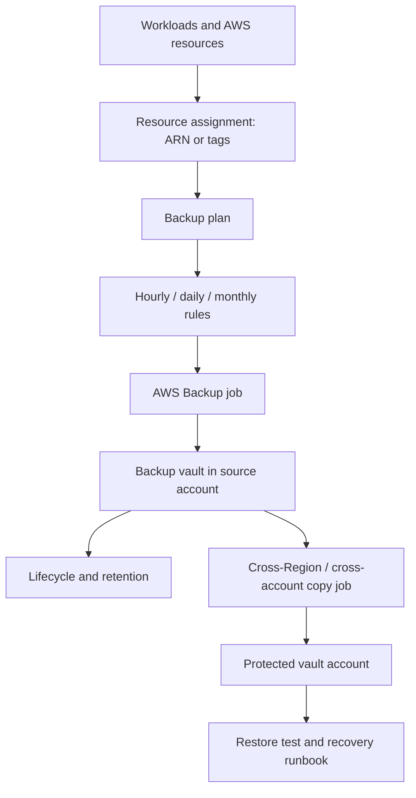

# Backup and Restore Strategy for AWS Systems

An AWS system can run across multiple services and Regions, yet data can still be accidentally deleted, overwritten by a buggy application, encrypted by ransomware, or rendered inaccessible when an administrative account is compromised. High availability keeps a system serving when a component fails; replication places data elsewhere; and backups create independent recovery points to roll back to a pre-incident state.

A sound backup-and-restore strategy starts with business objectives—identifying which data requires protection and how much data loss and downtime can be tolerated. Next, organize backup schedules, retention, cross-account/cross-Region copies, recovery permissions, and restore tests. On AWS, AWS Backup provides centralized management across many services, though each resource type retains distinct backup and restore behaviors. Infrastructure, IAM permissions, KMS keys, DNS, application configurations, and external dependencies must also be included in the recovery plan.

## Learning Objectives

After this lesson, you will be able to:

- Define RPO, RTO, and recovery priority tiers for each workload.
- Distinguish between backups, snapshots, replication, high availability, and disaster recovery.
- Design backup plans, backup rules, resource assignments, vaults, and lifecycles with AWS Backup.
- Protect recovery points using encryption, cross-account copies, cross-Region copies, Vault Lock, and isolated backup accounts.
- Choose appropriate backup methods for EC2/EBS, RDS/Aurora, DynamoDB, S3, EFS, FSx, and container workloads.
- Verify data consistency and recoverability across multi-tier applications.
- Design restore testing, runbooks, recovery ordering, and DR models aligned with RTO/RPO.
- Monitor jobs, control costs, and troubleshoot backup/restore errors.

## 1. Defining Recovery Objectives: RPO and RTO

Backups should never be designed solely around default service schedules. First determine the business impact if data is lost or the application goes offline.

**Recovery Point Objective (RPO)** is the maximum duration of data loss acceptable, measured backward from the time of an incident. For a 15-minute RPO, the organization needs a data protection mechanism ensuring the newest recoverable point is no older than roughly 15 minutes under target operating conditions.

**Recovery Time Objective (RTO)** is the maximum allowed duration to restore a service after an outage. RTO is not just the time AWS takes to complete a restore job. It also includes time to provision infrastructure, configure networking/IAM, restore databases, deploy applications, validate, and shift traffic.

Examples:

| Workload | Target RPO | Target RTO | Design Implications |
|---|---:|---:|---|
| Payments and orders | 5–15 minutes | 1 hour | Requires suitable PITR/replication, frequent backups, and rehearsed runbooks |
| Customer portal | 1 hour | 4 hours | Scheduled backups, cross-Region copies, and automated app redeployment |
| Internal reporting | 24 hours | 24 hours | Daily backups and on-demand restores may suffice |
| Long-term archival data | 24 hours or policy-driven | 2–5 days | Prioritizes retention, immutability, and storage efficiency |

These figures are examples only. Workload owners must validate RPO/RTO against business impact, regulatory obligations, customer SLAs, and acceptable cost.

### Actual Recovery Time

When planning, break down RTO into its parts:

\[
RTO_{total}=T_{detect}+T_{decide}+T_{provision}+T_{restore}+T_{validate}+T_{cutover}
\]

Here, the organization detects and declares an incident, decides on a recovery path, provisions infrastructure, restores data, validates the application, and cuts users over to the recovered environment. Measuring only database restore time severely underestimates RTO.

## 2. Understanding Backups, Snapshots, Replication, and High Availability

Data protection mechanisms solve different failure modes.

| Mechanism | Purpose | Strengths | Limitations |
|---|---|---|---|
| High availability (HA) | Maintain service continuity when a component fails | Fast failover, minimizes downtime | Can continue propagating logic bugs or deletions |
| Replication | Maintain data copies in another system/Region | Low RPO, supports failover | Accidental deletion, corruption, or ransomware can replicate |
| Snapshot | Capture data state at a point in time | Creates recovery points and often supports incremental storage | Must account for consistency and restore duration |
| Backup | Retain recovery points by schedule and retention | Rolls back to a pre-incident timestamp | Carries schedule lag; requires restore testing and deletion protection |
| Disaster recovery (DR) | Recover the entire service after a major outage | Defined RTO/RPO targets and failover architecture | Cost and complexity vary by strategy |

Replication does not replace backups. For example, if a user accidentally drops a table and the change replicates immediately to another Region, the replica loses the data as well. Backups with multiple independent recovery points let you roll back before the deletion.

Conversely, backups alone do not produce a traffic-ready system. After restoring data, you still need compute, networking, identity, secrets, DNS, load balancers, and cutover workflows. HA, replication, backups, and DR are commonly combined.

## 3. Classifying Data and Designing Protection Policies

Not all data requires the same backup frequency and retention. Classify data by criticality and regenerability.

- **Tier 0 – Core data and services**: transactions, accounts, identity, customer records. Low RPO/RTO; continuous or frequent backups; cross-account/Region copies; periodic restore tests.
- **Tier 1 – Important workloads**: operational apps, primary business data. Hourly or daily backups per RPO; retention covering error-detection windows.
- **Tier 2 – Regenerable data**: caches, temporary artifacts, short-lived logs. Can be rebuilt from source or retained under lighter policies.
- **Tier 3 – Archive/compliance**: data kept for years. Prioritizes retention, immutability, auditability, and storage cost.

For each workload, document:

1. Business owner and technical owner.
2. Datasets, resource ARNs, accounts, Regions, and dependencies.
3. RPO/RTO, retention, legal hold, or compliance mandates.
4. Backup method, frequency, vault, encryption key, and copy destinations.
5. Permissions to create backups, delete recovery points, and execute restores.
6. Restore runbooks, integrity checks, and measured recovery times.

### The 3-2-1-1-0 Mental Model

The 3-2-1-1-0 rule is a heuristic for checking copy diversity and reliability:

- 3 copies of data: production plus at least two backup copies.
- 2 distinct storage locations or media mechanisms.
- 1 copy in an account or Region isolated from production.
- 1 copy immutable or isolated from routine administrative privileges.
- 0 unverified restore errors left undetected by testing and validation.

This is a design principle, not a hard requirement enforced by AWS Backup. In the cloud, evaluate account boundaries, KMS keys, deletion permissions, Vault Lock, and independent recoverability to fulfill the spirit of this rule.

## 4. AWS Backup and Its Core Components

AWS Backup is a centralized backup service covering many AWS services and selected hybrid workloads. It lets you define schedules, retention, vaults, copy actions, resource assignments, job monitoring, and restores from a unified console and API.

Key components:

| Component | Function |
|---|---|
| Backup plan | Collection of backup rules applied to workloads |
| Backup rule | Schedule, backup windows, target vault, lifecycle, and copy actions |
| Resource assignment | Selects resources by ARN or tags |
| Backup job | A single backup execution run |
| Recovery point | Restorable backup stored inside a backup vault |
| Backup vault | Container storing recovery points, access policies, and encryption keys |
| Copy job | Copies recovery points to another vault/Region/account |
| Restore job | Recreates resources or data from a recovery point |
| Backup policy | AWS Organizations policy deploying backup plans across multiple accounts |
| Backup Audit Manager | Evaluates and reports compliance with backup policies |

A single backup plan can contain multiple rules—for instance, a daily rule with 35-day retention and a monthly rule with 7-year retention. Resource assignments can match all resources tagged `Backup=Critical`.



AWS Backup uses service-linked roles and IAM roles to operate on resources. Ensure roles hold permissions for source services, vaults, KMS keys, and copy/restore targets. Never grant account-wide administrative access to an application just to take backups.

## 5. Creating Backup Plans and Assigning Resources

### Backup Rules

A rule defines:

- **Schedule**: timing or frequency of backups.
- **Start window**: duration after scheduled time within which AWS Backup can start the job.
- **Completion window**: maximum expected duration for the job to finish.
- **Target backup vault**: where recovery points are stored.
- **Lifecycle**: when to move to cold storage (if supported by resource type) and when to delete.
- **Copy actions**: copies sent to other vaults, potentially in other Regions/accounts.
- **Recovery point tags**: tags for categorization, auditing, and management.

Schedules should fit system load and operational windows. If every account runs backups at the exact same timestamp, spikes in load or quota contention can push jobs past completion windows. Stagger schedules where needed and monitor actual execution durations.

### Resource Assignments

Resources can be assigned by explicit ARNs or tags. Tags automate coverage for new resources, though they are reliable only when tagging standards are enforced.

Examples:

| Tag | Meaning |
|---|---|
| `Backup=Critical` | Frequent backups plus cross-account/Region copies |
| `Backup=Standard` | Daily backups |
| `Backup=Archive` | Long-term retention backups |
| `DataClass=Restricted` | Strict retention and access controls |
| `Owner=payments` | Identifies the accountable team |

Never treat tags alone as proof of compliance if principals can arbitrarily alter tags. Combine tag policies, SCPs, IaC validation, and coverage audits to prevent unprotected gaps.

### Backup Policies with AWS Organizations

AWS Backup policies let administrators define backup plans at the Organization, root, or OU level. Policies inherit down to accounts along the Organizations hierarchy and deploy backup plans inside target accounts. The management account can designate a delegated administrator for AWS Backup to centralize operations.

Separate policies by OU and data tier. For example, Production receives daily backups with cross-Region copies; Sandbox receives shorter retention. Inspect effective policies after an account moves OUs, and verify backup plans actually appear inside member accounts.

## 6. Backup Vaults and Protecting Recovery Points

A backup vault holds recovery points and access control policies. Each vault has an encryption key and can carry an access policy. Vault design must address security boundaries, deletion controls, copy capabilities, and restore workflows.

### Encryption and KMS Keys

Recovery points are encrypted according to source service and AWS Backup rules. For resource types/vaults supporting customer managed KMS keys, ensure key policies and IAM policies permit the AWS Backup role to perform encrypt/decrypt/copy/restore operations.

KMS keys are critical backup dependencies. If a key is disabled, scheduled for deletion, or loses permissions, recovery points may still exist yet remain impossible to decrypt. Document key ARNs, owners, policies, rotation, and key-protection procedures in DR runbooks. Never delete a KMS key simply because the source workload was deleted.

Support for customer managed keys, AWS owned keys, or destination account keys depends on resource type and copy flow. Cross-account copies commonly require a key in the destination controlled by the destination account. Check each service's encryption rules before designing.

### Vault Access Policies and Separation of Duties

Separate privilege groups:

- Backup operator: creates and monitors backup jobs.
- Vault administrator: manages vaults and policies; does not by default hold rights to delete all recovery points.
- Restore operator: authorized to restore into approved target accounts/OUs.
- Security/compliance auditor: read-only access to status, reports, and history.
- Break-glass administrator: emergency access protected by MFA, approval, and auditing.

SCPs and IAM policies can block production principals from deleting vaults or recovery points. However, carve out exceptions for AWS Backup service roles, delegated administrators, and restore procedures. Test policies in a non-critical account before broad rollout.

### AWS Backup Vault Lock

Vault Lock provides WORM (write once, read many) protection for recovery points inside a vault:

- **Governance mode**: sufficiently privileged principals can modify or remove Vault Lock under governed workflows.
- **Compliance mode**: after an initial configurable grace period, the lock becomes immutable and cannot be altered or removed before locked retention limits expire.

Vault Lock reduces the risk of compromised administrators wiping out backups during an attack. Before enabling compliance mode, confirm min/max retention, retention durations, cost impact, and legal mandates. Misconfigurations can lock recovery points indefinitely and generate unexpected storage bills.

### Logically Air-Gapped Vaults

AWS Backup supports logically air-gapped vaults for scenarios requiring isolation of recovery points from routine operational accounts. These vaults can sit inside a dedicated security account and be shared via supported mechanisms for recovery. This is an added isolation layer; still verify supported resource types, Regions, encryption, access controls, and actual restore procedures.

## 7. Cross-Account and Cross-Region Copies

A backup kept solely in a production account remains vulnerable if that account's administrative control is compromised. Cross-account copying establishes a separate administrative boundary; cross-Region copying mitigates losing an entire Region. For critical workloads, combine both.

### Cross-Account Copy

A common pattern:

1. Workload account creates recovery points in a source vault.
2. AWS Backup copies recovery points to a vault in a dedicated Backup account.
3. The Backup account enforces strict policies restricting deletions and vault edits.
4. Security monitors copy jobs and retention in the destination account.
5. Restore operators assume dedicated roles to restore from the Backup account during incidents.

The management account can register a delegated administrator for AWS Backup. From the delegated administrator, teams can govern backups and copies across accounts/OUs. Copies still require checking encryption, key policies, vault policies, and restore permissions in the destination account.

### Cross-Region Copy

Cross-Region copying retains recovery points in another Region. When picking a destination Region, evaluate:

- Data residency and regulatory mandates.
- Whether the service/resource type supports copying to that Region.
- KMS key availability in the destination Region.
- Copy duration and data transfer/storage costs.
- Whether the destination Region has required quotas, networking, IAM, AMIs, images, and dependencies.

Copy jobs are asynchronous. Never treat configuring a copy action as proof the copy is ready. Monitor job statuses and verify recovery points inside the destination vault.

### Never Substitute Replication for Independent Backups

S3 Cross-Region Replication, DynamoDB Global Tables, or database replication maintain near-real-time data. They support HA/DR, yet do not automatically provide independent retention against deletion or corruption. Maintain point-in-time backups with separated deletion controls.

## 8. Selecting Backup Methods by AWS Service

AWS Backup supports many services, though backup methods, consistency, retention, cold storage, and restore behaviors differ by resource type. Always inspect the current support matrix by Region and feature.

| Service | Common Protection Mechanisms | Restore Considerations |
|---|---|---|
| Amazon EC2 / EBS | EBS snapshots, AMIs, AWS Backup | Snapshots may be crash-consistent; must restore multiple volumes and instance configs |
| Amazon RDS | Automated backups, PITR, manual snapshots, AWS Backup | Restores typically create a new DB instance; update endpoints, parameter groups, and secrets |
| Amazon Aurora | Continuous backup/PITR, cluster snapshots, AWS Backup | Restores create a new cluster; verify writer/reader endpoints and subnet groups |
| DynamoDB | Point-in-time recovery (PITR), on-demand backups, AWS Backup | Restores create a new table; verify indexes, streams, TTL, autoscaling, and policies |
| Amazon S3 | Versioning, Object Lock, AWS Backup for S3, replication | Restore objects/versions, bucket configuration, and access permissions |
| Amazon EFS | AWS Backup, replication where needed | Restores may create a new file system; verify mount targets, access points, and POSIX permissions |
| Amazon FSx | AWS Backup and FSx-type snapshots/replication | Check FSx type, throughput, subnets, AD, and client connectivity |
| Amazon EKS | AWS Backup for EKS where resource/Region supported; separate volume backups | Must restore Kubernetes resources, persistent data, secrets, and cluster dependencies |

### EC2 and EBS

EBS snapshots are incremental block-level backups. Snapshots protect volume contents, yet do not automatically protect all EC2 instance configuration. For workloads needing rapid recovery, create AMIs to capture boot volumes and supported instance metadata while backing up data volumes consistently.

Before backing up databases running on EC2, evaluate application consistency. Snapshots taken during active writes may only be crash-consistent. Quiesce writes, flush buffers, or use VSS/application-aware mechanisms when transactional consistency is needed. For multi-volume workloads, use multi-volume snapshots so volumes are captured at a coordinated point in time.

During restore, create new volumes or instances, attach volumes with correct device mappings, and restore instance configuration, security groups, subnets, IAM instance profiles, user data, and DNS. Verify file systems and databases before opening traffic.

### RDS and Aurora

RDS automated backups support point-in-time recovery within the configured retention window. Manual snapshots persist until explicitly deleted and fit release milestones or long-term retention. AWS Backup can manage backup plans and lifecycles for supported DB engines.

Restoring from a snapshot or PITR typically creates a new DB instance/cluster. The new endpoint may differ from the original. Runbooks must update secrets/configs and verify subnet groups, security groups, parameter/option groups, KMS keys, engine versions, and read/write endpoints. Validate replication, read replicas, and app connections before cutover.

### DynamoDB

DynamoDB PITR provides table recovery to any second within the service-supported window. On-demand backups create manual recovery points as needed. Restores create a new table, so verify Global Secondary Indexes, Local Secondary Indexes, streams, TTL, autoscaling, tags, resource policies, and encryption.

DynamoDB Global Tables keep data distributed across Regions, yet modifications or deletions replicate across Regions too. You still need PITR or independent on-demand backups to roll back prior to logic errors.

### Amazon S3

S3 Versioning preserves multiple object versions and enables recovery from overwrites or deletions. Delete markers hide objects from normal reads while earlier versions can remain intact. Object Lock protects object versions under retention periods or legal holds.

AWS Backup for S3 manages continuous and periodic backups for supported buckets. Check IAM requirements, resource assignments, S3 versioning, restore modes, object counts, metadata, bucket configuration, and cost. S3 replication copies objects to another bucket and can propagate delete operations depending on configuration; never treat replication as immutable backup.

Beyond objects, protect bucket policies, access points, lifecycles, replication rules, notifications, event configs, encryption, inventory, and ownership settings. Bucket-level configurations may need separate recreation or checks after restore.

### EFS and FSx

EFS can be protected with AWS Backup. When restoring, decide whether to create a new file system or restore into an appropriate target, then configure mount targets, security groups, access points, and policies. Verify owner/group, POSIX permissions, file metadata, and application paths.

FSx offers multiple file system flavors with distinct recovery needs. For FSx for Windows File Server, check Active Directory, DNS, and share permissions. For FSx for Lustre or OpenZFS, check subnets, deployment types, throughput, data repository associations, and client mounts. Do not rely on one generic restore runbook across all FSx types.

### EKS and Container Workloads

Backing up Kubernetes resources and backing up persistent data are related yet distinct concerns. With AWS Backup for EKS, confirm cluster, namespace, resource types, and persistent volumes are supported in your Region. When using CSI snapshots or third-party backup tools, verify CRDs, storage classes, snapshot controllers, volume encryption, and cross-cluster restore capability.

Store container images in ECR with traceable tags/digests; replicate images cross-Region where needed. Cluster configs, add-ons, IAM roles for service accounts, secrets, ConfigMaps, ingresses, policies, and GitOps repositories also require recovery plans. Data backups never replace storing manifests/IaC and deployment artifacts.

## 9. Application Consistency and Protection Ordering

A recovery point that is valid at the storage layer is not necessarily valid at the application layer.

### Crash-Consistent vs. Application-Consistent

- **Crash-consistent**: resembles a sudden power-off state. File systems/journals can recover, though in-flight transactions may remain uncommitted.
- **Application-consistent**: the application flushed buffers and completed or quiesced transactions in a supported manner prior to backup capture.

For databases, prefer native backups/PITR or service-supported application-aware mechanisms. For multi-volume apps, synchronize snapshot timing to prevent skewed data states.

### Cross-Service Consistency

Suppose an application spans RDS, S3, DynamoDB, and SQS. Backing up each service at different times can leave data out of sync. An order might appear in RDS while its corresponding invoice file in S3 did not yet exist in the S3 recovery point.

Designs should define:

1. Transaction markers or watermarks used to correlate data stores.
2. Methods to pause writes or switch the application into maintenance/read-only mode.
3. Backup ordering and data-cutoff timestamps.
4. How events/queues replay post-restore without duplicating transactions.
5. Integrity checks using counts, checksums, foreign keys, and business invariants.

When atomic cross-service snapshots are impossible, use application-level checkpoints, log sequences, event replay, and reconciliation to converge components to a consistent business state.

## 10. Retention, Lifecycle, and Long-Term Protection

Retention must satisfy both operational recovery and regulatory mandates. For example, daily backups kept 35 days cover recent errors; monthly backups kept 13 months catch delayed anomalies; annual archives address audits or legal retention.

### Lifecycle

AWS Backup can transition recovery points to cold storage when the resource type and backup type support it. Cold storage reduces storage rates, though it usually imposes minimum storage durations and retrieval/restore charges. Not all resource types support cold storage; verify per-service rules.

Configure lifecycles so that:

- Retention exceeds the maximum time needed to detect logic bugs or silent corruption.
- Critical recovery points copy to an isolated vault before expiring at the source.
- The last usable copy of legally mandated data is never deleted prematurely.
- Expired backups purge per policy with an audit trail.
- Legal holds or forensic holds preserve copies under approved workflows.

### Recovery Points and Corruption Detection Windows

If data is silently corrupted yet discovered only 45 days later, 30-day retention leaves no clean copy. For critical data, size retention around anomaly-detection latency, reconciliation cycles, accounting closes, and audit schedules. Longer retention increases cost, whereas overly short retention can leave the organization with no valid recovery point.

## 11. Restore Testing and Recoverability Verification

A successful backup job only proves data was written per the backup mechanism. It does not prove the app can boot, data decrypts, or RTO is met.

AWS Backup supports restore testing to schedule automated restore drills for supported resource types. You can choose resources, vaults/recovery points, schedules, and validation windows. Organizations must layer on application checks and runbook sign-offs.

### Testing Layers

| Layer | Question to Answer |
|---|---|
| Backup job | Did the job finish and does the recovery point exist? |
| Copy job | Is the copy present in the destination account/Region? |
| Encryption | Can the restore role decrypt using the KMS key? |
| Resource restore | Does the new resource launch with the expected settings? |
| Data integrity | Is data complete, matching checksums/counts, and error-free? |
| Application | Can the application reach databases, S3, queues, and dependencies? |
| Business validation | Do critical business workflows execute properly? |
| RTO/RPO | Do recovery duration and recovered data timestamp meet targets? |

### Restore Test Plan

1. Select both the newest recovery point and an older recovery point to validate retention.
2. Restore into an isolated account or VPC to avoid overwriting production.
3. Log start time, resource-ready time, and application-healthy time.
4. Verify data, permissions, encryption, endpoints, and application dependencies.
5. Run business tests, reconcile records, and verify sensitive data is not exposed publicly.
6. Tear down test resources per procedure and archive evidence.
7. Update measured RTO/RPO and refine runbooks wherever steps are slow or lack permissions.

Never restore-test onto live production resources without explicit change and rollback plans. Restores typically create new resources or require distinct metadata; account for resource costs incurred during testing.

## 12. Disaster Recovery Models

Backup-and-restore is one of several DR strategies. The right model depends on RTO/RPO targets and budget.

| Strategy | How It Works | Relative RTO/RPO | Cost / Complexity |
|---|---|---|---|
| Backup and restore | Store backups; provision infrastructure and restore on incident | Longer RTO; RPO depends on schedule/PITR | Lowest |
| Pilot light | Keep core/data components in DR Region; scale compute when needed | Moderate RTO; low RPO if data replicates | Moderate |
| Warm standby | Scaled-down live version runs continuously in DR Region | Shorter RTO; low RPO | Higher |
| Multi-site active/active | Multiple Regions actively serve traffic | Very low RTO; potentially very low RPO by design | Highest, most complex |

### Backup and Restore

Fits workloads tolerating longer recovery durations. When the primary Region fails, operations triggers runbooks, deploys infrastructure via IaC, copies/restores data, configures endpoints, and shifts traffic. Maintain pre-checked quotas, AMIs/container images, KMS keys, networking, and IAM in the DR Region.

### Pilot Light

Maintains minimal foundational pieces—such as database replicas or synchronized data, networking, and IAM—ready in advance. On failover, scale compute, deploy applications, and shift traffic. Test scaling under load because quotas or dependencies can delay startup past target timelines.

### Warm Standby

Runs a full yet scaled-down footprint in the DR Region. On failover, scale capacity up and cut traffic over. Warm standby reduces provisioning delays while requiring continuous synchronization of configurations, data, and application versions.

### Multi-Site Active/Active

Multiple Regions serve traffic concurrently. This goes far beyond turning on replication; you must solve consistency, write conflicts, sessions, idempotency, routing, health checks, and shared state. Unless the application is engineered for multi-writer behavior, active/active can introduce severe data inconsistencies.

## 13. Recovery Infrastructure: IaC, IAM, Networking, and Dependencies

Data backups alone cannot restore a complete system. Manage the following as code or reproducible inventories:

- VPCs, subnets, route tables, NAT, VPC endpoints, security groups, and NACLs.
- IAM roles, policies, instance profiles, permission boundaries, and trust relationships.
- KMS keys, key policies, aliases, and decryption access procedures.
- Secrets Manager secrets, Parameter Store parameters, and rotation workflows.
- EC2 launch templates, AMIs, ECR images, ECS task definitions, and EKS manifests.
- RDS parameter groups, subnet groups, option groups, and security groups.
- Load balancers, target groups, API Gateway, WAF, Route 53 records, and certificates.
- SQS/SNS, EventBridge rules, Step Functions, and integration configs.
- DNS domains, external SaaS endpoints, licenses, quotas, and third-party credentials.

Infrastructure as Code tools like AWS CloudFormation, CDK, or Terraform rebuild environments reproducibly. Store source code, state, artifacts, and modules independently of the production account. Test deploying IaC in the DR Region to confirm templates do not hard-code resource IDs or secrets tied solely to the primary Region.

KMS key material cannot simply be backed up like a file. Design key availability, multi-Region keys where suitable, key policies, and replacement/access recovery workflows. If a key is permanently deleted, ciphertext may become permanently unrecoverable.

## 14. Dependency-Ordered Restore Runbook

Recovery order directly dictates total recovery time. A general sequence:

1. **Declare incident and select recovery point**: identify impacted Region/account, last known clean timestamp, and RPO.
2. **Prepare recovery account/Region**: verify quotas, roles, KMS keys, networking, and access permissions.
3. **Provision foundation**: VPCs, subnets, routing, security groups, endpoints, IAM, and logging.
4. **Restore foundational data**: databases, file systems, object stores, and volumes in dependency order.
5. **Restore application tier**: EC2/ECS/EKS/Lambda, images, configurations, and secrets.
6. **Restore integrations**: queues, event buses, schedulers, certificates, DNS, and external endpoints.
7. **Verify**: health checks, database consistency, permissions, encryption, and business transactions.
8. **Cutover**: update DNS/routing or application endpoints per runbook.
9. **Monitor**: errors, latency, backlogs, duplicate events, data drift, and traffic.
10. **Close incident**: archive evidence, record actual RTO/RPO, and plan failback.

Never cut over traffic merely because restore jobs finished. Applications must pass health checks and business validation. For queues/events, enforce deduplication via idempotency keys and inspect unprocessed events.

## 15. AWS Backup Audit Manager and Compliance

AWS Backup Audit Manager evaluates backup deployments against controls and frameworks. Organizations can audit backup plans, backup frequencies, retention, copies, resource coverage, and other protections under supported frameworks.

Audit Manager generates compliance reports across accounts and Regions. It does not replace restore testing; a resource may satisfy backup schedule compliance yet still hold an unusable recovery point due to KMS keys or missing application dependencies.

Combine:

- AWS Backup Audit Manager for policy coverage and configuration checks.
- AWS Config/Organizations for account and resource state auditing.
- CloudTrail for auditing changes to plans, vaults, policies, and jobs.
- Restore testing for verifying data and application recovery.
- Ticket/exception registers to track resources excluded from backups or requiring custom policies.

## 16. CLI for Inspecting and Operating AWS Backup

The examples below illustrate basic operations. In practice, replace ARNs, accounts, Regions, roles, and metadata per resource type. Run using a least-privilege role.

### Create a Backup Vault

```bash
aws backup create-backup-vault \
  --backup-vault-name prod-critical-vault \
  --encryption-key-arn arn:aws:kms:us-east-1:111122223333:key/00000000-1111-2222-3333-444444444444 \
  --region us-east-1
```

### Run an On-Demand Backup Job

```bash
aws backup start-backup-job \
  --backup-vault-name prod-critical-vault \
  --resource-arn arn:aws:ec2:us-east-1:111122223333:volume/vol-0123456789abcdef0 \
  --iam-role-arn arn:aws:iam::111122223333:role/AWSBackupDefaultServiceRole \
  --lifecycle DeleteAfterDays=35 \
  --region us-east-1
```

Backup jobs are asynchronous; the command returns a job ID. Track status until completion or failure.

### List Recovery Points in a Vault

```bash
aws backup list-recovery-points-by-backup-vault \
  --backup-vault-name prod-critical-vault \
  --region us-east-1
```

### Monitor Backup Jobs

```bash
aws backup list-backup-jobs \
  --by-state COMPLETED \
  --region us-east-1

aws backup describe-backup-job \
  --backup-job-id <backup-job-id> \
  --region us-east-1
```

### Retrieve Metadata and Start a Restore

Restore metadata varies by resource type. First fetch the recovery point's original metadata:

```bash
aws backup get-recovery-point-restore-metadata \
  --backup-vault-name prod-critical-vault \
  --recovery-point-arn <recovery-point-arn> \
  --region us-east-1
```

After creating `restore-metadata.json` with verified and adjusted values per resource-type guidance:

```bash
aws backup start-restore-job \
  --recovery-point-arn <recovery-point-arn> \
  --metadata file://restore-metadata.json \
  --iam-role-arn arn:aws:iam::111122223333:role/AWSBackupDefaultServiceRole \
  --region us-east-1
```

Restore jobs typically create new resources. Verify resource names, subnets, security groups, KMS keys, endpoints, and permissions before routing applications to them. Never run examples with placeholder ARNs or unconfigured roles.

## 17. Monitoring Backup and Restore Jobs

AWS Backup emits job statuses and events trackable via console, API, CloudWatch, and EventBridge. Alert on:

- Backup job failures or completion-window timeouts.
- Copy job failures or missing recovery points in destination vaults.
- In-scope resources lacking a recovery point newer than allowed thresholds.
- Restore job failures or unusually long restore durations.
- Changes to Vault Lock, access policies, KMS keys, or backup plans.
- Coverage drops after accounts move OUs or resource tags change.
- Failed restore tests or actual RTO/RPO breaches.

Important metrics go beyond successful backup job counts. Track newest recovery point age, resource coverage percentage, copy success rate, restore test pass rate, and actual measured recovery durations.

CloudTrail records who created, edited, or deleted backup plans/vaults, changed policies, or launched restores. For isolated backup accounts, store administrative logs where production principals cannot delete them.

## 18. Cost and Optimization

Backup costs depend on recovery point count, incremental churn, retention, copies, cold storage, restores, data transfer, and DR resources running during recovery.

| Component | Cost Drivers |
|---|---|
| AWS Backup | Backup count/volume, resource types, backup management, and enabled features per pricing |
| EBS snapshots | Incremental snapshot storage, copies, and retention length |
| RDS/Aurora | Automated backups exceeding included allowance, manual snapshots, copies, and storage |
| DynamoDB | PITR, on-demand backups, restores, and storage per pricing |
| S3 | Object/version storage, AWS Backup for S3, replication, requests, and retrievals |
| Cross-Region copy | Data transfer, destination Region storage, and KMS keys |
| Restore tests | Resources spun up during tests, compute/storage/network, and cleanup |
| DR environment | Pilot light/warm standby/active-active infrastructure and data replication |

Optimization approaches:

- Use tags/resource assignments to back up only necessary data.
- Split plans by tier and retention instead of keeping all resources identically.
- Use lifecycle/cold storage when resource types support it and retrieval SLAs allow.
- Purge expired recovery points per policy without deleting the last copy needed for compliance.
- Stagger backup schedules to flatten load and avoid quota contention.
- Copy cross-Region/cross-account only for workloads requiring that resilience tier.
- Schedule restore tests cleanly and tear down test resources promptly after completion.
- Track cost allocation tags and cost reports by OU, account, and workload owner.

Never optimize by cutting retention or dropping cross-account copies before owners confirm RPO, RTO, and compliance obligations remain satisfied.

## 19. Common Troubleshooting

| Symptom | Possible Cause | Remediation |
|---|---|---|
| Backup job not created | Resource not opted in, outside assignment, wrong tag, or schedule not yet triggered | Check service opt-in, Region, ARNs, tags, and effective backup plan |
| Backup job failed with AccessDenied | IAM role, service-linked role, SCP, or vault policy lacks permissions | Verify principal/action/resource and related KMS permissions |
| Recovery point cannot be decrypted | KMS key disabled, policy altered, or key unavailable in target account | Restore key/permissions per runbook; verify key state prior to restore |
| Cross-account copy job failed | Vault access policy, destination vault, KMS key, or Organization policy misconfigured | Check copy permissions at source and receive permissions at destination |
| Cross-Region copy job incomplete | Unsupported Region/resource type, quota, or service error | Inspect job status, Region availability, quotas, and perform controlled retry |
| Restore job failed | Invalid metadata, missing role permissions, or missing dependencies | Fetch original metadata, verify resource-specific restore prerequisites and KMS |
| Restore completed but app fails to run | Missing network, IAM, secrets, DNS, endpoints, or app config | Follow dependency runbook; check health and business transactions |
| Restored data inconsistent | Crash-consistent backup or multiple services captured at different timestamps | Use native PITR/app checkpoints, log replay, and reconciliation |
| Vault Lock blocks recovery point deletion | Retention locked under governance/compliance mode | Verify retention and permissions; never attempt to bypass immutability |
| New resources not backed up | Missing tags, OU policy not inherited, or assignment gap | Check effective policies, tag compliance, and coverage reports |

## 20. Real-World Design Scenarios

### Scenario A: Single-Region Database Requiring 15-Minute RPO

A payment application runs on Amazon RDS. The team enables engine-supported automated backups/PITR, adds periodic snapshots via a backup plan, and copies recovery points to a Backup account. KMS keys are governed separately, with vault deletion rights separated from operations roles. Monthly, the team restores into a test VPC, runs transaction reconciliation, and measures end-to-end time until the app is healthy.

### Scenario B: EC2 and EBS Requiring Regional Recovery

A workload runs on EC2 with multiple EBS volumes. A backup plan creates regular recovery points and copies them to the DR Region. AMIs, launch templates, IaC, security groups, and IAM roles are managed independently. When the primary Region goes down, operations builds the VPC in the DR Region, restores volumes/AMIs, validates file systems/databases, updates secrets/endpoints, and shifts traffic via Route 53.

### Scenario C: Accidentally Deleted S3 Bucket Contents

The bucket has Versioning and AWS Backup for S3 enabled. Copies reside in the Backup account under appropriate Vault Lock. Upon discovering accidental deletion, the data team identifies affected objects/versions, restores into an isolated recovery bucket, checks metadata and permissions, and selectively syncs back to the production bucket. The recovery bucket is never opened publicly to the internet during inspection.

### Scenario D: Ransomware Compromising a Production Account

An attacker gains administrative privileges in the production account and tries to delete backups. Copies in the Backup account are protected by separate roles, Vault Lock, and policies blocking production principals from deleting recovery points. Responders isolate the account, locate a clean recovery point, validate KMS keys, and restore into a clean account/Region. Before cutover, verify images, secrets, IAM credentials, and data contain no attacker persistence.

## 21. Hands-On Exercise: Creating a Vault, Backing Up, and Restoring EBS

Goal: create a recovery point for a test EBS volume, verify the backup, and restore it into a new volume.

### Preparation

1. A lab AWS account and Region.
2. An EBS volume holding no production data.
3. An appropriate IAM role for AWS Backup.
4. A usable KMS key if selecting a customer managed key.
5. A dedicated lab vault.

### Execution

1. Create a backup vault via CLI or console.
2. Confirm the volume is in the Region and EBS is opted in for AWS Backup.
3. Run an on-demand backup job or create a backup plan with a short lab schedule.
4. Track the job until `COMPLETED` and record the recovery point ARN.
5. Retrieve restore metadata for the recovery point.
6. Start a restore job with appropriate names/metadata to create a new volume.
7. Wait for restore completion, then inspect volume state, encryption, and AZ.
8. Attach the volume to a test EC2 instance in the matching AZ.
9. Verify the file system and data contents.
10. Save test results and tear down lab resources in proper order.

### Expected Outcomes

- The backup job completes and the recovery point exists in the vault.
- The restore job produces a usable new resource.
- Restored data passes integrity verification.
- Backup/restore timings are recorded.
- No unexpected lab resources remain running or stored after cleanup.

## 22. Common Misconceptions

- **Having snapshots means having DR**: you still need infrastructure, IAM, KMS, networking, DNS, and runbooks to bring the application back.
- **Replication is backup**: logic bugs and deletions replicate; independent historical recovery points are still required.
- **Backup job success guarantees restore success**: only restore testing validates the entire dependency chain.
- **One backup schedule fits every workload**: RPO/RTO, churn, and retention vary by business tier.
- **AWS Backup protects all AWS configuration**: maintain IaC/inventories for networking, IAM, DNS, secrets, images, and dependencies.
- **Putting backups in another Region is enough isolation**: administrative privileges, KMS keys, and deletion policies still need separation.
- **Vault Lock can be turned on and changed freely later**: compliance mode becomes immutable after its initial grace window.
- **Restores overwrite the original resource in place**: many services create new resources; endpoints and ARNs may change.
- **Restored data is automatically business-consistent**: verify transactions and relationships across multiple services.
- **RTO equals restore job duration**: include decision, provisioning, validation, and cutover time.
- **More backups are always better**: uncategorized backups without retention discipline or restore tests inflate costs without reliably lowering risk.

## 23. Production Operations Checklist

Before taking a backup-and-restore strategy to production, confirm:

- [ ] Every workload has an approved business owner, technical owner, RPO, and RTO.
- [ ] Data is classified by tier, retention, and regulatory requirements.
- [ ] Backup plans cover resources via ARNs/tags across appropriate accounts and Regions.
- [ ] AWS Organizations backup policies apply to new accounts and accounts moving OUs.
- [ ] AWS Backup delegated administrator and administrative privileges are separated.
- [ ] Backup vaults have explicit access policies, encryption, and clear owners.
- [ ] KMS keys remain available throughout full retention and restore windows.
- [ ] Critical recovery points copy to an independent account.
- [ ] Cross-Region copies satisfy DR and data residency requirements.
- [ ] Vault Lock or logically air-gapped vaults are evaluated for critical data.
- [ ] Backup consistency is defined for databases and multi-volume workloads.
- [ ] IaC, AMIs, images, secrets, IAM, networking, DNS, and dependencies have recovery plans.
- [ ] Alerts exist for job failures, stale recovery points, and copy failures.
- [ ] Restore testing runs periodically in isolated environments.
- [ ] Business validation verifies data integrity after restores.
- [ ] Actual RTO/RPO are measured and compared against targets.
- [ ] Runbooks include recovery ordering, owners, approvals, and failback plans.
- [ ] Costs for storage, copies, cold tiers, restore tests, and DR environments are tracked.
- [ ] Scenarios for account loss, Region loss, accidental deletion, and ransomware have been rehearsed.

## Conclusion

A backup-and-restore strategy for AWS must begin with RPO/RTO and data classification. AWS Backup centralizes backup plans, vaults, recovery points, lifecycles, and copies, yet recoverability still depends on resource types, consistency, KMS keys, access controls, and recreatable infrastructure.

Keep recovery points across appropriate account/Region boundaries, protect copies with policies and immutability, and run regular restore tests in isolated environments. Combine IaC, dependency-ordered runbooks, business validation, and measured RTO/RPO so you know with confidence your systems can recover when an incident strikes.

## References

- [AWS Backup Developer Guide](https://docs.aws.amazon.com/aws-backup/latest/devguide/whatisbackup.html)
- [Creating and managing backup plans](https://docs.aws.amazon.com/aws-backup/latest/devguide/creating-a-backup-plan.html)
- [Assigning resources to a backup plan](https://docs.aws.amazon.com/aws-backup/latest/devguide/assigning-resources.html)
- [Managing AWS Backup with AWS Organizations](https://docs.aws.amazon.com/aws-backup/latest/devguide/manage-cross-account.html)
- [Cross-Region backup](https://docs.aws.amazon.com/aws-backup/latest/devguide/cross-region-backup.html)
- [Cross-account backup](https://docs.aws.amazon.com/aws-backup/latest/devguide/create-cross-account-backup.html)
- [AWS Backup Vault Lock](https://docs.aws.amazon.com/aws-backup/latest/devguide/vault-lock.html)
- [Logically air-gapped vaults](https://docs.aws.amazon.com/aws-backup/latest/devguide/logicallyairgappedvault.html)
- [AWS Backup restore testing](https://docs.aws.amazon.com/aws-backup/latest/devguide/restore-testing.html)
- [AWS Backup Audit Manager](https://docs.aws.amazon.com/aws-backup/latest/devguide/aws-backup-audit-manager.html)
- [Supported AWS Backup features by resource](https://docs.aws.amazon.com/aws-backup/latest/devguide/backup-feature-availability.html)
- [Amazon EBS snapshots](https://docs.aws.amazon.com/ebs/latest/userguide/ebs-snapshots.html)
- [Amazon RDS backup and restore](https://docs.aws.amazon.com/AmazonRDS/latest/UserGuide/CHAP_CommonTasks.BackupRestore.html)
- [Amazon DynamoDB backup and restore](https://docs.aws.amazon.com/amazondynamodb/latest/developerguide/BackupRestore.html)
- [Amazon S3 Versioning](https://docs.aws.amazon.com/AmazonS3/latest/userguide/Versioning.html)
- [Amazon S3 Object Lock](https://docs.aws.amazon.com/AmazonS3/latest/userguide/object-lock.html)
- [Amazon EFS backup](https://docs.aws.amazon.com/efs/latest/ug/awsbackup.html)
- [AWS Well-Architected Framework: Reliability Pillar](https://docs.aws.amazon.com/wellarchitected/latest/reliability-pillar/welcome.html)
- [Disaster recovery options in the cloud](https://docs.aws.amazon.com/whitepapers/latest/disaster-recovery-workloads-on-aws/disaster-recovery-options-in-the-cloud.html)
