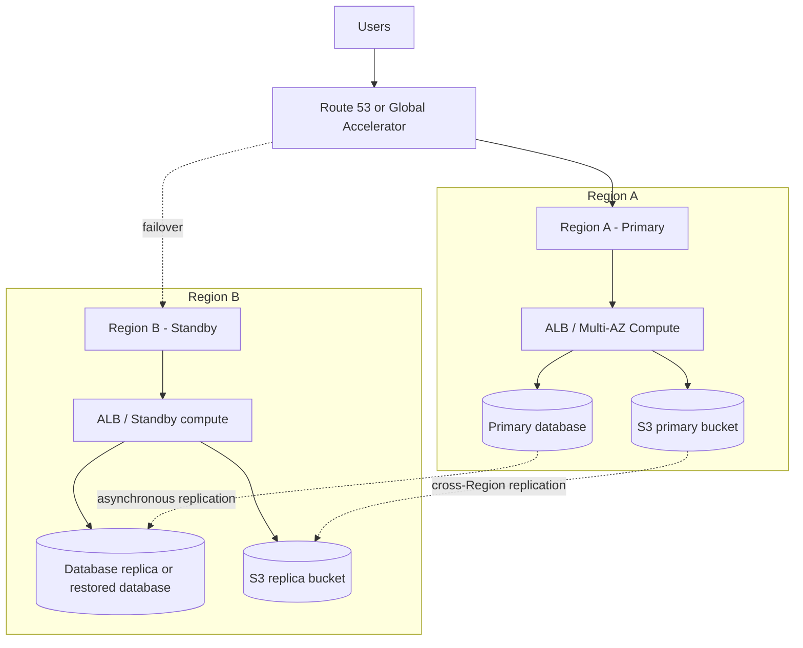
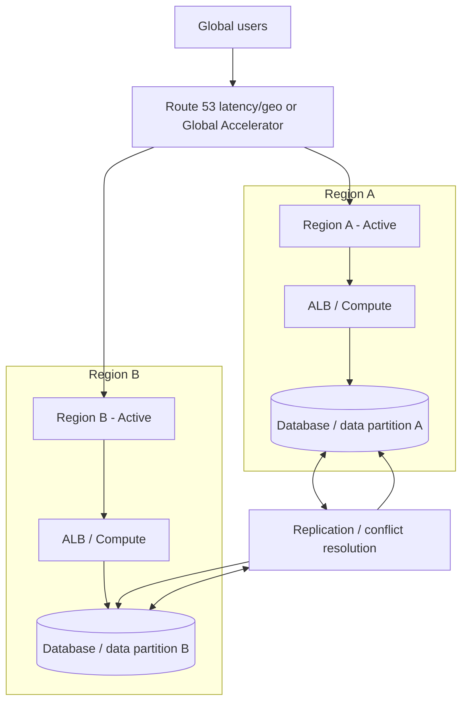

# Multi-Region Active-Passive and Active-Active Architectures

A critical application may need to remain available even when an entire AWS Region suffers an outage. Multi-Availability Zone (AZ) redundancy protects workloads against localized faults inside a Region, yet is insufficient for Regional outages, loss of connectivity to a Region, or requirements to serve users in another geography. In those cases, a multi-Region architecture enables workloads to operate from another Region.

Two common models are **active-passive** and **active-active**. Active-passive designates one primary Region to serve live traffic while keeping the other Region on standby to take load when needed. Active-active allows multiple Regions to serve production traffic continuously. Active-active can lower latency for distributed users and eliminate cold startup delays during outages, yet demands significantly more complex data design, routing, synchronization, and conflict resolution.

Within the AWS ecosystem, selecting between these models must align with application requirements across Regions, data, IAM, VPCs, compute, storage, databases, integrations, monitoring, recovery, and cost. No single pattern fits every system. Start from RTO/RPO, the failure modes to mitigate, and data behavior when two Regions operate concurrently.

## Learning Objectives

After this lesson, you will be able to:

- Distinguish between active-passive, active-active, backup-and-restore, pilot light, and warm standby.
- Select a multi-Region model based on RTO, RPO, latency, data consistency, and budget.
- Design user traffic routing with Amazon Route 53, AWS Global Accelerator, and Amazon Route 53 Application Recovery Controller (ARC).
- Select replication or recovery mechanisms suited to S3, RDS, Aurora, DynamoDB, and storage services.
- Handle write conflicts, idempotency, replay, and failback in active-active architectures.
- Design security, observability, testing, and runbooks for Region-level outages.

## What Does Multi-Region Solve?

An AWS Region is an isolated geographic area composed of multiple AZs. A Multi-AZ architecture distributes resources within the same Region to survive AZ failures. A Multi-Region architecture deploys or replicates workloads across independent Regions to tolerate broader failures.

Common drivers for multi-Region deployments include:

- **Region-level disaster recovery:** keeping or restoring services when the primary Region is unavailable.
- **Geographic requirements:** serving users closer to home, reducing latency, or satisfying regional data residency laws.
- **Business continuity:** avoiding single-Region concentration and retaining operational options during widespread incidents.
- **Load distribution:** serving traffic from multiple Regions to improve response times and scale aggregate capacity.
- **Change-risk control:** deploying and validating new releases in one Region before expanding, where release workflows permit.

Multi-Region does not automatically make an application highly available. If both Regions share a single identity provider, a single DNS provider, a single deployment pipeline, or a single external dependency, a shared point of failure can still bring down both Regions. Map all dependencies and identify which components are genuinely independent.

## Active-Passive vs. Active-Active

### Active-Passive

In an active-passive model, one Region is primary (active) and handles production traffic. The other Region is secondary (standby), holding data and partial or full infrastructure ready to accept traffic if the primary fails.

Standby readiness spans multiple tiers:

- **Backup and restore:** stores backups, templates, and configurations; provisions infrastructure and restores data after an outage. Lower cost, longer RTO.
- **Pilot light:** keeps minimal core components active—typically data or database replicas plus foundational networking/security. Compute and remaining capacity scale up at failover.
- **Warm standby:** runs a scaled-down yet fully functional replica in the standby Region. Scales capacity and shifts traffic on demand.
- **Hot standby:** keeps a near full-scale environment running in the standby Region, enabling faster traffic cutover at higher cost.

These labels describe readiness levels and resource allocation. Implementation varies by workload; some architectures mix tiers across data, compute, and integration layers.

### Active-Active

In an active-active model, two or more Regions concurrently serve production traffic. Each Region holds sufficient compute, networking, and dependencies to handle its share of load. When one Region fails, traffic shifts to the surviving Regions.

Active-active can deliver lower latency via proximity routing, utilize capacity across multiple Regions, and reduce standby spin-up delays. However, concurrent writes across Regions can collide. Define authoritative write ownership, conflict resolution, event ordering, idempotency, and behavior when inter-Region connectivity drops.

| Criterion | Active-Passive | Active-Active |
|---|---|---|
| Regions serving live traffic | Primarily one Region | Multiple Regions |
| Resources in secondary Region | Small, off, or full depending on standby tier | Must typically carry baseline traffic plus failover load |
| RTO | Depends on standby tier, automation, and recovery time | Can be short if routing and data plane are already live |
| RPO | Depends on replication lag or backup schedule | Depends on synchronization mechanism and data model; not zero by default |
| Write conflicts | Usually simpler if only primary accepts writes | Must be resolved if multiple Regions write the same records |
| Cost | Can be lower if standby runs minimal capacity | Typically higher from operating multiple active Regions |
| Operational complexity | Relatively lower; requires failover/failback runbooks | Higher; requires coordinating data, traffic, and cross-Region conflicts |
| Best fit | Well-defined DR targets where load can shift to one Region | Global apps requiring low latency or continuous multi-region serving |

### Choosing a Model by Recovery Objectives

Do not pick active-active solely to chase a low RTO. If the application does not need multi-Region writes, active-passive with warm standby and a well-tested failover procedure often meets requirements at far lower cost and complexity.

Conversely, if users span continents, traffic must run locally under normal operations, and data can be cleanly partitioned, active-active can make sense. Size surviving Regions to absorb peak load when one Region drops—not merely average load while both Regions are healthy.

## Defining RTO, RPO, and Incident Scope

Recovery Time Objective (RTO) is the maximum acceptable duration of service interruption. Recovery Point Objective (RPO) is the maximum acceptable data loss, usually expressed as the time between the recovery point and the moment of failure.

Examples:

- A 15-minute RTO means the application must restore service within at most 15 minutes under the agreed measurement method.
- A 1-minute RPO means the business tolerates losing up to roughly one minute of data, depending on commit semantics and measurement rules.
- Zero RTO or zero RPO is extremely hard and costly; verify exact transaction boundaries, synchronization, dependencies, and network conditions before committing.

Define RTO/RPO per capability rather than only for the application as a whole. For instance, login, product catalog lookup, checkout, reporting, and email notifications may carry different targets. An application might continue serving catalog pages while temporarily pausing order writes if that degraded mode is business-approved.

| Component | Questions to Answer |
|---|---|
| Compute | How long to bring up enough instances/tasks/pods in the standby Region? |
| Database | How long to promote a writer, update endpoints, and reconnect? How current is replicated data? |
| Object/file storage | Have recent objects replicated? Are destination buckets/volumes accessible? |
| DNS/routing | How long does traffic shifting take, and do clients cache stale addresses? |
| Identity/secrets | Can the target Region authenticate workloads and read required secrets/certificates? |
| Queues/events | Are messages replicated? Is there risk of duplicate processing or out-of-order delivery? |
| Operations | Who declares the incident, who triggers failover, and who authorizes returning to primary? |

### Classifying Incidents

Define tailored runbooks for each scenario:

1. One AZ in the primary Region fails, while the Region stays healthy.
2. A Regional service such as database or identity degrades.
3. The primary Region becomes unavailable or network-isolated.
4. The primary Region stays healthy, but inter-Region connectivity breaks.
5. A logic bug or accidental deletion corrupts data and replicates to the other Region.

Scenario 4 is especially dangerous for active-active. When Regions cannot communicate, both may keep accepting writes and diverge into conflicting states. Architectures must define write authority, split-brain detection, and reconciliation once connectivity returns.

## Active-Passive Reference Architecture



Region A handles traffic during normal operations. Region B holds replicated data and standby infrastructure. Once Region A is confirmed unusable and failover criteria are met, operations or automation promotes Region B's database, scales compute, checks dependencies, and shifts traffic.

Failover ordering matters. Shifting traffic before the target database accepts writes causes transaction errors; promoting the target database without fencing the old primary risks split-brain if Region A was only partially partitioned. Runbooks must fence or confirm the old primary can no longer accept writes before enabling the new writer.

## Active-Active Reference Architecture



Both Regions serve requests. If both write to the same data entity, the data layer must support multi-writer semantics or the application must partition write ownership. If each Region owns a distinct set of tenants or shards, both Regions can run active-active at the application tier while each record maintains a single authoritative write Region. This reduces conflicts and is generally far easier to govern than allowing unrestricted concurrent writes from any Region to every record.

Active-active does not require every component to be multi-writer. Frontends and read paths can run in multiple Regions while critical write flows route to a data-owning Region or single designated writer.

## Routing Users Across Regions

### Amazon Route 53

Route 53 offers routing policies including failover, latency-based, weighted, and geolocation. Health checks evaluate endpoints and drive failover to the standby Region. In active-active setups, latency-based routing directs users to low-latency Regions; weighted routing splits traffic by percentage or supports gradual rollouts; geolocation routes by geographic location.

DNS is not an instantaneous traffic switch. Resolvers and clients cache responses for the TTL duration, and some clients hold long-lived TCP connections after DNS changes. Health checks must verify real business readiness rather than probing a static endpoint. Measure actual traffic migration times using representative clients.

### AWS Global Accelerator

Global Accelerator provides two static anycast IPv4 addresses (or IPv6 where configured) as a global entry point. Users connect to the nearest AWS edge location, and Global Accelerator routes to endpoint groups in healthy Regions. Supported endpoints include ALBs, NLBs, EC2 instances, and Elastic IPs.

Global Accelerator excels when you need stable IP addresses, health-based and traffic-dial routing across Regions, or reduced reliance on client DNS caching. It does not synchronize data or recover databases on its own; pair it with data and application failover.

### Amazon Route 53 Application Recovery Controller

ARC provides routing controls to execute deterministic failovers. A routing control toggles traffic flow for a serving cell and integrates with Route 53 health checks. Safety rules prevent unsafe combinations—such as accidentally turning off all serving Regions simultaneously.

ARC separates control plane and data plane. When designing DR, follow AWS guidance to interact with data plane endpoints during incidents so recovery avoids control-plane dependencies. ARC does not determine which data copy is newest and does not automatically promote every database type.

### Choosing a Routing Mechanism

| Mechanism | Strengths | Considerations |
|---|---|---|
| Route 53 failover | Easy DNS and health check integration | TTL/caching delays traffic shifts; verify resolver behavior |
| Route 53 latency-based | Directs users to lowest-latency Region | Requires health checks and data locality; low latency does not guarantee capacity |
| Route 53 weighted | Splits traffic proportionally for rollouts and gradual shifts | DNS weights do not guarantee exact request splits due to caching and connection reuse |
| Global Accelerator | Static anycast IPs, health-based routing, and traffic dials | Carries dedicated charges; still requires data failover and endpoint tests |
| ARC routing controls | Controlled traffic switching with safety rules | Requires runbooks, IAM governance, and data plane testing; does not replace replication |

## Selecting Multi-Region Data Mechanisms

Data usually dictates RPO and architectural complexity. Never pick a routing layer first and try to bolt database replication on afterward. Define the data model, consistency guarantees, write ownership, and recoverability upfront.

### Amazon S3 Cross-Region Replication

S3 Cross-Region Replication (CRR) copies objects from a source bucket to a destination bucket in another Region per replication rules. Versioning must be enabled on both source and destination buckets. CRR is asynchronous; a newly written object may not appear immediately in the destination bucket.

Key considerations:

- Scope replication by prefix, object tags, or full bucket per requirements.
- Use a replication IAM role and verify bucket policies and KMS key policies when using SSE-KMS.
- Monitor replication status and replication metrics; never assume every object replicated simply because the rule is Enabled.
- CRR does not replicate delete markers in every configuration by default; verify delete marker replication and version deletion rules before designing recovery workflows.
- Objects created before enabling a rule require S3 Batch Replication to backfill historical data.
- S3 Replication Time Control can provide backed replication-time targets for most new objects, yet does not turn replication into a backup or transactional sync mechanism.

CRR suits objects, documents, and files needing cross-Region copies. If applications write the same object key from both Regions, define ownership rules and version conflict handling; CRR is not a synchronous multi-writer engine for a single bucket.

### Amazon RDS Cross-Region Read Replicas

For supported engines and configurations, RDS supports cross-Region read replicas. Data replicates asynchronously from source to replica. When the source Region fails, the replica can be promoted to a standalone database accepting writes. After promotion, it ceases to be a read replica of the original source; rebuilding the topology requires separate steps.

Cross-Region read replicas fit active-passive or read scaling. Monitor replica lag, verify engine/version/Region support, KMS encryption, and access controls. RPO equals replication lag at failure time; never promise zero RPO with asynchronous replication.

### Amazon Aurora Global Database

Aurora Global Database maintains one primary DB cluster in the primary Region and secondary clusters in other Regions. Storage replicates across Regions with low latency—often under a second—yet remains asynchronous and lag can rise under certain conditions.

Secondary clusters serve read traffic; the global database writer lives in the primary Region. When switching Regions, use supported managed failover or switchover procedures. After promotion, applications must connect to the new Region's endpoints and manage the updated primary/secondary topology.

Aurora Global Database generally fits active-passive with multi-Region reads or rapid DR. Do not describe it as a concurrent active-active multi-writer database for a single cluster; standard global databases have one primary writer at a time.

### Amazon DynamoDB Global Tables

DynamoDB Global Tables replicate tables across Regions and allow applications to read and write in any configured Region. It fits active-active architectures when data and access patterns align with the service's replication semantics.

Distinguish supported consistency modes. Under multi-Region eventual consistency (MREC), updates replicate asynchronously with potential lag; concurrent updates to the same item across Regions trigger conflict resolution where one write can overwrite another. Under multi-Region strong consistency (MRSC), verify constraints on Region topology, table types, features, and latency in current AWS documentation before selecting. Never assume every Region pair or feature behaves identically.

Global Tables do not eliminate application-level design. Use conditional writes, version numbers, idempotency keys, or partition ownership where appropriate; avoid relying on cross-Region event ordering unless guaranteed.

### Multi-Region Backups

AWS Backup can create backups and copy recovery points to another Region for supported resource types. Cross-Region backups support recovery when the primary Region fails, though restore durations are typically longer than failing over a live database replica.

For each resource, verify:

- Whether the resource type, Region, and feature support cross-Region copying.
- Destination backup vault, encryption keys, and access policies.
- Vault Lock, lifecycles, retention, and protections against unauthorized deletion.
- Copy times, restore times, recovery ordering, and prerequisite dependencies.
- Periodic restore testing schedules and post-restore data verification.

Backups capture point-in-time recovery states; replication propagates changes elsewhere. Both address different risk classes and commonly work together.

## Handling Conflicts and Consistency in Active-Active

Active-active boosts availability, yet introduces scenarios where two Regions update the same record before exchanging state. Without explicit rules, data can be overwritten, lost, or diverge across Regions.

### Write Management Strategies

1. **Single-writer per entity:** each record or tenant has one authoritative write Region. Requests arriving elsewhere route to the owner. This is a clean way to eliminate concurrent write conflicts.
2. **Partitioned ownership:** partition customers, accounts, or shards by Region. Each Region writes its local partition and replicates read copies elsewhere.
3. **Multi-writer with conflict resolution:** allow multiple Regions to write the same data and apply business rules to reconcile conflicts. Define versions, timestamps, ordering, and handling for superseded writes.
4. **Append-only event log:** write immutable events and materialize state via projections. This supports replay and auditing while requiring handling for event ordering, duplicates, and eventual consistency.

### Conflict Example

Suppose a customer profile initially holds phone number `0900000000`. During an inter-Region network partition, Region A writes `0911111111` while Region B writes `0922222222`. When replication resumes, the system needs an agreed rule: which Region holds write authority, which version wins, or whether user confirmation is required. Arbitrarily picking last-writer-wins by message arrival time fails because network arrival order does not reflect business intent.

A data model can track monotonic versions or optimistic concurrency:

```json
{
  "customerId": "C-1042",
  "phone": "0911111111",
  "version": 18,
  "writeRegion": "ap-southeast-1",
  "updatedAt": "2026-11-20T05:30:00Z"
}
```

On update, the application submits the expected version and commits only if the stored version matches. If the check fails, the app re-reads and resolves the conflict per business rules. Timestamps help auditing yet should not serve as the sole conflict arbiter because clock skew and differences between creation and receipt times distort ordering.

### Idempotency and Duplicate Messages

In distributed systems, retries and replication can deliver the same operation multiple times. Attach an idempotency key or transaction identifier to every critical write. Consumers persist processed IDs so duplicate messages never create duplicate orders, payments, or ledger entries.

When using event-driven replication, define:

- Globally unique event IDs and deduplication logic.
- Partition keys preserving ordering within required scopes.
- Retry policies, dead-letter queues, and replay procedures.
- Schema versioning and backward compatibility across Regions.
- Handling for late-arriving, out-of-order, and replayed events.
- Reconciliation workflows between Regions after partitions heal.

### Split-Brain and Fencing

Split-brain occurs when two Regions both believe they are primary and accept writes for data requiring a single writer. An inter-Region network outage can cause this even while both Regions operate normally internally.

To prevent split-brain, enforce fencing: only one Region holds write authority at any instant. Depending on architecture, use routing controls, leases/epochs, or an authoritative coordinator. When promoting a standby Region, revoke or disable write paths on the old primary before opening writes on the new writer. If the old primary's state cannot be confirmed, apply safe-failure rules to block concurrent writes.

## Cross-Region Security and Configuration Management

Multi-Region multiplies resources, keys, roles, endpoints, and pipelines. Configurations existing only in the primary Region will fail during failover. Manage configurations as code and deploy consistently across every Region.

### IAM and Workload Identity

- Provision required IAM roles and policies in target Regions/accounts; verify trust policies and cross-account permissions.
- Apply least privilege for applications, replication roles, backup roles, and automation roles.
- Never bake static access keys into AMIs, container images, or config files.
- Audit AWS Organizations SCPs, permission boundaries, and resource policies that could block actions in the target Region.
- Rehearse authentication from the standby Region to prove workloads obtain credentials and call APIs cleanly.

### KMS and Secrets

AWS KMS keys are Regional resources. A key ARN in Region A cannot be used directly as a Regional key in Region B. Multi-Region keys can share key material across Regions for supported encryption use cases, yet they remain distinct Regional key resources whose policies and grants must be managed per Region.

For S3 CRR or AWS Backup copies using SSE-KMS, verify key policies and permissions for replication/backup roles on both source and destination keys. Secrets Manager can replicate secrets to another Region; applications in the target Region must reference the right replica ARN with matching IAM/KMS permissions. Certificates, trust stores, parameters, and endpoint settings must also be pre-deployed.

### Networking and Dependencies

Each Region maintains its own VPCs, subnets, route tables, security groups, endpoints, NAT Gateways, and connectivity. Ensure non-overlapping CIDRs if interconnecting VPCs across Regions. Configure private connectivity, Transit Gateway peering, or VPN/Direct Connect as needed, and verify each Region still operates if inter-Region links sever.

Never make Region B depend on a private API living only in Region A if Region B must survive Region A failing. Treat any shared cross-Region dependency as an out-of-Region point of failure with a fallback plan.

## Deployment and Change Management

Regions must run compatible application versions and configurations. Use Infrastructure as Code such as AWS CloudFormation, AWS CDK, or Terraform to define VPCs, IAM, load balancers, compute, databases, alarms, and routing. Parameterize per-Region differences while keeping security baselines uniform and controlling drift.

A multi-Region release pipeline can follow:

1. Build artifacts once and tag with immutable versions/digests.
2. Deploy to a low-traffic or canary Region first.
3. Run smoke tests, database migrations, and dependency checks.
4. Shift traffic incrementally with controlled ratios.
5. Monitor error rates, latency, saturation, and business metrics.
6. Roll out to remaining Regions once criteria pass.
7. If failures occur, halt rollout and roll back using data-compatible strategies.

Database schema migrations must remain backward-compatible during staggered rollouts. Avoid applying breaking schema changes in Region A while Region B still runs an older application build or drains unsynchronized events.

## Failover and Failback Procedures

### Before an Incident

- Designate who has authority to declare a disaster and trigger failover.
- Maintain inventories of resources, endpoints, database roles, replication status, and dependencies per Region.
- Monitor backups, replica lag, KMS keys, secrets, IAM, quotas, and capacity in standby Regions.
- Maintain runbooks with ordered steps, abort criteria, and communication channels.
- Rehearse regularly under representative load and log actual RTO/RPO.

### When the Primary Region Fails

1. **Declare:** confirm blast radius, incident class, and approve DR activation per criteria.
2. **Fence:** block writes to the old primary if split-brain risk exists. Establish authoritative data ownership.
3. **Assess data:** inspect replication lag, backup timestamps, and latest recoverable state. Record expected RPO.
4. **Promote/restore:** promote replicas or restore databases/storage in the target Region. Execute once against verified state.
5. **Activate dependencies:** scale compute, verify IAM/KMS/secrets, queues, endpoints, and integrations.
6. **Validate:** run smoke tests and synthetic business transactions; confirm reads/writes, consistency, and capacity.
7. **Shift traffic:** update ARC routing controls, Global Accelerator traffic dials, or Route 53 policies per runbook.
8. **Observe:** track error rates, latency, replication, queue backlogs, and business metrics; update stakeholders.

Never shift traffic solely because the target Region returns HTTP 200. Verify write paths and critical business dependencies first.

### Failback to the Original Region

Failback returns workloads to the original Region after recovery. Treat it as an architectural and data migration event rather than a casual toggle.

Before failing back:

1. Confirm the original Region is stable across networking, security, quotas, and dependent services.
2. Choose a data synchronization strategy from the currently active Region back to the original Region.
3. Converge data to a consistent state; identify the current writer and coordinate write pauses or ownership handoff.
4. Verify schema versions, application builds, secrets, keys, and configs in both Regions.
5. Shift traffic gradually or via one controlled cutover.
6. Monitor transactions, replication lag, errors, and rollback readiness.
7. Re-establish the original active-passive topology only after confirming the primary Region owns the writer role and the other Region returns to standby.

Never rush failback the instant the old Region comes back online. If the DR Region is serving stably, a hasty failback can trigger avoidable downtime or data loss.

## Real-World Scenario: Two-Region E-Commerce Platform

An e-commerce platform serves customers across Southeast Asia. Region A sits in `ap-southeast-1`, while Region B serves as the DR Region selected for latency, service availability, and data policy. The stack comprises APIs, transactional databases, a catalog, product images, order-processing queues, and notifications.

### Active-Passive Approach

- Region A runs ALBs, ECS services, RDS/Aurora primary, primary S3 buckets, and primary SQS queues.
- Region B maintains VPCs, IAM, KMS, secrets, ALBs, and warm-standby compute; database replicas or backups stay within RPO targets.
- S3 CRR replicates images and documents; AWS Backup copies supported recovery points to a vault in Region B.
- Route 53 failover or ARC routing controls shift traffic after responders confirm primary unavailability.
- During failover, promote the database, verify queues and dependencies, scale ECS capacity, test transactions, and cut over traffic.

This fits when Region B only needs to carry traffic during Region A outages and the business accepts a controlled failover step.

### Active-Active Approach

- Both Regions run APIs and ECS services; Global Accelerator or Route 53 routes users to the appropriate Region.
- Catalog reads from local replicas per Region; updates propagate via replication.
- Product images use S3 CRR to distribute objects with agreed ownership and deletion rules.
- Session or shopping cart data can use DynamoDB Global Tables if consistency and conflict semantics fit.
- Orders partition by tenant or order ownership so one Region holds primary write authority per subset. Payments enforce idempotency keys and reconciliation.
- When Region A fails, traffic dials shift load to Region B; Region B holds pre-tested capacity to absorb the extra traffic.

Active-active removes reliance on spinning up a cold standby Region, yet demands clear write ownership and state reconciliation. For payment flows, avoid letting both Regions freely create the same transaction without deduplication and reconciliation safeguards.

## DR Testing and Periodic Drills

A DR plan is trustworthy only when proven by testing. Tests must cover infrastructure, data, routing, security, and people.

Test types:

- **Tabletop exercise:** operations walks through runbooks, roles, decisions, and communication paths without touching live infrastructure.
- **Backup restore test:** restore data from backups into an isolated environment, measure duration, and validate integrity.
- **Replica promotion test:** promote a database replica in a test environment, verifying endpoints, app connectivity, and RPO.
- **Traffic failover test:** divert partial or full traffic to the DR Region via Global Accelerator/Route 53/ARC per scenario.
- **Region isolation exercise:** simulate losing connectivity to the primary Region using approved methods, testing fencing and split-brain prevention.
- **Failback exercise:** synchronize data back and return traffic, verifying post-cutover consistency.
- **Load test:** prove the surviving Region sustains projected peak load when one Region is offline.

AWS Fault Injection Service (FIS) supports controlled fault experiments for supported resources and scenarios. FIS does not replace a full Region-level DR plan or automatically validate end-to-end application logic. Every experiment needs a bounded blast radius, stop conditions, active observers, backups, and abort procedures.

After each drill, record:

- Time to detect, time to decide, time to promote/restore, and time to shift traffic.
- Actual RPO and replication lag at cutover.
- Missed dependencies, missing IAM/KMS permissions, and insufficient quotas.
- App errors caused by connection pools, DNS caching, retries, event replay, or schema mismatches.
- Load and cost observed in the surviving Region when handling full traffic.
- Updates required for runbooks, dashboards, and automation.

## Multi-Region Monitoring

Dashboards and alarms must display per-Region health alongside overall DR readiness. Aggregating metrics globally can mask one failing Region behind healthy numbers from the other.

Monitor at a minimum:

- Availability, latency, request/error rates, and business transaction success per Region.
- Compute capacity, healthy targets, task/pod counts, CPU, memory, and networking.
- Database roles, replication lag, failover events, connection counts, and storage headroom.
- S3 replication pending bytes/operations, failed replications, and object replication statuses.
- Queue depth, message age, DLQ counts, duplicate processing, and event lag.
- DNS/Global Accelerator endpoint health, ARC routing control states, and traffic dials.
- Backup jobs, cross-Region copies, vault access, restore tests, and KMS key availability.
- AWS Health events, CloudTrail changes, and deployment pipeline statuses.

Every alert must map to a concrete action. For example, replica lag breaching thresholds may require throttling writes or delaying failover; failed backup copies must be resolved before claiming DR readiness. Alert not only when production fails, but also when standby redundancy degrades.

## Cost and Trade-Offs

Multi-Region increases expenses substantially due to running compute, databases, storage, replication, cross-Region network transfer, load balancers, backups, and observability across multiple Regions.

Primary cost drivers:

- Standby compute or continuous active capacity in secondary Regions.
- Database replicas, Global Database, Global Tables, and replicated storage.
- S3 replication, cross-Region data transfer, request fees, and replication metrics.
- Global Accelerator, Route 53 health checks, ARC, and routing services.
- AWS Backup cross-Region copies, backup storage, vaults, and restore testing.
- Logs, metrics, traces, CloudTrail, and multi-Region evidence retention.
- Operational effort: drills, consistency audits, pipeline maintenance, and incident support.

To control costs, align standby tiers with RTO/RPO—using backup-and-restore for lower-tier workloads, pilot light or warm standby for faster RTO targets, and active-active only where latency or continuous availability truly demands it. Budget both steady-state and failover-state costs, since the surviving Region must handle full production load during an outage.

## Common Design Mistakes

| Mistake | Consequence | Remediation |
|---|---|---|
| Assuming cross-Region copies equal complete DR | Missing compute, IAM, keys, secrets, DNS, or dependencies | Run end-to-end recovery tests and maintain runbooks |
| Ignoring replication lag | Actual RPO exceeds targets | Monitor lag and enforce pre-failover lag thresholds |
| Shifting traffic before promoting the database | Writes fail or hit read-only replicas | Enforce sequence: promote, validate, then shift traffic |
| Failing to fence the old primary | Both Regions accept writes, causing split-brain | Revoke write paths or verify old primary isolation |
| Running active-active without conflict policies | Data overwrites or divergent state | Use single-writer per entity, partitioned ownership, or conflict resolution |
| Testing failover without testing failback | Unable to return cleanly to baseline topology | Rehearse both failover and failback directions |
| Using DNS failover without checking TTL/caching | Users continue hitting dead endpoints | Measure client behavior and consider Global Accelerator/ARC |
| Omitting KMS/IAM setup in target Region | Workloads fail to decrypt data or read secrets | Provision keys, policies, roles, and grants in target Region |
| Insufficient capacity in DR Region | Service overloads immediately after failover | Pre-scale or load-test at full failover traffic |
| Treating replication as backup | Accidental deletions or corruption replicate | Maintain independent backups, versioning, retention, and restore tests |

## Design and Operations Checklist

- [ ] Define failure scope: AZ, Region, network isolation, data corruption, or logic error.
- [ ] Finalize RTO/RPO per capability and define measurement rules.
- [ ] Choose active-passive or active-active based on business needs and data semantics.
- [ ] Select standby Regions considering latency, service availability, quotas, cost, and data residency.
- [ ] Provision VPCs, subnets, routing, security groups, IAM, KMS, and secrets in every required Region.
- [ ] Select appropriate replication or backups for each database, object store, and file system.
- [ ] Define write ownership, consistency, conflict resolution, idempotency, and split-brain prevention.
- [ ] Configure Route 53, Global Accelerator, or ARC with proper health checks and safety rules.
- [ ] Maintain enough compute/database/network capacity when one Region is offline.
- [ ] Manage configurations and releases via Infrastructure as Code and controlled pipelines.
- [ ] Monitor replication lag, backup copies, endpoint health, queue backlogs, and business metrics per Region.
- [ ] Document runbooks for failover, failback, fencing, notifications, and approvals.
- [ ] Regularly test backup restores, replica promotions, traffic shifts, load handling, and failback.
- [ ] Measure actual RTO/RPO, update documentation, and review costs regularly.

## Conclusion

Active-passive fits when a standby Region needs to take over workloads after an outage with controlled cost and complexity. Active-active fits when multiple Regions must serve concurrently to cut latency or sustain continuous regional operations, yet requires explicit data modeling and conflict resolution. Both models depend on tested routing, replication or backups, IAM/KMS, capacity headroom, observability, and runbooks. Rely on measured RTO/RPO and real drills to prove the standby Region can serve the business when an outage strikes.

## References

- [Disaster recovery options in the cloud](https://docs.aws.amazon.com/whitepapers/latest/disaster-recovery-workloads-on-aws/disaster-recovery-options-in-the-cloud.html)
- [AWS Well-Architected: REL 13 - How do you plan for disaster recovery (DR)?](https://docs.aws.amazon.com/wellarchitected/latest/framework/rel_planning_for_recovery.html)
- [Amazon Route 53 routing policies](https://docs.aws.amazon.com/Route53/latest/DeveloperGuide/routing-policy.html)
- [AWS Global Accelerator](https://docs.aws.amazon.com/global-accelerator/latest/dg/what-is-global-accelerator.html)
- [Amazon Route 53 Application Recovery Controller](https://docs.aws.amazon.com/r53recovery/latest/dg/what-is-route53-recovery.html)
- [Amazon S3 Cross-Region Replication](https://docs.aws.amazon.com/AmazonS3/latest/userguide/replication.html)
- [S3 Replication Time Control](https://docs.aws.amazon.com/AmazonS3/latest/userguide/replication-time-control.html)
- [Amazon RDS cross-Region read replicas](https://docs.aws.amazon.com/AmazonRDS/latest/UserGuide/USER_ReadRepl.XRgn.html)
- [Amazon Aurora Global Database](https://docs.aws.amazon.com/AmazonRDS/latest/AuroraUserGuide/aurora-global-database.html)
- [DynamoDB Global Tables](https://docs.aws.amazon.com/amazondynamodb/latest/developerguide/GlobalTables.html)
- [AWS Backup cross-Region backup](https://docs.aws.amazon.com/aws-backup/latest/devguide/cross-region-backup.html)
- [AWS Secrets Manager replication](https://docs.aws.amazon.com/secretsmanager/latest/userguide/replicate-secrets.html)
