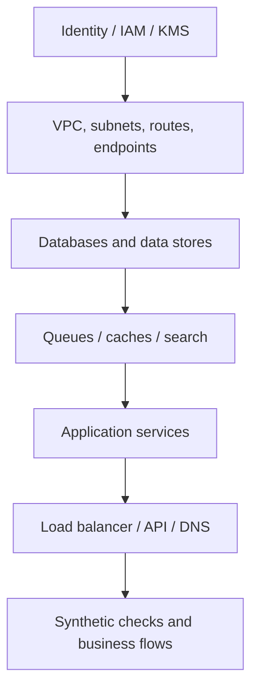

# DR Runbooks, Game Days, and Recovery Objective Evaluation

A Disaster Recovery (DR) plan has value only when the operations team can execute it under pressure, with clear accountability, restorable data, and validated steps. Turning on backups or replicating data to another Region is only part of DR. When an outage hits, the organization must also decide when to invoke DR, recover dependencies in order, shift traffic, validate data and applications, and return the system to steady-state operations.

This lesson focuses on three interconnected capabilities: **DR runbooks** describing how to respond and recover; **game days** testing people, processes, and architecture under controlled scenarios; and **recovery objective evaluation** confirming whether measured RTO/RPO actually meet business requirements. In the `CLOUD_PROVIDERS_AWS` module, these capabilities integrate AWS Backup, Amazon S3, EBS, RDS/Aurora, DynamoDB, AWS Elastic Disaster Recovery, IAM, KMS, Route 53, CloudWatch, AWS Fault Injection Service, and Infrastructure as Code.

After this lesson, you will be able to:

- Distinguish RTO, RPO, MTPD, and actual measured recovery time.
- Select an appropriate DR strategy: backup and restore, pilot light, warm standby, or multi-site active/active.
- Design backups, replication, and recovery permissions across accounts and Regions.
- Author runbooks containing activation triggers, roles, recovery ordering, validation criteria, and failback plans.
- Run game days and fault injection with explicit scope, guardrails, and stop conditions.
- Measure actual RTO/RPO, verify data recoverability, and build remediation plans.
- Identify risks such as split-brain, insufficient quotas, missing KMS keys, DNS caching, and unrestorable backups.

## 1. What Is DR and When Should It Be Activated?

Disaster Recovery is the ability to restore applications, data, and business operations after a major disruption renders the primary environment unable to meet requirements. Disruptions can include:

- Loss of an Availability Zone or an entire Region.
- Configuration errors disrupting multiple services or deleting data accidentally.
- Ransomware or credential compromises threatening workloads and backups.
- Software defects or bad deployments causing widespread data corruption.
- Connectivity loss to on-premises systems, identity providers, or external dependencies.
- Storage, database, or control plane failures exceeding normal in-place recovery.

DR is often discussed alongside High Availability (HA), yet the two address different goals. HA minimizes downtime from component or infrastructure faults by keeping live replicas and automating failover within the active architecture. DR prepares for recovering in another environment or Region, typically with dedicated activation and verification workflows.

For instance, RDS Multi-AZ keeps a database available within the same Region if an AZ fails. It does not constitute a complete DR strategy for full-Region loss, accidental deletions, or ransomware. Maintain backups, replication, or database recovery strategies at the proper scope.

### 1.1. An Incident Does Not Automatically Mean DR

Not every alert warrants switching Regions. A failed instance can be replaced by Auto Scaling; a failed task can be recreated by ECS; an impaired AZ can be handled by load balancers and Multi-AZ services. Activate DR when projected scope and recovery duration exceed HA mechanisms or in-place recovery options.

Runbooks should distinguish:

| Scenario | Typical Response |
|---|---|
| Single instance or container failure | Replace workload, roll back, or self-heal |
| Single AZ unavailable | Rely on Multi-AZ and shift traffic within the Region |
| Database failure recoverable in-Region | Fail over replica, restore/PITR, or run database recovery workflow |
| Primary Region fails to meet objectives | Activate DR Region per runbook |
| Unauthorized data encryption or deletion | Isolate, identify clean checkpoint, restore from immutable backup or clean copy |
| Compromised credentials or control plane | Execute incident response first; recover only after permissions and environment are verified clean |

Crucially, base DR activation on business impact, primary environment trustworthiness, and expected recovery duration. Shifting traffic too early routes users to inconsistent data; shifting too late breaches RTO commitments.

## 2. Defining RTO, RPO, and Disruption Limits

RTO and RPO are the two core metrics driving DR design. Determine them alongside Business Impact Analysis (BIA), dependency maps, and data requirements.

### 2.1. Recovery Time Objective (RTO)

**RTO** is the maximum downtime targeted by the organization to restore a service to an agreed operational state after an incident. RTO is not merely the time to boot EC2 or restore a database. It includes detection, decision-making, isolation, infrastructure provisioning, data recovery, application deployment, verification, and traffic shifting.

An RTO breakdown:

```text
RTO =
  detection time
+ assessment and DR declaration time
+ isolation / environment preparation time
+ infrastructure provisioning time
+ data restore or synchronization time
+ testing and business validation time
+ traffic cutover time
```

If target RTO is 60 minutes, the runbook must allocate a time budget per step. A 50-minute database restore will miss the target if 20 minutes are still needed for application provisioning and verification.

### 2.2. Recovery Point Objective (RPO)

**RPO** is the maximum data loss the business can tolerate, expressed as the time interval backward from the incident to the nearest consistent recoverable data point.

For example, a 15-minute RPO means the business accepts losing up to roughly 15 minutes of data changes prior to the outage. Zero RPO is a demanding requirement usually requiring synchronous commit semantics; never promise zero RPO simply because two copies of data exist.

Actual RPO depends on:

- Backup or snapshot frequency.
- Replication lag.
- Completion time and accessibility of recovery points.
- In-flight transactions and consistency across multiple datastores.
- Ability to detect silent corruption before corrupted copies replicate.

A 15-minute backup schedule does not automatically guarantee a 15-minute RPO in every scenario. Backups can fail, finish late, or omit expected committed transactions. Measure the actual timestamp of the newest restorable, verified recovery point.

### 2.3. MTPD, MAO, and Actual Recovery Time

**Maximum Tolerable Period of Disruption (MTPD)** or **Maximum Acceptable Outage (MAO)** is the maximum duration the business can endure before consequences become unacceptable. RTO must stay below this ceiling with a buffer for worse-than-expected conditions.

Standardize timing definitions:

- `T0`: timestamp when the service actually disrupted or the incident was confirmed per organizational convention.
- `Tdeclare`: timestamp when the incident commander declared DR.
- `Trestore`: timestamp when the service met agreed operational acceptance criteria.
- `RTO_actual`: elapsed time from T0 to Trestore under the agreed measurement rule.
- `RPO_actual`: elapsed time from incident occurrence to the timestamp of the newest consistent data recovered.

Measuring solely from restore start to instance boot underreports the outage users actually experience. Always include detection and decision latency.

### 2.4. Example: Setting Objectives

An order processing service has the following requirements:

| Metric | Target | Rationale |
|---|---:|---|
| MTPD | 4 hours | Beyond this duration, order fulfillment suffers severe damage |
| RTO | 60 minutes | Must restore well ahead of MTPD with incident buffer |
| RPO | 5 minutes | Only minimal transaction loss is tolerable |
| Testing RTO | 45 minutes | Internal test goal tighter than RTO to maintain safety margin |

To achieve a 60-minute RTO, operations might budget: 5 minutes confirmation, 5 minutes DR declaration, 5 minutes fencing the old environment, 20 minutes data recovery, 10 minutes app deployment, 10 minutes validation, and 5 minutes traffic shift. This is an assumed budget that must be measured in a game day.

If backups run every 30 minutes, that design cannot meet a 5-minute RPO without replication or transaction-log/PITR mechanisms. Change the data architecture or revise objectives after BIA review.

## 3. Business Impact Analysis and Application Classification

BIA identifies the consequences when a business process halts, recovery priorities, data requiring protection, and critical dependencies. Avoid assigning identical RTO/RPO across every application in an account.

For each application, collect:

- Business owner and technical owner.
- Supported business processes.
- Users, geographies, and operating hours.
- Financial, legal, operational, and reputational impacts of downtime.
- Data types, consistency requirements, and retention periods.
- Dependencies: identity providers, DNS, databases, queues, object storage, KMS, networking, external APIs.
- MTPD, RTO, RPO, and minimum acceptable degraded service level.
- Region constraints, data residency, compliance, and access controls.
- Manual workarounds or degraded modes before full restoration.

### 3.1. Criticality Tiering

Example classification:

| Tier | Examples | Typical Recovery Targets |
|---|---|---|
| Tier 0 – Mission critical | Payment processing, identity, core transactions | Very low RTO/RPO; may require warm standby or active/active |
| Tier 1 – Business critical | Orders, inventory, customer portal | Low to moderate RTO; pilot light or warm standby |
| Tier 2 – Important | Internal reporting, batch analytics | Tolerates longer RTO/RPO; backup and restore |
| Tier 3 – Non-critical | Dev/test, regenerable data | Recover based on demand and cost |

This is only a template. An analytics system can become Tier 0 if it informs safety-critical decisions or regulatory filings. Business owners must approve tiers and targets—not infrastructure teams alone.

### 3.2. Building a Dependency Map

An application can recover cleanly at the compute tier yet still fail without DNS, KMS, secrets, IAM roles, database schemas, message queues, or partner links. Dependency maps must show both startup ordering and shared points of failure.

Example:



Exact ordering varies by architecture. Some systems need DNS and identity before restoring; others need databases ready before apps. Base runbooks on actual dependencies and test this sequence.

## 4. Choosing the Right DR Strategy

AWS commonly frames four primary DR strategies. Greater pre-provisioning yields lower potential RTO/RPO at higher cost and complexity.

| Strategy | Preparation Approach | Relative RTO/RPO | Cost and Complexity |
|---|---|---|---|
| Backup and restore | Back up data/configs; build infrastructure at incident time | Higher | Lower |
| Pilot light | Keep core foundations and data copies in DR Region; scale compute on demand | Moderate | Moderate |
| Warm standby | Scaled-down DR environment running continuously | Lower | Higher |
| Multi-site active/active | Multiple Regions concurrently serving traffic | Lowest when well-designed | Highest |

No single strategy fits every application. Choose based on RTO/RPO, MTPD, downtime cost, data complexity, operational readiness, and team capacity.

### 4.1. Backup and Restore

In this strategy, the organization stores backups independently, then provisions infrastructure and restores data once DR is declared.

Appropriate when:
- Business tolerates RTOs of several hours or longer.
- Data restores cleanly from snapshots/backups.
- Infrastructure recreates reproducibly via Infrastructure as Code.
- Keeping an always-on DR environment is cost-prohibitive.

Preparation needed:
- Scheduled backups copied cross-Region/cross-account.
- Infrastructure as Code, images, configs, DNS, and secrets.
- Protected IAM roles authorized to restore.
- Quotas, IPs, subnets, KMS keys, and capacity in the target Region.
- Data restore runbooks and regular testing.

The primary risk is prolonged provisioning, data loading, and manual configuration. Backups that have never been test-restored provide no proof the strategy works.

### 4.2. Pilot Light

Pilot light keeps core components in the DR Region—typically replicated data or frequent backups alongside minimal baseline infrastructure. On incident, operations scales compute, deploys services, and shifts traffic.

Appropriate when:
- Shorter RTO is needed than backup and restore provides.
- Data replication can run continuously without paying for full compute capacity.
- Infrastructure scales rapidly via IaC/automation.

Checks needed:
- Whether database replicas or recovery points keep pace with RPO.
- Whether images, containers, configs, and secrets exist in the target Region.
- Whether service quotas and capacity suffice to scale out.
- Whether dependencies like queues, caches, identity, and endpoints are ready.
- Whether runbooks cleanly promote replicas or databases to accept writes.

### 4.3. Warm Standby

Warm standby runs a live copy of the workload in the DR Region at reduced scale. On DR, systems scale up and absorb traffic.

Advantages:
- Infrastructure, apps, and dependencies are already live, cutting provisioning time.
- Health checks and synthetic tests can run continuously.
- Easier to benchmark RTO than cold builds from scratch.

Challenges:
- Must keep configurations synchronized across both Regions.
- Higher compute, database, networking, and licensing costs than pilot light.
- Must manage data, queues, scheduled jobs, and background workers to avoid duplicate processing.
- Must prevent split-brain when both primary and standby could take writes.

### 4.4. Multi-Site Active/Active

In active/active, multiple Regions serve traffic concurrently. When one Region fails, traffic routes to surviving Regions. This minimizes downtime while demanding distributed fault-tolerant data and application design.

Problems to solve:
- Data replication and conflict resolution.
- Idempotency, ordering, and duplicate message handling.
- Session state and caching.
- Global routing, health checks, and traffic weighting.
- Consistency, latency, and data residency.
- Handling inter-Region partitions or isolated Regions.

Active/active does not guarantee zero RPO automatically. Asynchronous replication can still lose or conflict on writes near failure time. Define explicit consistency models and behavior when a Region isolates.

## 5. Distinguishing Backup, Replication, and High Availability

These three concepts are frequently confused:

- **Backup** creates recovery points to restore data from an earlier point in time.
- **Replication** copies changes to another location, typically with some lag.
- **High availability** maintains service continuity when a component or AZ fails.

Replication copies accidental deletions, ransomware encryption, and bad writes too. Backups preserve clean recovery points when guarded against deletion/tampering with adequate retention. HA can fail over to replicas holding replicated logic errors, so HA never replaces backups.

A complete DR strategy typically combines:
- HA for component/AZ faults.
- Replication for low RPO and rapid recovery.
- Immutable/independent backups for logic bugs or account compromise.
- IaC and golden images to rebuild compute/networking.
- Game days and restore tests to prove the end-to-end chain works.

## 6. Designing Backups and Protecting Recovery Points on AWS

AWS Backup centralizes backup management across many AWS resources. Define backup plans, schedules, lifecycles, backup vaults, copy actions, and policies per account/Region.

### 6.1. Backup Plans and Vaults

A backup plan should define:

- Resource selection via tags or resource ARNs.
- Backup frequency and execution windows.
- Retention periods.
- Cold storage lifecycle transitions where supported by resource type.
- Copy actions to another Region or account.
- Target backup vaults and encryption keys.
- Owners, application tiers, and policy compliance.

A backup vault stores recovery points. Separate vaults by environment, sensitivity, or retention mandate. Restrict permissions to delete recovery points and alter backup plans; separate backup creation, restore, and deletion permissions.

### 6.2. Cross-Account and Cross-Region Backups

In-account backups may be insufficient if an attacker compromises the account and wipes out both production and backups. Consider:

- Copying recovery points to a dedicated backup account.
- Copying cross-Region to survive Region outages.
- Using AWS Organizations and backup policies to enforce standards.
- Using dedicated IAM roles for backups and restores.
- Separating production administrative control from backup vaults.
- Hardening destination vaults with Vault Lock or equivalent retention controls.

When copying cross-account, configure destination permissions and encryption keys. Not every resource type supports identical copy flows or options. Verify support by resource type, Region, service, and backup type before finalizing architecture.

### 6.3. AWS Backup Vault Lock

AWS Backup Vault Lock enforces WORM (write once, read many) policies on recovery points. Vault Lock provides Governance and Compliance modes with distinct controls.

- Governance mode lets sufficiently privileged principals modify or remove settings under governed workflows.
- Compliance mode uses a grace period; once lock settings finalize and the grace period expires, protections cannot be altered to delete recovery points early under Vault Lock rules.

Test min/max retention, lifecycles, and restore procedures before engaging Compliance mode in production. Vault Lock protects recovery points within its configuration scope; it does not ensure applications can restore, decryption keys still exist, or target Regions hold enough quotas.

### 6.4. Protecting Backups Against Ransomware

Core principles:
- Use an isolated backup account with tightly restricted access.
- Enforce MFA and approval workflows for sensitive actions.
- Restrict `backup:DeleteRecoveryPoint`, vault deletions, and retention edits.
- Protect CloudTrail and audit logs in an independent account.
- Enable Vault Lock or Object Lock where appropriate.
- Verify backup integrity and restorability.
- Retain clean historical copies predating compromise; avoid keeping only the very latest backup.
- Define clean-room isolation steps before restoring so malware is not reintroduced.

## 7. DR Patterns by AWS Service

DR cannot be designed solely at the EC2 layer. Every data and compute service has distinct backup, replication, and restore mechanics.

| Service | Common Protection / DR Mechanisms | Items to Verify |
|---|---|---|
| EC2/EBS | AMIs, EBS snapshots, AWS Backup, cross-Region snapshot copies | Destination KMS keys, boot modes, ENI/SGs, quotas, user data |
| Amazon S3 | Versioning, replication, AWS Backup, Object Lock | Delete markers, version recovery, replication status, bucket policies |
| RDS | Automated backups, snapshots, point-in-time recovery, cross-Region snapshot/backup copy where engine supported | Engine/version, parameter groups, option groups, KMS, endpoints |
| Aurora | Automated backup/PITR, cross-Region read replicas, or Global Database | Promotion, writer endpoints, lag, failover order |
| DynamoDB | Point-in-time recovery, on-demand backups, Global Tables | Region replication, conflict behavior, IAM, streams/consumers |
| EFS | AWS Backup, replication suited to use case | Destination file system, mount targets, access points, POSIX permissions |
| FSx | Backups and replication/DR options per FSx flavor | Engine-specific recovery, throughput, DNS, client remounts |
| Secrets Manager | Cross-Region secret replication | KMS keys, resource policies, rotation, and consumers |
| ECR | Cross-Region/cross-account replication | Image digests, repository policies, lifecycle rules |
| SQS/SNS | IaC recreation, message archival/republishing, or multi-Region design | Queue ARNs, redrive policies, deduplication, subscriptions |
| Route 53 | Health checks, failover/weighted routing, ARC routing controls | TTLs, record ownership, health signals, and failback |
| KMS | Key policies, grants, and destination-Region keys | Region scope, key availability, permissions to decrypt/restore |

### 7.1. EC2 and EBS

EBS snapshots are incremental point-in-time volume copies that can be copied cross-Region. AMIs standardize boot images and launch configurations. During recovery, prepare:

- Instance types available in the target Region.
- VPCs, subnets, routes, SGs, and network interfaces.
- IAM instance profiles and SSM permissions.
- KMS keys encrypting volumes in the target Region.
- EBS volume types, throughput/IOPS, and quotas.
- DNS, load balancer targets, and application configurations.

Snapshots do not capture volatile runtime RAM state. When applications require consistency across multiple volumes, coordinate freezes/quiescing or application-aware backup mechanisms.

### 7.2. S3

S3 Versioning preserves multiple object versions for recovering overwrites or deletions. Replication copies objects to buckets in other Regions/accounts; Object Lock enforces retention or legal holds.

Replication does not replace backups. If deletions or corrupted writes replicate per rule configuration, destination copies suffer too. Pair versioning, retention, Object Lock, and separated admin privileges to protect recovery points.

### 7.3. RDS and Aurora

RDS automated backups support point-in-time recovery within retention windows. You can copy snapshots cross-Region or enable cross-Region automated backup replication for supported engines/versions. When restoring, create a new database from snapshot/PITR and verify parameter groups, option groups, subnet groups, SGs, KMS keys, and endpoints.

Aurora offers cross-Region read replicas and Aurora Global Database. When promoting a secondary Region, verify replication lag and writer status. Update connection strings, secrets, and DNS per runbook. RDS Multi-AZ mainly boosts in-Region HA; never treat it as a sole solution for regional DR.

### 7.4. DynamoDB

DynamoDB PITR restores tables to any timestamp within the supported window. On-demand backups capture explicit recovery points. Global Tables provide multi-Region replication for multi-Region workloads, requiring clear handling of conflicts and eventual consistency.

If erroneous deletes or writes replicate, other Regions receive those changes too. Guard against logic errors or compromise by pairing PITR/backups with independent administrative controls.

### 7.5. KMS and Secrets Manager

Encrypted backups require keys usable by the restore workflow. Standard KMS keys are Regional; copying recovery points cross-Region requires valid destination keys per service rules. Multi-Region KMS keys assist select use cases without automatically making every resource or backup share keys seamlessly.

Verify:
- Destination keys are Enabled and not Pending deletion.
- Key policies allow backup/restore roles.
- Required grants or resource policies exist.
- Secrets are replicated or safely recreatable.
- Applications hold permissions to read secrets in the DR Region.
- Private CAs/certificates and trust chains are available where needed.

Missing KMS keys or decrypt permissions are a top cause of recovery points existing yet failing to restore.

## 8. DR Infrastructure as Code and Preparing the Target Region

Infrastructure as Code (IaC) builds repeatable, peer-reviewed infrastructure using CloudFormation, CDK, or Terraform per organizational standards.

A DR baseline generally requires:
- VPCs, subnets, route tables, NAT/egress, endpoints, and firewalls.
- Security groups, NACLs, and network ACL rules.
- IAM roles, trust policies, permissions boundaries, and break-glass access.
- KMS keys, aliases, key policies, and grants.
- Load balancers, target groups, listeners, and certificates.
- Database subnet groups, parameter groups, option groups, and secrets.
- Compute clusters, services, task definitions, launch templates, and Auto Scaling.
- Queues, topics, event source mappings, and dead-letter queues.
- Monitoring, log destinations, alarms, dashboards, and alert routing.
- DNS records, health checks, ARC routing controls, and certificates.
- Quota requests, capacity reservations, or fallback instance-type mappings.

### 8.1. Avoiding Hardcoded Resource IDs

Identifiers like subnets, security groups, KMS keys, and ARNs differ across Regions and accounts. Use outputs/parameters, lookup mappings, and consistent naming conventions. Never hardcode primary-Region resource IDs inside images or application configs.

### 8.2. Quotas and Capacity

The DR Region may lack sufficient service quotas or compute capacity during an outage. Verify in advance:
- EC2 vCPU and instance family quotas.
- Elastic IP, VPC, ENI, NAT Gateway, and load balancer quotas.
- RDS instance class, storage, and cluster quotas.
- EKS/ECS capacity, subnet IP addresses, and ENI limits.
- EBS volume/snapshot and throughput quotas.
- API throttling, account service limits, and reserved concurrency.

Game days must test scaling to realistic peak load rather than booting one tiny instance. Where capacity must be guaranteed, evaluate capacity reservations or fallback instance families/sizes.

### 8.3. Preparing Access and Control Plane Paths

Runbooks need a DR access path independent of primary identity systems that might be compromised. Examples include MFA-protected, least-privilege break-glass roles with logging and approval workflows. Never store plaintext emergency access keys inside runbook documents.

Ensure operators can access the backup account and DR Region while remaining unable to arbitrarily delete recovery points. Check SCPs, permission boundaries, KMS key policies, and trust policies to ensure none inadvertently block recovery actions.

## 9. Designing a DR Runbook

A runbook is an actionable operational guide built for live incidents. A good runbook goes beyond architecture diagrams: it specifies who does what, when, with which inputs, expected outputs, and abort criteria.

### 9.1. Mandatory Components

| Component | Contents |
|---|---|
| Objectives | Application, account, Region, tier, and RTO/RPO |
| Activation criteria | Outage thresholds, Region failures, data corruption, or incident commander call |
| Roles | Incident commander, DR lead, data owner, network, security, application, communications |
| Access | AWS accounts, roles, MFA, break-glass, console/CLI profiles |
| Dependencies | DNS, IAM, KMS, secrets, network, databases, queues, compute, external providers |
| Recovery points | Vaults, backup ARNs, snapshots, timestamps, and retention |
| Execution steps | Ordering for restore, promotion, deployment, and traffic shifting |
| Verification | Health checks, synthetic transactions, data consistency, security validation |
| Rollback/failback | Trigger conditions, ordering, and approvers |
| Communications | Incident channels, stakeholders, customer updates, and escalation |
| Evidence | Timelines, command outputs, event IDs, approvals, and outcomes |

Every step should specify:
- Executing owner/role.
- Preconditions.
- Exact commands or actions.
- Expected result.
- Verification method.
- Estimated duration.
- Stop/escalation criteria.
- Failure fallback actions.

### 9.2. Roles in DR

Sample responsibility matrix:

| Role | Responsibilities |
|---|---|
| Incident Commander | Declares incident/DR, sets priorities, authorizes failover/failback, leads communications |
| DR Lead | Coordinates runbook execution, tracks RTO/RPO and dependencies |
| Cloud Platform Lead | Networking, IAM, compute, quotas, and IaC |
| Data Lead | Selects recovery points, restores/promotes databases, validates consistency |
| Security Lead | Credentials, KMS, logs, evidence, clean-room controls, and access approvals |
| Application Lead | Deploys apps, configures endpoints, runs health checks and synthetic transactions |
| Business Owner | Signs off on business validity, acceptable data loss, and service reopening |
| Communications Lead | Posts status updates to users, partners, and leadership |

In smaller teams, one person may wear multiple hats, though decision authority and verification sign-off should remain separated where possible.

### 9.3. DR Activation Triggers

Define objective criteria, such as:
- Primary Region unavailable beyond an agreed duration threshold.
- Multiple AZs or critical dependencies unrecoverable within RTO.
- Confirmed compromise rendering primary untrustworthy.
- Data corruption propagated to replicas requiring restoration from a clean recovery point.
- Incident commander and business owner confirm impact exceeds thresholds.

Never activate DR from a single isolated alarm. Correlate health signals, telemetry, AWS Health, service status, synthetic checks, and business judgment. For ransomware, obtain security clearance before opening the DR environment.

## 10. Step-by-Step Failover Runbook

Exact sequencing depends on architecture, though a standard progression follows below.

### Step 1 — Declare and Open the Incident

- Generate an incident ID and record T0 per convention.
- Confirm affected primary Region, apps, accounts, and blast radius.
- Incident commander declares DR and logs the decision.
- Assign DR lead, data lead, platform, security, application, and communications leads.
- Record target RTO/RPO and the next decision checkpoint.

### Step 2 — Protect Environments and Select a Recovery Point

- Check whether primary still accepts writes.
- If compromise or corruption is suspected, isolate the fault source and halt propagation.
- Choose a clean recovery point by timestamp—not blindly the newest copy.
- Verify backup vault, Region/account, KMS keys, and restore permissions.
- Document expected data loss window against RPO.

### Step 3 — Fence Primary to Prevent Split-Brain

Split-brain happens when both primary and DR Regions accept writes for a data store intended for a single writer, creating two irreconcilable transaction histories.

Before promoting databases or opening DR writes:
- Block primary writes or verify primary is genuinely unreachable.
- Disable scheduled jobs, consumers, and workers that could double-process messages in both Regions.
- Revoke/restrict primary credentials if compromise is suspected.
- Record fencing timestamps and verification evidence.

Never rely solely on DNS to fence primary; DNS caches preserve old paths. Fence at the database, network, application, or write-credential layer depending on architecture.

### Step 4 — Prepare the DR Region Foundation

- Verify VPCs, subnets, routes, endpoints, and security controls.
- Check IAM roles, KMS keys, secrets, and certificates.
- Confirm quotas and capacity.
- Deploy infrastructure from reviewed IaC.
- Initialize monitoring, logging, alarms, and alert routing.
- Confirm operators can administer the DR Region.

### Step 5 — Restore or Promote Data

- Select snapshots/PITR/replicas matching RPO and data integrity.
- Restore databases or promote replicas per service procedures.
- Restore required objects and files.
- Synchronize secrets, keys, schemas, and migrations.
- Initialize queues/streams and handle queued messages per policy.
- Verify timestamps, record counts, transaction markers, and consistency.

Never allow applications to write production data to the DR database until the data lead signs off on writer state and recovery point validity.

### Step 6 — Recover Applications and Dependencies

- Deploy containers/images or EC2 instances from verified artifacts.
- Configure database endpoints, secrets, and service discovery.
- Start queue consumers, scheduled jobs, and background workers in order.
- Verify KMS decryption, IAM access, and external dependencies.
- Check certificates, TLS, DNS, and load balancer targets.
- Run internal health checks and synthetic transactions.

### Step 7 — Shift Traffic

Depending on architecture:
- Update Route 53 failover or weighted records.
- Toggle Route 53 Application Recovery Controller routing controls if configured.
- Update CloudFront origins or API endpoints if needed.
- Shift traffic incrementally where supported.
- Monitor TTLs, resolver caches, and DNS propagation.
- Keep rollback options ready if health checks or error rates breach limits.

### Step 8 — Validate Business Operations and Monitor

- Business owner executes test transactions.
- Data lead validates data integrity and transaction sequences.
- Security lead verifies permissions, logging, and security controls.
- Application lead monitors error rates, latency, queue depth, and saturation.
- Communications lead broadcasts service restoration status.
- Record `RTO_actual`, `RPO_actual`, recovered data checkpoint, and any deviations.

## 11. Failback: Returning to the Primary Region

Failback moves services from the DR Region back to the primary Region once primary is repaired and verified. Failback is never as simple as restoring old DNS records.

Before failing back:
- Confirm the root cause of primary failure is fully resolved.
- Confirm primary is free of compromise or data corruption.
- Establish data sync from DR back to primary.
- Check replication lag and consistency.
- Take a pre-cutover backup recovery point.
- Define a write-freeze window or writer handoff procedure.
- Obtain approvals from incident commander, data owner, and business owner.

Reference sequence:
1. Re-provision primary using reviewed IaC.
2. Sync data from DR back to primary via supported mechanisms.
3. Verify schemas, transactions, sequences, objects, and queues.
4. Pause or freeze writes during the scheduled cutover window.
5. Fence the DR writer, promote the primary writer, and confirm a single writer exists.
6. Shift traffic back in controlled steps.
7. Monitor errors, replication, and data integrity.
8. Tear down temporary DR resources only when retention, backups, and business owners permit.

For active/active systems, failback must honor conflict handling and routing controls per design. Never shut down an active serving Region before confirming the destination holds sufficient capacity and consistent data.

## 12. DNS, Routing, and Traffic Control

DNS is often the most visible step in failover, yet represents only one piece of DR.

Route 53 options include:
- Failover routing with primary/secondary records.
- Weighted routing to shift percentages of traffic.
- Latency-based routing across multiple Regions.
- Health checks evaluating endpoints.
- Application Recovery Controller routing controls for deterministic switching in supported architectures.

Key caveats:
- TTLs influence DNS cache expiry without forcing every client to switch instantly.
- Resolvers, browsers, proxies, and runtimes can cache DNS longer than expected.
- Health checks can yield false positives/negatives if probing only a shallow endpoint.
- DNS does not fence writers or close open sessions.
- Certificates, WAFs, CDNs, API clients, and partner IP allowlists may also require updates.
- Some clients hardcode IPs or endpoints in configs; verify how they transition Regions.

With ARC routing controls, configure safety rules and restrict permissions to toggle control states. Game days should test scenarios where an operator loses primary permissions or the primary control plane is unreachable.

## 13. Tracking RTO/RPO with Metrics and Evidence

DR evaluation demands empirical measurements—not merely "backup successful" or "service running" badges.

### 13.1. Technical Metrics

| Metric | Measurement Method | Purpose |
|---|---|---|
| RTO target vs. actual | Time from T0 until service meets recovery criteria | Validates downtime commitments |
| RPO target vs. actual | Span from T0 to timestamp of newest recovered consistent data | Validates data loss limits |
| Backup success rate | Successful jobs / total scheduled jobs per period | Tracks backup reliability |
| Restore test success rate | Passing restores / total restore attempts | Verifies usable recovery points |
| Backup age | Elapsed time since newest recovery point | Detects stale backups |
| Replication lag | Data delay between primary and secondary | Governs RPO |
| Failover completion rate | Successful steps/drills out of total attempts | Measures runbook repeatability |
| Data validation results | Counts, checksums, transactions, and business invariants | Proves data integrity |
| Recovery capacity | Actual throughput/load handled by DR Region | Confirms failover headroom |
| Runbook step duration | Elapsed time per runbook phase | Pinpoints bottlenecks |

### 13.2. Measuring RPO Using Data

For instance, an incident starts at 10:00 UTC. Post-restore, the latest verified consistent transaction marker carries timestamp 09:57 UTC. Thus `RPO_actual` is roughly 3 minutes. Against a 5-minute target, this run meets RPO.

Do not compare only backup job timestamps. Verify committed data, related tables, and message queues align at the same logical point. Distributed systems may require transaction IDs, sequence numbers, or business reconciliation.

### 13.3. Measuring RTO Using Service Criteria

Suppose DR is declared at 10:05 UTC, yet the service processes its first valid business transaction at 10:52 UTC. With T0 defined as 10:00 UTC, `RTO_actual` is 52 minutes—not 47 minutes from DR declaration.

Define clearly what "recovered" means:
- Endpoint returns HTTP 200?
- Database accepts connections?
- Users can log in?
- End-to-end transactions complete with consistent data?
- All background workers and downstream dependencies operate?

For business applications, adopt end-to-end business criteria rather than shallow health endpoints.

## 14. What Is a Game Day?

A game day is a planned exercise testing readiness against a realistic failure scenario. It may take the form of a tabletop exercise, workflow simulation, test failover, or infrastructure fault injection.

Goals:
- Verify runbooks are clear enough for operators to execute.
- Validate permissions, backups, KMS, quotas, and dependencies.
- Measure actual RTO/RPO.
- Uncover manual steps, missing automation, or unowned tasks.
- Test incident commander decisions and communications.
- Surface latent architectural risks.

A game day is neither a blame exercise nor an uncontrolled surprise ambush. Participants must know the scope, stop conditions, and who holds abort authority. Production exercises require change approvals, customer impact assessments, and rollback plans.

### 14.1. Exercise Tiers

| Tier | Execution Method | Risk Profile |
|---|---|---|
| Tabletop | Walk through scenarios and decisions using runbooks | Very Low |
| Simulation | Execute steps in test environments or mocked services | Low |
| Component recovery | Restore standalone databases, snapshots, or workloads | Moderate |
| Regional failover exercise | Move a test application to the DR Region | Higher |
| Fault injection | Inject controlled faults via AWS FIS or similar tools | Depends on action and blast radius |

Start with tabletops and component restores before escalating to integrated regional failovers. Never test a full-Region recovery for the first time during a live production outage.

## 15. Designing a Safe Game Day

Every game day requires a written charter and plan.

### 15.1. Defining Objectives and Hypotheses

Example:
- Objective: verify the Orders application achieves a 60-minute RTO and 5-minute RPO when the primary Region is unavailable.
- Hypothesis: the team can restore the database, deploy APIs in the DR Region, and shift traffic within 60 minutes.
- Scope: staging account, one application, and selected dependencies.
- Out of scope: live payment gateways and production customer data.

Hypotheses need measurable outcomes. "Check that DR works" is too vague; "serve 95% of requests successfully within 60 minutes while losing no more than 5 minutes of confirmed transactions" is testable.

### 15.2. Preparing Safety Controls

Before the drill:
- Assign a game day lead and a safety officer.
- Lock in exact accounts, Regions, and target resources.
- List permitted actions and explicitly forbidden actions.
- Define stop conditions and abort mechanisms.
- Verify recent backups, restore points, and rollback paths.
- Check service quotas, IAM roles, and KMS keys.
- Notify dependent teams and observers.
- Ready dashboards, log queries, and stopwatches.
- Define test data and consistency checks.
- Freeze unscheduled production changes during the window.

### 15.3. Stop Conditions

Abort the experiment immediately if:
- Customer impact exceeds approved limits.
- Data loss threatens to breach allowed RPO.
- An out-of-scope resource is impacted.
- Logging or monitoring loses visibility.
- Automation fails to roll back or operators lose control.
- Primary and DR both accept writes outside design rules.
- Costs or capacity exceed thresholds.
- Security lead detects leaked credentials or sensitive data.

Automate stop conditions wherever possible—such as CloudWatch alarms halting an AWS FIS experiment. For human judgment triggers, empower the safety officer to abort immediately without multi-level approvals.

## 16. AWS Fault Injection Service in Game Days

AWS Fault Injection Service (AWS FIS) runs controlled fault experiments on AWS resources to validate resilience hypotheses. FIS relies on experiment templates, IAM roles, actions, targets, stop conditions, and logs.

General workflow:
1. Define hypothesis and blast radius.
2. Select target resources via controlled tags or resource IDs.
3. Pick supported fault actions matching the service and failure mode.
4. Create a least-privilege IAM role for FIS to execute actions.
5. Attach CloudWatch alarm stop conditions.
6. Set experiment duration, action ordering, and rollback options where supported.
7. Peer-review and approve the template.
8. Run in a safe environment.
9. Observe metrics, abort if thresholds trip, and capture findings.

FIS performs genuinely disruptive actions. Review action scopes, target selectors, and service constraints carefully before running. Never target overly broad tags like `Environment=production` if a template could hit unintended workloads.

FIS does not replace full game days. Injecting a network partition or stopping instances does not automatically test whether the incident commander makes sound calls, the data owner picks the right recovery point, or customer communications run smoothly.

## 17. Sample Game Day Scenarios

### Scenario A — Single-AZ Outage

**Goal:** verify in-Region HA.

- Inject or simulate failure of one AZ in a test environment.
- Inspect load balancers, Auto Scaling, Multi-AZ databases, and service schedulers.
- Measure failover duration and error spikes.
- Confirm regional DR is unnecessary when HA handles the fault.
- Note any dependencies still pinned to the impaired AZ.

### Scenario B — Primary Region Loss

**Goal:** test regional failover.

- Simulate unavailability of the primary Region.
- Incident commander activates the runbook.
- Fence primary per scenario rules.
- Restore/promote data in the DR Region.
- Deploy workloads and verify KMS/secrets/IAM.
- Shift test traffic.
- Run synthetic transactions and reconcile data.
- Record actual RTO/RPO.

### Scenario C — Ransomware or Accidental Data Deletion

**Goal:** verify clean recovery from uncompromised recovery points.

- Pick a test dataset and inject simulated corruption/deletes.
- Identify the pre-incident clean timestamp.
- Restore into an isolated recovery environment.
- Run malware scans, integrity checks, and data reconciliation.
- Verify the backup account/vault cannot be wiped by test workload credentials.
- Reopen data access only after data and security owners sign off.

### Scenario D — Primary Recovery Credentials Fail

**Goal:** validate independent DR access paths.

- Use a drill role mirroring DR operator permissions.
- Simulate primary identity provider unavailability.
- Test break-glass MFA, trust policies, SCPs, and KMS access.
- Confirm operators can restore without holding permissions to delete backup vaults.
- Document any steps dependent on a single person or hardware token.

### Scenario E — Replication Lag Exceeds RPO

**Goal:** test data-loss decision governance.

- Induce replication lag in test or simulate via metrics.
- Compare lag against RPO targets.
- Identify the recoverable data checkpoint.
- Decide whether to wait, fall back to backups, or enter degraded mode.
- Confirm business owners approve projected data loss.

## 18. Restore Testing: The Ultimate Proof of Backups

A successful backup job proves only that the backup service completed its write. It does not prove applications can run from that recovery point.

A restore test should verify:
- Recovery points are accessible and decryptable.
- IAM roles hold restore rights and KMS key policies permit access.
- Resources provision cleanly in the target Region.
- Data integrity and consistency pass checks.
- Application configs, secrets, and endpoints update accurately.
- Service health and business transactions succeed.
- Actual elapsed time stays inside RTO.
- Recovered data meets RPO.

### 18.1. Isolated Recovery Environments

For ransomware or suspected tampering, restore into an isolated VPC/account. Never attach restored resources directly to production networks. Run malware scans, inspect files, schemas, transactions, and permissions. Use fresh credentials and verified KMS keys rather than reusing potentially compromised secrets.

### 18.2. Testing Frequency

Frequency depends on criticality tier and architectural churn:
- Tier 0: frequent restore and failover tests—potentially monthly or aligned with release cycles.
- Tier 1: quarterly restore tests or after major changes.
- Tier 2/3: risk-based schedule and ahead of major migrations.
- After changes to KMS, IAM, backup plans, schemas, Regions, or dependencies: run targeted re-tests.

These are baseline recommendations; BIA and organizational policy govern final cadence. Never test solely right before audits.

## 19. Evaluating Game Day Results

Post-exercise, compare targets against evidence-backed results.

| Criterion | Target | Recorded Result | Met? |
|---|---|---|---|
| RTO | 60 minutes | 54 minutes | Yes |
| RPO | 5 minutes | 3 minutes | Yes |
| Data consistency | Zero divergent transactions | 2 transactions required reconciliation | Not yet |
| IAM/KMS | Restore role accesses key cleanly | Passed after policy fix | Failed initially |
| DNS/traffic | Shift traffic within 5 minutes | 8 minutes due to TTL/caching | Not yet |
| Monitoring | Alarms and logs active | Passed | Yes |
| Runbook clarity | Zero out-of-band decisions needed | Missing owner on promote step | Not yet |

This table shows how RTO/RPO numbers can pass while DR remains incomplete if data consistency, IAM, or ownership fails. Judge pass/fail holistically rather than looking solely at two numbers.

### 19.1. Bottleneck Analysis

Group delays by category:
- Detect/declare: unclear alarms or missing authority to declare DR.
- Access: operators lack account/Region access or MFA.
- Provision: IaC failures, quota shortfalls, or subnet IP exhaustion.
- Data: stale backups, replication lag, or slow restores.
- Dependencies: missing KMS keys, secrets, certificates, or endpoints.
- Application: hardcoded Region configs or unready queues.
- Traffic: DNS TTLs, health checks, or partner allowlists.
- Validation: missing synthetic tests or unavailable business owners.

Assign every bottleneck a concrete action item with an owner, deadline, and verification test.

## 20. AWS Resilience Hub and Supporting Tools

AWS offers services to assess and orchestrate resilience:

- **AWS Resilience Hub**: evaluates applications against resilience policies, checks RTO/RPO, and recommends improvements. Results depend on declared resources and assessment inputs; it does not replace live game days.
- **AWS Backup**: manages backup plans, recovery points, copies, and restores for supported resources.
- **AWS Elastic Disaster Recovery (AWS DRS)**: provides block-level replication and recovery for supported source servers, including on-premises and EC2 workloads; verify agent prerequisites, staging area, and supported sources.
- **AWS Fault Injection Service**: runs controlled fault injections to test resilience hypotheses.
- **Route 53 Application Recovery Controller (ARC)**: provides readiness checks and routing controls to assess readiness and steer traffic in supported architectures.
- **CloudWatch**: metrics, alarms, dashboards, and composite alarms for monitoring.
- **CloudTrail**: audits AWS API calls and configuration edits.
- **AWS Config**: tracks resource configuration and compliance.
- **AWS Systems Manager Automation**: orchestrates repeatable recovery steps.

Tools provide signals and automation primitives. Organizations still need runbooks, decision-makers, proper permissions, restorable backups, and business acceptance criteria.

## 21. Sample Abbreviated Runbook for an Orders Application

An e-commerce app runs in `ap-southeast-1`, with DR in `ap-southeast-2`. Architecture includes CloudFront, ALB, ECS, RDS, S3, SQS, and Secrets Manager. Targets: 60-minute RTO, 5-minute RPO.

### 21.1. Pre-Incident Preparation

- AWS Backup copies database snapshots and supported resources to the backup account/DR Region.
- RDS maintains replication/backups verified against RPO.
- S3 Versioning and replication are configured; backups preserve clean recovery points.
- ECR images replicate to the DR Region.
- ECS clusters/services and VPCs are defined in IaC.
- Secrets Manager secrets replicate; destination KMS keys and policies are tested.
- Route 53 records and health checks are pre-configured.
- IAM DR roles are tested with MFA.
- CloudWatch dashboards display replication lag, backup age, service health, and queue depth.
- Runbook documents owners, contacts, and restore ordering.

### 21.2. When DR Is Declared

| Target Time | Owner | Action | Completion Evidence |
|---|---|---|---|
| 0–5 min | Incident Commander | Declare DR, open incident, assign roles | Incident ID, T0, decision log |
| 5–10 min | Security/Data | Assess primary state, pick recovery point, fence writers | Timestamp, primary fenced |
| 10–20 min | Platform | Verify VPC, IAM, KMS, secrets, quotas, and deploy IaC | Infrastructure ready |
| 20–35 min | Data | Restore/promote database, verify consistency | DB healthy, recovery timestamp |
| 35–45 min | Application | Deploy ECS services, queues, and endpoints | Health checks and synthetic tests |
| 45–55 min | Network/App | Shift Route 53/ARC traffic per plan | Requests reaching DR endpoint |
| 55–60 min | Business/Security | Validate transactions, data, permissions, and logging | Business sign-off, RTO/RPO |

These times are planning targets, not AWS guarantees. Measure and tune during game days based on database engine, data volume, capacity, and deployment speed.

### 21.3. Post-Recovery

- Operate the DR Region as temporary primary per incident decision.
- Increase monitoring, check data drift, and verify backups/replication.
- Keep the old primary fenced until repaired and verified.
- Plan failback with scheduled write-freeze or synchronization windows.
- Record actual RTO/RPO and follow-up action items.
- Retain recovery points and forensic evidence until retention deadlines expire.

## 22. Cost Management and Trade-Offs

DR cost extends well beyond compute in a second Region. Account for:
- Backup storage and retention.
- Cross-Region data transfer and replication.
- Database replicas, storage, IOPS, and snapshot copies.
- Warm standby or active/active compute.
- NAT Gateways, endpoints, load balancers, and firewalls.
- Monitoring, log ingestion, and retention.
- Licensing, support, and engineering hours for drills.
- Game day expenses and capacity reservations.

| Strategy | Common Costs | Key Trade-Offs |
|---|---|---|
| Backup and restore | Backup storage, copies, restore compute during incidents | Longer RTO; requires automation and restore testing |
| Pilot light | Backups/replication, minimal DR baseline | Must scale and deploy during outages |
| Warm standby | Continuous compute/databases running in DR | Higher cost, shorter provisioning time |
| Active/active | Full multi-Region infrastructure and operations | Highest cost/complexity; harder consistency |

Never cut costs by skipping restore tests or leaving backups solely inside the primary account/Region when DR mandates protection against account compromise or regional outages. Weigh DR spend against projected business losses from missing RTO/RPO.

## 23. Common DR Pitfalls

| Pitfall | Consequence | Prevention |
|---|---|---|
| Having backups without testing restores | Recovery points may be unusable | Run scheduled restore tests and retain evidence |
| Confusing Multi-AZ with regional DR | Regional outage still downs the service | Keep copies and runbooks in another Region |
| Relying solely on replication | Deletions or corruption propagate to replicas | Pair replication with independent backups and retention |
| Missing KMS keys/permissions at destination | Backups cannot decrypt or restore | Test KMS policies and destination keys |
| Insufficient quotas or capacity | Cannot scale in the DR Region | Verify quotas, subnet IPs, and capacity upfront |
| Hardcoded Regions or ARNs | Application fails to boot in DR | Parameterize IaC and configs |
| Failing to fence primary | Split-brain and conflicting writes | Fence writers, queues, and scheduled jobs |
| Changing DNS alone | Clients keep hitting cached endpoints or stale sessions | Check TTLs, routing, connections, and fencing |
| Skipping data consistency checks | Service runs on corrupted or partial data | Run synthetic transactions and reconciliation |
| Skipping failback testing | New data loss or second outage on return | Rehearse failback explicitly |
| Runbook missing owners | Slow decisions and skipped steps | Assign clear roles, escalation, and contacts |
| Overly broad FIS targets | Unintended blast radius | Use tag allowlists, stop conditions, and template reviews |

## 24. Periodic DR Review Checklist

- [ ] Application has designated business and technical owners.
- [ ] BIA defines MTPD, RTO, RPO, and criticality tier.
- [ ] Dependency map is current.
- [ ] DR strategy aligns with recovery objectives.
- [ ] Backup plans enforce proper retention and cross-account/Region copies.
- [ ] Backup vaults are protected against unauthorized deletion.
- [ ] Recovery points are accessible and decryptable with KMS.
- [ ] IAM DR roles and break-glass access are tested.
- [ ] IaC, images, secrets, certificates, and DNS exist in the DR Region.
- [ ] Quotas, subnet IPs, and capacity are verified.
- [ ] Restore tests have run and results are archived.
- [ ] Game days define goals, scope, owners, stop conditions, and rollback.
- [ ] `RTO_actual` and `RPO_actual` are measured from agreed start markers.
- [ ] Data consistency and business transactions are verified.
- [ ] Failback has been rehearsed or reviewed.
- [ ] Action items have owners, deadlines, and acceptance tests.

## 25. Key Takeaways

DR must be engineered from business objectives. BIA establishes MTPD, tiers, and dependencies; RTO caps downtime; RPO caps data loss. Those objectives determine whether to adopt backup and restore, pilot light, warm standby, or active/active.

On AWS, combine AWS Backup, snapshots/PITR, replication, KMS, IAM, IaC, DNS, and traffic controls. Backups, replication, and HA address distinct failure modes. A recovery point has value only when it can be accessed, decrypted, restored, and verified for data integrity. Runbooks must spell out decision-makers, activation triggers, primary fencing, recovery sequence, traffic-cutover criteria, and failback workflows.

Game days and AWS FIS validate hypotheses within controlled boundaries. After each drill, measure actual RTO/RPO, analyze bottlenecks, archive evidence, and assign remediation items. DR readiness is proven only when people, data, permissions, infrastructure, and applications recover together within committed targets.

## References

- [Disaster recovery options in the cloud](https://docs.aws.amazon.com/whitepapers/latest/disaster-recovery-workloads-on-aws/disaster-recovery-options-in-the-cloud.html)
- [AWS Backup Developer Guide](https://docs.aws.amazon.com/aws-backup/latest/devguide/whatisbackup.html)
- [AWS Backup Vault Lock](https://docs.aws.amazon.com/aws-backup/latest/devguide/vault-lock.html)
- [Cross-account backup](https://docs.aws.amazon.com/aws-backup/latest/devguide/create-cross-account-backup.html)
- [AWS Elastic Disaster Recovery](https://docs.aws.amazon.com/drs/latest/userguide/what-is-drs.html)
- [AWS Fault Injection Service](https://docs.aws.amazon.com/fis/latest/userguide/what-is.html)
- [AWS Resilience Hub](https://docs.aws.amazon.com/resilience-hub/latest/userguide/what-is.html)
- [Amazon Route 53 Application Recovery Controller](https://docs.aws.amazon.com/r53recovery/latest/dg/what-is-route53-recovery.html)
- [Amazon RDS backup and restore](https://docs.aws.amazon.com/AmazonRDS/latest/UserGuide/CHAP_CommonTasks.BackupRestore.html)
- [Amazon Aurora Global Database](https://docs.aws.amazon.com/AmazonRDS/latest/AuroraUserGuide/aurora-global-database.html)
- [Amazon DynamoDB backup and restore](https://docs.aws.amazon.com/amazondynamodb/latest/developerguide/Backup-and-Restore.html)
- [Amazon S3 replication](https://docs.aws.amazon.com/AmazonS3/latest/userguide/replication.html)
