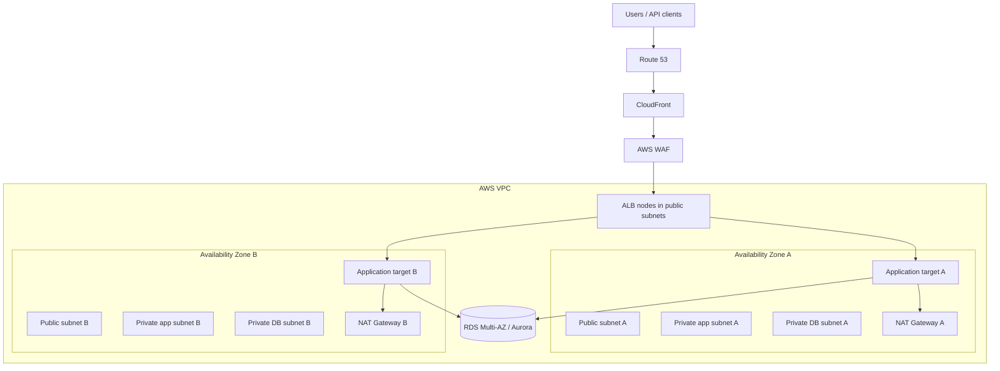

# Designing a High-Availability Three-Tier Architecture

## 1. The Three-Tier System Design Problem

A three-tier architecture separates an application into three parts with distinct responsibilities:

- **Presentation tier:** receives requests, handles HTTP/HTTPS connections, and distributes traffic.
- **Application tier:** executes business logic, performs authentication, orchestrates requests, and communicates with dependent services.
- **Data tier:** provides durable data storage, queries, transactions, and integrity protection.

Tiering helps control access permissions, scale each part independently, and modify one tier with minimal impact on the others. However, splitting an application into three tiers does not automatically produce high availability. If all web servers, application servers, or databases reside in a single Availability Zone (AZ), an outage in that AZ can still bring the application down.

To achieve high availability (HA), each tier must tolerate a component or single-AZ failure within target objectives. Architectures commonly combine:

- Amazon Route 53 and/or Amazon CloudFront to route requests.
- AWS WAF to filter unwanted requests.
- Application Load Balancer (ALB) spanning multiple AZs.
- EC2 Auto Scaling, Amazon ECS, or Amazon EKS to maintain application capacity.
- Amazon RDS Multi-AZ or Amazon Aurora to maintain data accessibility.
- VPC with public, private application, and isolated database subnets.
- Amazon CloudWatch, CloudTrail, and AWS Config for observability and governance.

AWS Well-Architected recommends deploying production workloads across at least two AZs when location-level fault tolerance is required. The design must also ensure the remaining capacity can handle the load when one AZ becomes unavailable. Multi-AZ reduces the impact of localized failures; it does not replace backups or a disaster recovery strategy for Region-level events.

## 2. Learning Objectives

After this lesson, learners can:

1. Explain the responsibilities and boundaries of the presentation, application, and data tiers.
2. Design a VPC with public, private application, and database subnets across at least two AZs.
3. Choose ALB, EC2 Auto Scaling, ECS/EKS, and RDS/Aurora suited to the workload.
4. Configure security groups following the communication flow between tiers.
5. Analyze health checks, scaling, failover, and capacity when an AZ experiences an outage.
6. Distinguish RDS Multi-AZ DB instance, Multi-AZ DB cluster, Aurora, and read replicas.
7. Design resilient outbound connectivity using NAT Gateways or VPC endpoints.
8. Implement timeouts, retries, connection pooling, and database failover handling in the application tier.
9. Monitor the health of each tier with CloudWatch and build alarms.
10. Evaluate RTO, RPO, cost, security, and limitations of Multi-AZ architectures.
11. Inspect configurations using the AWS CLI and build a failure testing plan.

## 3. Defining Requirements Before Selecting Services

You should not start by picking EC2, RDS, or ALB before understanding application requirements. An HA architecture must stem from business goals and acceptable levels of disruption.

### 3.1. Availability Target

An availability target describes the percentage of time a service must be available over a measurement period. For example, 99.9% and 99.99% have significantly different downtime budgets.

Do not infer system-wide availability by simply taking the SLA of a single AWS service. End-to-end availability depends on all dependencies, configurations, operational procedures, application bugs, and recovery time.

### 3.2. RTO and RPO

| Metric | Meaning | Example Question |
|---|---|---|
| RTO (Recovery Time Objective) | Maximum target time to restore service | How long can the application be down at most? |
| RPO (Recovery Point Objective) | Maximum acceptable data loss, measured in time | How many minutes of data can be lost at most? |
| Availability target | Target availability percentage in the measurement period | What availability level must the service meet? |
| MTTR | Mean Time To Repair/Recover | How long does the operations team typically take to recover? |
| MTBF | Mean Time Between Failures | How frequently does a component typically fail? |

Multi-AZ generally enables faster automatic failover to resources in another AZ than restoring from backups. However, failover still incurs brief disruption and may affect in-flight transactions. RTO/RPO must be measured through real testing.

### 3.3. Workload Profile

Gather at least:

- Average and peak request rates.
- Database read/write ratio.
- Payload sizes and processing times.
- Concurrent session counts and session storage approach.
- Impact of batch jobs, scheduled tasks, and background workers.
- External dependencies such as payment gateways, email, and identity providers.
- Encryption, data residency, and network segmentation requirements.
- Data growth and retention requirements.

This information determines the number of AZs, compute types, database topology, caching, queues, network throughput, and cost.

## 4. Three-Tier Architecture Model

### 4.1. Presentation Tier

This tier receives requests from clients. In a typical web architecture, an ALB sits in public subnets across multiple AZs. CloudFront and AWS WAF can sit in front of the ALB to distribute content, reduce latency, and protect the application.

This tier is responsible for accepting HTTP/HTTPS, terminating TLS at the appropriate point, routing by host/path, checking target health, and forwarding requests to healthy application tier targets.

### 4.2. Application Tier

This tier executes business logic. It can be deployed using:

- EC2 instances in an Auto Scaling group.
- Amazon ECS services with EC2 or Fargate launch types.
- Amazon EKS deployments on managed node groups or Fargate profiles.
- AWS Lambda if a serverless model fits the request-handling pattern.

The application tier usually resides in private subnets and does not accept direct connections from the Internet. The ALB only forwards requests to the permitted target group and port.

To make replacement and scaling easy, application instances should be stateless. Sessions, carts, or temporary data should be stored in shared services like ElastiCache or DynamoDB rather than solely in the memory or local disk of a single instance.

### 4.3. Data Tier

The data tier can use:

- Amazon RDS Multi-AZ DB instance.
- Amazon RDS Multi-AZ DB cluster.
- Amazon Aurora.
- Amazon DynamoDB.
- Amazon ElastiCache for caching or sessions.
- Amazon S3 for objects/static files.

Traditional databases typically reside in a DB subnet group consisting of private subnets across multiple AZs. The database does not need a public IP, and its security group only allows the application tier to connect on the required port.

### 4.4. Reference Diagram



This diagram is a logical model. In practice, ALB creates nodes/network interfaces in enabled subnets; an RDS Multi-AZ DB instance has a primary and standby managed by RDS, whereas a Multi-AZ DB cluster has a writer and two readers across three AZs. You do not necessarily have to provision EC2 instances or manage database replicas manually.

## 5. VPC and Subnet Design for HA

### 5.1. Functional Partitioning

A production VPC typically divides subnets by role:

| Subnet | Resources Placed | Typical Route |
|---|---|---|
| Public subnet A/B | ALB, NAT Gateway, bastion if still needed | Has a route to Internet Gateway |
| Private application subnet A/B | EC2, ECS tasks, EKS nodes/pods | Internal route; outbound via NAT or VPC endpoints |
| Isolated database subnet A/B | RDS/Aurora, database-related resources | VPC local route only or dedicated private network path |
| Private endpoint subnet (if needed) | Interface VPC endpoints | No public IP required |

Each AZ needs its own subnets for the tiers expected to operate in that AZ. Do not place all application targets in a single subnet/AZ while only creating the ALB in two AZs; if the targets' AZ fails, the compute tier remains a single point of failure.

### 5.2. Route Tables

Reference route configuration:

- Public subnet: `0.0.0.0/0` route to Internet Gateway.
- Private application subnet: `0.0.0.0/0` route to the NAT Gateway in the same AZ, or a Regional NAT Gateway if appropriate and supported in the Region.
- Database subnet: no default route to the Internet. Keep only the VPC local route and strictly required private routes.
- IPv6: if the workload uses outbound-only IPv6, evaluate an Egress-only Internet Gateway and corresponding security policies.

Do not place databases in public subnets. Enabling public accessibility on RDS is not the right way for the application tier to access the database.

### 5.3. CIDR and Scalability

Plan CIDRs for both current and future needs:

- ALB requires free IP addresses to scale and replace nodes.
- EKS can consume many subnet IPs due to ENI/pod networking.
- ECS tasks with `awsvpc` network mode also require IP addresses.
- Private endpoints create ENIs in selected subnets.
- Auto Scaling needs available subnet addresses to launch instances when another AZ experiences an outage.

For Application Load Balancer, AWS requires at least two subnets in different AZs. Current documentation recommends subnets with at least a `/27` CIDR and at least 8 available IP addresses per subnet so ALB can scale and replace nodes. Do not wait until subnets nearly exhaust IPs before addressing capacity.

### 5.4. VPC Endpoints

VPC endpoints allow private workloads to access supported AWS services without traversing the Internet/NAT.

Examples:

- S3 Gateway endpoint.
- DynamoDB Gateway endpoint.
- Interface endpoints for Systems Manager, ECR, Secrets Manager, CloudWatch Logs, KMS, and other needed services.

Endpoint policies and interface endpoint security groups must still be configured properly. Endpoints do not automatically replace every route or DNS requirement.

## 6. Presentation Tier: Route 53, CloudFront, WAF, and ALB

### 6.1. Route 53 and CloudFront

Route 53 manages DNS and can alias to CloudFront or ALB. CloudFront distributes content via edge locations, lowering latency for distributed users and reducing request load on the origin.

For applications with static assets:

- Store static assets in S3.
- Distribute via CloudFront.
- Use Origin Access Control to restrict read access to the S3 origin.
- Configure appropriate cache policies and invalidation.
- Separate static content from dynamic requests routed to the ALB.

CloudFront does not replace HA for the application/data tiers. If the origin fails, design origin failover or appropriate error responses.

### 6.2. AWS WAF

AWS WAF can protect CloudFront or ALB from certain malicious request patterns such as SQL injection, XSS, bots, or rate abuse. Rules should be tested in Count mode before enabling Block to avoid false positives.

WAF helps reduce unwanted traffic, but does not replace authentication, authorization, secure coding, or network segmentation.

### 6.3. Application Load Balancer

ALB supports:

- HTTP/HTTPS listeners.
- TLS certificates via AWS Certificate Manager.
- Host-based and path-based routing.
- Target groups for EC2, IP, or Lambda within supported limits.
- Health checks.
- Slow start, deregistration delay, and stickiness per use case.

Enable ALB in at least two AZs. Each enabled AZ should have healthy targets whenever possible. If one AZ goes down, ALB can continue routing to healthy targets in the remaining AZs.

### 6.4. Health Checks

Health checks should verify the application's ability to serve requests, such as a `/health/ready` endpoint. Do not merely check if the process is running if the application has lost database connectivity or cannot serve business logic.

Separate two types of checks:

- **Liveness:** is the process still running or is it deadlocked/crashed?
- **Readiness:** does the instance have the required dependencies and capacity to receive requests?

Be careful when readiness depends on a shared dependency. If all targets are marked unhealthy simultaneously, ALB can fail open and route requests to all targets regardless of health state. Therefore, health checks are not a security mechanism or an absolute kill switch; you need a maintenance/emergency routing plan and target state monitoring.

## 7. Application Tier: Deploying Compute Across Multiple AZs

### 7.1. EC2 Auto Scaling Group

An EC2 Auto Scaling group should:

- Select subnets across at least two AZs.
- Use a launch template standardizing AMI, instance type, IAM instance profile, and bootstrap configuration.
- Attach to an ALB target group.
- Set minimum, desired, and maximum capacity.
- Enable the ELB health check type if you want ASG to replace instances marked unhealthy by ALB.
- Configure instance refresh and rolling deployments.
- Choose instance types with sufficient capacity and consider multiple instance types if appropriate.

Auto Scaling distributes instances across selected AZs and attempts to maintain balance. When an AZ experiences issues, ASG can launch replacement instances in healthy AZs depending on capacity, subnet IPs, quotas, and distribution strategy.

### 7.2. ECS and EKS

For ECS:

- Select private subnets across multiple AZs for the service.
- Use an Application Load Balancer target group.
- Set desired task count greater than one and spread tasks across AZs.
- Configure deployment circuit breaker/rollback where appropriate.
- Monitor service events and task placement.

For EKS:

- Node groups should span multiple AZs.
- Deployments should have an appropriate replica count.
- Use topology spread constraints or pod anti-affinity to distribute pods.
- Configure Pod Disruption Budgets for voluntary disruptions.
- Check storage classes and volume topology because EBS volumes are bound to a single AZ.
- Use managed node groups or tested node self-healing mechanisms.

Do not simply create multiple replicas. If every replica sits in the same AZ or depends on a single node/storage/network endpoint, the workload still has a large fault domain.

### 7.3. Stateless Applications

So instances can be replaced automatically:

- Do not store unique sessions in local memory.
- Store uploaded files in S3.
- Use ElastiCache/DynamoDB or appropriate token-based sessions.
- Use queues for long-running tasks or tasks requiring retries.
- Externalize configuration and secrets.
- Do not rely on local disk after an instance is replaced.

Sticky sessions can be useful in certain cases, but should not be a requirement for the application to function correctly when a target is replaced.

## 8. Data Tier: Choosing RDS Multi-AZ or Aurora

The data tier is the hardest component to replace because data integrity must be preserved. Choose the topology based on engine, read/write profile, RTO, RPO, cost, and operational capability.

### 8.1. RDS Multi-AZ DB Instance Deployment

This model includes:

- One primary DB instance.
- One synchronous standby replica in another AZ.
- RDS manages replication and automatic failover.
- The standby does not serve normal read traffic.
- Applications connect via the DB instance endpoint.

When the primary or its AZ encounters an eligible failure, RDS shifts the endpoint to the standby. Failover typically takes about 60–120 seconds, though this is not a fixed SLA; long-running transactions or recovery can extend it. Applications must reconnect and retry transactions appropriately.

This is a common choice when HA is needed for a single database instance without scaling read capacity via the standby.

### 8.2. RDS Multi-AZ DB Cluster

A Multi-AZ DB cluster includes:

- One writer DB instance.
- Two reader DB instances across three different AZs in the same Region.
- Semisynchronous replication.
- Reader instances can serve read traffic.
- One reader can be promoted to writer during failover.

This topology provides HA and additional read capacity. Engine/version/Region support and instance classes are more restricted than standard RDS options. Failover is typically faster than a Multi-AZ DB instance deployment, but must be tested per engine and workload.

### 8.3. Amazon Aurora

An Aurora cluster has a writer instance and can have multiple reader instances. The storage layer is designed to be distributed across multiple AZs; readers can support read scaling and failover. Use the cluster endpoint for the writer and the reader endpoint for read workloads as needed.

Aurora is not synonymous with an RDS Multi-AZ DB cluster. It is a distinct database architecture with its own storage and replication model. Choose Aurora when engine compatibility, performance, storage scaling, and operational requirements fit.

### 8.4. Read Replicas Do Not Replace Multi-AZ Standby

Read replicas primarily serve read scaling and can support DR depending on configuration. Replication is typically asynchronous with replication lag; promotion may require manual action or separate procedures.

Do not treat a read replica as a direct substitute for the synchronous standby of a Multi-AZ DB instance. Distinguish intra-Region HA goals from read-scaling or cross-Region DR goals.

### 8.5. Quick Selection Table

| Requirement | Option to Evaluate |
|---|---|
| Database instance needing automatic failover, standby not serving reads | RDS Multi-AZ DB instance |
| Need a writer and two readable replicas across three AZs | RDS Multi-AZ DB cluster if engine/Region supported |
| Need Aurora engine, distributed storage, and reader endpoints | Amazon Aurora cluster |
| Need to scale read traffic with acceptable replication lag | Read replicas |
| Need serverless, multi-AZ managed NoSQL database | DynamoDB |
| Need low-latency cache/session store | ElastiCache or DynamoDB depending on access pattern |

## 9. Database Subnets, Security, and Connection Management

### 9.1. DB Subnet Group

RDS Multi-AZ requires a DB subnet group containing subnets in multiple AZs within the same VPC. Databases should use private/isolated subnets and disable public access unless a specific, tightly controlled requirement exists.

The DB subnet group must have enough subnets and IP addresses for RDS to perform maintenance/failover. Undersized subnets can cause topology changes to fail.

### 9.2. Security Groups Between Tiers

A simple rule model:

| Security Group | Allowed Inbound | Source |
|---|---|---|
| ALB-SG | TCP 443 | Internet/CloudFront origin path per design |
| App-SG | TCP 8080 or application port | ALB-SG |
| DB-SG | TCP 5432/3306 or engine port | App-SG |
| Cache-SG | TCP 6379 or cache port | App-SG |

Never open database ports to `0.0.0.0/0`. Use security group references to express trust between tiers. Egress rules should also be restricted based on dependencies and operational requirements.

If CloudFront is used in front of the ALB, only allow the origin to accept traffic through the protected path, such as prefix lists or an appropriate origin authentication mechanism; do not allow clients to bypass CloudFront if policy requires all traffic to go through WAF/edge.

### 9.3. Connection Pooling and Retries

Database failover can sever existing connections. Applications need:

- Connection pools with proper validation and eviction.
- DNS resolution without excessively long caching.
- Retries with exponential backoff and jitter.
- Bounded retry counts.
- Timeouts for connect, query, and transaction operations.
- Separation between retryable errors and business errors.
- Idempotency keys for write requests that may be retried.
- Never blindly retrying unsafe transactions when commit outcome is unknown.

A retry storm can overload a database that has just recovered. Limit concurrency and apply circuit breakers when dependencies are unhealthy.

## 10. Calculating Capacity When Losing One AZ

Multi-AZ is only meaningful if the remaining AZs have enough capacity to serve the required load.

### 10.1. N-1 Capacity

Suppose a system needs 8 application instances at peak load and runs across two AZs:

- If each AZ has 4 instances, losing one AZ leaves only 4 instances.
- If the workload still needs all 8 instances after losing an AZ, each AZ must be able to provide all 8 instances, or the architecture must accept degraded functionality/load.
- With three AZs, capacity distribution and headroom across the remaining two AZs must likewise be calculated.

Do not calculate CPU alone. Account for network bandwidth, connection counts, database capacity, NAT throughput, IP addresses, service quotas, and downstream rate limits.

### 10.2. Static Stability

Static stability means the system already has sufficient spare capacity provisioned to continue operating in a failure mode without relying on scaling out at the moment an incident occurs.

If very high availability is required, consider keeping pre-provisioned headroom across AZs. Scaling out after detecting a failure can be constrained by EC2 capacity, quotas, or control plane impairment.

### 10.3. Capacity Reservations and Instance Flexibility

For critical workloads:

- Consider On-Demand Capacity Reservations or zonal reservations.
- Use multiple compatible instance types in a mixed instances policy.
- Avoid relying on a single instance family or single AZ.
- Verify quotas before scaling.
- Maintain tested AMIs and launch templates.

Do not use Spot Instances for the entire mandatory capacity of a workload that cannot tolerate interruptions. Spot can be used for flexible capacity alongside an On-Demand baseline and Capacity Rebalancing.

## 11. NAT Gateway and Outbound Availability

The private application tier often needs outbound access to download packages, call external APIs, or reach services without VPC endpoints.

### 11.1. Per-AZ NAT Gateways

A NAT Gateway is a zonal resource. If private subnets across multiple AZs route through a single NAT Gateway and the AZ hosting that NAT fails, subnets in the remaining AZs can lose outbound Internet access.

Common pattern to improve resiliency:

- Create one NAT Gateway in the public subnet of each AZ.
- Route each AZ's private subnet through the NAT Gateway in the same AZ.
- Keep route tables independent so there is no dependency on a NAT in another AZ.

This increases cost, but removes cross-AZ dependencies and avoids a single point of failure on the outbound path.

### 11.2. Regional NAT Gateway

AWS offers Regional NAT Gateway in supported Regions. This feature automatically scales across AZs in a VPC and can reduce the need to create and manage individual zonal NAT Gateways. Verify support, routing behavior, quotas, and pricing in the target Region before selecting it.

### 11.3. Reducing Internet Dependency

Use VPC endpoints for S3, DynamoDB, ECR, Systems Manager, CloudWatch Logs, and Secrets Manager where appropriate. Reducing requests traversing NAT lowers data processing costs and limits dependency on Internet egress.

## 12. Health Checks and Self-Healing

### 12.1. Multi-Layer Health Checks

| Layer | Health Signal | Response |
|---|---|---|
| ALB | Target health, HTTP status, timeout | Stop routing to unhealthy targets while healthy targets remain |
| EC2 | EC2 status checks | Auto Scaling replaces instances when the appropriate health check type is enabled |
| ECS/EKS | Task/pod health, service desired count | Scheduler replaces tasks/pods or nodes per policy |
| RDS/Aurora | DB events, availability, connections, failover events | RDS failover or operator intervention |
| Application | Error rate, latency, dependency health | Alert, scale, shed load, or degrade features |

### 12.2. Health Checks Should Be Neither Too Shallow Nor Too Deep

If a health endpoint only returns 200 whenever the web server process is running, it may miss that the application has lost database connectivity. If the endpoint checks every deep dependency, a failure in an auxiliary dependency can mark all targets unhealthy.

Design readiness checks to reflect core request-serving capability. Use separate metrics and alarms for dependencies so you do not mark the entire application fleet unhealthy due to a non-critical feature.

### 12.3. Auto Scaling Health Check Integration

By default, EC2 Auto Scaling relies on EC2 health checks. To replace instances marked unhealthy by ELB/ALB, enable the ELB health check type and configure an appropriate grace period.

A grace period that is too short can cause new instances to be continuously replaced while booting; one that is too long leaves unhealthy instances in the fleet longer.

## 13. Handling Database Failover in the Application

The RDS DNS endpoint can point to a new primary after failover. Applications must handle dropped connections and re-resolve the endpoint.

Principles:

1. Use the RDS endpoint or Aurora cluster endpoint; never hardcode IPs.
2. Set a DNS cache TTL appropriate for the runtime.
3. The pool must evict dead connections.
4. Retry connections with bounded attempts and backoff.
5. Do not send simultaneous bursts of retries from every worker.
6. Identify which transactions can be retried safely.
7. Monitor failover events and recovery duration.

With an RDS Multi-AZ DB instance, the standby does not serve read traffic prior to promotion. With a Multi-AZ DB cluster or Aurora, the reader endpoint can serve read workloads depending on topology. Applications must distinguish between the writer endpoint and the reader endpoint.

## 14. Protecting the Data Tier and Data Integrity

HA does not replace backups. Replication can propagate accidental deletions or corrupted writes.

Combine:

- Automated backups and point-in-time recovery.
- Manual snapshots prior to major changes.
- AWS Backup policies and appropriate backup vaults.
- KMS encryption at rest.
- TLS in transit.
- Database authentication and least privilege.
- Audit logs and CloudTrail.
- Periodic restore testing.
- Retention and immutable backups as required.

Place backups in a separate account/vault when needed to reduce the risk of an attacker deleting both the workload and backups. Determine RPO from backup schedules and transaction logs, rather than assuming it solely from enabling Multi-AZ.

## 15. Security Architecture Across the Three Tiers

### 15.1. Identity

- Each compute workload uses its own IAM role.
- Never embed long-lived access keys in AMIs or source code.
- Use Secrets Manager or Parameter Store for sensitive secrets/configs.
- Use IAM database authentication if supported by the engine/use case.
- Restrict permissions of CI/CD roles and operator roles.

### 15.2. Network

- Only the ALB accepts inbound traffic from designed sources.
- The application tier only accepts traffic from the ALB security group.
- The database only accepts connections from the application security group.
- Do not assign public IPs to application/database targets unless necessary.
- Use VPC Flow Logs to investigate traffic.
- Use NACLs as an additional subnet-level control layer, not a replacement for security groups.

### 15.3. Encryption and Secrets

- Use ACM for TLS certificates.
- Use KMS keys with scoped permissions.
- Rotate secrets and credentials on schedule.
- Do not log `Authorization` headers, passwords, or tokens.
- Ensure snapshots and backups are encrypted.
- Verify key policies before deploying Multi-AZ or cross-account restores.

### 15.4. Application Security

- Use AWS WAF at the HTTP layer.
- Validate inputs and enforce authorization in the application.
- Protect dependencies and packages.
- Manage patches and AMIs.
- Separate admin endpoints from public listeners.
- Use rate limiting and request size controls.

## 16. Observability and Alerting by Tier

An HA system must detect failures before users report incidents.

### 16.1. Presentation Metrics

Monitor:

- ALB `HealthyHostCount` and `UnHealthyHostCount`.
- `TargetResponseTime`.
- `HTTPCode_ELB_5XX_Count`.
- `HTTPCode_Target_5XX_Count`.
- `RequestCount`.
- `RejectedConnectionCount`.
- WAF blocked/count metrics if used.

### 16.2. Application Metrics

Monitor:

- CPU, memory, disk, and network.
- Request rate, error rate, and latency percentiles.
- Thread pools, connection pools, and queue depth.
- ECS task count / EKS pod availability.
- ASG desired, in-service, and pending instances.
- Dependency timeouts, retries, and circuit breaker counts.

### 16.3. Data Metrics

Monitor:

- RDS `CPUUtilization`, `DatabaseConnections`, and `FreeStorageSpace`.
- Read/Write latency and IOPS.
- Replica lag if using read replicas.
- Deadlocks, lock waits, and query latency.
- Aurora reader/writer health and failover events.
- Backup job status and restore test results.

### 16.4. Alarms and SLOs

Set alarms based on user impact, not just infrastructure. For example, p95 latency breaching an SLO or 5xx rate rising over a meaningful window. Attach alarms to runbooks, owners, and escalation paths.

CloudWatch dashboards should display all three tiers on the same timeline so operations teams can tell whether an error originated at the edge, compute, or database layer.

## 17. Zero-Downtime Deployments and Configuration Changes

High availability must be maintained during releases and maintenance as well.

### 17.1. Rolling Deployment

- Split instances/tasks/pods into batches.
- Maintain sufficient healthy capacity during each wave.
- Use ALB deregistration delay and connection draining.
- Set an appropriate health check grace period.
- Do not update all AZs at once if doing so violates N-1 capacity.

### 17.2. Blue/Green Deployment

Blue/green creates a new environment, verifies health, and shifts traffic. ALB listener rules or CodeDeploy can be used for supported models.

Database schema migrations must be controlled in a backward-compatible manner. If the new app requires a schema that does not exist yet or the old app is incompatible with the new schema, blue/green can still cause downtime.

### 17.3. Infrastructure as Code

Use AWS CloudFormation, AWS CDK, or Terraform to manage VPCs, subnets, route tables, ALBs, ASGs, security groups, and database subnet groups. Code reviews and change sets help catch changes before applying them.

Avoid manual changes outside IaC that leave prolonged drift. Check for drift and keep the source of truth updated.

## 18. Distinguishing Multi-AZ HA and Multi-Region DR

| Criterion | Multi-AZ Within One Region | Multi-Region |
|---|---|---|
| Primary goal | Tolerate AZ or component failures | Tolerate Region-level failures and geographic disasters |
| Replication latency | Typically low; synchronous/semisynchronous possible depending on service | Depends on distance and replication mechanism |
| Failover | Can be automated by managed services | Usually requires DNS/routing, data replication, and orchestration procedures |
| Cost | Increased capacity and multi-AZ resource fees | Higher due to duplicate stacks, data transfer, and operations |
| Complexity | Moderate | Significantly higher |
| RTO/RPO | Typically smaller for AZ failures | Depends on DR pattern and data synchronization level |

Do not deploy Multi-Region just to get HA. AWS Well-Architected recommends choosing the right fault isolation scope; Multi-AZ satisfies most infrastructure fault-tolerance needs. Multi-Region is reserved for Region-level resilience, regulatory needs, or RTO/RPO targets that Multi-AZ cannot meet.

## 19. Failure Scenarios and System Responses

| Incident | Architectural Response | What to Verify |
|---|---|---|
| Single EC2 instance fails | ALB removes unhealthy target; ASG launches replacement | `HealthyHostCount`, ASG health checks |
| Single AZ fails | ALB routes to remaining AZs; ASG maintains capacity in healthy AZs | N-1 capacity, subnet IPs, quotas |
| ALB target group loses all healthy targets | Fail-open routing may occur | Emergency levers needed; do not treat health checks as an absolute block |
| NAT Gateway/AZ fails | Same-AZ NAT fails; other subnets still use their own NATs | Per-AZ route tables |
| RDS primary fails | RDS Multi-AZ fails over to standby/reader | App reconnect, DNS cache, retries |
| Database overloaded | Scale/optimize, queue, cache, limit concurrency | CPU, connections, latency, locks |
| External dependency fails | Timeouts, bounded retries, circuit breaker, graceful degradation | Retry storms and thread exhaustion |
| Bad release | Roll back or shift traffic back to previous environment | Database compatibility and deployment health |
| Region fails | DR strategy activated | Data replication, DNS, RTO/RPO |

## 20. Design Example for an E-Commerce Application

Suppose an e-commerce application has a website and REST API, product search API, shopping cart, and checkout, built with Spring Boot and PostgreSQL, with traffic surging heavily during promotional hours.

Reference design:

| Tier | Service | HA Configuration |
|---|---|---|
| Edge | Route 53, CloudFront, WAF | DNS, caching, request protection |
| Presentation | Public ALB | At least two AZs, HTTPS listener, health checks |
| Application | EC2 Auto Scaling or ECS | Private subnets across two/three AZs, stateless, autoscaling |
| Cache/session | ElastiCache or DynamoDB | Appropriate replication/failover, externalized sessions |
| Data | RDS PostgreSQL Multi-AZ or Aurora PostgreSQL | Failover, backups, private DB subnets |
| Async | SQS + worker fleet | Buffer orders/emails/background jobs |
| Static assets | S3 + CloudFront | Separate files from application instances |
| Observability | CloudWatch, CloudTrail, Config | Dashboards, alarms, auditing, and configuration history |

For payments, do not rely on blind retries. Use idempotency keys, clear transaction states, and reconciliation with the payment provider to prevent double charging during request timeouts or database failovers.

## 21. Verifying Architecture with the AWS CLI

The commands below help verify configuration after deployment. Replace IDs and Regions with values from your actual environment.

### 21.1. Check ALB and Enabled AZs

```bash
aws elbv2 describe-load-balancers \
  --names orders-alb \
  --region ap-southeast-1 \
  --query "LoadBalancers[].{DNS:DNSName,Scheme:Scheme,AZs:AvailabilityZones[].ZoneName,Subnets:AvailabilityZones[].SubnetId,State:State.Code}"
```

Confirm the ALB has subnets in at least two AZs.

### 21.2. Check Target Health

```bash
aws elbv2 describe-target-health \
  --target-group-arn arn:aws:elasticloadbalancing:ap-southeast-1:111122223333:targetgroup/orders/0123456789abcdef \
  --region ap-southeast-1
```

Check target states, reason codes, and target distribution across AZs. Do not just look at registered target count; check the number of healthy targets.

### 21.3. Check Auto Scaling Group

```bash
aws autoscaling describe-auto-scaling-groups \
  --auto-scaling-group-names orders-app-asg \
  --region ap-southeast-1 \
  --query "AutoScalingGroups[].{Min:MinSize,Desired:DesiredCapacity,Max:MaxSize,AZs:AvailabilityZones,Instances:Instances[].{Id:InstanceId,AZ:AvailabilityZone,Health:HealthStatus,State:LifecycleState}}"
```

Confirm the group spans multiple AZs and that desired capacity and instance states align with the N-1 capacity plan.

### 21.4. Check RDS Multi-AZ

```bash
aws rds describe-db-instances \
  --db-instance-identifier orders-db \
  --region ap-southeast-1 \
  --query "DBInstances[].{Status:DBInstanceStatus,MultiAZ:MultiAZ,AZ:AvailabilityZone,SecondaryAZ:SecondaryAvailabilityZone,Endpoint:Endpoint.Address,Public:PubliclyAccessible,SubnetGroup:DBSubnetGroup.DBSubnetGroupName}"
```

For an RDS Multi-AZ DB instance, verify `MultiAZ=true` and that the database is not public. For a Multi-AZ DB cluster or Aurora, use the `describe-db-clusters` API to inspect writer/readers and AZs.

### 21.5. Check RDS Events

```bash
aws rds describe-events \
  --source-identifier orders-db \
  --source-type db-instance \
  --duration 1440 \
  --region ap-southeast-1
```

Use events to inspect failovers, maintenance, and state changes. Combine with CloudWatch metrics to measure application impact.

## 22. Testing HA and Failure Scenarios

You cannot claim an architecture is HA based solely on diagrams or configurations. Failure modes must be tested.

A test plan can include:

1. Terminate an application instance in staging.
2. Verify ALB stops sending requests to the unhealthy target.
3. Verify Auto Scaling launches a replacement instance.
4. Stop a task/pod and verify scheduler recovery.
5. Simulate AZ impairment using AWS-supported methods with evaluated blast radius.
6. Trigger an RDS failover in a test environment.
7. Verify the application connection pool and retries after failover.
8. Temporarily sever a non-critical dependency to test graceful degradation.
9. Generate a traffic spike to test scaling and queue behavior.
10. Test backup restores and DR procedures separately.

AWS Fault Injection Service can support controlled experiments. Only execute in approved environments and scopes; define stop conditions, rollbacks, and observers before starting.

### 22.1. Pass Criteria

- Requests continue to be served within defined limits.
- Error rate and latency do not exceed acceptable thresholds for too long.
- Remaining application capacity meets load when an AZ is lost.
- Database failover completes and the application reconnects automatically.
- No data loss beyond RPO.
- Alarms and notifications fire properly.
- Runbooks are executed accurately and RTO is measured.
- No unexpected costs or orphaned resources remain after the test.

## 23. Costs and Trade-offs

HA always carries a cost. Components that can increase the bill:

- ALB and LCUs.
- Spare EC2/ECS/EKS capacity.
- Per-AZ NAT Gateways and data processing.
- RDS Multi-AZ standby or Multi-AZ DB cluster readers.
- Cross-AZ data transfer.
- CloudWatch metrics, logs, alarms, and dashboards.
- Backups, snapshots, storage, and cross-Region replication.
- WAF rules and request volume.

Optimize costs by:

- Using Auto Scaling for workloads with variable traffic.
- Sizing AZ count and spare capacity based on RTO/SLO.
- Using VPC endpoints to reduce NAT traffic where appropriate.
- Selecting database topologies according to read/write profiles.
- Using Savings Plans/Reserved Instances for steady-state baselines.
- Using Spot for interruption-tolerant workload portions.
- Setting appropriate log and backup retention.
- Measuring cross-AZ data transfer and optimizing chatty traffic.

Do not eliminate NAT redundancy, database standbys, or spare capacity purely on price. First determine which failure modes the organization accepts and the business impact of downtime.

## 24. Lab Exercise: Designing a Multi-AZ Three-Tier Web Application

### 24.1. Objective

Design a web application with an ALB, application fleet, and database across two AZs. Learners must demonstrate traffic flow, security boundaries, and continued service availability when one AZ or instance fails.

### 24.2. Prerequisites

- Lab AWS account.
- A sufficiently large VPC CIDR.
- Two AZs in the same Region.
- Two public subnets, two private application subnets, and two private database subnets.
- IAM role for compute.
- An ALB, target group, and listener.
- An EC2 Auto Scaling group or ECS service.
- An RDS Multi-AZ DB instance or supported equivalent topology.
- Basic CloudWatch metrics and alarms.

### 24.3. Steps

1. Choose a Region and two AZs.
2. Design CIDRs for each subnet, leaving headroom for ENIs and scaling.
3. Create an Internet Gateway and route table for public subnets.
4. Create NAT Gateways per AZ or choose Regional NAT if appropriate.
5. Create private route tables for application subnets.
6. Create a database subnet group from the two database subnets.
7. Create an ALB in the two public subnets.
8. Create a target group with a health check endpoint.
9. Create an EC2 Auto Scaling group or ECS service across the two private application subnets.
10. Configure security groups following the ALB → App → DB flow.
11. Create an RDS Multi-AZ database in private subnets.
12. Configure the application endpoint and connection pool.
13. Enable CloudWatch dashboards/alarms for ALB, ASG, and RDS.
14. Test requests through the ALB and verify target health.
15. Terminate a lab instance and observe replacement.
16. Trigger a database failover in the lab environment if appropriate.
17. Measure recovery time and record application errors.
18. Verify backups and clean up resources following procedures.

### 24.4. Completion Criteria

- ALB has subnets in at least two AZs.
- Application targets are distributed across multiple AZs.
- Database is non-public and uses a Multi-AZ topology.
- Security groups allow only necessary traffic flows.
- A failed instance is replaced automatically.
- Application reconnects after database failover.
- CloudWatch metrics and alarms detect abnormal conditions.
- RTO/RPO and actual costs are documented.

## 25. Self-Check Questions

### Question 1

What are the tiers in a three-tier architecture?

**Answer:** Presentation tier, application tier, and data tier. Each tier has distinct responsibilities, network boundaries, and scaling capabilities.

### Question 2

Why is placing an ALB in two AZs while putting application instances in only one AZ still not full HA?

**Answer:** The application tier remains a single point of failure. If the AZ holding all targets fails, the ALB has no healthy application capacity left to serve requests.

### Question 3

Does an RDS Multi-AZ DB instance standby serve normal read traffic?

**Answer:** No. The standby is maintained by RDS for failover; it is not a read replica.

### Question 4

How does an RDS Multi-AZ DB cluster differ from a Multi-AZ DB instance?

**Answer:** A Multi-AZ DB cluster has a writer and two readers across three AZs; the readers can serve read traffic and act as failover targets.

### Question 5

Do read replicas replace Multi-AZ standbys?

**Answer:** No. Read replicas primarily scale read workloads and typically use asynchronous replication; their purpose differs from the synchronous standby of a Multi-AZ DB instance.

### Question 6

Why should the application tier be stateless?

**Answer:** So instances/tasks can be replaced or scaled horizontally without losing local sessions/state. State should live in a shared service or appropriate database.

### Question 7

What happens if a single NAT Gateway placed in AZ-A fails?

**Answer:** Private subnets in other AZs that route through that NAT can lose outbound Internet access. Per-AZ NAT Gateways isolate this dependency.

### Question 8

If ALB marks all targets unhealthy, can you guarantee ALB will block every request?

**Answer:** No. ALB can fail open and route to unhealthy targets. Separate emergency controls and monitoring are needed.

### Question 9

Why do we need to calculate N-1 capacity?

**Answer:** So the remaining capacity can still handle the required load when losing one AZ or fault domain.

### Question 10

After an RDS failover, how should the application behave?

**Answer:** Use the DNS endpoint, evict stale connections, re-resolve DNS, perform bounded retries with backoff/jitter, and handle transactions idempotently.

### Question 11

Does Multi-AZ replace backups and DR?

**Answer:** No. Multi-AZ provides intra-Region infrastructure fault tolerance; backups are for data recovery and Multi-Region DR protects against Region-level events.

### Question 12

Should Multi-Region be deployed for every application requiring HA?

**Answer:** No. Multi-AZ satisfies most HA requirements with lower complexity. Multi-Region requires explicit Region-level resilience needs and matching RTO/RPO targets.

## 26. Production Design Checklist

### Requirements and Capacity

- [ ] Availability target, RTO, and RPO are defined.
- [ ] Peak request rate and database workload are measured.
- [ ] Sufficient capacity exists to survive a single-AZ loss.
- [ ] EC2 quotas, subnet IPs, and database limits have been checked.
- [ ] Plans exist for traffic spikes and graceful degradation.

### Network and Presentation

- [ ] VPC has a sufficiently large CIDR.
- [ ] Public/private/database subnets are clearly separated across multiple AZs.
- [ ] ALB is enabled in at least two AZs.
- [ ] ALB subnets have enough free IPs to scale.
- [ ] Route tables and NAT paths avoid single points of failure.
- [ ] Security Groups follow the ALB → App → DB flow.
- [ ] WAF/TLS/CloudFront are configured as needed.
- [ ] Databases and application targets are not unnecessarily public.

### Application Tier

- [ ] EC2 ASG/ECS/EKS spans multiple AZs.
- [ ] Applications are stateless or sessions are externalized.
- [ ] Health checks accurately reflect readiness.
- [ ] Auto Scaling health check integration is configured.
- [ ] Deployments do not take down all capacity at once.
- [ ] Timeouts, retries, backoff, and circuit breakers are bounded.
- [ ] Secrets and IAM roles are managed securely.

### Data Tier

- [ ] Database subnet group spans multiple AZs.
- [ ] RDS/Aurora topology meets HA requirements.
- [ ] Standby is distinguished from read replicas.
- [ ] Applications use endpoints and proper connection retries.
- [ ] Encryption, backups, and restore tests are configured.
- [ ] Database monitoring and failover event tracking are in place.

### Observability and Testing

- [ ] Dashboards exist for ALB, application, and database tiers.
- [ ] Alarms are tied to SLOs.
- [ ] CloudTrail and AWS Config are enabled as required.
- [ ] Instance failures, AZ impairment, and database failovers have been tested.
- [ ] RTO/RPO have been measured and compared against targets.
- [ ] Runbooks, owners, and rollback plans are ready.
- [ ] NAT, cross-AZ transfer, standby, and log costs are monitored.

## 27. Official References

The AWS documents below are references for checking architectural details, service limits, and Region/engine-specific configurations. Actual availability and failover times must be tested with your specific workload.

### AWS Well-Architected and Reference Architectures

- [AWS Well-Architected Reliability Pillar](https://docs.aws.amazon.com/wellarchitected/latest/reliability-pillar/)
- [REL10-BP01: Deploy the workload to multiple locations](https://docs.aws.amazon.com/wellarchitected/latest/reliability-pillar/rel_fault_isolation_multiaz_region_system.html)
- [REL11: Design your workload to withstand component failures](https://docs.aws.amazon.com/wellarchitected/latest/framework/rel-11.html)
- [REL05: Design interactions in a distributed system to mitigate failures](https://docs.aws.amazon.com/wellarchitected/latest/framework/rel-05.html)
- [Example VPC with servers in private subnets and NAT](https://docs.aws.amazon.com/vpc/latest/userguide/vpc-example-private-subnets-nat.html)

### VPC, Load Balancing, and Auto Scaling

- [VPC subnet and network design](https://docs.aws.amazon.com/vpc/latest/userguide/configure-subnets.html)
- [NAT Gateway basics](https://docs.aws.amazon.com/vpc/latest/userguide/nat-gateway-basics.html)
- [Regional NAT Gateway](https://docs.aws.amazon.com/vpc/latest/userguide/nat-gateways-regional.html)
- [Application Load Balancers](https://docs.aws.amazon.com/elasticloadbalancing/latest/application/application-load-balancers.html)
- [ALB target group health checks](https://docs.aws.amazon.com/elasticloadbalancing/latest/application/target-group-health-checks.html)
- [EC2 Auto Scaling group Availability Zone distribution](https://docs.aws.amazon.com/autoscaling/ec2/userguide/ec2-auto-scaling-availability-zone-balanced.html)
- [Auto Scaling group health checks](https://docs.aws.amazon.com/autoscaling/ec2/userguide/health-checks-overview.html)

### RDS and Database Availability

- [RDS Multi-AZ DB instance deployments](https://docs.aws.amazon.com/AmazonRDS/latest/UserGuide/Concepts.MultiAZSingleStandby.html)
- [RDS Multi-AZ DB cluster deployments](https://docs.aws.amazon.com/AmazonRDS/latest/UserGuide/multi-az-db-clusters-concepts.html)
- [Failing over a Multi-AZ DB instance](https://docs.aws.amazon.com/AmazonRDS/latest/UserGuide/Concepts.MultiAZ.Failover.html)
- [Failing over a Multi-AZ DB cluster](https://docs.aws.amazon.com/AmazonRDS/latest/UserGuide/multi-az-db-clusters-concepts-failover.html)
- [Amazon Aurora high availability](https://docs.aws.amazon.com/AmazonRDS/latest/AuroraUserGuide/Concepts.AuroraHighAvailability.html)
- [RDS scaling and high availability](https://docs.aws.amazon.com/AmazonRDS/latest/gettingstartedguide/scaling-ha.html)

### DNS, Security, and Monitoring

- [Route 53 failover routing](https://docs.aws.amazon.com/Route53/latest/DeveloperGuide/dns-failover-types.html)
- [AWS WAF Developer Guide](https://docs.aws.amazon.com/waf/latest/developerguide/)
- [Amazon CloudWatch User Guide](https://docs.aws.amazon.com/AmazonCloudWatch/latest/monitoring/WhatIsCloudWatch.html)
- [AWS Config Developer Guide](https://docs.aws.amazon.com/config/latest/developerguide/WhatIsConfig.html)
- [AWS Fault Injection Service](https://docs.aws.amazon.com/fis/latest/userguide/what-is.html)
