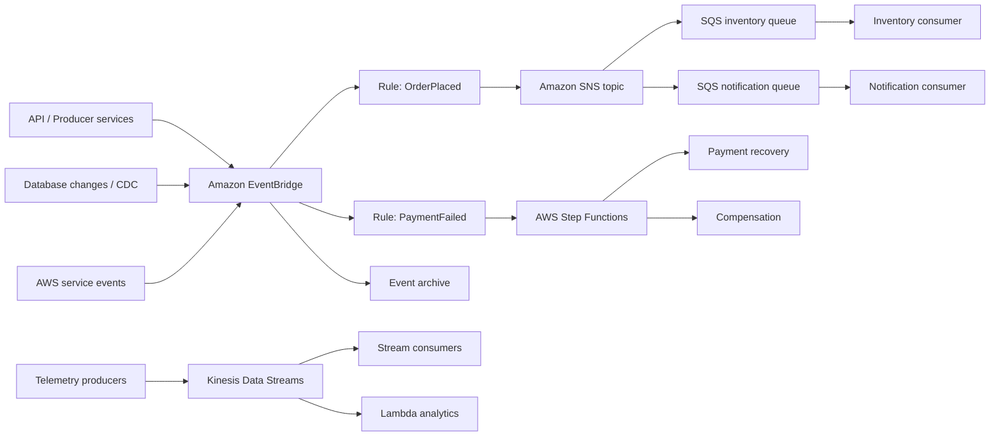
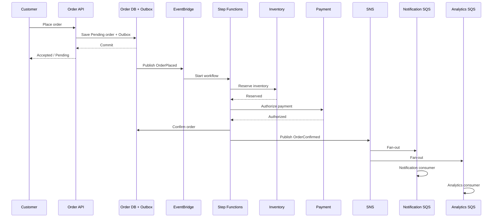

# Event-Driven Architecture and Asynchronous Communication

## 1. Why Do Systems Need Event-Driven Architecture?

In a distributed system, a single business operation often needs to notify many other components. When a customer places an order, the system may need to reserve inventory, process payment, send an email, update analytics, and notify a shipping partner.

If the Order Service synchronously calls all of these services within the same request, response time depends on the slowest component. If one dependency goes down, the order request might fail even though order creation succeeded. Services also become tightly coupled to one another's APIs, addresses, and operational availability.

**Event-driven architecture (EDA)** allows a component to emit an event describing what happened. Interested components subscribe to and process events independently. Asynchronous communication decouples emission time from processing time, absorbs traffic bursts, reduces direct coupling, and allows each consumer to scale independently.

On AWS, an architecture typically combines:

- **Amazon EventBridge:** event buses, event patterns, and routing to multiple targets.
- **Amazon SNS:** publish/subscribe and fan-out to multiple subscribers.
- **Amazon SQS:** durable queues for buffering messages, load leveling, and distributing work to consumers.
- **Amazon Kinesis Data Streams:** ingesting and processing continuous data streams.
- **AWS Lambda:** serverless event processing.
- **AWS Step Functions:** orchestrating multi-step workflows and error branches.
- **Amazon DynamoDB Streams or database change data capture (CDC):** detecting data changes.
- **Amazon CloudWatch and AWS X-Ray:** observing latency, errors, backlog, and processing flows.

EDA is not a replacement for every synchronous API. Requests needing immediate results, such as validating login credentials or reading an instant balance, can still use synchronous APIs. Work that can finish later, requires fan-out, or must absorb fluctuating load is usually well suited to asynchronous communication.

## 2. Learning Objectives

After this lesson, learners can:

1. Distinguish between an event, a command, and a message.
2. Explain the benefits, limitations, and eventual consistency of asynchronous communication.
3. Choose EventBridge, SNS, SQS, Kinesis Data Streams, or Step Functions based on requirements.
4. Design event envelopes, schema versions, and correlation identifiers.
5. Build fan-out, queue-based load leveling, and streaming pipelines.
6. Handle duplicate delivery, retries, visibility timeouts, poison messages, and dead-letter queues (DLQs).
7. Design idempotent consumers, ordering, and transactional outboxes.
8. Use saga choreography or orchestration to coordinate transactions across multiple services.
9. Integrate Lambda safely with SQS, EventBridge, and Kinesis.
10. Monitor event age, queue depth, iterator age, delivery failures, and end-to-end latency.
11. Secure event payloads using IAM, resource policies, KMS, and data minimization.
12. Evaluate HA, throughput, retention, replay, cost, and resilience.

## 3. Distinguishing Events, Commands, and Messages

These terms are often used interchangeably, yet they carry distinct meanings.

| Concept | Meaning | Example |
|---|---|---|
| Event | A record describing something that has already happened | `OrderPlaced`, `PaymentCaptured` |
| Command | A request for a component to perform an action | `ReserveInventory`, `CapturePayment` |
| Message | A unit of data transferred between components; can carry an event or command | SQS message containing `ReserveInventory` |
| Notification | Informing other components about an event or state | `CustomerRegistered` |
| Stream record | A record in a data stream with a position/order per shard or partition | `ClickEvent`, `DeviceTelemetry` |

Events should be named in the past tense because they describe facts that already occurred: `OrderPlaced`, `PaymentFailed`. Events should not contain instructions commanding a specific consumer. Commands express intent and target a specific handler: `ShipOrder` or `RefundPayment`.

An event can have multiple subscribers. Each subscriber decides how to react based on its own responsibilities. For example, `OrderPlaced` can be consumed independently by Inventory Service, Notification Service, and Analytics Service.

A command typically has one owner responsible for executing it. If an action must be requested and its result tracked, define an explicit command ID, processing status, and correlation ID.

## 4. Synchronous and Asynchronous Communication

### 4.1. Synchronous Communication

In synchronous communication, the caller sends a request and waits for a response before continuing.

Advantages:

- Control flow is straightforward.
- Caller receives an immediate result.
- Fits queries or operations requiring direct feedback.

Limitations:

- Caller depends on dependency availability and latency.
- Timeouts or cascading errors can propagate across multiple services.
- Hard to absorb traffic bursts if downstream lacks capacity.
- Caller usually must know the target service's endpoint and contract.

### 4.2. Asynchronous Communication

In asynchronous communication, the producer sends a message/event to a broker or stream. Consumers process it at an appropriate time.

Advantages:

- Producer and consumer do not need to be available simultaneously.
- Queues can absorb bursts and regulate processing speed.
- Consumers can scale independently.
- One event can trigger multiple workflows.
- Downstream failures can be retried or routed to a DLQ.

In return, the system must handle eventual consistency, duplicate delivery, retries, ordering, DLQs, replay, and observability. Users also need to understand that business state may be `Pending` or `Processing` before completion.

### 4.3. Eventual Consistency

Suppose Order Service writes an order successfully and emits `OrderPlaced`. Inventory Service may update stock a few seconds later. During that window, the two services hold different states, but the system converges once the event is processed successfully.

The design must define:

- Which state is considered confirmed to the user.
- Which consumer is the authoritative source of truth for each piece of data.
- How in-progress states are displayed.
- How late or out-of-order events are handled.
- How data is repaired when a consumer fails persistently.

Do not use eventual consistency to mask the absence of reconciliation. For financial or inventory domains, implement reconciliation jobs to detect and resolve discrepancies.

## 5. Event Contracts and Data Structure

A stable event contract enables producers and consumers to evolve independently.

### 5.1. Recommended Fields

| Field | Purpose |
|---|---|
| `eventId` | Unique identifier of the event |
| `eventType` | Name of the event type |
| `source` | Service or system emitting the event |
| `occurredAt` | Timestamp when the business event occurred, usually normalized to UTC |
| `schemaVersion` | Version of the payload structure |
| `aggregateId` | ID of the business entity, e.g., `orderId` |
| `correlationId` | Links multiple operations within the same workflow |
| `causationId` | The event/command that caused the current event |
| `traceparent` | Trace context if using distributed tracing |
| `data` | Business payload |

Not every AWS service requires this exact envelope. EventBridge has its own envelope with fields such as `version`, `id`, `source`, `detail-type`, `time`, `region`, `resources`, and `detail`. When designing custom events, keep the contract consistent across producers, brokers, and consumers.

### 5.2. Example `OrderPlaced` Event

```json
{
  "eventId": "evt-01J9M5A7K3Q8",
  "eventType": "com.example.orders.order-placed",
  "schemaVersion": "1.0",
  "source": "orders-service",
  "occurredAt": "2026-11-20T05:30:00Z",
  "aggregateId": "order-20261120-10025",
  "correlationId": "checkout-8f3a",
  "causationId": "cmd-place-order-771",
  "data": {
    "orderId": "order-20261120-10025",
    "customerId": "customer-482",
    "currency": "VND",
    "totalAmount": 1250000,
    "items": [
      {
        "sku": "SKU-100",
        "quantity": 2
      }
    ]
  }
}
```

This example carries only the data consumers need. Do not include access tokens, passwords, payment card data, or full customer profiles in events unless consumers require them. For large payloads, store the data in S3 and pass an object reference with controlled access permissions.

### 5.3. Schema Evolution

When changing an event contract:

- Prefer adding optional fields with clear defaults.
- Do not change the meaning of existing fields.
- Do not reuse a field name for a different data type.
- Maintain backward compatibility during consumer upgrade windows.
- Have a deprecation plan for old schemas.
- Test producers and consumers against both old and new versions.
- Consider AWS Glue Schema Registry for streaming use cases requiring schema governance.

If a change is breaking, create a new event version/type or use explicit versioning. Do not assume all consumers deploy simultaneously.

## 6. Overview of Event-Driven Architecture on AWS

A system can combine event buses, queues, streams, and workflows depending on each business flow.



Every component does not have to appear in every application. Choose the fewest services capable of meeting routing, durability, fan-out, ordering, throughput, and workflow requirements.

## 7. Choosing the Right Communication Service

| Need | Suitable Service | Key Characteristics |
|---|---|---|
| Route events by source/type/content to multiple targets | EventBridge event bus | Event patterns, rules, target routing, archive/replay |
| Point-to-point integration from one source to one target with filtering/enrichment | EventBridge Pipes | Managed source-to-target integration |
| Fan-out one notification to multiple subscribers | SNS | Pub/sub, filter policies, delivery retries |
| Buffer work and distribute to workers | SQS | Durable queue, visibility timeout, DLQ |
| Preserve ordering per message group | SQS FIFO | Per-group ordering and deduplication |
| Ingest high-volume telemetry/events and stream processing | Kinesis Data Streams | Shards, partition keys, retention, consumers |
| Orchestrate multi-step workflows and compensation | Step Functions | State machines, retry, catch, execution history |
| Track item changes in DynamoDB | DynamoDB Streams | Ordered change records in stream |
| Emit changes from relational databases | AWS DMS CDC or suitable CDC mechanism | Capture changes and forward to streams/targets |

### 7.1. EventBridge or SNS?

Use EventBridge when you need routing based on event metadata and content, integration across AWS services/SaaS/custom sources, or archive and replay capabilities.

Use SNS when you need to publish a notification to multiple subscribers in a fan-out pattern. SNS subscriptions can use filter policies so each subscriber receives only relevant messages.

### 7.2. SNS or SQS?

SNS is publisher-driven fan-out: the publisher sends once to a topic, and SNS forwards to subscribers.

SQS is a consumer-pulled queue: messages stay in the queue until processed and deleted by a consumer. SQS fits when load buffering, concurrency control, retaining messages while consumers are offline, and decoupling producer/consumer speeds are needed.

The SNS → multiple SQS queues pattern combines fan-out with a durable buffer for each consumer.

### 7.3. SQS or Kinesis?

SQS fits independent task/message processing where consumers receive and acknowledge individual messages. Kinesis fits streaming data requiring retention over a window, reading by shard/sequence, and allowing multiple consumers to process the data stream.

Do not use Kinesis merely to get a queue. Verify whether you genuinely need stream retention, partition ordering, sequence/time-based replay, and multiple stream consumers.

## 8. Amazon EventBridge Event Bus

### 8.1. How It Works

An EventBridge event bus receives events from AWS services, custom applications, or SaaS partners. Rules on the event bus match event patterns and route events to corresponding targets.

One event can match multiple rules. Each rule can route to supported targets such as Lambda, SQS, SNS, Step Functions, or another event bus.

An event bus frees producers from knowing specific subscribers. Producers simply emit events conforming to the contract; each consumer owner manages their own rules and targets.

### 8.2. Event Patterns

Example rule matching only `OrderPlaced` events from Orders Service:

```json
{
  "source": ["com.example.orders"],
  "detail-type": ["OrderPlaced"],
  "detail": {
    "status": ["CONFIRMED"],
    "totalAmount": [
      {
        "numeric": [">=", 1000000]
      }
    ]
  }
}
```

Event patterns evaluate fields inside the event. Use the EventBridge Sandbox to test patterns against sample events before deployment. Also test missing fields, mismatched data types, and new event versions.

### 8.3. Event Bus and Rule Design

- Use custom event buses to separate domains or workload groups.
- Use consistent naming conventions for `source` and `detail-type`.
- Create purposeful rules; avoid overly broad patterns.
- Scope `PutEvents` permissions per producer.
- Scope target execution roles/resource policies tightly.
- Monitor `FailedInvocations`, `Invocations`, and DLQ metrics.
- Avoid rule loops, such as a rule catching a policy change event whose target modifies the policy in a way that emits the same event.

An event matching no rules on the event bus is not routed to any target. If retention for inspection or replay is required, configure an appropriate archive.

### 8.4. Cross-Account and Cross-Region

EventBridge supports sending events to another event bus using resource policies and IAM roles by design. Clearly define account owners, Regions, source trust, and target permissions. Do not open `PutEvents` to an entire account or broad principals when only a specific producer needs to send events.

## 9. EventBridge Pipes, Archives, and Replay

### 9.1. EventBridge Pipes

Pipes fit point-to-point integration: one source, optional filtering/enrichment, and one target. Sources can be SQS, Kinesis, DynamoDB Streams, or other supported sources.

Pipes reduce custom polling/forwarding code. However, understand source semantics, batching, retries, checkpoints, and target behavior before selecting them. A Pipe is not a fan-out event bus; if multiple independent consumers are needed, an event bus or pub/sub usually fits better.

### 9.2. Archives

An EventBridge archive stores events matching an archive filter for a configured retention period. Archives are useful for:

- Incident investigation.
- Recovering consumers after a bug.
- Replaying a range of events to rebuild projections.
- Testing new consumers against historical data.

An archive is not an automatic full database backup. It only stores events sent to the event bus that match the archive configuration.

### 9.3. Replay

EventBridge replay resends archived events back to the source event bus. You can select a time window and specify which rules are allowed to receive the replay.

Before replaying in production:

- Identify which consumers will receive replayed events.
- Verify idempotency and duplicate handling.
- Use event timestamps and event IDs to avoid reapplying unintended business effects.
- Assess backlog and downstream capacity.
- Consider replaying to a staging environment or dedicated bus first.

Replaying events does not reset database state. Consumers need logic to distinguish live versus replayed events if business rules require it.

### 9.4. EventBridge Retries and DLQs

When target invocation fails, EventBridge applies its retry policy. Configure maximum event age, retry attempts, and an SQS DLQ on the target when undeliverable events must be preserved.

Without a configured DLQ, events can be dropped after exhausting retries. The DLQ must permit EventBridge to send messages via an appropriate resource policy. For FIFO targets or ordering requirements, choose matching DLQs and redrive procedures.

EventBridge DLQ messages may include metadata about the failed delivery; exact structure depends on the event bus type and target integration. Do not assume the body always matches the raw original event. When processing, read the documented format, extract the event identifier and error metadata, and replay the original event following the proper procedure.

## 10. Amazon SNS: Publish/Subscribe and Fan-Out

### 10.1. Topic Model

Producers publish messages to an SNS topic. SNS delivers messages to each subscription:

- SQS queue.
- Lambda function.
- HTTP/S endpoint.
- Email/SMS or other supported protocols.

A single topic can broadcast notifications to multiple systems without the producer knowing the subscriber count.

### 10.2. SNS Filter Policies

Filter policies let each subscription receive only messages whose message attributes or body satisfy specified conditions.

Examples:

- Billing subscriber receives `PaymentCaptured` events.
- Notification subscriber receives `OrderPlaced` or `ShipmentDispatched`.
- Analytics subscriber receives events for a specific region/business unit.

Filters reduce unnecessary invocations and traffic. Test filters whenever schemas change because an incorrect filter can silently drop notifications for a subscriber.

### 10.3. SNS and SQS Fan-Out

Common pattern:

1. Producer publishes an event to an SNS topic.
2. SNS delivers a copy of the message to each SQS subscription.
3. Each consumer reads from its own queue.
4. A slow consumer does not block other consumers.
5. Queues retain messages while consumers recover.

Each subscription can attach its own DLQ to investigate endpoint delivery failures. This differs from an SQS consumer DLQ: an SNS subscription DLQ holds messages SNS could not deliver to the subscriber; an SQS queue DLQ holds messages that consumers failed to process repeatedly.

### 10.4. SNS FIFO

SNS FIFO topics support ordering and deduplication by message group/deduplication configuration, paired with SQS FIFO subscriptions when ordered fan-out is needed. Design message groups to preserve ordering per aggregate while still allowing parallel processing across different aggregates.

Do not assume every subscriber protocol supports FIFO-like semantics. Check topic types, subscription types, and service limits before deployment.

### 10.5. Ordering and Subscription Failures

With FIFO topics and FIFO queue subscriptions, keep `MessageGroupId` consistent throughout fan-out. If delivery to a subscriber fails, attach a subscription-level DLQ and monitor delivery failures. Redriving a failed message must account for business ordering within the group; do not replay an older message after newer messages have already been processed if doing so corrupts aggregate state.

## 11. Amazon SQS: Durable Queues and Load Leveling

### 11.1. Standard Queues

SQS Standard queues suit high throughput and independent consumer processing. Key semantics:

- At-least-once delivery: a message may be delivered more than once.
- Best-effort ordering: receive order is not strictly guaranteed.
- A message can be received again if the consumer does not delete it before visibility timeout expires.
- Consumers must be idempotent.

Use Standard queues when strict ordering is not required and the system can handle duplicates.

### 11.2. FIFO Queues

SQS FIFO queues support:

- Strict ordering within the same `MessageGroupId`.
- Deduplication ID or content-based deduplication.
- Higher throughput when using high-throughput mode within supported limits.
- Consumers process messages sequentially within a group, while different groups can process in parallel.

FIFO does not automatically eliminate all business duplicates. SQS deduplication has a bounded time window; if a producer retries after the window expires or a consumer commits a side effect before deleting the message, the application still needs idempotency.

If a message in a FIFO group fails repeatedly and moves to the DLQ, subsequent messages in that group can continue being processed. This can create gaps in a business sequence. When redriving, verify sequence/version numbers and aggregate state before re-running an older message. For a FIFO source queue, the DLQ must also be a FIFO queue.

### 11.3. Visibility Timeout

When a consumer receives a message, SQS temporarily hides it from other consumers for the duration of the visibility timeout.

- If processing and `DeleteMessage` succeed, the message is deleted.
- If the consumer fails or times out, the message can become visible again.
- For long processing, consumers can call `ChangeMessageVisibility` to extend the timeout.
- Visibility timeout cannot exceed the 12-hour maximum measured from when the message was first received.

Set the timeout long enough for processing time, but not so long that failed messages take excessive time to retry. For jobs exceeding the limit, split the work or use Step Functions.

### 11.4. Dead-Letter Queues

A DLQ receives messages after the source queue has delivered them more than the configured count in its redrive policy.

DLQs help:

- Isolate poison messages.
- Prevent a single bad message from causing infinite consumer retries.
- Preserve data for root-cause analysis.
- Support redrive after fixing bugs.

Set `maxReceiveCount` according to your failure profile. DLQ retention should be long enough for investigation; with Standard queues, consider a DLQ retention period longer than the source queue's. Check `RedriveAllowPolicy` so only authorized source queues can send to the DLQ.

### 11.5. Long Polling and Batching

Long polling reduces empty `ReceiveMessage` responses and lowers polling costs. Batch send/receive/delete operations increase throughput and reduce API calls.

Larger batches are not always better: they increase memory usage, processing duration, payload size, and blast radius when a batch fails. Choose batch sizes based on processing time, message size, and concurrency.

## 12. Ordering, Deduplication, and Delivery Semantics

### 12.1. Three Delivery Semantics

| Semantics | Meaning | Design Implication |
|---|---|---|
| At-most-once | Message is delivered at most once, but may be lost | Fits when occasional drops are acceptable |
| At-least-once | Message is delivered one or more times | Consumers must handle duplicates |
| Exactly-once | System provides once-only processing semantics within a defined scope | Understand guarantee scope; external side effects still require idempotency |

In distributed systems, "exactly once" is never a universal guarantee across all external side effects. For instance, SQS FIFO deduplicates sends within a defined window, but if a consumer deducts inventory successfully and crashes before `DeleteMessage`, the message can be received again. Consumers must track processed `eventId` or `commandId` values.

### 12.2. Idempotency

An operation is idempotent when executing it multiple times with the same input produces the same business outcome as executing it once.

Examples:

- Maintain a `ProcessedEvents` table with `eventId` as a unique key.
- Record payment operations with an idempotency key.
- Use conditional writes or transactions to prevent duplicate updates.
- Check aggregate version before applying an event.
- Design command handlers to return the stored result when receiving an already-processed command ID.

Processing pattern:

1. Receive event.
2. Start database transaction.
3. Insert `eventId` into an inbox/processed-events table with a unique constraint.
4. If `eventId` already exists, skip repeating side effects and acknowledge the message.
5. If new, apply business updates and commit in the same transaction.
6. Only after commit succeeds, acknowledge/delete the message.

Never mark an event as processed before the side effect completes; if the process crashes between the two steps, the event could be skipped even though business state was never updated.

### 12.3. Ordering

Ordering may be required per `orderId`, `customerId`, or `accountId` rather than globally across the whole system. Choose message groups/partition keys by aggregate to maintain ordering where needed while enabling parallelism across aggregates.

When events arrive out of order:

- Check aggregate version or sequence number.
- Ignore older events that have already been superseded.
- Buffer early events if a prior event is missing.
- Retry or trigger projection rebuilds when detecting gaps.
- Do not rely on timestamps alone to determine order if producer clocks can drift.

## 13. Integrating Lambda with SQS

Lambda event source mappings poll SQS and invoke the function in batches. When the function processes the entire batch successfully, Lambda deletes the messages. If the invocation fails, messages can reappear after the visibility timeout.

### 13.1. Timeout and Batch Configuration

- Function timeout must be less than or equal to the queue visibility timeout.
- AWS recommends setting visibility timeout to at least six times the function timeout so Lambda has room to retry on throttling.
- Choose batch size based on processing time and payload.
- Set reserved concurrency or maximum concurrency to protect downstream databases/APIs.
- Configure redrive policies and DLQs.
- Monitor queue age and `ApproximateNumberOfMessagesVisible`.

### 13.2. Partial Batch Response

By default, if one record in a batch fails, the entire batch may be returned for retry. Enable `ReportBatchItemFailures` so the function returns only the failed items; successfully processed messages do not need to be reprocessed.

Example response when one message fails:

```json
{
  "batchItemFailures": [
    {
      "itemIdentifier": "message-id-2"
    }
  ]
}
```

With a FIFO queue, when a record fails, stop processing subsequent records in the same batch and return the failed record plus all unprocessed records to preserve ordering. AWS Lambda Powertools Batch Processor can reduce boilerplate for handling batch failures.

### 13.3. Concurrency and Backpressure

Consumers must not scale faster than downstream databases or APIs can handle. Set maximum concurrency, reserved concurrency, or poller limits based on actual downstream capacity.

If queue backlog grows, distinguish between:

- Increased producer traffic.
- Slow consumers due to heavy processing.
- Slow downstream dependencies.
- Consumer throttling.
- Repeated poison messages.
- Misconfigured queue visibility timeout.

Do not raise concurrency infinitely to clear a backlog; doing so can take down downstream systems as well.

## 14. Amazon Kinesis Data Streams

Kinesis Data Streams fits continuous streaming data such as clickstreams, telemetry, application logs, IoT events, and event analytics.

### 14.1. Streams, Records, Shards, and Partition Keys

- A stream contains multiple shards.
- Each record has a sequence number, partition key, and data blob.
- The partition key determines which shard receives the record in the user-managed partition key model.
- Records with the same partition key land in the same shard, allowing consumers to preserve relative order per key.
- A shard is the unit of throughput and ordering.

A hot partition key can overload a single shard even while the rest of the stream has spare capacity. Choose partition keys with uniform distribution that still preserve ordering for the required entity.

### 14.2. Capacity Modes

Kinesis Data Streams has provisioned mode and on-demand mode:

- Provisioned: select shard count, manage capacity and scaling.
- On-demand: service automatically manages capacity based on traffic patterns within supported limits.

Choose the mode based on traffic predictability, bursts, throughput, cost, and shard management capability. Check quotas and Region support before deploying.

### 14.3. Retention and Replay

Default stream retention is 24 hours and can be extended up to 365 days. Consumers can re-read records within the retention window by starting from a sequence number or timestamp.

Kinesis retention does not replace a data lake or long-term archival. For long-term history, use Firehose/S3 or an appropriate storage pipeline.

### 14.4. Consumers and Enhanced Fan-Out

Consumers can use `GetRecords` with shared read throughput or enhanced fan-out to receive dedicated per-shard throughput. Enhanced fan-out is useful when multiple independent consumers read the same stream simultaneously and require lower latency.

Use the Kinesis Client Library (KCL) if you need shard lease management, checkpointing, and failover across consumer instances. When a consumer processes records, checkpoints must reflect committed progress to avoid unintended data loss or reprocessing.

### 14.5. When to Choose Kinesis Instead of SQS?

Choose Kinesis when you need:

- To retain stream records for multiple consumers to read independently.
- Ordering per partition key/shard.
- Replay within a retention period.
- Streaming analytics or near-real-time processing.
- Integration with KCL, Lambda, Managed Service for Apache Flink, or Firehose.

Choose SQS when individual tasks must be distributed to workers with per-message acknowledge/delete and queue-style DLQs.

## 15. AWS Step Functions for Asynchronous Workflows

Step Functions orchestrates multi-step workflows with branching, retries, timeouts, catch blocks, and compensation.

Example order flow:

1. Validate order.
2. Reserve inventory.
3. Authorize payment.
4. Confirm order.
5. Request shipment.
6. Send notification.

If payment fails after inventory has been reserved, the workflow can invoke `ReleaseInventory` to compensate.

### 15.1. Standard and Express Workflows

| Attribute | Standard | Express |
|---|---|---|
| Use case | Long-running workflows needing audit/execution history | High-volume, short-duration event processing |
| Max duration | Up to one year | Up to five minutes |
| Semantics | Exactly-once workflow execution; declared retries may rerun tasks | Async Express at-least-once; Sync Express at-most-once |
| History | Detailed execution history | Relies on CloudWatch Logs per configuration |
| Billing | State transitions | Execution count, duration, and memory |

Standard's "exactly-once" describes workflow/state execution semantics inside the service. It does not automatically make external side effects like charging a card or writing to a database exactly-once. Tasks still need idempotency keys and handling for ambiguous timeouts.

### 15.2. Retry and Catch

Use `Retry` for transient errors like throttling or service unavailability. Use `Catch` to route unrecoverable errors or errors after retries are exhausted.

Configure:

- Specific `ErrorEquals`.
- `IntervalSeconds` and `BackoffRate`.
- Appropriate `MaxAttempts`.
- Task timeouts.
- Catch paths and compensation.
- Least-privilege execution roles.

Do not retry validation errors or business rule violations that cannot self-heal. Overly broad retries can cause duplicate side effects or unnecessary costs.

## 16. Transactional Outbox and CDC

### 16.1. The Dual-Write Problem

Suppose Order Service:

1. Writes the order to the database.
2. Publishes `OrderPlaced` to EventBridge or SQS.

If the database commit succeeds but the publish fails, downstream services never learn the order was created. If the publish succeeds but the database rolls back, downstream services receive an event with no backing record.

This is the dual-write problem.

### 16.2. Transactional Outbox

The outbox pattern stores the event in the same database transaction as the business data.

Workflow:

1. Start transaction.
2. Insert/update Order.
3. Insert event record into the Outbox table.
4. Commit once.
5. Publisher/CDC process reads outbox and sends events to the broker.
6. Mark or checkpoint published events.
7. Consumers process idempotently.

If the transaction rolls back, neither the Order nor the Outbox record exists. If the publisher sends successfully but crashes before marking it published, the event may be resent; consumers still need idempotency.

### 16.3. CDC

CDC reads changes from database logs/streams and forwards them downstream. With DynamoDB, DynamoDB Streams can trigger Lambda whenever items change. With relational databases, AWS DMS can capture CDC and stream data to supported targets.

CDC reduces the need to poll outbox tables, but requires understanding source retention, checkpoints, schema mapping, duplicate behavior, and ordering semantics.

## 17. Saga: Coordinating Transactions Across Multiple Services

When a workflow updates multiple independent databases, a single ACID transaction spanning all services cannot be assumed. A saga breaks the workflow into local transactions and defines compensating actions.

Example order flow:

| Step | Local Transaction | Compensation |
|---|---|---|
| 1 | Create Pending order | Cancel order |
| 2 | Reserve inventory | Release inventory |
| 3 | Authorize payment | Void authorization |
| 4 | Confirm order | Cancel order if still possible |
| 5 | Create shipment | Cancel shipment |

Compensation is not necessarily a physical rollback. If a payment was already captured, compensation may be a refund. If a shipment has already dispatched, a return workflow may be needed.

### 17.1. Choreography

Each service listens for events and emits subsequent events. Fits workflows with few participants and domains with clear ownership.

Advantages: no central coordinator, independent services.

Limitations: as participants grow, distributed business flows become harder to observe and debug.

### 17.2. Orchestration

An orchestrator coordinates steps and error handling. AWS Step Functions is a common choice.

Advantages: centralized workflow visibility, easier status tracking and compensation.

Limitations: must manage state machines, permissions, and orchestration logic; avoid concentrating all business rules into one oversized orchestrator.

Choose choreography for simple event reactions; choose orchestration for multi-step transactions needing explicit state, timeouts, human approvals, or compensation.

## 18. Retries, Backoff, and Poison Messages

### 18.1. Controlled Retries

Retries fit transient failures such as network timeouts, throttling, or temporary unavailability. Use exponential backoff and jitter to avoid synchronized retry storms across consumers.

Example strategy:

- Attempt 1: short wait.
- Attempt 2: longer wait.
- Subsequent attempts: exponential backoff with a max cap.
- Stop when the retry budget or business deadline expires.

Do not continuously retry validation errors, permission denied errors, or schema mismatches without deploying a fix.

### 18.2. Poison Messages

A poison message is a message that consistently fails due to invalid payload, bugs, incompatible schemas, or unexpected business data.

Mitigations:

- Cap receive counts.
- Route messages to a DLQ.
- Log `eventId`, error type, and `correlationId`.
- Alert on DLQ depth.
- Analyze and fix the root cause.
- Perform controlled redrives after fixing the consumer.
- Maintain an audit trail of replays.

Do not automatically redrive continuously before fixing the root cause. Doing so creates error loops and can inflate queue backlogs.

### 18.3. Retry Budgets and Deadlines

A single business request may traverse multiple services. If every service retries 5 times independently, total downstream calls can grow exponentially. Propagate deadline/correlation context so services know remaining time and stop retrying once results are no longer useful.

## 19. Backpressure, Batching, and Queue Depth

Queues are buffers, not infinite processing capacity. If producers consistently emit messages faster than consumers process them, backlogs grow.

Monitor:

- `ApproximateNumberOfMessagesVisible`.
- `ApproximateNumberOfMessagesNotVisible`.
- `ApproximateAgeOfOldestMessage`.
- `NumberOfMessagesSent`/`Received`/`Deleted`.
- Lambda concurrent executions and throttles.
- Consumer processing duration.
- Downstream database/API saturation.

Set concurrency limits to protect dependencies. Use batch processing when API overhead is high, while balancing latency and failure isolation. For Kinesis, track `IncomingBytes`/`IncomingRecords`, `Read`/`WriteProvisionedThroughputExceeded`, and `IteratorAgeMilliseconds`.

A queue can absorb brief bursts. If producer rate permanently exceeds consumer rate, a queue only delays failure; you must scale capacity, shed work, rate-limit producers, or implement admission control.

## 20. Observability for Event-Driven Systems

### 20.1. Correlation and Tracing

Every event should carry an `eventId` and `correlationId`. Propagate trace context across producers, brokers, and consumers where integrations support it. Emit structured logs containing:

- `eventId`.
- `eventType`.
- `source`.
- `aggregateId`.
- `correlationId`.
- Consumer name/version.
- Attempt count.
- Processing duration.
- Outcome/error category.

Do not log full payloads if they contain PII, secrets, or sensitive data.

### 20.2. Metrics by Service

| Service | Metrics to Monitor |
|---|---|
| EventBridge | `Invocations`, `FailedInvocations`, `ThrottledRules`, `DeadLetterInvocations`, `MatchedEvents` |
| SNS | `NumberOfMessagesPublished`, `NumberOfNotificationsDelivered`, `NumberOfNotificationsFailed` |
| SQS | `ApproximateNumberOfMessagesVisible`, `ApproximateAgeOfOldestMessage`, `NumberOfMessagesSent`/`Received`/`Deleted` |
| Lambda | `Invocations`, `Errors`, `Throttles`, `Duration`, `ConcurrentExecutions` |
| Kinesis | `IncomingRecords`, `IncomingBytes`, Read/Write throughput exceptions, `IteratorAgeMilliseconds` |
| Step Functions | `ExecutionsStarted`, `ExecutionsFailed`, `ExecutionsTimedOut`, `ExecutionThrottled` |

Specific metrics depend on the service, Region, and dimensions. Set alarms on business impact, such as oldest message age breaching SLAs or new messages arriving in a DLQ.

### 20.3. Distributed Tracing

AWS X-Ray or OpenTelemetry can link traces across service calls. With queues, producers and consumers do not execute within the same request context; propagate trace/correlation metadata in the message and start a separate consumer span.

Do not assume traces automatically propagate across every broker. Check integration instrumentation and propagate context in the chosen format.

## 21. Security for Event Buses, Topics, Queues, and Streams

### 21.1. IAM and Resource Policies

- Producers only have permission to publish to required event buses/topics/queues.
- Consumers only have permission to receive messages from their own queues/streams.
- EventBridge target roles can only invoke intended targets.
- SNS topic policies restrict authorized publishers/subscribers.
- SQS queue policies restrict which service principals or accounts can send messages.
- Kinesis producers/consumers have permissions scoped to specific streams and operations.

Use resource policies for cross-account integration and check both IAM identity policies and resource policies. Never grant wildcard permissions unnecessarily.

### 21.2. Encryption

- Use TLS for API calls and endpoints.
- Enable server-side encryption for SQS/SNS/Kinesis as required.
- Configure KMS key policies for producers/consumers.
- Verify `kms:Decrypt` permissions when Lambda reads encrypted queues.
- Protect archives and DLQs since they can retain sensitive payloads.

### 21.3. Data Minimization

Events are frequently replicated to multiple subscribers. Therefore:

- Emit only necessary fields.
- Avoid secrets, passwords, and payment credentials.
- Use object references instead of large payloads.
- Configure retention policies for archives, queues, and streams.
- Classify data before permitting cross-account fan-out.
- Do not let DLQs or logs become unmonitored PII stores.

## 22. Availability, Durability, and Disaster Recovery

### 22.1. Choosing Durability Based on Requirements

SQS, SNS, EventBridge, and Kinesis have different durability and retention models. Review each service's guarantees, retention limits, retry policies, and behavior when targets fail.

Do not treat brokers as permanent backups. If events must be retained for years or for audits, design archival to S3/data lakes or storage systems with dedicated retention.

### 22.2. Failure Domains

- Separate event buses, queues, and streams by domain or workload.
- Avoid one shared queue for all unrelated work types.
- Maintain DLQs and alarms.
- Cap concurrency to prevent downstream overload.
- Design producer retries with idempotency.
- Evaluate cross-Region replication and replay if DR requires it.

### 22.3. Recovering After an Outage

When a consumer goes down:

1. Assess queue age/backlog and downstream errors.
2. Restore dependencies before scaling up consumer concurrency.
3. Check DLQs and event retention.
4. Run a canary consumer to verify recovery.
5. Scale consumers incrementally.
6. Monitor age of oldest message and processing rate.
7. If replaying archives/streams, check duplicates and side-effect impact.

Never purge a queue or archive to clear a backlog before verifying which messages must be preserved.

## 23. Common Anti-Patterns

| Anti-Pattern | Consequence | Improvement |
|---|---|---|
| Using an event bus as a task queue needing per-message ack | Hard to manage worker backlogs and per-message state | Use SQS |
| Using SQS Standard while assuming strict ordering | Corrupted business state when events arrive out of order | FIFO/groups or sequence/version handling |
| Non-idempotent consumers | Duplicates cause double charges/stock deductions | Inbox tables/idempotency keys |
| Publishing events after DB commit without an outbox | Lost events when publishing fails | Transactional outbox or CDC |
| Infinite retries | Poison messages and growing backlogs | Retry budgets, DLQs, alerts |
| Shared queue for unrelated workloads | One slow consumer delays other teams | Separate queues per consumer/domain |
| Event payloads containing entire entities | Increased coupling and data exposure | Small, versioned events with references when needed |
| An event infinitely re-triggering itself | Loops and runaway costs | Precise event patterns, idempotent rules |
| Unbounded consumer scaling | Downstream database overload | Maximum concurrency/backpressure |
| Choosing Kinesis without managing partition keys | Hot shards and throttling | Analyze key distribution |
| Sagas without compensation | Stuck intermediate states hard to recover | Design forward/compensating actions |
| Uncontrolled replay | Side effects re-executed | Idempotency, replay scope, and canaries |

## 24. Example Architecture: Asynchronous Order Processing

An e-commerce website receives checkout requests. The API only needs to confirm that the request has been accepted; remaining steps run asynchronously.

Reference flow:

1. API Gateway/Lambda or Order Service validates the request.
2. Order Service writes a `Pending` order and an outbox record in the same database transaction.
3. The publisher sends `OrderPlaced` to EventBridge.
4. EventBridge routes the event to Step Functions to orchestrate the order workflow.
5. The workflow asks Inventory Service to reserve items.
6. Payment Service authorizes payment.
7. When both succeed, the workflow confirms the order.
8. `OrderConfirmed` is published to SNS.
9. SNS fans out to SQS queues for Notification, Analytics, and Fulfillment.
10. Each consumer processes independently with a DLQ and idempotency.
11. If payment fails, the saga releases inventory and marks the order `Failed`/`Cancelled`.

### 24.1. Sequence Diagram



### 24.2. When Payment Fails

- Step Functions catches the error.
- The workflow calls `ReleaseInventory`.
- Order Service updates status to `Cancelled` or `PaymentFailed`.
- Emits `OrderPaymentFailed`.
- Notification Service sends the appropriate notification.
- Incidents/metrics record the failure for monitoring.

Do not issue a refund if the payment was only authorized and never captured; compensation must match the payment provider's actual transaction state.

## 25. AWS CLI: Creating Queues and Testing Event Flows

The commands below are examples. Replace Region, account ID, and resource names with your environment values. IAM roles/policies and resource policies must be configured separately.

### 25.1. Create an SQS Dead-Letter Queue

```bash
aws sqs create-queue \
  --queue-name orders-dlq \
  --attributes MessageRetentionPeriod=1209600 \
  --region ap-southeast-1
```

Retrieve `QueueUrl` and `QueueArn` using `get-queue-attributes`. DLQ retention should be long enough for investigation and remediation.

### 25.2. Create a Standard Queue with a Redrive Policy

```json
{
  "VisibilityTimeout": "120",
  "ReceiveMessageWaitTimeSeconds": "20",
  "RedrivePolicy": "{\"deadLetterTargetArn\":\"arn:aws:sqs:ap-southeast-1:111122223333:orders-dlq\",\"maxReceiveCount\":\"5\"}"
}
```

Apply attributes at queue creation or via `set-queue-attributes`. The DLQ's queue policy must allow the source queue to send messages according to `RedriveAllowPolicy`.

### 25.3. Send a Test Message

```bash
aws sqs send-message \
  --queue-url https://sqs.ap-southeast-1.amazonaws.com/111122223333/orders \
  --message-body '{"eventId":"evt-1001","eventType":"OrderPlaced","orderId":"order-1001"}' \
  --region ap-southeast-1
```

### 25.4. Receive Messages

```bash
aws sqs receive-message \
  --queue-url https://sqs.ap-southeast-1.amazonaws.com/111122223333/orders \
  --max-number-of-messages 10 \
  --wait-time-seconds 20 \
  --attribute-names All \
  --message-attribute-names All \
  --region ap-southeast-1
```

After processing succeeds, call `DeleteMessage` with the latest receipt handle. Never delete a message before side effects have committed.

### 25.5. Create an EventBridge Custom Event Bus

```bash
aws events create-event-bus \
  --name commerce-domain \
  --region ap-southeast-1
```

Send a test event:

```bash
aws events put-events \
  --entries '[{"Source":"com.example.orders","DetailType":"OrderPlaced","Detail":"{\"orderId\":\"order-1001\",\"status\":\"CONFIRMED\"}","EventBusName":"commerce-domain"}]' \
  --region ap-southeast-1
```

`PutEvents` can return per-entry results; check `FailedEntryCount` and `ErrorCode`/`ErrorMessage` rather than relying solely on the CLI exit code.

### 25.6. Inspect Queue Attributes

```bash
aws sqs get-queue-attributes \
  --queue-url https://sqs.ap-southeast-1.amazonaws.com/111122223333/orders \
  --attribute-names All \
  --region ap-southeast-1
```

Verify `VisibilityTimeout`, `RedrivePolicy`, `ApproximateNumberOfMessages`, and KMS configuration if encryption is enabled.

## 26. Lab Exercise: Event-Driven Order Processing

### 26.1. Objective

Build an asynchronous order-processing flow using EventBridge, SQS, Lambda, and a DLQ. Learners must demonstrate that consumers handle duplicates safely and failed messages are isolated.

### 26.2. Prerequisites

- Lab AWS account.
- A custom EventBridge event bus.
- A Standard SQS queue and a DLQ.
- A Lambda consumer function.
- Least-privilege IAM role.
- CloudWatch Logs and metrics.
- A database or DynamoDB table to store order states and processed event IDs.

### 26.3. Steps

1. Create custom event bus `commerce-domain`.
2. Create SQS queues `orders-processing` and `orders-dlq`.
3. Configure the redrive policy and queue resource policy.
4. Create an EventBridge rule matching source `com.example.orders` and detail-type `OrderPlaced`.
5. Attach the SQS queue as a target with an appropriate target role.
6. Create a Lambda function processing messages from SQS via an event source mapping.
7. Set visibility timeout to at least six times the Lambda timeout.
8. Enable `ReportBatchItemFailures` if processing batches.
9. In the consumer, write `eventId` to an inbox table with a unique constraint.
10. Send a valid event and verify the order is processed.
11. Send the same `eventId` twice and verify side effects occur only once.
12. Send a malformed payload to test retries and DLQ routing.
13. Check `ApproximateAgeOfOldestMessage` and DLQ depth.
14. Fix the consumer and perform a controlled redrive of failed messages.
15. Verify logs contain `eventId`, `correlationId`, and processing outcome.
16. Record latency, retry counts, and baseline cost.

### 26.4. Completion Criteria

- Event pattern routes only matching event types.
- Queue receives messages and the consumer processes them successfully.
- Duplicate events do not create duplicate side effects.
- Poison messages move to the DLQ after the configured receive count.
- Consumer implements partial batch responses when using batches.
- CloudWatch metrics and logs surface backlogs/errors.
- A redrive procedure exists after fixing root causes.
- IAM/resource policies do not grant unnecessarily broad permissions.

## 27. Self-Check Questions

### Question 1

How does an event differ from a command?

**Answer:** An event describes something that has already happened; a command asks a component to perform an action.

### Question 2

When should you use EventBridge instead of SQS?

**Answer:** Use EventBridge when pattern-based routing to multiple targets or multi-source/multi-target integration is needed. Use SQS when durable queues, buffering, consumer acknowledgment, and backlog control are needed.

### Question 3

What problem does SNS → SQS fan-out solve?

**Answer:** SNS broadcasts one event to multiple subscribers; each SQS queue holds an independent buffer so consumers process at their own pace.

### Question 4

Does SQS Standard guarantee strict ordering?

**Answer:** No. Standard queues provide at-least-once delivery and best-effort ordering. If strict per-group ordering is required, consider FIFO.

### Question 5

What does visibility timeout do?

**Answer:** Temporarily hides a message after a consumer receives it so the consumer has time to process it. If not deleted before the timeout expires, the message can be redelivered.

### Question 6

Why must consumers still be idempotent even when using a FIFO queue?

**Answer:** FIFO deduplication applies within a limited time window, and queue delivery does not guard all external side effects. A consumer can commit a side effect and crash before acknowledging/deleting the message.

### Question 7

How does an SNS subscription DLQ differ from an SQS source queue DLQ?

**Answer:** An SNS subscription DLQ holds messages SNS failed to deliver to a subscriber; an SQS queue DLQ holds messages that consumers failed to process beyond the allowed receive count.

### Question 8

What does a Kinesis partition key affect?

**Answer:** It determines which shard receives a record, affecting per-key ordering, load distribution, and hot shard risk.

### Question 9

When should you use Step Functions Standard?

**Answer:** Long-running workflows requiring execution history/auditability, multiple steps, retry/catch/compensation logic, and potentially long durations.

### Question 10

How does a transactional outbox solve the dual-write problem?

**Answer:** Business data and the event are written inside the same database transaction. A publisher/CDC sends the event post-commit; consumers still need idempotency because publishing can repeat.

### Question 11

Is saga compensation an ACID rollback?

**Answer:** No. Compensation is a new business transaction aimed at returning the system to an acceptable state, such as issuing a refund instead of erasing payment history.

### Question 12

When queue backlog rises, should you increase concurrency without limit?

**Answer:** No. Inspect downstream capacity and the cause of the backlog first, then scale within bounds to avoid overloading dependencies.

## 28. Production Design Checklist

### Event Contracts

- [ ] Events describe facts that occurred; commands express intent.
- [ ] `eventId`, `eventType`, `source`, `occurredAt`, and `schemaVersion` are present.
- [ ] `correlationId`/`causationId` exist to trace workflows.
- [ ] Payloads contain only data consumers need.
- [ ] Backward compatibility and deprecation processes exist.

### Service Selection

- [ ] EventBridge is used for pattern-based routing.
- [ ] SNS is used for fan-out.
- [ ] SQS is used for durable task queues and load leveling.
- [ ] Kinesis is used for streaming/retention/partition ordering.
- [ ] Step Functions is used for multi-step workflows and compensation.
- [ ] Overlapping brokers are not used without clear justification.

### Reliability

- [ ] Producers implement retries and inspect publish results.
- [ ] Transactional outbox/CDC is used if DB updates and event publishing must stay consistent.
- [ ] Consumers are idempotent.
- [ ] Delivery semantics and ordering guarantees are documented.
- [ ] Visibility timeouts and processing timeouts are properly aligned.
- [ ] DLQs, `maxReceiveCount`, and redrive procedures exist.
- [ ] Retries use exponential backoff, jitter, and budgets.
- [ ] Backpressure and concurrency limits exist.
- [ ] Replays are scoped with duplicate protection.

### Security and Observability

- [ ] Least-privilege IAM and resource policies are applied.
- [ ] Encryption in transit/at rest and KMS key policies are verified.
- [ ] Unnecessary secrets/PII are excluded from events.
- [ ] Structured logs include `eventId`/`correlationId`.
- [ ] Alarms exist for queue age, DLQ depth, and delivery failures.
- [ ] Producer-to-consumer tracing is configured where appropriate.
- [ ] Retention/archival matches compliance and DR needs.

### Operations

- [ ] Runbooks exist for consumer outages and growing backlogs.
- [ ] Duplicate, poison message, and out-of-order event scenarios have been tested.
- [ ] Redrive/replay procedures exist after bug fixes.
- [ ] Reconciliation jobs exist for eventual consistency.
- [ ] Load, burst, and downstream saturation tests have been run.
- [ ] Broker, request, retention, logging, and data transfer costs are evaluated.

## 29. Official References

The AWS documents below serve as references for checking semantics, quotas, and Region-specific configurations. When designing for production, verify the latest limits and test with realistic workloads.

### EventBridge

- [Amazon EventBridge event buses](https://docs.aws.amazon.com/eventbridge/latest/userguide/eb-event-bus.html)
- [EventBridge event patterns](https://docs.aws.amazon.com/eventbridge/latest/userguide/eb-event-patterns.html)
- [EventBridge rules](https://docs.aws.amazon.com/eventbridge/latest/userguide/eb-rules.html)
- [EventBridge retry policies and dead-letter queues](https://docs.aws.amazon.com/us_en/eventbridge/latest/userguide/eb-custom-bus-retry.html)
- [Creating EventBridge archives](https://docs.aws.amazon.com/eventbridge/latest/userguide/eb-archive-event.html)
- [Replaying archived events](https://docs.aws.amazon.com/eventbridge/latest/userguide/eb-replay-archived-event.html)
- [EventBridge Pipes](https://docs.aws.amazon.com/eventbridge/latest/userguide/eb-pipes.html)

### SNS and SQS

- [Amazon SNS message filtering](https://docs.aws.amazon.com/sns/latest/dg/sns-message-filtering.html)
- [Amazon SNS message delivery and retries](https://docs.aws.amazon.com/sns/latest/dg/message-delivery.html)
- [Amazon SNS dead-letter queues](https://docs.aws.amazon.com/sns/latest/dg/sns-dead-letter-queues.html)
- [Amazon SQS visibility timeout](https://docs.aws.amazon.com/AWSSimpleQueueService/latest/SQSDeveloperGuide/sqs-visibility-timeout.html)
- [Amazon SQS FIFO queues](https://docs.aws.amazon.com/AWSSimpleQueueService/latest/SQSDeveloperGuide/sqs-fifo-queues.html)
- [Exactly-once processing in SQS FIFO queues](https://docs.aws.amazon.com/AWSSimpleQueueService/latest/SQSDeveloperGuide/FIFO-queues-exactly-once-processing.html)
- [Amazon SQS dead-letter queues](https://docs.aws.amazon.com/AWSSimpleQueueService/latest/SQSDeveloperGuide/sqs-dead-letter-queues.html)

### Lambda, Kinesis, and Step Functions

- [Using Lambda with Amazon SQS](https://docs.aws.amazon.com/lambda/latest/dg/with-sqs.html)
- [Configuring an SQS event source mapping](https://docs.aws.amazon.com/lambda/latest/dg/services-sqs-configure.html)
- [Handling errors for an SQS event source](https://docs.aws.amazon.com/lambda/latest/dg/services-sqs-errorhandling.html)
- [Kinesis Data Streams concepts](https://docs.aws.amazon.com/streams/latest/dev/key-concepts.html)
- [Kinesis enhanced fan-out consumers](https://docs.aws.amazon.com/streams/latest/dev/enhanced-consumers.html)
- [Choosing a Step Functions workflow type](https://docs.aws.amazon.com/step-functions/latest/dg/choosing-workflow-type.html)

### Distributed Systems Patterns

- [Transactional outbox pattern](https://docs.aws.amazon.com/prescriptive-guidance/latest/cloud-design-patterns/transactional-outbox.html)
- [Saga patterns](https://docs.aws.amazon.com/prescriptive-guidance/latest/cloud-design-patterns/saga-patterns.html)
- [Saga orchestration pattern](https://docs.aws.amazon.com/prescriptive-guidance/latest/cloud-design-patterns/saga-orchestration.html)
- [Choosing a coordination approach for microservices](https://docs.aws.amazon.com/prescriptive-guidance/latest/modernization-integrating-microservices/choosing-approach.html)
