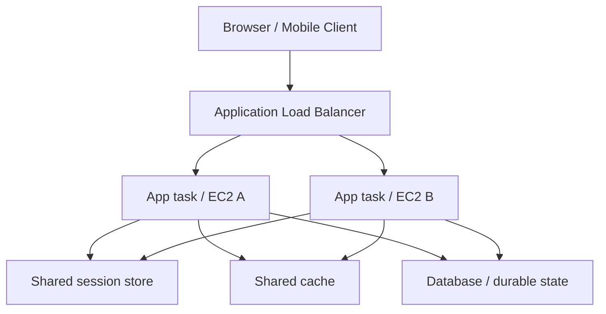
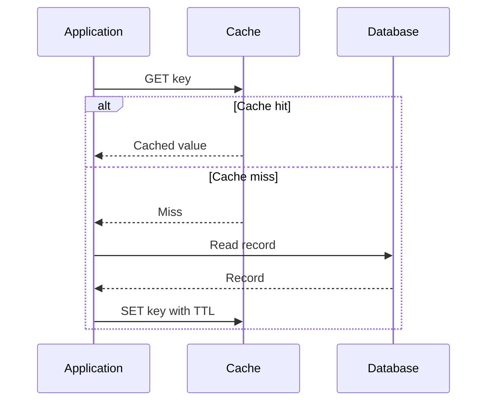
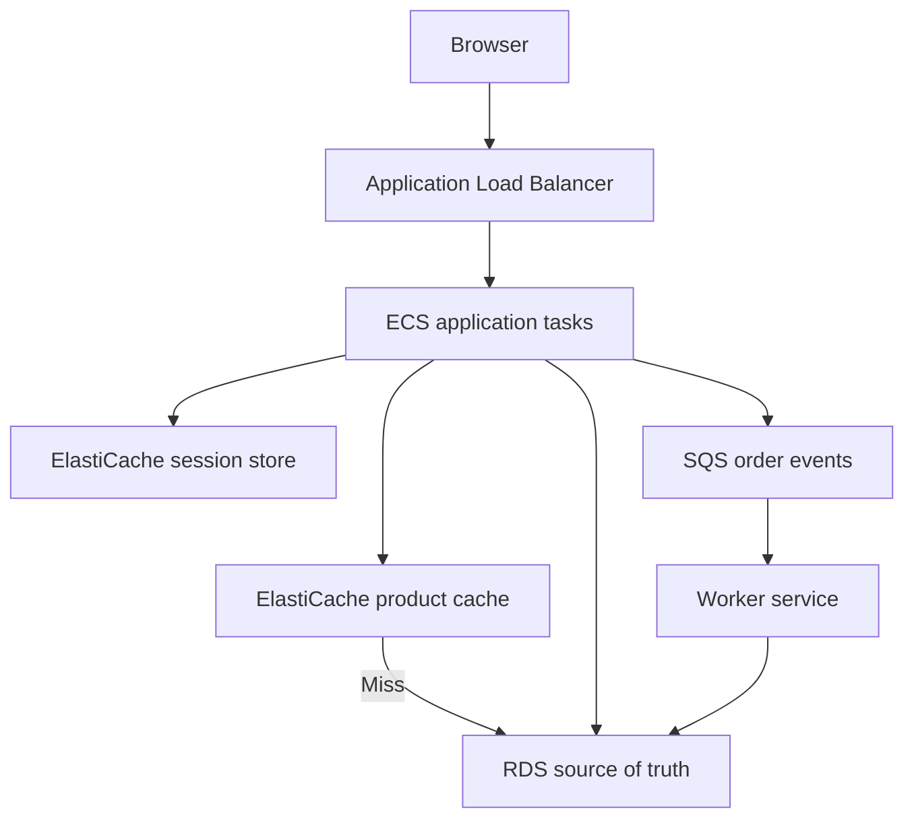

# Managing Sessions, Caching, and Application State

Applications running on AWS are typically scaled across multiple EC2 instances, ECS tasks, EKS pods, or Lambda execution environments. Because any arbitrary request can be handled by a different instance, login session data and business state cannot rely on the memory of a single machine. At the same time, reading the database on every request can increase latency and cost. Therefore, the architecture must clearly distinguish **sessions**, **caches**, and **application state**, and then choose appropriate storage, lifetimes, synchronization mechanisms, and recovery strategies for each.

Sessions hold a user's or client's interaction context across multiple requests. Caches hold copies of data to speed up access. Application state describes business progress, such as an order awaiting payment or a pending background job. These three data categories may share some AWS services, yet they have different requirements for durability, consistency, security, and retention.

Within the `CLOUD_PROVIDERS_AWS` module, this lesson connects these concepts with Elastic Load Balancing, Amazon ElastiCache for Valkey/Redis OSS/Memcached, Amazon DynamoDB, Amazon RDS, Amazon SQS, AWS Step Functions, IAM, VPC, and Amazon CloudWatch. The goal is to build applications that scale horizontally, survive compute instance replacement, protect session data, and control performance.

After this lesson, you can:

- Distinguish session state, cached data, and business state requiring durable storage.
- Design stateless applications that scale across EC2, ECS, EKS, and Lambda.
- Choose between server-side sessions, cookie sessions, and token-based sessions.
- Use ElastiCache or DynamoDB for session storage based on latency, durability, and scalability needs.
- Choose cache-aside, write-through, write-behind, or refresh-ahead for different data types.
- Handle TTL, cache invalidation, stale data, cache stampedes, and hot keys.
- Protect sessions and caches using IAM, VPC, TLS, encryption at rest, and least-privilege access.
- Monitor cache hit rate, latency, eviction, replication lag, and session errors.
- Test behavior when a cache or session store fails, fails over, or loses connectivity.

## 1. Distinguishing Sessions, Caches, and Application State

Different data categories may contain information about the same user or transaction, but their purposes and recovery models differ.

| Data Type | Examples | Authoritative Source | Can It Be Lost? |
|---|---|---|---|
| Session state | User ID, login state, temporary cart, CSRF token, activity timestamps | Session store or identity mechanism | Depends on business rules; losing a session may force re-login or lose unsaved actions |
| Cache | Product details, read-heavy config, query results, token introspection | Source database or service | Usually regenerable, though losing cache can cause load spikes |
| Business state | Orders, payments, inventory reservations, workflow status | Database, event store, or workflow service | Must never be arbitrarily lost; requires backups and consistency |
| Transient processing state | In-flight messages, retry counts, checkpoints | Queue, workflow engine, or durable store | Requires retry/recovery mechanisms and duplicate protection |
| Process-local state | Connection pools, local memoization, temporary in-RAM data | In-process copy only | Lost on process restart; never use as a shared source of truth |

A key principle: **a cache is not a database, and a session is not the sole store for critical business data**. For example, a shopping cart can start in a session, but once the user confirms an order, its contents must be persisted as a durable order record. Storing the cart only in RAM on one EC2 instance means scaling or replacing that instance loses data.

### 1.1. Durable State vs. Regenerable State

Before choosing a service, answer:

- Can the data be regenerated from a database or another source?
- If the data is lost, can the user simply log in again or must a transaction be recovered?
- Must the data persist after logout or session expiration?
- Do multiple instances read/write this data concurrently?
- Are immediate reads of the latest write required, or are a few seconds of staleness acceptable?
- Is the data sensitive, such as access tokens, PII, or payment details?
- When the store is unavailable, should the application fail closed, fail open, or enter degraded mode?

These answers determine storage placement, TTL, backups, replication, and fallback behavior.

## 2. Designing Stateless Applications for Horizontal Scaling

A stateless application does not depend on state living solely in a single instance's memory to handle subsequent requests. Any instance can serve requests from any user because sessions and shared data live in a shared store or travel as verifiable credentials/tokens.

Example architecture:



When instance A is replaced, instance B can still verify the session via the shared store. When Auto Scaling adds instance C, no manual session copying from A or B to C is needed.

Implementation principles:

- Never keep the sole copy of a session in process memory.
- Never use local disk to store state that must survive deployments or instance replacements.
- Use a shared session store or tokens verifiable by every instance.
- Store business data in durable databases or workflow stores.
- Use a shared cache when multiple instances need the same cached view.
- Design requests and background jobs to be idempotent.
- Handle store failures with explicit policies—never silently create a new session when the existing session cannot be verified.

### 2.1. Sticky Sessions Do Not Replace a Shared Session Store

Application Load Balancer supports stickiness to prefer routing a client's requests to the same target for a set duration. While helpful for some legacy apps, it does not fully solve session storage:

- Targets can become unhealthy or be replaced.
- Auto Scaling and deployments can change targets.
- Requests can land on another target after the stickiness cookie expires or is lost.
- An AZ or target group may experience an outage.
- In-RAM sessions are neither shared nor automatically recovered.

If an application needs sessions to survive instance replacements, store sessions in a shared store. Sticky sessions are only a routing optimization, not a durability mechanism.

## 3. Choosing a Session Model

Two models are common: server-side sessions with opaque session IDs, and client-side tokens such as JWTs. Some systems combine both.

### 3.1. Server-Side Sessions

The client receives a random session ID, while session data is stored in a server-side store. Each request sends the session ID via a cookie or header; the application looks up the session, checks expiration, and checks permissions.

Example session record:

```json
{
  "sessionId": "random-high-entropy-id",
  "userId": "user-123",
  "createdAt": "2026-11-20T08:00:00Z",
  "lastSeenAt": "2026-11-20T08:14:00Z",
  "idleExpiresAt": "2026-11-20T08:44:00Z",
  "absoluteExpiresAt": "2026-11-20T20:00:00Z",
  "authLevel": "mfa",
  "csrfToken": "server-generated-value"
}
```

This is illustrative data. Never store plaintext passwords, private keys, or payment card details in sessions. If a session needs to reference sensitive data, store an ID and retrieve the data from a controlled source.

Advantages:
- Sessions can be revoked immediately by deleting or marking them revoked in the store.
- Permissions, MFA status, or metadata can be updated without waiting for tokens to expire.
- Cookies carry only a random ID, not full session attributes.
- Easy to manage multiple concurrent sessions for the same user.

Trade-offs:
- Every request must query the session store, which can add latency.
- The session store becomes a critical dependency.
- Must handle failover, eviction, TTL, and capacity.
- The store must be protected as a security-sensitive resource.

### 3.2. Client-Side Tokens and JWTs

With token-based sessions, the client holds a signed token; the server verifies the signature and claims rather than performing a full session lookup on every request. JWTs typically contain claims such as:

- `iss`: issuer.
- `sub`: subject/user identifier.
- `aud`: audience.
- `iat`: issued-at timestamp.
- `exp`: expiration timestamp.
- `jti`: token identifier if individual token tracking is needed.

A signed JWT does not mean its contents are encrypted. The payload is usually readable; never place secrets or sensitive PII in claims simply because the token is signed.

Advantages:
- Token verification can be performed locally using a trusted public key.
- Reduces session store queries on every request.
- Well suited for distributed APIs and federation.

Trade-offs:
- Harder to revoke an issued token immediately without a denylist, token version, or extra state checks.
- Stolen tokens remain usable until expiration.
- Key rotation, issuer/audience validation, and clock skew must be handled accurately.
- Large tokens increase request size and log-leakage surface.

A common pattern pairs short-lived access tokens with tightly protected refresh tokens. Refresh tokens should be stored securely, support rotation/reuse detection where supported, and be revocable on logout or suspected compromise.

### 3.3. Comparing Server-Side Sessions and JWTs

| Criterion | Server-Side Session | JWT / Token |
|---|---|---|
| Immediate revocation | Easier with a shared store or revoke list | Harder without extra state checks |
| Per-request store lookup | Usually yes | Not necessarily |
| Client credential size | Small session ID | Tokens are typically larger |
| Permission updates | Can update session in the store | Usually requires a new token or external policy check |
| Behavior when store fails | Depends on session store | Can keep verifying tokens if keys/caches remain |
| Best suited for | Web apps needing instant logout/revocation and mutable sessions | APIs/federation, service-to-service, or token-based identity |

Neither model is universally superior. Systems can use tokens for identity verification alongside a server-side store to manage refresh tokens, logout, risk state, or session revocation.

## 4. Securing Cookies and Session Lifecycles

When using cookies to carry session IDs, set explicit security attributes. Example header:

```http
Set-Cookie: __Host-app_session=<opaque-session-id>; Path=/; Secure; HttpOnly; SameSite=Lax
```

- `Secure`: send the cookie only over HTTPS.
- `HttpOnly`: client-side JavaScript cannot read the cookie.
- `SameSite=Lax`: mitigates certain cross-site requests; selection must match login and integration flows.
- `Path=/`: cookie applies across the entire host.
- `__Host-` prefix: requires `Secure`, `Path=/`, and no `Domain` attribute in supporting browsers.

If `SameSite=None` is needed for cross-site flows, the cookie must have `Secure`. `HttpOnly` cookies do not prevent CSRF on their own; use CSRF tokens, `Origin`/`Referer` checks, or an appropriate architectural defense.

### 4.1. Preventing Session Fixation and Session Hijacking

Key controls:

1. Generate session IDs using a cryptographically secure random generator with sufficient entropy.
2. Rotate session IDs after login, privilege elevation, MFA state changes, or critical security events.
3. Never put session IDs in URLs, query strings, analytics events, or logs.
4. Enforce HTTPS end-to-end.
5. Limit both idle and absolute lifetimes.
6. Invalidate sessions server-side on logout or account lock.
7. Sessions can be bound to risk signals like device or auth level, but avoid hard binding to IP addresses since mobile/networks change frequently.
8. Monitor anomalous sessions, impossible travel, user-agent shifts, or unexplained behavior.

Never treat an IP address as a secret or sole authentication proof. IPs can serve as risk signals, yet NAT, VPNs, and mobile networks change IPs routinely.

### 4.2. Idle Timeout and Absolute Timeout

These two timeouts serve different purposes:

- **Idle timeout**: expires if the session sees no activity within the specified window.
- **Absolute timeout**: session expires after a maximum duration since creation, even under continuous activity.

For example, an application has a 30-minute idle timeout and a 12-hour absolute timeout. Continuously active users still must re-authenticate after 12 hours. For sensitive operations, require re-authentication or MFA step-up rather than relying solely on the existing session.

### 4.3. Logout and Session Revocation

Logout must invalidate the session in the server-side store or revoke the refresh token. Clearing only the browser cookie is insufficient if a previously copied session ID remains valid.

For JWT access tokens, logout can:
- Wait for short-lived access tokens to expire.
- Revoke refresh tokens so no new access tokens are minted.
- Use a token denylist or token version if early revocation is required.
- Revoke credentials at the identity provider if an account is compromised.

Define behavior when the session store is unreachable. For sensitive actions, failing closed is usually safer than creating a new session or allowing requests through unverified.

## 5. Choosing a Session Store on AWS

Store selection depends on latency, durability, access patterns, TTL, scalability, and cost.

| Service | Strengths | Limitations / Considerations | Use Case |
|---|---|---|---|
| Amazon ElastiCache for Valkey/Redis OSS | Low latency, rich key-value operations, TTL, atomic operations, replication | Must manage memory, eviction, failover, and engine-specific persistence/backups | Session stores, hot caches, rate-limit counters, properly designed distributed locks |
| Amazon ElastiCache for Memcached | Simple distributed cache, easy horizontal scaling | No replication/persistence like Redis-compatible engines; node loss loses cache | Caching regenerable data |
| Amazon DynamoDB | Managed durable key-value/document store, scaling, conditional writes, TTL, backups/PITR | Request/capacity-based latency and cost; TTL deletion is not instantaneous | Sessions needing higher durability than pure cache, idempotency records, workflow metadata |
| Amazon RDS/Aurora | Relational transactions and queries, durability, backups | Different latency/throughput profile than in-memory caches; needs connection management | Business state, complex sessions requiring transactions/queries |
| Client-side cookies/tokens | No session store lookup per request if tokens are self-verifying | Harder revocation and client credential protection | Stateless authentication, APIs/federation |

### 5.1. When to Choose ElastiCache?

ElastiCache fits when sessions require fast access, simple structures, and key-value representation. A Redis-compatible store supports automatic TTL expiration, hashes, sets, and atomic commands to update data.

Production designs should consider:
- Replication group with primary and read replicas.
- Multi-AZ and automatic failover when availability is required.
- Cluster mode disabled or enabled based on capacity and throughput needs.
- Encryption in transit and at rest.
- Authentication/RBAC per engine and version.
- Subnet groups and security groups inside private VPCs.
- Snapshots/backups if data requires recovery.
- Memory headroom and eviction policies.

If sessions are evicted, users may be logged out. This may be acceptable for some applications, but must be confirmed with business stakeholders. Never share a single Redis cluster between critical sessions and caches prone to mass eviction without capacity partitioning or policy isolation.

### 5.2. When to Choose DynamoDB?

DynamoDB fits when session or state records need durability, scale, and key-based access. You can design `sessionId` as the partition key, storing user ID, metadata, version, and expiry timestamp.

DynamoDB TTL:
- Uses a Number attribute containing Unix epoch time in seconds.
- The service deletes expired items asynchronously in the background, with no guarantee of deletion at the exact expiry second.
- The application must check expiry itself before accepting a session.
- Expired items may still appear in queries/gets until background TTL deletion finishes.
- TTL deletion does not replace logout/revocation logic.

Use conditional writes or a version attribute to prevent two concurrent requests from overwriting session updates and losing data. If you must query by user to log out all sessions, design an appropriate GSI/index and evaluate its cost.

### 5.3. Never Use a Cache as the Authoritative Source for Critical State

If a shopping cart, order, or payment state must survive a cache outage, store it in a durable database. A cache can keep a fast read copy, but there must be a way to rebuild from the authoritative source.

Example:
- Redis stores session IDs and login status.
- DynamoDB or RDS stores persisted carts.
- RDS stores orders and payment transactions.
- SQS stores asynchronous jobs.
- ElastiCache holds product catalog cache to offload the database.

## 6. Managing Sessions in ElastiCache

For server-side sessions, applications can use namespaced keys, such as `sess:<session-id>`. The value holds the user ID, creation time, expiration time, and minimal required claims.

Illustrative Redis commands:

```text
SET sess:random-session-id "{...session-json...}" EX 1800
GET sess:random-session-id
DEL sess:random-session-id
TTL sess:random-session-id
```

- `EX 1800` sets a 30-minute TTL.
- `GET` reads the session.
- `DEL` revokes the session.
- `TTL` checks remaining lifetime.

Never log real cookie values or session IDs. If you need to look up sessions by user, maintain a controlled index or per-user session ID list; avoid scanning the entire keyspace in the request path.

### 6.1. Safe Session Updates

Two concurrent requests might read the same session and write back updates based on stale snapshots. For example, one request updates the cart while another updates locale. If the application overwrites the entire JSON blob, one change can be lost.

Reduce this risk by:
- Updating individual fields with hashes/appropriate atomic operations.
- Using optimistic locking with a version field.
- Using Lua scripts or transactions when multiple atomic steps are needed.
- Keeping sessions small; avoid treating sessions like document databases.
- Moving critical business data to dedicated stores.

### 6.2. Redis Failover and Session Loss

When a primary node fails, ElastiCache can fail over to a replica if the replication group is configured accordingly. However, replicas may experience replication lag; writes shortly before failover may not have replicated yet. Applications must:
- Perform bounded retries with exponential backoff and jitter.
- Handle connection resets and DNS endpoint changes per client behavior.
- Never treat a timeout as proof that a session does not exist.
- Verify sessions before issuing new ones to avoid granting wrong identities.
- Define clear fallback behavior when the store is unavailable.

If losing a session forces users to log in again, that may be preferable to accepting unauthenticated requests. For transactional workflows, recoverable state must live in a separate durable store.

## 7. Caching Patterns and Selection

A cache is a copy of data kept close to its consumer to lower latency or offload the data source. How the cache is updated affects consistency and complexity.

### 7.1. Cache-Aside (Lazy Loading)

The application checks the cache first. On a miss, it reads the database and writes the result to the cache with a TTL.



Advantages:
- Only requested data gets cached.
- Easy to layer onto existing databases.
- Cache can be flushed and rebuilt.

Disadvantages:
- Cache misses incur an extra database read.
- Stampedes can occur when popular keys expire.
- Cache invalidation after updates must be handled.

### 7.2. Write-Through

On writes, the application updates both the authoritative source and the cache through a coordinated flow. The read path sees fresh cache immediately after a write succeeds if both updates succeed.

You must handle cases where the database commits but the cache update fails, or vice versa. There is no built-in atomic transaction across RDS and ElastiCache. You can use an outbox/event to emit invalidation/update notifications post-commit, and rely on TTL to bound the stale window.

### 7.3. Write-Behind (Write-Back)

The application writes to the cache first and updates the database asynchronously later. This pattern can boost write throughput, but risks data loss if the cache or worker fails before flushing to durable storage.

Use only when the business accepts eventual persistence and you have durable queues/logs, retries, idempotency, and reconciliation. Do not use naive write-behind for payments, inventory, or order states without strict durability guarantees.

### 7.4. Refresh-Ahead

The application refreshes cached entries before their TTL expires based on access frequency or refresh schedules. This reduces cache misses for hot data, though refresh load must be controlled to avoid refreshing keys no longer in demand.

### 7.5. Pattern Selection Table

| Pattern | Read Path | Write Path | Best Suited For |
|---|---|---|---|
| Cache-aside | Cache; on miss, database | Update database then invalidate/update cache | General purpose, read-heavy data |
| Write-through | Read from cache | Update source and cache in coordinated flow | Fresh cache needed immediately after writes |
| Write-behind | Read from cache | Write cache then persist asynchronously | Workloads tolerating eventual persistence |
| Refresh-ahead | Read pre-refreshed cache | Background refresh | Hot data with predictable refreshes |

## 8. TTL, Eviction, and Cache Invalidation

### 8.1. Choosing TTL

TTL controls how long a cache entry lives if not updated or deleted. Too long increases stale data; too short increases miss rates and database load.

Choose TTL based on:
- How often source data changes.
- Business tolerance for stale data.
- Cost of re-reading from the source.
- Impact when stale data is served.
- Active invalidation mechanisms.
- Sensitivity of personal data or access permissions.

Add random jitter to TTLs to prevent thousands of keys from expiring simultaneously—for example, a base TTL of 300 seconds plus or minus a small random offset.

### 8.2. Cache Invalidation

When source data changes, caches can be updated in several ways:
- Delete the key immediately after commit.
- Write the new value into the cache.
- Emit a domain event for consumers to invalidate.
- Use versioned keys, such as `product:v42:123`.
- Wait for TTL expiration if the stale window is acceptable.

A common failure occurs when the database commits successfully, yet the application crashes before invalidating the cache. A transactional outbox records the event in the same database transaction; a worker reads the outbox and emits invalidation events to consumers. TTL acts as a final safety net if events are delayed or lost.

### 8.3. Eviction Policies

When a cache runs out of memory, Redis-compatible engines can apply eviction policies. Common options include:
- `allkeys-lru`: evicts least recently used keys across the entire keyspace.
- `allkeys-lfu`: favors keeping frequently accessed keys.
- `volatile-ttl`: prefers evicting keys with the shortest remaining TTL among keys with expirations.
- `noeviction`: rejects writes upon hitting memory limits per engine behavior.

Exact policy names and support depend on engine and version. Verify actual configurations. If sessions and caches share a cluster, eviction can unexpectedly drop sessions. Separate clusters or partition data by criticality to contain blast radius.

## 9. Common Caching Problems

### 9.1. Cache Stampede / Thundering Herd

A popular key expires, causing many concurrent requests to miss and hit the database simultaneously. This creates a sharp load spike on the data source.

Solutions:
- TTL jitter to spread out expiration times.
- Single-flight/request coalescing so only one request refreshes the key.
- Time-bounded distributed locks with handling for crashed lock owners.
- Serve stale-while-revalidate if data semantics permit.
- Pre-warm caches for critical keys.
- Cap concurrency and protect databases with queues/bulkheads.

### 9.2. Cache Penetration

Clients repeatedly query non-existent keys, sending every request down to the database. Mitigations include:
- Input validation and rate limiting.
- Negative caching with a short TTL for not-found results.
- Bloom filters or valid-key indexes for large datasets.
- WAF/API throttling if traffic shows automated abuse patterns.

Negative caches must be invalidated when new records are created, otherwise new data can be hidden behind stale not-found entries.

### 9.3. Hot Keys

One heavily accessed key turns a single node/shard into a bottleneck. Solutions include:
- Read replicas or very short-TTL local in-process caches.
- Logical key sharding if the data can be split.
- Request coalescing.
- Precomputing or materializing data.
- Analyzing top keys and distributing traffic.

Local caches can cause different instances to hold differently stale data; use only for data with clear consistency tolerance.

### 9.4. Cache Poisoning and Key Collisions

Never let clients freely dictate cache keys without validation. Cache keys should include tenant, locale, authorization scope, or version if those dimensions alter results. If private responses are cached solely by URL, one user could receive another user's data.

Example:
`product:v3:tenant-42:locale-vi:product-123`

Do not include plaintext access tokens or PII in cache keys unnecessarily. For sensitive data, restrict cache access permissions and lifetimes.

## 10. Securing Sessions and Caches on AWS

Session stores and caches may hold sensitive data or data used to make access decisions. Apply defense in depth.

### 10.1. Network Isolation

- Place ElastiCache in private VPC subnets.
- Never assign public IPs or expose cache endpoints to the Internet.
- Use security groups permitting inbound traffic only from the application workload's SG on required ports.
- Use appropriate subnet groups and routing.
- For multi-account workloads, choose an appropriate private connectivity model and restrict principals.

### 10.2. Authentication and Encryption

- Enable encryption in transit to protect traffic between apps and caches.
- Enable encryption at rest where supported by the service/engine and required by security policies.
- Use auth tokens or RBAC/user groups per engine and version.
- Manage credentials via Secrets Manager or a suitable secret store.
- Rotate credentials periodically and upon suspected compromise.
- Scope access by application role and environment.

TLS protects data in transit, not authorization. A workload able to connect to a cache should still only operate within the namespace or keyspace it owns.

### 10.3. Data and Tenant Isolation

- Prefix keys by service, environment, and tenant.
- Never share session namespaces between production and development.
- Avoid predictable cache keys that could enable cross-tenant access.
- Use dedicated roles and security groups for sensitive workloads.
- Never store passwords, full payment data, or private keys in caches.
- Use short TTLs for authorization-sensitive data.

### 10.4. Managing Secrets and Tokens

Never store high-privilege refresh tokens or access tokens in unprotected caches. If storage is unavoidable, enforce encryption/access controls, TTLs, rotation, and auditing. Logs must never contain session cookies, `Authorization` headers, or secrets. During incidents, have procedures ready to revoke sessions or rotate signing keys.

## 11. Sessions and Caches in Multi-AZ / Multi-Region Architectures

### 11.1. Multi-AZ Within a Single Region

With ElastiCache replication groups, placing replicas in other AZs with Multi-AZ automatic failover increases availability. However:
- Failover can briefly disrupt connections during switchover.
- Clients must handle reconnects and retries.
- Replicas may experience replication lag.
- Not every write right before a failure is guaranteed to have reached the replica.
- Snapshots/backups are still needed if data must be recovered from logic bugs or accidental deletion.

For pure caches, losing entries may be acceptable if regenerable. For sessions, determine whether forcing users to re-authenticate is acceptable.

### 11.2. Multi-Region

A multi-Region session store must decide:
- Are users routed to a home Region or can they access any Region?
- Do session updates require strong consistency?
- If two Regions update the same session concurrently, how are conflicts resolved?
- How quickly must logout/revocation propagate?
- When inter-Region links fail, does the application fail open or fail closed?

ElastiCache Global Datastore for Redis OSS/Valkey supports asynchronous cross-Region replication per service mechanics; do not assume synchronous replication or guarantee that every session write reaches the secondary before failover. Define an acceptable RPO and test promoting secondary clusters.

With DynamoDB Global Tables, understand the replication and conflict resolution behavior of your configuration. If logout or revocation must take effect globally right away, asynchronously replicated revocation records can leave a window where revoked sessions are still accepted. Choose designs matching security requirements, such as short-lived tokens, centralized revocation checks, or routing sessions back to a home Region.

### 11.3. Never Let Caches Outlive Access Revocation Policies

If a user's permissions are revoked, a cache holding stale authorization results could continue allowing access. Use short TTLs, emit invalidation events, or verify critical policies against the authoritative source. Cached data must never become a bypass around IAM or application authorization.

## 12. Application State and Durable Workflows

Not every state belongs in a session. Long-running process states belong in a durable store or workflow engine.

Examples:
- Order status: database.
- Payment workflow: Step Functions or database state machine.
- Background jobs: SQS and durable job records.
- Inventory reservations: database transactions/conditional updates with expiration logic.
- User preferences: database, optionally read-cached.
- Search results: cache or search index, regenerable.

AWS Step Functions persists execution state inside the workflow service and fits orchestrating long steps, retries, timeouts, and compensations. SQS buffers messages for asynchronous processing; consumers must be idempotent since messages can be redelivered. Caches can offload workflow status queries, but do not replace execution history or authoritative records.

### 12.1. Idempotency

When retrying requests or processing messages, repeating an operation must not create extra unintended side effects. Use idempotency keys:
- Clients send a unique key per operation.
- The server persists the key and result in a durable store.
- Repeated requests return the recorded result instead of creating a new transaction.
- Idempotency records carry TTL/retention aligned with business windows.
- Update the idempotency record and business state via transactions or conditional writes as needed.

Never store idempotency keys solely in an eviction-prone cache if duplicate execution could cause double charges or duplicate orders.

## 13. Example Architecture: Sessions and Caching for an E-Commerce Website

A website runs on ECS behind an Application Load Balancer. Users log in, browse products, add items to their cart, and place orders.

Design:
- ALB distributes requests across multiple ECS tasks.
- The `__Host-app_session` cookie holds an opaque session ID.
- ElastiCache for Valkey/Redis OSS stores server-side sessions with an idle TTL.
- RDS stores users, saved carts, orders, and payment states.
- ElastiCache caches product details using versioned keys and TTLs.
- SQS handles asynchronous email/fulfillment tasks.
- Secrets Manager stores database credentials and cache auth material if needed.
- CloudWatch monitors the session store, cache, and application.

Request flow:



When a user adds an item to their cart:
1. App verifies the session ID in the session store.
2. App reads the cart record from RDS or the appropriate business store.
3. App updates the cart using transactional/conditional logic.
4. App invalidates related cache entries if any.
5. App returns the response and refreshes session idle timeout per policy.

When a user creates an order:
1. App verifies session and authorization.
2. Uses an idempotency key to prevent duplicate orders.
3. Writes order/payment intent to the durable store.
4. Emits events via a transactional outbox or reliable mechanism.
5. Workers process messages and update status.
6. Product detail cache is invalidated when inventory/price changes via domain events.

Sessions are not the sole storage for carts/orders; if Redis restarts, orders written to RDS remain intact.

## 14. Pseudocode Patterns for Session and Cache Handling

The examples below illustrate logic flows, independent of a specific SDK:

```text
function handleRequest(request):
    sessionId = readCookie(request, "__Host-app_session")

    if sessionId is missing:
        return unauthenticated

    session = sessionStore.get(sessionId)

    if session is missing:
        return unauthenticated

    if now() >= session.absoluteExpiresAt:
        sessionStore.delete(sessionId)
        return unauthenticated

    if now() >= session.idleExpiresAt:
        sessionStore.delete(sessionId)
        return unauthenticated

    if session.revoked:
        return unauthenticated

    authorize(session.userId, request.action, request.resource)

    refreshIdleExpiry(sessionId, boundedBy=session.absoluteExpiresAt)

    return continueRequest()
```

A cache-aside read:

```text
function getProduct(productId):
    key = "product:v3:" + productId
    value = cache.get(key)

    if value exists:
        return value

    value = database.getProduct(productId)

    if value does not exist:
        cache.set(key, NOT_FOUND, ttl=shortNegativeTtl)
        return notFound

    cache.set(key, value, ttl=baseTtl + randomJitter())
    return value
```

Ensure `NOT_FOUND` cannot be confused with valid data and that cache keys include sufficient tenant/authorization scope if results vary by user. For session expiry, automatic store key deletion does not replace explicit expiry checks in the application.

## 15. Observing Session Stores and Caches

Use CloudWatch metrics, application metrics, and structured logs to detect issues before users report them.

| Category | Metrics to Monitor | Signals Requiring Investigation |
|---|---|---|
| Cache effectiveness | Cache hit rate, miss rate | Sudden drop in hit rate, rising database load |
| Latency | Cache latency, app p95/p99, command latency | Rising tail latency, timeouts |
| Memory | Engine memory, freeable memory, evictions | Memory pressure, abnormal evictions |
| Capacity | Connections, CPU, network bytes, shards | Connection saturation, hot shards |
| Availability | Failover events, node health, replication lag | Session loss, reconnect storms |
| DynamoDB | Throttled requests, consumed capacity, latency | Session lookup throttling |
| Application sessions | Login failures, session not found, logout/revoke, expired sessions | Mass user logouts or sessions failing to expire |
| Security | Invalid tokens, session anomalies, authorization denials | Credential abuse or session hijacking |

Specific metric names depend on the engine and node type. Choose metrics matching your ElastiCache engine/version and workload rather than applying a single threshold across every cluster.

### 15.1. Safe Logging

Logs should capture:
- Request ID / correlation ID.
- Session lookup success/failure and reason codes.
- Cache hit/miss and latency.
- Store endpoint/cluster identifier at a non-sensitive level.
- Pseudonymized user ID if needed for analysis.
- Error codes, retry counts, and dependency status.

Never log session IDs, cookies, access tokens, refresh tokens, passwords, or sensitive session payloads. To correlate events, log a keyed hash or a separate correlation identifier instead of raw credentials.

### 15.2. Alarms and SLOs

SLOs can be set for:
- Authentication request success rate.
- p95/p99 session lookup latency.
- Cache dependency availability.
- Cache hit rate by key group.
- Login/session refresh failure rate.
- Database load when the cache degrades.
- Recovery time after failover.

Alarms should tie to concrete actions: scale the cluster, mitigate hot keys, inspect deployments, roll back, or activate degraded mode. A low hit rate is not always an incident if data was just legitimately invalidated.

## 16. Common Troubleshooting

| Symptom | Possible Cause | Resolution |
|---|---|---|
| Mass user logouts | Cache failover, eviction, flush, or wrong TTL | Check node events, memory, TTL, and deployments; restore sessions if durable backups exist |
| Session remains valid after logout | Cleared cookie only, revoke missed store, unexpired JWT | Invalidate server-side session/refresh token; inspect revoke path and token lifetimes |
| Some requests see stale sessions | Local in-memory caching across instances, replication lag, or delayed invalidation | Inspect topology, TTL, event delivery, and source of truth |
| Sudden database CPU spike | Cache misses/stampede or cluster unavailable | Check hit rate, key expiration, request coalescing, and scale source safely |
| Cache memory full | Missing TTL, key leaks, oversized objects, or low capacity | Check key cardinality, evictions, memory fragmentation, and lifecycle |
| Cache hit returns wrong tenant data | Cache key lacks tenant/authorization scope | Fix key design, invalidate leaked entries, and audit exposure |
| Sessions not expiring in DynamoDB | App relies solely on TTL deletion | Check expiry in application code on every request |
| Redis reconnect storm after failover | Synchronized client retries or misconfigured pools | Exponential backoff + jitter, connection pooling, and failover testing |
| Hot shard/key | Skewed key distribution or one ultra-hot record | Analyze top keys, add read replicas/caching, shard logically, or coalesce requests |
| JWT still accepted after revocation | Access token still valid with no revocation check | Shorten token lifetime, revoke refresh tokens, add denylist/version checks where needed |

### 16.1. Cache Degradation Investigation Procedure

1. Identify start time and recent deployments/config changes.
2. Compare cache hit/miss, latency, memory, evictions, and connection counts.
3. Inspect node health, failover events, replication lag, and networking.
4. Identify affected keyspaces or tenants.
5. Assess whether the database can survive cache-miss load.
6. Throttle concurrency or enable rate limits if the source is overloaded.
7. Restore the cache cleanly; avoid flushing everything before assessing stampede impact.
8. Verify source data and invalidation logic.
9. Monitor metrics after stabilization.

Never flush an entire cache as a first step without confirming the underlying data source can handle the rebuild load.

## 17. Testing Sessions and Caches

Testing must cover functional, security, load, and dependency-failure scenarios.

### 17.1. Functional Tests

- Sessions are created after login and rotated after authentication.
- Logout invalidates the session on the server.
- Idle timeout and absolute timeout are enforced.
- Tokens validate issuer, audience, signature, and expiry.
- Sessions cannot be reused across tenants or environments.
- Cache misses return accurate data from the source of truth.
- Data updates invalidate or refresh cached entries properly.
- Negative caches are cleared when new records are created.

### 17.2. Security Tests

- Cookies include appropriate `Secure`, `HttpOnly`, and `SameSite` flags.
- Session IDs never appear in URLs/logs.
- CSRF protections are verified on state-changing requests.
- TLS is enforced between applications and caches.
- Only authorized workload security groups can access caches.
- Cache credentials are stored and rotated securely.
- JWT key rotation never accepts invalid tokens.
- Session revocation takes effect within committed SLAs.

### 17.3. Resilience / Load Tests

- Scale app tasks from few to many instances; sessions keep working.
- Restart tasks/instances; no durable state is lost.
- Fail over ElastiCache; clients reconnect and retry properly.
- Trigger concurrent cache misses; database avoids stampede collapse.
- Simulate DynamoDB throttling or timeouts; app enters degraded mode cleanly.
- Test memory pressure and eviction behavior.
- Test replication lag and behavior when losing a Region.
- Measure p95/p99 latency under peak load.

For failover or fault-injection tests, use approved environments and scopes, set stop conditions, and prepare rollbacks. Never test by flushing production caches or deleting real user sessions.

## 18. Architecture Selection Guide

| Requirement | Recommended Design |
|---|---|
| Web app needing instant logout/revocation | Opaque session ID + shared server-side store |
| Distributed API needing fast token verification | Short-lived signed tokens + refresh/revocation strategy |
| Very low session latency, regenerable data | ElastiCache Valkey/Redis OSS with appropriate Multi-AZ |
| Sessions needing durability/conditional updates | DynamoDB with in-app expiry checks |
| Business data that must survive cache loss | RDS/DynamoDB as source of truth; cache as a read copy only |
| Read-heavy data tolerating minutes of staleness | Cache-aside with TTL/jitter and invalidation |
| Need consistent cache immediately after updates | Write-through or event-driven invalidation |
| Multi-Region where revocation must propagate fast | Evaluate central session authority, short token lifetimes, and consistency needs |
| Long multi-step workflows with retries | Step Functions or durable state machine; do not store entire workflows in sessions |
| Background processing | SQS + durable job state + idempotency |

## 19. Pitfalls to Avoid

| Misconception | Correct Understanding |
|---|---|
| Sticky sessions guarantee no session loss | Stickiness only prefers routing to a target; targets can still fail or be replaced |
| Signed JWT means payload is secret | Signatures guarantee integrity/authenticity; payloads are usually readable |
| Deleting a cookie equals complete logout | Server-side sessions or refresh tokens must also be revoked |
| DynamoDB TTL deletes items at exact expiry time | TTL deletion runs in the background; apps must check expiry themselves |
| A cache can always replace a database | Caches can evict or lose data; critical data needs a durable source |
| ElastiCache Multi-AZ guarantees zero write loss | Failovers may incur replication lag; understand consistency and test |
| Higher cache hit rate is always better | Hit rate must balance freshness, correctness, and cost |
| Local memory caches are shared across tasks | Each process has its own cache, which can diverge |
| `HttpOnly` prevents all forms of CSRF | `HttpOnly` blocks JS from reading cookies; it does not replace CSRF protection |
| Redis locks automatically guarantee distributed correctness | Locks need leases, fencing tokens, expirations, and dead-owner handling |
| Logging out in one Region revokes everywhere instantly | Replication can lag; design explicit revocation propagation |

## 20. Design and Operations Checklist

- [ ] Classify data into sessions, caches, durable business state, and workflow state.
- [ ] Identify the source of truth for each data category.
- [ ] Applications do not depend on process-local sessions to scale horizontally.
- [ ] Choose server-side sessions or token models based on revocation requirements.
- [ ] Cookies enforce `Secure`, `HttpOnly`, `SameSite`, and appropriate lifetimes.
- [ ] Session IDs are randomly generated, rotated, and never logged.
- [ ] Idle timeouts and absolute timeouts are enforced in the application.
- [ ] Logout/revocation handles both server-side stores and refresh tokens.
- [ ] ElastiCache/DynamoDB are placed in private networks with least-privilege permissions.
- [ ] Encryption in transit/at rest and credential rotation are configured.
- [ ] Cache patterns, TTL, jitter, invalidation, and eviction policies are defined.
- [ ] Cache keys include tenant/authorization scope when needed.
- [ ] Mitigations exist for stampedes, hot keys, and cache penetration.
- [ ] Backups/replication match durability requirements.
- [ ] Failover and client reconnection have been tested.
- [ ] CloudWatch dashboards and alarms monitor latency, memory, evictions, hit rate, and errors.
- [ ] Logs exclude session cookies, tokens, and secrets.
- [ ] Evidence exists for functional, security, load, and resilience tests.
- [ ] Runbooks document degraded modes when session/cache stores are unavailable.

## 21. Knowledge Summary

Sessions hold interaction context, caches accelerate data access, and application state persists business progress. Applications running across multiple instances should externalize sessions and shared state; process memory should hold only temporary, regenerable data. Server-side sessions enable fast revocation but require a shared store; JWTs reduce store lookups but require managing expiration, refresh, key rotation, and revocation.

On AWS, ElastiCache fits low-latency sessions/caches; DynamoDB fits records needing durability and conditional updates; RDS or DynamoDB stores business state; SQS and Step Functions support durable workflows. Cache-aside is a common pattern, yet still requires TTLs, invalidation, jitter, and stampede protection. ElastiCache Multi-AZ improves availability without replacing backups or failover testing. DynamoDB TTL deletes items asynchronously, so applications must check expiration explicitly.

Finally, sessions and caches are part of your security boundary. Use secure cookies, TLS, private VPCs, restrictive security groups, least-privilege IAM/credentials, token-free logs, and CloudWatch monitoring. An architecture is only complete after testing scale-out, logout, failover, cache misses, store outages, and business state recovery.

## References

- [Amazon ElastiCache User Guide](https://docs.aws.amazon.com/AmazonElastiCache/latest/dg/WhatIs.html)
- [ElastiCache for Valkey and Redis OSS](https://docs.aws.amazon.com/AmazonElastiCache/latest/dg/WhatIs.core.html)
- [ElastiCache Multi-AZ](https://docs.aws.amazon.com/AmazonElastiCache/latest/dg/AutoFailover.html)
- [ElastiCache security](https://docs.aws.amazon.com/AmazonElastiCache/latest/dg/Clusters.security.html)
- [Amazon DynamoDB Time to Live](https://docs.aws.amazon.com/amazondynamodb/latest/developerguide/TTL.html)
- [DynamoDB conditional writes](https://docs.aws.amazon.com/amazondynamodb/latest/developerguide/Expressions.ConditionExpressions.html)
- [DynamoDB Global Tables](https://docs.aws.amazon.com/amazondynamodb/latest/developerguide/GlobalTables.html)
- [Application Load Balancer sticky sessions](https://docs.aws.amazon.com/elasticloadbalancing/latest/application/edit-target-group-attributes.html)
- [Amazon Cognito user pools](https://docs.aws.amazon.com/cognito/latest/developerguide/cognito-user-pools.html)
- [AWS Well-Architected Framework: Performance Efficiency](https://docs.aws.amazon.com/wellarchitected/latest/performance-efficiency-pillar/welcome.html)
- [AWS Well-Architected Framework: Security](https://docs.aws.amazon.com/wellarchitected/latest/security-pillar/welcome.html)
- [AWS Step Functions Developer Guide](https://docs.aws.amazon.com/step-functions/latest/dg/welcome.html)
- [Amazon SQS Developer Guide](https://docs.aws.amazon.com/AWSSimpleQueueService/latest/SQSDeveloperGuide/welcome.html)
