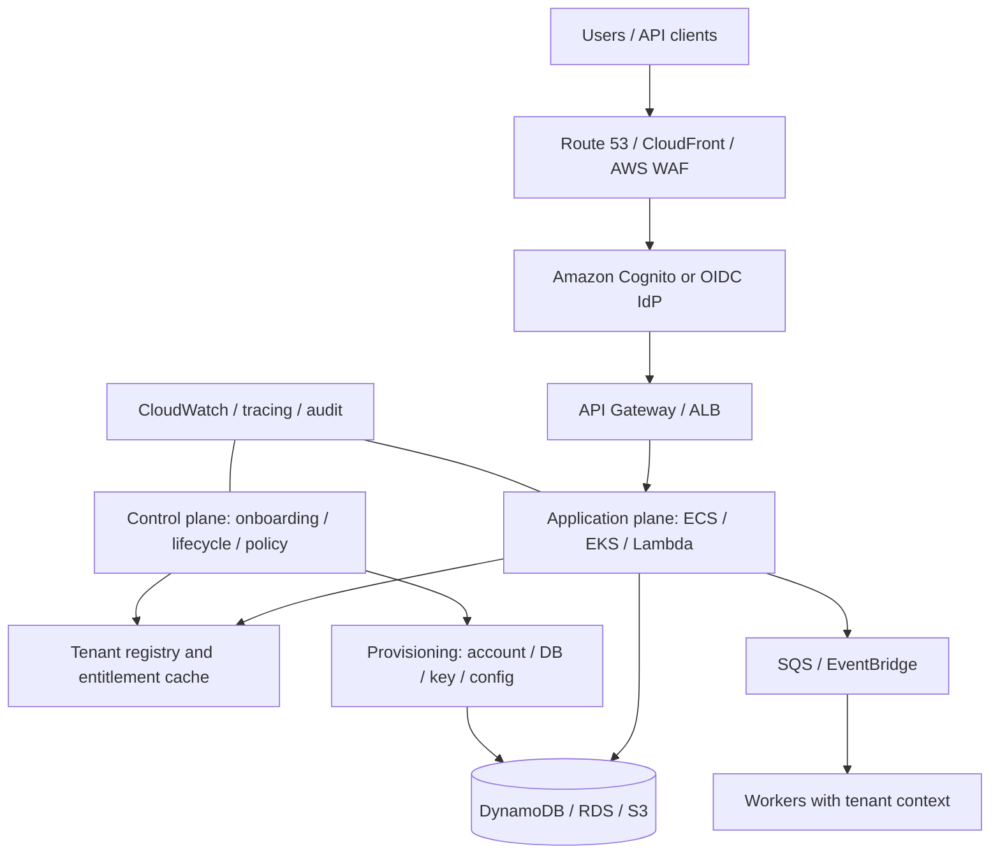
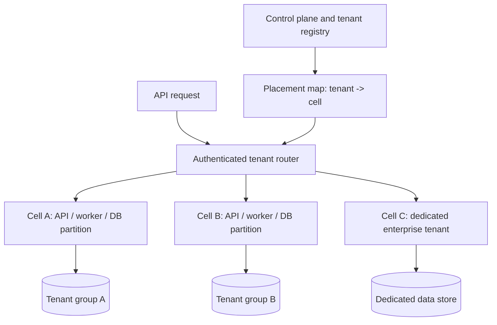

# Designing a Multi-Tenant SaaS Platform on AWS

A Software as a Service (SaaS) platform serves multiple customers on a single product. Each customer is a **tenant** with its own users, data, configurations, access permissions, quotas, and lifecycle. Tenants can share parts of the infrastructure to optimize costs, or be placed on dedicated resources when security, performance, or compliance demands higher isolation.

Designing SaaS on AWS requires solving three problems simultaneously: delivering a product that operates continuously for many customers; ensuring one tenant cannot access another tenant's data or resources; and enabling operations teams to onboard, update, meter usage, troubleshoot, and recover without manual per-customer intervention.

AWS provides the building blocks for such platforms: AWS Organizations and AWS Control Tower for account governance; Amazon Cognito and federation mechanisms for identity; API Gateway, CloudFront, WAF, Lambda, ECS, and EKS for the application layer; DynamoDB, RDS, S3, and storage services for data; IAM, STS, and KMS for access control and encryption; EventBridge, SQS, and Step Functions for asynchronous processing; and CloudWatch and observability tools for operations. A sound architecture combines these services according to the isolation model suited to each tenant and data type.

## Learning Objectives

After this lesson, you can:

- Explain SaaS characteristics and distinguish the control plane from the application plane.
- Compare the three tenant isolation models: silo, pool, and bridge.
- Design tenant identity, tenant context, and authorization end-to-end across requests.
- Choose data partitioning strategies for DynamoDB, RDS/Aurora, and S3.
- Design compute, network, queue, encryption key, and account isolation based on risk levels.
- Build tenant onboarding, upgrade, suspension, and offboarding workflows.
- Control noisy neighbors, quotas, metering, billing, and per-tenant observability.
- Plan deployment, recovery, testing, and governance for a multi-tenant SaaS platform.

## 1. SaaS and the Tenant Concept

SaaS is a software delivery model operated centrally as a service. Customers sign up and use the product via web interfaces, APIs, or integrations. The provider is responsible for deploying, maintaining, securing, scaling, and updating the platform.

In SaaS architecture:

- **Tenant** is a customer or subscription unit with its own data and configuration boundaries. A tenant may be a business, organization, or business unit depending on the product model.
- **Tenant user** is a user belonging to a tenant. One user can hold multiple roles within the same tenant; some products also allow one identity to belong to multiple tenants.
- **Tenant administrator** manages users, configurations, and permissions within their own tenant.
- **SaaS operator** is the platform operations team, holding service-level administrative privileges while following strict procedures for accessing customer data.
- **Tenant context** is the metadata identifying which tenant is being processed in a given request, job, or message.
- **Tenant isolation** is the set of mechanisms ensuring a tenant can only access the data, workloads, and capabilities granted to it.

A tenant is not synonymous with an AWS account. A tenant can share an account with many other tenants, have its own database in a shared account, or reside in a dedicated AWS account. Boundary selection depends on isolation requirements, cost, customization, data residency, and operational capability.

### Characteristics of a True SaaS Platform

Having multiple customers log in to the same website does not automatically mean a complete SaaS architecture. A SaaS platform must manage tenants across their entire lifecycle:

1. Tenants are registered, authenticated, and provisioned via a standardized workflow.
2. The platform knows which tenant is using which resources, features, and data.
3. Product changes are deployed in a controlled manner across many tenants.
4. Operations teams can observe health and usage per tenant.
5. Tenants can change tiers, separate data, be suspended, or be offboarded per policy.
6. An incident affecting one tenant does not unexpectedly impact all customers.

## 2. Control Plane and Application Plane Architecture

A common organizational pattern separates the **control plane** and the **application plane**.

### Control Plane

The control plane manages tenants and their lifecycles. It typically exposes APIs or portals for operations such as:

- Registering tenants, verifying domains, and generating tenant IDs.
- Creating tenant registry records and assigning tiers, Regions, quotas, and product configurations.
- Setting up identity providers, user pools/clients, or SAML/OIDC connections.
- Provisioning databases, storage, compute, encryption keys, and networking as needed.
- Provisioning tenant admins, inviting users, and assigning roles.
- Tracking provisioning status, upgrades, suspension, and tenant deletion.
- Managing feature flags, entitlements, usage plans, and metering.

The control plane holds broader privileges than the application plane and must be protected separately. Regular business requests must never be able to call provisioning APIs or modify the tenant registry directly.

### Application Plane

The application plane handles tenant business requests and data:

- Authenticating access tokens and resolving tenant context.
- Checking entitlements and authorization for every operation.
- Reading/writing data in the right tenant partition or database.
- Sending events/jobs carrying verified tenant context.
- Enforcing quotas, rate limits, and resource boundaries.
- Emitting logs, metrics, and traces with appropriate tenant metadata.

The application plane can be a shared compute pool, multiple cells, or per-tenant dedicated stacks. The control plane determines which cell or stack requests/jobs route to.



Separating the control plane and application plane limits privileges and blast radius. If the control plane fails, running business requests can still proceed within allowed limits; if one application-plane cell fails, the control plane can route tenants to another cell according to the DR design.

## 3. Choosing Isolation Models: Silo, Pool, and Bridge

The AWS SaaS Lens typically describes three primary isolation models. These are architectural patterns, not three separate AWS services.

### Silo Model

Each tenant gets a dedicated set of resources. Resources may include an AWS account, VPC, cluster, database, bucket, or application stack.

Advantages:

- Clear data and access boundaries.
- Versions, configurations, KMS keys, and policies can be customized per tenant.
- Easier to meet data residency, audit, or contractual high-isolation requirements.
- Resource incidents for one tenant rarely impact other tenants.

In return, cost and resource counts scale with the number of tenants. Operations teams must manage provisioning, quotas, patching, backups, monitoring, and upgrades across many stacks.

### Pool Model

Multiple tenants share a common set of resources. The application partitions data and enforces authorization via tenant context.

Advantages:

- High utilization of compute, databases, and storage.
- Easy to deploy a single product version across many tenants.
- Per-tenant cost is generally lower at large tenant counts.
- Can scale horizontally by adding capacity or splitting partitions/cells.

Pool requires strict tenant context enforcement. A single query missing a `tenant_id` predicate can leak data between customers. A high-traffic tenant can also cause noisy-neighbor issues for others.

### Bridge Model

Bridge combines shared resources and dedicated resources. Examples:

- Sharing CloudFront, API Gateway, and compute while giving each tenant its own database.
- Sharing a database cluster while large tenants get dedicated schemas or databases.
- Sharing the application plane while tenants get dedicated KMS keys, S3 buckets, or queues.
- Sharing the control plane while enterprise tenants are provisioned a dedicated account or cell.

Bridge lets you apply isolation precisely at higher-risk layers. However, the platform needs a reliable tenant registry to know which configuration each tenant uses.

### Comparing Models

| Criterion | Silo | Pool | Bridge |
|---|---|---|---|
| Isolation | High if resource boundaries are properly designed | Primarily at the application/data layer | Per layer |
| Baseline cost | Higher | Lower | Moderate to high |
| Per-tenant customization | Easy | More limited | Flexible |
| Multi-tenant operations | Requires strong automation | Fewer resources, needs strict guardrails | Complex due to mixed placement types |
| Noisy neighbor | Lower across separate stacks | Requires quotas and fairness | Can isolate large tenants |
| Best suited for | Enterprise, regulated, dedicated requirements | Many small/medium tenants | SaaS with varied tiers and requirements |

No single model fits every product. You can start with pool and later migrate large or specialized tenants to bridge/silo through a prepared migration process.

## 4. Designing Tenant Identity and Tenant Context

Authentication answers "who is calling?". Tenant authorization answers "within which tenant is that user acting, and what are they permitted to do?". These two questions must be handled separately.

### Identity Provider

A SaaS platform can use Amazon Cognito User Pools, IAM Identity Center for operators, or external identity providers via OIDC/SAML. The choice depends on how customers manage identities:

- **Shared user pool**: multiple tenants share a Cognito User Pool; the application links users to tenants in the tenant registry. This reduces pool count and simplifies operations.
- **Per-tenant pool/client**: suits tenants needing custom branding, domains, callback URLs, federation, or login policies. Pool/client counts and quotas must be planned ahead.
- **Per-tenant federation**: each tenant connects its enterprise IdP via SAML/OIDC; the control plane stores issuers, metadata, clients, and domain mappings.

Do not use Cognito groups as the sole security boundary between tenants. Groups fit representing roles/teams inside a user pool; tenant membership and data access permissions still must be checked on the backend.

### Tokens and Tenant Membership

After login, the backend verifies the token's signature, issuer, audience/client ID, expiration, and claims. The tenant ID must come from verified membership in the tenant registry or claims issued by a trusted identity system.

Never trust a `tenantId` sent by a client in a query string, JSON body, or HTTP header without verifying the user has membership and permissions in that tenant. If a user belongs to multiple tenants, they must choose an active tenant; the backend validates that choice against membership before constructing the tenant context.

A minimal tenant context might include:

```json
{
  "tenantId": "t-8f2a",
  "subject": "user-42",
  "roles": ["tenant-admin"],
  "plan": "enterprise",
  "region": "ap-southeast-1",
  "correlationId": "req-91d2"
}
```

This is an example of verified internal data, not a token to trust blindly simply because the client sent matching JSON. `tenantId`, `roles`, `plan`, and `region` must originate from authoritative sources.

### Propagating Tenant Context

Tenant context must propagate across all synchronous and asynchronous flows:

1. API gateway/authorizer validates the token.
2. Backend middleware verifies membership and creates an immutable context for the request.
3. Service-to-service calls propagate context through authenticated internal mechanisms.
4. SQS/EventBridge messages include service-generated tenant identifiers and correlation IDs.
5. Workers re-verify tenant context and permissions before accessing data.
6. Logs/traces record tenant identifiers according to data protection policies.

Never accept an `X-Tenant-Id` header from the Internet as authorization proof. If a header is used for routing, the gateway must overwrite any client-supplied value and the backend must still validate the context. In Java systems, avoid leaving tenant context in `ThreadLocal` across thread pools without cleaning up after each request; prefer passing context explicitly across service boundaries or using tested context propagation mechanisms.

## 5. Designing Per-Tenant Authorization

Authentication proves identity; authorization governs permissions on a specific tenant, resource, and action. A person may be a `tenant-admin` in tenant A while only a `viewer` in tenant B.

An authorization decision should evaluate:

- Principal: user, service, or workload role.
- Tenant: verified tenant context.
- Resource: which tenant owns the object and its current state.
- Action: read, create, update, delete, export, or administer.
- Entitlement: whether the plan/tier permits that capability.
- Context: Region, tenant status, time, or required approvals.

Apply deny-by-default. The backend must check permissions on every API and every object operation, even if the frontend hides buttons. This mitigates Insecure Direct Object Reference (IDOR), where a user changes an ID in a URL to read another tenant's object.

### RBAC and ABAC

- **RBAC** (Role-Based Access Control) assigns permissions by roles such as `tenant-admin`, `billing-admin`, `operator`, and `viewer`.
- **ABAC** (Attribute-Based Access Control) makes decisions based on attributes such as tenant ID, data classification, Region, environment, or resource tags.

Platforms commonly combine both. RBAC expresses roles within a tenant; ABAC enforces policies using tenant context and resource attributes. Avoid creating a separate IAM role for every end user when the backend can enforce application-layer authorization with least-privilege workload roles.

### IAM Principal Tags and STS Session Tags

In some architectures, the backend can use STS session tags to attach tenant attributes to a role session. IAM policies can reference principal tags to scope resources. For example, a role issued with session tag `tenantId=t-8f2a` can be restricted to the corresponding S3 prefix.

Crucially, only trusted components may attach session tags. Restrict `sts:TagSession`, validate tag values, never let clients choose arbitrary tags, and review trust policies. Session tags do not replace business authorization and do not automatically protect database queries lacking a tenant predicate.

## 6. Choosing AWS Account and Cell Boundaries

An AWS account is an important governance and quota boundary. Putting each tenant in its own account isolates IAM, service quotas, logging, and part of the blast radius, but increases account count, operational overhead, and provisioning time.

Common layouts:

- **Shared services account**: hosts the control plane, identity integration, tenant registry, and management services.
- **Application accounts**: host the application plane per environment or per cell.
- **Tenant-dedicated accounts**: for tenants needing silo isolation, data residency, or separate administrative access.
- **Log/archive/security accounts**: store audit logs and security tooling isolated from workloads.

AWS Organizations and AWS Control Tower support account vending, OUs, guardrails, and baselines. The control plane triggers account provisioning workflows and then deploys stacks per tenant tier. Never create accounts directly inside a synchronous HTTP request; provisioning takes time and requires state tracking, retries, and approvals.

### Cell-Based Architecture

A cell is a bounded deployment unit containing compute, data partitions, queues, and capacity. A cell serves a group of tenants. If a cell fails, the number of affected tenants is contained to that group.



Cells contain blast radius, allow scaling by tenant group, and enable ring-based upgrades. However, they require a tenant placement service, cross-cell migration tooling, capacity management, and consistent routing. Never let clients specify their own cell.

## 7. Data Isolation: DynamoDB, RDS, and S3

The data tier carries high cross-tenant leakage risk. Every query must be constrained by a verified tenant context.

### DynamoDB Pooled Table

In a pool model, one table can serve multiple tenants by embedding the tenant ID in the partition key:

```text
PK = TENANT#t-8f2a
SK = ORDER#2026-00091

PK = TENANT#t-8f2a
SK = CUSTOMER#c-102
```

The advantage is storing multiple entity types in one table and querying by tenant. Design access patterns upfront: which tenant, which keys, which sort keys or GSIs are needed. GSIs must also preserve tenant boundaries; never create an index keyed solely by email or order ID if queries could return data across tenants without strict backend filtering.

Key rules:

- Construct all keys server-side from tenant context; never accept arbitrary tenant partitions from clients.
- Every `Query`, `GetItem`, `UpdateItem`, `DeleteItem`, and batch operation validates the tenant.
- GSIs, streams, exports, backup restores, and data pipelines must preserve tenant IDs.
- Monitor for hot partitions if one tenant drives most of the traffic.
- Dedicated tables can be used for large tenants or sensitive data.

DynamoDB IAM fine-grained access control supports conditions like `dynamodb:LeadingKeys` in some designs, but policies must align with key design and credential vending. When a shared backend role serves multiple tenants, the application must still enforce tenant checks at the service layer.

### RDS/Aurora Pooled Database

A shared relational database can partition tenants by:

- Shared schema with a `tenant_id` column on every business table.
- Separate schema per tenant.
- Separate database per tenant inside the same cluster.
- Dedicated cluster for tenants requiring silo isolation.

With a shared schema, every table storing tenant data needs `tenant_id` and appropriate indexes. Foreign keys should include the tenant ID where needed to prevent records from referencing another tenant. Query repositories should require a tenant context instead of exposing unscoped read methods.

PostgreSQL Row-Level Security (RLS) adds a database-layer control. The application sets the tenant ID inside the transaction, and the RLS policy filters rows accordingly. Illustrative example:

```sql
ALTER TABLE orders ENABLE ROW LEVEL SECURITY;
ALTER TABLE orders FORCE ROW LEVEL SECURITY;

CREATE POLICY tenant_orders_policy ON orders
  USING (tenant_id = current_setting('app.tenant_id', true))
  WITH CHECK (tenant_id = current_setting('app.tenant_id', true));

BEGIN;
SET LOCAL app.tenant_id = 't-8f2a';
SELECT order_id, status FROM orders;
COMMIT;
```

This example assumes the backend already authenticated the tenant before opening the transaction. Use `SET LOCAL` inside the transaction so the tenant value does not leak to other requests when connections return to the pool. The application's database role must not be a superuser, a table owner able to bypass RLS, or a role with `BYPASSRLS`. RLS is defense in depth; you still need application-layer authorization and query testing.

Separate schemas/databases make per-tenant permissions and migrations clearer, but increase object counts, connections, migrations, and backup complexity. Separate clusters offer stronger isolation at higher cost.

### S3 Pooled Buckets and Tenant Prefixes

One bucket can organize objects by prefix:

```text
s3://saas-data/tenant/t-8f2a/documents/...
s3://saas-data/tenant/t-91bc/documents/...
```

Prefixes organize data, but a prefix alone is not a security boundary. Bucket policies, IAM policies, access points, or session policies are needed to restrict principals to the right prefix. The server must construct object keys from tenant context; never trust client-supplied object paths.

S3 Access Points can provide dedicated policies and network origins per access group. For tenants with stricter requirements, use dedicated access points or buckets. Account for access point quotas, policy size limits, lifecycle rules, replication, Object Lock, and costs.

### Encryption and KMS Per Tenant

Options include:

- A shared KMS key across tenants, with properly scoped permissions and encryption context.
- A customer managed key per tenant or tenant group.
- Silo accounts with dedicated keys inside each tenant account.
- Envelope encryption, where KMS protects data keys used to encrypt data.

Encryption context can include non-secret tenant IDs and resource IDs to bind cryptographic context and support auditing. Never put secrets or personal data into encryption context. With per-tenant keys, manage KMS quotas, key counts, rotation, policies, costs, and key deletion workflows during offboarding.

## 8. Compute and Runtime Isolation

The compute model determines how much tenants can affect one another.

### Shared Compute Pool

A single ECS service, EKS deployment, or Lambda function serves requests for multiple tenants. This maximizes resource efficiency, but requires:

- Immutable tenant context validated at every service boundary.
- Never storing tenant state in global variables or caches lacking tenant-scoped keys.
- Cache keys must include tenant ID when data is tenant-scoped.
- Limiting concurrency, CPU, memory, request rate, and queue backlogs per tenant.
- Ensuring one tenant cannot craft payloads causing workers to read another tenant's objects or secrets.

### Dedicated Compute

Tenants get dedicated ECS services/tasks, Lambda functions, EKS node groups/clusters, or accounts. This fits enterprise tenants or workloads needing resource reservations, custom configurations, and smaller blast radius. In return, deployment and monitoring must scale with stack count.

### EKS Multi-Tenancy

Kubernetes namespaces help organize workloads, yet a namespace alone is not a strong enough security boundary for all threat models. Combine RBAC, `NetworkPolicy`, Pod Security, admission controls, resource quotas, node isolation, IAM roles for service accounts/Pod Identity, and secret controls. Mutually untrusted tenants or high-compliance tenants may need dedicated node groups, clusters, or AWS accounts.

### Lambda and ECS

With a shared Lambda function, the execution role belongs to the function rather than individual tenant users. Code must verify tenant authorization before calling AWS APIs. If a function's role accesses multiple tenants, a single logic bug widens the blast radius. With ECS, task roles should grant only what the service needs; never bake tenant credentials into shared images or environments when secrets can be fetched at runtime.

## 9. Network and Edge Security

CloudFront, AWS WAF, API Gateway, and Application Load Balancer are common edge components. A reference architecture:

- Route 53 routes product domains or tenant custom domains.
- CloudFront distributes content and offloads origins.
- AWS WAF filters malicious requests, bots, and rate-based abuse.
- API Gateway or ALB routes requests to the application plane.
- VPCs, private subnets, security groups, and VPC endpoints restrict internal access paths.
- Network Firewall or egress proxies inspect outbound traffic when threat models require it.

Tenant custom domains must undergo ownership verification and map strictly in the tenant registry. Never allow unrestricted domain mapping that lets one tenant hijack another tenant's hostname. Certificates and DNS validation must tie into onboarding/offboarding workflows.

WAF rate-based rules block traffic by IP or supported aggregation keys; they do not understand business tenant quotas on their own. To enforce per-tenant limits, the backend or API gateway layer must identify tenant context after authentication and apply per-tenant token buckets/quotas. Never use API keys as a primary authentication mechanism.

## 10. Asynchronous Processing and Tenant Context

Jobs and messages often run after the original request finishes. If tenant context is lost when sending to SQS, EventBridge, or Step Functions, workers will not know which tenant owns the data or may use the wrong permissions.

A message should include essential identifiers:

```json
{
  "eventId": "evt-2026-00091",
  "tenantId": "t-8f2a",
  "eventType": "invoice.created",
  "resourceId": "inv-109",
  "correlationId": "req-91d2",
  "occurredAt": "2026-11-20T08:15:00Z"
}
```

Workers must not trust payloads solely because messages arrived from a queue. They must validate the producer, tenant, resource ownership, and event type. With shared queues, cap concurrency and enforce fair scheduling so one tenant cannot starve others.

### Choosing Queues and Event Buses

- **Shared SQS queue**: simple and low cost; workers must handle tenant context and fairness.
- **Per-tenant queues**: better isolation for backlogs and DLQs; queue count scales with tenants and requires automation.
- **SQS FIFO**: `MessageGroupId` can serialize per tenant or entity; weigh throughput and ordering trade-offs.
- **EventBridge buses/rules**: fit event routing by type, account, or attributes; control event permissions and schemas.
- **Step Functions**: orchestrates long workflows like onboarding, data exports, or offboarding; state machines need idempotency and compensation.

## 11. Tenant Onboarding and Lifecycle

Onboarding is a multi-step workflow that can take time. Implement it as a state machine rather than a single synchronous API doing everything.

### Reference Onboarding Workflow

1. Receive tenant creation request and verify contract/owner.
2. Generate a stable, unique tenant ID; create a `PENDING` record in the registry.
3. Choose placement: pool, cell, bridge, or silo based on tier and policy.
4. Create identity configuration, domain mapping, and admin membership.
5. Provision database/schema, S3 prefix/bucket, queues, KMS key, or account if required.
6. Assign quotas, feature entitlements, backup policies, and monitoring.
7. Seed default configurations, create baseline resources, and verify access permissions.
8. Run smoke tests confirming the tenant can access only its own resources.
9. Transition status to `ACTIVE`, emit completion events, and notify the customer.

Every step must be idempotent. If step 6 fails after the database is created, retries must not create a duplicate database. Use idempotency keys, per-step state, backoff retries, and compensating actions to clean up incomplete resources.

### Tenant Registry

The tenant registry is the authoritative source of truth about tenants. Store it in DynamoDB or RDS based on access patterns. Common fields:

| Field | Purpose |
|---|---|
| `tenant_id` | Stable, never-reused identifier |
| `status` | `PENDING`, `ACTIVE`, `SUSPENDED`, `MIGRATING`, `OFFBOARDING` |
| `tier` | Plan/entitlements and service level |
| `placement` | Cell, account, Region, database, or stack |
| `identity_config` | IdP, issuer, domain, and mappings |
| `quota_profile` | API, storage, compute, and concurrency limits |
| `data_classification` | Data classification and protection requirements |
| `created_at` / `updated_at` | Lifecycle auditing |
| `retention_policy` | Retention, export, and deletion requirements |

Tenant IDs must be immutable. Changing a company name or domain should never alter the tenant ID used in partition keys, audit logs, and events.

### Suspension and Offboarding

When a tenant is suspended, the platform must define whether logins, APIs, background jobs, and exports are blocked. Do not delete data immediately upon suspension. Record status, reason, approver, and duration.

Offboarding requires:

- Verifying contracts, legal holds, retention, and export rights.
- Stopping session/token issuance and disabling federation/domain mappings.
- Halting jobs, queue consumers, and scheduled tasks belonging to the tenant.
- Exporting data in agreed formats and verifying integrity.
- Deleting or hiding data per retention/legal policies.
- Revoking keys/secrets and deleting silo resources after approval.
- Retaining audit evidence for mandatory periods.

Never delete KMS keys before data passes its retention period and no restore requirements remain; deleting keys can render data permanently undecryptable.

## 12. Noisy Neighbors, Quotas, and Fairness

In a pool model, one tenant can consume excessive CPU, connections, requests, or storage, degrading service quality for other tenants. This is the noisy-neighbor problem.

Control layers include:

- **API rate limits**: cap requests/second or bursts per tenant.
- **Concurrency quotas**: cap concurrent requests/jobs per tenant.
- **Storage quotas**: cap capacity, object counts, record counts, or retention.
- **Database quotas**: limit connections, query cost, throughput, and transaction size.
- **Queue fairness**: limit messages/worker slots per tenant and prioritize by tier.
- **Compute isolation**: move large tenants to dedicated services, tasks, nodes, or cells.
- **Cost guardrails**: alert on abnormal usage spikes and block unexpected cost-generating actions per contract.

Quotas must be enforced in the backend and relevant infrastructure layers. A `plan=basic` field in the frontend cannot protect the system if the backend does not enforce entitlements.

## 13. Metering, Billing, and Cost Allocation

SaaS products typically bill by flat subscription, user seats, API requests, storage, compute time, or a combination. The platform must record per-tenant usage reliably.

### Metering Pipeline

1. Services emit a usage event after completing a billable operation.
2. Events include tenant ID, metric name, quantity, unit, timestamp, and idempotency key.
3. Events are sent to a stream/queue for asynchronous processing.
4. Aggregators deduplicate events and aggregate by billing period and tenant.
5. The billing service applies entitlements, free tiers, rate cards, and adjustments.
6. Results are stored for reconciliation and invoicing.

Do not bill directly from frontend request counts, as retries or failed calls produce inaccurate numbers. Clearly define which events are billable and how refunds, duplicates, late events, and timezones are handled.

### AWS Cost Allocation

Cost allocation tags, AWS Cost Categories, CUR/AWS Data Exports, and account structures help analyze infrastructure costs. However, a shared ECS cluster or DynamoDB table does not automatically generate separate AWS charges per tenant. In a pool model, application metering or allocation by usage metrics (CPU time, requests, storage, throughput) is needed.

For tenant silo accounts, account-level costs are easier to attribute. For bridge models, shared platform costs can be allocated via transparent formulas. Never present internal allocation estimates as exact AWS invoices without corresponding measurement mechanisms.

## 14. Per-Tenant Observability

Operations teams must be able to answer: which tenant is failing, in which cell/Region, how many users are impacted, and whether any tenant is causing overload.

### Logging

Structured logs should include fields such as:

- Verified `tenant_id`.
- `request_id` and `correlation_id`.
- `user_subject` or service principal in a log-safe form.
- `service`, `operation`, `cell`, `region`, and `result`.
- Appropriate `latency_ms`, `error_code`, and `resource_id`.

Never log access tokens, passwords, secrets, personal data, or sensitive payloads purely for debugging convenience. Apply retention, masking, and log access controls based on data classification.

### Metrics and Cardinality

Tenant IDs can have very high cardinality. Avoid adding `tenant_id` as a dimension on every custom metric when tenant counts are large, as it multiplies time series and costs. Instead:

- Aggregate metrics by service, cell, Region, and tier.
- Record tenant IDs in logs/traces to drill down during investigations.
- Create dedicated metrics only for enterprise or high-SLA tenants.
- Use grouped percentiles/aggregates instead of per-tenant dashboards for tens of thousands of tenants.
- Track per-tenant usage through the metering store rather than emitting backend metrics for every event.

### Tracing

Trace context should flow across APIs, service calls, and message consumers. Tenant IDs can be attached to trace attributes/baggage per data policy, while bounding cardinality and excluding PII. CloudWatch, AWS X-Ray, or OpenTelemetry support tracing; tenant context helps trace requests without dumping full payloads into logs.

## 15. Deployment, Upgrades, and Migration

A product change can affect hundreds or thousands of tenants. Deploy via rings/cells to limit blast radius.

### Deployment Rings

- Internal/canary tenants: internal or opt-in test groups.
- Early adopters: tenants opting into early releases.
- General availability: roll out by cell or percentage of tenants.
- Long-tail: tenants with special configurations or dedicated maintenance windows.

Each ring needs health metrics, error budgets, rollback triggers, and designated owners. Never roll out to all tenants while canary error rates are climbing.

### Database Migration

Use the expand-and-contract pattern:

1. Add new columns/indexes/schemas while remaining compatible with the previous application version.
2. Deploy code capable of reading/writing both old and new structures.
3. Backfill data in throttled, checkpointed batches.
4. Verify row counts, checksums, and business invariants.
5. Switch read paths to the new schema.
6. After an observation window, drop old structures in a separate release.

With per-tenant databases/schemas, migrations must track per-tenant state, handle retries, and cap concurrency. With large pooled tables, backfills must avoid hot partitions and query latency degradation.

### Moving Tenants Between Cells or Isolation Models

Migrating from pool to silo typically requires copying data, syncing deltas, verifying integrity, switching routing, and keeping a rollback path. Reference steps:

1. Mark the tenant `MIGRATING` and freeze schema changes.
2. Provision the target and verify policies/keys/networking.
3. Copy an initial snapshot or export data.
4. Sync ongoing changes via CDC/event logs or write journals.
5. Reconcile data and validate permissions.
6. Update the tenant placement map to the target during a cutover window.
7. Monitor errors; keep the source read-only for the rollback window.
8. Delete source data once approved and retention obligations are met.

## 16. Resilience and Disaster Recovery

SaaS platforms must define RPO/RTO for both the control plane and the application plane. If the tenant registry or identity mapping is unavailable, the application plane may not know which tenant owns a request even if databases are healthy.

Components to protect:

- Tenant registry, memberships, and entitlements.
- Identity configuration, signing keys, and federation metadata.
- Databases, object storage, queues, and event logs.
- KMS keys, secrets, and certificates.
- Control plane workflow state and placement maps.
- IaC, container images, deployment artifacts, and schema migrations.
- DNS, custom domain mappings, and routing.

For pooled data stores, maintain both full restore procedures and per-tenant recovery plans if contracts require them. Restoring an entire database just to extract one tenant takes time; test per-tenant export/import or restoring into temporary environments ahead of time.

With cell architectures, DR can be scoped per cell. A cell can be restored or failed over independently if the tenant placement map and data are synchronized. If many tenants share one database cluster, assess blast radius and concurrent recovery capacity.

Run restore tests, failover drills, and verify tenant isolation after recovery. A backup with intact data is unusable if the tenant registry or encryption keys are missing.

## 17. Security, Privacy, and Compliance

SaaS designs must protect data across multiple layers:

- TLS for external and service-to-service connections.
- Encryption at rest using KMS or service-native encryption.
- Tenant-aware authorization and object ownership checks.
- Least-privilege IAM for workload roles and the control plane.
- Audit trails for data access, membership changes, and operator actions.
- Secret management and rotation.
- Backup, retention, immutability, and deletion policies.
- Data residency and Region pinning per contractual requirements.
- Emergency access procedures with approvals, session recording, or proper auditing.

### Operator Access

SaaS operators may need to assist customers, yet should not have default read access to all tenant data. Use just-in-time access, tickets/approvals, session timeouts, access justifications, and auditing. If the product supports customer-managed keys, customers can retain additional control over decryption per agreed models.

### Testing Tenant Isolation

Add security tests to verify:

- A tenant A user cannot read/modify/delete tenant B objects by changing IDs.
- A tenant A token cannot access tenant B hostnames or APIs.
- Queue workers reject or refuse messages with forged tenant contexts.
- Caches never return another tenant's data.
- Exports/reports contain only data for the requested tenant.
- Backup/restore, search indexes, analytics, and data lakes preserve tenant boundaries.
- Operators cannot access tenants outside approved scopes.

Tests should cover both positive and negative cases. Returning `404` instead of `403` can reduce resource-existence disclosure, but does not replace authorization checks.

## 18. Example Per-Tenant S3 Policy

In a pooled architecture, the backend can vend STS role sessions with a verified `tenantId` principal tag. The illustrative policy below restricts object operations to the prefix matching that tag:

```json
{
  "Version": "2012-10-17",
  "Statement": [
    {
      "Sid": "AllowTenantObjects",
      "Effect": "Allow",
      "Action": [
        "s3:GetObject",
        "s3:PutObject",
        "s3:DeleteObject"
      ],
      "Resource": "arn:aws:s3:::saas-data/tenant/${aws:PrincipalTag/tenantId}/*"
    }
  ]
}
```

This example policy must be paired with bucket policies, STS permissions, trust policies, and appropriate conditions. Only trusted backend components may attach session tags; never let clients supply arbitrary `tenantId` values. Also test `ListBucket`, access points, multipart uploads, object tagging, replication, and other S3 APIs to prevent unintended access paths.

## 19. Real-World Architecture Scenarios

### Scenario A: Order Management SaaS for Thousands of Small Businesses

Each tenant has dozens of users sharing a common feature set. The architecture can use a shared Cognito User Pool, API Gateway, cell-based ECS services, DynamoDB pooled tables partitioned by tenant, an S3 bucket with prefixes, and a shared SQS queue. The backend verifies membership, enforces per-tenant quotas, and emits metering events. Cells group tenants to limit blast radius.

### Scenario B: Enterprise Customers Requiring Dedicated Databases

Smaller tenants stay in the pool. Enterprise tenants move to bridge: shared compute, while each tenant gets a dedicated RDS database or cluster, dedicated KMS key, and contractual backup vaults/copies. The tenant registry stores placement; routers select the matching database. The control plane manages per-tenant migrations, backups, and upgrades.

### Scenario C: Data Must Stay in a Specific Region

Tenants are pinned to Regions per contract and data residency rules. The control plane provisions resources only within allowed Regions and stores Region-specific placement and domain mappings. Request routers check tenant Region before forwarding traffic; avoid cross-Region replication if prohibited by data rules. Backups and DR must obey the same constraints.

### Scenario D: One Tenant Causes Overload

One tenant submits a massive batch import, spiking database connections and queue backlogs. The platform enforces concurrency quotas, queue fairness, rate limits, and storage/compute limits. If high usage persists, the control plane moves the tenant to a dedicated cell or worker pool. Per-tenant dashboards surface impact and clarify billing.

## 20. Design Process from Requirements to Architecture

When designing a SaaS platform, follow this sequence:

1. **Classify tenants**: expected count, sizes, tiers, compliance needs, Regions, and customization levels.
2. **Define threat model**: sensitive data, authorized actors, acceptable blast radius, and trust boundaries.
3. **Select isolation models**: pool, silo, or bridge across compute, data, network, and account layers.
4. **Design identity**: IdP, federation, membership, tenant context, and roles.
5. **Design the data plane**: partition keys, database placement, S3 access, encryption, and backups.
6. **Design the control plane**: tenant registry, onboarding, lifecycle, provisioning, and placement.
7. **Design quotas and metering**: APIs, compute, storage, queues, billing events, and cost allocation.
8. **Design observability**: logs, metrics, traces, tenant dashboards, SLAs, and alarms.
9. **Design deployment/DR**: cells, rings, migrations, backups, restores, failover, and failback.
10. **Test isolation**: cross-tenant negative tests, abuse tests, load tests, and restore tests.

## 21. Common Design Mistakes

- **Trusting client-supplied tenant IDs**: attackers can swap IDs to access another tenant's data. Tenant context must be validated from identity/membership.
- **Checking permissions only in the frontend**: backends and data access layers must enforce authorization.
- **Treating S3 prefixes as security boundaries**: IAM/bucket/access point policies must enforce prefix scoping.
- **Forgetting tenant filters in GSIs or reports**: secondary queries, exports, and analytics must also preserve tenant boundaries.
- **Using a shared cache without tenant IDs in keys**: can serve one tenant's data to another.
- **Treating Kubernetes namespaces as complete isolation**: combine RBAC, network policies, pod security, IAM, and dedicated clusters/accounts when needed.
- **Using one overly broad IAM role for all tenants**: a single application bug can expose all data. Reduce permissions and split cells/resources where needed.
- **Not bounding noisy neighbors**: one tenant can exhaust connections, concurrency, or queue capacity.
- **Billing from frontend requests**: retries and failed calls skew usage; metering requires idempotency and clear billable rules.
- **Using tenant ID as a dimension on every metric**: high cardinality inflates costs and hurts operability.
- **Non-idempotent onboarding**: retries can create duplicate databases, keys, or accounts.
- **Deleting keys too early during offboarding**: retained data becomes undecryptable.
- **Never testing per-tenant restores**: pooled databases may restore as a whole while making single-tenant extraction difficult.
- **Deploying to all tenants simultaneously**: a bad release causes platform-wide outages; use canaries and deployment rings.

## 22. Lab Exercise: Building a Tenant-Aware API

The objective is to simulate an order-processing API for two tenants and prove requests cannot access cross-tenant data.

### Prerequisites

1. A sandbox AWS account.
2. API Gateway or ALB and a test Lambda/ECS backend.
3. A Cognito User Pool or test JWT issuer.
4. A DynamoDB table with a partition key containing the tenant ID.
5. Two test tenants `t-alpha` and `t-beta`, each with one user.

### Steps

1. Create tenant registry records for both tenants.
2. Log in as the user belonging to `t-alpha` and obtain an access token.
3. Backend validates the token and checks membership to construct tenant context `t-alpha`.
4. Write an order with partition key `TENANT#t-alpha`.
5. Send a request with `t-alpha`'s token while changing `tenantId` in the body to `t-beta`; the backend must reject it or ignore the client value and enforce the verified tenant context.
6. Log in as `t-beta`'s user and verify `t-alpha`'s order cannot be read.
7. Test query, update, delete, and export paths to confirm every access path is tenant-aware.
8. Send an SQS message and confirm the worker validates tenant context before processing.
9. Emit logs with tenant ID, request ID, and outcome without logging tokens or secrets.
10. Test quotas/rate limits by sending requests beyond the threshold for one tenant.

### Expected Outcomes

- Both tenants share the same endpoint while data remains partitioned.
- Backend never trusts client-chosen tenant IDs.
- No API path bypasses tenant authorization.
- Asynchronous workers preserve and validate tenant context.
- Logs and dashboards support per-tenant investigation.
- Negative tests prove tenant A cannot access tenant B's data.

## 23. Production Operations Checklist

Before launching a multi-tenant SaaS platform into production, verify:

- [ ] Tenant model, immutable tenant IDs, and protected tenant registry are in place.
- [ ] Control plane privileges are separated from the application plane.
- [ ] Isolation models are defined across compute, data, network, account, and encryption layers.
- [ ] Tokens are fully validated; tenant membership is verified on the backend.
- [ ] Tenant context propagates safely across APIs, services, queues, and workers.
- [ ] Every query, cache, export, search, and report is tenant-aware.
- [ ] IAM roles, STS session tags, and KMS key policies follow least privilege.
- [ ] S3 prefixes/access points have enforcing policies; prefixes are not treated as standalone security boundaries.
- [ ] RDS RLS or equivalent partitioning has been tested if used.
- [ ] EKS/ECS/Lambda isolation and workload roles match the threat model.
- [ ] Quotas, rate limits, fairness, and noisy-neighbor controls are active.
- [ ] Onboarding/lifecycle workflows are idempotent with explicit states and compensation.
- [ ] Offboarding complies with export, retention, legal hold, and key deletion policies.
- [ ] Metering events are idempotent with clear billable rules.
- [ ] Per-tenant observability avoids unexpected metric cardinality or log exposure.
- [ ] Deployments use canaries/rings, safe schema migrations, and rollbacks.
- [ ] Backups, restores, tenant-level recovery, and DR drills have been executed.
- [ ] Negative tests cover IDOR and cross-tenant data leakage.
- [ ] Operator access requires approval, time bounds, and auditing.
- [ ] Cost allocation distinguishes shared pool costs from tenant silo costs.

## Conclusion

Designing a multi-tenant SaaS platform on AWS is a challenge of isolation, operations, and product lifecycle management. Pool optimizes costs at large tenant counts; silo fits strict isolation requirements; bridge combines both selectively per layer. Regardless of model, tenant identity and tenant context must be verified and preserved across every request, query, message, and workflow.

Build a control plane to manage tenants, an application plane to serve workloads, a tenant registry to store placement and entitlements, and guardrails to protect data, quotas, encryption, backups, and audits. Test cross-tenant access, measure noisy neighbors, roll out by cell/ring, and rehearse restores regularly so the platform can scale while keeping every customer's boundaries intact.

## References

- [AWS Well-Architected SaaS Lens](https://docs.aws.amazon.com/wellarchitected/latest/saas-lens/welcome.html)
- [SaaS architecture fundamentals on AWS](https://docs.aws.amazon.com/whitepapers/latest/saas-architecture-fundamentals/saas-architecture-fundamentals.html)
- [SaaS tenant isolation strategies](https://docs.aws.amazon.com/whitepapers/latest/saas-tenant-isolation-strategies/saas-tenant-isolation-strategies.html)
- [AWS Organizations](https://docs.aws.amazon.com/organizations/latest/userguide/orgs_introduction.html)
- [AWS Control Tower](https://docs.aws.amazon.com/controltower/latest/userguide/what-is-control-tower.html)
- [Amazon Cognito user pools](https://docs.aws.amazon.com/cognito/latest/developerguide/cognito-user-pools.html)
- [API Gateway throttling](https://docs.aws.amazon.com/apigateway/latest/developerguide/api-gateway-request-throttling.html)
- [IAM tags for access control](https://docs.aws.amazon.com/IAM/latest/UserGuide/access_iam-tags.html)
- [STS session tags](https://docs.aws.amazon.com/IAM/latest/UserGuide/id_session-tags.html)
- [DynamoDB partition key design](https://docs.aws.amazon.com/amazondynamodb/latest/developerguide/bp-partition-key-design.html)
- [Amazon S3 access points](https://docs.aws.amazon.com/AmazonS3/latest/userguide/access-points.html)
- [Amazon S3 access point policies](https://docs.aws.amazon.com/AmazonS3/latest/userguide/access-points-policies.html)
- [KMS encryption context](https://docs.aws.amazon.com/kms/latest/developerguide/encrypt_context.html)
- [Amazon ECS task IAM roles](https://docs.aws.amazon.com/AmazonECS/latest/developerguide/task-iam-roles.html)
- [Amazon EKS best practices](https://docs.aws.amazon.com/eks/latest/best-practices/introduction.html)
- [Amazon SQS queue types](https://docs.aws.amazon.com/AWSSimpleQueueService/latest/SQSDeveloperGuide/sqs-queue-types.html)
- [EventBridge cross-account events](https://docs.aws.amazon.com/eventbridge/latest/userguide/eb-cross-account.html)
- [AWS WAF rate-based rules](https://docs.aws.amazon.com/waf/latest/developerguide/waf-rate-based-rules.html)
- [CloudWatch Embedded Metric Format](https://docs.aws.amazon.com/AmazonCloudWatch/latest/monitoring/CloudWatch_Embedded_Metric_Format.html)
