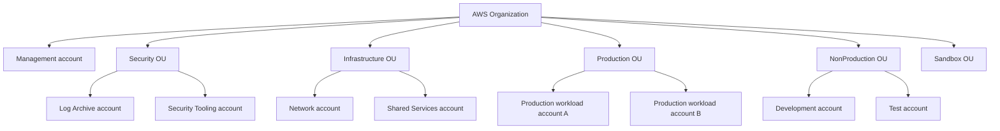
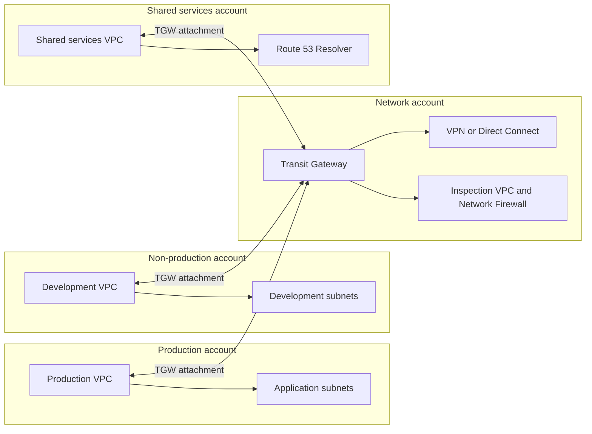

# Multi-Account Architecture and Blast Radius Isolation

An AWS account is a critical administrative and security boundary: each account has its own IAM principals, resources, quotas, billing, and service configurations. Organizing multiple accounts properly separates environments, teams, data, and administrative privileges; when a workload or credential is compromised, the blast radius can be contained within a defined account or trust domain.

Multi-account architecture is the practice of structuring AWS Organizations into purpose-built accounts, applying consistent guardrails, and designing controlled cross-account access flows. The goal is not to create an account for every tiny component, but to establish boundaries aligned with risk levels, ownership, lifecycles, and compliance requirements.

After this lesson, learners can:

- Explain the roles of AWS accounts, AWS Organizations, Organizational Units (OUs), the management account, and delegated administrators.
- Design an OU/account structure for security, log archive, networking, shared services, production, and non-production.
- Use Service Control Policies (SCPs), Resource Control Policies (RCPs), and IAM to build layered guardrails.
- Design cross-account access using IAM roles, AWS IAM Identity Center, and resource policies.
- Segment networks, data, encryption keys, and pipelines to reduce blast radius.
- Build safe processes for account vending, monitoring, incident response, and account closure.

## 1. Why Do We Need a Multi-Account Architecture?

### 1.1. Accounts Are Critical Isolation Boundaries

In AWS, an account creates an isolated administrative scope for resources, IAM, service quotas, and billing. Resources in another account are not accessible by default; sharing must go through authentication and authorization mechanisms such as IAM roles, resource policies, AWS Resource Access Manager (AWS RAM), VPC sharing, or service-native data sharing.

Separating accounts reduces the impact of scenarios such as:

- Credentials for a production application's IAM role are leaked.
- An engineer accidentally deletes resources or alters network policies.
- An experimental workload generates huge costs or exhausts quotas.
- A bucket, database, or KMS key is misconfigured.
- A workload account is compromised and must be isolated for investigation.
- A team needs independent administrative authority or data has distinct compliance mandates.

VPCs segment networks within an account, but do not provide the same administrative boundary as separate accounts. If all environments share one account, a principal with broad IAM permissions or an administrative mistake can affect multiple VPCs and workloads. Separating accounts shrinks the set of resources one set of credentials can impact, provided cross-account permissions are also constrained.

### 1.2. Accounts, OUs, and VPCs Solve Different Problems

| Component | Scope | Primary Role |
|---|---|---|
| AWS account | Account's resources, IAM, quotas, billing, and service settings | Administrative, security, and cost boundary |
| Organizational Unit (OU) | Group of accounts in AWS Organizations | Applying policies and governance by group |
| VPC | Logical network in one Region of an account | Network isolation and routing |
| Subnet | IP range within one AZ of a VPC | Network segmentation by function |
| IAM role | Permission set assumable by a principal | Granting temporary credentials to humans or workloads |
| Resource policy | Policy attached to a resource | Allowing or denying principals access to the resource |

Do not treat OUs as network groups or treat VPCs as IAM boundaries. One account can hold multiple VPCs; one OU can hold multiple accounts; and a VPC can be shared with other accounts via AWS RAM within supported models.

### 1.3. Analyzing Blast Radius

Blast radius is the scope of resources, data, users, and operations that can be impacted when a failure or incident occurs. Analyze blast radius across at least five dimensions:

- **Identity:** which roles can a compromised principal assume, which accounts can it reach, and which policies can it alter?
- **Network:** which subnets, VPCs, endpoints, or Internet paths can a workload reach?
- **Data:** which datasets can the credentials read, modify, delete, or decrypt?
- **Control plane:** who can modify Organizations, SCPs, CloudTrail, KMS, the network hub, or pipelines?
- **Operations:** how many workloads are affected by a Region, quota, CI/CD, or shared-service outage?

An account boundary is one layer of blast-radius reduction. It does not on its own stop a principal authorized to assume roles in other accounts, a misconfigured pipeline deploying across many accounts, or a compromised shared control plane. Therefore, cross-account access, central administration, and recovery procedures must all be designed carefully.

## 2. Design Principles

A sound account structure should follow these principles:

1. **Separate by trust boundaries and ownership.** Production, non-production, security, and log archives typically require separate accounts.
2. **Use accounts for isolation, OUs for policy grouping.** OUs should reflect shared governance intent and similar control levels.
3. **Deny unnecessary permissions by default.** IAM roles and resource policies grant minimal actions/resources; SCPs/RCPs enforce organization-wide guardrails.
4. **Keep the central control plane small and strongly protected.** The management account does not run regular application workloads.
5. **Share deliberately.** Network hubs, artifacts, images, DNS, and data platforms are shared only through audited mechanisms with clear owners.
6. **Automate baselines.** New accounts must receive logging, security services, identity, networking, and tagging before hosting workloads.
7. **Design independent recovery capability.** Backups, log archives, and recovery accounts do not rely solely on the credentials of the workload being recovered.
8. **Measure cost and operational overhead.** Each new account adds policies, quotas, logs, and pipelines to govern; automate to prevent drift.

There is no single optimal account count for every organization. Decisions to split accounts should weigh data sensitivity, blast radius, ownership, lifecycle, quotas, billing, and operational cost.

## 3. AWS Organizations and OU Structure

### 3.1. Management Account and Member Accounts

AWS Organizations manages multiple AWS accounts inside one organization. The account that creates the organization is the **management account**. Accounts invited or created within the organization are **member accounts**.

The management account holds organizational administration privileges and plays a special role in billing, policies, and service configuration. SCPs do not restrict permissions in the management account, so this account must be protected with strict identity controls, MFA, role separation, logging, and rigorous change processes.

Member accounts are subject to SCPs applied from the root, OUs, and account level. Resources in member accounts still require IAM/resource policies to grant actual permissions. Never use the management account to run regular applications or workloads; reserve it for essential Organizations administration and billing tasks.

### 3.2. Reference OU Example

A clean structure can start as follows:



Common roles:

| Account / OU | Responsibility | Access to Restrict |
|---|---|---|
| Management account | Organizations, billing, and org-level governance | Very few administrators; no workloads |
| Log Archive | Centralized storage of CloudTrail, Config, and security logs | Write from source accounts; read via investigation roles |
| Security Tooling | Delegated administrator for security services, finding aggregation | Security team and service-linked roles |
| Network | Transit Gateway, Network Firewall, DNS resolver, egress/ingress hub | Network engineering and workload attachments |
| Shared Services | Directory, artifacts, images, CI/CD runners, or shared services | Approved workloads/teams only |
| Production | Production workloads and data | Runtime roles, deploy roles, break-glass roles |
| Non-production | Dev, test, staging | Separate data, credentials, and access from production |
| Sandbox | Bounded experimentation | Quotas, budgets, time limits, and strict SCPs |

This is a reference model, not a mandatory blueprint. Smaller organizations may merge network and shared services; larger ones may split by business unit, data sensitivity, or regulatory boundary. Do not merge log archive into production workload accounts just to reduce account count.

### 3.3. OUs Should Reflect Policies

OUs are usually grouped by environment, function, or control level. For example, the Production OU can forbid disabling CloudTrail, altering log archive buckets, or creating unapproved public resources. The Sandbox OU can restrict Regions, instance types, and high-cost services.

Avoid creating OUs solely around department names if accounts inside them require different guardrails. Avoid overly deep OU nesting that makes effective policies hard to reason about. Use consistent naming, assign owners, and document the purpose of every OU.

## 4. Guardrails with AWS Organizations

### 4.1. SCPs Set Maximum Permission Boundaries

A Service Control Policy (SCP) is an AWS Organizations policy that sets the maximum available permissions for principals in member accounts. SCPs do not grant permissions. An API call succeeds only when IAM/resource policies allow it and no explicit deny exists in any applicable policy.

SCPs can attach at the organization root, an OU, or an account. A member account's effective permissions are shaped by the policy chain from root down to OU/account. When multiple SCPs attach at the same level, Allows must be evaluated along the inheritance path; an explicit Deny in any applicable policy blocks the request.

Key points to remember:

- SCPs apply to member accounts in the organization; they do not apply to the management account.
- SCPs do not restrict service-linked roles.
- SCPs do not grant permissions to IAM users/roles on their own.
- SCPs can restrict a member account's root user, but do not replace protecting root credentials.
- SCP changes can affect many accounts simultaneously; test in a staging OU and maintain a rollback plan.
- When an account leaves the organization, organization SCPs no longer serve as guardrails for that account.

### 4.2. Example SCP Restricting Regions

The following example denies creating or modifying resources outside two approved Regions while keeping certain required global services/actions in an exception allowlist. This is an illustrative template; the exception list must be validated against your service catalog and actual organizational needs.

```json
{
  "Version": "2012-10-17",
  "Statement": [
    {
      "Sid": "DenyOutsideApprovedRegions",
      "Effect": "Deny",
      "NotAction": [
        "acm:*",
        "aws-portal:*",
        "budgets:*",
        "ce:*",
        "cloudfront:*",
        "iam:*",
        "organizations:*",
        "route53:*",
        "support:*"
      ],
      "Resource": "*",
      "Condition": {
        "StringNotEquals": {
          "aws:RequestedRegion": [
            "ap-southeast-1",
            "ap-southeast-2"
          ]
        }
      }
    }
  ]
}
```

The `NotAction` list above merely illustrates how to handle global APIs and should not be copied verbatim. Some services use global endpoints yet create regional resources; some control-plane APIs behave differently. Test each service in non-production accounts and inspect CloudTrail before broad rollout.

### 4.3. Example SCP Protecting Audit Logs

The template below denies actions that disable or delete trails in member accounts. In real environments, also review APIs for updating trails, event selectors, log buckets, Config recorders, and delivery channels per your organization baseline.

```json
{
  "Version": "2012-10-17",
  "Statement": [
    {
      "Sid": "ProtectCloudTrail",
      "Effect": "Deny",
      "Action": [
        "cloudtrail:StopLogging",
        "cloudtrail:DeleteTrail"
      ],
      "Resource": "*"
    }
  ]
}
```

This SCP does not make logs immutable on its own. The log archive account still needs bucket policies, KMS key policies, versioning/Object Lock where appropriate, separated delete permissions, and delivery failure alerts. The security team needs a controlled break-glass process for legitimate exceptions.

### 4.4. Resource Control Policies

A Resource Control Policy (RCP) is an AWS Organizations policy type used to set maximum guardrails on access to resources in supported services. SCPs focus on restricting what principals in member accounts can do; RCPs focus on restricting the maximum access that resources in an account can grant to principals.

RCPs do not replace resource policies or IAM policies and apply only to AWS-supported resource types/services. Before adopting them, verify the current list of supported services/actions and assess impacts on cross-account access, AWS service principals, and integrated services.

You can combine:

- SCPs to prevent principals in workload accounts from performing dangerous actions.
- RCPs to prevent resources from being shared outside defined trust boundaries.
- IAM policies to grant permissions to specific roles.
- Resource policies to specify which principals can access buckets, keys, queues, or other resources.
- Permission boundaries/session policies to narrow role/session permissions.

### 4.5. Deploying Policies Safely

Every organization policy needs an owner, objective, scope, testing, and a rollback plan. Recommended process:

1. State the requirement in business terms, e.g., "production workloads may only create resources in approved Regions."
2. Identify affected API actions, principals, resources, and conditions.
3. Evaluate using IAM Access Analyzer, appropriate policy simulators, and test accounts.
4. Attach the policy to a test OU with representative workloads.
5. Check CloudTrail, application logs, pipelines, and integrated AWS services.
6. Roll out OU by OU; monitor `AccessDenied` errors and owner feedback.
7. Record policy version, approver, change timestamp, and rollback steps.

Do not use SCPs as a quick patch for an application bug. A broad Deny can break backups, deployments, logging, or AWS service integrations.

## 5. Identity and Cross-Account Access

### 5.1. AWS IAM Identity Center

AWS IAM Identity Center centralizes workforce access management across multiple AWS accounts. Users authenticate through a configured identity source and are assigned permission sets for accounts or applications. Permission sets provision corresponding roles in target accounts; users receive temporary sessions upon sign-in.

Design principles:

- Federate with an enterprise identity provider where appropriate; enforce MFA and synchronized offboarding.
- Assign permission sets by job function, such as `ReadOnly`, `Developer`, `NetworkAdmin`, `SecurityAudit`, and `Billing`.
- Separate production access from sandbox access; require approvals or JIT access for sensitive permissions.
- Use identity groups for consistent permission assignments rather than assigning individuals manually.
- Periodically review account assignments, permission sets, and session durations.
- Keep emergency access independent, restrict who holds credentials, and test regularly.

IAM Identity Center addresses workforce access; workloads should still use IAM roles, task roles, instance profiles, or service roles rather than human user credentials.

### 5.2. Cross-Account AssumeRole

A workload account can assume a role in a shared services account to obtain scoped permissions. This requires two sides:

1. The target role's trust policy allows the source principal/account to call `sts:AssumeRole`.
2. The source principal's identity policy allows calling `sts:AssumeRole` on the target role's ARN.

The target role grants only required actions/resources. Sessions are time-bounded; applications use STS credentials instead of long-lived access keys.

Example trust policy allowing a deployment role from the CI/CD account to assume a deploy role in the production account:

```json
{
  "Version": "2012-10-17",
  "Statement": [
    {
      "Sid": "TrustDeploymentRole",
      "Effect": "Allow",
      "Principal": {
        "AWS": "arn:aws:iam::111122223333:role/ReleasePipeline"
      },
      "Action": "sts:AssumeRole"
    }
  ]
}
```

The identity policy in the CI/CD account must also allow `sts:AssumeRole` on the target role ARN. The trust policy only controls who may assume the role; it does not grant deployment permissions unless the target role itself has policies allowing those actions.

When integrating third-party providers, use `sts:ExternalId` per AWS guidance to mitigate the confused deputy problem. `ExternalId` is not a password and does not replace validating the trusted principal. For internal workloads, specify exact principal ARNs, source identity/session tags if needed for auditing, and cap session durations.

### 5.3. Human Permissions and Workload Permissions

| Need | Mechanism to Consider |
|---|---|
| Engineers logging into console/CLI across accounts | IAM Identity Center and permission sets |
| EC2 calling S3/KMS | Instance profile with IAM role |
| ECS task reading database secrets | Task role, plus secret resource policy if needed |
| Lambda calling queues | Least-privilege execution role |
| CI/CD deploying into workload accounts | Target role assumed by the pipeline |
| Another account reading S3 objects | Bucket policy + IAM policy in calling account, plus KMS policy if SSE-KMS |
| Sharing subnets or Transit Gateway | AWS RAM and corresponding network administration permissions |

Never share one full-admin role across all teams. Separate read, operations, deployment, security, and organization administration roles so a compromised credential cannot simultaneously alter workloads, delete logs, and disable guardrails.

## 6. Network Isolation Across Accounts

### 6.1. Hub-and-Spoke Model

In an organization with many workload accounts, each account can own its own VPCs. A central network account can manage Transit Gateway, Network Firewall, DNS resolvers, VPN/Direct Connect, and shared ingress/egress paths.

Transit Gateway (TGW) acts as a central router connecting VPCs and network attachments. TGW route tables decide which attachments can exchange traffic. Attaching a VPC to a TGW does not automatically allow every other VPC to reach it; specific associations, propagations, and routes must be configured.

A hub-and-spoke model typically includes:

- Workload VPCs in individual accounts, separated by environment or product.
- A Network account owning the TGW, inspection VPC, and on-premises connections.
- AWS RAM sharing the TGW with approved accounts or the organization.
- TGW route tables separating production, non-production, shared services, and on-premises.
- Network Firewall or appliances inspecting traffic on required paths.
- VPC endpoints and private DNS allowing workloads to call AWS services over private paths.

### 6.2. Reference Connectivity Diagram



This diagram illustrates connectivity only. Route tables, security groups, NACLs, DNS resolver rules, and firewall policies still must be configured separately. Do not allow development to reach production merely because both attach to the same TGW.

### 6.3. Separating TGW Route Tables

Dedicated TGW route tables can separate production, non-production, and shared services. For example:

| Route Table | Associated Attachments | Permitted Routes |
|---|---|---|
| Production | Production VPC | Required shared services, inspection, approved on-premises |
| Non-production | Development/test VPC | Limited shared services, Internet egress via inspection |
| Shared services | Shared services VPC | Only workload accounts requiring shared services |
| Inspection | Inspection VPC | Symmetric routes to inspected sources and destinations |

Use route propagation selectively. Enabling propagation for all attachments into one shared route table can cause VPCs to learn routes to each other unintentionally. Test bidirectional paths and return traffic flows before production rollout.

### 6.4. AWS RAM and Network Sharing

AWS Resource Access Manager (AWS RAM) enables sharing supported resources across accounts in an organization or with specific accounts. Commonly shared network resources include Transit Gateways, VPC subnets, and resolver rules.

When sharing subnets via RAM, participant accounts can launch resources into shared subnets, while the VPC owner still manages the VPC, route tables, and VPC-level configurations. Participants do not become owners of the VPC. Clearly define who manages security groups, IP addresses, quotas, and resource lifecycles.

Before sharing:

- Identify the resource owner and participant accounts.
- Share only necessary subnets/attachments.
- Define naming, tagging, IPAM, and access revocation procedures.
- Check participant resource creation permissions and quotas.
- Enable logging and incident coordination between network owners and workload owners.

### 6.5. DNS, Egress, and VPC Endpoints

Route 53 Resolver inbound/outbound endpoints and resolver rules can be shared to resolve DNS between VPCs and on-premises. Control which domains are forwarded, query sources, and which accounts can use rules. DNS query logs help investigate anomalous domains, but restrict read access and retention.

For egress, outbound traffic can route through an inspection VPC, Network Firewall, and NAT Gateways. Use VPC endpoints for S3, DynamoDB, and supported AWS services to reduce Internet/NAT dependency. Endpoint policies restrict services/resources via the endpoint, while IAM/resource policies still must grant access.

Not all traffic must pass through a central hub. For workloads needing low latency or handling sensitive data, consider PrivateLink endpoints, VPC peering, or service-specific private connectivity. VPC peering does not support transitive routing; TGW fits multi-VPC topologies better, at the cost of higher spend and routing complexity.

## 7. Data, Key, and Backup Isolation

### 7.1. Cross-Account S3

Production data buckets should belong to the data-owning account. Other accounts receive only required access through bucket policies, IAM policies, and KMS key policies if the bucket uses SSE-KMS.

Example bucket policy allowing a role in an analytics account to read a published prefix:

```json
{
  "Version": "2012-10-17",
  "Statement": [
    {
      "Sid": "AllowAnalyticsReadPublishedData",
      "Effect": "Allow",
      "Principal": {
        "AWS": "arn:aws:iam::444455556666:role/AnalyticsReader"
      },
      "Action": [
        "s3:GetObject"
      ],
      "Resource": "arn:aws:s3:::company-data/published/*"
    }
  ]
}
```

The role in the analytics account also needs an IAM policy allowing `s3:GetObject` on the corresponding ARN. If objects use a customer managed SSE-KMS key, the role needs appropriate decrypt permissions and the owning account's key policy must permit that principal/account. If only processed data needs sharing, publish it to a dedicated bucket/prefix instead of granting read access to raw data.

### 7.2. Databases and Data Platforms

For databases, prefer keeping resources and credentials inside the workload-owning account. Share only via APIs, data exports, snapshots, or service-native mechanisms when clearly justified.

- Use private subnets and security groups scoped only to authorized workloads.
- Separate database users per service; never share master credentials across accounts.
- Use Secrets Manager resource policies and KMS key policies if secrets must be read cross-account.
- For shared snapshots, verify engine, Region, encryption, and KMS restrictions; do not assume every encrypted snapshot can be shared directly.
- Use service-native data lake/resource sharing when tables or datasets must be shared without copying raw data.
- Document owners, consumers, purpose, retention, and access revocation procedures.

### 7.3. KMS Key Boundaries

Customer managed KMS keys should have clear owners. The key policy defines foundational permissions; IAM policies in calling accounts specify which principals may exercise shared permissions. Never grant broad `kms:Decrypt` when a consumer only needs `GenerateDataKey` or access to a specific dataset.

Separate keys by account or data domain when independent administrative boundaries are required. Note:

- A key in one Region is not automatically usable as the same key in another Region; multi-Region keys have a distinct design.
- KMS permissions do not replace access permissions on the resource holding ciphertext.
- If a key is disabled, scheduled for deletion, or its policy altered, applications and backups may become undecryptable.
- CloudTrail logs KMS operations; keep those logs independent from workload accounts.
- Never put secrets or PII in encryption context; context is unencrypted and can appear in logs.

### 7.4. Backup Accounts and Recovery Boundaries

A separate backup or vault account reduces the risk of a workload administrator deleting both production data and backups. AWS Backup supports centralized backup policies, cross-account/cross-Region copies for supported resources, and vault controls per resource type/Region.

Designs should include:

- Source account creating recovery points on schedule with retention.
- Backup account receiving copies via permitted policies/copy actions.
- Backup vaults using KMS keys with independent owners and restricted restore permissions.
- AWS Backup Vault Lock in the appropriate mode when WORM and compliance are required; evaluate governance vs. compliance modes before locking.
- Restore roles granted only to recovery teams; workload runtimes must not be able to delete vaults or shorten retention.
- Regular restore drills verifying data, keys, dependencies, DNS, and recovery time.

Cross-account copies do not guarantee recovery on their own. If the backup account's keys, catalogs, runbooks, or identities depend on a compromised production account, the blast radius can still spread.

## 8. Workload and Deployment Pipeline Isolation

### 8.1. Choosing Workload Account Boundaries

You can choose one account per environment of a product, or one account per product/sensitivity level. Balance isolation against operational overhead.

| Criterion | Separate Account When |
|---|---|
| Sensitivity | Data or workloads have distinct control requirements |
| Ownership | Teams have independent owners, on-call rotations, and lifecycles |
| Environment | Production must isolate credentials, quotas, and billing from dev/test |
| Compliance | Separate logs, retention, Regions, or access controls are required |
| Blast radius | One compromised workload must not impact other workloads |
| Cost / quotas | Dedicated budgets, quotas, and cost allocation are needed |

There is no need to create a separate account for every microservice if services share the same trust boundary, owner, and operational policy. However, services handling sensitive data or differing administrative privileges should consider separate accounts, or at minimum separate IAM roles, VPCs, keys, and resource policies.

### 8.2. Account Vending and Automated Baselines

New accounts should be provisioned through a standard process, often called account vending. AWS Control Tower Account Factory or automated workflows built on AWS Organizations can create accounts and apply baselines.

An account baseline should include:

- Owner, cost center, environment, data classification, and contact metadata.
- IAM Identity Center assignments or workforce access mechanisms.
- Environment-appropriate SCP/OU guardrails.
- Organization CloudTrail, AWS Config, and log delivery to centralized accounts.
- Delegated security services: GuardDuty, Security Hub, and selected tools.
- Standardized VPC/subnet/IPAM or network attachment workflows.
- Required KMS keys, secret stores, backup policies, and resource policies.
- Budgets, cost anomaly alerts, tag policies, and account closure workflows.

Never hand an empty account to a team and leave security setup for later. Workloads should deploy only after the account meets its baseline and the owner confirms accountability.

### 8.3. CI/CD Accounts and Deployment Roles

A central CI/CD account can build artifacts once and deploy across multiple workload accounts. The pipeline assumes a role in the target account; the target role permits only actions needed for specific stacks, services, or resources.

Principles:

- Separate build roles, deployment roles, and runtime roles.
- Artifacts carry clear checksums, versions, provenance, and retention.
- Use OIDC/federated identities or temporary roles for runners; avoid long-lived access keys.
- Restrict deployment role trust policies by pipeline principal, source identity, and appropriate conditions.
- Deploy in waves: dev → test → staging → production, with approvals and canaries for production.
- Never grant the pipeline account Organizations administration or log-archive deletion permissions.
- Audit who approved each release, which artifact deployed, and to which account/Region.

A pipeline bug can ripple across many accounts even when workload accounts are well isolated. Capping concurrency, target scope, rollback authority, and rollout kill-switches are all part of blast-radius design.

### 8.4. Resource Sharing and Service Catalogs

Shared services such as artifact repositories, container registries, DNS, directories, observability, or internal APIs should have service owners and consumer contracts.

Choose the right sharing mechanism:

- AWS RAM for supported resources like subnets, Transit Gateways, or resolver rules.
- Resource policies for S3 buckets, KMS keys, SNS topics, SQS queues, and supported resources.
- IAM role assumption for tasks needing execution permissions inside an owning account.
- PrivateLink for private service endpoints into consumer VPCs.
- Native database/data lake sharing when sharing datasets.

Never share a broad wildcard bucket or role across all accounts. Partition by purpose, dataset, environment, and consumer; periodically audit shared account lists and revoke stale access.

## 9. Scenario-Based Blast Radius Isolation

### 9.1. Compromised Workload Credentials

If access keys or a role session for a production application leak, an attacker can perform any action allowed by that session and associated resource policies.

Reduce impact by:

- Using temporary roles with appropriately short session durations and no long-lived access keys.
- Separating roles per service; never share one role across workloads with differing risk profiles.
- Restricting `iam:PassRole`, `sts:AssumeRole`, `kms:Decrypt`, `s3:*`, and security group modification permissions.
- Preventing runtime roles from assuming administrative roles in other accounts.
- Monitoring CloudTrail and GuardDuty; maintaining procedures to revoke credentials, disable role paths, and isolate workloads.

### 9.2. Compromised Workload Account

A compromised account may require rapid isolation. The Network account can revoke TGW routes/attachments or enforce firewall containment; the security team can block roles, sessions, endpoints, or resource policies per runbook.

Do not immediately delete the account or resources if forensic evidence must be preserved. Containment procedures should define:

1. Who is authorized to isolate an account/VPC and who approves?
2. How to block egress while keeping investigation access intact?
3. Are logs stored in an independent account?
4. Are backups and KMS keys still accessible?
5. Do other workloads share secrets, subnets, roles, or pipelines?
6. What criteria allow reconnecting the account?

SCPs act as guardrails, not an instant network isolation switch. Concrete actions are needed across IAM, TGW, security groups, firewalls, DNS, and service endpoints.

### 9.3. Compromised Management or Security Account

Management and security accounts have a massive blast radius because they administer or observe many accounts. Protect them with:

- Very few principals, strong MFA, and hardware security keys for sensitive permissions.
- Separate permission sets; never use daily admin roles for organization management tasks.
- Monitored, time-bounded break-glass roles with approval workflows.
- CloudTrail logs shipped to an independent log archive account.
- Alerts on changes to Organizations, SCPs, delegated administrators, trails, and log destinations.
- Runbooks to recover access from identity providers and backup credentials.

Never put all investigation tools, logs, backups, and identity recovery mechanisms in one account where a single compromised administrative principal could delete them all.

### 9.4. Outage in Shared Services

Network hubs, DNS, CI/CD, artifact registries, and directories can impact many workloads simultaneously. Reduce shared-service blast radius:

- Separate control planes and data planes; prevent service owners from arbitrarily accessing production data.
- Separate production and non-production endpoints, secrets, and artifacts.
- Implement multi-AZ, backup/restore, and bypass/isolated operation modes.
- Restrict consumers via endpoint policies, resource policies, security groups, and authentication.
- Define SLOs, change windows, and rollback plans for shared changes.
- Test failure modes such as DNS resolver outages, misconfigured TGW routes, unreachable artifact registries, or faulty pipeline releases.

## 10. Logging, Delegated Administration, and Security Operations

### 10.1. Centralized Accounts for Logs and Security

The Log Archive account should receive logs from the organization trail, AWS Config, and critical telemetry sources. Bucket policies permit only source services/accounts to write to designated prefixes; read permissions belong to security/audit roles; delete permissions are separated and monitored.

The Security Tooling account can serve as delegated administrator for GuardDuty, Security Hub, IAM Access Analyzer, or other services supporting delegated administration. Delegated administration lets the security team manage findings across accounts without using the management account day-to-day.

Delegated admin does not automatically grant full control over every resource. Verify service-specific permissions, trusted access, regional enablement, and the scope of managed member accounts.

### 10.2. Organizational Monitoring Baseline

| Signal | Source | Action |
|---|---|---|
| New account or account leaving organization | CloudTrail / Organizations EventBridge | Verify owner, baseline, and access |
| SCP/RCP modified | CloudTrail | Review policy, assess affected accounts |
| CloudTrail/Config disabled | CloudTrail / Config / Security Hub | High-severity alert and restore logging |
| Anomalous cross-account `AssumeRole` | CloudTrail STS events | Verify principal, source identity, and session |
| Bucket/KMS policy modified | CloudTrail | Assess public exposure or loss of decrypt access |
| TGW route/attachment modified | CloudTrail / VPC telemetry | Verify network isolation and route propagation |
| GuardDuty/Security Hub findings | Security services | Triage, containment, owner, and SLA |

Assign owners to every finding. A multi-account dashboard without a remediation workflow does not reduce risk. Define severity, SLAs, escalation, evidence, and closure criteria.

### 10.3. AWS Config and Drift

AWS Config records resource configurations and evaluates Config Rules/conformance packs according to service capabilities. Use aggregators to view multi-account/multi-Region compliance from a monitoring account. Config detects drift such as public buckets, overly permissive security groups, or unencrypted resources.

Config does not fix every drift automatically and does not replace IaC reviews. For automated remediation, scope actions tightly, test in non-production, and preserve audit trails. When resources change outside pipelines, identify the owner and reason before auto-reverting to avoid breaking valid emergency fixes.

## 11. Account Lifecycle and Change Governance

### 11.1. Creating Accounts

An account request should specify business owner, technical owner, environment, data classification, cost center, Region, network requirements, and expected launch date.

Account provisioning workflow:

1. Validate business need and select an OU matching purpose/guardrails.
2. Create the account via Control Tower Account Factory or standardized Organizations workflows.
3. Attach owner, cost allocation tags, and contacts.
4. Apply SCP/RCPs, IAM Identity Center assignments, and logging/security baselines.
5. Enroll the account in delegated security services, Config aggregators, and backup policies.
6. Provision network attachments, DNS, and shared-service access as required.
7. Verify baseline compliance via Config, Security Hub, and checklists before allowing deployments.

### 11.2. Changing OUs or Policies

Moving an account between OUs can immediately alter effective SCPs. Before moving an account:

- Compare source and target policies.
- Check permissions for deployment, backups, logging, networking, and service integrations.
- Test on a representative account or test OU.
- Notify owners and schedule a change window.
- Monitor `AccessDenied` errors, security findings, and service health afterward.
- Keep a plan to move the account back to its original OU if errors occur.

Never use an OU move to isolate a compromised account without checking whether the new policies interfere with log preservation, forensic access, or backups.

### 11.3. Closing Accounts

Account closure requires a process with clear ownership and retention timelines. Before closing:

- Confirm workloads have migrated or been decommissioned.
- Export and retain logs, evidence, data, and backups per retention rules.
- Revoke cross-account trusts, RAM shares, TGW attachments, DNS records, and service integrations.
- Resolve KMS key dependencies, secrets, certificates, domains, and billing.
- Remove obsolete credentials and permission set assignments.
- Confirm no consumers still depend on resources in the account.
- Execute closure following AWS Organizations procedures and internal policies.

Never delete an account just to close out an incident. A compromised account may need to remain intact to preserve evidence, maintain network containment, and support controlled recovery.

## 12. Costs, Quotas, and Multi-Account Operations

Splitting accounts aids cost allocation and quota isolation, yet increases operational overhead. Each account can incur charges for CloudTrail data events, AWS Config, GuardDuty, Security Hub, VPC endpoints, NAT Gateways, Transit Gateway, Network Firewall, log ingestion, and backup copies.

Cost governance:

- Use consolidated billing and Cost Explorer to track costs by account, OU, tag, and service.
- Set AWS Budgets per account/workload with threshold alerts.
- Enforce consistent cost allocation tags; track untagged resources or missing owners.
- Evaluate data transfer costs across TGW, NAT, firewalls, and inter-Region links.
- Set retention/lifecycle rules for logs and artifacts; never disable audit logs just to cut costs.
- Use Service Quotas to track account/Region quotas; request increases prior to rollouts.
- Constrain sandboxes with budgets, allowed Regions, service restrictions, and resource TTLs.

Not all quotas are shared across accounts; splitting accounts helps prevent one workload from exhausting quotas for another. Still, shared pipelines or shared services may have shared throughput/quota limits.

## 13. Reference Architecture: E-Commerce Company

Suppose an enterprise operates an e-commerce website and order APIs across multiple environments. Payment and customer data require strong protection; network and security teams govern centrally; developers deploy independently within assigned accounts.

A design might include:

| Account | Components | Boundaries and Controls |
|---|---|---|
| Management | AWS Organizations, billing | No workloads; minimal admins, MFA, and alerts |
| Log Archive | Organization CloudTrail, Config logs | Bucket policies, KMS, retention/Object Lock, separated read access |
| Security Tooling | GuardDuty, Security Hub, Access Analyzer | Delegated admin, finding workflows, and incident response |
| Network | TGW, Network Firewall, DNS resolver | Separate prod/nonprod route tables, egress inspection |
| Shared Services | CI/CD, artifacts, container registry, directory | Consumer allowlists, role assumption, and auditing |
| Production Commerce | Web/API, RDS, S3 order data | Dedicated IAM roles, private subnets, KMS, backups |
| Production Analytics | Data lake/warehouse | Receives published datasets only; dedicated keys and resource policies |
| Development/Test | Test environments | Synthetic data, quotas/budgets, no production secrets |
| Sandbox | Individual experimentation | SCPs restricting services/Regions, budgets, and time limits |

Deployment flow: developers sign in via IAM Identity Center; pipelines in Shared Services build signed/versioned artifacts; pipelines assume deployment roles in Development; after testing and approval, pipelines assume dedicated roles in Production. Application runtime roles access only required secrets, queues, bucket prefixes, and databases.

Analytics data flow: production publishes datasets with minimized sensitive data to a dedicated bucket/prefix; the `AnalyticsReader` role receives read access to that exact prefix; KMS key policies allow scoped decryption; CloudTrail records activity. When consumers no longer need access, owners revoke bucket policies, IAM policies, and KMS access.

If the production account is compromised, the security team retains logs in Log Archive, uses the Network account to isolate routes/egress, revokes sessions/roles, and recovers from the backup account. Reconnection occurs only after verifying credentials, images, policies, and data.

## 14. Common Design Mistakes

| Mistake | Consequence | Resolution |
|---|---|---|
| Running workloads in the management account | Widens blast radius of the organization admin account | Move workloads to member accounts |
| Mixing production, dev, and sandbox in one account | Credentials, quotas, and bugs can bleed across environments | Separate accounts by trust boundaries |
| Treating SCPs as Allow permissions | Principals without IAM permissions still cannot call APIs | Use SCPs as max-permission guardrails; IAM/resource policies grant access |
| One OU with wildly different policies per account | Effective policies become hard to predict and review | Group OUs by purpose and shared guardrails |
| Sharing one TGW route table across all VPCs | VPCs can reach one another unexpectedly | Separate route tables and selective propagation |
| Sharing roles/buckets with wildcards | A consumer can access data out of scope | Use principal/resource/prefix allowlists |
| All workloads assuming the same admin role | Compromising one workload compromises everything | Per-workload roles with minimal actions |
| Giving CI/CD Organizations or log-archive privileges | Pipeline compromise can break guardrails/evidence | Separate build, deploy, and security admin roles |
| Keeping logs and backups in the workload account | Attackers can erase both data and audit trails | Use dedicated log archive and backup accounts |
| Sharing KMS keys while forgetting key or IAM policies | Cross-account requests fail with `AccessDenied` | Check both sides plus resource policies |
| Splitting too many accounts without automation | Configuration drift, rising costs, and toil | Account vending, baselines, and policy-as-code |
| Containing an incident by deleting the account immediately | Destroys evidence and disrupts recovery | Follow containment runbooks; preserve logs and backups |

## 15. Hands-On Exercise: Designing a Multi-Account Organization

### Context

An enterprise has three teams: Commerce, Analytics, and Platform. Commerce runs production APIs and customer databases; Analytics needs to read approved reporting datasets; Platform manages networking and CI/CD. The company needs to separate dev from production, store audit logs independently, and limit blast radius if a workload is compromised.

### Tasks

1. Propose OUs and accounts for management, security, log archive, network, shared services, production, non-production, and sandbox.
2. Identify which account owns the Transit Gateway, log buckets, KMS keys, artifacts, and datasets.
3. Write SCP guardrails restricting Regions and protecting CloudTrail in member accounts.
4. Design IAM Identity Center permission sets for `Developer`, `ProductionOperator`, and `SecurityAudit`.
5. Design a cross-account deployment role from the CI/CD account to production.
6. Design TGW route tables so dev cannot reach production, allowing only approved shared services.
7. Design bucket policies and KMS key policies for `AnalyticsReader` to read published datasets.
8. Define workflows for account vending, logging baselines, backup copies, and account closure.
9. Describe how to isolate the production account if compromised credentials are detected.
10. Define metrics/SLAs to track account baselines, findings, costs, and containment times.

### Completion Criteria

- Every account has an owner, purpose, OU, and cost allocation.
- The management account runs no routine workloads.
- SCP/RCPs and IAM/resource policies have distinct, clear roles.
- Cross-account access uses scoped roles or resource policies.
- Production, non-production, log archive, and backups have proper boundaries.
- TGW route tables do not automatically bridge every VPC.
- Security findings and logs have account owners, retention, and remediation workflows.
- Accounts can be isolated while preserving evidence and recovery capability.

## 16. Self-Check Questions

1. Why does an AWS account provide a stronger isolation boundary than adding another VPC?
2. How does the management account differ from member accounts?
3. Do SCPs grant permissions to IAM roles? Why or why not?
4. Which sides do SCPs and RCPs focus on restricting?
5. Why are both a trust policy in the target account and an identity policy in the source account needed when assuming a role?
6. When should you use IAM Identity Center instead of creating separate IAM users in every account?
7. Why does attaching VPCs to a TGW not automatically allow all VPCs to communicate?
8. When sharing S3 objects with SSE-KMS cross-account, which policies must be checked?
9. Why should log archive and backup accounts be independent from workload accounts?
10. How can a central pipeline become a source of blast radius?
11. When an account is compromised, why should you not delete the account right away?
12. Which factors determine whether to split out another account?

### Suggested Answers

1. Accounts separate IAM, resource namespaces, quotas, and billing; VPCs only segment networks within an account. Cross-account permissions must still be explicitly granted.
2. The management account administers the organization and is exempt from SCPs; member accounts are governed by organizational guardrails.
3. No. SCPs set maximum permission boundaries; IAM/resource policies grant permissions, and explicit denies always take effect.
4. SCPs cap maximum permissions of principals in member accounts; RCPs cap maximum permissions resources can grant to principals across supported services.
5. The trust policy permits the trusted principal to assume the role; the identity policy permits the source principal to invoke STS `AssumeRole`.
6. When workforce users must sign into multiple accounts using centralized federation, MFA, groups, and permission sets.
7. TGW route table associations, propagations, and routes govern traffic; attachments only establish connectivity.
8. Bucket policy, IAM policy in the calling account, KMS key policy/grants, and endpoint policies if present.
9. So a compromised workload administrator cannot easily delete logs/evidence and backups simultaneously.
10. Pipelines can deploy faulty changes fleet-wide, leak artifacts/credentials, or hold overly broad assume-role permissions.
11. You risk losing evidence, logs, backups, and forensic visibility; perform containment and evidence preservation first.
12. Data sensitivity, ownership, lifecycle, quotas, compliance, blast radius, and operational overhead.

## 17. Multi-Account Architecture Checklist

- [ ] Management account is reserved strictly for org governance and essential billing.
- [ ] OUs reflect consistent purposes and guardrails.
- [ ] Production, non-production, security, log archive, and backups have clear boundaries.
- [ ] New accounts are created via account vending with automated baselines.
- [ ] IAM Identity Center manages workforce access; workloads use temporary roles.
- [ ] SCPs/RCPs are tested and have owners and rollback plans.
- [ ] Cross-account trusts specify explicit principals and appropriate session limits.
- [ ] TGW route tables, propagation, and firewall policies segment flows properly.
- [ ] AWS RAM/resource sharing defines owners, consumers, and revocation procedures.
- [ ] S3/database/KMS/data sharing is scoped per dataset and purpose.
- [ ] Log archive and backups do not depend on workload administrative permissions.
- [ ] CI/CD roles lack Organizations admin or log-deletion permissions.
- [ ] GuardDuty, Security Hub, Config, and CloudTrail have delegated admins/owners.
- [ ] Budgets, cost allocation tags, and Service Quotas are actively managed.
- [ ] Runbooks exist for containment, evidence preservation, and recovery.
- [ ] Account closure revokes trusts, shares, networking, and data cleanly.

## 18. References

- [AWS Organizations User Guide](https://docs.aws.amazon.com/organizations/latest/userguide/orgs_introduction.html)
- [AWS multi-account strategy](https://docs.aws.amazon.com/prescriptive-guidance/latest/transitioning-to-multiple-aws-accounts/welcome.html)
- [AWS Control Tower User Guide](https://docs.aws.amazon.com/controltower/latest/userguide/what-is-control-tower.html)
- [AWS Security Reference Architecture](https://docs.aws.amazon.com/prescriptive-guidance/latest/security-reference-architecture/welcome.html)
- [Service control policies](https://docs.aws.amazon.com/organizations/latest/userguide/orgs_manage_policies_scps.html)
- [Resource control policies](https://docs.aws.amazon.com/organizations/latest/userguide/orgs_manage_policies_rcps.html)
- [AWS IAM Identity Center](https://docs.aws.amazon.com/singlesignon/latest/userguide/what-is.html)
- [Cross-account role access](https://docs.aws.amazon.com/IAM/latest/UserGuide/tutorial_cross-account-with-roles.html)
- [AWS Resource Access Manager](https://docs.aws.amazon.com/ram/latest/userguide/what-is.html)
- [Transit Gateway](https://docs.aws.amazon.com/vpc/latest/tgw/what-is-transit-gateway.html)
- [AWS Network Firewall](https://docs.aws.amazon.com/network-firewall/latest/developerguide/what-is-aws-network-firewall.html)
- [AWS CloudTrail organization trails](https://docs.aws.amazon.com/awscloudtrail/latest/userguide/creating-trail-organization.html)
- [AWS Config aggregators](https://docs.aws.amazon.com/config/latest/developerguide/aggregate-data.html)
- [AWS Backup cross-account management](https://docs.aws.amazon.com/aws-backup/latest/devguide/manage-cross-account.html)
- [AWS Backup Vault Lock](https://docs.aws.amazon.com/aws-backup/latest/devguide/vault-lock.html)
- [AWS KMS key policies](https://docs.aws.amazon.com/kms/latest/developerguide/key-policies.html)
- [AWS Well-Architected Framework - Security Pillar](https://docs.aws.amazon.com/wellarchitected/latest/security-pillar/welcome.html)
- [AWS Well-Architected Framework - Reliability Pillar](https://docs.aws.amazon.com/wellarchitected/latest/reliability-pillar/welcome.html)
