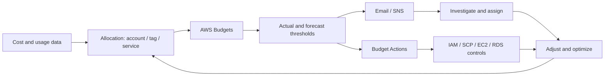

# AWS Budgets, Alerting, and Budget Control

AWS costs fluctuate with resource usage, traffic, deployment Regions, service selections, and discount commitments. An application's spend can grow quickly when teams expand test environments, forget to clean up resources, experience unexpected traffic spikes, or adopt new services. Reviewing the bill only at month-end often catches issues too late to course-correct.

AWS Budgets lets you set budgets for cost, usage, and the efficiency of commitments such as Reserved Instances (RIs) and Savings Plans. The service can send alerts when actual spend hits a threshold or when forecasts indicate a potential budget overrun. With Budget Actions, organizations can also automatically—or with approval—apply specific permission and resource controls.

Within the AWS ecosystem, Budgets is a core FinOps tool: it gives engineering, finance, and product owners shared visibility into consumption, forecasts, and cost accountability. Budgets handles detection and response; organizations still need Cost Explorer, Cost and Usage Reports, cost allocation tags, Cost Categories, approval workflows, and architectural optimization to manage spend end-to-end.

## Learning Objectives

After this lesson, you will be able to:

- Explain which metrics AWS Budgets tracks and distinguish a budget from a hard spending cap.
- Choose among cost, usage, RI utilization/coverage, and Savings Plans utilization/coverage budgets.
- Design appropriate budget periods, budgeting methods, filters, and cost aggregation bases.
- Distinguish actual and forecasted alerts, and select thresholds and notification channels.
- Configure Budget Actions safely with an understanding of IAM permissions and blast radius.
- Build a budgeting model across accounts, services, environments, and product groups.
- Operate alerts, investigate variances, test notifications/actions, and continuously improve FinOps workflows.

## AWS Budgets in the FinOps Lifecycle

FinOps is how finance, engineering, and business teams collaborate to maximize value from cloud spend. A typical FinOps loop consists of:

1. **Inform:** allocate and surface costs by account, product, environment, team, or owner.
2. **Plan:** establish budgets and forecasts aligned with business goals, release plans, and growth.
3. **Optimize:** uncover waste reduction opportunities, adjust configurations, pick fitting services, or tune commitments.
4. **Operate:** monitor thresholds, act on alerts, assign owners, and evaluate outcomes.

AWS Budgets primarily supports planning and operational control. A budget can monitor total account spend, spend for a single service, usage of a resource type, or commitment utilization ratios. Each budget can define multiple alert thresholds and corresponding actions.



### A Budget Is Not a Hard Spending Limit

AWS Budgets tracks spend and triggers alerts when billing data shows a threshold is reached or forecasted to be exceeded. Creating a budget does not automatically block new resource creation or cap the bill at the specified dollar amount.

Budget Actions can execute specific responses such as applying an IAM policy, attaching a Service Control Policy (SCP), or targeting specific EC2/RDS instances. These actions have defined scopes and conditions; they are not a universal spending cap across every service in an account. Billing data also has latency, so costs can continue rising before an alert or action fires.

If an organization needs hard limits on resource provisioning, combine IAM, SCPs, service quotas, provisioning workflows, policy-as-code, and monitoring. Never rely solely on a Budgets threshold to guarantee spend will not exceed a limit.

## AWS Budgets Types

AWS Budgets provides four main categories:

| Budget Type | Tracked Metric | Example Use Case |
|---|---|---|
| Cost budget | Cost by period and filter scope | Total monthly production cost must not exceed $20,000 USD |
| Usage budget | Consumption of one or more usage types sharing a unit | EC2 running hours, data transfer, or hourly service usage |
| Savings Plans budget | Savings Plans utilization or coverage | Alert when utilization drops below 80% or coverage falls below target |
| Reservation budget | Reserved Instance utilization or coverage | Detect idle RI commitments or declining coverage share |

### Cost Budget

A cost budget compares incurred or forecasted spend against a target budget. This is the most common type for tracking overall spend, an account, a product, or a service.

For example, a monthly production budget is $15,000 USD. You can set actual alerts at 70%, 90%, and 100%, alongside a forecasted alert at 90% so teams get early warning when spending trends point above plan.

### Usage Budget

A usage budget tracks consumption in a service's native unit—such as running hours, stored GB, or a group of usage types. Usage types must share the same unit for comparisons to be meaningful. Never combine EC2 hours with GB of data transfer in the same usage threshold.

Usage budgets are helpful when cost ties directly to an easily observable unit. For instance, a dev team can set an EC2 running-hours budget for a test environment to catch servers left running off-schedule.

### Savings Plans and Reserved Instances Budgets

These two budget types focus on commitment efficiency:

- **Utilization** shows the percentage of the purchased commitment consumed during the period. Low utilization can indicate over-commitment relative to actual demand or shrinking workloads.
- **Coverage** shows the share of eligible usage covered by commitments. Low coverage can indicate significant remaining On-Demand usage where additional commitments might be evaluated.

For example, Savings Plans utilization below 80% over several days signals a need to review commitments and usage. Falling coverage can signal rapid workload growth or instance/compute shifts leaving new usage uncovered.

Low utilization does not automatically mean you can or should buy more commitments; conversely, low coverage alone does not prove you should buy immediately. Evaluate workload stability, term length, scope, flexibility, and risk if demand shifts.

## Budget Periods and Planning Methods

### Periods

Depending on the budget type, you can select tracking periods such as:

- **Daily:** tracks daily fluctuations; suited for usage or utilization requiring rapid response.
- **Monthly:** standard for operating budgets and monthly bills.
- **Quarterly:** aligns with quarterly financial plans.
- **Annually:** tracks annual budgets.
- **Custom:** defines explicit start and end dates, such as project windows, contracts, or fiscal years.

Budgets can be recurring (resetting each period) or expiring (covering a single time window). Budget periods use UTC; verify start/end dates when planning in local timezones.

### Budgeting Methods

Cost and usage budgets support three methods for setting budget amounts:

| Method | How It Works | When It Fits |
|---|---|---|
| Fixed | Uses a single budget amount per period | Relatively steady costs or fixed spending caps |
| Planned | Sets different amounts for each month or quarter in a plan | Projects with ramp-up phases, seasonal peaks, or planned expansion |
| Auto-adjusting | Automatically adjusts the budget from historical data or a chosen baseline period | Workloads with cyclical trends needing self-updating baselines |

Planned budgets support up to 12 months or 4 quarters in a plan; afterward, the final amount becomes fixed. Auto-adjusting budgets require choosing a clean baseline. If the baseline window contains abnormal high or low spend, the auto-adjusted budget may not reflect current expectations.

Example of a product launch with planned ramp-up:

| Month | Planned Budget |
|---|---:|
| Month 1: pilot | 2,000 USD |
| Month 2: beta | 3,500 USD |
| Month 3: scale-out | 5,000 USD |
| Month 4: steady state | 4,000 USD |

Planned budgets let you set thresholds matching each phase rather than firing constant false alarms during planned growth.

## Budget Scope and Filters

A useful budget clearly defines which costs fall inside its tracking scope. Filters segment budgets by organization, account, service, Region, or cost group.

Common filters include:

- **Linked account:** track a specific member account in AWS Organizations from the management/payer account.
- **Service:** track EC2, S3, RDS, Lambda, or another specific service.
- **Region and Availability Zone:** isolate costs incurred in specific deployment locations.
- **Tag:** allocate costs by `Environment`, `Product`, `Team`, `CostCenter`, or project code.
- **Cost Category:** use defined cost categories combining accounts, tags, or services under business rules.
- **Usage type / usage type group:** track a specific consumption type or unit-consistent usage group.
- **Purchase option, instance family/type, platform, tenancy:** slice costs by resource type or purchasing model.
- **Charge type, billing entity, API operation, and other attributes:** filter more granularly depending on budget type and supported data.

Not every filter is available on every budget type. For example, the Linked account filter is designed for consolidated payer budgets rather than standalone member-account views. Check the available filter list for your selected budget type.

### Cost Allocation Tags and Cost Categories

Tags only enable cost allocation once activated as cost allocation tags in Billing and Cost Management. Attaching tags to resources does not instantly cause costs to appear by tag in reports. Standardize keys/values, apply tags to supported resources, and verify data after activation.

Example convention:

```text
Environment = production | staging | development
Product     = checkout | catalog | identity
Team        = platform | commerce | data
CostCenter  = CC-1001 | CC-1002
Owner       = team-alias
```

Cost Categories group costs using rules. For example, a `Commerce` category might include the production account plus product tags `checkout` and `catalog`; a `Shared Platform` category might include shared logging, networking, and CI/CD. When modifying Cost Category rules, check the impact on reports and budgets referencing that category.

### Choosing Cost Aggregation Options

Cost budgets can aggregate costs as blended, unblended, net unblended, amortized, or net amortized costs. Choose the option matching the financial question:

| Cost Type | General Meaning | Scenario |
|---|---|---|
| Unblended | Cost based on rates and usage lines recorded for the resource/account | Tracking account-level usage costs |
| Blended | Averaged rate distribution across consolidated billing reflecting RI/Savings Plans sharing | Viewing consolidated averages when sharing commitment benefits |
| Net unblended | Unblended cost after eligible discounts/credits | Tracking net recorded spend |
| Amortized | Distributes upfront and recurring commitment fees over time | Evaluating workload costs inclusive of commitments |
| Net amortized | Amortized cost after eligible discounts/credits | Long-term net cost analysis |

You can also choose whether to include or exclude items such as taxes, refunds, credits, support fees, upfront/recurring reservation charges, and certain subscriptions. Two budgets using different cost settings can show different figures with both being right. Document the exact cost definition in the budget name, description, and runbook.

## Actual and Forecasted Alerts

AWS Budgets supports two primary alert types:

- **Actual:** alerts when recorded cost or usage reaches the threshold.
- **Forecasted:** alerts when the period forecast projects cost or usage will exceed the threshold.

Example for a $10,000 USD monthly budget:

| Alert | Type | Threshold | Meaning |
|---|---|---:|---|
| Early watch | Actual | 50% | $5,000 USD in costs already recorded |
| Action prep | Actual | 80% | $8,000 USD recorded |
| Over plan | Actual | 100% | At least $10,000 USD recorded |
| Forecast risk | Forecasted | 90% | Period-end forecast projected to reach at least $9,000 USD |

Forecasted alerts let teams react before actual spend crosses the limit. However, forecasts depend on historical data and forecasting models. AWS requires roughly five weeks of usage data to generate forecasts; brand-new accounts or abruptly changed workloads may lack reliable forecasts.

Actual alerts typically fire once per budget per period when the actual threshold is first crossed. Forecasted alerts can fire multiple times within the same period if the forecast crosses the threshold, drops below it, and crosses again. This reflects forecast updates as new usage data arrives.

### Billing Data Latency

AWS Budgets relies on billing/cost usage data, not real-time telemetry. Budget data refreshes multiple times per day; AWS documentation notes updates occur up to three times daily, roughly every 8–12 hours. There is latency between resource consumption and when charges appear.

Therefore:

- Do not rely on Budgets as an instant circuit breaker for newly launched resources or sudden load spikes.
- Do not expect an alert to arrive the exact second or minute spend crosses a threshold.
- Actual spend may keep climbing after an alert is received.
- For workloads prone to rapid cost runaways, supplement with quotas, provisioning policies, CloudWatch metrics, service-specific alarms, and approval gates.

## Notification Channels and Recipients

An alert threshold can notify email addresses and an Amazon SNS topic. Email recipients must verify their addresses before receiving notifications. When using SNS, subscriptions must be confirmed; otherwise, the topic will not deliver notifications to subscribers.

SNS enables fan-out to multiple subscribers such as email, Lambda, SMS, or external ticketing systems. When integrating Lambda or ticketing, design for idempotency and log deliveries to avoid duplicate tickets if notifications are retried.

Each budget supports up to five alerts; each alert can notify up to ten email recipients and one SNS topic. Target recipients by operational responsibility rather than blasting every alert to a huge distribution list. A 50% threshold may only need to reach the team owner; 90–100% thresholds may include FinOps or service leadership.

### Useful Notification Structure

When building downstream handlers, standardize the following fields in tickets or internal messages:

- Budget name, account ID, period, and alert type.
- Actual/forecasted value, threshold, and budget limit.
- Service, Region, tag, or Cost Category being tracked.
- Owner/team, cost center, and links to Cost Explorer/Budgets console.
- Required action, response SLA, and accountable person.

A budget notification does not replace root-cause analysis. An alert stating only "reached 80%" without naming the account or owner rarely drives effective action.

## Budget Actions: Turning Thresholds into Controls

A Budget Action is an action AWS Budgets executes on your behalf when a budget crosses a threshold. Actions can run automatically or wait for approval from an authorized reviewer.

Supported action categories include:

1. **Apply IAM policy:** attaches a policy restricting permissions for a chosen user, group, or role—for example, blocking creation of new resources.
2. **Apply Service Control Policy:** attaches an SCP restricting permissions at the account/OU scope under Organizations policies. SCP actions are applied from the management account; understand the impact on all workloads within scope.
3. **Target specific EC2 or RDS instances:** executes supported actions such as stopping selected instances when a threshold is breached.

A management account can apply an SCP to another account in the organization, but cannot use a Budget Action to directly target EC2/RDS instances inside another account in the same manner. For a member account, resource-targeting actions apply within that account.

### Choosing Automatic vs. Manual Approval

| Mode | How It Works | Best Suited When |
|---|---|---|
| Automatic | AWS Budgets executes the action when conditions are met | Low blast radius, reversible, and thoroughly tested |
| Manual approval | Action waits for an authorized reviewer to approve | Potential production impact or service disruption risk |

For example, when a sandbox account's forecasted cost exceeds 120% of budget, you might automatically apply a policy blocking large instance launches. For production, send alerts and require owner approval before stopping any resources.

### IAM Role for Budget Actions

Budgets requires a service role with permissions to execute actions on your behalf. The role must have a trust policy allowing `budgets.amazonaws.com` to assume the role and a permission policy granting only the required actions. AWS provides managed policies for certain Budget Action categories; verify current versions and permission scopes before attaching.

Security principles:

- Use a dedicated role for Budget Actions; never reuse an application role.
- Constrain `aws:SourceAccount` and `aws:SourceArn` in the trust policy where applicable to mitigate confused deputy risks.
- Grant attach/detach policy or resource-stop permissions only within approved scopes.
- Restrict who can create, modify, or approve Budget Actions.
- Audit changes and action outcomes via AWS CloudTrail and action history.
- Test actions in non-production accounts before enabling automatic execution.

### Illustrative Trust Policy Example

Below is a minimal trust policy example allowing AWS Budgets to assume a role in the same account. Replace the account ID with your real value and scope the budget ARN to your design; the permission policy for actions must be configured separately.

```json
{
  "Version": "2012-10-17",
  "Statement": [
    {
      "Effect": "Allow",
      "Principal": {
        "Service": "budgets.amazonaws.com"
      },
      "Action": "sts:AssumeRole",
      "Condition": {
        "StringEquals": {
          "aws:SourceAccount": "123456789012"
        },
        "ArnLike": {
          "aws:SourceArn": "arn:aws:budgets::123456789012:budget/*"
        }
      }
    }
  ]
}
```

### Caution When Stopping EC2/RDS

A Budget Action can stop selected EC2 or RDS instances, but stopping does not always bring cost to zero. EBS volumes, snapshots, Elastic IPs, storage, backups, data transfer, and other components can still incur charges.

In particular, stopping an EC2 instance inside an Auto Scaling group may cause Auto Scaling to launch a replacement instance to maintain desired capacity. Therefore, stopping individual instances is not an effective control for ASG-managed workloads. Instead, adjust desired capacity, scaling schedules, or workload settings through approved workflows.

Never automatically stop a production database simply for crossing a cost threshold. Evaluate dependencies, active transactions, backups, restart behavior, and customer impact. Budget Actions require an owner, clear conditions, rollback procedures, and a runbook.

### Action Status and History

In the Budgets console, you can view actions pending approval, completed, or reverted. AWS Budgets displays action history for a limited retention window in the console; for longer investigations, use CloudTrail or the appropriate action history APIs. When reverting an action, verify that policies or resource states actually returned to the intended configuration.

## Designing Budgets in AWS Organizations

Under consolidated billing, the management/payer account can create budgets filtered by linked account to track each member account's spend. Organizations should combine top-level and granular budgets:

- Organization-wide budget to track total spend.
- Per-linked-account budgets; if OU views are needed, group OU accounts via Cost Categories or appropriate allocation rules.
- Per-service budgets for services with notable spend growth.
- Per-Cost-Category or per-tag budgets aligned with products and cost centers.
- RI/Savings Plans utilization and coverage budgets to track commitment efficiency.

Example budget matrix:

| Scope | Monthly Budget | Owner | Primary Alerts |
|---|---:|---|---|
| Organization-wide | 50,000 USD | FinOps | Forecast 90%, actual 100% |
| Production | 30,000 USD | Platform | Actual 80%, 100% |
| Development | 8,000 USD | Engineering leads | Forecast 90%, actual 100% |
| Data platform | 7,000 USD | Data team | Actual 80%, forecast 100% |
| Sandbox | 2,000 USD | Developer enablement | Forecast 100%, approval-gated action |

Granular budgets can overlap with top-level budgets. Do not sum all budgets together as total spend; they are distinct management views over the same underlying data. Clearly specify which budgets serve reporting, which assign team accountability, and which trigger actions.

Budgets belong to the account in which they are created and are visible only to users with access to that account/budget. The management account can create budgets by linked account, but member accounts do not automatically see management account budgets. Design IAM permissions and Billing and Cost Management access accordingly.

## Console Workflow for Creating a Cost Budget

A typical workflow for creating a monthly cost budget:

1. Open the Billing and Cost Management console and select **Budgets**.
2. Choose **Create budget**, then choose **Customize (advanced)** if detailed settings are needed.
3. Select **Cost budget**.
4. Enter a clear name, such as `prod-monthly-total-cost`.
5. Choose Monthly period, recurring type, and Fixed/Planned/Auto-adjusting method.
6. Enter the budget amount and define scope via account, service, Region, tag, or Cost Category filters.
7. Choose the cost aggregation method and specify which charges are included or excluded.
8. Create alert thresholds for actual and/or forecasted spend using absolute dollar amounts or percentages.
9. Configure email recipients or an SNS topic; confirm email/SNS subscriptions.
10. If needed, configure a Budget Action, select the action type, target policy/resources, and automatic or manual approval.
11. Review budget scope, timeframe, thresholds, recipients, role, and action, then create the budget.
12. Afterward, verify that the budget appears, notification subscribers are confirmed, and actions show the expected status.

### Threshold Calculation Example

Suppose the development budget is $4,000 USD/month:

- 50% equals $2,000 USD: prompts the owner to check burn rate.
- 80% equals $3,200 USD: triggers audit of idle resources and new workloads.
- 100% equals $4,000 USD: notifies FinOps and engineering management.
- Forecasted 90% equals $3,600 USD projected: early warning on month-end trajectory.

Every threshold should map to an action. If every threshold sends the exact same alert to the exact same distribution list, recipients will suffer alert fatigue. Escalate by severity and assign specific responders.

## Combining Budgets with Other Cost Management Tools

AWS Budgets does not replace analytical or optimization tools:

| Tool | Role | How It Pairs with Budgets |
|---|---|---|
| AWS Cost Explorer | Analyzes spend over time by service, account, Region, tag, and dimension | Investigates budget overruns and pinpoints cost drivers |
| Cost and Usage Reports / Data Exports | Supplies granular billing data for analytics, BI, and chargeback | Builds detailed reporting and budget reconciliation |
| AWS Cost Anomaly Detection | Detects abnormal spend against historical ML models | Supplements fixed thresholds with anomaly alerts |
| AWS Cost Categories | Groups spend by organizational or product structures | Enables budgets aligned with business groupings |
| Cost allocation tags | Links spend to teams, products, environments, or owners | Enables budgets scoped to activated tags |
| Cost Optimization Hub | Aggregates cost optimization opportunities | Identifies optimization actions after budget alerts |
| AWS Billing Conductor | Models costs and allocations by custom pricing rules | Supports corresponding showback/chargeback models |

### From Alert to Investigation

When an 80% budget alert fires:

1. Open the budget and confirm whether it is actual or forecasted, along with period and filters.
2. Use Cost Explorer to compare costs by service, Region, linked account, and usage type.
3. Compare against the prior period and budget/forecast plan to isolate new growth.
4. Check tags, Cost Categories, and owners to identify the responsible team.
5. Check CloudTrail or change logs for newly created resources, configuration edits, or load increases.
6. Identify the cause: legitimate traffic growth, planned scaling, misconfiguration, idle resources, unexpected data transfer, or unutilized commitments.
7. Pick an action: optimize, terminate unused resources, adjust schedules, revise architecture, or update the budget if business plans changed.
8. Document the decision and track results in the next period.

## Practical Scenario: Controlling E-Commerce Platform Costs

An enterprise runs an e-commerce application across three AWS accounts: `prod`, `staging`, and `dev`. FinOps sets an overall monthly budget of $50,000 USD and wants each team accountable for its own spend.

### Budget Design

- Create an organization-wide budget in the management account under consolidated billing.
- Create individual linked-account budgets for `prod`, `staging`, and `dev`.
- Create a budget on Cost Category `Commerce` covering the product's APIs, databases, storage, and networking.
- Create a usage budget on EC2 running hours in `dev` to catch instances left running off-schedule.
- Create Savings Plans utilization/coverage budgets to catch idle commitments or uncovered new workloads.

### Thresholds and Notifications

- Forecasted 90%: send SNS notification to FinOps and owner to investigate before month-end.
- Actual 80%: email owner and engineering lead.
- Actual 100%: notify service leadership and open a tracking ticket.
- Sandbox forecasted 100%: require approval before provisioning additional high-cost resources.

### Response When Dev Spend Spikes

Cost Explorer reveals sharp increases in EC2 and NAT Gateway spend in `dev`. Checking tags and CloudTrail, the team discovers a load test spun up many EC2 instances with no cleanup schedule. The owner stops the test, deletes unused resources, updates off-hours auto-shutdown schedules, and adds an approval-gated budget action restricting further large resource launches in sandbox.

The team avoids stopping ASG instances directly because the ASG would launch replacements. Instead, they adjust desired capacity and scaling schedules properly. Spend drops in subsequent periods and budget alerts return to normal.

## Operations, Testing, and Governance

### Assigning Accountability

Every budget needs an owner accountable for explaining variances and responding to alerts. A simple RACI model:

| Role | Responsibility |
|---|---|
| FinOps | Define budget standards, aggregate views, review thresholds, and coordinate |
| Finance | Validate baselines, forecasts, fiscal periods, and cost aggregation basis |
| Engineering owner | Investigate technical root causes and execute optimizations |
| Account/platform admin | Manage IAM, SCPs, budget action roles, and guardrails |
| Product owner | Confirm whether cost shifts align with product roadmap plans |

### Testing Alerts and Actions

Do not wait for real spend to breach a threshold to discover notifications are broken. Verify:

- Email recipients are verified and can receive messages.
- SNS topic policies allow Budgets to publish, and subscribers are confirmed.
- Lambda or ticketing integrations handle messages idempotently.
- Budget Action roles have proper trust policies and permissions.
- Manual approval requests route to the right approvers with clear approval instructions.
- Actions can be reverted cleanly without losing desired state.
- Alerts do not create feedback loops or duplicate tickets.

### Periodic Reviews

- Weekly: inspect budgets nearing thresholds, forecasts, and anomalies.
- Monthly: compare actuals against budgets, explain variances, and refresh forecasts.
- Quarterly: review cost allocation, tags, Cost Categories, account ownership, and thresholds.
- At product launches: create dedicated budgets, define baselines, and set end dates for time-bound projects.
- On architectural or commitment changes: re-evaluate usage, RI/Savings Plans coverage, and budget amounts.

## Limitations and Caveats

- Budgets rely on delayed cost/usage data; they are not real-time circuit breakers.
- Forecasted alerts require sufficient history—typically around five weeks—and shift as new data arrives.
- Actual alerts generally fire once per budget per period upon first crossing; forecasted alerts can refire if forecasts fluctuate.
- Available filters depend on budget type; not all filters exist for every type.
- Cost allocation tags must be activated and take time to propagate.
- Budget Actions support specific IAM/SCP/EC2/RDS actions; they are not a hard spending cap across all services.
- Stopping EC2 instances inside an Auto Scaling group via Budget Actions can cause the ASG to launch replacements.
- Cost and utilization metrics can change due to credits, refunds, discounts, support, taxes, and amortization rules.
- For RI utilization/coverage, AWS notes metrics can take up to 48 hours to generate; do not treat these metrics as real-time alerts. Check data freshness rules separately for Savings Plans before configuring automated responses.
- Verify current pricing for action-enabled budgets and budget reports. Standard monitoring budgets typically incur no charge, while Budget Actions and scheduled reports may carry separate charges per current pricing.

## Production Deployment Checklist

- [ ] Identify owner, cost center, baseline, and budget period.
- [ ] Select the right budget type: cost, usage, Savings Plans, or RI.
- [ ] Configure recurring/expiring, daily/monthly/quarterly/annual/custom period, and fixed/planned/auto-adjusting method.
- [ ] Define filters by account, service, Region, tag, or Cost Category.
- [ ] Activate required cost allocation tags and verify tag coverage.
- [ ] Select cost aggregation basis and explicitly define included/excluded charges.
- [ ] Configure actual and forecasted thresholds aligned with escalation tiers.
- [ ] Verify email recipients, SNS topics, and subscribers.
- [ ] If using Budget Actions, verify IAM role, trust policy, permissions, scope, and approval mode.
- [ ] Never auto-stop production workloads without assessing dependencies and recovery capabilities.
- [ ] Test budget notifications and actions safely before relying on them.
- [ ] Establish owners, runbooks, review cadence, and variance investigation workflows.
- [ ] Pair Budgets with Cost Explorer, Cost Anomaly Detection, CUR/Data Exports, and Cost Optimization Hub.
- [ ] Revisit thresholds, filters, and budget amounts whenever workloads or business plans change.

## Conclusion

AWS Budgets turns financial targets into trackable thresholds across cost, usage, and commitment efficiency. Actual alerts show how much spend has already occurred; forecasted alerts give early warning based on projected trajectories. Filters, tags, and Cost Categories tie budget accountability to the right accounts, services, and business teams. Budget Actions can help restrict permissions or resources upon threshold breaches, provided they are backed by least-privilege IAM, explicit scopes, approvals, and testing. Combined with Cost Explorer, granular billing data, anomaly detection, and FinOps governance, Budgets enables organizations to spot variances early and keep cloud spend aligned with business objectives.

## References

- [Managing your costs with AWS Budgets](https://docs.aws.amazon.com/cost-management/latest/userguide/budgets-managing-costs.html)
- [Best practices for AWS Budgets](https://docs.aws.amazon.com/cost-management/latest/userguide/budgets-best-practices.html)
- [Creating a cost budget](https://docs.aws.amazon.com/cost-management/latest/userguide/create-cost-budget.html)
- [Creating a usage budget](https://docs.aws.amazon.com/cost-management/latest/userguide/create-usage-budget.html)
- [Budget methods](https://docs.aws.amazon.com/cost-management/latest/userguide/budget-methods.html)
- [Budget filters](https://docs.aws.amazon.com/cost-management/latest/userguide/budgets-create-filters.html)
- [Creating a Savings Plans budget](https://docs.aws.amazon.com/cost-management/latest/userguide/create-savingsplans-budget.html)
- [Creating a reservation budget](https://docs.aws.amazon.com/cost-management/latest/userguide/create-reservation-budget.html)
- [Configuring budget actions](https://docs.aws.amazon.com/cost-management/latest/userguide/budgets-controls.html)
- [Setting up a role for AWS Budgets to run budget actions](https://docs.aws.amazon.com/cost-management/latest/userguide/budgets-action-role.html)
- [Reviewing and approving your budget action](https://docs.aws.amazon.com/cost-management/latest/userguide/budgets-action-review.html)
- [AWS Budgets pricing](https://aws.amazon.com/aws-cost-management/aws-budgets/pricing/)
