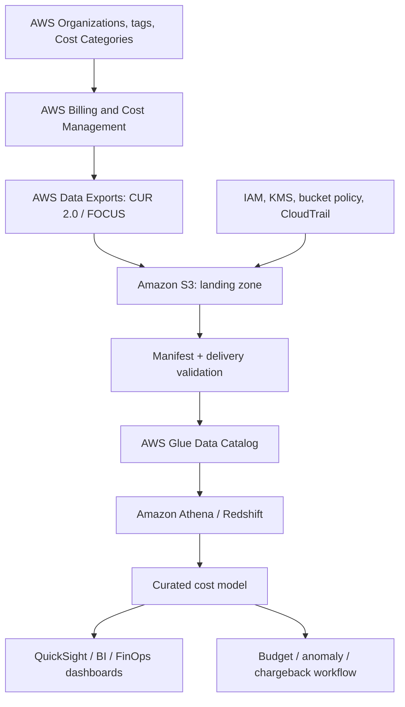

# Cost and Usage Report, AWS Data Exports, and Cost Data

To manage AWS costs by account, application, engineering team, or individual resource, FinOps teams need data far more granular than the invoice total. The **AWS Cost and Usage Report (CUR)** provides cost and usage line items; **AWS Data Exports** is the mechanism to create, customize, and deliver those billing tables to Amazon S3; and Athena, Redshift, and BI tools query, reconcile, and turn that data into decisions.

In the `CLOUD_PROVIDERS_AWS` module, this topic connects knowledge across Organizations, accounts, Regions, compute, storage, databases, tagging, IAM, and cost control. A strong cost data pipeline must answer: which account incurred the cost, which service and usage type generated it, which resource or team owns it, how the cost was calculated, as of when the data was updated, and how the figures reconcile with the invoice.

After this lesson, you will be able to:

- Distinguish legacy CUR, CUR 2.0, and AWS Data Exports.
- Select appropriate tables, granularity, columns, and filters for analytical goals.
- Understand line-item structure, cost/usage columns, and common charge types.
- Organize data in S3, track manifests, handle refreshes, and process updated records.
- Analyze data with Athena or Redshift using Glue and Parquet format.
- Allocate costs using AWS Organizations, cost allocation tags, Cost Categories, and split cost allocation data.
- Choose FOCUS when standardizing cost data across multiple providers.
- Build a pipeline with security, data quality checks, and reconciliation workflows.

## 1. Why Granular Cost Data Matters

A billing dashboard or summary invoice shows how much the organization spent in a period. However, an aggregate total cannot explain the cause:

- Did costs rise due to EC2 instance count, running hours, or instance type?
- Did S3 rise due to stored capacity, requests, retrievals, or data transfer?
- Did RDS rise due to instance class, storage, IOPS, backups, or Multi-AZ?
- Which production account is using substantial NAT Gateway or cross-Region data transfer?
- Did an application's cost rise because of real traffic or forgotten resources?
- How much usage are Savings Plans/Reserved Instances covering, and is there unused commitment?
- How are shared platform costs allocated across business units?

CUR stores cost and usage lines across many analytical dimensions. By combining account, service, Region, usage type, operation, resource ID, tags, and cost categories, FinOps teams can analyze spend from both financial and engineering perspectives.

### 1.1. Cost Data Granularity Levels

| Source | Purpose | Granularity Level |
|---|---|---|
| AWS Bills / Billing dashboard | Track amount due and invoice status | Aggregated by period, service, and account |
| AWS Cost Explorer | Quickly analyze trends, filter, and group costs | Aggregated by dimension and metric |
| CUR / CUR 2.0 | Analyze line items, usage, pricing, discounts, and resources | Most granular billing data |
| AWS Data Exports | Select tables, columns, filters, configurations, and schedule exports | Customizable to analytical needs |
| Athena / Redshift / BI | Query, model, visualize dashboards, and analyze history | Follows organization-built data models |

Cost Explorer works well for fast answers to common questions. CUR/Data Exports works well when building custom dashboards, deep analysis, chargeback/showback, reconciliation, or data lake integration. Sources may differ in refresh timestamps and metric definitions; explicitly document which metric each report uses.

## 2. What Is CUR?

AWS Cost and Usage Report (CUR) is a detailed report of AWS costs and usage. CUR breaks the bill down into line items, each describing a usage charge, fee, discount, credit, tax, or other charge type over a time interval.

A line item may contain:

- Usage account and payer account.
- Service, product, Region, and Availability Zone.
- Usage type, operation, and start/end timestamps.
- Usage quantity, measurement unit, and applied rate.
- Resource ID if the usage type supports it and resource-level data is enabled.
- Discounts, Reserved Instances, Savings Plans, and amortization details.
- Cost allocation tags and Cost Categories if configured.
- Currency, billing period, and invoice metadata.

CUR is valuable because data is represented at the line-item level, allowing aggregation along dimensions summary reports cannot provide. For example, an EC2 bill can be broken down into instance usage, EBS, data transfer, public IPv4, Savings Plans, RI fees, and other adjustments.

### 2.1. Legacy CUR vs. CUR 2.0

AWS currently supports CUR 2.0 via AWS Data Exports. Legacy CUR can still be maintained as a legacy export for compatibility with existing pipelines.

| Characteristic | Legacy CUR | CUR 2.0 |
|---|---|---|
| Creation method | Legacy Cost and Usage Reports page or legacy export | Standard export in AWS Data Exports |
| Schema | Can shift as new usage, tags, and cost categories appear | More stable schema; data groups use nested columns |
| Data customization | Limited ability to pick columns/filter at export time | SQL column selection, row filtering, and aliasing |
| Nested data | Typically flattened into many separate columns | Some groups use MAP/STRUCT such as `resource_tags`, `cost_category`, `product`, `discount` |
| Granularity setting | Chosen in report settings | HOURLY, DAILY, or MONTHLY |
| Resource-level data | Can enable resource IDs | Uses `INCLUDE_RESOURCES` configuration |
| Analysis | S3, Athena, Redshift, QuickSight, and external tools | S3, Athena, Redshift, QuickSight, and external tools |

CUR 2.0 delivers equivalent information to CUR with a steadier schema, additional columns, and nested data that reduces sparse empty columns. Nested attributes can be projected as separate columns in Data Exports queries when backward compatibility with older CUR pipelines is needed.

When migrating from legacy CUR to CUR 2.0, do not simply swap the table name and run the old pipeline. Inspect column names, data types, nested attributes, null values, line-item types, file formats, and data update rules.

## 3. What Is AWS Data Exports?

AWS Data Exports is the mechanism in Billing and Cost Management to create exports from AWS-provided cost data tables. With CUR 2.0, Data Exports lets you define:

1. **Data table** to export, such as `COST_AND_USAGE_REPORT`.
2. **SQL query** to select columns, filter rows, and rename columns.
3. **Table configurations** to adjust granularity and include optional datasets.
4. **Destination** S3 bucket and prefix.
5. **Delivery options** such as CSV/GZIP or Parquet, file overwrite mode, and Athena/Redshift integration where supported.

Data Exports is not a directly queryable database. Data is generated and delivered to S3; Athena, Redshift, or other engines then read that data.

### 3.1. Common Tables and Export Types

Depending on current support and Region availability, Data Exports can provide:

- **Cost and Usage Report 2.0**: most granular cost/usage dataset.
- **FOCUS 1.0 with AWS columns** and **FOCUS 1.2 with AWS columns**: standardized FOCUS schema data plus AWS-specific columns.
- **Cost Optimization Recommendations**: optimization recommendations from Cost Optimization Hub.
- **Cost and usage dashboard**: prebuilt dashboard export and integration.
- **Carbon emissions**: carbon emissions data across supported service scopes.

Choose the table based on the question to answer. CUR 2.0 fits granular line-item investigations and deep analytics. FOCUS fits multi-cloud cost comparisons under a unified schema. Cost Optimization Recommendations drives action workflows rather than replacing actual billing data.

### 3.2. CUR 2.0 Has a Fixed Schema and Nested Data

CUR 2.0 organizes columns across bill, identity, line item, product, pricing, reservation, Savings Plans, discounts, cost categories, resource tags, capacity reservations, and split line items.

Several groups are structured as nested columns:

- `resource_tags`: resource tags.
- `cost_category`: Cost Categories applied to the line item.
- `product`: product and service attributes.
- `discount`: discount details.

For example, instead of a separate column for every product attribute, you can select an attribute from the `product` column. In Data Exports SQL, use dot notation to select a nested attribute:

```sql
SELECT product.from_location AS product_from_location
FROM COST_AND_USAGE_REPORT
```

Attribute names must exist in the table dictionary and are case-sensitive as defined. Before writing pipelines, inspect the actual schema and export manifest.

## 4. Choosing Granularity and Table Configuration

Higher granularity provides richer detail for deep investigation, but increases row counts, S3 storage, crawl times, and query costs.

### 4.1. Time Granularity

CUR 2.0 supports:

| Granularity | When to Use | Trade-Off |
|---|---|---|
| HOURLY | Investigating spikes, hourly workloads, autoscaling efficiency | More rows and storage volume |
| DAILY | Daily trend tracking, routine FinOps operations | Hides intra-day fluctuations |
| MONTHLY | Monthly reporting and long-term trend analysis | Unsuited for investigating brief spikes |

For example, an operations team investigating why EC2 costs spike overnight should use HOURLY. Monthly showback reports can use DAILY or MONTHLY depending on reconciliation needs.

### 4.2. Resource-Level Granularity

Setting `INCLUDE_RESOURCES=TRUE` adds `line_item_resource_id` and generates resource-level line items for supported usage types. This helps pinpoint the exact instance, volume, database, or bucket generating charges.

Not every line item has a resource ID. Data transfer, API requests, discounts, credits, taxes, and certain shared items may not map to a single resource. Thus, resource-level data does not mean every dollar maps to an ARN.

Enabling resource-level granularity can sharply increase row counts and export size. Enable it only with a clear use case; otherwise, narrow down by account/service/usage type first before creating a resource-level export.

### 4.3. Split Cost Allocation Data

Setting `INCLUDE_SPLIT_COST_ALLOCATION_DATA=TRUE` adds `split_line_item_*` columns and rows showing how usage of certain shared resources is allocated across workloads or teams.

For instance, an EC2 instance hosts multiple containers. Rather than attributing the entire instance cost to one app, split cost allocation data can attribute usage across containers based on service-supported telemetry.

This differs from **Cost Category split charge rules**. Split cost allocation data provides resource/workload-level usage allocation inside CUR 2.0. Cost Category split charge rules distribute shared costs across category values proportionally, by fixed percentage, or evenly; split charge results appear on the Cost Categories details page and do not automatically become line items in CUR or Cost Explorer.

### 4.4. Other CUR 2.0 Configurations

| Configuration | Effect | Notes |
|---|---|---|
| `TIME_GRANULARITY` | HOURLY, DAILY, MONTHLY | Choose based on analytical goals and data volume |
| `INCLUDE_RESOURCES` | Adds resource-level data and `line_item_resource_id` | Can significantly increase row count |
| `INCLUDE_SPLIT_COST_ALLOCATION_DATA` | Adds split allocation columns/rows | Fits shared-workload allocation use cases |
| `INCLUDE_CAPACITY_RESERVATION_DATA` | Adds capacity reservation details | New data effective from 2025-11-01 |
| `INCLUDE_IAM_PRINCIPAL_DATA` | Adds `line_item_iam_principal` for Bedrock inference costs | Currently applies to Amazon Bedrock; can increase row count |
| `INCLUDE_STANDARDIZED_COST_AND_RATE` | Adds 14 `cost_analytics_*` columns for standardized costs/rates | Compare billed, list, contracted, effective, and public-equivalent costs/rates |
| `INCLUDE_MANUAL_DISCOUNT_COMPATIBILITY` | Changes how discounts are represented | Applies only to customers enrolled in Discount Automation per AWS terms |

When enabling a new setting, validate schema, ETL jobs, and downstream consumers. AWS added support for updating table configurations on existing CUR 2.0 exports via console and SDK/CLI starting June 2026; changes take effect on the next scheduled delivery. Verify status and schema after updating before running production pipelines.

## 5. Understanding Line-Item Structure

A line item is the fundamental analytical unit of CUR. Not every row represents a running resource; a row can represent usage, subscription fees, discounts, credits, refunds, or taxes.

Common column groups:

| Group | Example Columns | Meaning |
|---|---|---|
| Billing | `bill_billing_period_start_date`, `bill_billing_period_end_date`, `bill_payer_account_id` | Billing period and payer account |
| Account | `line_item_usage_account_id`, `line_item_usage_account_name` | Account consuming the service |
| Product | `line_item_product_code`, `product_product_family`, `product_servicecode` | Service code and product family |
| Region/AZ | `product_region_code`, `line_item_availability_zone` | Location where usage occurred |
| Usage | `line_item_usage_type`, `line_item_operation`, `line_item_usage_amount` | Activity type and usage quantity |
| Time | `line_item_usage_start_date`, `line_item_usage_end_date` | Time window of the line item |
| Resource | `line_item_resource_id` | Resource ID if supported and enabled |
| Cost | `line_item_unblended_cost`, `line_item_blended_cost` | Cost value by calculation method |
| Pricing | `pricing_unit`, `pricing_public_on_demand_rate` | Billing unit and public list price per schema |
| Discount | `discount`, `reservation_*`, `savings_plan_*` | Discounts, RIs, and Savings Plans |

Column names and column presence depend on the table, table configuration, and account activity. Do not hardcode ETL against a column list sampled from a single month assuming every future period will look identical.

### 5.1. Common Line-Item Types

| `line_item_line_item_type` | Meaning |
|---|---|
| `Usage` | Usage billed at On-Demand rates |
| `DiscountedUsage` | Usage receiving Reserved Instance benefits |
| `SavingsPlanCoveredUsage` | Usage covered by a Savings Plan |
| `SavingsPlanNegation` | Offsetting line for Savings Plan Covered Usage |
| `RIFee` | Recurring fee for a Reserved Instance |
| `Fee` | Upfront or subscription fee depending on type |
| `SavingsPlanRecurringFee` | Recurring fee for a Savings Plan |
| `SavingsPlanUpfrontFee` | Upfront fee for a Savings Plan |
| `Discount` | Discount applied to usage |
| `Credit` | Credit recorded by AWS |
| `Refund` | Refund amount |
| `Tax` | Taxes |
| `BundledDiscount` | Volume or feature bundle discount |

Some line-item types may be added or updated across services and billing programs. Rely on the table dictionary and observed values rather than parsing free-text descriptions to infer charge types.

### 5.2. Why Understanding Line-Item Types Matters

When summing total costs, filtering solely on `Usage` may omit RI fees, Savings Plans fees, credits, refunds, taxes, or other adjustments. Summing `SavingsPlanCoveredUsage` without `SavingsPlanNegation` can double-count charges already offset by the Savings Plan.

When analyzing commitment costs:
- Inspect covered usage.
- Inspect the corresponding negation lines.
- Inspect recurring and upfront fees.
- Inspect unused commitment portions.
- Apply an appropriate amortized calculation.

Never sum incompatible cost columns in the same query. Pick one cost basis per report and document its definition explicitly.

## 6. Distinguishing Cost Measures

CUR exposes multiple ways to represent cost. They serve different analytical purposes and are not interchangeable across reports.

| Cost Measure | General Meaning | When to Use |
|---|---|---|
| Unblended cost | Cost at the consuming account's specific rate × usage | Line-item analysis and account-level spend |
| Blended cost | Cost at blended rates across consolidated billing | Certain internal allocations using blended rates |
| Net unblended cost | Unblended cost after applicable discounts when available | Post-discount cost analysis |
| Amortized cost | Spreads upfront/recurring commitments across usage periods | Comparing operating run-rates over time |
| Net amortized cost | Amortized cost after applicable discounts | Post-discount FinOps showback/chargeback |
| Public On-Demand cost/rate | Reference public On-Demand list price | Benchmarking savings against list rates |

### 6.1. Unblended vs. Blended

Unblended cost is typically computed from the unblended rate multiplied by usage amount. In consolidated billing, the unblended rate is tied to the account consuming the line item.

Blended rate is an organization-wide SKU average in consolidated billing scenarios supporting blended rates. It can make allocated costs differ from actual per-account rates. When using blended costs, document the allocation rationale and do not confuse it with the final invoice total.

### 6.2. Net Cost and Discounts

Net unblended cost represents cost after discounts when corresponding columns are present in the report. Net columns may appear only when an account has applicable discounts during the period. Pipelines should gracefully handle missing net columns or null values.

Do not assume `line_item_unblended_cost` always equals the net amount paid under commercial agreements. Check whether the report contains net cost columns and reconcile against Billing/Invoice.

### 6.3. Amortized Cost

For Reserved Instances and Savings Plans, upfront and recurring fees can be spread over time to reflect the economic cost of usage within each period.

For example, an enterprise buys a one-year Partial Upfront RI. Looking solely at unblended charges in the purchase month makes month one look expensive and subsequent months artificially cheap. Amortization distributes the upfront fee across periods to compare consumption and commitment efficiency fairly.

Relevant amortized fields may include:
- `reservation_effective_cost`
- `reservation_amortized_upfront_fee_for_billing_period`
- `reservation_unused_amortized_upfront_fee_for_billing_period`
- `savings_plan_savings_plan_effective_cost`
- Corresponding net fields when present.

Calculating net amortized cost may require combining multiple line-item types. Never run a naive `SUM(line_item_unblended_cost)` and label the result amortized cost. Use formulas and views verified against AWS billing semantics or validated FinOps tooling.

## 7. Creating a CUR 2.0 Export

To create a CUR 2.0 export, an authorized Billing and Cost Management user performs these steps in the AWS Management Console:

1. Open Billing and Cost Management.
2. Select **Data Exports**.
3. Choose to create a standard data export.
4. Select the **Cost and Usage Report 2.0** table.
5. Select required columns and table configurations.
6. Specify a SQL query if filtering rows or aliasing columns.
7. Choose S3 bucket, prefix, file format, and delivery options.
8. Select Athena or Redshift integration if it fits your workflow.
9. Review permissions, bucket policy, encryption, and export settings.
10. Create the export and monitor delivery status.

If creating exports via SDK/CLI, the destination bucket and bucket policy must be prepared beforehand per Data Exports documentation. Do not assume the service can write to any bucket simply because the caller has `s3:PutObject`.

### 7.1. Data Exports Query Examples

Data Exports SQL selects columns, filters rows, and assigns aliases. It is not the full Athena SQL dialect; export queries support SELECT/FROM/WHERE/LIMIT constructs per service documentation.

Example selecting specific EC2 columns:

```sql
SELECT
  line_item_usage_account_id,
  line_item_product_code,
  line_item_usage_type,
  line_item_operation,
  line_item_unblended_cost
FROM COST_AND_USAGE_REPORT
WHERE line_item_product_code = 'AmazonEC2'
LIMIT 100
```

To directly project a nested attribute, use dot notation and an alias:

```sql
SELECT
  product.from_location AS product_from_location
FROM COST_AND_USAGE_REPORT
LIMIT 100
```

Attribute names are examples from the table dictionary; verify the attribute exists in your exported dataset. Data Exports queries are not intended for full `GROUP BY` aggregations, multi-table joins, or window functions. Perform those analytical operations in Athena or Redshift after delivery.

### 7.2. Table Configuration Example

An illustrative configuration for an hourly export with resource IDs and split allocation:

```json
{
  "COST_AND_USAGE_REPORT": {
    "TIME_GRANULARITY": "HOURLY",
    "INCLUDE_RESOURCES": "TRUE",
    "INCLUDE_SPLIT_COST_ALLOCATION_DATA": "TRUE"
  }
}
```

Enable only configurations you genuinely need. Adding resource IDs and split allocation can make exports substantially larger. Verify the updated schema and Glue/Athena throughput after making changes.

## 8. Organizing Export Files in Amazon S3

Data Exports delivers data to S3 organized into data and metadata directories.

A CUR 2.0 data path looks like:

```text
s3://<bucket>/<prefix>/<export-name>/data/BILLING_PERIOD=YYYY-MM/
```

The metadata manifest path looks like:

```text
s3://<bucket>/<prefix>/<export-name>/metadata/BILLING_PERIOD=YYYY-MM/<export-name>-Manifest.json
```

The manifest lists columns, data files, time coverage, and export metadata. For large exports, a single billing period may be split into multiple files/chunks. Ingestion pipelines should read the manifest to discover files to process rather than assuming a single file or static filename.

### 8.1. Manifests and Delivery Ordering

AWS delivers `Manifest.json` only after all data files for that export execution have finished delivering. Therefore, the manifest serves as a completion signal for a delivery run.

A pipeline should:
1. Detect a new or updated manifest.
2. Read the file list inside the manifest.
3. Identify the corresponding billing period and execution/version.
4. Ingest all listed files.
5. Validate file count, schema, and record count.
6. Record the processed execution to prevent duplicate ingestion.
7. Publish the partition only after validation passes.

### 8.2. Data Refreshes and Post-Period Adjustments

Data Exports can take up to 24 hours to begin delivery after creation. Once started, billing/cost data refreshes at least daily; exact timing can vary.

CUR 2.0 for the current billing period continues refreshing as source data updates. After a billing period closes, AWS may update the prior period's export during the first two weeks. Credits, refunds, or billing adjustments can also alter previously observed numbers.

Therefore:
- Never treat day-one data as final month-end numbers.
- Never close financial books solely on a provisional intra-month export.
- Record the latest refresh timestamp and manifest.
- Maintain a backfill/correction workflow.
- Reprocess affected partitions whenever AWS updates prior period data.

### 8.3. Overwrite vs. Create New

When configuring delivery, you choose how refreshes are written:

| Mode | Behavior | Trade-Off |
|---|---|---|
| Overwrite | Files for the same billing period are overwritten with the latest refresh | Saves storage; downstream must detect and reprocess partitions |
| Create new | Each refresh writes to a new execution path | Preserves delivery history; consumes additional S3 storage |

With Overwrite, do not ingest a partition once and ignore subsequent updates. Whenever the manifest changes, reprocess the partition to capture corrections. With Create New, determine which manifest is latest and avoid summing multiple snapshots of the same period as independent costs.

## 9. Athena, Glue, and Redshift

### 9.1. Amazon Athena

Athena lets you query S3 data using SQL without managing clusters. It fits:
- Ad hoc queries.
- FinOps dashboards.
- Cost reconciliation by account/service/tag.
- Standardized cost metric views.
- Resource-level or hourly investigations.

CUR 2.0 can integrate directly with Athena inside Data Exports. AWS provides supporting metadata and assets such as CloudFormation templates, table-creation SQL, and status folders. Starting June 2026, CUR 2.0 also offers native Athena/Redshift integration that delivers query-engine-friendly formats and auto-updates tables across refreshes without building custom ETL for basic flows.

If configuring Athena manually:
1. Deliver Parquet exports to S3.
2. Create Glue Data Catalog tables via Glue crawler or DDL.
3. Partition by billing period.
4. Query with Athena.
5. Optimize partition pruning, projection, and column selection.
6. Encrypt and secure the S3 query results location.

### 9.2. AWS Glue

Glue Data Catalog stores table metadata, schemas, and partitions for Athena, Redshift Spectrum, or other engines.

A Glue crawler can infer schemas from S3 files. However, crawlers do not replace schema governance:
- Schema changes must be reviewed.
- Nested MAP/STRUCT types require proper type handling.
- New files must land in proper partitions.
- Updated partitions must stay synchronized.
- Prevent crawlers from accidentally generating extra tables due to mixed prefixes.

For production pipelines, use schema contracts and validate manifests before updating the catalog.

### 9.3. Amazon Redshift

Redshift fits when you need a data warehouse, joins between billing data and business datasets, or high-concurrency enterprise reporting. CUR 2.0 provides Redshift integration with command files and load instructions. A self-managed workflow can use S3 as a landing zone, Redshift `COPY` to load data, and dbt/SQL to build data models.

Weigh compute costs, storage, concurrency, and refresh cadence. If only occasional queries are needed, Athena may be simpler. If building enterprise dashboards joining many business sources, Redshift may fit better.

## 10. Querying CUR 2.0 Data with Athena

Once Glue Catalog holds the table, Athena supports richer SQL than Data Exports export queries. The example below aggregates unblended line-item amounts by account and service for one month.

```sql
SELECT
    line_item_usage_account_id,
    line_item_product_code,
    SUM(line_item_unblended_cost) AS unblended_line_item_cost
FROM finops_db.cur2_table
WHERE line_item_usage_start_date >= TIMESTAMP '2026-11-01 00:00:00'
  AND line_item_usage_start_date <  TIMESTAMP '2026-12-01 00:00:00'
GROUP BY
    line_item_usage_account_id,
    line_item_product_code
ORDER BY
    unblended_line_item_cost DESC
LIMIT 50;
```

This is an unblended line-item sum, not automatically the final invoice total or net amortized cost. If another cost basis is required, construct the metric using line-item types and corresponding discount/commitment columns.

### 10.1. Analyzing by Line-Item Type

The query below inspects cost composition by row type:

```sql
SELECT
    line_item_line_item_type,
    SUM(line_item_unblended_cost) AS unblended_amount,
    COUNT(*) AS line_count
FROM finops_db.cur2_table
WHERE line_item_usage_start_date >= TIMESTAMP '2026-11-01 00:00:00'
  AND line_item_usage_start_date <  TIMESTAMP '2026-12-01 00:00:00'
GROUP BY line_item_line_item_type
ORDER BY unblended_amount DESC;
```

The output surfaces commitment fees, usage, credits, refunds, or taxes. Cross-reference line-item types and cost measures before interpreting totals.

### 10.2. Analyzing by Usage Type

```sql
SELECT
    line_item_product_code,
    line_item_usage_type,
    line_item_operation,
    SUM(line_item_usage_amount) AS usage_amount,
    SUM(line_item_unblended_cost) AS unblended_amount
FROM finops_db.cur2_table
WHERE line_item_usage_start_date >= TIMESTAMP '2026-11-01 00:00:00'
  AND line_item_usage_start_date <  TIMESTAMP '2026-12-01 00:00:00'
GROUP BY
    line_item_product_code,
    line_item_usage_type,
    line_item_operation
ORDER BY unblended_amount DESC
LIMIT 100;
```

Usage types and operations link dollar amounts to engineering behavior. For example, a service might increase due to storage, requests, data transfer, or instance types. Never stop at product code alone when diagnosing root causes.

### 10.3. Resource-Level Queries

If the export has `INCLUDE_RESOURCES` enabled, you can group by resource ID:

```sql
SELECT
    line_item_usage_account_id,
    line_item_product_code,
    line_item_resource_id,
    SUM(line_item_unblended_cost) AS unblended_amount
FROM finops_db.cur2_resource_table
WHERE line_item_resource_id IS NOT NULL
  AND line_item_usage_start_date >= TIMESTAMP '2026-11-01 00:00:00'
  AND line_item_usage_start_date <  TIMESTAMP '2026-12-01 00:00:00'
GROUP BY
    line_item_usage_account_id,
    line_item_product_code,
    line_item_resource_id
ORDER BY unblended_amount DESC
LIMIT 100;
```

Database and table names in these examples are illustrative; replace them with your actual Glue Catalog names. Since some line items lack resource IDs, this query does not represent 100% of spend; track unattributed/unallocated spend separately.

### 10.4. Avoiding Misreads and Double-Counting

Key rules:
- Never sum multiple refresh snapshots from `Create new` mode.
- Never sum `SavingsPlanCoveredUsage` without accounting for `SavingsPlanNegation`.
- Never label unblended cost as net amortized cost.
- Never assume every line item carries a resource ID.
- Never parse `line_item_line_item_description` with regex as a join/logic key; descriptive text can change.
- Never sum mixed currencies before normalizing currency.
- Never blindly substitute usage start date for billing period in all analyses; corrections can span prior periods.
- Never assume every cost category or tag is already activated and populated.

## 11. Cost Allocation Tags

Tags are key-value pairs attached to resources or principals describing owner, project, environment, cost center, and workload.

Examples:
- `Environment=production`
- `Application=checkout`
- `Team=payments`
- `CostCenter=CC-042`
- `Owner=platform`

For a tag to appear in billing data as a cost allocation tag, the organization must activate the tag key in Billing and Cost Management. Applying a tag to a resource and activating a cost allocation tag are two separate steps.

### 11.1. FinOps Tagging Workflow

1. Define a unified taxonomy: keys, values, owners, and naming conventions.
2. Apply tags to resources via IaC, Tag Editor, or provisioning workflows.
3. Identify which tag keys are needed for cost allocation.
4. Activate those tag keys under Cost allocation tags.
5. Wait for data propagation and verify in CUR/Cost Explorer.
6. Build dashboards by project, team, environment, or cost center.
7. Monitor untagged spend percentages and assign owners to remediate.

New tag keys can take up to 24 hours to appear on the activation page, and another 24 hours after activation to populate in billing data. Do not expect newly applied tags to show up instantaneously in CUR.

### 11.2. Tag Coverage and Unallocated Costs

Organizations should measure:
- Percentage of spend carrying an `Application` tag.
- Percentage of spend carrying `Owner`/`Team`/`CostCenter`.
- Untagged spend.
- Shared platform spend.
- Percentage of resources violating the taxonomy.

Not all charges can attach directly to resources. Data transfer, support, taxes, marketplace items, or commitment fees may need allocation via Cost Categories or custom rules.

Never place sensitive information, secrets, personal emails, or customer data in tags. Tags appear in billing reports read by many teams with billing visibility.

## 12. AWS Cost Categories

Cost Categories map AWS costs to internal structures such as departments, products, business units, environments, or projects. In AWS Organizations, the management account manages Cost Categories for the organization; standalone accounts manage categories within their own billing scope. Rules can use:
- AWS account.
- Cost allocation tag.
- Service.
- Region.
- Usage type.
- Charge type.
- Billing entity.
- Another Cost Category.

Examples:
- Accounts for teams Alpha and Beta → Engineering.
- Tag `Project=Gamma` → Marketing.
- Costs matching no rule → Shared IT.

Cost Categories appear as dimensions in Cost Explorer and in CUR data. Rules evaluate sequentially; include a default category so uncategorized costs are never lost.

### 12.1. Split Charge Rules

Cost Categories can distribute shared costs across multiple target groups using:
- Proportional: weighted by each target group's cost share.
- Fixed: by explicitly defined percentages.
- Even split: divided equally.

For example, shared platform cost is $10,000 USD, split 70% Engineering and 30% Marketing:
- Engineering: $7,000 USD.
- Marketing: $3,000 USD.

Split charge rules support organizational showback/chargeback. Note that split charge results appear on the Cost Categories details page; they do not automatically rewrite CUR line items or Cost Explorer figures. When building reports, state clearly whether numbers reflect base cost categories or split charge allocations.

### 12.2. Effective Timing

After creating or editing a Cost Category, it can take up to 24 hours for cost/usage data to update. You can select a retroactive effective date within service limits to apply rules from the start of the month or a supported prior date. Verify that status transitions from Processing to Applied before using results for chargeback.

## 13. Allocating Costs for Containers and Shared Workloads

An EC2 instance or cluster can host multiple workloads. Looking only at EC2 instance-level costs makes it hard to tell which team drove CPU/memory consumption.

CUR 2.0 split cost allocation data can attribute costs of certain shared resources to individual containers or workloads. Supported configurations and resource types depend on current AWS services and documentation.

To use this effectively:
- Standardize tags/labels for clusters, namespaces, services, and teams.
- Understand how CPU/memory or usage metrics drive the split calculation.
- Enable split cost allocation data in exports where appropriate.
- Inspect split allocation rows and reconcile sums against the parent resource cost.
- Never sum both parent line items and split rows as independent costs.
- Label reports clearly as shared-workload cost allocation, not a separate AWS bill.

When allocating Kubernetes/ECS costs, understand data limitations and workload identification rules. Inconsistent tags or labels yield unreliable allocations.

## 14. FOCUS and Cost Data Standardization

FOCUS (FinOps Open Cost and Usage Specification) is an open specification standardizing cost/usage data across cloud providers and service vendors. Rather than maintaining separate models for AWS, Azure, Google Cloud, and SaaS, organizations can build multi-cloud reporting on shared standard columns.

AWS Data Exports offers FOCUS tables with AWS-specific columns. Depending on table version and Regional support, organizations can choose FOCUS 1.0 or FOCUS 1.2.

### 14.1. Key Cost Columns in FOCUS

| Column | Meaning |
|---|---|
| `ListCost` | Cost calculated at the provider's public list rates |
| `ContractedCost` | Cost at contracted unit rates before certain additional commitment discounts |
| `BilledCost` | Cost serving as the billing basis as defined by FOCUS |
| `EffectiveCost` | Effective cost after amortization and discounts as defined by FOCUS |

FOCUS standardizes column names and semantics for multi-cloud comparisons. However, do not assume every provider exposes identical granularity, refresh timing, or discount mechanics. Review conformance gaps, AWS-specific columns, and version definitions.

### 14.2. When to Choose CUR 2.0 vs. FOCUS

| Requirement | Appropriate Choice |
|---|---|
| Investigating line items, usage types, operations, resource IDs | CUR 2.0 |
| Calculating detailed RIs/Savings Plans and discounts | CUR 2.0 |
| Comparing cost models across multiple cloud providers | FOCUS |
| Needing AWS-specific columns for detailed analysis | CUR 2.0 or FOCUS with AWS columns |
| Standardized executive financial dashboards | FOCUS or a curated model built from CUR 2.0 |
| Diagnosing technical root causes of an AWS service | CUR 2.0 |

You can maintain both exports: CUR 2.0 as the granular source and FOCUS as the standardized multi-cloud reporting layer. Manage storage and refresh costs to avoid unnecessary duplicate pipelines.

## 15. AWS Organizations Integration

Under consolidated billing, the management account can create exports containing cost data for the management account and all member accounts in the organization. Member accounts can create their own exports, scoped strictly to their own account.

This shapes pipeline design:
- Central FinOps typically creates exports in the management/payer account.
- Destination buckets can reside in a dedicated data/FinOps account using cross-account access.
- Member accounts need appropriately scoped permissions if creating self-service exports.
- When an account leaves or switches organizations, export data scope across membership timestamps changes.
- Read permissions on historical S3 exports still depend on bucket policies and IAM.

Do not confuse the payer account with the usage account. A line item may be billed through the management account while usage originated in a member account. Use `bill_payer_account_id` and `line_item_usage_account_id` accurately.

## 16. Cost Data Pipeline Architecture

A reference architecture:



### 16.1. Landing Zone

The S3 landing zone should:
- Use a dedicated bucket/prefix for billing exports.
- Enforce encryption per organizational standards.
- Enable versioning or protective controls aligned with audit requirements.
- Apply bucket policies restricting access to the Data Exports writer and approved reader roles.
- Separate raw data from curated data.
- Apply lifecycle policies aligned with financial retention rules.
- Log access events and policy changes.

### 16.2. Raw, Curated, and Semantic Layers

A three-layer data model:

| Layer | Contents | Rules |
|---|---|---|
| Raw | Original files from Data Exports, manifests, and metadata | Immutable; never modify source contents |
| Curated | Standardized schemas, deduplication, corrections, and standardized cost measures | Versioned, with lineage and quality checks |
| Semantic | Views by account, team, application, service, cost center, and time | Explicit metric definitions for dashboards |

Preserving the raw layer lets you reprocess history whenever schemas, allocation rules, or metric definitions evolve. Perform transformations in the curated layer rather than altering source files in S3.

## 17. Security and Governance of Billing Data

Cost data can reveal:
- Application, environment, and project names.
- Account and organizational structure.
- Resource names and resource IDs.
- Usage volumes and deployment schedules.
- AI/model inference activity or sensitive services.
- Spend levels and commercial discount arrangements.

Therefore, protect it as sensitive internal data.

Principles:
- Use separate IAM roles for export management, raw reading, querying, and administration.
- Allow only authorized accounts/roles to read the bucket.
- Use KMS encryption and tightly scoped key policies.
- Protect Glue Catalog, Athena workgroups, and S3 query result buckets.
- Do not grant dashboard consumers raw bucket access when curated views suffice.
- Enable CloudTrail to audit Billing, S3, Glue, Athena, and IAM actions.
- Restrict permissions to alter Cost Categories, export settings, and bucket policies.
- Never put secrets or personal data in tags.
- Define retention policies and governance for sharing data with external BI vendors.

Within Organizations, separate billing administration from workload administration. Application roles do not need permission to read organization-wide cost exports or alter export destinations.

## 18. Data Quality Checks and Reconciliation

An export showing Healthy status does not automatically mean data is modeled correctly. Pipelines must validate:

### 18.1. Delivery Checks

- Has the export begun delivery?
- Is the manifest present and up to date?
- Were all files listed in the manifest ingested?
- Are billing period partitions accurate?
- Are any file chunks missing or duplicated?
- Did an overwrite refresh update a previously processed partition?

### 18.2. Schema Checks

- Are required columns present?
- Did any column data types change?
- Are nested attributes still present in the schema?
- Can optional columns be null or absent?
- Do resource IDs appear for the usage types being analyzed?
- Were table configurations applied as expected?

### 18.3. Numeric Reconciliation Checks

- Are line-item totals per period reasonable?
- Are currencies consistent?
- Are credits/refunds/taxes handled accurately?
- Are RIs/Savings Plans double-counted?
- Do net/amortized costs match definitions?
- Are unallocated costs tracked?
- Do results reconcile with Bills/Cost Explorer on matching cost basis and timestamp?

CUR and Cost Explorer can differ if metrics, granularities, filters, or refresh timestamps differ. Align cost basis and billing period before comparing.

## 19. Monitoring Exports and Troubleshooting Errors

Data Exports reports export status such as Healthy or Unhealthy based on the most recent delivery. When an export is Unhealthy:
1. Identify the export name and table.
2. Check S3 destination, bucket policy, and KMS key.
3. Check IAM permissions for export creation and delivery.
4. Inspect the last refresh timestamp and manifest.
5. Check the export query and table configuration.
6. Check service quotas or export limits.
7. Restore delivery and confirm new files arrive in S3.
8. Rerun ingestion for affected partitions.

Common causes:
- Bucket policy blocks Data Exports delivery.
- KMS key policy blocks encryption.
- Incompatible destination bucket or Region.
- Export query references a nonexistent column.
- Downstream schema was not updated.
- Glue crawler lacks read access to the prefix.
- Athena queries hit limits or read partially refreshed partitions.
- Data Exports is mid-refresh while the pipeline reads files too early.

Do not immediately delete and recreate an export upon failure. First capture status, manifest, and error messages; fix the root cause and verify recovery.

## 20. Practical Scenario: FinOps Cost Analysis for an E-Commerce App

An organization operates an AWS Organization with these accounts:
- `111122223333`: production.
- `222233334444`: development.
- `333344445555`: shared services.

The checkout application runs on ECS, RDS, S3, CloudFront, and SQS. FinOps needs cost reporting by team and application, plus root-cause analysis for a monthly cost spike.

### 20.1. Data Design

1. The management account creates a CUR 2.0 export for the organization.
2. Chooses HOURLY granularity to investigate spikes.
3. Enables resource-level data for use cases requiring exact resource identification.
4. Activates tag keys `Application`, `Team`, `Environment`, `CostCenter`.
5. Creates Cost Categories by Department and Environment.
6. Exports to an S3 landing zone in the data account.
7. Uses Athena/Glue to build curated tables.
8. Builds dashboards by account, service, Region, usage type, and application.
9. Tracks unallocated shared services costs.

### 20.2. Investigating a Cost Spike

The dashboard reveals a 35% EC2 cost increase over three days. The FinOps team:
- Filters to the production usage account.
- Groups by usage type and operation.
- Switches to hourly granularity.
- Inspects resource-level IDs.
- Correlates with deployment and Auto Scaling events.
- Discovers an ECS service over-scaled due to a retry storm.
- Reviews CPU/memory, request rates, and task counts.
- Fixes retry policies and sets autoscaling bounds.

CUR identifies the cost lines and usage; CloudWatch/Container Insights explains runtime behavior. Combining billing data with telemetry takes you from "spend went up" to "the exact engineering change that drove it."

### 20.3. Showback and Chargeback

FinOps uses tags and Cost Categories to assign direct costs to teams. Shared services are categorized separately, then split charge rules are applied for showback. Reports must distinguish:
- Direct costs per CUR.
- Costs grouped by Cost Category.
- Shared costs allocated via split charges.
- Invoiced/billed totals versus amortized figures used for governance.

Never add allocated shared costs back on top of the original CUR total a second time. Showback tables must state the cost basis and allocation method clearly.

## 21. Lab Exercise: Building an Export and Query Pipeline

A lab workflow can follow this sequence:

**Step 1 — Create the export**
- Create a CUR 2.0 standard export.
- Choose DAILY granularity to limit volume.
- Select account, service, usage type, Region, cost, and time columns.
- Enable resource IDs if the lab analyzes specific resources.
- Choose Parquet and an S3 destination.

**Step 2 — Verify S3**
- Wait for delivery to start.
- Inspect the data partition and metadata manifest.
- Read the file list inside the manifest.
- Verify file format and billing period.

**Step 3 — Create Athena tables**
- Use Athena integration or Glue crawler/DDL.
- Verify schema and partitions.
- Run bounded queries first.

**Step 4 — Build reports**
- Aggregate costs by account and service.
- Break down by usage type.
- Identify top-cost resources.
- Inspect line-item types and discounts.

**Step 5 — Quality checks**
- Reconcile row counts against the manifest.
- Check subsequent refreshes.
- Reprocess partitions when files are overwritten.
- Document metric definitions and refresh timestamps.

Do not use production accounts or live billing data in labs without proper authorization and access controls. Use sample datasets to practice SQL before connecting live exports.

## 22. Optimizing Query Performance and Cost

CUR can grow to millions or billions of rows depending on organization size, granularity, and retention. Athena cost scales with bytes scanned; good data design reduces both runtime and query spend.

Principles:
- Prefer Parquet for Athena/Redshift analytics.
- Filter explicitly on billing period partitions.
- `SELECT` only needed columns.
- Avoid `SELECT *` across full history.
- Apply predicates on timestamp and partition columns.
- Build curated tables or views for recurring dashboards.
- Consider CTAS/Iceberg or structured data models when standardized history is required.
- Apply S3 lifecycle policies to raw exports aligned with retention.
- Monitor Athena bytes scanned and query history.
- Avoid enabling hourly/resource-level/split allocation without an actual need.

Do not optimize by stripping critical columns before understanding audit and investigation needs. Retain complete raw data per policy while keeping curated tables and queries lean.

## 23. Misconceptions to Avoid

| Misconception | Accurate Understanding |
|---|---|
| Data Exports is a directly queryable dashboard | Data Exports delivers datasets; Athena/Redshift/BI perform analysis |
| CUR 2.0 and legacy CUR share the exact same schema | CUR 2.0 has a steadier schema and nested columns |
| CUR shows final invoice numbers as soon as the first file lands | Data refreshes and can be adjusted after period close |
| Every line item has a resource ID | Many shared/service-level items lack resource IDs |
| `Usage` represents all costs | Fees, commitments, discounts, credits, refunds, taxes, and other types exist |
| Unblended cost equals net amortized cost | These are distinct cost bases |
| Summing SavingsPlanCoveredUsage is sufficient | Must account for SavingsPlanNegation and commitment fees to avoid double-counting |
| Applying a tag automatically puts it into CUR | The cost allocation tag key must be activated and given propagation time |
| Cost Category split charges appear as CUR line items | Split charge rules appear on Cost Categories details; CUR does not generate split rows |
| Split cost allocation data and Cost Category split charges are identical | One allocates container/resource usage; the other splits category shared costs |
| The manifest is just an auxiliary file | The manifest defines files, columns, and period boundaries for each delivery |
| Overwrite exports only need one-time ingestion | Refreshes can overwrite partitions; pipelines must detect and reprocess |
| CUR 2.0 is only for AWS-only reporting | Use CUR 2.0 for granular AWS detail and FOCUS for multi-cloud standardization |

## 24. Cost Data Implementation Checklist

- [ ] Identify FinOps owner and billing management account.
- [ ] Choose CUR 2.0, FOCUS, or both based on objectives.
- [ ] Choose appropriate granularity and resource-level/split allocation options.
- [ ] Standardize tag taxonomy and activate cost allocation tags.
- [ ] Configure Cost Categories and a default category.
- [ ] Create S3 landing zone with encryption and bucket policies.
- [ ] Separate permissions for export management, raw reading, querying, and administration.
- [ ] Configure Athena/Glue or Redshift.
- [ ] Handle manifests, partitions, refreshes, and overwrite/create-new modes.
- [ ] Validate schemas and nested columns.
- [ ] Standardize line-item types and cost measures.
- [ ] Reconcile against Bills/Cost Explorer on matching periods and metrics.
- [ ] Monitor unallocated spend and tag coverage.
- [ ] Build correction/backfill pipelines.
- [ ] Monitor export status, delivery lag, and query spend.
- [ ] Secure raw data, query results, and dashboards.

## 25. Summary

CUR is the granular line-item source for AWS cost and usage data. CUR 2.0 in AWS Data Exports provides a steadier schema, nested columns, and SQL/table configuration customization. Data Exports delivers datasets to S3 with manifests, billing-period partitioning, and periodic refreshes that can update current or recently closed periods.

Accurate analysis requires understanding line-item types and cost bases. Usage, RIs, Savings Plans, fees, discounts, credits, refunds, and taxes carry distinct semantics. Unblended, blended, net, and amortized costs cannot be mixed arbitrarily. Resource IDs, tags, Cost Categories, and split allocation tie costs to workloads and organizations, each with defined boundaries.

A reliable FinOps pipeline pairs raw S3 exports, manifest-aware ingestion, Glue/Athena or Redshift, curated cost models, dashboards, and data quality checks. Secure buckets, KMS, IAM, and audit logs; monitor refresh lag; handle corrections; reconcile figures; and label cost metrics explicitly. With trustworthy data, teams move beyond reading invoice totals to understanding drivers, assigning accountability, and making evidence-based optimization decisions.

## References

- [Cost and Usage Report (CUR) 2.0](https://docs.aws.amazon.com/cur/latest/userguide/table-dictionary-cur2.html)
- [Creating data exports](https://docs.aws.amazon.com/cur/latest/userguide/dataexports-create.html)
- [Data query and table configurations](https://docs.aws.amazon.com/cur/latest/userguide/dataexports-data-query.html)
- [Understanding export delivery and refresh](https://docs.aws.amazon.com/cur/latest/userguide/dataexports-export-delivery.html)
- [Migrating from CUR to CUR 2.0](https://docs.aws.amazon.com/cur/latest/userguide/dataexports-migrate.html)
- [Processing data exports with Athena and Redshift](https://docs.aws.amazon.com/cur/latest/userguide/dataexports-processing.html)
- [Using Data Exports with AWS Organizations](https://docs.aws.amazon.com/cur/latest/userguide/dataexports-organizations.html)
- [Line item columns](https://docs.aws.amazon.com/cur/latest/userguide/table-dictionary-cur2-line-item.html)
- [Activating user-defined cost allocation tags](https://docs.aws.amazon.com/awsaccountbilling/latest/aboutv2/activating-tags.html)
- [Creating cost categories](https://docs.aws.amazon.com/awsaccountbilling/latest/aboutv2/create-cost-categories.html)
- [Splitting charges within cost categories](https://docs.aws.amazon.com/awsaccountbilling/latest/aboutv2/splitcharge-cost-categories.html)
- [FOCUS 1.2 with AWS columns](https://docs.aws.amazon.com/cur/latest/userguide/table-dictionary-focus-1-2-aws-columns.html)
- [CUR 2.0 Athena and Redshift integration — June 2, 2026](https://aws.amazon.com/about-aws/whats-new/2026/06/aws-cur2.0-athena-redshift/)
- [CUR 2.0 table configuration updates — June 10, 2026](https://aws.amazon.com/about-aws/whats-new/2026/06/aws-cost-usage-report/)
