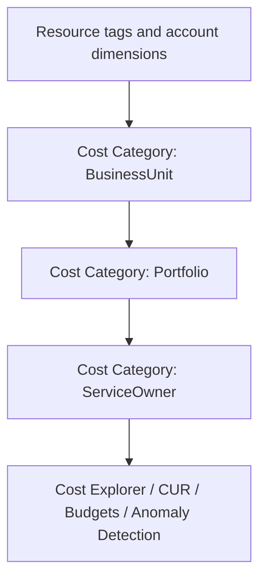

# Cost Allocation Tags and Cost Categories

An AWS organization may operate hundreds of accounts, thousands of resources, and multiple teams sharing platform services. A consolidated bill shows how much the organization spent, but does not fully answer governance questions: which product is consuming budget, which team is accountable, which environment spiked unexpectedly, which customer consumes the most resources, and how shared costs should be allocated across units.

AWS provides two core mechanisms for organizing cost data: **cost allocation tags** and **AWS Cost Categories**. A cost allocation tag is a label attached to a resource or account to identify spend by operational context. A Cost Category is a classification layer derived from billing data via rules, combining accounts, services, Regions, usage types, charge types, tags, and other categories. Together, they enable FinOps teams to build cost views by application, environment, project, cost center, and business unit.

Neither mechanism reduces the bill on its own. They reveal who or which workload generated costs, expose unallocated spend, enable showback/chargeback, and provide reliable data for optimization decisions.

## Learning Objectives

After this lesson, you will be able to:

- Explain cost allocation tags, AWS-generated tags, account tags, and Cost Categories.
- Design a consistent tag taxonomy across business unit, application, environment, owner, and cost center.
- Activate cost allocation tags in the management account and understand data propagation timelines.
- Use AWS Organizations tag policies, IAM, SCPs, and AWS Config to govern tag quality.
- Build Cost Categories using regular rules, inherited values, default values, and rule hierarchies.
- Allocate shared costs via split charges and understand the limits of where split data appears.
- Use Cost Explorer, CUR 2.0, AWS Data Exports, Budgets, and Cost Anomaly Detection to analyze costs.
- Design showback/chargeback workflows, remediate unallocated costs, and operate FinOps on a regular cadence.

## 1. The Cost Allocation Problem in AWS

Suppose an enterprise has Payments, Retail, Data Platform, and Corporate IT groups. Each group runs applications across EC2, EKS, RDS, S3, Lambda, and shared management services. The organization may run a single AWS Organization with consolidated billing, multiple OUs, and multiple member accounts.

Viewing total spend solely by service or account still leaves several questions unanswered:

- Which EC2/RDS/S3 resources belong to `orders` versus `analytics`?
- How much does production cost compared to development?
- Which team is accountable for resources without an owner?
- How should networking, logging, CI/CD, and shared database costs be divided across business units?
- Have a new account's costs been mapped to the right cost center?
- Is a cost increase driven by usage, pricing, discount changes, or orphaned resources?

A strong cost allocation system needs three data layers:

1. **Resource/account context**: tags identify which application, environment, owner, and cost center a resource belongs to; account tags provide context for an entire account.
2. **Billing classification**: Cost Categories translate line items into groupings understood by Finance and business units.
3. **Usage and cost evidence**: Cost Explorer and CUR/Data Exports supply cost/usage numbers for analysis, reconciliation, and archival.

## 2. Comparing Cost Allocation Tags and Cost Categories

| Criterion | Cost Allocation Tag | AWS Cost Category |
|---|---|---|
| Nature | Key/value attached to a resource or account | Cost group computed by rules over billing data |
| Who defines it | Resource-owning teams; AWS creates certain system tags | Billing/FinOps administrators in the management account |
| Example | `CostCenter=CC-204`, `Environment=Production` | `BusinessUnit=Payments`, `Portfolio=CustomerApps` |
| Scope | Supported resources or accounts | Billing line items matching rule conditions |
| Requires activation | Yes, before functioning as a cost allocation tag | Create category and rules; no separate per-tag activation beyond tag dimension requirements |
| Purpose | Attach cost context at the source | Standardize and aggregate costs along organizational structure |
| Used in | Cost Explorer, Cost and Usage Reports/Data Exports, and supported Cost Management tools | Cost Explorer, Budgets, Cost Anomaly Detection, CUR/Data Exports, and Cost Category details page per feature capabilities |

For example, an EC2 instance carries `CostCenter=CC-204`, `Application=orders`, `Environment=Production`. A Cost Category `BusinessUnit` can map `CostCenter=CC-204` to `Payments`. Tags preserve resource-level detail while Cost Categories supply business-unit views.

Cost Categories do not attach tags to EC2, S3, or RDS resources. Conversely, tags do not automatically split shared costs across multiple business units. Both mechanisms solve different layers and are commonly used together.

## 3. Designing a Tag Taxonomy

A taxonomy is a dictionary of tag keys, meanings, valid values, owners, and enforcement rules. Standardize the taxonomy before creating tags and Cost Categories at scale.

### Recommended Tag Set

| Tag Key | Purpose | Example Values | Where Required |
|---|---|---|---|
| `CostCenter` | Accountable cost center | `CC-204`, `CC-310` | Billable resources or accounts |
| `Application` | Product/application using the resource | `orders`, `customer-portal` | Application resources |
| `Environment` | Deployment environment | `Production`, `Staging`, `Development`, `Sandbox` | Application resources |
| `BusinessUnit` | Business unit | `Payments`, `Retail`, `Data` | Resources or accounts per model |
| `Owner` | Responsible team or group | `team-payments` | Operational resources |
| `Project` | Project or initiative | `checkout-v2`, `data-lake` | Project resources |
| `ManagedBy` | Resource management method | `Terraform`, `CloudFormation`, `Console` | Managed-lifecycle resources |
| `DataClass` | Data classification | `Public`, `Internal`, `Confidential` | Data-bearing resources |

You do not need to attach every tag to every resource. Define mandatory tags per resource type, ownership, and cost analysis needs. For instance, `Application` fits workload resources, while `BusinessUnit` can come from an account tag if an account is dedicated to a single business unit.

### Naming Rules

- Pick one casing convention, such as `CostCenter`, and enforce it across all accounts.
- Keys and values are case-sensitive in many tag/policy flows; `Production` and `production` can split into two distinct buckets.
- Avoid keys with overlapping meanings such as `Team`, `OwnerTeam`, and `ApplicationTeam` without clear definitions.
- Never store passwords, tokens, personal emails, or sensitive data in tags.
- Avoid embedding dates or transient states in keys; represent them in structured taxonomy values if needed.
- Never casually rename keys once referenced in CUR, dashboards, budgets, and Cost Category rules.

### Example Resource Configuration

```text
CostCenter=CC-204
Application=orders
Environment=Production
BusinessUnit=Payments
Owner=team-payments
ManagedBy=Terraform
```

Across multiple accounts, `BusinessUnit`, `CostCenter`, and `Environment` can be applied at the AWS account level. Resource tags add `Application`, `Owner`, and `Project` for deeper breakdown. When using account tags for cost allocation, account tag data appears in reports under a distinct namespace/prefix to avoid colliding with identically named resource tags.

## 4. Types of Cost Allocation Tags

AWS Billing and Cost Management supports two primary categories of cost allocation tags.

### User-Defined Tags

These are tags defined, created, and applied to resources by your organization—such as `CostCenter=CC-204`. User-defined tags can be attached at resource creation or updated later depending on service and resource type.

Key points to remember:

- Tags must be attached to supported resources and the cost allocation tag key must be activated.
- The `aws:` prefix is reserved for AWS; never use it for user-defined tags.
- A resource can hold only one value per key.
- Not every AWS service, resource type, or charge type supports resource tags in billing data.
- Applying or changing a tag mid-billing-period can split costs before and after the change into separate line items.
- New tags do not automatically populate onto existing resources; backfill existing resources via Tag Editor, APIs, IaC, or remediation workflows.

### AWS-Generated Tags

AWS or AWS Marketplace ISVs can create system tags for certain resources/charges. For example, `aws:createdBy` helps identify the principal that created a supported resource. System tags are managed by AWS, cannot be edited/deleted like user-defined tags, and appear only in Billing/Cost Management reports.

Important points:

- Only the management account can activate AWS-generated cost allocation tags for an Organization.
- Once activated in the management account, the tag is activated across member accounts.
- `aws:createdBy` is derived from CloudTrail data and applies only to supported resources/Regions; do not assume every resource carries a value.
- The `awsApplication` tag is automatically activated by AWS when applied via AppRegistry integration and does not count against the active tag key quota.
- AWS-generated tags may carry Region restrictions and specific data conditions.

### Account Tags

AWS Organizations account tags attach context directly to an AWS account—for example, `BusinessUnit=Payments` or `CostCenter=CC-204`. Once activated for cost allocation, account tags classify usage and certain account-level charges, including items that cannot be tagged directly on resources such as certain credits, refunds, or service fees.

Account tags fit setups where one account serves a single business unit or environment. If one account hosts multiple applications belonging to different units, account tags alone are too coarse; supplement them with resource tags or Cost Category rules.

## 5. Activating Cost Allocation Tags

Adding tags to resources is not enough for them to appear in cost reports. Keys must be activated in Billing and Cost Management.

### Governance Requirements and Permissions

- In an AWS Organization using consolidated billing, the management account controls cost allocation tag activation for the payer/organization.
- Member accounts can create and attach resource tags per granted permissions, but cannot manage the Organization-wide cost allocation tag list.
- Only the management account can activate AWS-generated tags.
- Managing cost allocation tags requires corresponding Billing/Cost Management permissions; listing tags may require `ce:ListCostAllocationTags`, while updating status requires the corresponding API permission.

### Console Workflow

1. Sign in to the Organization's management account. If using Billing Transfer, follow AWS's designated bill-source/bill-transfer roles for cost allocation tags.
2. Open the AWS Billing and Cost Management console.
3. Navigate to **Cost allocation tags**.
4. Select the appropriate tab for user-defined tags, AWS-generated tags, or account tags.
5. Inspect the key, status, and last-used timestamp.
6. Select the keys needed for analysis and choose **Activate**.
7. Wait for status to become Active, then verify data in Cost Explorer/CUR.

After creating and applying a user-defined tag, the key can take up to 24 hours to appear on the Cost allocation tags page; after clicking Activate, activation can also take up to 24 hours. Never assume data appears instantaneously upon clicking Activate.

### When Data Begins Appearing

Distinguish three distinct timestamps:

1. Resource is tagged.
2. Key is activated as a cost allocation tag.
3. Billing data is processed and displayed in analytical tools.

Costs can only be broken down by tag when the resource/usage carries the tag and the tag key is activated. Tags cannot be applied retroactively to a resource that lacked the tag when the usage occurred. If a tag is updated mid-period, reports may split charges before and after the change into separate rows. With Cost Categories, administrators can pick an effective date/lookback to apply rules retroactively to the prior month within service options; that is a separate mechanism from resource tagging.

### Active Tag Key Quota

Billing and Cost Management limits active cost allocation tag keys per payer account; current documentation lists a default limit of 500 active keys. Each API/console request also limits how many keys can be activated/deactivated at once. Auto-activated tags such as `awsApplication` do not count toward this quota. Use tag keys with clear analytical value and avoid creating a separate key per project/tenant when values inside a shared taxonomy can represent them.

## 6. Building Tag Governance with AWS Organizations

Tag governance must enforce both consistency and completeness. Mis-cased keys or arbitrary values fragment reports.

### AWS Organizations Tag Policies

Tag policies standardize key/value casing and define allowed values for supported resource types. Policies attach at the root, OU, or account level and inherit down the Organization hierarchy.

Example internal policy:

| Key | Allowed Values | Purpose |
|---|---|---|
| `Environment` | `Production`, `Staging`, `Development`, `Sandbox` | Prevent `prod`, `Prod`, `production` from splitting into separate groups |
| `BusinessUnit` | `Payments`, `Retail`, `Data`, `Corporate` | Classify by business unit |
| `ManagedBy` | `Terraform`, `CloudFormation`, `Manual` | Identify provisioning tool |

Tag policies provide reporting and enforcement across supported resource types and operations. Basic compliance enforcement can block invalid values or incorrect capitalization when tags are passed in requests, but does not by itself guarantee every resource has a tag. For enforcing required tag keys in IaC, enable supported enforcement/validation mechanisms for tools like CloudFormation, Terraform, or Pulumi. Review supported resource types and enforcement modes before applying.

### IAM Conditions and SCPs

For APIs/services supporting tag-on-create, IAM policies can require `aws:RequestTag/CostCenter` or restrict `aws:TagKeys`. SCPs can establish guardrails across member accounts on resource creation APIs. Tag condition behavior depends on each service's authorization support; do not assume every API supports identical condition keys.

### AWS Config and Post-Deployment Checks

The AWS Config managed rule `required-tags` detects resources missing specified tag keys across supported resource types. This is a detective control: it flags non-compliant resources after creation/recording. Pair it with EventBridge/Systems Manager Automation or ticketing workflows to notify owners to remediate missing tags.

### Tagging in IaC

Set default tags in shared modules/templates. In Terraform, build modules requiring `CostCenter`, `Application`, `Environment`, `Owner`; in CloudFormation, use parameters/tag maps with validation. Pipelines should fail when mandatory tags are missing or values fall outside the taxonomy.

Do not rely solely on IaC defaults: resources created via console, child resources spawned automatically by services, or out-of-band API calls may not inherit tags as expected. Run periodic inventory and compliance reports.

## 7. Designing Account Structure for Cost Allocation

Account structure is a foundational allocation dimension, especially when an Organization uses multiple OUs and consolidated billing.

A reference model:

| OU/Account | Role | Account Tags |
|---|---|---|
| `ou-production/payments-prod` | Production payments workloads | `BusinessUnit=Payments`, `Environment=Production` |
| `ou-production/retail-prod` | Production retail workloads | `BusinessUnit=Retail`, `Environment=Production` |
| `ou-nonprod/shared-dev` | Shared development resources | `BusinessUnit=Engineering`, `Environment=Development` |
| `ou-platform/network` | Networking, DNS, connectivity | `BusinessUnit=SharedPlatform` |
| `ou-platform/observability` | Logging, metrics, tracing | `BusinessUnit=SharedPlatform` |

Account tags provide context for an account's entire spend, including line items lacking resource tags. Resource tags subdivide spend inside an account. Cost Categories can combine account names/IDs, tags, and services to build views by business unit or portfolio.

Avoid cramming every team into one account if clear chargeback is a goal and reliable tagging/metering is absent. Conversely, avoid creating separate accounts for every small project solely for reporting; account vending and multi-account operations carry overhead.

## 8. What Is an AWS Cost Category?

A Cost Category is a cost classification structure in AWS Billing and Cost Management. Each category has a name, category values, and a set of rules determining which line items belong to each value.

Examples:

- `BusinessUnit`: Payments, Retail, Data, Corporate.
- `Environment`: Production, NonProduction, Sandbox.
- `Portfolio`: CustomerApps, InternalPlatform, DataPlatform.
- `SupportModel`: ProductTeam, SharedPlatform, CentralIT.

Cost Categories fit well when financial reporting hierarchies differ from tag or account structures. For example, multiple cost centers may roll up to Payments; one shared platform account may serve both Payments and Retail; or service charges may need grouping by portfolio.

Cost Categories are managed in the AWS Organizations management account. Billing Transfer introduces differences in administrative account roles and capabilities; check current documentation if your Organization uses Billing Transfer.

## 9. Cost Category Dimensions and Operators

Cost Category regular rules can use one or more dimensions to classify line items.

| Dimension | Used to Classify By | Example |
|---|---|---|
| Accounts | AWS account | `payments-prod`, `data-prod` |
| Cost allocation tags | Resource tag key/value | `CostCenter=CC-204` |
| Charge Type | Charge type | Usage, credit, refund, recurring fee |
| Service | AWS service | Amazon EC2, Amazon RDS, Amazon S3 |
| Region | AWS Region | `ap-southeast-1`, `us-east-1` |
| Usage Type | Specific usage unit | EC2 instance hours, NAT Gateway bytes |
| Billing Entity | Billing issuer | AWS or AWS Marketplace |
| Cost Category | Another category | `BusinessUnit` used as a dimension for `Portfolio` |

Common operators include `Is`, `Is not`, `Is absent`, `Contains`, `Starts with`, and `Ends with`. Partial-match operators like Contains/Starts with/Ends with are supported only for specific dimensions, notably Account and Tag. When matching on Accounts, matching may evaluate account names rather than account IDs. Verify dimension-specific behavior in the console/API.

Rules can combine multiple conditions using AND/OR (`all`/`any` conditions). Keep conditions explicit and avoid overly broad `Contains` strings, which can misclassify resources or make previews unpredictable.

## 10. Regular Rules, Inherited Values, and Default Values

Cost Categories support core rule types for grouping spend.

### Regular Rules

Regular rules map a condition to a fixed category value.

Example for `BusinessUnit`:

| Order | Condition | Category Value |
|---:|---|---|
| 1 | `CostCenter=CC-204` | `Payments` |
| 2 | `CostCenter=CC-310` | `Retail` |
| 3 | Account belongs to `data-*` group | `Data` |
| 4 | Service is shared platform and account is platform | `Corporate` |

### Inherited Value Rules

Inherited value rules pull category values dynamically from a dimension such as Account or a Cost allocation tag key. For instance, selecting the `BusinessUnit` tag as an inherited value automatically creates category values for Payments/Retail/Data.

Inherited values work well when tag taxonomies are clean and well-governed. If resources carry arbitrary tag values, the category can proliferate unexpected values. Standardize values before using inherited rules.

### Default Value

A default value captures line items matching no rule into a bucket such as `Unallocated` or `Other`. Never let unmatched costs disappear from reports. An `Unallocated` bucket gives FinOps an actionable worklist to locate owners and raise coverage.

### Rule Order and First Match

Cost Category rules evaluate sequentially. If a line item matches multiple rules, the first matching rule determines the category value. Therefore, place specific rules ahead of general rules.

For example, if `Service=Amazon EC2` precedes `CostCenter=CC-204`, EC2 costs belonging to CC-204 will get classified by the EC2 rule first. Order rules from most specific to most general and verify the preview.

## 11. Building Hierarchical Cost Categories

A Cost Category can reference another Cost Category as a dimension, creating a hierarchy.

Example:



Sample design:

| Category | Input Rule | Values |
|---|---|---|
| `BusinessUnit` | CostCenter or account tag | Payments, Retail, Data, Corporate |
| `Portfolio` | BusinessUnit + Application tag | CustomerApps, DataPlatform, SharedPlatform |
| `Environment` | Environment tag or account dimension | Production, NonProduction, Sandbox |
| `ServiceOwner` | Application/Owner tag | team-payments, team-retail, team-data |

Do not create excessive categories. Each category should answer a distinct governance question. If a dimension is already cleanly captured by a tag and needs no transformation rules, keeping it as a tag may be simpler.

### Effective Date and Lookback

When creating or editing a Cost Category, you can choose an effective date/lookback to apply rules starting from the prior month rather than only the current month. This retroactive billing classification capability is useful when taxonomies or rules are updated mid-cycle.

Document the effective date and rationale for every change. Editing rules can reclassify historical data within the lookback window, shifting previously observed numbers. For closed financial periods, archive snapshots/exports and version rules to preserve an audit trail.

## 12. Split Charges: Allocating Shared Costs

Certain costs are hard to tie directly to one business unit: network egress, NAT Gateways, shared EKS clusters, logging, security tooling, CI/CD, shared databases, or platform teams. Cost Categories provide split charge rules to distribute a source category value across target category values.

Example: category `SharedPlatform` has $10,000 USD in the period. The organization wants to allocate 60% to Payments and 40% to Retail.

| Source Value | Target Values | Allocation Method | Example Result |
|---|---|---|---|
| SharedPlatform | Payments, Retail | Fixed | Payments $6,000 USD; Retail $4,000 USD |

Three allocation methods:

- **Proportional**: allocates based on the current cost weight of target values. If Payments is 70% and Retail is 30% among the targets, shared costs split in that ratio.
- **Fixed**: allocates by organization-defined percentages, such as 60/40.
- **Even split**: divides equally across targets—for example, one-third to each of three teams.

### Limitations to Understand Clearly

- Shared costs must first be classified into the source category value before splitting.
- A category value can serve as a source only once across split charge rules; a value used as a source cannot simultaneously act as a target, and vice versa.
- A target value can receive allocations from multiple rules under service rules.
- If a category value comes from an inherited value rule, wait until the Cost Category enters `Applied` status before using it as a source or target.
- AWS currently caps split charge rules at 10 per Cost Category.
- Split charges appear on the Cost Category details page and corresponding downloadable reports; these allocated amounts do not appear in Cost Explorer, CUR, or other Cost Management tools as modifications to original line items.
- Split charges are an internal governance allocation layer; they do not alter the AWS invoice or actual service charges.

Because of these visibility limits, use split charges to explain internal allocation methodology and maintain a separate allocation table if bringing allocated figures into a data warehouse, financial statements, or chargeback. Never assume CUR already includes post-split numbers.

## 13. Enterprise Cost Category Design Example

Suppose an organization has these cost centers:

| Cost Center | Business Unit | Application | Environment |
|---|---|---|---|
| `CC-204` | Payments | orders | Production |
| `CC-205` | Payments | checkout | Production |
| `CC-310` | Retail | catalog | Production |
| `CC-311` | Retail | storefront | Production |
| `CC-900` | Corporate | shared-platform | Production |

Category design:

1. `BusinessUnit`: maps CostCenter to Payments/Retail/Corporate.
2. `Application`: inherited value from the `Application` tag if taxonomy is standardized.
3. `Environment`: inherited value from the `Environment` tag.
4. `Portfolio`: combines BusinessUnit and Application rules to group applications into reporting portfolios.
5. `SharedCost`: classifies shared platform accounts/services; splits charges to BusinessUnit using a Finance-approved formula.

In dashboards, FinOps can view spend by BusinessUnit and drill down to Application and Environment. Finance can use the same category inside Budgets or Cost Anomaly Detection to monitor spend by business unit.

## 14. Cost Allocation Tags and Cost Categories in Cost Explorer

Cost Explorer analyzes spend over time and across dimensions. Once tag keys are activated and billing data updates, you can group/filter by tag. Cost Categories also appear as dimensions to analyze by category value.

Common analyses:

- Group by `CostCenter` to view spend by cost center.
- Group by `Application` to compare applications.
- Filter `Environment=Production` to exclude non-production.
- Group by Cost Category `BusinessUnit` to report by business unit.
- Compare net amortized cost vs. unblended cost when different perspectives on discounts/commitments are needed.
- Drill down by Service, Usage Type, and Region to isolate cost drivers.

When comparing periods, match cost metric, granularity, filters, and time ranges. If Cost Category rules or tags change mid-period, note the change date to explain why historical figures reclassified or split into separate line items.

## 15. CUR 2.0 and AWS Data Exports

Cost and Usage Report (CUR) and AWS Data Exports deliver granular line-item billing data for data warehouse or query engine analysis. CUR 2.0 offers a more flexible column layout with tags, cost categories, and extensive billing attributes.

### Why Use CUR/Data Exports?

- Retain granular cost/usage history for auditing and reconciliation.
- Join billing data with CMDB, deployment metadata, product usage, and ownership.
- Build custom dashboards or chargeback reports in Athena/Glue/QuickSight/warehouses.
- Calculate unit economics such as cost per order, cost per tenant, or cost per GB.
- Detect untagged line items or items missing Cost Categories.

### Notes on Tags in Billing Exports

User-defined tags appear in tag columns according to export structure; AWS-generated tags and account tags carry distinct namespaces/prefixes. Cost Categories have dedicated columns or attributes in the export schema. Inspect the schema of your CUR 2.0/Data Exports before writing SQL, as column names and structures differ from legacy CUR.

Not every charge carries a resource tag. Subscriptions, AWS Support, some Marketplace fees, credits/refunds, upfront fees, or non-resource charges may not be classifiable via resource tags. Account tags or Cost Category rules matching account/service/charge type help classify part of these charges.

### Illustrative SQL Example

Illustrative example assuming a CUR 2.0 table is cataloged in Athena and columns/structs are normalized into `line_item_unblended_cost`, `resource_tags_costcenter`, `cost_category_businessunit`.

```sql
SELECT
  cost_category_businessunit AS business_unit,
  resource_tags_costcenter AS cost_center,
  SUM(line_item_unblended_cost) AS unblended_cost
FROM cur2_view
WHERE billing_period = DATE '2026-11-01'
GROUP BY 1, 2
ORDER BY unblended_cost DESC;
```

This is illustrative SQL with normalized column names inside an internal view, not mandatory column names across every CUR 2.0 export. Inspect the actual schema and apply partition predicates to minimize Athena bytes scanned.

## 16. Account Tags for Allocating Non-Resource Costs

Resource tags are powerful but cannot attach to every line item. Account tags in AWS Organizations supply a supplementary account-level dimension.

For example, account `payments-prod` carries:

```text
BusinessUnit=Payments
CostCenter=CC-204
Environment=Production
```

After activating account tags in Billing and Cost Management, usage and certain charges within the account can be classified by account tags. This helps attribute charges that cannot be tagged directly on resources, such as credits, refunds, and certain service charges.

Account tags require an AWS Organizations management account with consolidated billing and Organizations/Billing permissions. In CUR 2.0, tags from resources, accounts, user attributes, and Cost Categories are distinguished by prefixes/namespaces to prevent key collisions. Avoid naming custom keys starting with `accountTag`, as AWS uses this prefix to represent account tags in reports.

## 17. Integrating Cost Categories with Budgets and Cost Anomaly Detection

Once taxonomies and categories stabilize, use them to monitor budgets and cost anomalies.

### AWS Budgets

AWS Budgets can filter budgets by linked account, service, tag, and Cost Category where supported. Examples:

- Budget for `BusinessUnit=Payments`.
- Budget for `Application=orders`.
- Dedicated budget for `Environment=Production`.
- Budget for the shared platform account.

Configure actual/forecast thresholds and route alerts via SNS or integrated channels. Budgets do not automatically stop resources from incurring costs unless controlled automation/actions are configured.

### AWS Cost Anomaly Detection

Cost Anomaly Detection can create monitors by AWS services, linked accounts, cost allocation tags, or Cost Categories. A monitor on a tag key tracks distinct values; a monitor on a Cost Category tracks category values.

Cost Explorer data has latency and Cost Anomaly Detection runs on processing cycles; do not expect instant alerts the moment usage occurs. New monitors also need time and historical data to establish baselines.

### Design Guidelines

- Use Cost Categories to group by business owner; use tags to drill down to resources/applications.
- Align budget thresholds with fiscal calendars and seasonality.
- Separate anomaly monitors by business unit or critical tag keys.
- Route alerts to the corresponding owner rather than dumping everything into one shared mailbox.
- Periodically verify tag activation, category status, and coverage before trusting dashboards.

## 18. Showback and Chargeback

**Showback** gives each team visibility into the costs they generate without necessarily transferring budget funds. **Chargeback** allocates costs directly to a business unit's budget or financial ledger per finance policy.

A sound workflow:

1. FinOps defines the taxonomy and category model alongside Finance.
2. Platform team ensures tags are applied properly via IaC and resource lifecycles.
3. Billing team activates tags and configures Cost Categories.
4. Data team builds CUR/Data Exports pipelines and runs data quality checks.
5. FinOps reconciles unallocated costs, shared costs, and credits/discounts.
6. Business owners confirm allocations and explain variances.
7. Finance locks the chargeback methodology and period-close cutoff.

### Direct Costs vs. Shared Costs

- **Direct cost**: resources directly attributable to one application/team/account.
- **Shared cost**: resources serving multiple applications/teams such as networking, security, logging, CI/CD, and platform databases.
- **Unallocated cost**: line items lacking an identified owner or classification metadata.
- **Central cost**: costs intentionally retained at Corporate/IT level by policy.

Do not allocate shared costs arbitrarily just because you can. Formulas must reflect actual consumption or an agreed governance rule. For example, NAT costs may allocate by bytes/GB processed, shared EKS by CPU/memory requests, logging by ingest volume, or evenly when no reliable usage metric exists.

## 19. Workflow for Remediating Unallocated Costs

Unallocated cost is a key indicator of cost allocation quality. Track unallocated spend percentage monthly by service and account.

Workflow:

1. Filter line items missing tag/category values or falling into default `Unallocated`.
2. Classify the cause: resource does not support tags, missing tag, unactivated tag, non-resource charge, account missing account tag, or gap in Cost Category rules.
3. Identify the owner via account, service, resource ARN, deployment logs, or CloudTrail where applicable.
4. Decide remediation: add resource tag, add account tag, update category rule, designate central cost, or log a time-bound exception.
5. Update taxonomy/IaC/policies to prevent recurrence.
6. Monitor unallocated ratio and exception aging.

Example dashboard metrics:

| Metric | Meaning |
|---|---|
| Tagged spend % | Share of spend carrying valid resource tags |
| Categorized spend % | Share of spend assigned a Cost Category value |
| Unallocated spend | Spend landing in the unallocated bucket |
| Missing CostCenter | Resources/accounts lacking a cost center |
| Unknown tag value | Values outside the approved taxonomy |
| Shared cost ratio | Share of total spend classified as shared |
| Exception aging | Days open exceptions remain unresolved |

Never force tags onto charges that cannot carry resource tags directly. Use account tags, Cost Category rules by account/service/charge type, or central cost buckets to reflect their true nature.

## 20. CLI and API Reference

The AWS Cost Explorer API is exposed under the AWS CLI `ce` namespace. Examples below illustrate querying and activating tags. Use appropriate Billing/Cost Management permissions, the management account for Organization-wide activation, and valid start/end dates.

### List Cost Allocation Tags

```bash
aws ce list-cost-allocation-tags \
  --time-period Start=2026-11-01,End=2026-12-01 \
  --tag-key CostCenter \
  --region us-east-1
```

### Activate a Tag Key

```bash
aws ce update-cost-allocation-tags-status \
  --cost-allocation-tags-status '[{"TagKey":"CostCenter","Status":"Active"}]' \
  --region us-east-1
```

The API limits how many tag keys can be updated in a single request. When activating many keys, batch requests and verify status afterward.

### Group Costs by Tag in the Cost Explorer API

```bash
aws ce get-cost-and-usage \
  --time-period Start=2026-11-01,End=2026-12-01 \
  --granularity MONTHLY \
  --metrics UnblendedCost \
  --group-by Type=TAG,Key=CostCenter \
  --region us-east-1
```

### Group Costs by Cost Category

```bash
aws ce get-cost-and-usage \
  --time-period Start=2026-11-01,End=2026-12-01 \
  --granularity MONTHLY \
  --metrics UnblendedCost \
  --group-by Type=COST_CATEGORY,Key=BusinessUnit \
  --region us-east-1
```

The Cost Explorer API limits group-by depth and response size; automation must handle `NextPageToken` pagination. Avoid hardcoding Cost Category names if operating across multiple Organizations or evolving taxonomies.

## 21. Billing/FinOps Security and Permissions

Cost data can expose usage levels, architecture, projects, business units, and customer activity. Assign permissions by role:

- Billing administrator: manages cost allocation tags, Cost Categories, and billing settings.
- FinOps analyst: views Cost Explorer, Budgets, CUR, and Cost Category details.
- Resource owner: tags resources within their account/team scope.
- Platform governance: manages tag policies, IaC modules, and required-tag checks.
- Finance approver: approves taxonomies, split charges, and chargeback methodologies.
- Auditor: reads reports, change histories, and audit evidence.

Cost Categories support tagging category resources to restrict edit permissions via IAM resource-tag conditions. Use dedicated policies to limit who can create/modify categories. Never grant broad billing admin privileges just because someone needs to view reports.

Use CloudTrail and audit logs to track policy, category, tag activation, and billing permission changes. Protect CUR/Data Exports buckets with encryption, bucket policies, retention, and least-privilege read access.

## 22. Costs, Limits, and Operations

Cost allocation tags and Cost Categories are billing governance tools; they do not replace cost-bearing services. Track these operational limits:

- Up to 500 active cost allocation tag keys under the current default quota per payer account; check Service Quotas if adjustments are needed.
- Tag keys can take up to 24 hours to appear after creation/attachment; activation can also take up to 24 hours.
- Not every resource, service, or charge carries resource tags.
- Tag values fragment if casing and taxonomy are inconsistent.
- Cost Category rules evaluate sequentially; broad rules placed early can shadow specific rules.
- Cost Category previews are estimates; verify category details after saving.
- Split charges have rule limits and do not write allocated amounts back into CUR/Cost Explorer.
- Changing a Cost Category's effective date/lookback can reclassify historical data within the lookback window.
- Accounts moving to a different Organization may need user-defined cost allocation tags reactivated in the new management account.

### Optimization Practices

- Keep keys minimal and meaningful; favor standardized values over creating many near-duplicate keys.
- Require tags based on resource type and business owner.
- Use account tags to classify account-level charges where appropriate.
- Use inherited values to reduce manual rules once tags are clean.
- Always keep a default `Unallocated` value so no line item slips through unnoticed.
- Use split charges for shared costs when Finance has approved the formula.
- Archive snapshots/exports of closed periods before making major rule changes.
- Periodically review active tags and category definitions.

## 23. Common Troubleshooting

| Symptom | Possible Cause | Check / Resolution |
|---|---|---|
| Tag missing in Cost allocation tags | Tag not applied to resources, resource type unsupported, or billing data not yet refreshed | Verify resource tags, service support, and allow processing time |
| Tag visible in console but missing in Cost Explorer | Key not Active, tag value null, data not yet refreshed, or wrong filter/time range | Verify activation status, tag values, and time range |
| Tag appears for only some accounts | Account outside Organization, tag missing on member resources, or tag not activated by management account | Check payer/management account and resource inventory |
| Tag values split into `prod`, `Prod`, `Production` | Inconsistent taxonomy/case sensitivity | Standardize tag policy and remediate existing resources |
| Costs lack a Cost Category assignment | No rule matched, category not yet Applied, or default value unconfigured | Check rule order, dimensions, tag activation, and default |
| Line item matches the wrong category | General rule placed ahead of specific rule | Reorder rules and inspect preview/details |
| Cost Category missing in Cost Explorer | Category not Applied, wrong time range, or wrong filter | Check category status, effective date, and data refresh |
| Split charges missing in CUR | Split charges appear only on Cost Category details/reports | Export split report separately or compute allocations in data warehouse |
| Some charges lack resource tags | Subscriptions, credits/refunds, or non-resource charges | Use account tags, category rules by account/service/charge type, or central cost |
| Tag activation lost after account moved Organizations | Tag activation is tied to the Organization's management account | Reactivate keys in the new management account |
| IaC still deploys untagged resources | Resource type/tool lacks enforcement or template omits tags | Check tag policy mode, IAM/SCP conditions, and pipeline validation |

## 24. Lab Exercise: Allocating Costs by BusinessUnit

The objective is to build a basic cost allocation flow for three units: Payments, Retail, and Data.

### Preparation

1. An AWS Organization using consolidated billing.
2. Permissions to manage Cost allocation tags and Cost Categories in the management account.
3. Several taggable test resources generating measurable spend.
4. A taxonomy agreed upon with Finance.

### Execution

1. Attach `CostCenter`, `Application`, `Environment`, and `Owner` to test resources.
2. Attach account tags `BusinessUnit` and `CostCenter` to test accounts in Organizations.
3. Open Billing and Cost Management and activate the required cost allocation tag keys.
4. Wait for tags to become Active and billing data to update.
5. In Cost Explorer, group by `CostCenter` and verify values appear.
6. Create a `BusinessUnit` Cost Category with regular rules mapping CC-204 to Payments, CC-310 to Retail, and CC-410 to Data.
7. Add a default value `Unallocated`.
8. Check rule ordering and cost preview, then save the category.
9. Create an `Environment` Cost Category using an inherited value from the `Environment` tag if suitable.
10. Create a budget filtered by `BusinessUnit=Payments` and monitor spend.
11. Inspect uncategorized line items and document why they were unmatched.
12. Export CUR 2.0/Data Exports to verify tag/category columns in the live schema.

### Expected Outcomes

- Resources carry taxonomy-compliant tags.
- Tag keys are activated in the management account.
- Cost Explorer displays spend by tag after data refreshes.
- Cost Category accurately classifies BusinessUnit.
- Unmatched spend lands in `Unallocated`.
- Reports clearly show direct costs, shared costs, and unallocated spend.

## 25. Real-World Design Scenarios

### Scenario A: Multiple Applications in One Account

A Production account runs `orders`, `checkout`, and `catalog`. Account tags show only `BusinessUnit=CustomerApps`, while resource tags separate `Application` and `CostCenter`. Cost Category `BusinessUnit` maps cost centers to Payments/Retail; Cost Category `Portfolio` groups the apps into Customer Experience. This keeps the account footprint lean while preserving granular analysis.

### Scenario B: Shared Network Costs

NAT Gateways, Transit Gateways, and connectivity serve multiple business units. FinOps creates a source category `SharedNetwork`, then applies split charges to Payments/Retail/Data by usage share or an approved fixed ratio. Split reports are stored separately since allocated figures do not replace original line items in CUR.

### Scenario C: New Account Missing Tags

A new account is provisioned, but resources lack `CostCenter`. IaC pipelines validate tag policies before deployment; AWS Config `required-tags` flags existing untagged resources; FinOps routes the spend to `Unallocated` and opens tickets for owners. Once tags are remediated, subsequent reporting periods improve.

### Scenario D: Non-Resource Charges

AWS Support, certain subscriptions, credits, or refunds lack a resource ARN to tag. The organization applies account tags or writes Cost Category rules based on account, billing entity, and charge type. Company-wide fees remain under Corporate/Shared costs rather than being forced onto one application.

## 26. Common Misconceptions

- **Applying tags is enough to see costs**: cost allocation tag keys must also be activated, and billing data needs propagation time.
- **Activating a tag applies it to older resources**: activation only enables the key in billing; existing resources still need tagging separately.
- **Every AWS charge carries a resource tag**: many charges are non-resource or come from services without billing tag support.
- **Tag policies automatically force every resource to have tags**: enforcement depends on mode, tooling, and resource type; supplement with IAM/SCP/Config.
- **Cost Categories are resource tags**: categories are computed from billing rules, not attached to resources.
- **Every matching rule adds to a category**: the first matching rule determines the category value.
- **Inherited values automatically sanitize tags**: arbitrary values generate unexpected category values.
- **Default values can be skipped**: a default `Unallocated` surfaces uncategorized spend.
- **Split charges alter the AWS bill**: split charges are solely for internal allocation and do not change source line items.
- **Split charges appear in CUR**: split figures are not written to CUR/Cost Explorer as post-allocation costs.
- **Account tags and resource tags are identical**: they have distinct namespaces and scopes in billing exports.
- **Lower costs mean better tagging**: tagging improves visibility; reducing costs requires dedicated optimization actions.

## 27. Production Operations Checklist

Before putting cost allocation into production operations, confirm:

- [ ] Taxonomy defines owners, definitions, valid values, and casing rules.
- [ ] `CostCenter`, `Application`, `Environment`, `BusinessUnit`, and `Owner` are applied per resource type.
- [ ] Account tags are applied to accounts with clear business boundaries.
- [ ] Cost allocation tag keys are activated in the management account.
- [ ] Required AWS-generated tags are activated with support boundaries understood.
- [ ] Active tag key quota is monitored.
- [ ] Tag policies are attached to appropriate OUs/accounts and enforcement is tested at small scope.
- [ ] IaC modules/pipelines pass mandatory tags and validate allowed values.
- [ ] IAM/SCP conditions are applied only to supported APIs/resource types.
- [ ] AWS Config or inventory audits catch untagged resources.
- [ ] Cost Categories define clear regular/inherited rules, rule order, and default values.
- [ ] Effective dates/lookbacks are documented before modifying rules.
- [ ] Shared costs define source categories, targets, and Finance-approved split methods.
- [ ] Users understand split charges do not alter invoices or appear in CUR/Cost Explorer.
- [ ] Cost Explorer dashboards group/filter accurately by tags and categories.
- [ ] CUR 2.0/Data Exports are cataloged, secured, and schema-checked.
- [ ] Budgets/Cost Anomaly Detection monitor key business units or applications.
- [ ] Unallocated spend has an owner, SLA, and remediation workflow.
- [ ] Showback/chargeback defines direct/shared/central costs and reconciliation rules.
- [ ] Closed billing periods retain snapshots/exports and rule histories for audit.

## Conclusion

Cost allocation tags provide resource- and account-level cost context; AWS Cost Categories transform billing data into groupings aligned with financial and operational structures. A strong tag taxonomy enables breakdown by application, environment, project, and owner. Cost Categories group by business unit, portfolio, and service owner while handling line items that cannot carry resource tags directly.

Govern taxonomies jointly with Finance and Platform, activate cost allocation tags in the management account, monitor coverage, and use a default `Unallocated` bucket to expose unexplained spend. For shared costs, select evidence-based split methods and clearly document data boundaries. Combine Cost Explorer, CUR 2.0, Budgets, and Cost Anomaly Detection to turn cost allocation into a measurable, reconcilable, and continuously improving FinOps practice.

## References

- [Organizing and tracking costs using AWS cost allocation tags](https://docs.aws.amazon.com/awsaccountbilling/latest/aboutv2/cost-alloc-tags.html)
- [Using user-defined cost allocation tags](https://docs.aws.amazon.com/awsaccountbilling/latest/aboutv2/custom-tags.html)
- [Activating user-defined cost allocation tags](https://docs.aws.amazon.com/awsaccountbilling/latest/aboutv2/activating-tags.html)
- [Activating AWS-generated cost allocation tags](https://docs.aws.amazon.com/awsaccountbilling/latest/aboutv2/activate-built-in-tags.html)
- [Using AWS-generated tags](https://docs.aws.amazon.com/awsaccountbilling/latest/aboutv2/aws-tags.html)
- [Quotas and restrictions for cost allocation tags](https://docs.aws.amazon.com/awsaccountbilling/latest/aboutv2/billing-limits.html)
- [Understanding dates for cost allocation tags](https://docs.aws.amazon.com/awsaccountbilling/latest/aboutv2/cost-allocation-tags-timeline.html)
- [Using account tags for cost allocation](https://docs.aws.amazon.com/awsaccountbilling/latest/aboutv2/account-tags-cost-allocation.html)
- [Creating Cost Categories](https://docs.aws.amazon.com/awsaccountbilling/latest/aboutv2/create-cost-categories.html)
- [Organizing costs using AWS Cost Categories](https://docs.aws.amazon.com/awsaccountbilling/latest/aboutv2/manage-cost-categories.html)
- [Splitting charges within Cost Categories](https://docs.aws.amazon.com/awsaccountbilling/latest/aboutv2/splitcharge-cost-categories.html)
- [AWS Organizations tag policies best practices](https://docs.aws.amazon.com/organizations/latest/userguide/orgs_manage_policies_tag-policies-best-practices.html)
- [Enforcing tagging consistency with tag policies](https://docs.aws.amazon.com/organizations/latest/userguide/orgs_manage_policies_tag-policies-enforcement.html)
- [Enforcing required tag keys with IaC](https://docs.aws.amazon.com/organizations/latest/userguide/enforce-required-tag-keys-iac.html)
- [AWS Config required-tags managed rule](https://docs.aws.amazon.com/config/latest/developerguide/required-tags.html)
- [Using the monthly cost allocation report](https://docs.aws.amazon.com/awsaccountbilling/latest/aboutv2/configurecostallocreport.html)
- [AWS Cost Anomaly Detection](https://docs.aws.amazon.com/cost-management/latest/userguide/manage-ad.html)
- [Getting started with AWS Cost Anomaly Detection](https://docs.aws.amazon.com/cost-management/latest/userguide/getting-started-ad.html)
- [AWS Cost Explorer API reference](https://docs.aws.amazon.com/aws-cost-management/latest/APIReference/Welcome.html)
- [AWS Data Exports User Guide](https://docs.aws.amazon.com/cur/latest/userguide/what-is-data-exports.html)
