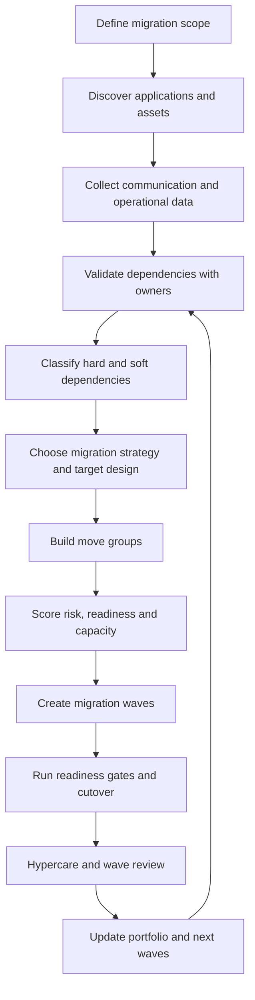
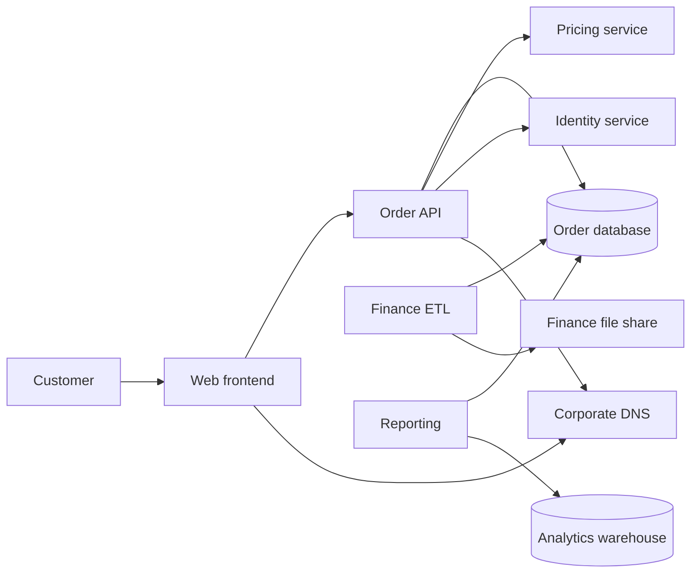

# Dependency Assessment and Migration Wave Planning

An application rarely consists of a single server. It may depend on shared databases, DNS, Active Directory, file systems, queues, partner APIs, batch schedules, authentication systems, and other operational teams. Simply listing servers and splitting them evenly by count can move applications to AWS while breaking business flows or degrading performance below acceptable levels.

Dependency assessment identifies which components communicate with each other, which relationships must stay colocated, which can operate over hybrid connectivity, and which require redesign. Migration wave planning uses those findings to group applications into waves with clear scope, schedules, resourcing, readiness gates, and rollback plans.

Within the AWS ecosystem, target planning must consider Regions and Availability Zones, IAM, VPCs, compute, storage, databases, integration, and serverless services. Each wave must prepare sufficient security, networking, monitoring, recovery, and cost controls so workloads operate reliably after cutover.

After completing this lesson, you will be able to:

- Build an inventory of applications, servers, databases, storage, network flows, and owners.
- Collect, verify, and classify technical, business, and operational dependencies.
- Distinguish hard dependencies from soft dependencies and determine appropriate move groups.
- Select migration strategies per application rather than applying one approach across the entire portfolio.
- Create migration waves based on complexity, risk, business priority, and team capacity.
- Build readiness gates, cutover runbooks, rollback plans, and hypercare procedures.
- Track progress using metrics and update the wave plan as new information emerges.

## 1. Portfolio Thinking Before Wave Planning

### 1.1. Assessment Scope

A migration portfolio is the set of applications and infrastructure components in scope for transformation. Before dividing into waves, agree on the unit of management. One business application may comprise multiple application components, servers, databases, file shares, batch jobs, and external endpoints.

Key concepts to distinguish:

| Concept | Meaning | Example |
|---|---|---|
| Business application | Business capability delivered to users | Order management |
| Application component | Software unit participating in application delivery | Web, API, worker, scheduler |
| Infrastructure asset | Resource hosting or storing a component | EC2 source server, VM, database, NAS |
| Dependency | Required relationship between two components or a condition | API needs database, job needs file share |
| Move group | Group of components that must move together per dependency rules | API and database with low-latency requirement |
| Migration wave | Deployment batch containing one or more move groups | Wave 2: internal applications group |
| Cutover event | Point in time when operations switch from source to AWS | Switching DNS and routing traffic to target |

Do not equate one server with one application. One server may host multiple applications; one application may span multiple servers and share a database. Without mapping relationships between applications and assets, plans can omit components or accidentally move shared resources.

### 1.2. Prerequisites Before Selecting Waves

A reliable portfolio requires at minimum:

- Catalog of applications, components, servers, databases, storage, and endpoints.
- Business owners, technical owners, support teams, and involved third parties.
- Criticality, user counts, operating hours, and business calendars.
- Current architecture, OS, runtimes, database versions, and licenses.
- Communication flows between components: source, destination, protocol, port, frequency, latency, and volume.
- Data volume, data change rate, and bandwidth required for replication.
- RTO, RPO, allowable downtime, security, and compliance requirements.
- Planned migration strategy, AWS target design, and readiness status.
- Risks, assumptions, unknowns, and owners responsible for verification.

Do not treat an outdated CMDB or an architecture diagram as the sole source of truth. Cross-check data with telemetry, discovery tools, owner interviews, and testing. Every key attribute should track its source, update date, and confidence level.

### 1.3. Workflow from Discovery to Waves



A wave plan is a living document. Discovery performed after starting replication might uncover a month-end batch job or another application sharing the same database. Update the dependency register and re-evaluate waves whenever new data surfaces.

## 2. Collecting Inventory and Discovery Data

### 2.1. Data Sources

Combine multiple sources to minimize blind spots:

| Source | Useful Data | Limitations to Watch |
|---|---|---|
| CMDB and asset inventory | Owners, servers, environments, licenses, declared relationships | May be outdated or missing runtime relationships |
| Hypervisor/cloud inventory | CPU, RAM, disk, VM, host, network adapters | Does not fully show business flows |
| Network flow/firewall logs | Source/destination, port, protocol, bytes, timestamps | Does not explain business meaning or hard dependencies |
| APM and distributed tracing | Call graphs, latency, errors, transaction paths | May miss batch jobs or off-hours traffic |
| DNS and load balancer logs | Service names, clients, endpoints, frequency | May miss hardcoded IP connections or cached lookups |
| Database catalog/audit | Schemas, clients, sessions, queries, objects, consumers | Requires controlled read access and handling sensitive data |
| Scheduler/job logs | Batch schedules, file inputs/outputs, job ordering | Infrequent schedules may not appear in short windows |
| Owner workshops | Business flows, downtime, criticality, exceptions | Must be verified with technical telemetry |
| Vendor/support contracts | Licenses, support matrices, SLAs, expiration dates | Terms may change across contracts |

AWS Transform provides workflows supporting discovery, dependency analysis, wave planning, landing zone setup, and network migration for new projects. AWS Transform MGN is the replication technology integrated into the workflow for rehosting servers to EC2. For existing projects using AWS Migration Hub, the service continues serving current customers; AWS stopped accepting new Migration Hub customers on November 7, 2025, and recommends AWS Transform for new projects. AWS Application Migration Service was renamed to AWS Transform MGN, so use the current naming when planning and reviewing documentation.

### 2.2. Observing Over Sufficiently Long Windows

A short snapshot can miss month-end, quarter-end, weekend traffic, or seasonal batches. The observation window must span critical business cycles and peak load periods.

Examples:

- An order system peaks on weekends or during sales campaigns.
- Reconciliation jobs run only after financial close.
- Backups and ETL batches run overnight.
- Reporting systems query databases on a weekly schedule.
- An application calls a partner service only on business days.

Record the observation window, telemetry sources, any log-loss gaps, and assumptions. If a full cycle cannot be observed, mark the dependency as unverified and log it in the risk register.

### 2.3. Application Fact Sheet

Create a standardized profile for every application. You can use the following fields:

| Field | Information to Record |
|---|---|
| Application ID/name | Unique identifier and application name |
| Business capability | Business function supported |
| Business/technical owner | Accountable individuals |
| Environment | Dev, test, staging, production |
| Criticality | Impact level upon disruption |
| Users and peak | User count, peak concurrency, or request rate |
| Components/assets | Servers, DBs, storage, queues, APIs |
| Dependencies | Upstream, downstream, and shared services |
| Data profile | Volume, data types, change rate |
| Availability | SLA, maintenance windows, RTO/RPO |
| Security/compliance | Data classification, identity, encryption, audit |
| Strategy | Rehost, relocate, replatform, refactor, repurchase, retain, or retire |
| Target | AWS account, Region, AZs, services, and network paths |
| Readiness/confidence | Verification status and evidence sources |

Each profile should be confirmed by an owner. Do not fill unknown fields with guesses; record `Unknown`, an assigned owner, and a verification due date.

## 3. Assessing and Classifying Dependencies

### 3.1. Common Dependency Categories

Categorizing relationships clarifies who needs to verify them and whether components must move together.

| Category | Examples | Questions to Answer |
|---|---|---|
| Compute/runtime | Web calling API, service calling worker, shared runtime | Which component must start first? Are OS/runtime compatible? |
| Database | Dedicated DB or shared DB | Can hybrid connectivity work? What are latency and consistency needs? |
| Network | DNS, firewall, routing, proxy, IP allowlists | Which paths change when one side moves to AWS? |
| Identity | Active Directory, LDAP, SSO, service accounts | Will authentication continue working during hybrid phase? |
| Storage/file | NFS, SMB, NAS, object store, shared disk | Can access span environments, or must they move together? |
| Integration | APIs, message brokers, queues, event buses, partner endpoints | Are protocols, retries, ordering, and certificates compatible? |
| Batch/data pipeline | Schedulers, ETL, file exchange, reports | What are job order, schedules, and data checkpoints? |
| Security | PKI, KMS, secrets, firewalls, endpoint allowlists | Are credentials, keys, and trust chains available at the target? |
| Operational | Backups, monitoring, patching, support, on-call | Which team supports both sides during coexistence? |
| Business/time | Financial close dates, peak seasons, release freezes | When are downtime or changes acceptable? |

Not every relationship is a hard dependency. An application may call an API over a WAN during the hybrid phase; a file share can be pre-synced and cut over for writes at cutover time. The key is identifying the conditions required for the application to continue functioning properly.

### 3.2. Hard Dependencies vs. Soft Dependencies

A **hard dependency** is a relationship where separating location or migration timing causes the application to fail, violate SLAs, or introduce unacceptable data risk. Examples include an application server and database communicating synchronously with ultra-low latency, a cluster using shared disks that cannot split nodes arbitrarily, or two systems relying on local LAN-only protocols.

A **soft dependency** is a relationship that can persist while both environments coexist. Examples include an AWS application calling an API still hosted in the data center over VPN/Direct Connect, or users accessing a system as DNS shifts gradually.

| Scenario | Initial Classification | Conditions to Verify |
|---|---|---|
| API and DB using synchronous, latency-sensitive connections | Likely hard | Measure RTT, connection pools, timeouts, throughput |
| Application calling an API over HTTPS with proper timeouts/retries | Likely soft | WAN latency, firewalls, DNS, certificates, SLAs |
| Two apps sharing a database schema and transactions | Usually hard or requires data decoupling | Transaction boundaries, locks, schema ownership |
| Applications sharing Active Directory | Usually a shared dependency viable for hybrid | DNS, site topology, replication, auth paths |
| ETL transferring files over SFTP nightly | Likely soft | Transfer duration, file size, schedule, retries, encryption |
| Cluster using synchronous shared storage | Hard until an alternative design exists | Quorum, fencing, storage semantics, and recovery |

Classification requires evidence. Do not label a dependency hard just because two servers share a subnet; do not label it soft just because both use TCP/IP. Ask what happens if latency rises, links drop, DNS changes, or one side moves ahead of the other.

### 3.3. Documenting Dependencies with Sufficient Metadata

Each edge in a dependency map should capture:

- Source component and target component.
- Direction: which side initiates connections or exchanges data.
- Type: network, database, identity, storage, API, batch, business, or operational.
- Protocol/port, hostname, DNS name, and endpoint.
- Frequency, duration, byte volume, request rate, and active hours.
- Current latency, maximum acceptable latency, and timeouts.
- Sync/async behavior, retries, ordering, transactions, and consistency requirements.
- Hard/soft classification, criticality, and impact of disconnection.
- Owners on both sides, evidence source, observation date, and confidence level.
- Handling plan: migrate together, prepare shared service, hybrid bridge, decouple, or retire.

Example dependency register:

| Source | Target | Type | Criticality | Hard/soft | Evidence | Action |
|---|---|---|---|---|---|---|
| Order API | Order DB | Database | Critical | Hard | Trace + DBA workshop | Same move group or synchronized DB migration |
| Order API | Pricing API | API | High | Soft | APM + firewall logs | Maintain tested hybrid connectivity |
| Nightly ETL | Finance share | File | Medium | Soft/unknown | Scheduler + owner | Test DataSync and verify schedule |
| All apps | Corporate AD | Identity | Critical | Shared service | DNS/AD logs | Prepare hybrid AD prior to waves |
| Report service | Analytics DB | Database | Medium | Hard/soft pending | DB audit | Decouple consumer or move DB together |

### 3.4. Building a Dependency Graph

Represent applications and components as nodes, and communication or dependency relationships as edges. The graph reveals dependency clusters, central hubs, and potential bottlenecks.



The graph above only illustrates relationships. When building an actual graph, distinguish observed traffic from business relationships confirmed by owners. A rare but essential connection might not appear in a few days of network telemetry.

If multiple nodes form a dependency cycle, determine whether it is a true bidirectional communication cycle or merely a shared service. Groups with bidirectional hard dependencies usually belong in the same move group or must be decoupled beforehand. For nodes with many dependent applications, evaluate whether they are shared platforms to prepare early or bottlenecks to break apart.

### 3.5. Separating Shared Dependencies from Move Groups

Shared services such as Active Directory, DNS, NTP, monitoring, backups, PKI, or proxies may connect to nearly every application. Placing all consumers of a shared service into one move group makes waves too large and unmanageable.

Instead:

1. Determine whether the service can be extended to AWS or maintained in hybrid mode.
2. Prepare endpoints, routing, identity, replication, and monitoring before migrating applications.
3. Test paths both from on-premises to AWS and from AWS to on-premises.
4. Assign an owner responsible for operating the service during coexistence.
5. Group consumers together only when a hard dependency cannot be served by a hybrid shared service.

For example, Active Directory can be extended or domain controllers deployed in AWS before migrating member servers. Applications do not all need to move in the same wave, but DNS, site selection, authentication, time sync, and replication must be tested.

## 4. Choosing a Migration Strategy Based on Dependencies

### 4.1. Seven Common Strategies

A portfolio can combine multiple strategies. Choose based on business goals, dependency profile, compatibility, downtime tolerance, cost, and ability to modify the application.

| Strategy | Meaning | When Appropriate | Impact on Dependencies |
|---|---|---|---|
| Rehost | Move workloads largely as-is | Need fast data center exit; legacy apps hard to modify | Preserves many existing dependencies; verify network, OS, and storage |
| Relocate | Move workload/platform to compatible target infrastructure with minimal change | Platform supports relocation; need to minimize app changes | Largely preserves architecture and connectivity; check platform limits |
| Replatform | Optimize part of the platform with minimal code changes | Can change DB engine, runtime, or storage without rewriting app | May alter protocols, drivers, latency, and operational dependencies |
| Refactor/re-architect | Redesign the application | Need cloud-native scale, resilience, or reduced coupling | Dependencies change substantially; often requires a separate project |
| Repurchase | Replace with SaaS/COTS | Replacement product meets business needs at acceptable cost | Identity integration, data migration, APIs, and vendor contracts need assessment |
| Retain | Keep in current environment for this phase | Technical, legal, or business constraints apply | Must design hybrid connectivity and long-term support |
| Retire | Decommission apps or components with no remaining value | No consumers remain or capability was replaced | Remove dependencies after verifying consumers and retention |

Do not choose a strategy solely by server type. One application can rehost its web tier, replatform its database, and retire a batch job within the same program. Determine strategy at the application component level, then evaluate the overall impact on the move group.

### 4.2. Validating Strategy Against Dependencies

For example, consider a web application with a frontend, API, database, and file share:

- Full rehost: minimal code change, but requires verifying routing, DNS, identity, and storage work after migration.
- Rehost API while keeping database on-premises: requires measuring latency, throughput, firewall paths, connection limits, and link-loss impact.
- Replatform database to a managed service: requires assessing schemas, data types, stored procedures, replication lag, transactions, and cutover.
- Move file share to Amazon FSx or Amazon S3: requires verifying file locking semantics, permissions, paths, throughput, and consumers.
- Refactor API to asynchronous messaging: reduces synchronous coupling, but requires designing retries, idempotency, ordering, and observability.

Whenever a strategy alters a key dependency, update the graph and re-evaluate the move group. Never leave a wave plan unchanged after modifying the target architecture.

### 4.3. AWS Tools for Assessment and Migration

| Tool / Service | Role in Planning | Items to Check |
|---|---|---|
| AWS Transform | Workflows for discovery, dependency analysis, wave planning, and migration/modernization activities | Check supported scope, access permissions, data sources, and organizational workflows |
| AWS Transform MGN | Rehost physical/virtual servers to Amazon EC2 using OS-level replication | OS support, agent/agentless mode, network/storage throughput, replication lag, cluster handling |
| AWS Database Migration Service (AWS DMS) | Full load and change data capture for database migration/replication | Engine compatibility, schema conversion, data types, primary keys, LOBs, CDC lag |
| DMS Schema Conversion | Assess and assist converting schemas across different engines | Auto-converted objects, manual conversion objects, stored procedures, and code |
| AWS DataSync | Transfer files/objects between on-premises storage and AWS storage | NFS/SMB access, task schedules, bandwidth, metadata, verification |
| AWS Storage Gateway | Provides hybrid storage models for files/volumes/tapes depending on gateway type | Cache sizing, bandwidth, app semantics, and long-term transition plans |
| AWS Direct Connect / Site-to-Site VPN | Hybrid network connectivity during coexistence and migration | Routing, encryption, redundancy, latency, throughput, and failover |
| AWS Snow Family | Supports data transfer when network transfer is infeasible or uneconomical, subject to current product/Region availability | Logistics, supported devices, encryption, import/export, and shipping lead times |

AWS Migration Hub previously provided a centralized location to track migration tasks; effective November 7, 2025, the service stopped onboarding new customers. Existing customers can continue completing active projects, while new projects should evaluate AWS Transform. AWS Application Migration Service was renamed AWS Transform MGN; older documentation may reference the former name, so verify against current guidance.

### 4.4. DMS Assessment Before Cutover Planning

For databases, never simply write "DB will move via DMS." Clarify:

- Source and target engines/versions, extensions, and features used.
- Schema objects, data types, primary/unique keys, indexes, partitions, and LOBs.
- Stored procedures, triggers, views, functions, and application SQL compatibility.
- Full load duration, CDC change rate, replication lag, and bandwidth.
- Table mappings, filters, large object modes, and target table preparation.
- Validation strategy, reconciliation queries, and business owner sign-off.
- Cutover sequence: stop writes, drain transactions, wait for CDC, validate, switch endpoints, and resume traffic.

AWS DMS provides premigration assessment runs to evaluate task components and detect issues like unsupported data types or missing primary keys. DMS Schema Conversion produces assessment reports highlighting which database objects convert automatically and which require manual handling. Run assessments early so remediation enters the backlog before wave scheduling.

### 4.5. Rehost Assessment and Replication Readiness

For server rehosting with AWS Transform MGN, check OS support, agent installation, connectivity to replication endpoints, disk layouts, boot modes, drivers, licenses, and launch templates. MGN supports agent-based replication for VMware and non-VMware servers; agentless replication is supported only for VMware per current service guidance.

Measure network bandwidth and storage change rates before scaling replication. If the write rate exceeds sustainable transfer capacity, replication lag grows and extends cutover duration. High-IOPS/throughput servers may require appropriately sized replication resources. MGN operates at the server level and does not natively understand full cluster topology; clustered workloads require dedicated plans for quorum, shared storage, and node startup order.

### 4.6. Hybrid Connectivity Is a Dependency with a Lifecycle

During migration, source and target frequently run side by side. Design:

- AWS Direct Connect or Site-to-Site VPN with required redundancy.
- Route propagation, non-overlapping CIDRs, DNS forwarding, and firewall allowlists.
- Identity federation or domain connectivity across both environments.
- Sufficient latency/throughput for APIs, databases, file transfers, and replication.
- Monitoring for tunnels/BGP, packet loss, retransmissions, DNS failures, and link saturation.
- Contingency plans if one side loses connectivity: queues, retries, read-only mode, or business fallbacks.

Hybrid connectivity is only a transitional solution if the end goal is data center exit. Every dependency left on-premises must have an owner, justification, deadline, and exit plan.

## 5. From Dependency Groups to Migration Waves

### 5.1. Defining Move Groups

A move group is a set of servers/applications that must migrate together due to hard dependencies, business constraints, or cutover coordination. It is the atomic scheduling unit placed into a wave.

Rules for creating move groups:

1. Start from the owner-verified application inventory and dependency graph.
2. Select dependencies that genuinely require simultaneous migration; do not group every consumer of a shared service.
3. Identify servers hosting multiple applications and databases serving multiple applications.
4. Identify components that can remain hybrid and the conditions required for them to do so.
5. Document move group rules in priority order with examples and owner confirmation.
6. Whenever a new dependency is discovered, update the rules and re-evaluate affected groups.

Example rules:

- Applications sharing a database that does not support coexistence must move in the same move group.
- Cluster nodes with shared storage must move under a validated cluster migration plan.
- Applications sharing hybrid AD do not all need to move in one group; foundational domain controllers and DNS must be ready first.
- Applications sharing an owner should be grouped together only if cutover schedules or owner availability strictly require it.
- Batch jobs reading/writing the same file set must define ordering, ownership, and write-cutover timing rules.

### 5.2. Distinguishing Dependencies from Scheduling

Some components are business-related without needing simultaneous migration. For example, a reporting application reading replicated data can move after the export pipeline is operational. Conversely, two servers with minimal traffic that must stop in the same maintenance window may form a move group due to operational constraints.

Classify constraints:

| Constraint | Examples | Handling Approach |
|---|---|---|
| Technical hard dependency | Synchronous transactions, shared disk, cluster quorum | Same move group or redesign beforehand |
| Technical soft dependency | HTTPS API, queue, file transfer | Can split waves if hybrid path is tested |
| Business dependency | Coordinated launch, month-end, campaign | Align schedules; optionally place in same wave |
| Operational dependency | Shared owner/on-call team, patch/backup window | Coordinate schedules or assign backup staff |
| Regulatory dependency | Data residency, audit evidence, approvals | Complete controls and sign-offs before cutover |
| Capacity dependency | Bandwidth, engineer, or test environment limits | Reduce wave size or stagger schedule |

Do not group all applications from the same business domain by default. Overly large waves increase blast radius when a cutover fails. If a domain contains multiple independent move groups, split them by criticality and recoverability.

### 5.3. Wave Selection Criteria

Once move groups are defined, select groups to form waves. Common criteria include:

- Business priority and deadlines.
- Criticality, user base, and acceptable downtime.
- Application complexity and count of external dependencies.
- Readiness of target architecture, landing zone, and security controls.
- Data volume, storage change rate, replication throughput, and bandwidth.
- Migration pattern and repeatability of tools/runbooks.
- Capacity of the migration team, application owners, DBAs, network, security, and operations.
- Readiness of testing, monitoring, backups, and rollback.
- Coordination with preceding/subsequent waves and shared services.

The first wave should be small, low-criticality, and have few dependencies to validate the landing zone, replication, testing, and cutover process. AWS Prescriptive Guidance for large migrations suggests early waves may be under 10 servers, scaling up as experience and capacity grow. This is a reference starting point, not a rigid limit for every program.

### 5.4. Illustrative Scoring Matrix

Each move group can be scored on a 1–5 scale. Higher complexity/risk scores indicate greater difficulty; higher readiness scores indicate greater preparedness.

| Criterion | Example Weight | Score 1 | Score 5 |
|---|---:|---|---|
| Business priority | 20% | Low value, no deadline | High business value or hard deadline |
| Dependency complexity | 20% | Few relationships, verified | Many hard or unknown dependencies |
| Technical complexity | 15% | Standard pattern, minimal customization | Legacy, clustered, unsupported components |
| Readiness | 20% | Target/tools/tests not ready | Landing zone, owner, runbook, and tests ready |
| Migration effort | 10% | Small data, few servers | Large data, high change rate |
| Operational capacity | 15% | Owners/teams not allocated | Full staffing, schedule, and support ready |

Illustrative priority score formula:

```text
Priority score =
  0.20 * Business priority
+ 0.20 * Readiness
+ 0.15 * Operational capacity
+ 0.20 * (6 - Dependency complexity)
+ 0.15 * (6 - Technical complexity)
+ 0.10 * (6 - Migration effort)
```

Before scoring, normalize criteria onto a consistent scale and define each level clearly. This formula is only an illustrative discussion tool; organizations must adjust weights to fit their goals. Never use a total score to bypass an unresolved hard dependency or unmet compliance requirement. Readiness gates are mandatory prerequisites, not points that high business priority can offset.

### 5.5. Grouping Example

Suppose you have the following components:

| Application / Move Group | Components | Dependencies | Characteristics |
|---|---|---|---|
| MG-A | Internal portal | AD, DNS, API catalog | Few users, hybrid-capable |
| MG-B | Order API + Order DB | Synchronous DB, pricing API | Hard dependency between API and DB |
| MG-C | Finance ETL + file share | File batches, close schedule | Needs DataSync and schedule testing |
| MG-D | Reporting service | Analytics DB, order data | Can move once data pipeline is ready |
| MG-E | Legacy billing cluster | Shared storage, licensing, vendor | Critical, complex, needs separate assessment |

Reference wave plan:

| Wave | Group | Objective | Rationale |
|---|---|---|---|
| Wave 0 | Foundation / shared services | Hybrid connectivity, DNS, identity, logging, security, target landing zone | Prepare shared foundation |
| Wave 1 | MG-A | Validate migration and operations on a low-risk app | Build experience and runbooks |
| Wave 2 | MG-B | Move Order API and DB in one cutover | Preserve transactions and latency |
| Wave 3 | MG-C | Move ETL/file flow in a maintenance window | Requires data consistency and schedule validation |
| Wave 4 | MG-D | Move reporting after data pipeline stabilizes | Avoid moving ahead of data sources |
| Dedicated wave | MG-E | Technical pilot, cluster design, and vendor sign-off | Unsuitable for standard waves |

Wave 0 is foundational preparation rather than necessarily an application wave. MG-E can be spun into a dedicated technical workstream rather than forcing it into standard wave timelines.

### 5.6. Wave Schedule and Capacity

A wave requires a start date, cutover date, duration, dependency groups, owners, and capacity plan. AWS Prescriptive Guidance notes that wave plans may span 6–10 weeks depending on complexity; some projects are shorter or longer. Maintain rolling visibility 4–5 waves ahead and update continuously rather than locking the entire schedule upfront.

Waves may overlap if separate teams execute infrastructure preparation, replication, and cutover in parallel. Overlap only when:

- Waves do not contend for the same test environments, network paths, or migration resources.
- DBAs, network, security, and application owners have sufficient bandwidth.
- Cutover windows do not collide and an incident commander is assigned.
- A failure in one wave does not starve capacity for another wave.
- Rollback and hypercare for the previous wave remain adequately staffed.

## 6. Designing Readiness Gates for Each Wave

### 6.1. Wave Phases

Each wave should have defined phases and deliverables:

| Phase | Activities | Required Deliverables |
|---|---|---|
| Design | Confirm target architecture, migration strategy, and dependencies | Approved architecture decision and dependency register |
| Cutover planning | Build runbook, sequence, timing, rollback, and communications | Cutover/rollback runbook, RACI, contact list |
| Pre-migration | Provision landing zone, network, IAM, security, tooling, and replication | Target environment ready, stable replication |
| Cutover | Freeze changes, final sync, traffic switch, and business validation | Go-live evidence, owner sign-off |
| Hypercare | Monitor errors, performance, data consistency, and user support | Issue log, operational handover |
| Wave closure | Review outcomes, update portfolio, and capture lessons learned | Closure report, metrics, next-wave backlog |

### 6.2. Pre-Cutover Readiness Gates

Never use a calendar date as proof that an application is ready. Every wave must pass these gates:

**Dependency gate**

- Critical dependencies verified with owners on both sides.
- Hard dependencies placed in the same move group or covered by a tested alternative design.
- Soft dependencies have verified hybrid connectivity, routing, DNS, firewalls, certificates, and SLAs.
- Shared services such as AD, DNS, PKI, monitoring, and backups are ready.
- Zero critical/high unknown dependencies without an assigned owner and remediation plan.

**Target readiness gate**

- AWS account, Region, VPC, subnets, routing, and security groups approved.
- IAM roles, secrets, KMS keys, certificates, and resource policies tested.
- Compute, storage, database, load balancer, and integration targets have confirmed capacity.
- Logging, metrics, tracing, alarms, backups, and restores are active.
- Quotas, budgets, licenses, and support model confirmed.

**Migration tooling gate**

- Agents/connectors, endpoints, and permissions ready.
- Network/storage benchmarks meet required replication throughput.
- Replication lag within approved cutover threshold.
- DMS premigration assessment or schema conversion report resolved.
- DataSync tasks, checksums/verification, and transfer schedules tested.
- Test launch or rehearsal succeeded using production-like configuration.

**Business and operations gate**

- Business owner, application owner, DBA, network, security, and on-call committed for the cutover window.
- UAT and integration tests passed; test data and test accounts prepared.
- RTO/RPO, downtime, acceptance criteria, and rollback triggers approved.
- Users and stakeholders notified.
- Change record, approvals, and incident channel ready.

### 6.3. Go/No-Go Criteria

Go/no-go is an evidence-backed decision with named accountability. Example:

| Condition | GO When | NO-GO When |
|---|---|---|
| Dependencies | All hard dependencies planned and tested | Critical unknown dependencies remain |
| Replication | Lag/data sync within defined threshold | Lag growing or insufficient sync window |
| Target health | Compute, DB, storage, network healthy | Launch, capacity, or security errors exist |
| Business tests | Critical user journeys pass | Transactions, auth, or reconciliation fail |
| Recovery | Rollback path viable within window | Cannot restore source or data |
| Staffing | All required owners and approvers present | Decision-makers missing |

Specific thresholds must be tailored per workload. Never impose one generic replication lag or error rate threshold across all applications.

## 7. Cutover, Rollback, and Coexistence

### 7.1. Preparing the Cutover Runbook

A runbook can be structured chronologically:

1. Open the bridge call, confirm attendees, and log the start time.
2. Verify health of source, target, network, DNS, identity, databases, and replication.
3. Confirm backups/snapshots/recovery points and the final restore point.
4. Enforce change freeze; halt deployments, schema changes, and unscheduled batches.
5. Announce downtime and block new traffic as planned.
6. Drain active requests/sessions, stop writers, and confirm no in-flight transactions remain.
7. Perform final data sync; wait for CDC or file transfers to complete.
8. Run reconciliation and verify data integrity.
9. Switch endpoints/DNS/routes or load balancer targets in order.
10. Start components in dependency order; verify identity, secrets, certificates, and connections.
11. Execute smoke tests, integration tests, and critical business journeys.
12. Open traffic via canary or phased rollout where supported by the architecture.
13. Monitor metrics, logs, traces, error rates, and user feedback.
14. Transfer operational control and record go-live approval.

The runbook must specify exact commands/actions, executor, verifier, expected results, timeouts, and failure actions. Never leave a critical step as a vague instruction such as "check database."

### 7.2. Rollback Requires Triggers and Boundaries

Rollback is not merely pointing DNS back to old servers. Define:

- Trigger conditions: business transaction failures, data mismatches, latency breaches, replication or identity failures.
- Who holds authority to call a rollback and the point of no return for safe fallback.
- How to restore endpoints, routes, DNS, secrets, certificates, and connection strings.
- How to handle data written to the target after cutover.
- How to prevent split-brain or dual writes across environments.
- Rollback RTO/RPO and impact on post-cutover transactions.
- Evidence to preserve and user communication plans.

If the target has already accepted writes, rollback may require reverse replication, data reconciliation, or accepting bounded data loss within approved RPO. Never re-enable source writers automatically without confirming the authoritative data direction.

### 7.3. Coexistence During the Hybrid Period

When part of an application runs in AWS and part remains on-premises, govern:

- DNS resolution and split-horizon DNS.
- Routing, firewalls, NAT, proxies, and IP allowlists.
- Identity federation, AD trusts, LDAP, Kerberos, and certificate chains.
- Database connections, API endpoints, message queues, and file exchanges.
- Time synchronization, monitoring, log correlation, and incident ownership.
- Data ownership, write authority, replication direction, and conflict resolution.
- Cross-environment SLAs and contingency plans when Direct Connect/VPN is disrupted.

Coexistence requires an end date or exit criteria. Otherwise, a temporary hybrid dependency can harden into a permanent architecture without dedicated ownership or budget.

### 7.4. Hypercare and Operational Handover

During hypercare, the migration team and operations monitor workloads jointly. Duration depends on criticality and complexity; never exit hypercare simply because the app returns HTTP 200.

Verify:

- Live transactions, batch jobs, reports, integrations, and reconciliations.
- CPU, memory, disk IOPS, network, database connections, and queue depths.
- Latency percentiles, error rates, timeouts, and retries.
- Backup completion, restore paths, monitoring alarms, and on-call routing.
- IAM access, secret rotation, vulnerability/patch compliance, and audit logs.
- Cost trends, data transfer, and resource sizing.

Conclude hypercare when operational owners accept handover, critical issues are closed or planned, runbooks are delivered, and SLOs meet approved targets.

## 8. Wave Governance, Metrics, and Plan Changes

### 8.1. Wave Tracker

A wave tracker must surface status, blockers, owners, and decisions. Example:

| Field | Example |
|---|---|
| Wave ID | W-02 |
| Move groups | MG-ORDER-01 |
| Applications / assets | Order API, Order DB, 6 source servers |
| Migration strategy | Rehost API, database replication and synchronized cutover |
| Dependency owners | Application lead, DBA, Network |
| Target | Approved production account, Region, and VPC |
| Cutover window | Date/time approved by business owner |
| Readiness | Design PASS, tooling PASS, business tests pending |
| Risks / blockers | CDC lag, DNS TTL, partner allowlists |
| Go/no-go owners | Migration lead and business owner |
| Rollback trigger | Transaction mismatch or latency breach |
| Hypercare owner | Operations team |

Statuses should reflect verified evidence: `Not started`, `In progress`, `Blocked`, `Ready`, `Cutover`, `Hypercare`, `Closed`. Define transition criteria for every status so teams report consistently.

### 8.2. Evaluation Metrics

| Metric | Meaning | Usage |
|---|---|---|
| Inventory coverage | Percentage of apps/assets with complete profiles | Measure portfolio data reliability |
| Dependency validation | Percentage of critical dependencies confirmed by owners | Surface unknown risks |
| Unknown dependency count | Number of unclassified or unowned dependencies | Block cutover if critical unknowns remain |
| Wave readiness | Percentage of gates passing | Track readiness to enter cutover |
| Replication lag | Source-to-target data lag | Assess ability to meet RPO |
| Data transfer throughput | Sustained data transfer rate | Validate bandwidth and sync duration |
| Cutover duration | Elapsed time from freeze to active service | Compare against downtime window |
| Change failure / rollback rate | Percentage of cutovers rolled back or causing incidents | Improve runbooks and wave sizing |
| Post-migration defects | Issues discovered during hypercare | Measure migration quality |
| Operational acceptance | Percentage of workloads handed over to operations | Prevent closing waves without owners |
| Cost variance | Actual vs. forecasted spend | Adjust sizing and subsequent wave budgets |

Do not optimize solely for migrated server count. A successful wave means applications operate properly, data is validated, operations has accepted handover, and remaining dependencies have plans.

### 8.3. Managing Scope Changes and New Dependencies

When a new dependency or scope change is discovered:

1. Record source, target, evidence, and reporter.
2. Determine whether the dependency is hard/soft, its criticality, and impact.
3. Check whether current move groups and downstream waves are affected.
4. Re-evaluate target design, migration strategy, capacity, and cutover sequence.
5. Update the risk/issue log, runbooks, owners, and schedule.
6. Approve the change through governance and notify affected teams.
7. Rehearse modified steps before cutover.

Wave planning should maintain a multi-wave horizon while adapting to lessons from each wave. Never keep a wave unchanged simply because it appeared in an earlier presentation if dependencies or readiness have shifted.

## 9. Practical Example: Migrating an Order System to AWS

### 9.1. Context

An enterprise operates an on-premises order system consisting of:

- Web frontend running on two VMs.
- Order API running on three VMs.
- Order database running on a database cluster.
- Pricing service operated by another team.
- Shared Active Directory and DNS.
- Finance ETL reading order data overnight and writing files to an SMB share.
- Reporting service reading from the database and analytics warehouse.

The goal is to migrate the application to AWS across multiple waves, keep the business running during the hybrid period, and limit transaction downtime.

### 9.2. Dependency Assessment Results

| Dependency | Classification | Required Evidence | Decision |
|---|---|---|---|
| Web → Order API | Hard within the same user journey | APM, latency, owner | Move in the same application wave |
| Order API → Order DB | Hard due to transactions/latency | DB traces, connection metrics | Same move group or synchronized DB cutover |
| Order API → Pricing API | Soft if WAN meets needs | Network benchmark, timeouts/retries | Allow temporary hybrid connectivity |
| Order API → AD/DNS | Shared foundation | DNS/AD tests, routing | Prepare hybrid services beforehand |
| Finance ETL → SMB share | Batch dependency | Job logs, file sizes, schedule | Test DataSync or FSx path; move with data wave |
| Reporting → Analytics warehouse | Can be decoupled | Data freshness and owner | Move after target data pipeline stabilizes |

### 9.3. Proposed Waves

**Foundation:** prepare AWS account, VPC, subnets, VPN/Direct Connect, DNS, identity, security baseline, monitoring, and backups. Test bidirectional paths between AWS and on-premises.

**Wave 1:** move the web frontend and a test environment of the Order API. Validate TLS, DNS, load balancing, authentication, tracing, and connectivity to the Pricing API and AD still at source.

**Wave 2:** move production Order API together with Order DB per the defined move group. Rehearse transaction freeze, final data sync, reconciliation, endpoint switching, and rollback.

**Wave 3:** move Finance ETL and file workflows after DataSync or the target storage is verified. Verify file counts, sizes, checksums, permissions, job schedules, and duplicate handling.

**Wave 4:** move Reporting after the warehouse/data pipeline has a stable data feed in AWS. Verify freshness, access policies, and reconciliation results.

Actual waves can be merged or split based on capacity and business windows. Never move Order API ahead of the database if synchronous dependencies cannot tolerate hybrid latency.

### 9.4. Order Wave Completion Criteria

- Web and API serve critical user journeys.
- Zero database transaction mismatches; reconciliation meets agreed criteria.
- Pricing, AD, and DNS operate reliably during hybrid phase.
- Replication lag and cutover duration stay within approved thresholds.
- Backups, restores, alarms, logs, and on-call are verified.
- Business owner signs off acceptance; operations accepts handover.
- Source writers are handled per plan with zero risk of split-brain.

## 10. Common Planning Pitfalls

| Pitfall | Consequence | Remediation |
|---|---|---|
| Splitting waves by server count | Breaks application dependencies | Build application maps and move groups first |
| Relying solely on CMDB | Misses runtime traffic or batch dependencies | Combine telemetry with owner workshops |
| Too short network observation | Misses month-end batches or peaks | Observe across full business cycles |
| Treating every link as hard | Waves become huge and hard to coordinate | Assess latency, sync/async, and hybrid options |
| Treating every link as soft | App fails when components are separated | Test latency, throughput, timeouts, and failover |
| Forgetting shared services | Authentication, DNS, or monitoring fails | Prepare shared services ahead of waves |
| Picking strategy before assessment | Forces redesign upon discovering incompatibilities | Assess dependencies and compatibility first |
| Putting critical production in Wave 1 | Large blast radius before processes stabilize | Run a small pilot, then scale complexity |
| Ignoring capacity and quotas | Replication or cutover bottlenecks | Benchmark throughput and check service quotas |
| Lacking rollback/reconciliation plans | Cannot revert safely | Define write authority and rollback triggers |
| Missing post-cutover owners | Incidents go unhandled | Make operational acceptance a mandatory gate |
| Failing to update the wave plan | Schedule drifts from reality | Enforce change management and periodic reviews |

## 11. Hands-on Exercise: Dependency Assessment and Wave Plan Creation

### Scenario

A company operates 12 applications in a data center. The applications share Active Directory, DNS, monitoring, and backups. Three applications share a database; two exchange files over SMB; one system uses a clustered database; and one API calls a partner service protected by an IP allowlist. The company wants to migrate workloads to AWS within 6 months while maintaining business continuity.

### Tasks

1. Create an application fact sheet for each app and an inventory of servers, databases, and storage.
2. List discovery data sources and the observation window needed to cover batches and peaks.
3. Draw a dependency graph and record metadata for every edge.
4. Classify hard/soft dependencies; flag shared services and unverified dependencies.
5. Determine migration strategies per application/component.
6. Write move group rules for the shared database, SMB shares, cluster, and partner API.
7. Propose a foundation phase and at least three migration waves.
8. Score readiness, complexity, business priority, and capacity.
9. Write readiness gates, a cutover sequence, rollback triggers, and a hypercare plan.
10. Select metrics to track progress and wave closure criteria.

### Completion Criteria

- Every application has an owner, business criticality, target, and strategy.
- Critical dependencies have supporting evidence and owner sign-off.
- Hard dependencies are grouped together or have a tested decoupling plan.
- Shared services are prepared beforehand without pulling all applications into one wave.
- Wave 1 is small, low-risk, and has clear learning objectives.
- Each wave includes capacity, cutover window, runbook, and rollback plan.
- Go/no-go criteria and operational acceptance are defined.
- The wave plan can be updated as dependencies or readiness evolve.

## 12. Self-Check Questions

1. Why can't migration waves be divided based solely on server count?
2. How does a hard dependency differ from a soft dependency?
3. Which data sources help identify technical dependencies?
4. Why must traffic be observed across multiple business cycles?
5. When should a shared service be prepared ahead of time rather than grouping all consumers into one move group?
6. What conditions turn an API-to-database link into a hard dependency?
7. Why should migration strategies be evaluated at the component level?
8. What migration type fits AWS Transform MGN, and what should be benchmarked?
9. What risks can DMS premigration assessments uncover?
10. Which check categories should a wave readiness gate include?
11. Why is rollback not as simple as changing DNS back to source?
12. Which metrics prove that a wave completed successfully?

### Answer Hints

1. Multiple servers may belong to one application or share databases/storage; splitting by count can sever hard dependencies.
2. A hard dependency cannot be separated in location or timing while preserving functionality/SLA; a soft dependency can operate over tested hybrid network or operational paths.
3. CMDB, flow/firewall logs, APM/tracing, DNS, DB audits, schedulers, storage logs, and owner workshops.
4. Batches, peaks, month-end runs, and seasonal workloads may not appear in a short snapshot.
5. When it is a shared foundation such as AD, DNS, monitoring, or backups capable of serving both environments during hybrid coexistence.
6. Synchronous transactions or latency/throughput/consistency requirements that fail when API and DB are separated.
7. One application can combine rehost, replatform, refactor, or retire across components; dependencies change with the strategy.
8. AWS Transform MGN rehosts servers to EC2; check OS/agent support, network bandwidth, storage change rate, replication lag, and cluster behavior.
9. DMS assessments check source/target compatibility and task issues such as data types, keys, indexes, mappings, and supported features.
10. Dependencies, target infrastructure/security, migration tooling/replication, business/operations, and recovery readiness.
11. Target may have received writes; you must resolve write authority, reverse sync/reconciliation, split-brain prevention, and RPO.
12. Cutover duration, replication lag, business tests, data reconciliation, error/latency rates, rollback rate, operational acceptance, and cost variance.

## 13. Migration Wave Checklist

- [ ] Portfolio inventory includes owners, environments, criticality, and data sources.
- [ ] Application-to-asset mappings are verified.
- [ ] Dependency graph includes direction, protocol, latency, frequency, and confidence.
- [ ] Hard/soft dependencies are classified and confirmed by owners.
- [ ] Shared services have a hybrid or target plan before migrating consumers.
- [ ] Migration strategies are selected per application/component and checked for compatibility.
- [ ] Move group rules are clear and prioritized.
- [ ] Wave sizing matches risk appetite, capacity, bandwidth, and cutover windows.
- [ ] Wave 1 is small enough to validate processes safely.
- [ ] Target account, Region, VPC, IAM, security, and observability are ready.
- [ ] Replication benchmarks, premigration assessments, and test launches are complete.
- [ ] Cutover runbook defines timeline, owners, expected results, and escalation.
- [ ] Rollback triggers, write authority, and data reconciliation are approved.
- [ ] Business owners, operations, and on-call confirm readiness.
- [ ] Hypercare and operational handover have assigned owners.
- [ ] Metrics, lessons learned, and wave-plan update cadence are maintained.

## 14. References

- [AWS Prescriptive Guidance - Wave planning](https://docs.aws.amazon.com/prescriptive-guidance/latest/application-portfolio-assessment-guide/wave-planning.html)
- [AWS Prescriptive Guidance - Large migration portfolio playbook: Wave planning](https://docs.aws.amazon.com/prescriptive-guidance/latest/large-migration-portfolio-playbook/wave-planning.html)
- [AWS Transform User Guide](https://docs.aws.amazon.com/transform/latest/userguide/what-is-service.html)
- [AWS Migration Hub availability change](https://docs.aws.amazon.com/mhj/latest/userguide/migrationhub-availability-change.html)
- [AWS Transform MGN - Migration at scale](https://docs.aws.amazon.com/mgn/latest/ug/migration_at_scale.html)
- [AWS Transform MGN - General questions](https://docs.aws.amazon.com/mgn/latest/ug/General-Questions-FAQ.html)
- [AWS DMS - Premigration assessments](https://docs.aws.amazon.com/dms/latest/userguide/CHAP_Tasks.AssessmentReport.html)
- [AWS DMS - Premigration assessment runs](https://docs.aws.amazon.com/dms/latest/userguide/CHAP_Tasks.PremigrationAssessmentRuns.html)
- [AWS DMS - Schema conversion assessment reports](https://docs.aws.amazon.com/dms/latest/userguide/assessment-reports.html)
- [AWS DataSync User Guide](https://docs.aws.amazon.com/datasync/latest/userguide/what-is-datasync.html)
- [AWS Storage Gateway User Guide](https://docs.aws.amazon.com/storagegateway/latest/userguide/WhatIsStorageGateway.html)
- [AWS Direct Connect User Guide](https://docs.aws.amazon.com/directconnect/latest/UserGuide/Welcome.html)
- [AWS Site-to-Site VPN User Guide](https://docs.aws.amazon.com/vpn/latest/s2svpn/VPC_VPN.html)
- [AWS Well-Architected Framework - Migration Lens](https://docs.aws.amazon.com/wellarchitected/latest/migration-lens/welcome.html)
