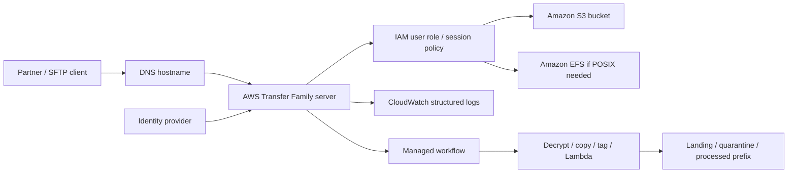

# AWS Transfer Family and SFTP Integration

Many enterprises exchange files with banks, suppliers, logistics partners, ERP systems, and on-premises data centers. These systems commonly rely on SFTP to send scheduled reports, purchase orders, payment files, or reconciliation batches. Self-managing SFTP servers on EC2 forces teams to maintain operating systems, patches, accounts, SSH keys, storage capacity, high availability, logs, and file processing workflows—tasks that easily drift across environments and add operational overhead.

AWS Transfer Family is a managed file transfer service supporting standard protocols including SFTP, FTPS, FTP, and AS2, storing data directly in Amazon S3 or Amazon EFS. For SFTP, it provides endpoints compatible with existing SSH/SFTP clients, manages user identities, enforces directory access controls, writes structured logs, and automates post-upload processing. SFTP connectors also allow AWS to initiate transfers to send or retrieve files from remote SFTP servers.

Within the AWS ecosystem, Transfer Family bridges on-premises systems and external partners with storage, IAM, KMS, Secrets Manager, VPC, CloudWatch, EventBridge, and downstream data processing applications. It fits whenever you need secure file ingestion or distribution without operating protocol servers yourself.

## Learning Objectives

After completing this lesson, you will be able to:

- Explain the role of AWS Transfer Family and distinguish SFTP from FTP/FTPS.
- Choose between public, VPC internet-facing, and VPC internal endpoints based on connectivity requirements.
- Select among service-managed, Directory Service, or custom identity providers.
- Design IAM roles, session policies, home directories, and logical directory mappings for S3/EFS.
- Configure SSH keys, host keys, network security, data encryption, and logging.
- Automate post-upload processing with managed workflows and connect to remote SFTP servers using SFTP connectors.
- Operate, monitor, troubleshoot, and estimate costs for a file transfer solution.

## What Is AWS Transfer Family?

AWS Transfer Family provides AWS-managed file transfer endpoints. Users or partners connect with standard clients such as OpenSSH `sftp`, WinSCP, FileZilla, or compatible MFT software. Transfer Family authenticates users, enforces permissions, and translates reads/writes into Amazon S3 or Amazon EFS operations.

Transfer Family supports multiple protocols and capabilities:

| Protocol / Capability | Purpose |
|---|---|
| SFTP | File transfer over SSH; suitable for secure transfers over public or private networks |
| FTPS | FTP secured with TLS; commonly used when partners require FTP/TLS |
| FTP | Traditional FTP; should only be used on private networks or for strict legacy compatibility because credentials and payloads are unencrypted at the protocol layer |
| AS2 | Signed/encrypted B2B messaging with receipts per the AS2 standard |
| SFTP connector | Outbound connections to remote SFTP servers to send, retrieve, list, or manage remote files |
| Managed workflows | Automates post-upload steps when uploads complete or finish partially |
| Transfer Family web apps | Provides a managed web interface for users exchanging files with S3; a distinct access model from SFTP endpoints |

**SFTP and FTPS are not the same protocol.** SFTP runs over SSH and typically uses TCP port 22. FTPS combines FTP with TLS, using separate control and data channel port requirements. Plain FTP does not encrypt credentials or transferred payloads. Whenever a partner mentions "FTP," confirm whether they mean SFTP, FTPS, or plain FTP before designing the endpoint.

Transfer Family is a managed service; customers have no shell access to the underlying SFTP servers and cannot install OS packages or run OS commands on the endpoint. For file processing logic, use managed workflows, Lambda, or downstream processing services.

## Inbound SFTP Architecture

A common pattern has partners connect to a Transfer Family server, authenticate, and write files into an S3 bucket. Completed uploads trigger a workflow to inspect, decrypt, tag, or route files into processing prefixes.



Components that must be designed together:

- **Server endpoint:** where clients connect, including protocol, endpoint type, hostname, and network access.
- **Identity provider:** verifies username, password, or SSH public keys and returns authorization configuration.
- **User role:** grants Transfer Family access to the specific bucket, prefix, or file system.
- **Home directory:** defines the directory layout users see upon login.
- **Storage:** S3 fits object storage and event-driven processing; EFS fits applications requiring POSIX filesystem semantics.
- **Workflow and logging:** handles post-upload processing and provides audit/operational evidence.

One server can serve many users. Each user can have a distinct home directory, IAM role, session policy, SSH public keys, and tags. Separate users by partner or business function to simplify access governance and auditing.

## Endpoint Types and Network Selection

When creating a Transfer Family server, the endpoint type determines whether clients connect over the Internet or a private network, whether static IPs can be attached, and which protocols are supported.

| Endpoint | Accessibility | IP Addressing and Source Control | Primary Protocols |
|---|---|---|---|
| Public | Accessible over the Internet without VPC endpoint configuration | AWS-assigned IPs that can change; does not support security group IP allowlists | SFTP |
| VPC hosted - Internet-facing | Accessible from the Internet and VPC/VPC-connected networks | Supports static Elastic IPs; controls source IPs via security groups and network ACLs | SFTP, FTPS |
| VPC hosted - Internal | Accessible only from VPC or connected networks like VPN/Direct Connect | Stable private IP endpoints; controlled via security groups and network ACLs | SFTP, FTP, FTPS, AS2 |
| `VPC_ENDPOINT` | Legacy endpoint type | Do not use for new servers | Deprecated; use VPC hosted instead |

### Public Endpoint

A public endpoint is the simplest option when partners connect over the Internet and do not require static IP allowlisting. It uses a Transfer Family–provided hostname:

```text
server-id.server.transfer.region.amazonaws.com
```

Public endpoint IPs can change. Partners should allowlist by hostname per AWS guidance rather than pinning a static IP. Public endpoints do not support security groups for restricting source IPs. If source IP filtering is required, consider an internet-facing VPC hosted endpoint.

### VPC Hosted - Internet-Facing

An internet-facing VPC endpoint resides in your VPC and can attach Elastic IPs to selected AZs/subnets. Partners can allowlist stable EIPs, while security groups restrict inbound traffic to permitted IP ranges. This is typically chosen when partners mandate static IPs or the organization enforces network-layer source filtering.

For SFTP, the default port is TCP 22. VPC hosted endpoints can support alternative SFTP ports such as 2222, 2223, or 22000 depending on configuration. Avoid changing ports unless partners can reconfigure their clients and firewalls. Internet-facing VPC endpoints currently support SFTP and FTPS; check the current protocol matrix before enabling multiple protocols.

### VPC Hosted - Internal

An internal endpoint has private IPs only and is not exposed directly to the Internet. Clients must reside inside the VPC or on a connected network such as Site-to-Site VPN, AWS Direct Connect, Transit Gateway, or appropriate private links. This fits internal systems or partners connecting exclusively over private networks.

Internal endpoints do not support custom hostnames in the same manner as public/internet-facing endpoints. If a friendly internal hostname is required, design private DNS resolution compatible with how clients resolve endpoints while verifying service configuration limits.

### AZ Distribution and Security Groups

For VPC hosted endpoints, select subnets across up to three supported Availability Zones. Distribute endpoints across multiple AZs to avoid single-AZ dependence. Verify subnet CIDRs and available IP capacity before provisioning.

Inbound security group rules should allow only required sources, typically on TCP 22 for SFTP. If using a non-default port, align server configuration and partner firewalls. Avoid opening `0.0.0.0/0` when partners have fixed IP ranges. When connections fail, inspect network ACLs, route tables, on-premises firewalls, and DNS together.

### Custom Hostnames and DNS

For endpoint types supporting custom hostnames, use Route 53 or an external DNS provider to create an alias pointing to the endpoint. Custom hostnames give partners a stable name such as `sftp.example.com` even if backend servers change. Manage TTLs, test DNS resolution from partner networks, and plan hostname cutovers when replacing servers.

## Identity Providers and User Authentication

Transfer Family supports three main identity provider categories. Each server uses one identity provider type chosen at creation; choose based on your identity store and the authentication methods partners support.

| Identity Provider | Protocols | Authentication Method | Best Suited When |
|---|---|---|---|
| Service-managed | SFTP | SSH public key | Small/medium user lists where users and keys are managed directly in Transfer Family |
| AWS Managed Microsoft AD | SFTP, FTPS, FTP | Active Directory credentials | Users and groups are already managed in Microsoft AD |
| Custom identity provider via Lambda or API Gateway | SFTP, FTPS, FTP | Password, public key, or both per SFTP configuration | Integrating existing IdPs, Secrets Manager, LDAP, or custom auth logic |

### Service-Managed Users

With service-managed identity, usernames and SSH public keys are stored inside Transfer Family. Users authenticate with their corresponding private keys; Transfer Family does not store passwords in service-managed mode. Each user can hold one or more SSH public keys to support phased key rotation.

The advantage is simplicity and minimal dependencies. The trade-off is managing user and public-key lifecycles via the Transfer Family API/console or IaC. With many partners, automate key provisioning and revocation.

### AWS Managed Microsoft AD

Directory Service authenticates users via Active Directory credentials and manages access by group membership. This fits internal users who already hold AD accounts. Grant required Directory Service permissions and verify connectivity, DNS, group membership, and server configuration.

### Custom Identity Providers

A custom identity provider can use Lambda directly or API Gateway backed by Lambda. When a client connects, Transfer Family passes authentication context to the provider. The provider validates credentials, user policies, and source IP if needed, returning configuration such as IAM role, home directory, session policy, and POSIX profile for EFS.

With a custom identity provider for SFTP, you can configure:

- `PUBLIC_KEY`: authenticates solely via SSH key.
- `PASSWORD`: authenticates solely via password.
- `PUBLIC_KEY_OR_PASSWORD`: accepts either method.
- `PUBLIC_KEY_AND_PASSWORD`: requires both SSH key and password.

`AND` mode requires clients to perform two authentication steps; the custom provider must return complete responses for both. This adds an extra authentication factor, but verify client compatibility and password management processes. When using passwords, enforce strength policies, failed-login limits, brute-force monitoring, and password rotation/revocation.

### SSH Key Lifecycle

SSH keys authenticate clients to the server. Users retain private keys; Transfer Family or the custom identity provider stores/looks up public keys. Never send private keys to AWS or third parties. Protect client private keys with passphrases and strict filesystem permissions.

Key management should include:

1. Generating key pairs using algorithms and lengths permitted by the server's security policy.
2. Exchanging public keys over a verified channel and binding them to the right username.
3. Verifying fingerprints and testing with a real client.
4. During rotation, adding the new public key first, verifying connectivity, and then revoking the old key.
5. When a partner offboards, removing keys and disabling the user/credentials.
6. Retaining audit history of key changes, approvers, and effective dates.

The server also presents an SSH host key so clients can verify server identity. When migrating endpoints or rotating host keys, communicate new fingerprints to partners over a trusted channel to avoid host key mismatch warnings or man-in-the-middle risk. Never tell users to blindly bypass fingerprint warnings.

## Storage: Amazon S3 or Amazon EFS?

Transfer Family supports S3 and EFS as storage domains. The choice depends on access semantics, permissions, downstream applications, and directory organization.

| Criterion | Amazon S3 | Amazon EFS |
|---|---|---|
| Data model | Objects in buckets and prefixes | Filesystem with directories, files, and POSIX semantics |
| Access control | IAM roles, bucket policies, and session policies | POSIX UID/GID, secondary groups, and filesystem policies |
| Scale and integration | Strong for data lakes, event-driven processing, lifecycles, and object sharing | Strong for apps requiring filesystem semantics and POSIX file locking/permissions |
| Home directory | `PATH` or `LOGICAL` mapping to bucket/prefix | `PATH` or `LOGICAL` mapping to filesystem path |
| Encryption | SSE-S3 or SSE-KMS; client-side/PGP if needed | Encryption at rest and in transit per EFS configuration |
| Integration | S3 events, EventBridge, Lambda, Glue, Athena | EC2, ECS/EKS, Linux apps needing shared filesystems |

### S3 Paths and Logical Directories

With S3, directory paths represent buckets and prefixes. Transfer Family offers two home directory types:

- **`PATH`:** users see full configured S3 paths, including bucket and prefix.
- **`LOGICAL`:** users see a virtual folder tree defined by `Entry` and `Target` pairs. For instance, `/inbound` can map to `/partner-a/dropbox` inside a bucket. Users never need to know actual bucket names or underlying prefixes.

Logical mapping is ideal for isolating users and presenting a clean folder structure. Mapping `Entry: "/"` to a user's dedicated target creates a virtual root that confines file transfer visibility to the assigned folder. The IAM role must still hold permissions on the underlying target.

Mapping example:

```json
[
  {
    "Entry": "/",
    "Target": "/company-transfer/partners/partner-a"
  },
  {
    "Entry": "/processed",
    "Target": "/company-transfer/partners/partner-a/processed"
  }
]
```

Here, the bucket is `company-transfer`; the user sees `/` and `processed`, while actual S3 objects reside under their mapped prefixes. Ensure mappings do not overlap or point outside the IAM role's permitted scope.

### IAM User Roles and Session Policies for S3

Each Transfer Family user is assigned an IAM role. Transfer Family assumes that role when the user accesses S3. Grant minimal permissions such as `s3:ListBucket`, `s3:GetObject`, and `s3:PutObject`, adding `s3:DeleteObject` only if deletion is genuinely required. Multipart uploads require corresponding multipart permissions. If the bucket uses SSE-KMS, grant KMS permissions to the role and permit the role in the key policy.

A session policy narrows an individual user's permissions within a shared IAM role. Session policies apply to S3 only, not EFS. Policy variables such as `${transfer:HomeBucket}`, `${transfer:HomeDirectory}`, and `${transfer:UserName}` enable dynamic per-user scoping. Session policies have size limits, so keep them concise and readable.

Condensed trust policy example for a user role:

```json
{
  "Version": "2012-10-17",
  "Statement": [
    {
      "Effect": "Allow",
      "Principal": { "Service": "transfer.amazonaws.com" },
      "Action": "sts:AssumeRole",
      "Condition": {
        "StringEquals": {
          "aws:SourceAccount": "123456789012"
        },
        "ArnLike": {
          "aws:SourceArn": "arn:aws:transfer:ap-southeast-1:123456789012:user/*"
        }
      }
    }
  ]
}
```

Replace account ID, Region, and ARN scope with real values. If the role serves a single server, narrow `SourceArn` to the specific server ID. `aws:SourceAccount` and `aws:SourceArn` conditions mitigate confused deputy risks.

### EFS and POSIX Profiles

For EFS, Transfer Family uses a POSIX profile consisting of UID, GID, and secondary GIDs to enforce filesystem permissions. Both the user role and EFS filesystem policy must allow required operations. Directory and file POSIX permissions still apply, so a user may authenticate successfully yet fail to read/write if their UID/GID lacks filesystem rights.

Assign consistent UIDs/GIDs per user or business group, avoiding shared UIDs across unrelated partners where isolation is needed. Verify EFS mount targets across AZs, security groups, filesystem policies, and encryption before opening the endpoint to partners.

## Data and Network Security

SFTP encrypts transport via SSH. However, transport encryption does not replace encryption at rest or downstream processing security.

### Protection in Transit and at Rest

- Configure SFTP/SSH security policies permitting modern algorithms compatible with partner clients.
- On S3, enable server-side encryption with SSE-S3 or SSE-KMS per requirements; for sensitive data, govern key policies, rotation, and decrypt permissions.
- On EFS, enable encryption at rest and in transit per filesystem/mount settings.
- When partners require end-to-end encryption before files reach AWS, have partners PGP-encrypt files and decrypt via managed workflows after upload.
- Never log passwords, private keys, file contents, or sensitive personal data in application logs.

### PGP and Managed Decryption

PGP protects file contents independently of the SFTP channel. Partners encrypt files with the recipient's public key; the Transfer Family workflow uses the corresponding private key to decrypt post-upload. PGP private keys are stored in AWS Secrets Manager following Transfer Family's required secret structure. Restrict secret read access and manage key lifecycles as sensitive security assets.

PGP decryption supports only algorithms and formats documented by Transfer Family. When encrypting, partners must specify the recipient properly; anonymous encryption can prevent workflows from locating the right key. Test with sample files, confirm mutually supported algorithms, and retain the encrypted original separately if compliance mandates preserving original evidence.

### Security Policies and Host Keys

Transfer Family servers use security policies to govern allowed SSH ciphers and algorithms. Select a policy matching security requirements and partner clients. Avoid keeping weak algorithms solely for legacy clients if clients can upgrade. If an exception is unavoidable, record an expiration date and remediation plan.

Manage server host keys and fingerprints under change control. Partners verify host keys to ensure they connect to the genuine endpoint. When migrating servers or rotating host keys, execute planned cutovers and distribute updated fingerprints over an independent trusted channel.

### Network Hardening

- Prefer internal VPC endpoints when partners connect over VPN or Direct Connect.
- When Internet access is required, use an internet-facing VPC endpoint and allowlist source IPs in security groups.
- Open only strictly required ports and protocols.
- Isolate subnets and security groups across endpoints, processing workloads, and backend services.
- Use bucket policies or filesystem policies to constrain data access paths; consider VPC endpoint policies where S3 architecture warrants them.
- Protect custom identity providers with least-privilege IAM, API authorization, throttling, and logging.
- Use AWS WAF when an API Gateway–backed custom identity provider needs HTTP-layer protection; WAF does not inspect SFTP traffic directly on the Transfer Family endpoint.

## Managed Workflows: Automating Post-Upload File Processing

Managed workflows allow Transfer Family to execute a sequence of steps when a file upload completes or when a session terminates with a partially uploaded file. This standardizes B2B ingestion without operating custom file-handling servers for every partner.

Built-in step types include:

| Step | Purpose |
|---|---|
| `COPY` | Copy file to another bucket or prefix |
| `TAG` | Attach tags to the object |
| `DELETE` | Delete the source file after processing per policy |
| `DECRYPT` | Decrypt PGP payloads using a managed private key |
| `CUSTOM` | Invoke Lambda for custom business validation or processing |

Typical inbound workflow:

1. Partner uploads a file into `landing/partner-a`.
2. Transfer Family detects upload completion and starts the workflow.
3. Workflow checks/decrypts PGP if the file is encrypted.
4. Tags `partner=partner-a` and `status=received`.
5. Invokes Lambda to validate filename conventions, schema, or checksum.
6. If valid, copies the file to `ready/`; if invalid, moves it to `quarantine/` and alerts operators.
7. Records workflow logs and outcomes for auditing.

Workflows require a dedicated execution role permitting Transfer Family to invoke needed services and Lambda functions. Scope permissions to exact buckets, prefixes, secrets, and functions. Custom Lambda steps must support the workflow's asynchronous callback model and handle timeouts, retries, and idempotency.

### Complete Uploads vs. Partial Uploads

Servers can attach separate workflows for `OnUpload` and `OnPartialUpload`. Never process incomplete files as valid deliveries. Partial-upload workflows can quarantine, clean up, or alert; business procedures determine whether to resume uploads or ask the partner to retransmit.

### Workflow Limits to Factor In

Per published AWS service quotas, key constraints include:

- Up to 10 workflows per account, per Region.
- Up to 8 steps per workflow.
- Custom steps have a maximum timeout of 30 minutes.
- Decrypted files are limited to 10 GB maximum size.
- Per-workflow limits apply to tag counts and concurrent decrypt executions.
- Zero-byte files do not trigger workflows.
- S3 buckets accessed by a workflow must reside in the same Region as the workflow.
- Cross-account or cross-Region custom Lambda steps are not supported; cross-account copies are possible with proper IAM and bucket policies.
- Attaching a workflow to an AS2 server does not cause AS2 messages to run Transfer Family post-upload workflows.

Quotas vary by Region and over time. Check current quotas and workflow documentation before designing for high-volume workloads.

## SFTP Connectors: Sending and Retrieving Files from Remote Servers

Transfer Family servers handle inbound client connections to AWS. SFTP connectors handle the reverse direction: AWS connects outbound to a remote SFTP server to send or retrieve files. Each connector represents one remote SFTP server.

Supported connector operations include:

- Sending objects from S3 to a directory on a remote SFTP server.
- Retrieving files from a remote SFTP server into S3.
- Listing files and directories on the remote server.
- Deleting, renaming, or moving files/directories on the remote server.

### Connector Authentication

Credentials for remote servers are stored in AWS Secrets Manager. When creating a connector, specify the secret ARN, remote server URL or resource configuration ARN, security policy, and IAM access role. The access role allows the connector to read the secret and access designated S3 objects. Never embed passwords or private keys in scripts, public templates, or shell history.

Before production use, test the connector to verify reachability, host keys, credentials, paths, and remote permissions. Partners may require source IP allowlisting; select the appropriate egress type to provide stable addresses.

### Egress Types: Service-Managed and VPC Lattice

| Egress Type | Path | When Appropriate |
|---|---|---|
| Service-managed | AWS Transfer Family uses AWS-managed egress infrastructure to reach the Internet; provides static IPs for remote allowlisting | Public Internet-accessible remote SFTP servers with no need for private connectivity or custom NAT |
| VPC Lattice | Connector routes through your VPC via Amazon VPC Lattice Cross-VPC Resource Access; supports organizational NAT Gateway/EIP and network controls | Private remote SFTP servers in VPCs, on-premises via Direct Connect/VPN, or centralized egress control |

With VPC Lattice egress, prepare a VPC, subnets, routes, security groups, a Resource Gateway deployed across at least two AZs, and a Resource Configuration pointing to the remote SFTP server. This lets connectors reach private resources without exposing endpoints to the public Internet.

Service-managed egress carries service-defined bandwidth and IP limits; review quotas and pricing. If a remote server accepts only customer-owned source IPs, use VPC Lattice with your own NAT Gateway and Elastic IPs.

### Transferring Files via CLI

After creating and authorizing a connector, use `StartFileTransfer` to send or retrieve files. Example sending an S3 object to a remote server:

```bash
aws transfer start-file-transfer \
  --connector-id c-0123456789abcdef0 \
  --send-file-paths /company-transfer/outbound/report-2026-11.csv
```

Paths in `--send-file-paths` reference object paths within the bucket configured for the connector. For retrievals, specify remote file paths and the local S3 directory per current CLI/API syntax. Connectors also provide dedicated APIs to list and delete remote files. Inspect the returned transfer ID and logs to verify outcomes; starting the transfer successfully does not guarantee the remote server received and processed the final file.

### Idempotency and Delivery Confirmation

Network transfers can drop after the remote server receives a file but before the client gets the final acknowledgment. Retrying may retransmit the file. Establish file naming conventions, checksums, manifests, or acknowledgments so partners detect duplicates cleanly. Never delete source files immediately upon initiating transfer; delete only after business confirmation and in accordance with retention policies.

## Example: Deploying an SFTP Server with AWS CLI

The commands below illustrate creating a public SFTP server using the service-managed identity provider and S3. Replace sample values with your actual account, Region, bucket, and IAM role.

### Create the Server

```bash
aws transfer create-server \
  --protocols SFTP \
  --identity-provider-type SERVICE_MANAGED \
  --endpoint-type PUBLIC \
  --domain S3
```

This returns a `ServerId`. For IP allowlisting or private access, create the server with `VPC` endpoint type and configure access mode, subnets, and security groups accordingly.

### Create a User with a Logical Home Directory

Create `home-mapping.json`:

```json
[
  {
    "Entry": "/",
    "Target": "/company-transfer/partners/partner-a"
  }
]
```

After creating the IAM role with appropriate trust and S3 permissions, create the user:

```bash
aws transfer create-user \
  --server-id s-0123456789abcdef0 \
  --user-name partner-a \
  --role arn:aws:iam::123456789012:role/TransferPartnerAAccess \
  --home-directory-type LOGICAL \
  --home-directory-mappings file://home-mapping.json \
  --ssh-public-key-body "ssh-ed25519 AAAAC3NzaC1lZDI1NTE5AAAAIExamplePublicKey partner-a"
```

In production, `ssh-public-key-body` must be a valid public key supplied by the partner over a verified channel. Never use an example placeholder string as a real key.

### Verify Server Status

```bash
aws transfer describe-server \
  --server-id s-0123456789abcdef0

aws transfer list-users \
  --server-id s-0123456789abcdef0
```

Once the server reaches `ONLINE`, test from an authorized client:

```bash
sftp -i ./partner-a-private-key partner-a@server-id.server.transfer.ap-southeast-1.amazonaws.com
```

Keep the private key on the client machine protected by strict file permissions. Partners must use the exact hostname, username, port, and verified host key fingerprint.

## Monitoring, Logging, and Auditing

AWS Transfer Family supports CloudWatch logging. For new servers and managed workflows, enable JSON structured logging for consistent fields and querying via CloudWatch Logs Insights. Connectors use logging roles per connector logging support.

Log events capture:

- Successful/failed connections, usernames, and sessions.
- File operations such as `OPEN`, `CLOSE`, `DELETE`, `RENAME`, `MKDIR`, and related actions.
- Bytes uploaded/downloaded, durations, and transfer errors.
- Negotiated SSH ciphers/algorithms per session.
- Workflow executions, step start/completion/failure events, and Lambda errors.
- Connector operations, transfer IDs, file paths, and send/retrieve results.

Do not rely solely on login logs. Correlate file-operation logs with S3 data events or EFS audit mechanisms when compliance requires deeper evidence. CloudTrail logs control-plane actions such as creating servers, updating configurations, adding users, and managing connectors; CloudWatch logs session and file-transfer activity per logging configuration.

### Metrics and Alarms

Build dashboards segmented by server, partner, and environment. Track connection counts, active sessions, authentication failures, bytes in/out, workflow failures, connector transfer failures, transfer durations, and downstream processing backlogs. Alert when:

- Authentication failure rates spike unexpectedly.
- A partner misses a scheduled file delivery window.
- Workflows or file-processing Lambdas fail.
- Connectors fail to reach remote servers or transfers error out.
- S3/EFS capacity or storage spend grows abnormally.
- File counts in `landing/` or `quarantine/` exceed thresholds.

Use CloudWatch Logs Insights to query by username, server ID, session ID, connector ID, transfer ID, and activity type. Align log retention with audit requirements, and restrict log read permissions since metadata can expose usernames, filenames, and partner details.

## Troubleshooting Common Issues

| Symptom | Common Cause | Investigation Steps |
|---|---|---|
| Connection timeout | Security group, NACL, routing, firewall, wrong hostname/port, or unreachable internal endpoint | Check DNS, TCP reachability, source IP, subnets, VPN/DX, and port |
| Connection refused | Server not online, wrong port, or protocol mismatch | Check server state, enabled protocols, port, and endpoint type |
| Authentication failed | Wrong username, mismatched public key, expired password, IdP error, or wrong auth mode | Inspect Transfer Family logs, custom IdP logs, and key fingerprint mappings |
| Login succeeds but files invisible | Bad home directory mapping or role missing `s3:ListBucket` | Check `PATH`/`LOGICAL` mappings, target path, and IAM session policy |
| Upload fails with `AccessDenied` | Missing `PutObject`, restrictive bucket policy, missing KMS key policy grant, or overly narrow session policy | Inspect role policy, bucket policy, KMS permissions, and object prefix |
| Download fails | Missing `GetObject`, missing object, or KMS decrypt denied | Check object key, IAM grants, and CloudTrail/KMS events |
| EFS returns `Permission denied` | Mismatched UID/GID or POSIX permissions, filesystem policy, or security group | Check `PosixProfile`, ownership, mount targets, and NFS access |
| Workflow does not trigger | Incomplete upload, 0-byte file, unattached workflow, execution role missing permissions, or throttling | Check `OnUpload`/`OnPartialUpload`, workflow logs, execution role, and quotas |
| PGP decryption fails | Wrong private key, anonymous recipient, unsupported algorithm, or malformed file | Check PGP key secret, recipient ID, and client/algorithm compatibility |
| Connector fails to transfer files | Bad secret, changed remote host key, bad remote path/permissions, or broken egress path | Test connector; inspect connector logs, Secrets Manager, and VPC Lattice/NAT path |

When investigating, record UTC timestamp, server/connector ID, username, remote IP, session/transfer ID, object path, and error code. Never paste private keys, passwords, or sensitive payloads into tickets or logs.

## Real-World Scenario: Receiving Daily Bank Reconciliation Reports

An e-commerce company receives daily transaction reconciliation files from a bank. The bank supports SFTP only and requires IP allowlisting. Files are PGP-encrypted prior to transmission and must be decrypted, schema-validated, and ingested into downstream data pipelines.

Proposed design:

1. Provision a Transfer Family server with an internet-facing VPC hosted endpoint, attach stable Elastic IPs, and restrict security groups to the bank's IP addresses on TCP 22.
2. Configure a custom hostname such as `bank-sftp.example.com` where endpoint mode supports it and configure DNS.
3. Use a service-managed user if SSH keys alone suffice, or a custom identity provider if user-store integration and password/key policies are required.
4. Create a dedicated IAM role for the bank user scoped to `PutObject` on `landing/bank-a/`, granting read permissions only if contractually needed.
5. Configure a logical home directory so the partner sees only its upload folder without seeing bucket names or other prefixes.
6. Enable SSE-KMS on the bucket; store the PGP private key in Secrets Manager with read access restricted to the workflow execution role.
7. Attach an `OnUpload` workflow: decrypt, tag, invoke Lambda to validate filename/checksum/schema, then copy valid files to `ready/` or move invalid files to `quarantine/`.
8. Enable JSON structured logs, CloudTrail, and alarms for missed schedules or workflow failures.
9. Test with valid samples, malformed signatures/formats, duplicate filenames, 0-byte files, and aborted partial uploads.
10. Periodically rotate SSH/PGP keys and review IP allowlists, IAM policies, retention, and costs.

If the company instead needs to pull reports actively from the bank's SFTP server rather than waiting for uploads, use an SFTP connector with service-managed egress or VPC Lattice depending on allowlist and private connectivity needs. Store remote credentials in Secrets Manager and implement delivery tracking to prevent duplicate ingestion.

## Costs and Optimization

Transfer Family costs depend on enabled protocols/endpoints, endpoint uptime hours, data uploaded/downloaded over SFTP/FTPS/FTP, connector calls, and data processed by workflows. Web apps are billed by web app units. Beyond Transfer Family fees, factor in S3/EFS storage and requests, data transfer, KMS, Secrets Manager, Lambda, API Gateway, CloudWatch Logs, EventBridge, Route 53, and VPC Lattice / NAT Gateway if used.

Cost control practices:

- Enable only strictly needed protocols; each enabled protocol can carry separate charges.
- Audit server endpoint counts and uptime, especially in non-production/test environments.
- Use S3 lifecycle rules to transition or expire files per retention policy; do not retain landing files forever.
- Optimize connector API call frequency and file sizes; avoid overly frequent polling/listing.
- Run workflows only on complete files that need processing; optimize workflow steps and Lambda duration.
- Set appropriate log retention; keep required audit logs without retaining verbose debug logs indefinitely.
- Evaluate S3 vs. EFS based on access patterns, file sizes, and filesystem semantics.
- Use the AWS Pricing Calculator and current regional pricing pages to estimate endpoint hours, data volume, connector usage, and supporting services.

Never weaken logging, encryption, or access controls purely to cut costs when data carries security or compliance obligations. Optimize retention, workflows, and idle infrastructure first.

## Best Practices

- Confirm explicitly whether partners require SFTP, FTPS, FTP, or AS2 before creating a server.
- Prefer internal VPC endpoints for private networks; use internet-facing VPC endpoints with EIPs and source allowlists when partners connect over the Internet with static IPs.
- Use SSH public keys for service-managed users; use custom identity providers when passwords or multi-factor checks are required.
- Give each partner or user group a distinct role, home directory, and prefix.
- Use logical directory mappings and session policies to minimize visible scope and access rights.
- Enforce least privilege across IAM roles, bucket policies, KMS key policies, and POSIX profiles.
- Rotate SSH keys, host keys, and PGP keys on schedule; revoke immediately upon credential compromise or partner offboarding.
- Standardize decrypt, validation, tagging, copying, and quarantine with managed workflows; handle partial uploads separately.
- Use SFTP connectors for outbound exchange; store credentials in Secrets Manager and pick the right egress mode.
- Enable JSON structured logging, CloudTrail, and alerts keyed to partners, transfer IDs, and delivery schedules.
- Test duplicates, empty files, oversized files, interrupted uploads, expired keys, and workflow failures.
- Enforce lifecycle/retention policies across landing, processed, quarantine, and log data.
- Monitor quotas, throughput, workflow concurrency, and connector egress limits before scaling.

## Production Deployment Checklist

- [ ] Confirmed protocol, partners, transfer direction, and delivery cadence.
- [ ] Selected S3 or EFS based on data semantics and downstream applications.
- [ ] Selected public, VPC internet-facing, or VPC internal endpoint.
- [ ] Designed multi-AZ subnets, security groups, NACLs, routes, DNS, and IP allowlists.
- [ ] Selected identity provider and authentication method; verified client compatibility.
- [ ] Designed user roles, trust policies, session policies, bucket/KMS policies, or POSIX profiles.
- [ ] Configured home directories and logical mappings per partner.
- [ ] Verified SSH host keys, client public keys, security policies, and rotation workflows.
- [ ] Configured encryption at rest and PGP where end-to-end protection is needed.
- [ ] Configured managed workflows, execution roles, partial-upload handling, and quarantine.
- [ ] If using connectors, created Secrets Manager secrets, access roles, egress type, and tested remote servers.
- [ ] Enabled structured logging, CloudTrail, dashboards, alarms, and retention policies.
- [ ] Tested uploads/downloads, permissions, network failures, bad credentials, duplicates, and workflow errors.
- [ ] Estimated costs across endpoints, data transfer, storage, workflows, connectors, and supporting services.
- [ ] Documented runbooks for operations, credential compromise response, file recovery, and partner contacts.

## Conclusion

AWS Transfer Family delivers managed SFTP file transfer gateways integrated natively with S3 or EFS. Endpoint type governs client network reachability; identity providers govern authentication; and IAM roles, session policies, logical home directories, and POSIX profiles govern data scope. Managed workflows automate post-upload processing, while SFTP connectors send and retrieve files from remote servers. Paired with sound VPC networking, SSH/PGP/KMS encryption, Secrets Manager, CloudWatch, and clear operational runbooks, organizations can integrate partners and on-premises systems securely without self-managing SFTP servers.

## References

- [AWS Transfer Family User Guide](https://docs.aws.amazon.com/transfer/latest/userguide/what-is-aws-transfer-family.html)
- [Configuring an SFTP, FTPS, or FTP server endpoint](https://docs.aws.amazon.com/transfer/latest/userguide/sftp-for-transfer-family.html)
- [Create an SFTP-enabled server](https://docs.aws.amazon.com/transfer/latest/userguide/create-server-sftp.html)
- [Create a server in a VPC](https://docs.aws.amazon.com/transfer/latest/userguide/create-server-in-vpc.html)
- [Identity provider options](https://docs.aws.amazon.com/transfer/latest/userguide/custom-idp-intro.html)
- [Managing users for server endpoints](https://docs.aws.amazon.com/transfer/latest/userguide/create-user.html)
- [Create an IAM role and policy](https://docs.aws.amazon.com/transfer/latest/userguide/requirements-roles.html)
- [Creating a session policy for an Amazon S3 bucket](https://docs.aws.amazon.com/transfer/latest/userguide/users-policies-session.html)
- [AWS Transfer Family managed workflows](https://docs.aws.amazon.com/transfer/latest/userguide/transfer-workflows.html)
- [Using SFTP connectors](https://docs.aws.amazon.com/transfer/latest/userguide/transfer-sftp-connectors.html)
- [VPC connectivity for SFTP connectors](https://docs.aws.amazon.com/transfer/latest/userguide/sftp-connectors-vpc-overview.html)
- [Amazon CloudWatch logging for AWS Transfer Family servers](https://docs.aws.amazon.com/transfer/latest/userguide/structured-logging.html)
- [AWS Transfer Family pricing](https://aws.amazon.com/aws-transfer-family/pricing/)
