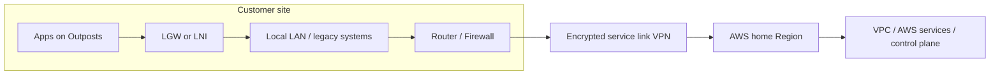

# AWS Outposts, Cutover, Rollback, and Post-Migration Operations

AWS Outposts brings AWS infrastructure and selected AWS services to an organization's data center, factory, or operational site. The goal is typically to run workloads close to on-premises systems to satisfy low-latency requirements, process data locally, or maintain tight integration with existing equipment and applications. An Outpost is an extension of an Availability Zone in a chosen AWS Region; it still requires a service link connection back to the Region for management, control plane operations, and traffic exchange with regional AWS services.

Moving workloads onto Outposts does not end with launching EC2 instances or creating subnets. The project team must prepare networking, power, capacity, data, identity, observability, and recovery mechanisms before shifting traffic. Cutover requires explicit entry/exit criteria, named decision-makers, business validation, and a safe fallback path. Afterward, operations teams monitor the service link, local gateway, capacity, hardware health, backups, and ongoing application changes.

This lesson focuses on the lifecycle after choosing Outposts as a deployment target or hybrid building block: preparing sites and workloads, syncing data, shifting traffic, rolling back when necessary, and sustaining stable post-migration operations.

## Learning Objectives

After completing this lesson, you will be able to:

- Distinguish Outposts racks from Outposts servers, service links, local gateways, and local network interfaces.
- Evaluate whether a workload fits Outposts and verify supported services by form factor.
- Design networking, capacity, security, backups, and observability for hybrid environments.
- Build migration waves, cutover plans, and rehearsable rollback plans.
- Choose traffic cutover strategies using DNS, load balancers, or network routing.
- Govern write freezes, replication lag, split-brain prevention, and data consistency across cutover and rollback.
- Operate Outposts post-migration, covering service links, power, hardware maintenance, capacity, and incident response.
- Measure actual RTO/RPO and confirm workloads meet operational acceptance criteria.

## 1. Outposts in a Hybrid Architecture

AWS Outposts is a pool of AWS compute and storage capacity deployed at a customer site and anchored to an AWS Region. VPCs in the Region extend onto the Outpost via Outpost subnets. Teams continue managing resources through familiar AWS Management Console, CLI, and API interfaces.

Outposts fits when workloads require one or more of the following:

- Low latency to on-site equipment, control systems, servers, or databases.
- Local data processing due to residency, data sovereignty, or internal policy mandates.
- Integration with on-premises networks, industrial gear, legacy systems, or local protocols.
- Consistent AWS tooling and operating models across hybrid environments.
- Continued local operation during temporary disconnects from the Region, within the scope supported by each service.

Outposts is not an independent AWS Region. Many management operations, APIs, and services depend on the parent Region over the service link. Design both local workload paths and regional management/sync paths.

### Outposts as an Extension of an Availability Zone

When creating an Outpost, you select an Availability Zone in the parent Region as its home AZ. The Outpost anchors to that AZ while physically residing at the customer site. To increase site- or AZ-level fault tolerance, deploy multiple Outposts at independent sites anchored to different AZs and design cross-site replication/failover between them.

A single rack or server does not inherently provide high availability for an application. Account for all failure domains: hosts, racks, network switches, power feeds, site facilities, service link, home Region, and external dependencies.

## 2. Outposts Rack vs. Outposts Server

Outposts offers distinct form factors. Selecting the right form factor directly impacts network design, available AWS services, and operational runbooks.

| Criterion | Outposts Rack | Outposts Server |
|---|---|---|
| Form factor | Full-size rack with integrated compute, storage, and networking gear | Rack-mountable server installed in an existing customer rack |
| Regional connectivity | Service link | Service link |
| On-premises LAN connection | Local gateway (LGW) | Local network interface (LNI) on the server |
| Compute | EC2 and supported services per rack/configuration | EC2 and supported services per server |
| Storage | Can include EBS and S3 on Outposts depending on configuration | Instance store; no EBS on server form factor |
| Managed services | May support RDS, EKS worker nodes, ALB depending on configuration | Narrower service list; do not assume RDS/EKS node support |
| Networking | Local gateway route tables, VIFs/VIF groups, and BGP | LNI provides direct attachment to local LAN |

Supported services vary by form factor, rack generation, configuration, and Region. Before finalizing designs, check the current service matrix for your exact ordered Outpost configuration. Never assume a service available in the Region runs on every Outpost.

### Choosing a Form Factor by Requirement

- If you require rack services such as EBS, S3 on Outposts, RDS on Outposts, or EKS nodes, confirm the rack configuration supports them.
- If you need modest compute at a branch site with existing racks and networking, Outposts servers may fit better.
- For LAN connectivity, distinguish LGW (rack) vs. LNI (server); the two mechanisms are not interchangeable in runbooks.
- For local data residency, verify where snapshots, backups, logs, metrics, metadata, and ancillary data are stored—not just primary volumes or objects.

## 3. Service Link and Local Data Paths

Outposts relies on two network planes that must be designed cleanly.

### Service Link

The service link is a set of encrypted VPN connections between the Outpost and its home Region. It carries Outpost management, infrastructure telemetry, firmware/software updates, and traffic between the Outpost and VPCs/services in the Region.

Prepare service link connectivity before equipment arrives. For racks, AWS configures the service link during provisioning while the customer configures site networking per agreed VLAN/IP/BGP parameters. For servers, the customer configures connectivity per form-factor installation instructions.

For Outposts racks, service link connectivity type and settings are locked during ordering; once the order completes, you cannot arbitrarily swap service link connectivity models. Agree on public vs. private connectivity, home Region, VLANs, CIDRs, BGP, firewalls, and redundant paths before placing the order.

Key network requirements in current Outposts rack documentation include:

- Redundant connectivity to the home Region; AWS recommends at least 500 Mbps of redundant connectivity per compute rack.
- Maximum round-trip latency of 175 ms to the Region.
- Network support for 1500-byte MTU between the Outpost and service link endpoints in the Region. Traffic between Outpost instances and Region instances has an effective MTU of 1300 bytes due to encapsulation overhead.
- Racks use LACP/LAG, VLANs, point-to-point IPs, and BGP to establish service link and local gateway paths.
- Verify firewalls, NAT, route advertisements, DNS, and AWS service endpoints required by workloads.

These figures reflect technical requirements/recommendations in Outposts rack documentation; confirm exact parameters against your order configuration, home Region, and AWS site installation guides. Never size the service link purely on average throughput; include bursts, AMI transfers, backups, replication, and Outpost-to-Region traffic.

### Local Gateway and Local Network Interface

On Outposts racks, the local gateway (LGW) provides the data plane path from Outpost subnets to on-premises networks. Routing can use default private IPs or customer-owned IPs (CoIP) to support overlapping CIDRs or specialized topologies. Customers manage LGW route tables, VIF/VIF groups, and BGP peering with site routers.

LGW supports IPv4 only; IPv6 is not supported. If applications require IPv6, design connectivity around form-factor and service constraints.

On Outposts servers, the local network interface (LNI) provides direct LAN connectivity. Physical service link and LNI paths carry different traffic classes; do not assume they act as redundant failover paths for each other. Engineer switch, uplink, power, and WAN redundancy independently per workload requirements.

### Control Plane and Data Plane

The Outposts control plane always traverses the service link. Application data planes can flow through LGW/LNI to on-premises networks or over the service link to the Region. During cutover design, clarify which traffic must survive locally if the service link drops and which traffic depends on regional services.



## 4. Selecting Workloads and Defining Migration Targets

Do not migrate every system simply because an Outpost is installed. Decide which workloads belong on-site, which belong in the Region, and which require a hybrid split.

| Workload Group | Reference Decision | What to Verify |
|---|---|---|
| Processing needing ultra-low latency to equipment | Place compute on the Outpost | Latency, protocols, network paths, and local survivability |
| Databases requiring on-site residency | RDS on Outposts or self-managed DB if supported | Engine/version, HA, backup locations, storage, and restore paths |
| Object/file data requiring residency | S3 on Outposts or on-site storage | Bucket capacity, lifecycles, replication, and backup destinations |
| Shared APIs, identity, analytics | Often suited for the Region | Outpost needs a reliable service link to reach regional services |
| Delay-tolerant batch workloads | Consider running in the Region | Data transfer, egress, schedules, and cost |
| Legacy systems talking to site equipment | Hybrid routing via LGW/LNI | CIDR overlap, BGP, firewalls, and DNS |

### Compatibility Assessment

For every application, verify:

- Supported OS, AMIs, instance families/sizes, and CPU architectures.
- Storage types, capacity, IOPS, throughput, snapshots, and backup destinations.
- Dependent services such as RDS, EKS, ALB, S3, Secrets Manager, KMS, CloudWatch, and required endpoints.
- Socket/core/host-based licenses, dongles, hardware bindings, or static IP assumptions.
- DNS, NTP, PKI/certificates, SMTP, proxies, registries, artifact repositories, and external SaaS.
- Data residency rules for logs, backups, telemetry, metadata, crash dumps, and support bundles.
- RPO/RTO, failover timing, and ability to fail over to the Region if the Outpost becomes unavailable.

Never assume a workload transfers untouched. You may need refactoring to separate state, externalize configs, remove hardcoded IP dependencies, or adapt storage access patterns.

## 5. Designing Target Architecture and Landing Zone

Before migrating, finalize the target foundation so workloads deploy repeatably.

### Networking and DNS

- Choose VPC CIDRs and Outpost subnets that do not overlap on-premises or partner networks.
- Define route tables for local, Region, Internet, and service endpoint traffic.
- Design LGW route tables/BGP or LNI connectivity per form factor.
- Provision redundant uplinks, LAG/VLANs, BGP ASNs, route preferences, and firewall rules.
- Design DNS resolution/forwarding carefully; avoid relying solely on regional DNS if apps must keep working when the service link drops.
- Test MTU, fragmentation, latency, packet loss, and throughput end-to-end.

### Identity and Security

- Use IAM roles for workloads; never embed long-lived access keys in images or scripts.
- Prepare KMS keys, key policies, grants, and decrypt permissions for backups/restores.
- Manage secrets via Secrets Manager / Parameter Store or on-site secret stores aligned with link availability.
- Enforce Security Groups, NACLs, firewalls, and network segmentation.
- Synchronize clocks via reliable NTP so tokens, certificates, logs, and databases remain consistent.
- Route CloudTrail, application logs, and audit evidence to residency-compliant storage.

### Compute, Storage, and Capacity

Outposts capacity is finite and fixed by ordered hardware. Account for instance counts by family/size, EBS capacity, S3 on Outposts, plus headroom for failover, maintenance, and growth. Track capacity at the Outpost and instance-type levels; free aggregate vCPU/RAM does not guarantee a specific large instance size can launch.

Prepare AMIs, container images, IaC, launch templates, deployment packages, database schemas, and data migration jobs. Pin versions and verify checksums between source and target artifacts.

## 6. Pre-Migration Readiness Checklist

Migrations should begin only after foundational prerequisites are verified.

| Area | Readiness Condition | Evidence |
|---|---|---|
| Site | Rack space, cooling, redundant power, grounding, and physical access controls | Site readiness sign-off |
| Network | Service link, LGW/LNI, BGP, VLANs, firewalls, DNS, and NTP operational | Network test report |
| Capacity | Instance types, EBS/S3 capacity, and N+1 headroom sufficient | Capacity plan and CloudWatch baseline |
| Security | IAM, KMS, secrets, certificates, logging, and access approvals complete | Security review |
| Application | Health checks, dependencies, licensing, and performance baselines verified | Test report |
| Data | Initial sync, replication lag, consistency checks, and backups verified | Data validation report |
| Operations | Runbooks, on-call rotation, AWS Support contacts, and alert routing ready | Operations sign-off |
| Rollback | Triggers, decision owners, reverse sync, and write fencing validated | Rollback rehearsal |

### Go / No-Go Criteria

Declare Go only when network redundancy, capacity, backups, observability, and rollback paths have been tested. Declare No-Go if unexplained data errors exist, replication lag breaches targets, capacity is insufficient, decision authority is unclear, or critical dependencies fail on target.

## 7. Migration Waves and Change Planning

Group workloads into waves by dependencies and risk, never merely by application name.

A typical progression includes:

1. Low-dependency workloads to validate networking, deployment pipelines, and operations.
2. Stateless workloads enabling fast traffic cutovers.
3. Stateful/database workloads requiring replication and write freezes.
4. Workloads tightly coupled to legacy systems or on-site equipment.
5. Mission-critical workloads requiring dedicated change windows and rehearsed rollbacks.

Every wave requires an application owner, data owner, network engineer, security representative, operations lead, change manager, and Go/No-Go decision-maker. Document start times, freeze windows, RTO/RPO, dependencies, execution commands, validation checks, and abort conditions.

### Minimum Change Record

- Scope: affected services, hosts, databases, subnets, DNS names, and tenants/customers.
- Source/target: hostnames, IPs, Outpost ID, subnets, accounts, Regions, and endpoints.
- Data plan: initial copy, CDC/replication, final sync, checksums, and data owner sign-off.
- Traffic plan: DNS, load balancer, BGP, or route modifications.
- Security plan: credentials, KMS keys, secrets, firewalls, and certificates.
- Validation: technical health, transaction tests, performance benchmarks, and business sign-off.
- Rollback: triggers, write fence, reverse sync, routing reversal, and approvers.
- Communications: notifications to customers, service desk, on-call teams, and AWS Support if needed.

## 8. Pre-Cutover Data Preparation and Synchronization

For stateful workloads, move the bulk of data ahead of the cutover window. Meanwhile, source continues serving production while target receives ongoing changes via appropriate replication.

### Synchronization Stages

1. **Initial copy:** transfer baseline data using snapshots, backup/restore, file copies, or suitable migration tools.
2. **Incremental sync:** sync changes occurring after the initial copy.
3. **Continuous replication:** use native database replication, change data capture (CDC), log shipping, or supported mechanisms to minimize lag.
4. **Final sync:** halt writes on source, wait for replication to drain, and sync remaining deltas.
5. **Validation:** verify record counts, checksums, sequences, schemas, object metadata, and business invariants.

Select tools based on engines and topology. AWS Database Migration Service, DataSync, native database replication, EBS snapshots, and S3 replication each have distinct support matrices and limits. Verify source/target engines, Outposts form factor, Region, networking, and encryption before choosing; never assume every migration service supports every Outposts target type.

### Controlling Replication Lag

Track lag over time and set maximum thresholds ahead of cutover. If lag rises, isolate root causes such as insufficient bandwidth, high write rates, long transactions, index builds, throttling, or packet loss. Never begin final sync before target catches up to source.

### Consistency and Data Ordering

When applications span databases, object storage, and queues, establish a shared checkpoint. For example, an order row may reference an invoice object and a payment processing message. Checking database row counts alone is insufficient; reconcile cross-component references and replay events in proper order.

## 9. Selecting a Cutover Strategy

Cutover transitions production authority from source to target. Pick traffic shifting mechanics based on protocols, routing control, and allowable downtime.

| Strategy | Mechanism | Best Suited For | Risks to Control |
|---|---|---|---|
| DNS cutover | Update A/AAAA/CNAME or weighted records | HTTP/API workloads with DNS-capable clients | DNS caching, TTLs, long-lived client connections |
| Load balancer cutover | Register Outpost targets, pass health checks, shift weights | Web/API workloads on supported ALB/NLB topologies | Connection draining, sticky sessions, health checks |
| BGP / route cutover | Shift route preferences or prefix advertisements | Internal workloads, systems using static private IPs | Route leaks, asymmetric routing, convergence lag |
| Application endpoint switch | Update configs or service discovery | Internal clients or microservices | Config caching, restart ordering, stale endpoints |
| Phased / canary | Shift a subset of traffic first | Tenant- or partition-splittable workloads | Shared data and cross-site consistency |

Avoid DNS cutover if clients connect to hardcoded IPs or cannot refresh DNS promptly. Avoid BGP cutover unless networking teams have tested route filters and rehearsed route withdrawals.

### TTLs and Connection Draining

Lower DNS TTLs early enough before cutover so resolvers pick up new records. Low TTLs do not force all clients to switch instantaneously; some clients cache DNS aggressively or hold persistent TCP connections. Plan drain timers, graceful shutdowns, and active session handling.

## 10. Checkpoint-Driven Cutover Runbook

Runbooks must specify exact commands, expected results, owners, and abort points. Sample progression:

| Step | Action | PASS Criteria | If FAIL |
|---:|---|---|---|
| 1 | Open change window, confirm bridge/on-call, freeze scope | All owners online, change approved | Abort cutover |
| 2 | Verify Outpost status, service link, BGP/LGW/LNI, capacity | Links stable, routes accurate, capacity ready | Halt and resolve infrastructure |
| 3 | Verify latest backups/snapshots and restore points | Latest backup verified restorable | Halt and take fresh backup |
| 4 | Place source into maintenance/read-only or write freeze | Zero new writes on source | Halt and locate active writers |
| 5 | Wait for replication lag within threshold; run final sync | Lag is 0 or meets approved target | Do not shift traffic |
| 6 | Run data validation and obtain data owner sign-off | Checksums/counts/invariants pass | Roll back before enabling target writes |
| 7 | Start target stack and run internal smoke tests | Health checks, auth, DB, and dependencies PASS | Halt and keep traffic on source |
| 8 | Switch DNS/LB/BGP/endpoints per plan | Traffic reaches target cleanly without error spikes | Roll back to checkpoint |
| 9 | Enable writes on target; commit and read back test transactions | Test transactions commit and verify cleanly | Trigger incident/rollback decision |
| 10 | Monitor latency, errors, queues, DB, and business KPIs | Metrics stay within thresholds during observation | Roll back or hold canary |
| 11 | Close change, send notifications, retain source per retention | Full evidence and owner sign-off captured | Keep change open; extend hypercare |

### Minimum Smoke Tests

- DNS/endpoints resolve accurately and TLS certificates validate.
- Users and service principals authenticate and authorize properly.
- Read and write requests succeed.
- Transactions commit and read back consistently on target.
- Queues/events, file transfers, printers/scanners, or on-site equipment integrations function.
- Latency, throughput, error rates, and saturation remain within SLOs.
- Logs, metrics, traces, and alerts reach operational tooling.

## 11. Managing Write Freezes and Data Authority Transition

For stateful systems, pinpoint exactly when source stops accepting writes and target begins accepting writes. This boundary governs rollback safety.

### Write Fence

A write fence prevents both environments from writing to the same dataset during transition. Mechanisms include maintenance mode, read-only database mode, revoking write credentials, disabling queue consumers, or application-level leader locks. Switching DNS alone is not a write fence: stale clients can keep writing to source.

### Authority Handoff Checkpoint

Record:

- UTC timestamp when source stopped accepting writes.
- Final database log position/LSN/SCN/binlog or CDC checkpoint.
- Replication lag at transition time.
- Checksum/row count and business validation outcomes.
- UTC timestamp when target began accepting writes.
- Correlation/transaction IDs for reconciliation.

Without this checkpoint, rolling back after target accepts writes risks dropping or duplicating transactions.

## 12. Designing Rollback Before Cutover

Rollback returns workloads to their pre-migration serving state or to a defined fallback target. Design rollback upfront with assigned owners and objective trigger criteria.

### Rollback Triggers

Examples of pre-agreed quantitative triggers:

- Target fails health checks past the maximum allowed grace period.
- Error rate, latency, or saturation breaches SLOs during the observation window.
- Database consistency checks fail, or transactions are lost or duplicated.
- Service link or local network instability prevents meeting workload requirements.
- Capacity exceptions block target scaling or recovery.
- Mandatory dependencies such as identity, DNS, KMS, queues, or on-site hardware fail.
- Security controls or data residency mandates are violated.

Do not trigger rollback blindly off a single isolated metric without assessing blast radius. The incident commander or change owner evaluates evidence, while severe data-loss or security triggers must authorize immediate halt.

### Two Rollback Phases

**Before target accepts writes:** traffic can normally revert to source once you confirm source remains consistent and no writers remain active on target.

**After target accepts writes:** you require reverse replication, delta exports, log replay, or manual reconciliation to bring new changes back to source. If source cannot ingest deltas cleanly, obtain a formal business decision on RPO, acceptable loss, and compensating transactions.

Never delete source immediately after cutover. Keep source read-only or isolated for the approved rollback window and per retention/security policies.

## 13. Safe Rollback Procedure

1. Declare rollback/incident and freeze all unscheduled changes.
2. Stop incoming traffic or put target into maintenance mode.
3. Enforce a write fence on target to halt new transactions.
4. Record target's final checkpoint/log position.
5. If target accepted writes, execute reverse replication or delta export per runbook.
6. Reconcile transactions, sequences, checksums, and duplicates before reopening source.
7. Verify source capacity, dependencies, secrets, certificates, and endpoints.
8. Revert DNS/LB/BGP/endpoints back to source in the rehearsed sequence.
9. Re-enable writes on source only after confirming source is the sole writer.
10. Run smoke tests, monitor SLOs, and reconcile transactions created during the rollback window.
11. Keep target isolated for forensic analysis; preserve logs and evidence.
12. Communicate status and archive the timeline, decisions, checkpoints, and outcomes.

### Preventing Split-Brain

Split-brain happens when both source and target accept writes simultaneously as independent primaries. It causes conflicts, duplicate sequences, lost updates, or irreconcilable divergence. Enforce a single writer authority using fencing tokens, leases, or leader election. Where automated fencing does not exist, runbooks must require proof that source is read-only before opening target writes—and vice versa.

## 14. Cutover via DNS, Load Balancers, and BGP

### DNS

1. Lower TTLs ahead of the migration window.
2. Verify records, aliases, private hosted zones, and resolver forwarding rules.
3. Update records/weights to point to Outposts targets.
4. Test resolution from multiple resolvers and on-premises networks.
5. Monitor residual traffic hitting source; keep source read-only during drain.

### Load Balancers

1. Register new targets and wait for healthy status.
2. Test internal requests before entering the production pool.
3. Shift traffic by weights/canary if supported by the architecture.
4. Drain old connections while watching 4xx/5xx errors, latency, and backend saturation.
5. Keep source targets warm throughout the rollback window.

### BGP and Local Gateways

On Outposts racks, the local gateway uses BGP to exchange routes with site networks. Cutover design needs route filters, prefix allowlists, route preferences, AS-path policies, and withdraw/re-advertise steps. Verify return paths to prevent asymmetric routing.

AWS Outposts network devices may advertise prefixes with varying AS-path attributes to support failover and maintenance. Customer routers should preserve BGP attributes per AWS guidance; avoid stripping or rewriting attributes that break redundant paths. Capture route tables and BGP states before and after cutover changes.

## 15. Post-Cutover Hypercare Operations

Once target serves production traffic, enter hypercare: heightened monitoring to catch defects that surface only under real load.

### What to Monitor

- Error rates, p50/p95/p99 latency, throughput, and saturation.
- Database connections, locks, replication, transaction rollbacks, and query latency.
- Queue depth, oldest message age, retries, DLQs, and duplicate events.
- Outpost service link, LGW/LNI, BGP, packet loss, MTU, and network latency.
- EC2/EBS/S3 capacity, instance status checks, and capacity exceptions.
- Authentication, authorization, KMS, secret retrieval, and certificate expirations.
- Batch schedules, equipment integrations, file transfers, and external dependencies.
- Customer tickets, business KPIs, and financial/operational reconciliations.

### Hypercare Exit Criteria

Exit hypercare only when:

- Workloads meet SLOs across the agreed observation window.
- Zero unresolved data errors or unreconciled transactions remain.
- Fresh backups have completed and restore paths are verified.
- Alerts, dashboards, runbooks, and on-call ownership have transitioned to operations.
- Any open issues have assigned owners, severities, and due dates.
- Change records hold complete evidence, sign-offs, and a source retirement plan.

Hypercare duration depends on criticality, batch cycles, and real traffic; never apply one fixed day count blindly across all workloads.

## 16. Post-Migration Responsibility Model

Outposts follows the shared responsibility model. AWS manages Outpost physical hardware and foundational software, including firmware, security patches, and hardware maintenance. The customer manages the site, power, customer-side networking, workloads, data, security configuration, and application operations.

| Domain | AWS | Customer |
|---|---|---|
| Outposts equipment | Supplies, monitors, and maintains per service terms | Provides site, physical access, and environmental conditions |
| Firmware / hardware | Manages updates and hardware replacements | Monitors notices; coordinates maintenance windows |
| Power / site | Publishes technical facility specifications | Dual power, UPS/generators, cooling, and physical facility |
| Networking | Outposts devices and AWS-side service link | Site routers, switches, firewalls, VLANs, BGP, ISP, and redundancy |
| Workloads | Underlying AWS platform services | OS/app configuration, patching, data, backups, and recovery |
| IAM / KMS | Foundational AWS services | Roles, policies, key policies, secrets, and access reviews |
| Monitoring | Service-emitted metrics and health signals | Dashboards, alarms, on-call, runbooks, and incident response |

Keep technical, operations, and site owner contacts current. Whenever Outpost owners change, update contacts with AWS per service procedures.

## 17. Service Link Outages, Network, and Power Incidents

When the service link disconnects, local workloads on an Outposts rack—such as EC2 instances, local gateway traffic, and EBS volumes—can continue running over local site networks. However, management APIs such as `RunInstances`, `StartInstances`, `StopInstances`, and `TerminateInstances` may degrade or fail. Certain metrics and logs cache locally for up to 7 days; longer disconnects risk losing telemetry not yet shipped to the Region.

Therefore, applications must clarify:

- Which capabilities continue running when the service link drops.
- Which capabilities require regional APIs or control planes.
- Whether secrets, tokens, DNS, licenses, or certificates depend on regional endpoints.
- Whether queues, database replication, and backups can continue or must pause.
- How operators inspect on-site systems when AWS console/APIs are unreachable.

### Redundant Networking

For racks, deploy redundant uplinks, routers/switches, LAG/LACP, and BGP per AWS guidance. Keep service link and local gateway paths logically separated; never bridge VLANs outside approved designs. For planned network maintenance, capture traceroute/path baselines before and after changes.

### Power Outages

Outposts requires stable power and environmental conditions. During major power events, never assume every resource boots back up in the right sequence automatically. Runbooks should shift traffic away from the Outpost via DNS or load balancers, shut down containers/instances/databases cleanly in dependency order, back up critical data off-Outpost, and have AWS verify hardware/service health once power stabilizes if needed.

## 18. Hardware Maintenance and Instance Retirement

AWS may issue instance retirement notices when underlying hardware requires replacement. On Outposts racks, owners can coordinate stopping and starting instances at an opportune time to migrate onto healthy capacity. If spare capacity is exhausted, instances may remain stopped until capacity frees up or is added.

Preparation steps:

1. Monitor AWS Health and retirement notices.
2. Identify affected instances, EBS volumes, instance stores, and dependencies.
3. Back up durable data off instance stores; instance store data can be lost on disk failure or stop/terminate/hibernate depending on instance type.
4. Confirm sufficient Outpost capacity exists to relaunch instances.
5. Schedule a maintenance window and notify application owners.
6. Stop/start or execute actions per AWS notifications and runbooks.
7. Verify instance status, networking, storage, applications, and telemetry.

Firmware updates typically do not impact running instances. In rare cases requiring device reboots, AWS may send retirement notices for instances on affected hardware. Never ignore notifications simply because the application looks healthy today.

## 19. Capacity Management and Fault Tolerance

Outposts capacity is bounded by ordered hardware. Unlike a Region, you cannot assume arbitrary instance sizes can always launch during traffic spikes.

### N+1 Capacity

For critical workloads, reserve spare capacity to recover instances after host failures or during AWS maintenance. Outposts can be configured for N+1 resilience per instance family when capacity is provisioned appropriately. Track headroom by instance family and size, not merely aggregate vCPUs.

### Placement Groups and Auto Recovery

Spread placement groups can distribute instances across hosts or racks depending on strategy and configuration. Auto recovery can move unhealthy instances onto healthy hosts when conditions are met. Verify actual capacity and behavior before relying on these features as RTO guarantees.

### Capacity Reviews

- Monitor `InstanceFamilyCapacityAvailability` and `InstanceTypeCapacityAvailability` for remaining capacity.
- Track `InstanceFamilyCapacityUtilization`, `InstanceTypeCapacityUtilization`, and `CapacityExceptions`.
- Monitor EBS and S3 on Outposts capacity if workloads use local storage.
- Forecast growth, peak loads, maintenance, and concurrent failover events.
- Plan capacity tasks or engage AWS Support ahead of hardware changes.

Never configure unbounded auto scaling policies on Outposts. Set explicit max capacities, workload priorities, and fallback to the Region or another cell where architecture permits.

## 20. Monitoring, Logging, and Incident Response

Outposts integrates with Amazon CloudWatch, AWS CloudTrail, and AWS Health for distinct observability roles:

| Source | Used For |
|---|---|
| CloudWatch `AWS/Outposts` | Capacity, `ConnectedStatus`, LAG/VIF, and infrastructure health |
| CloudTrail | API callers, resource/configuration changes, and timestamps |
| AWS Health | Service events, maintenance schedules, and instance retirements |
| EC2 / OS metrics | CPU, memory, disk, network, and instance health |
| Application telemetry | SLOs, request latency, error rates, and business transactions |
| Site network monitoring | BGP state, interface errors, packet loss, latency, and link utilization |

### Priority Metrics

- `ConnectedStatus`: average below 1 indicates service link degradation.
- `CapacityExceptions`: launch failures caused by insufficient capacity.
- `InstanceFamilyCapacityAvailability` / `InstanceTypeCapacityAvailability`: available capacity ratio.
- `InstanceFamilyCapacityUtilization` / `InstanceTypeCapacityUtilization`: utilized capacity ratio.
- VIF/LAG metrics for tracking physical/logical network paths.

If an entire Outpost loses connectivity, telemetry pipelines may stop receiving metrics from network gear, showing chart gaps instead of zero values. Treat missing telemetry as an active investigation signal, not as healthy operation.

### Alert Routing

Route service link impairments, capacity exceptions, instance retirements, and power/network incidents to appropriate on-call responders. Alerts should include Outpost ID, Region, site, metric, timestamp, owner, and runbook links. Separate AWS infrastructure alerts from application alerts so the right team responds immediately.

## 21. Backup, Restore, and Disaster Recovery Post-Migration

Never treat an Outpost as the sole copy of production data. Design backups around RPO/RTO and data residency rules.

### EC2 and EBS

EBS snapshots of Outposts rack volumes are stored by default in Amazon S3 in the parent Region. If the Outpost has S3 on Outposts capacity, you can use local EBS snapshots to retain snapshots on-site. Local snapshots can only restore to the same Outpost. Verify residency policies and regional connectivity before choosing.

Instance stores are not persistent backups. Replicate durable data to EBS, S3, S3 on Outposts, or appropriate network storage.

### S3 on Outposts

S3 Versioning on S3 on Outposts buckets retains multiple object versions. S3 Replication on Outposts can replicate to another Outpost where supported. When local data residency is not mandated, evaluate DataSync or other mechanisms to archive data back to S3 in the Region.

### RDS on Outposts

RDS on Outposts automates provisioning, patching, and backups for supported engines and features. Backups/restores to the Region require network connectivity; DB instances can continue operating locally during regional disconnects, though network-dependent management/backup actions are affected. Local backups require both S3 on Outposts and local EBS snapshots plus compatible configuration; local backups carry engine/deployment restrictions and do not support Multi-AZ instance deployments or read replicas per feature documentation. Check the latest feature matrix before committing RPO/RTO.

### Disaster Recovery Between Outposts and Region

You can run Outposts as primary with the Region as DR target, or vice versa. Choose based on residency, latency, and dependencies. AWS Elastic Disaster Recovery (DRS) can protect EC2 instances and EBS volumes in supported Outposts topologies; using an Outposts rack as a DRS target requires S3 on Outposts for replicated EBS snapshots and Direct VPC Routing. Using an Outpost as a source for failback requires S3 on Outposts at the source per architectural prerequisites. DRS does not protect managed service instances on Outposts; for managed databases, use native backup/replication capabilities.

### Restore Testing

At minimum, test:

- Restoring volumes/instances and verifying filesystems.
- Restoring databases and verifying transactional consistency.
- Recovering secrets, keys, certificates, and IAM permissions.
- Rebuilding DNS, routes, security groups, and endpoints.
- Shifting traffic to the Region or backup Outpost.
- Measuring total elapsed time from incident start until business transactions succeed.

## 22. Security, Data Residency, and Compliance

Data residency applies beyond where compute runs. Inventory where all data classes live:

- Databases, objects, volumes, and snapshots.
- Backups, replication targets, and archives.
- Logs, metrics, traces, audit trails, and crash dumps.
- Secrets, key metadata, certificates, and configurations.
- Artifacts, container images, packages, AMIs, and deployment bundles.
- Support bundles or diagnostic uploads sent with AWS Support cases.

For every data class, document owner, Region/site, encryption key, retention, access controls, and transit paths. The service link is encrypted back to the Region, yet that alone does not keep all data on-site; inspect each service and every telemetry/backup stream individually.

Enforce least-privilege IAM, encryption at rest and in transit, physical access controls, network segmentation, vulnerability management, patching, and auditing. Break-glass access requires formal approval, expiration timers, and immutable audit trails.

## 23. Post-Migration Cost and FinOps

Outposts alters how an organization pays for and manages capacity. Track:

- Outposts capacity/commitment charges and contract terms.
- Compute, EBS/S3 on Outposts, backup, and replication costs.
- Network connectivity, Direct Connect/ISP links, data transfer, and regional traffic.
- Unused capacity headroom reserved for N+1/failover.
- Site staffing, power, cooling, rack space, and local networking.
- OS/database/third-party software licenses and support fees.
- Parallel-run costs during migration and hypercare.

Tag supported resources with `Application`, `Environment`, `CostCenter`, and `Owner`; combine accounts and Cost Categories to allocate shared network and platform expenses. Track cost per transaction or cost per workload to compare pre- and post-migration economics.

Never strip away spare capacity purely to boost utilization percentages if doing so breaks fault tolerance or blocks maintenance/instance retirement migrations.

## 24. CLI Checks for Outposts and CloudWatch

The commands below are read-only queries. Substitute real Outpost IDs, instance types, and Regions. Target the Outpost's home Region.

### List Outposts

```bash
aws outposts list-outposts \
  --region ap-southeast-1
```

### Inspect Outpost Details

```bash
aws outposts get-outpost \
  --outpost-id op-0123456789abcdef0 \
  --region ap-southeast-1
```

### View Supported Instance Types

```bash
aws outposts get-outpost-instance-types \
  --outpost-id op-0123456789abcdef0 \
  --region ap-southeast-1
```

Supported instance type listings do not replace checking real-time available capacity at launch time. Inspect capacity metrics and Capacity Reservations when guaranteed launch capacity is required.

### Check Service Link Status

```bash
aws cloudwatch get-metric-statistics \
  --namespace AWS/Outposts \
  --metric-name ConnectedStatus \
  --dimensions Name=OutpostId,Value=op-0123456789abcdef0 \
  --statistics Average \
  --period 60 \
  --start-time 2026-11-20T00:00:00Z \
  --end-time 2026-11-20T01:00:00Z \
  --region ap-southeast-1
```

### Check Instance Health

```bash
aws ec2 describe-instance-status \
  --instance-ids i-0123456789abcdef0 \
  --include-all-instances \
  --region ap-southeast-1
```

When querying CloudWatch, pass exact metric dimensions published by AWS. If an Outpost suffers total connectivity loss, metrics may show gaps; pair CloudWatch with local site network monitoring and AWS Health.

## 25. Post-Migration Troubleshooting Runbook

| Symptom | First Check | Action |
|---|---|---|
| `ConnectedStatus` below 1 | Physical links, LAG, VLANs, BGP, firewalls, NAT, ISP, and MTU | Trace hop by hop, compare pre/post-maintenance traceroutes, open AWS Support case if persistent |
| Local app runs but AWS APIs fail | Service link and regional dependencies | Fall back to designed local operation; avoid API-driven changes while link is down |
| EC2 launch reports insufficient capacity | Instance family/size and capacity metrics | Free capacity, adjust placement, or request capacity adjustments |
| Instance retirement notice | AWS Health, host capacity, EBS/instance store | Back up instance stores, schedule stop/start, and verify target capacity |
| Local app cannot reach on-premises | LGW/LNI, route tables, BGP, CoIP, firewalls, and return paths | Check prefix advertisements and return routes; verify DNS/IP mappings |
| App accesses Region slowly | Service link bandwidth/latency, MTU, routing, and packet loss | Inspect network paths and relocate latency-sensitive dependencies on-site if needed |
| Database restore fails | Backup target, engine support, KMS, storage, and networking | Verify local/regional backup paths and run isolated restore tests |
| Missing transactions post-cutover | Replication checkpoint, write fence, queue replay, and log sequence | Halt writes, reconcile, reverse sync, or apply approved RPO handling |
| Rollback creates duplicates | Dual writes across source and target, or non-idempotent replay | Fence to single writer, enforce idempotency keys, and reconcile transaction IDs |
| Blank metric dashboard | Service link outage or wrong dimensions/filters | Check AWS Health and off-Outpost network telemetry |

## 26. Hands-On Exercise: Cutover and Rollback Rehearsal

The objective is to rehearse migrating a web application and database from on-premises to an Outposts rack in a sandbox, then execute a controlled rollback before the change window closes.

### Preparation

1. Provisioned Outposts rack with operational service link and local gateway.
2. VPC with an Outpost subnet and routes to the test network.
3. A stateless web application and test database with sample data.
4. DNS record or load balancer capable of shifting traffic.
5. Verified backups and replication.
6. CloudWatch dashboards, alerts, and runbooks with assigned owners.

### Executing Cutover

1. Capture baseline latency, error rate, and business transaction counts on source.
2. Verify capacity, `ConnectedStatus`, BGP/LGW, DNS, and security groups.
3. Run initial data copy and incremental replication to target.
4. Lower DNS TTL ahead of the change window.
5. Enable maintenance/read-only mode on source.
6. Wait for replication lag to reach 0 or target threshold; record checkpoint.
7. Run checksum/count and business validation checks.
8. Shift traffic to Outposts targets.
9. Enable writes on target; create and read back test transactions.
10. Monitor latency, errors, queues, and databases throughout the observation window.

### Executing Rollback

1. Trigger rollback based on a defined trigger condition.
2. Stop new traffic and enable the write fence on target.
3. Capture target's final checkpoint.
4. If writes occurred, reverse sync or reconcile deltas back to source.
5. Confirm source is the sole active writer.
6. Revert DNS/LB back to source.
7. Run smoke tests and reconcile transactions.
8. Archive timeline, metrics, errors, and rollback duration.

### Target Outcomes

- Zero split-brain.
- Zero lost or duplicated transactions outside approved RPO.
- Cutover and rollback complete within target RTOs.
- Alerts detect service link, capacity, and application issues.
- Runbooks define clear checkpoints, owners, and expected results.

## 27. Common Pitfalls

- **Treating Outposts like an independent Region:** the service link remains mandatory for control plane and many data flows.
- **Confusing LGW with LNI:** LGW belongs to racks; LNI belongs to server form factors.
- **Assuming every AWS service runs on Outposts:** always check the service matrix by form factor and configuration.
- **Skipping spare capacity:** maintenance or host failures can prevent relaunching instances elsewhere.
- **Using instance stores as sole storage:** data is lost on disk failure or stop/terminate/hibernate events.
- **Relying solely on DNS switches for cutover:** stale clients, pooled connections, and legacy writers may persist.
- **Rolling back by immediately flipping traffic to source:** if target accepted writes, reverse sync or reconciliation is required first.
- **Allowing dual writes across source and target:** triggers split-brain and conflicting data.
- **Testing only with ping:** validate full application transactions, DNS, KMS, databases, queues, and business workflows.
- **Assuming blank dashboards mean zero errors:** complete service link loss can cause telemetry gaps.
- **Failing to update AWS Health contacts:** maintenance and retirement notices may miss operational owners.
- **Closing migration immediately after cutover:** hypercare, restore testing, and operational handover are still required.

## 28. Post-Migration Production Checklist

### Pre-Cutover

- [ ] Workload confirmed compatible with Outposts form factor and supported services.
- [ ] Site readiness, power, cooling, networking, and physical access controls verified.
- [ ] Service link, LGW/LNI, BGP, VLANs, MTU, DNS, and NTP tested.
- [ ] Capacity by instance family/size and storage sufficient for production, maintenance, and N+1.
- [ ] IAM, KMS, secrets, certificates, and security controls active on target.
- [ ] Initial copy, replication, final sync, and consistency checks rehearsed.
- [ ] DNS/LB/BGP changes have owners and reversal plans.
- [ ] Write fence and writer authority explicitly defined.
- [ ] Rollback triggers, decision owners, and RTO/RPO approved.
- [ ] AWS Support contacts, on-call staff, and customer communications ready.

### Post-Cutover

- [ ] Target serves live transactions and meets business KPIs.
- [ ] Zero legacy writers or uncoordinated sessions remain active.
- [ ] CloudWatch, CloudTrail, AWS Health, and site network telemetry active.
- [ ] Alerts for `ConnectedStatus`, capacity exceptions, and instance retirements routed properly.
- [ ] Backup/restore and DR paths verified.
- [ ] Capacity headroom and growth forecasts reviewed.
- [ ] Runbooks, CMDB, asset inventory, and ownership updated.
- [ ] Hypercare exit criteria met.
- [ ] Source retired only after rollback window expiration, data reconciliation, and retention approval.
- [ ] Pre/post-migration costs and shared platform costs measured.

## Conclusion

AWS Outposts extends AWS infrastructure to customer sites while remaining anchored to a home Region via the service link. Successful migrations require thorough understanding of form factors, local gateways / local network interfaces, network paths, supported services, and bounded capacity. Cutovers demand explicit data checkpoints, write fences, validation, and clear Go/No-Go governance.

Safe rollback depends on knowing unambiguously whether source or target holds sole write authority. Before target accepts writes, reverting traffic to source is relatively straightforward; after target accepts writes, reverse replication or reconciliation must run before reopening source. Post-migration, operate Outposts with full production rigor—monitoring service links, power, maintenance notices, capacity, backups, security, and SLOs—and regularly rehearse cutover, rollback, and restores to prove RTO/RPO with real metrics.

## References

- [What is AWS Outposts?](https://docs.aws.amazon.com/outposts/latest/userguide/what-is-outposts.html)
- [How AWS Outposts works](https://docs.aws.amazon.com/outposts/latest/network-userguide/how-outposts-works.html)
- [Connectivity through service link](https://docs.aws.amazon.com/outposts/latest/network-userguide/service-links.html)
- [Local network connectivity for Outposts racks](https://docs.aws.amazon.com/outposts/latest/userguide/local-rack.html)
- [Local gateways for Outposts racks](https://docs.aws.amazon.com/outposts/latest/network-userguide/outposts-local-gateways.html)
- [Local network connectivity for Outposts servers](https://docs.aws.amazon.com/outposts/latest/server-userguide/local-server.html)
- [Site requirements for Outposts racks](https://docs.aws.amazon.com/outposts/latest/userguide/outposts-requirements.html)
- [Capacity management for AWS Outposts](https://docs.aws.amazon.com/outposts/latest/userguide/outposts-capacity.html)
- [Optimize Amazon EC2 for AWS Outposts](https://docs.aws.amazon.com/outposts/latest/userguide/outposts-optimizations.html)
- [Resilience in AWS Outposts](https://docs.aws.amazon.com/outposts/latest/userguide/disaster-recovery-resiliency.html)
- [Outposts rack maintenance](https://docs.aws.amazon.com/outposts/latest/userguide/outpost-maintenance.html)
- [CloudWatch metrics for Outposts racks](https://docs.aws.amazon.com/outposts/latest/userguide/outposts-cloudwatch-metrics.html)
- [Monitor your Outposts rack](https://docs.aws.amazon.com/outposts/latest/network-userguide/monitor-outposts.html)
- [Amazon EBS local snapshots on Outposts](https://docs.aws.amazon.com/ebs/latest/userguide/snapshots-outposts.html)
- [Amazon RDS on AWS Outposts](https://docs.aws.amazon.com/AmazonRDS/latest/UserGuide/rds-on-outposts.html)
- [Amazon RDS on Outposts feature support](https://docs.aws.amazon.com/AmazonRDS/latest/UserGuide/rds-on-outposts.features.html)
- [AWS Outposts High Availability Design and Architecture Considerations](https://docs.aws.amazon.com/whitepapers/latest/aws-outposts-high-availability-design/introduction.html)
- [Data protection for AWS Outposts](https://docs.aws.amazon.com/whitepapers/latest/aws-outposts-high-availability-design/data-protection.html)
- [AWS Outposts examples using AWS CLI](https://docs.aws.amazon.com/cli/latest/userguide/cli_outposts_code_examples.html)
- [Data Residency and Hybrid Cloud Lens](https://docs.aws.amazon.com/wellarchitected/latest/data-residency-hybrid-cloud-services-lens/welcome.html)
