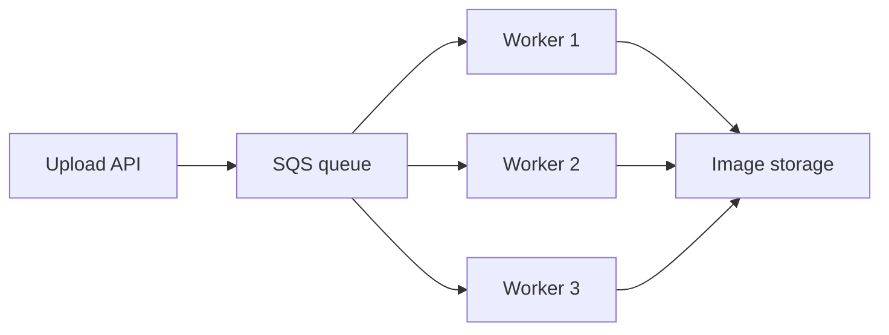
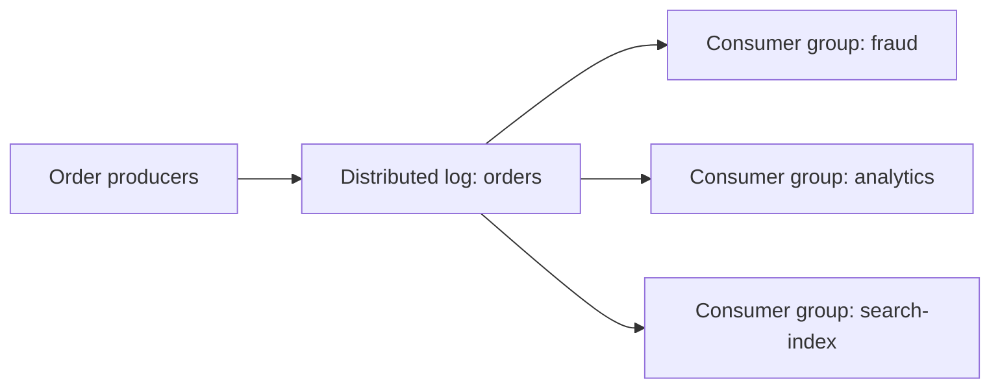
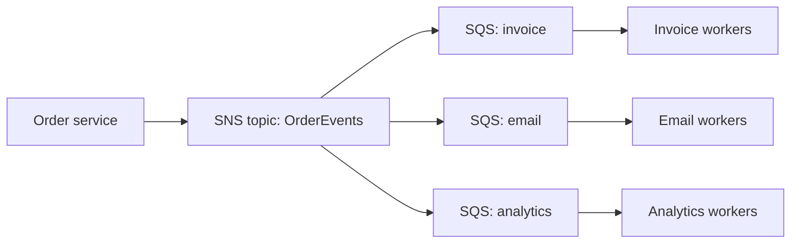
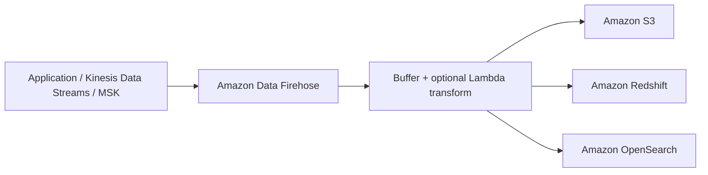
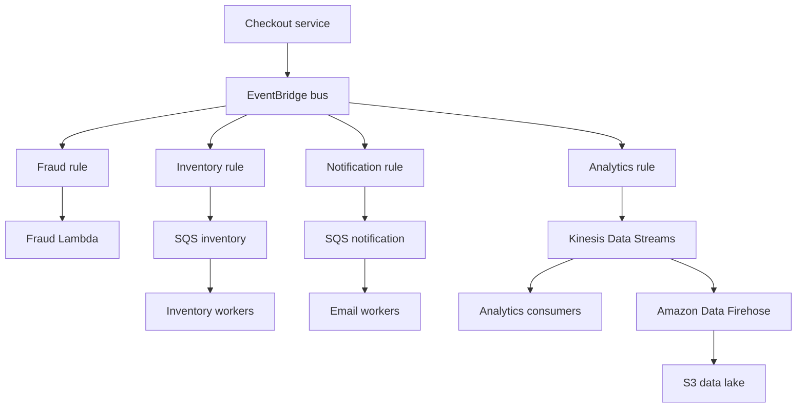

# Distinguishing Event Streams, Queues, and Distributed Logs

In distributed systems, data is often generated continuously: orders are placed, payments are confirmed, devices send telemetry, applications write logs, accounts change state, or a database table generates updates. This data can be transmitted to multiple components for processing, analytics, or storage. Three common concepts are **event streams**, **message queues**, and **distributed logs**. They are related, yet they describe different ways of organizing and consuming data.

An event stream describes a sequence of events occurring over time. A queue organizes pending work for consumers to receive and complete. A distributed log stores records in order across partitions, allowing multiple independent consumers to re-read data within the retention period. An event stream can be implemented on top of a distributed log; an event-driven system can also use a queue to distribute individual events to workers.

In AWS, common choices include Amazon SQS, Amazon SNS, Amazon EventBridge, Amazon Kinesis Data Streams, Amazon Managed Streaming for Apache Kafka (Amazon MSK), Amazon Data Firehose, and DynamoDB Streams. Choosing the right service requires understanding how the system handles delivery, ordering, retention, replay, consumer concurrency, backpressure, and failure.

After this lesson, you will be able to:

- Distinguish between events, event streams, queues, and distributed logs.
- Explain the competing consumers, publish/subscribe, and consumer groups models.
- Compare delivery, ordering, acknowledgement, retention, and replay.
- Choose SQS, SNS, EventBridge, Kinesis Data Streams, or Amazon MSK based on requirements.
- Identify the role of Amazon Data Firehose in delivering data to analytics destinations.
- Design partition keys, message groups, idempotency, retries, and dead-letter queues.
- Build scalable, observable, and resilient event-driven and streaming architectures on AWS.

## 1. Starting with Events and Messages

An **event** is a record describing something that has happened at a point in time. Events are usually named in the past tense, for example:

- `OrderPlaced`: an order has been created.
- `PaymentAuthorized`: a payment has been authorized.
- `InventoryReserved`: inventory has been reserved.
- `DeviceTemperatureMeasured`: a device sent a temperature measurement.
- `CustomerAddressChanged`: a customer address has changed.

A well-structured event typically has:
- A unique Event ID to identify it and prevent duplicate processing.
- An event type or schema version.
- The time it occurred and the time it was emitted.
- The source, tenant, or entity ID.
- A correlation/trace ID to link processing steps.
- A payload containing the data needed by consumers.

Example of a JSON event:

```json
{
  "eventId": "evt-01J9A2B3C4D5",
  "eventType": "OrderPlaced",
  "schemaVersion": 2,
  "occurredAt": "2026-11-20T06:30:00Z",
  "producer": "checkout-service",
  "correlationId": "req-7f3a",
  "data": {
    "orderId": "ord-1042",
    "customerId": "cus-204",
    "currency": "USD",
    "total": 125.50
  }
}
```

This is an illustrative example. Do not put passwords, access keys, session tokens, or unnecessary personal data into events. Events are often stored or transferred across multiple systems, so payloads should be minimized and protected by policy.

A **message** is a unit of data sent through a messaging mechanism. A message can contain an event, a command, a task, or a reference to data. For example, `GenerateInvoice` is a command instructing a worker to perform work; `InvoiceGenerated` is an event notifying that the work has completed.

Distinguishing between events and commands helps consumers understand intent:
- An event describes something that happened; consumers can react to it.
- A command requests an action; a specific component is responsible for executing or rejecting it.
- A message is the transport unit; it does not by itself determine whether the content is an event or a command.

## 2. What Is an Event Stream?

An **event stream** is a flow of events generated over time from a source or a set of sources. The stream may be continuous or bursty, its rate may vary, and consumers may need to process events in near real time.

Examples:
- A clickstream recording user interactions on a website.
- A telemetry stream collecting CPU, memory, temperature, or device status.
- A payment stream recording transaction state changes.
- A database change stream emitting insert/update/delete changes.
- An application event stream delivering business events to multiple services.

An event stream is typically described by the following attributes:

| Attribute | Question to answer |
|---|---|
| Producer | Which component creates the events? |
| Event schema | What is the event structure and version? |
| Partition/key | By which entity are events grouped? |
| Throughput | How many events/second, average and peak size? |
| Ordering | Is ordering needed globally, per key, or not at all? |
| Retention | How long should events be kept? |
| Consumer | How many applications need to read the events? |
| Replay | Is there a need to re-read old events to fix logic or rebuild state? |
| Delivery | Under what conditions can events be duplicated or lost? |
| Latency | What is the acceptable latency? |

An event stream does not by default guarantee that every event is processed exactly once, nor does it default to global ordering. Those properties depend on the platform, partitioning, producer, and how consumers manage checkpoints.

## 3. What Is a Message Queue?

A **message queue** is a buffer that stores messages waiting to be processed. Producers send messages to the queue; one or more consumers retrieve messages, process them, and confirm completion. A common pattern is **competing consumers**: multiple workers read from the same queue to share the load.

A queue is a good fit when:
- You need to decouple the producer from processing time.
- Work can be processed asynchronously.
- You want to absorb traffic spikes.
- You want retries when a worker fails.
- Each task typically only needs to be successfully processed by one worker.
- You need to limit concurrency or processing rate.

Example image processing flow:



Each worker receives a message, processes the image, and deletes the message from the queue. If a worker dies before deleting it, the message can reappear after the visibility timeout. This enables retries, but it also means consumers must handle duplicates safely.

### 3.1. Visibility Timeout and Acknowledgement

With Amazon SQS, when a consumer receives a message, the message becomes invisible for a period called the visibility timeout. If the consumer processes it successfully, it calls `DeleteMessage`. If it is not deleted before the timeout expires, the message can be redelivered.

Workflow:

1. The consumer calls `ReceiveMessage`.
2. SQS returns the message and temporarily hides it from other consumers.
3. The consumer executes the business logic.
4. If successful, the consumer calls `DeleteMessage`.
5. If it fails or the consumer does not finish, the message can be redelivered after the visibility timeout.

Visibility timeout is not a lease that guarantees the consumer will finish. If processing takes longer, the consumer may need to extend it with `ChangeMessageVisibility`. If the timeout is set too short, the message may be redelivered while the first worker is still processing it. If it is too long, detecting a dead worker and retrying takes longer.

### 3.2. A Queue Is Not a Log for Arbitrary Replay

In a destructive-read queue like SQS, once a consumer processes and deletes a message, the message is no longer in the queue for another consumer to re-read. A queue keeps messages until deletion or retention expiration, but its primary purpose is task distribution.

You can use a dead-letter queue (DLQ), an archive, or separate raw event storage for investigation and replay. However, a DLQ does not turn a queue into a distributed log with independent offsets for multiple consumers.

## 4. What Is a Distributed Log?

A **distributed log** is a storage structure that appends records in order across one or more partitions, distributed and replicated across multiple nodes. Records are typically retained according to a retention policy rather than deleted immediately when read by a consumer.

A distributed log typically has:
- A topic or stream to group records.
- Partitions to distribute load and store data in parallel.
- Offsets/sequence positions to locate records.
- Consumer groups or consumer identities to track progress.
- Retention by time or storage size.
- Replication to increase fault tolerance.
- A replay mechanism by re-reading from an earlier offset.

Kafka is a classic example of a distributed log. Amazon MSK provides AWS-managed Kafka. Kinesis Data Streams also provides a stream model with record retention, shards, and consumer checkpoints; the concepts are not identical to Kafka, but they share many similarities in how consumers re-read data.

### 4.1. Independent Consumers and Offsets

Suppose the `orders` topic has two consumer groups:
- `fraud-detection` reads events to detect fraud.
- `analytics` reads events to aggregate metrics.

Both can read the same records independently and store their own read positions. When `analytics` is stopped for an hour, `fraud-detection` continues unaffected. `analytics` can resume from its saved offset or re-read from an earlier position if the data is still within retention.



This is a major difference from competing consumers on a queue: consumer groups on a log can all read the entire stream at their own pace; workers within the same group share partitions to increase throughput.

### 4.2. Per-Partition Ordering

A distributed log usually guarantees ordering within a single partition, not global ordering across all partitions. If you need to preserve the order of events for the same order, the producer must use `orderId` as the partition key so that events for the same order go to the same partition.

If you use a key with skewed distribution, one partition can become a hot partition. When that happens, the throughput of the hot key is bottlenecked by that partition even while other partitions remain idle.

### 4.3. Retention and Replay

Retention determines how long records are kept in the log. Consumers can re-read data when:
- Processing logic is fixed and needs to be recalculated.
- A consumer group falls behind.
- A search index or materialized view needs to be rebuilt.
- An incident needs to be investigated and events reconciled.

Replay is only possible while records are still within retention and the consumer has read permissions. If retention has expired, a separate archive or backup source is needed. Replay can also trigger side effects again, so consumers must be idempotent or run against a separate target environment.

## 5. Comparing the Three Models

| Criterion | Event stream | Message queue | Distributed log |
|---|---|---|---|
| Nature | Flow of events over time | Pending work/messages to process | Partitioned append-only record log |
| Goal | Transmit and process events continuously | Distribute tasks to workers | Store, distribute, and replay data |
| Consumers | One or multiple subscribers depending on platform | Typically competing consumers | Multiple independent consumer groups |
| After reading | Depends on platform | Usually deleted after processing | Records remain until retention expires |
| Progress | Cursor/checkpoint or subscription state | Visibility/acknowledgement | Offset or sequence checkpoint |
| Replay | Platform-dependent | Limited; usually needs DLQ/archive | Core capability within retention |
| Ordering | Depends on key/partition/service | Can be FIFO or best effort | Typically per partition |
| AWS examples | Kinesis Data Streams, EventBridge event flow | SQS | Amazon MSK, Kinesis Data Streams |

An event stream is a concept describing a flow of data; queues and logs are two ways of organizing, storing, and distributing messages/records. Therefore, these three concepts should not be treated as mutually exclusive service categories. An event stream can be stored in a distributed log and simultaneously routed into task queues for workers.

## 6. Delivery Semantics: At-Most-Once, At-Least-Once, and Effectively-Once

One of the most important questions is how many times a message can be delivered.

### 6.1. At-Most-Once

A message is delivered at most once. If a failure occurs after the message is lost or marked complete before processing finishes, data can be lost. This model reduces duplicates but requires accepting the possibility of event loss.

### 6.2. At-Least-Once

A message is delivered at least once via the system's retry mechanism. If a consumer finishes processing but acknowledgement fails, the message can be redelivered. Duplicates are a normal possibility.

SQS Standard is a common example of at-least-once delivery. Consumers need idempotency, such as recording processed `eventId` values in a database with a unique constraint.

### 6.3. Exactly-Once and Practical Limits

A platform may offer deduplication or transactions within a specific scope. However, end-to-end "exactly once" is very difficult when a transaction spans a broker, database, HTTP API, and external systems.

For example, a worker:
1. Writes a payment transaction to the database.
2. Sends an email.
3. Commits the offset or deletes the message.

If the worker crashes after sending the email but before committing, the message may be reprocessed and the email sent twice. The broker cannot automatically roll back the side effect of an email.

In practice, design **effectively-once** processing using these techniques:
- Stable Event IDs.
- Idempotency keys at the API or database layer.
- Unique constraints or an inbox table.
- Transactional outbox to emit events in the same business transaction.
- Checkpointing only after processing succeeds.
- Consumers that can retry without producing duplicate side effects.

Do not claim a system is "exactly once" just because the broker has deduplication. Define the exact scope of the guarantee and where duplicates can still occur.

## 7. Ordering and Partitioning

Ordering is a business requirement, not just a technical setting. For example, order states must follow `OrderPlaced` → `PaymentAuthorized` → `OrderShipped`. If `OrderShipped` arrives before `PaymentAuthorized`, the consumer could update the state incorrectly.

Questions to answer:
- Is global ordering required, or only per-entity ordering?
- Which events must share the same partition/message group?
- Can producers send concurrently?
- Could retries cause an older event to arrive after a newer event?
- Does concurrent consumer processing alter the order of side effects?

### 7.1. Partition Keys in Streaming Logs

Partition keys are usually hashed to select a partition. Choose a key:
- `orderId` if per-order ordering is needed.
- `customerId` if per-customer ordering is needed.
- `deviceId` if per-device telemetry ordering is needed.

Do not choose a low-cardinality or skewed key if it creates a hot partition. Likewise, do not choose a random key if per-entity ordering is required.

### 7.2. Message Groups in FIFO Queues

SQS FIFO uses `MessageGroupId` to define ordered groups of messages. Messages within the same group are processed in order; different groups can be processed in parallel.

If you use a single group ID for all messages, throughput is serialized. If you use random group IDs, business ordering can break. Choose the group key based on the entity that needs ordering preserved.

## 8. Backpressure and Rate Control

Backpressure occurs when producers send faster than consumers can process. Without throttling or flow control, queue depth or consumer lag grows continuously, leading to higher latency, storage growth, and eventually failures.

Signs of backpressure:
- SQS `ApproximateNumberOfMessagesVisible` increases.
- Kinesis iterator age increases.
- Kafka consumer lag increases.
- Firehose delivery lag increases.
- Consumer CPU, memory, or downstream connection pools hit limits.
- Spikes in retries/DLQ messages.

How to handle it:
- Scale consumers based on queue depth or lag.
- Limit producer rate or apply admission control.
- Batch messages/records to reduce overhead.
- Increase partitions/shards when architecture and key distribution allow.
- Reduce work inside consumers or offload heavy tasks to a separate queue.
- Use retries with exponential backoff and jitter.
- Apply circuit breakers when downstream dependencies fail.
- Configure retention and alarms to detect backlogs before data expires.

Increasing the number of consumers does not always increase throughput. With queues, a downstream database might become overloaded. With Kafka/Kinesis, parallel consumers are bounded by the number of partitions/shards or consumer mechanisms. Scale based on the actual bottleneck.

## 9. Amazon SQS: Work Queues

Amazon Simple Queue Service (SQS) is a managed message queue service. Producers send messages to the queue; consumers receive and delete messages after processing.

Two main queue types:

| Characteristic | Standard queue | FIFO queue |
|---|---|---|
| Throughput | High scalability | Ordered per message group; throughput depends on mode and configuration |
| Ordering | Best-effort ordering | FIFO within the same message group |
| Delivery | At-least-once; duplicates possible | Deduplication and FIFO semantics within service scope |
| Use when | Independent tasks, parallel processing | Ordering and deduplication per group needed |
| Consumers | Many competing workers | Multiple workers across groups, preserving order within each group |

SQS is suitable for:
- Asynchronous order processing.
- Image/video resizing.
- Sending emails or notifications.
- Batch jobs.
- Buffering between APIs and workers.
- Retrying jobs when downstream services experience transient failures.

### 9.1. Long Polling

Long polling allows a consumer to wait for messages for a period instead of continuously polling an empty queue. This reduces empty requests and polling costs. SQS supports `WaitTimeSeconds` up to 20 seconds.

### 9.2. Dead-Letter Queues

A DLQ receives messages that have exceeded the configured maximum number of receives/retries. A DLQ isolates poison messages instead of letting them repeatedly clog the main queue.

A typical DLQ workflow:
1. Configure a redrive policy and `maxReceiveCount`.
2. Alert when messages appear in the DLQ.
3. Inspect the error, payload, and dependencies.
4. Fix the root cause or mark the message as invalid.
5. Perform a controlled redrive back to the source queue or a reprocessing queue.
6. Monitor for duplicates and side effects.

A DLQ is not an indefinite storage archive. The DLQ retention period must be configured appropriately and should be longer than the source queue's retention period per SQS guidance.

### 9.3. Example: Sending and Receiving Messages

Send a message:

```bash
aws sqs send-message \
  --queue-url https://sqs.ap-southeast-1.amazonaws.com/111122223333/order-jobs \
  --message-body '{"eventId":"evt-1001","orderId":"ord-1042","task":"generate-invoice"}' \
  --region ap-southeast-1
```

Receive messages using long polling:

```bash
aws sqs receive-message \
  --queue-url https://sqs.ap-southeast-1.amazonaws.com/111122223333/order-jobs \
  --wait-time-seconds 20 \
  --max-number-of-messages 10 \
  --region ap-southeast-1
```

After processing successfully, the consumer uses the receipt handle from that receive call to invoke `DeleteMessage`. The receipt handle changes each time a message is received; do not use the message ID in place of the receipt handle.

## 10. Amazon SNS: Publish/Subscribe and Fan-Out

Amazon Simple Notification Service (SNS) is a pub/sub service. Publishers send messages to a topic; SNS distributes them to subscribers such as SQS, Lambda, HTTPS endpoints, or email depending on supported protocols.

SNS is ideal when a single event needs to be delivered to multiple independent systems. For example, `OrderPlaced` needs:
- An invoicing service.
- An email service.
- An analytics service.
- A search indexing service.



Each SQS subscription has its own queue, allowing consumers to process independently with separate retries and DLQs. This is the SNS-to-SQS fan-out pattern.

### 10.1. SNS or SQS?

- SQS stores tasks for consumers to pull and delete after processing.
- SNS is a publisher that distributes messages to multiple subscribers.
- You can combine SNS and SQS for both fan-out and independent buffering/retries.
- SNS does not replace a distributed log with offsets and arbitrary replay.

SNS Standard fits high-throughput pub/sub and asynchronous delivery; ordering is not guaranteed like in a FIFO queue. SNS FIFO supports ordering and deduplication per message group in a FIFO model, subject to service-supported subscription/endpoint limits.

## 11. Amazon EventBridge: Rule-Based Event Routing

Amazon EventBridge is an event bus service that receives events from AWS services, custom applications, and SaaS partners, then routes them to targets based on rules. Rules can filter events by `source`, `detail-type`, and fields inside `detail`.

EventBridge is a good fit when:
- Multiple systems emit schema-structured events.
- Consumers only want to receive events matching specific conditions.
- You want to route to Lambda, SQS, SNS, Step Functions, or supported targets.
- You want to reduce direct coupling between producers and consumers.
- You need event archiving and replay for supported use cases.

Example rule for an order event:

```json
{
  "source": ["com.example.orders"],
  "detail-type": ["OrderPlaced"],
  "detail": {
    "status": ["CONFIRMED"]
  }
}
```

The rule above illustrates an event pattern that filters events with matching `source` and `detail-type`, and `status` equal to `CONFIRMED`. Patterns must match the actual event structure.

### 11.1. EventBridge Compared to Queues and Logs

EventBridge is an event router. It ingests events and determines targets based on rules; targets can be queues for job processing or Lambda functions for reactions. An event bus should not be treated as a partitioned log with global ordering or a work queue with destructive reads.

EventBridge supports delivery retries to targets and allows configuring a dead-letter queue for a target when delivery fails. Archive/replay supports storing and replaying events as configured. Replay is helpful for reprocessing events, but consumers must still be idempotent because side effects can occur again.

### 11.2. EventBridge Pipes

EventBridge Pipes connects a single source to a single target in a point-to-point model, with optional filtering, enrichment, and target invocation. Supported sources include certain queues, streams, and event systems; targets can be supported AWS services or APIs.

Pipes is useful when connecting a source like SQS, Kinesis Data Streams, or DynamoDB Streams to a target without writing all the polling, filtering, and routing boilerplate. Check source/target support, batching, retries, IAM, and failure destinations before choosing it.

## 12. Amazon Kinesis Data Streams: Managed Streaming Log

Amazon Kinesis Data Streams (KDS) ingests records from producers and stores them in a stream for multiple consumers to read. A stream is divided into shards in provisioned mode; in on-demand mode, AWS automatically adjusts capacity based on traffic without users managing shard capacity directly.

A record consists of:
- Partition key.
- Data blob.
- Service-assigned sequence number.
- Associated metadata.

The partition key is hashed to determine the shard. Records with the same partition key are routed to the same shard, preserving relative order per key.

### 12.1. Producers and Consumers

Producers can use the Kinesis Producer Library (KPL), AWS SDK, or integrated services to write records. Consumers can use:
- Kinesis Client Library (KCL).
- Enhanced fan-out consumers.
- The `GetRecords` API.
- Lambda event source mapping.
- Firehose as a delivery stream source per supported configurations.

KCL manages shard leases and checkpoints, typically using DynamoDB to store state. When a worker restarts, the consumer resumes from the saved checkpoint. If it checkpoints before side effects complete, records can be skipped on restart; if side effects complete before the checkpoint is written, records can be reprocessed. Choose checkpoint boundaries carefully and make side effects idempotent.

### 12.2. Shards, Throughput, and Hot Partitions

A shard is the unit of parallelism and capacity for a stream in provisioned mode. The number of shards required depends on write/read throughput, consumer count, and partition key distribution.

A hot shard occurs when a partition key or group of keys concentrates too much traffic on a single shard. Even if the overall stream has spare capacity, the hot shard can still experience throttling.

Remediation approaches:
- Choose a partition key with even distribution that still satisfies ordering requirements.
- If a single entity is too hot, consider a sub-key/sharding strategy and handle ordering in the application.
- Increase shards or switch capacity modes when appropriate.
- Monitor write/read throttles, iterator age, and incoming bytes/records.

Do not arbitrarily add shards if key distribution remains skewed. Adding shards does not split a single partition key across multiple independent ordering sequences.

### 12.3. Retention and Replay

Kinesis Data Streams retains records for a configured retention period. The default retention is 24 hours; it can be extended up to 365 days within service limits. Consumers can re-read from an earlier position while records remain within retention.

Extended retention helps with:
- Catching up after consumer downtime.
- Rebuilding materialized views.
- Running a new consumer over historical data.
- Investigating incidents.

Retention does not replace long-term archiving. If you need multi-year storage, use Data Firehose/S3 or a dedicated archiving pipeline.

### 12.4. Shared Throughput and Enhanced Fan-Out

Multiple consumers reading via `GetRecords` share a shard's read throughput. Enhanced fan-out allocates dedicated throughput to each registered consumer and pushes records via `SubscribeToShard`. This fits scenarios where multiple consumers need to read the same stream with low latency without competing for read capacity.

Choose enhanced fan-out when throughput/latency requirements justify the added cost and complexity. If there are only one or two low-traffic consumers, shared throughput may be simpler.

## 13. Amazon MSK and Kafka Distributed Logs

Amazon Managed Streaming for Apache Kafka (Amazon MSK) is an AWS-managed Apache Kafka infrastructure service. Kafka organizes data using:
- **Topic**: logical name of a record stream.
- **Partition**: ordered storage subdivision.
- **Offset**: position of a record within a partition.
- **Broker**: node storing and serving partitions.
- **Replication factor**: number of partition replicas.
- **Consumer group**: group of consumers sharing partitions for parallel processing.

MSK is a good fit when:
- Applications already rely on the Kafka ecosystem.
- Kafka APIs, connectors, or tooling are required.
- Log retention, consumer groups, and replay are needed.
- There are many producers/consumers and complex streaming topologies.
- You want to integrate Kafka with an existing data platform.

### 13.1. Partitions and Consumer Groups

Within a consumer group, each partition is assigned to at most one consumer member in that group at a time. If the group has more consumers than partitions, some consumers will remain unassigned and will not add throughput. If there are fewer consumers than partitions, each consumer can process multiple partitions.

Different consumer groups can read the same topic independently. Offsets are managed per group and partition.

### 13.2. Retention and Compaction

Kafka can retain records by time or size. Log compaction retains the latest record for each key while discarding older versions according to compaction rules. This is useful for storing key-based changelogs/state snapshots, but it is not the same as time-based retention and is not a complete backup mechanism.

### 13.3. MSK Provisioned and MSK Serverless

- MSK Provisioned lets you choose and manage cluster/broker capacity tailored to your workload.
- MSK Serverless automates most capacity provisioning and fits workloads where you want to reduce cluster administration, within supported limits and features.

Evaluate throughput, partition count, storage, networking, authentication, retention, and compatibility with Kafka versions/clients. Do not pick MSK simply because a task involves "streaming"; if you just need a simple task queue, SQS usually requires far less operational overhead.

## 14. Amazon Data Firehose: Delivery to Analytics Destinations

Amazon Data Firehose (formerly Kinesis Data Firehose) is a fully managed service for ingesting, buffering, optionally transforming, and delivering streaming data to supported destinations such as Amazon S3, Redshift, OpenSearch, Splunk, and HTTP endpoints.

Firehose fits when the goal is **delivering data to a destination** without operating a consumer fleet.

Example pipeline:



Firehose supports buffering by size/time to aggregate records before delivery. This optimizes performance and file sizes, though it introduces latency. You can use a Lambda transform to normalize or filter data before writing to the destination.

Firehose is not a general-purpose broker for multiple applications to read the same stream by offset. If replay is needed, store the data in S3 or use Kinesis Data Streams/MSK with appropriate retention. Understand retries, backup/error prefixes, and delivery behavior for each destination.

## 15. DynamoDB Streams and Change Data Capture

DynamoDB Streams captures item-level modifications in a DynamoDB table over a short retention period. A stream record can describe an item being created, updated, or deleted. This is a form of change data capture (CDC).

Use cases:
- Syncing data to a search index.
- Updating caches or read models.
- Emitting events to workflows.
- Auditing application-level changes.
- Integrating data with Lambda or Kinesis Data Streams.

DynamoDB Streams is commonly consumed via Lambda event source mapping or the KCL adapter. Records can be retried; consumers must be idempotent. If you need longer retention or multiple independent consumers with longer replay windows, forward the data to Kinesis/MSK/S3 as appropriate for your architecture.

## 16. Choosing an AWS Service by Use Case

| Need | Recommended service | Reason |
|---|---|---|
| Workers processing independent tasks | SQS Standard | Managed queue, competing consumers, retries |
| Tasks needing per-entity ordering | SQS FIFO | Message groups and deduplication |
| One event sent to multiple subscribers | SNS + SQS | Fan-out and independent queues |
| Content-based event routing | EventBridge | Event bus, rules, and targets |
| Event integration across AWS services | EventBridge | Multiple sources/targets and filtering |
| Multi-consumer stream analytics | Kinesis Data Streams | Shards, retention, checkpoints, and replay |
| Kafka ecosystem, connectors, and consumer groups | Amazon MSK | Kafka APIs and distributed log |
| Delivering streams to S3/Redshift/OpenSearch | Amazon Data Firehose | Buffering and managed delivery |
| CDC from DynamoDB | DynamoDB Streams | Table change records |
| Multi-step workflows | Step Functions combined with events/queues | Stateful workflow orchestration |

An architecture can combine multiple services:
- EventBridge receives and routes business events.
- SNS fans out events to multiple queues.
- SQS holds tasks for workers.
- Kinesis Data Streams stores continuous telemetry.
- Data Firehose delivers telemetry to S3.
- Athena queries data in the data lake.

Do not add multiple brokers just to use every service. Each component must have a clear justification around delivery, ordering, replay, throughput, ownership, and operations.

## 17. Sample Architecture: Event-Driven Order Processing

An e-commerce system has the following requirements:
- Checkout emits `OrderPlaced`.
- Fraud service checks risk.
- Inventory service reserves stock.
- Notification service sends email.
- Analytics aggregates metrics.
- Each consumer has a different processing speed and SLA.

It can be designed as:



EventBridge decouples the producer from consumers and routes events based on rules. SQS buffers inventory/email tasks. Kinesis maintains a stream for analytics that need independent reads or replay. Firehose delivers data to S3.

Additional design considerations:
- Event IDs and schema versions.
- Idempotency in inventory/payment.
- Retries and DLQs per consumer.
- End-to-end correlation IDs.
- Least-privilege IAM permissions across producers, bus, queues, streams, and consumers.
- KMS encryption when required.
- Monitoring delivery failures, queue age, stream lag, and business SLAs.

## 18. Schema, Versioning, and Event Contracts

Events may be consumed by multiple teams over many years. Incompatible schema changes can break older consumers.

Principles:
- Maintain a schema registry or contract repository.
- Include `schemaVersion` on every event.
- Adding optional fields is usually more compatible than renaming or deleting fields.
- Consumers should ignore unknown fields if the contract allows.
- Never change the meaning of a field while keeping the same version.
- Have a migration plan for producers and consumers.
- Validate payloads before publishing.
- Run schema validation in CI/CD.

AWS Glue Schema Registry supports schema management for certain streaming use cases with Kinesis Data Streams and Kafka/MSK. EventBridge Schema Registry can discover or manage schemas for event buses per supported features. Choose a registry based on the broker, serialization format, and client libraries; do not assume one registry works for every service.

## 19. Idempotency, Deduplication, and Transactional Outbox

Consumers must be prepared for duplicates, even when the platform provides deduplication. A common pattern is storing processed event IDs in the same transaction as the business update.

Example logic:

```text
BEGIN TRANSACTION

if event_id exists in processed_events:
    COMMIT
    return

apply business update
insert event_id into processed_events

COMMIT
acknowledge message / checkpoint offset
```

If side effects occur outside the database transaction, an idempotency key or outbox/inbox pattern is also needed.

**Transactional outbox** solves the dual-write problem: an application should not commit to a database and separately publish an event, because either step could fail independently. Instead, write business data and an outbox record in the same transaction; a relay reads the outbox and publishes the event. The relay may publish duplicates, so consumers must still be idempotent.

**Deduplication** identifies and drops duplicate messages within a specific time window or key scope. Deduplication does not replace idempotency because duplicates can appear after the deduplication window expires or via another retry path.

## 20. Retries, Poison Messages, and Failure Isolation

A message can fail because of:
- Downstream service temporarily unavailable.
- Invalid payload schema.
- Missing IAM permissions.
- Timeout or throttling.
- Referenced data does not exist yet.
- Bug in the consumer.

Do not retry all errors the same way.

| Error type | Handling approach |
|---|---|
| Transient error, throttling | Exponential backoff + jitter, bounded retries |
| Dependency outage | Backpressure, circuit breaker, retain message |
| Invalid schema/payload | Send to DLQ/quarantine, alert producer |
| Permission denied | Alert operations, fix policy; avoid infinite retries |
| Valid business rejection | Record the rejection result, do not retry as a technical error |
| Poison message | Isolate, analyze, fix or discard per runbook |

SQS redrive policies send messages to a DLQ after a maximum receive count. EventBridge supports retry policies and target DLQs. Kinesis consumers manage checkpoints and error handling themselves; they need a mechanism to store failed records or quarantine them so they do not stall a shard. Kafka consumers must decide whether to commit offsets on failure, retry, or route records to a dead-letter topic.

## 21. Security: Protecting Brokers and Event Payloads

Events and messages often carry sensitive business data. Protect them in transit, at rest, and at the consumer.

- Use IAM roles for producers and consumers instead of long-lived access keys.
- Restrict publish, consume, delete, describe, and administer permissions by resource.
- Use resource policies and conditions where supported.
- Enable encryption at rest with AWS managed keys or customer managed KMS keys as required.
- Use TLS for data in transit.
- Do not include credentials or unnecessary sensitive payloads in messages.
- Separate event read permissions from permissions to modify queues/streams/topics.
- Protect DLQs and archives because they may retain failed data longer.
- Enable CloudTrail and service logs to audit configuration changes.
- Configure retention and data deletion according to compliance requirements.

When using a KMS customer managed key, producers, broker services, and consumers may require different permissions. Verify key policies, grants, and service integrations to prevent publish/consume errors after enabling encryption.

## 22. Observability for Queues and Streams

Do not monitor only consumer CPU. Measure backlog, lag, throughput, delivery failures, and data age.

| Service | Metric/Signal to monitor | Meaning |
|---|---|---|
| SQS | `ApproximateNumberOfMessagesVisible` | Number of messages waiting |
| SQS | `ApproximateAgeOfOldestMessage` | Age of the oldest message, reflecting backlog |
| SQS | `NumberOfMessagesSent/Received/Deleted` | Producer/consumer throughput and completion |
| SQS | DLQ visible messages | Unprocessable messages |
| SNS | `NumberOfNotificationsFailed`, delivery status logs | Subscriber delivery failures |
| EventBridge | `FailedInvocations`, `ThrottledRules`, `Invocations` | Delivery and rule throughput |
| Kinesis Data Streams | `IncomingBytes/Records`, `Read/WriteProvisionedThroughputExceeded` | Load and throttling |
| Kinesis Data Streams | `GetRecords.IteratorAgeMilliseconds` | Consumer lag |
| MSK | Consumer lag, bytes in/out, under-replicated partitions | Consumer progress and cluster health |
| Data Firehose | `DeliveryToS3.*` / delivery freshness | Delivery health to destination |

Specific metrics depend on the service, mode, and configuration. Set alarms aligned with business SLAs: for example, when queue age exceeds a threshold or stream iterator age approaches the retention window. A large backlog that drains quickly can be less risky than a small backlog where messages have been waiting too long.

Logs should include event ID, correlation ID, consumer group/task, partition/shard, offset/sequence, attempt count, and processing outcome. Avoid logging full payloads if they contain sensitive data.

## 23. Capacity Planning and Cost

Streaming costs are not limited to broker fees:
- SQS requests, payload size, and data transfer.
- SNS publishes/deliveries and subscriptions.
- EventBridge event ingestion, archive/replay, and invocations.
- Kinesis shards/capacity mode, retention, enhanced fan-out, and data retrieval.
- MSK brokers, storage, networking, monitoring, and operations.
- Data Firehose ingestion, transformation, and delivery.
- S3 storage, requests, lifecycle, and Athena scans.
- Lambda/compute consumers and downstream databases.

Capacity planning should measure:
- Average and peak events per second.
- Record/message size.
- Burst duration.
- Number of consumers and consumer groups.
- Retention/replay windows.
- Processing time and downstream capacity.
- Ordering/partition key distribution.
- Retry rate and DLQ volume.

With Kinesis/MSK, partitioning dictates parallelism and hot spots. With SQS, scaling consumers must match downstream database/API limits. With Firehose, buffering trades off latency against file size. With Athena, Parquet and partition pruning reduce the amount of data scanned.

## 24. Common Architectural Decisions

### 24.1. SQS or Kinesis Data Streams?

Choose SQS when messages are tasks that one worker needs to complete, retry, and delete. Choose Kinesis Data Streams when you need to store continuous events, support multiple independent consumers, and have retention and replay.

### 24.2. SNS or EventBridge?

SNS fits simple pub/sub fan-out and distributing messages to subscribers. EventBridge fits content-based event routing, integrating many sources/targets, and managing event buses/rules. You can combine EventBridge with SQS to buffer each consumer.

### 24.3. Kinesis Data Streams or Amazon MSK?

Kinesis Data Streams is an AWS-native service with managed shards/capacity and deep AWS integration. MSK fits when you need Kafka APIs, ecosystem, partition/offset semantics, connectors, and Kafka portability. Compare based on operational skills, client compatibility, throughput, retention, ordering, cost, and ecosystem.

### 24.4. Kinesis Data Streams or Amazon Data Firehose?

Kinesis Data Streams is a streaming platform for multiple consumers to process and re-read records. Data Firehose is a managed delivery service that buffers and delivers data to destinations. You can use Kinesis Data Streams as a source for Firehose when you need both application consumers and data lake storage.

## 25. Checklist for Designing a Streaming System

- [ ] Define how events, commands, and tasks differ.
- [ ] Document the producer, consumers, and owner of each event contract.
- [ ] Choose a queue, event bus, or distributed log based on the use case.
- [ ] Define delivery semantics and how duplicates are handled.
- [ ] Specify ordering scope and partition/message group keys.
- [ ] Estimate throughput, bursts, record sizes, and consumer lag.
- [ ] Choose retention and replay windows.
- [ ] Design retries, backoff, DLQs, or dead-letter topics.
- [ ] Make consumers idempotent and manage checkpoints at the right time.
- [ ] Plan for schema evolution and backward compatibility.
- [ ] Secure IAM, KMS, TLS, resource policies, and payloads.
- [ ] Configure alarms for backlog, age, lag, throttling, and delivery failures.
- [ ] Test downstream outages, poison messages, and duplicates.
- [ ] Estimate costs across brokers, consumers, retention, delivery, and queries.
- [ ] Write runbooks for replay, redrive, resharding, and incident response.

## 26. Knowledge Summary

An event stream is a flow of events over time; a queue stores messages waiting for consumers to process and typically deletes them upon acknowledgement; a distributed log is an append-only partitioned record store that keeps data within retention so multiple independent consumer groups can read and replay it. An event stream can be implemented on a distributed log or routed to queues depending on requirements.

On AWS, SQS fits work queues; SNS fits pub/sub fan-out; EventBridge fits rule-based event routing; Kinesis Data Streams fits streaming with shards, checkpoints, retention, and replay; Amazon MSK fits the Kafka ecosystem; Amazon Data Firehose delivers data to analytics destinations; and DynamoDB Streams provides CDC for tables. No single service fits every use case.

Good design requires clarifying delivery, ordering, idempotency, retries, retention, replay, backpressure, security, and observability. Select services based on business requirements, measure real bottlenecks, and test both happy paths and failure modes. That way, an event-driven system remains decoupled, scalable, and resilient.

## References

- [Amazon SQS Developer Guide](https://docs.aws.amazon.com/AWSSimpleQueueService/latest/SQSDeveloperGuide/welcome.html)
- [Amazon SNS Developer Guide](https://docs.aws.amazon.com/sns/latest/dg/welcome.html)
- [Amazon EventBridge User Guide](https://docs.aws.amazon.com/eventbridge/latest/userguide/eb-what-is.html)
- [Amazon EventBridge Pipes](https://docs.aws.amazon.com/eventbridge/latest/userguide/eb-pipes.html)
- [Amazon Kinesis Data Streams Developer Guide](https://docs.aws.amazon.com/streams/latest/dev/introduction.html)
- [Kinesis Data Streams data retention](https://docs.aws.amazon.com/streams/latest/dev/kinesis-extended-retention.html)
- [Kinesis Client Library](https://docs.aws.amazon.com/streams/latest/dev/developing-consumers-with-kcl.html)
- [Amazon Managed Streaming for Apache Kafka](https://docs.aws.amazon.com/msk/latest/developerguide/what-is-msk.html)
- [Amazon Data Firehose Developer Guide](https://docs.aws.amazon.com/firehose/latest/dev/what-is-this-service.html)
- [DynamoDB Streams](https://docs.aws.amazon.com/amazondynamodb/latest/developerguide/Streams.html)
- [AWS Glue Schema Registry](https://docs.aws.amazon.com/glue/latest/dg/schema-registry.html)
- [Amazon SQS dead-letter queues](https://docs.aws.amazon.com/AWSSimpleQueueService/latest/SQSDeveloperGuide/sqs-dead-letter-queues.html)
