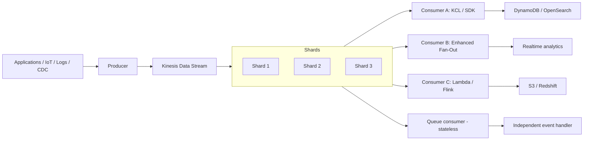

# Producers, Consumers, and Choosing a Capacity Mode

A streaming system typically receives continuous events from applications, IoT devices, logs, transactions, or business systems. Producers need to send data with low latency and without losing events during transient network issues. Consumers need to read and process data at the right pace, scale with load, and recover when workers fail. If stream capacity is unsuitable, the system may experience throttling, consumer lag, rising costs, or loss of real-time processing capability.

Amazon Kinesis Data Streams (KDS) is a managed streaming service that lets producers write records to a data stream and consumers read records from shards. The service supports two capacity management modes: Provisioned and On-demand. On-demand currently offers two billing/configuration modes: On-demand Standard and On-demand Advantage. Choosing the right mode depends on write/read throughput, variability, consumer count, partition key distribution, latency requirements, and budget.

In the AWS ecosystem, Kinesis Data Streams integrates with the AWS SDK, Kinesis Producer Library (KPL), Kinesis Client Library (KCL), AWS Lambda, Amazon Managed Service for Apache Flink, Amazon Data Firehose, Amazon S3, DynamoDB, Redshift, CloudWatch, and other analytics systems. Producers, consumers, and capacity must be designed as an end-to-end flow to ensure data reaches the right destination and is processed within target latency.

## Learning Objectives

After this lesson, you will be able to:

- Describe the roles of producers, data records, partition keys, shards, and consumers in Kinesis Data Streams.
- Choose between PutRecord, PutRecords, AWS SDK for Java, or KPL for producers.
- Design partition keys to preserve per-entity ordering and distribute load to avoid hot shards.
- Distinguish between shared-throughput consumers, Enhanced Fan-Out (EFO), KCL, Lambda event source mapping, and queue consumers.
- Calculate required shard counts in Provisioned mode based on write and read throughput.
- Compare Provisioned, On-demand Standard, and On-demand Advantage in scaling, limits, and cost.
- Handle retries, throttling, duplicates, checkpoints, consumer lag, and shard count changes.
- Monitor and tune capacity based on real metrics.

## Overall Architecture of Kinesis Data Streams

Producers write records to a stream. Kinesis distributes records across shards based on partition keys or a service-managed distribution strategy. Consumers read records and deliver results to target systems such as DynamoDB, S3, Redshift, or an event processing service.



A stream stores immutable records for the configured retention period. Kinesis does not interpret the schema or business content inside the data blob; producers and consumers must agree on format, schema version, encoding, and error handling. A stream is not an arbitrary queryable database: consumers read sequentially per shard and use sequence numbers to track their position within a shard.

## Key Concepts

| Component | Role | Key takeaway |
|---|---|---|
| Producer | Writes records to the stream | Chooses partition keys, formats data, handles retries and acknowledgements |
| Data record | Unit of data in the stream | Consists of a partition key, Kinesis-assigned sequence number, and data blob |
| Partition key | Determines which shard a record belongs to in user-managed strategy | Records with the same key map to the same shard; hot keys can create hot shards |
| Shard | Unit of capacity and ordering in a stream | Has dedicated write/read throughput limits |
| Sequence number | Position of a record within a shard | Used for checkpointing and resuming reads; not a global ID for sorting across all shards |
| Consumer | Reads and processes records | Can use shared throughput, EFO, or queues depending on workload |
| Checkpoint | Records the completed processing position | KCL stores checkpoints so workers can resume after restart |

### Shards and Baseline Capacity

In Provisioned mode, one shard supports up to:

- Write: 1 MB/second or 1,000 records/second, whichever limit is reached first.
- Read via `GetRecords`: 2 MB/second total and up to 5 read calls per second per shard.
- Enhanced Fan-Out: each registered EFO consumer can receive up to 2 MB/second per shard, independent of other EFO consumers.

These limits apply at the shard level and form the basis for capacity sizing. With On-demand, the service manages shard count/capacity automatically, yet per-shard throughput limits and partition key behavior still matter when analyzing throttling and load distribution.

By default, Kinesis allows records with a data blob up to 1 MiB. You can configure a stream limit up to 10 MiB, though large records are supported on a burst basis and do not increase sustained shard throughput. Use large records infrequently; for consistently large payloads, store the payload in S3 and send the object key/metadata in the stream.

## Producers: Writing Data to the Stream

A producer can be an API service, Java application, log collection agent, IoT device, or an AWS service. A well-built producer creates schema-valid records, selects appropriate partition keys, sends data efficiently, and handles transient errors.

### Choosing PutRecord or PutRecords

| API | How it works | When it fits |
|---|---|---|
| `PutRecord` | Sends one record per request; returns shard ID and sequence number | When per-partition-key ordering control and per-record handling are needed |
| `PutRecords` | Sends multiple records in one request; up to 500 records and 10 MiB total request size per current API | When maximizing throughput and reducing API calls |

`PutRecords` can return HTTP success even when some records inside the batch failed. Producers must inspect `FailedRecordCount` and each response entry, then retry only the failed records. `PutRecords` does not guarantee ordering across records within a batch. If strict ordering is required for a partition key, send sequentially with `PutRecord` and pass sequence numbers accordingly.

### Partition Keys and Record Distribution

In the user-managed partition key strategy (default), Kinesis hashes the partition key with MD5 to map the record to a shard's hash key range. The partition key is a Unicode string up to 256 characters long.

Examples:

- Order data: `orderId`.
- Account events: `accountId`.
- Device telemetry: `deviceId`.
- Host-partitioned logs: `hostId`.

If you need to preserve the order of events for the same order, use `orderId` as the partition key. Records with the same key go to the same shard and can be processed sequentially in shard order. However, if a single partition key generates excessive traffic, all records for that key land on one shard and can exceed its limits even if other shards have spare capacity.

Avoid low-cardinality keys like `region=ap-southeast-1` or a single static value for all records. Also avoid excessively hot keys, such as one customer or device accounting for most of the traffic. You can build composite keys like `customerId#bucket`, but only if the business domain accepts losing global per-customer order and consumers know how to recombine buckets.

### Service-Managed Record Distribution

For On-demand streams, you can choose the record distribution strategy:

- **User set / USER_PARTITION_KEY:** the producer provides the partition key and Kinesis uses it to select the shard. Suitable when per-entity ordering or explicit partitioning logic is required.
- **Auto:** Kinesis distributes records more evenly across shards and ignores producer-supplied partition keys. Suitable for stateless workloads that do not need partition-key ordering.

When using Auto, any `PartitionKey` sent is ignored for shard placement; consumers may receive records without a partition key. Producers and consumers must handle this case. Service-managed distribution does not support KPL aggregation because KPL aggregation depends on the producer predicting shards from partition keys. When using Auto, disable aggregation or use a newer KPL version configured for the distribution strategy to prevent record loss during de-aggregation.

You cannot mix Auto and user-managed partition keys in the same stream. When switching strategies, partition-key ordering applies only to new records under the active distribution mode; previously written data cannot be reordered.

### AWS SDK for Java 2.x

Java applications can write records directly using the AWS SDK for Java 2.x. The example below sends a JSON event:

```java
import java.nio.charset.StandardCharsets;

import software.amazon.awssdk.core.SdkBytes;
import software.amazon.awssdk.regions.Region;
import software.amazon.awssdk.services.kinesis.KinesisClient;
import software.amazon.awssdk.services.kinesis.model.PutRecordRequest;
import software.amazon.awssdk.services.kinesis.model.PutRecordResponse;

public final class OrderProducer {
    public static void main(String[] args) {
        String streamName = "orders-stream";
        String orderId = "order-1042";
        String json = "{\"eventType\":\"ORDER_CREATED\","
                + "\"orderId\":\"order-1042\","
                + "\"amount\":125000}";

        try (KinesisClient client = KinesisClient.builder()
                .region(Region.AP_SOUTHEAST_1)
                .build()) {

            PutRecordRequest request = PutRecordRequest.builder()
                    .streamName(streamName)
                    .partitionKey(orderId)
                    .data(SdkBytes.fromByteArray(
                            json.getBytes(StandardCharsets.UTF_8)))
                    .build();

            PutRecordResponse response = client.putRecord(request);
            System.out.printf("shard=%s sequence=%s%n",
                    response.shardId(), response.sequenceNumber());
        }
    }
}
```

In production, do not instantiate a client per record. Reuse the SDK client, supply credentials via IAM roles, configure timeouts/retries, log correlation IDs, and handle exceptions. Never hardcode static access keys in source code.

### Sending Batches and Handling Partial Failures

Condensed example with `PutRecords`:

```java
import java.nio.charset.StandardCharsets;
import java.util.List;

import software.amazon.awssdk.core.SdkBytes;
import software.amazon.awssdk.services.kinesis.KinesisClient;
import software.amazon.awssdk.services.kinesis.model.PutRecordsRequest;
import software.amazon.awssdk.services.kinesis.model.PutRecordsRequestEntry;
import software.amazon.awssdk.services.kinesis.model.PutRecordsResponse;

List<PutRecordsRequestEntry> entries = events.stream()
        .map(event -> PutRecordsRequestEntry.builder()
                .partitionKey(event.orderId())
                .data(SdkBytes.fromByteArray(
                        event.toJson().getBytes(StandardCharsets.UTF_8)))
                .build())
        .toList();

PutRecordsResponse response = client.putRecords(
        PutRecordsRequest.builder()
                .streamName("orders-stream")
                .records(entries)
                .build());

if (response.failedRecordCount() != null
        && response.failedRecordCount() > 0) {
    for (int i = 0; i < response.records().size(); i++) {
        var result = response.records().get(i);
        if (result.errorCode() != null) {
            // Enqueue the exact entries.get(i) into a bounded retry queue.
            // After max attempts, write to a DLQ or error store for reprocessing.
        }
    }
}
```

The batch above must be split according to API limits: up to 500 records and 10 MiB total request size, including partition keys. On retry, resend only the failed records; do not resend the entire batch when part of it succeeded. Use exponential backoff with jitter, bound retry attempts, and keep an idempotency key to handle cases where the producer misses an acknowledgement even though the record was written.

### Kinesis Producer Library (KPL)

KPL is a producer library optimized for high throughput. KPL can:

- Buffer and batch multiple user records into a single `PutRecords` call.
- Aggregate multiple user records into one Kinesis record to reduce overhead.
- Automatically retry and rate-limit per shard.
- Emit producer metrics to CloudWatch.
- Integrate with KCL so consumers de-aggregate user records.

KPL fits high-volume small events, such as thousands of devices sending telemetry. KPL uses native components and has settings for buffering, aggregation, and retries; deploy it for the proper target platform and test version upgrades. When using service-managed Auto distribution, do not enable aggregation because KPL's shard-mapping contract no longer holds.

## Consumers: Reading and Processing Records

Consumers read records from shards and process them according to business logic. A stream can have multiple independent consumers. Each consumer must define how it tracks read positions, distributes shards across workers, saves checkpoints, and handles errors.

### Shared-Throughput Consumers with GetRecords

Consumers use `GetShardIterator` and `GetRecords` in a pull model. These consumers share the total 2 MB/second read throughput per shard. If multiple applications read the same shard concurrently, they compete for that capacity. This approach fits when there are few consumers or moderate read rates.

`GetRecords` returns `NextShardIterator`; the consumer uses this next iterator for subsequent reads. Results can be empty even while data exists in the stream because the API does not block waiting for records. Consumers should poll at an appropriate cadence and avoid calling too rapidly, which causes throttling.

### Enhanced Fan-Out (EFO)

EFO lets a consumer register with a stream and receive data via `SubscribeToShard` over HTTP/2. Each EFO consumer gets dedicated throughput up to 2 MB/second per shard, unshared with other consumers. Kinesis pushes records to the consumer, eliminating `GetRecords` polling.

| Criterion | Shared throughput | Enhanced Fan-Out |
|---|---|---|
| API | `GetShardIterator`, `GetRecords` | `RegisterStreamConsumer`, `SubscribeToShard` |
| Model | Consumer pull | Service push over HTTP/2 |
| Throughput | 2 MB/second total per shard across all shared consumers | Up to 2 MB/second per shard for each EFO consumer |
| Latency | Increases when multiple consumers read concurrently | Typically lower and more consistent with multiple consumers |
| Cost | No separate consumer-shard hour fee | Retrieval and consumer-shard hour fees in Standard/Provisioned; On-demand Advantage has its own pricing |
| Best for | Single or few consumers, moderate read load | Multiple applications needing independent reads or low latency |

Under current quotas, On-demand Standard and Provisioned support up to 20 registered EFO consumers per stream; On-demand Advantage supports up to 50 in AWS-supported Regions. Queue consumers also share the registered consumers limit with EFO. Check the latest Region list and quotas before designing.

### Kinesis Client Library (KCL)

KCL helps build scalable, resilient consumers. KCL manages shard lifecycle, shard distribution across workers, leases, checkpoints, resharding, and worker restart scenarios. KCL uses DynamoDB to store leases/checkpoints and coordination state; therefore, the consumer role needs Kinesis permissions and appropriate permissions on the DynamoDB tables managed by the KCL application.

When a worker acquires a lease for a shard, the record processor processes records in shard order. After side effects complete, the application checkpoints the sequence number. If a worker dies before checkpointing, records can be re-read and reprocessed from the latest checkpoint. KCL does not make the pipeline end-to-end exactly-once; sinks require idempotency or deduplication.

For new applications, choose an AWS-supported KCL version kept current with its lifecycle. Do not start new projects on legacy KCL 1.x or 2.x; check upgrade guides for the current KCL line, including KCL 3.x.

### Lambda Event Source Mapping

AWS Lambda can read from a Kinesis stream through an event source mapping. Lambda manages polling, batching, checkpointing, and retries per configuration. Settings to review include batch size, maximum batching window, parallelization factor, bisect batch on function error, retry attempts, and on-failure destination.

Lambda fits event-driven processing with short logic that scales per shard. If the function runs slowly or downstream systems lag, iterator age rises and batch retries can produce duplicates. Design handlers to be idempotent and configure failure destinations/DLQs as needed.

### Queue Consumers for Stateless Processing

Kinesis Data Streams also supports queues on On-demand streams. A queue tracks delivery state per record for queue consumers, freeing consumers from coordinating shard checkpoints themselves. Producers require no changes.

Consumers call `ReceiveQueueRecords` to receive up to 10 records, process them, and call `AcknowledgeQueueRecords` for completed records. Queues deliver at least once: records not acknowledged before the visibility timeout expires are redelivered; in rare cases, already acknowledged records can also be redelivered. Queues do not guarantee order matching producer writes and include built-in dead-letter handling.

Queues fit when each record can be processed independently, such as sending notifications, updating a single record, or running isolated tasks. Do not use a queue if logic must maintain stateful ordering across records in the same partition or read an entire shard as a stateful sequence. Queues only work with On-demand Standard and On-demand Advantage; Provisioned mode is not supported. Unacknowledged records still expire when stream retention ends, including dead-letter records.

### Choosing a Consumer Type by Workload

| Need | Recommended option | Reason |
|---|---|---|
| One application reading and processing statefully per shard | KCL or shared-throughput SDK | Preserves read position and shard ordering |
| Multiple independent applications needing the same data | EFO | Each consumer has dedicated throughput |
| Stateless per-record processing with service-managed delivery/ack | Queue consumer on On-demand | Reduces self-managed shard checkpointing |
| Short event processing with serverless integration | Lambda event source mapping | Managed integration and automatic scaling |
| Continuous analytics, stateful windows | Managed Service for Apache Flink | Supports state, windowing, and complex stream processing |

## Checkpoints, Retries, and Processing Guarantees

Kinesis Data Streams delivers records at least once under standard consumer models. Duplicates can originate from either side:

- Producer retry after timeout: the producer does not know whether the request was written; retrying can create a second record.
- Consumer retry: a worker finishes the side effect but crashes before checkpointing; the record is read again.

To mitigate duplicate impact:

1. Every business event has a unique ID, such as `eventId` or `transactionId`.
2. Sinks use conditional writes, unique constraints, or an idempotency table to skip already processed events.
3. Checkpoint only after side effects have completed and been confirmed.
4. Never checkpoint before writing to the target sink, as records can be lost if the worker crashes after checkpointing.
5. Use bounded retries with exponential backoff and jitter; send unrecoverable errors to a DLQ or error store.
6. Monitor duplicate rates and per-batch processing times.

If per-entity ordering is needed, use a stable partition key and process sequentially within the shard or per partition. Do not assume sequence numbers sort across the entire stream, because sequence numbers are scoped to individual shards.

## Choosing a Capacity Mode

Capacity mode determines who manages shard counts and how billing works. Kinesis Data Streams has three modes to distinguish:

1. **Provisioned:** users specify the shard count and scale it up/down as load changes.
2. **On-demand Standard:** the service automatically scales capacity based on history and traffic, billing by usage plus a stream-hour fee.
3. **On-demand Advantage:** an account/Region-level setting for On-demand streams featuring warm throughput, simpler pricing, and lower published per-GB rates in exchange for a minimum ingest/retrieval commitment.

| Criterion | Provisioned | On-demand Standard | On-demand Advantage |
|---|---|---|---|
| Capacity management | User specifies shard count | AWS manages shards/capacity automatically | AWS manages automatically; warm throughput configurable |
| Best for | Steady, predictable load needing fine-grained shard control | Variable or unknown load, reducing capacity ops | Large steady aggregate load, many streams or many EFO consumers, needing warm capacity |
| Scaling | Scale shards up/down via console/API | Automatic based on traffic and historical peak | Automatic; can pre-warm and request capacity reduction toward warm/recent peak |
| Primary billing | Shard-hours, PUT payload units, optional features | GB ingest/retrieval, stream-hour fee, optional features | GB ingest/retrieval with account-level minimum commitment; no fixed per-stream fee |
| EFO consumer quota | Up to 20 per stream | Up to 20 per stream | Up to 50 in supported Regions |
| Service-managed distribution Auto | No | Yes | Yes |
| Queue consumer | No | Yes | Yes |

### Provisioned Mode

Provisioned fits when workloads are steady or fairly predictable. Operators specify the shard count; each shard adds write and read capacity. If load grows, shard count must be increased before or during the growth. If the shard count far exceeds demand, the organization pays for idle capacity.

Advantages:

- Easier cost forecasting when traffic is steady.
- Granular control over shard count and resharding.
- Ability to split a specific hot shard to address uneven partition key distribution.
- Suitable for pipelines optimizing cost around known capacity.

Limitations:

- Requires capacity planning and throughput monitoring.
- Must scale shards up/down when demand shifts.
- A hot shard can still throttle even when total stream capacity has headroom.
- Excessively high shard counts increase cost and consumer complexity.

### On-demand Standard

On-demand Standard fits when traffic fluctuates sharply or is hard to predict. AWS manages capacity and adjusts shard counts with traffic. By default, a new stream starts with 4 MB/s write and 8 MB/s read capacity; maximum scaling limits depend on the Region and account quotas.

On-demand Standard can accommodate up to roughly double the peak write throughput observed over the previous 30 days. If traffic surges past twice the prior peak within a 15-minute window, producers may encounter throttling during scaling. In that case, retry with backoff and plan warm-up/traffic ramps for known spikes.

On-demand does not mean every partition key automatically gets unlimited capacity. An overly hot partition key can funnel data into one shard and exceed 1 MB/s or 1,000 records/s. If distribution is heavily skewed, On-demand can continue throttling; fix the partition key or consider Provisioned to split specific shards.

### On-demand Advantage

On-demand Advantage is an account-level setting within a Region that applies to all On-demand streams in that Region. It keeps On-demand auto-scaling and adds:

- Configurable warm throughput to prepare write capacity ahead of expected events.
- Ability to request capacity reduction after a burst by lowering warm throughput; the service still retains whatever is needed to support peak ingest from the most recent hour if higher.
- No fixed stream-hour charge as in On-demand Standard.
- Ingest, retrieval, and extended retention priced under Advantage rates; Enhanced Fan-Out has no premium surcharge compared to other modes.
- Support for up to 50 registered EFO consumers per stream in AWS-listed Regions.

In return, the account commits to a minimum of 25 MiB/s ingest and 25 MiB/s retrieval aggregated across all On-demand streams in the Region. If usage falls below the commitment, shortfall charges may apply. After enabling Advantage, you must wait at least 24 hours before disabling it; any configured warm throughput must be removed before reverting to Standard. Compare total Region-wide usage before enabling.

Warm throughput is configured asynchronously. When calling the API, the stream enters the `UPDATING` state; changes can take several minutes, during which reads and writes continue to work. Do not wait until the last second before a major event to warm a stream.

### Choosing a Mode by Scenario

| Scenario | Mode to evaluate | Reason |
|---|---|---|
| New workload with unpredictable traffic | On-demand Standard | No need to guess initial shard count |
| Steady all-day traffic with good forecasts | Provisioned | Control over shards and capacity cost |
| Scheduled major event needing pre-warmed throughput | On-demand Advantage | Can prepare write capacity ahead of spikes |
| Hundreds of small streams with notable per-stream overhead | On-demand Advantage | No fixed per-stream fee, though minimum commitment must be weighed |
| Many consumers needing dedicated throughput | EFO; check On-demand Advantage if suitable | Higher registered consumer quota and no EFO premium in Advantage |
| One very hot partition key needing targeted hash-range split | Provisioned | Can identify the hot shard and split precisely |
| Stateless consumers needing service-managed ack/DLQ | On-demand Standard/Advantage + Queue | Queues do not support Provisioned |

Do not choose On-demand Advantage solely for a lower per-GB ingest price. If usage is below the minimum commitment, shortfall charges can push total cost higher than expected. Calculate total ingest/retrieval across all streams in the Region, EFO consumers, retention, S3 delivery/streaming tables if used, and auxiliary charges.

## Calculating Shard Count in Provisioned Mode

To estimate shard count, calculate both write throughput and read throughput. One shard supports 1 MB/s or 1,000 records/s write and 2 MB/s read via shared `GetRecords`.

Reference formula:

```text
write_shards = max(
  ceil(write_MB_per_second / 1),
  ceil(write_records_per_second / 1000)
)

shared_read_shards = ceil(
  total_shared_read_MB_per_second / 2
)

required_shards = max(write_shards, shared_read_shards)
```

With EFO, each consumer gets its own 2 MB/s per shard. Verify consumer throughput needs and registration quotas, but do not sum EFO consumer read throughput as if they shared 2 MB/s.

### Capacity Sizing Example

A stream receives an average of 2,000 records/second, each 2 KB. Three consumer applications read concurrently using shared throughput.

1. Write bandwidth = 2,000 × 2 KB = 4,000 KB/s, approximately 4 MB/s.
2. Write record rate = 2,000 records/s.
3. Shards for write bytes = ceil(4/1) = 4.
4. Shards for write records = ceil(2,000/1,000) = 2.
5. Total read bandwidth across three consumers = 4 × 3 = 12 MB/s.
6. Shards for shared read = ceil(12/2) = 6.
7. Minimum shards = max(4, 2, 6) = 6.

You might choose 8 shards for extra headroom, but verify peak traffic, key distribution, bursts, record sizes, and downstream processing speed. Formulas only estimate capacity; they do not replace load testing and shard-level monitoring.

### Resharding

In Provisioned mode, you can increase or decrease shard count via the console or `UpdateShardCount`. For hot shards, you can split a specific shard; you can merge shards when reducing capacity. Resharding changes shard topology and can cause consumers to reprocess some records near checkpoints. KCL manages discovering child shards and rebalancing leases automatically; custom consumers must handle shard lineage and iterators.

Do not merely increase shard count when the root cause is a hot partition key. If a single key generates most of the traffic, adding shards may not spread that key because the same key still hashes to one shard. Fix the partition key or use service-managed Auto if per-key ordering is not needed.

## Switching Capacity Modes

You can switch a stream between Provisioned and On-demand via the console or API. Switching modes does not disrupt active producers/consumers reading or writing; the stream transitions to `UPDATING` and back to `ACTIVE`. Each stream can only switch between Provisioned and On-demand up to twice in 24 hours.

When switching modes, the stream initially retains its current shard count. If switched to On-demand, AWS begins managing capacity based on traffic. If switched to Provisioned, the operator becomes responsible for adjusting shard counts afterward. Before switching, check for queue consumers because queues only support On-demand; if the stream still has queues, delete them before switching to Provisioned.

Moving from On-demand Standard to On-demand Advantage is an account-level change, not a single-stream mode switch. Enabling it affects all On-demand streams in the Region and carries a minimum commitment. Plan based on total usage and commitment duration.

## Retries, Throttling, and Preventing Data Loss

Producers must handle `ProvisionedThroughputExceededException`, `InternalFailure`, timeouts, and network errors. When retrying:

- Use exponential backoff and jitter to avoid synchronized retry storms across producers.
- Retry only the failed records from the `PutRecords` response.
- Limit retry attempts and how long records stay buffered.
- Persist unsent records to a durable outbox or DLQ so data is not lost on process restarts.
- Include an event ID so consumers can deduplicate if producers may send duplicates.
- For hot keys, fix the partitioning strategy or capacity; retries alone will not resolve a sustained hotspot.

Kinesis does not modify or reorder records once written. If a producer resends after a timeout, two records with identical content and different sequence numbers can exist. Consumers need idempotency to ensure business side effects occur only once.

## Monitoring Producers, Consumers, and Capacity

CloudWatch provides free per-minute stream-level metrics; shard-level enhanced monitoring must be enabled separately and incurs charges. Key metrics:

| Metric | Meaning | Action on anomaly |
|---|---|---|
| `IncomingBytes` | Bytes written to the stream | Compare against capacity and forecasts |
| `IncomingRecords` | Records written to the stream | Detect bursts or rising producer load |
| `WriteProvisionedThroughputExceeded` | Producer-side errors/throttling | Check shards, partition keys, retries, and shard count |
| `PutRecords.FailedRecords` | Failed records in batch writes | Retry failed records and investigate sustained errors |
| `GetRecords.IteratorAgeMilliseconds` | Age of the last record read by consumer | If rising continuously, consumer is falling behind |
| `ReadProvisionedThroughputExceeded` | Shared-read consumer throttling | Consider EFO, fewer shared consumers, or more shards |
| `GetRecords.Bytes` | Volume read by consumers | Compare with incoming bytes and consumer count |
| `SubscribeToShard.RateExceeded` | EFO consumer calling subscribe too fast | Check reconnect/retry loops and API rate |
| KCL `MillisBehindLatest` | Consumer lag per shard/worker | Add workers/throughput, speed up processing, or scale capacity |

If `IteratorAgeMilliseconds` exceeds 50% of the retention period, the risk of records expiring before consumers process them rises. Default retention is 24 hours and can be raised up to 365 days. Increasing retention buys recovery time but does not replace fixing consumer lag.

Create alarms for throttling, iterator age, failed records, incoming/outgoing throughput, and consumer health. Use the maximum statistic for iterator age to spot the worst-performing shard instead of relying only on averages. Combine KPL/KCL metrics, processing logs, and downstream metrics like DynamoDB throttling or S3 delivery failures to pinpoint the true bottleneck.

## Real-World Scenario: Order Event Processing

An e-commerce application emits 2,000 events/second into `orders-stream`. Each event includes `orderId`, `eventId`, `eventType`, `createdAt`, and a JSON payload. Three consumer groups exist: order state updates, fraud analysis, and archiving raw events to S3.

Producer design:

1. Java producer using AWS SDK 2.x or KPL depending on throughput.
2. Select `orderId` as the partition key so events for the same order go to the same shard.
3. Use `PutRecords` batches if strict ordering within a batch is not required; if exact order is needed, send sequentially with `PutRecord` per order key.
4. Retry failed records with backoff and store event IDs for consumer deduplication.

Consumer design:

1. State-updating consumer uses KCL for shard distribution and checkpointing; DynamoDB sink uses conditional writes keyed by `eventId`.
2. Fraud consumer uses EFO for dedicated throughput and low latency.
3. Raw event archival consumer uses a queue if each record can be processed independently, or Firehose/S3 delivery for managed delivery.
4. Dashboard tracking iterator age, failed records, write/read throttling, and fraud processing latency.

Capacity choice:

- If load is steady, Provisioned can be used with shard counts sized for both write and read throughput, followed by load testing.
- If traffic spikes sharply around campaigns and is hard to predict, start with On-demand Standard.
- If the business runs many streams with high steady aggregate throughput, multiple EFO consumers, or needs warm capacity ahead of campaigns, evaluate On-demand Advantage against the minimum commitment.

During a campaign, the operations team checks forecasts, warm capacity if using Advantage, account quotas, and downstream capacity. If consumer lag rises, do not just add shards; inspect per-record processing time, DynamoDB capacity, retries, and worker count. After the campaign, review costs and adjust mode or capacity from observed metrics.

## Common Design Mistakes

| Mistake | Consequence | Fix |
|---|---|---|
| Using one partition key for all records | One hot shard and throttling | Choose a high-cardinality key or Auto if ordering is not needed |
| Sizing only for write capacity | Shared-throughput consumers starve | Size for total read throughput and consumer count too |
| Letting many consumers use GetRecords concurrently | Consumers contend for 2 MB/s per shard | Use EFO or separate streams by purpose |
| Treating PutRecords as atomic | Partial record failures go ignored by producer | Inspect FailedRecordCount and retry individual records |
| Infinite retries without backoff | Retry storm worsens throttling | Exponential backoff, jitter, bounded retries, and durable outbox |
| Checkpointing before writing to sink | Worker crash can lose side effects | Write to sink successfully before checkpointing |
| Assuming exactly-once | Duplicates create double transactions or notifications | Idempotency keys and deduplication at the sink |
| Choosing On-demand Advantage without checking minimum commitment | Unexpected shortfall charges | Sum Region-wide ingest/retrieval before enabling |
| Using KPL aggregation with service-managed Auto | Consumers may fail to de-aggregate and lose user records | Disable aggregation or use a compatible strategy |
| Using queues for ordered/stateful processing | Records can arrive out of order and be redelivered | Use KCL/EFO stream consumers for stateful processing |
| Ignoring iterator age | Records expire from retention before processing | Alarm on iterator age and increase consumer throughput |

## Production Deployment Checklist

- [ ] Measure peak records/s, average/max record size, write MB/s, and consumer count.
- [ ] Select partition keys based on ordering requirements and load distribution; assess hot keys.
- [ ] Choose PutRecord, PutRecords, or KPL; handle partial failures and retries.
- [ ] Choose shared, EFO, KCL, Lambda, Flink, or queue consumers based on stateful/stateless needs and latency.
- [ ] Design checkpointing, idempotency, deduplication, retries, and DLQs.
- [ ] Choose Provisioned, On-demand Standard, or On-demand Advantage based on traffic and cost.
- [ ] If using Provisioned, calculate shard count for both write and read and add tested headroom.
- [ ] If using Advantage, confirm minimum commitment, Region support, and warm throughput.
- [ ] Verify stream, shard, EFO consumer, queue, and throughput quotas by Region/account.
- [ ] Configure retention for maximum recovery time and replay requirements.
- [ ] Enable CloudWatch alarms for throttling, iterator age, failed records, and consumer lag.
- [ ] Load test peaks, bursts, hot keys, worker restarts, resharding, and downstream throttling.
- [ ] Review costs for data ingest/retrieval, shard-hours, EFO, retention, enhanced metrics, and target services.
- [ ] Write runbooks for throttling, consumer lag, duplicates, resharding, and capacity mode switches.

## Conclusion

Producers determine data quality, partition keys, and write efficiency; consumers determine processing speed, checkpointing, and resilience; capacity mode determines how the stream handles load and how it is billed. Provisioned fits predictable traffic requiring granular shard control. On-demand Standard fits variable or unknown traffic. On-demand Advantage fits when aggregate usage is high enough or warm throughput and many consumers are needed, provided the Regional minimum commitment makes sense. Combining proper producer retries, idempotent consumers, iterator age monitoring, and two-way write/read capacity sizing keeps streaming pipelines reliable.

## References

- [Amazon Kinesis Data Streams terminology and concepts](https://docs.aws.amazon.com/streams/latest/dev/key-concepts.html)
- [Choose the right mode to stream in](https://docs.aws.amazon.com/streams/latest/dev/how-do-i-size-a-stream.html)
- [Quotas and limits](https://docs.aws.amazon.com/streams/latest/dev/service-sizes-and-limits.html)
- [Write data to Amazon Kinesis Data Streams](https://docs.aws.amazon.com/streams/latest/dev/building-producers.html)
- [Develop producers using the Kinesis Producer Library](https://docs.aws.amazon.com/streams/latest/dev/developing-producers-with-kpl.html)
- [PutRecords API](https://docs.aws.amazon.com/kinesis/latest/APIReference/API_PutRecords.html)
- [Service-managed record distribution strategy](https://docs.aws.amazon.com/streams/latest/dev/service-managed-record-distribution.html)
- [Read data from Kinesis data streams](https://docs.aws.amazon.com/streams/latest/dev/building-consumers.html)
- [Develop enhanced fan-out consumers](https://docs.aws.amazon.com/streams/latest/dev/enhanced-consumers.html)
- [Use Kinesis Client Library](https://docs.aws.amazon.com/streams/latest/dev/kinesis-record-processor-implementation-app-java.html)
- [Consume records from a stream with queues](https://docs.aws.amazon.com/streams/latest/dev/consuming-with-queues.html)
- [Handle duplicate records](https://docs.aws.amazon.com/streams/latest/dev/kinesis-record-processor-duplicates.html)
- [Monitor Kinesis Data Streams with CloudWatch](https://docs.aws.amazon.com/streams/latest/dev/monitoring-with-cloudwatch.html)
- [Amazon Kinesis Data Streams pricing](https://aws.amazon.com/kinesis/data-streams/pricing/)
