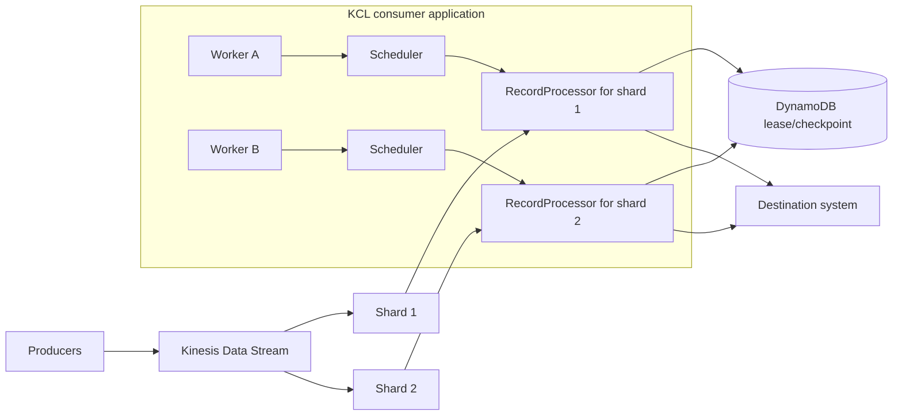
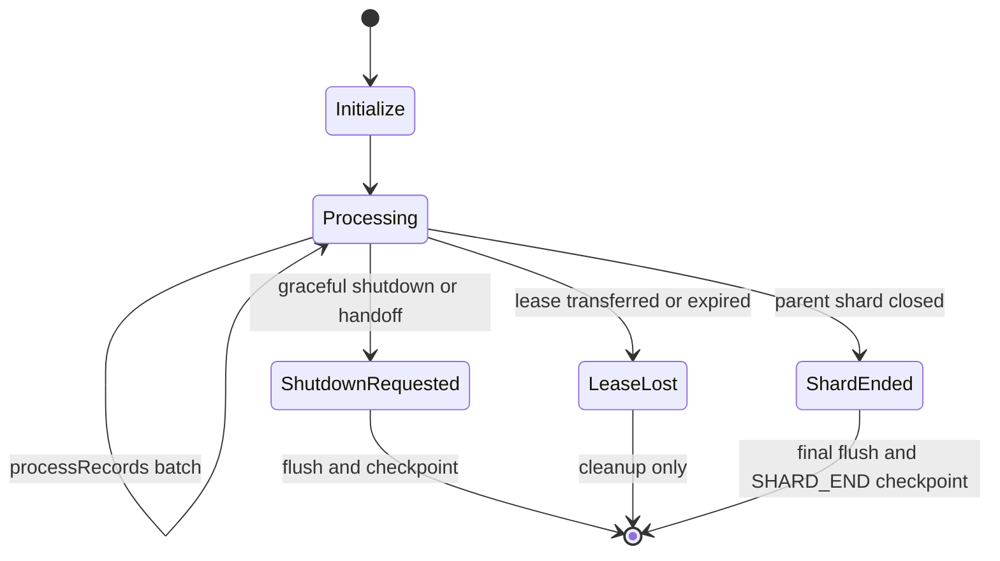

# Kinesis Client Library and Checkpointing During Processing

Amazon Kinesis Data Streams stores records by shard so multiple producers can write data continuously and multiple consumers can process it in near real time. As the number of shards and workers grows, consumers must handle shard distribution, tracking read positions, failure recovery, coordination when workers scale in/out, and shard split/merge events.

The Kinesis Client Library (KCL) is a Java library for building distributed consumers for Kinesis Data Streams. KCL manages shard lifecycles, leases across workers, load balancing, and checkpointing; the application provides the business logic to process records. A checkpoint is a durably saved progress position so a consumer can resume after a worker stops or fails.

Checkpointing does not by itself make business side effects exactly-once. If an application writes to a target system successfully but has not yet checkpointed, the record can be processed again. Therefore, KCL design must combine checkpointing with idempotent processing, retries, dead-letter queues (DLQs), monitoring, and proper shutdown handling.

This lesson focuses on KCL 3.x for Java. KCL 1.x and 2.x are obsolete; KCL 1.x reached end of support on January 30, 2026. For new applications, use the current KCL branch and AWS SDK for Java 2.x; when upgrading legacy applications, consult the migration guide for the version currently running.

After this lesson, learners will be able to:

- Explain the relationship between a Kinesis stream, shard, worker, scheduler, record processor, and lease.
- Describe how KCL stores leases/checkpoints in DynamoDB.
- Implement the callbacks in the `ShardRecordProcessor` lifecycle.
- Choose the right checkpoint timing for batches, side effects, and recovery requirements.
- Analyze at-least-once delivery, duplicates, processing errors, and idempotency.
- Handle shutdowns, lease loss, shard ends, and resharding safely.
- Configure, monitor, and operate KCL consumers on AWS.

## 1. Where Does KCL Fit in a Streaming Architecture?

### 1.1. From Stream to Record Processor

Amazon Kinesis Data Streams divides a stream into shards. Each record has a partition key and a sequence number. The partition key is mapped to a shard's hash-key range; records with the same partition key are routed to the same shard within the stream's configuration, enabling consumers to process records in shard order.

KCL runs inside the consumer application. The library continuously reads data from Kinesis, manages shard assignment, and passes batches to record processors. The application does not need to write its own `GetRecords` loop, manage shard iterators, or manually assign shards to hosts.

| Component | Responsibility |
|---|---|
| Kinesis data stream | Stores records by shard for the retention period |
| Shard | Data partition with its own sequence numbers and hash-key range |
| KCL application | A logical consumer group sharing progress and leases |
| Worker | A process/instance running the KCL application |
| Scheduler | Coordinates shard discovery, leases, record processors, and retrieval |
| Record processor | Runs business logic for a shard whose lease is held by the worker |
| Lease | Coordination record indicating which worker is processing a shard |
| DynamoDB lease table | Stores leases, checkpoints, and shard metadata |
| Checkpoint | Position of the last record the application confirmed as durably processed |

### 1.2. General Processing Flow



One worker can hold multiple leases and run multiple record processors. When a worker stops, loses connectivity, or loses a lease, KCL can transfer the lease to another worker. The new worker resumes reading from the saved checkpoint.

### 1.3. When Should You Use KCL?

KCL is suitable when you need consumers running across multiple EC2 instances, ECS tasks, EKS pods, or other Java environments; automatic shard load balancing; failure recovery; or per-shard checkpoint tracking.

If you only have a single small consumer and want direct control over the read loop, you can call Kinesis APIs like `GetRecords` or use the enhanced fan-out API directly. When managing APIs yourself, the application must implement shard discovery, iterators, checkpointing, resharding, and worker coordination. KCL is ideal when you want the library to handle those distributed concerns.

KCL is not a stream processing engine like Apache Flink. KCL delivers batches to application code; transformation logic, joins, aggregations, stateful windows, and sink transactions remain the responsibility of the application or downstream systems.

## 2. KCL Coordination Concepts

### 2.1. Application Name and Worker Identifier

`applicationName` identifies a KCL consumer application. All workers belonging to the same consumer group must use the same application name to share leases and checkpoints. An independent logical consumer reading the same stream needs its own application name; it then maintains a separate lease table and progress.

`workerIdentifier` identifies a running worker instance and must be unique across active workers within the same KCL application. Never use the same worker identifier for two concurrently running processes.

| Setting | Meaning | Rule |
|---|---|---|
| `streamName` | Source Kinesis stream | Must point to the right stream |
| `applicationName` | Logical consumer group | Shared across workers of the same consumer; unique across independent consumers |
| `workerIdentifier` | Single worker instance | Unique per active instance |
| `tableName` | DynamoDB lease table name | Can default from application name or be configured explicitly |

If you accidentally change the application name on restart, KCL may treat it as a new consumer application and create new metadata/checkpoints. This can cause the consumer to re-read from the initial position, increase load, and create duplicate side effects. Treat the application name as part of deployment identity.

### 2.2. Leases and Shard Ownership

A lease represents responsibility for processing a shard. In steady state, each shard has one lease owner at a time. A worker can hold multiple leases; KCL distributes leases among workers and transfers them as needed.

A lease has a duration and is renewed periodically by the worker. If a worker fails to renew within the configured failover interval, the lease can be considered expired and another worker can take over. Because network connectivity can recover after a lease has been reassigned, an old and new record processor can occasionally process the same shard briefly at the same time. Applications must tolerate this via idempotency and side-effect controls.

### 2.3. DynamoDB Metadata Tables

KCL uses DynamoDB to store metadata for coordination and recovery. In KCL 3.x, the default configuration creates three tables per application:

| Table | Role |
|---|---|
| Lease table | Stores per-shard leases, owners, and checkpoints |
| Worker metrics table | Stores worker resource metrics for load balancing |
| Coordinator state table | Stores internal coordination state, such as leader election |

Starting in KCL 3.5, you can configure a single-table format to consolidate metadata into the lease table. Moving from three tables to single-table is a phased migration process; wait for the migration status to complete before removing permissions or deleting old tables. Do not manually create or alter schemas of KCL-managed tables.

Common attributes in the lease table:

- `leaseKey`: lease identifier, typically matching the shard ID in single-stream mode.
- `leaseOwner`: worker currently holding the lease.
- `leaseCounter`: counter used to detect ownership changes.
- `checkpoint`: saved sequence number.
- `checkpointSubSequenceNumber`: user record position inside a KPL aggregated record when applicable.
- `parentShardId` and `childShardId`: lineage relationships during splits/merges.

KCL does not automatically delete metadata tables when a consumer application is decommissioned. Once you verify no workers remain and checkpoints are no longer needed for investigation/recovery, operations must clean up these tables per the organization's lifecycle and retention procedures.

### 2.4. Checkpoints Live in the Lease Table

A checkpoint is the progress state of a record processor on a shard. KCL writes checkpoints into the lease metadata in DynamoDB. When a new worker acquires the lease, KCL reads the checkpoint and resumes fetching data from the next position according to checkpoint semantics.

Checkpoints are managed per shard. They are not a stream-wide offset, nor do they represent a simultaneously committed transaction across all shards or all destination systems.

## 3. Record Processor Lifecycle

### 3.1. Main Callbacks

KCL instantiates one record processor for each shard whose lease is held by the worker. The application implements the `ShardRecordProcessor` interface and a factory to create instances. In KCL 3.x, key callbacks include:

| Callback | When invoked | Responsibility |
|---|---|---|
| `initialize()` | When the processor is assigned a shard | Store shard ID, initialize resources/buffers |
| `processRecords()` | Repeatedly while the processor holds the lease | Process batches and checkpoint progress |
| `leaseLost()` | When the worker no longer holds the lease | Stop side effects, release resources; do not checkpoint |
| `shardEnded()` | When the shard is closed and read to the end | Flush remaining data and checkpoint SHARD_END |
| `shutdownRequested()` | When the scheduler requests shutdown/handoff | Finish in-flight work, flush, and checkpoint if still holding the lease |

### 3.2. Callback Order and States



Not every stop triggers the same callback. Once a lease is lost, the processor no longer has authority to write checkpoints for that shard. When a shard ends due to resharding, KCL requires the processor to complete the final checkpoint so child shards become eligible for processing.

### 3.3. Meaning of Each Callback

**`initialize()`**

Receives the shard ID and starting position. Create required buffers, clients, or context. Never assume a processor stays bound to a fixed shard for the application's lifetime; when lease ownership changes, another worker creates a new processor.

**`processRecords()`**

Receives a batch of records and runs business logic. This callback may be invoked repeatedly, including with empty batches depending on configuration. Every record must be handled under retry/DLQ policy before the application checkpoints the batch.

**`shutdownRequested()`**

Invoked by KCL when the scheduler is shutting down or performing a controlled lease handoff. Flush buffers and checkpoint committed work. KCL 3.x includes graceful lease handoff; this feature relies on checkpoint logic inside `shutdownRequested()` to minimize record reprocessing when a lease moves between workers.

**`leaseLost()`**

The worker has lost the lease, typically because the lease expired or another worker took ownership. Never call checkpoint in this callback. Stop starting new work for the shard, cancel cancelable tasks, and release resources. In-flight tasks may already have written to the destination; therefore, sinks still need idempotency.

**`shardEnded()`**

When a parent shard closes due to a split/merge and the record processor reaches the end of the shard, KCL invokes this callback. You must flush all remaining buffers and checkpoint shard end. Failing to checkpoint here prevents KCL from cleanly finishing parent shard processing and can delay child shards.

## 4. How Does Checkpointing Work?

### 4.1. Checkpointing Saves Processed Position

Each record in a shard has a Kinesis-assigned sequence number. When the application calls the checkpointer, KCL saves that position in the DynamoDB lease table. When a new worker acquires the lease, KCL uses that position to resume reading.

A checkpoint means: "the consumer has completed and durably persisted all side effects up to this position." If the application checkpoints before destination data is committed, a worker could crash after checkpointing and before the destination write; those records would be skipped on restart. Therefore, the default sequence must be:

1. Read the batch.
2. Process and confirm sink side effects are durably committed.
3. Flush any required buffers/transactions.
4. Write the checkpoint.
5. Proceed to the next batch.

Never checkpoint before the sink confirms commit.

### 4.2. Checkpoint Methods

KCL offers multiple checkpointing methods. Pick the one matching your within-batch processing model:

| Call | Saved position | Use case |
|---|---|---|
| `checkpoint()` | Last record of the current batch | Only checkpoint after the entire batch succeeds |
| `checkpoint(record)` | Specified record | Sequential processing when checkpointing up to the last committed record |
| `checkpoint(sequenceNumber, subSequenceNumber)` | Specific sequence and subsequence numbers | Locating a user record inside a KPL aggregation |
| Shard end checkpoint | Marks parent shard complete | Inside the `shardEnded()` callback |

For sequential batch processing, calling `checkpoint()` after the whole batch succeeds is usually simplest. If processing concurrently within a batch, do not checkpoint to the highest completed record if earlier records are still incomplete. Checkpoint only up to the highest contiguous position where all preceding records have committed.

### 4.3. Initial Position Is Not a Checkpoint

KCL supports initial positions such as:

- `TRIM_HORIZON`: start from the oldest record still retained in the stream when creating the initial lease.
- `LATEST`: start from the newest record at lease initialization time.
- `AT_TIMESTAMP`: start at a specified timestamp.

`initialPositionInStreamExtended` applies only when KCL creates a lease for a shard for the very first time. If the lease table already contains a checkpoint, KCL resumes from that checkpoint; changing initial position does not automatically rewind or fast-forward an existing lease.

For controlled replay, use a separate consumer application name with a clear retention plan, sink idempotency, and cost bounds. Never delete a production lease table just to try a different initial position.

### 4.4. Checkpoint Frequency and Trade-offs

Checkpointing typically writes metadata to DynamoDB, so checkpointing too often increases writes, latency, and cost. Checkpointing too rarely increases the number of records replayed when a worker fails.

| Strategy | Advantage | Risk/cost |
|---|---|---|
| Every record | Minimal replay | High DynamoDB write count and overhead |
| Every batch | Easy to implement, good balance | May replay the entire last batch |
| Every N records | Bounds the replay window | Must track the last committed position |
| Time-based | Suits continuous workloads | Large batches or bursts may delay checkpoints |
| Per sink transaction | Aligned with commit boundaries | Requires designing sink and checkpoint together |

No single checkpoint interval is optimal for every workload. Define your RPO/replay window target, measure DynamoDB cost and processing time, and choose an appropriate cadence. Always flush buffers before checkpointing.

### 4.5. A Checkpoint Is Not a Backup

A checkpoint only stores consumption position. It does not back up records, extend stream retention, or protect the sink. If a consumer falls too far behind and older records age out of retention, the checkpoint may point to a position where data is no longer readable. Monitor consumer lag and set retention large enough to allow recovery time.

## 5. At-Least-Once, Duplicates, and Idempotency

### 5.1. Why Can a Record Be Processed Multiple Times?

KCL provides at-least-once semantics. A record can be delivered to processing logic multiple times when:

- A worker crashes after writing to the destination but before checkpointing.
- A checkpoint outcome is uncertain due to timeout; the application restarts and replays.
- A lease transfers to another worker after the previous worker loses connectivity.
- Workers are added/removed during scaling or deployments.
- Shard splits/merges cause a new record processor to resume from a checkpoint.
- Producer retries create duplicate records in the input stream.

Checkpointing does not create a distributed transaction across Kinesis, the DynamoDB lease table, and destination systems. Thus, you cannot infer end-to-end exactly-once merely from successful KCL checkpoints.

### 5.2. Two Failure Orderings

| Ordering | Where does the worker fail? | Consequence |
|---|---|---|
| Checkpoint first, write sink after | After checkpoint, before sink commit | Record can be skipped on restart |
| Write sink first, checkpoint after | After sink commit, before checkpoint | Record is re-read and can produce duplicate side effects |

The standard safe design is write sink first, checkpoint after, and make sink writes idempotent. If a record is replayed, the sink recognizes it as the same event and avoids duplicating the result.

### 5.3. Building an Idempotency Key

An idempotency key must stably identify a logical event. With Kinesis, you can combine:

- Stream ARN or stream identity.
- Shard ID.
- Sequence number.
- Subsequence number if the producer uses KPL aggregation.
- Business event ID generated by the producer, if that ID is truly unique and stable.

Do not use the partition key alone as an idempotency key because many distinct records share the same partition key.

For example, the target table can store `event_id` with a unique constraint or conditional write. When a record arrives the first time, the transaction writes the result and event ID. When it arrives again, the duplicate insert is treated as already completed and produces no second side effect.

### 5.4. Idempotent Processing Patterns

| Pattern | How it works | Best for |
|---|---|---|
| Upsert by event ID | Overwrites state by a stable key | Materialized views, current state |
| Conditional write | Creates only if event ID does not exist | DynamoDB conditional puts, database unique keys |
| Deduplication ledger | Inserts processed event ID in the same transaction as the result | Sinks with transactional databases |
| Idempotent API | Passes idempotency key to downstream API | Supported payment, order, or partner APIs |
| Deterministic object key | Writes objects keyed by shard/sequence or stable event ID | File/object sinks |
| Transactional outbox/inbox | Stores events and processing state in transactions | Multi-service systems requiring auditability |

For operations like incrementing balances, debiting funds, or sending notifications, a simple upsert may be insufficient. Use transactions, conditional updates, or idempotency tokens supported by the business system.

### 5.5. Error Handling and DLQs

KCL does not automatically replay a batch simply because `processRecords` throws an exception. If an exception goes unhandled, KCL may invoke the next batch without redelivering the failing batch; the application risks dropping records. Therefore, the record processor must handle errors proactively.

Per-record workflow:

1. Classify the error as transient or permanent.
2. For transient errors, retry with bounded attempts, exponential backoff, and jitter.
3. If still failing, send the record and metadata to a durable DLQ; confirm the DLQ write succeeded.
4. Only after a record is processed or confirmed persisted in the DLQ, treat it as complete.
5. Once every record in the batch reaches a completed state, flush the sink and checkpoint.

If neither processing nor DLQ persistence can succeed, fail closed: stop the consumer via application lifecycle controls, prevent subsequent batches from checkpointing past the failed record, emit alerts, and restart from the previous checkpoint after remediation. Simply throwing an exception and continuing is not a retry strategy.

A DLQ should include the payload or data reference, stream/shard/sequence/subsequence, partition key, timestamp, retry count, exception class, sanitized error message (redacting sensitive data), and correlation ID. The DLQ must have an owner, retention, access controls, and a replay runbook.

### 5.6. Example Recovery Timeline

```mermaid
sequenceDiagram
  participant K as KCL worker
  participant S as Sink database
  participant D as DynamoDB lease table
  K->>S: Commit event E-101 (idempotency key)
  S-->>K: Commit success
  K-xD: Checkpoint request times out
  Note over K,D: Worker restarts or lease changes
  K->>S: Replay event E-101
  S-->>K: Duplicate key; return prior result
  K->>D: Checkpoint sequence for E-101
  D-->>K: Checkpoint saved
```

In this example, the sink committed while the checkpoint outcome was uncertain. Upon replay, the sink recognizes the same event ID and avoids repeating the side effect. The worker can then safely checkpoint progress.

## 6. KPL Aggregation and Subsequence Checkpointing

### 6.1. Sequence Numbers and User Records

The Kinesis Producer Library (KPL) can pack multiple user records into a single Kinesis record to improve write efficiency. When a consumer de-aggregates them, multiple user records can share the sequence number of the underlying Kinesis record. KCL tracks an additional subsequence number to distinguish individual user records within the aggregate.

If an application checkpoints only by sequence number and ignores the subsequence, a restart can re-read part of the user records already processed within the same aggregated record. That is why checkpointing must account for both sequence number and subsequence when KPL aggregation is used.

### 6.2. Choosing the Right Checkpoint API

With KCL de-aggregation enabled, `checkpoint(record)` is recommended when precise per-user-record checkpointing is required. KCL accepts `UserRecord` (a record subclass) and persists the corresponding subsequence number.

If the application tracks checkpoint metadata manually or calls sequence-string overloads, store the subsequence number as well and use `checkpoint(sequenceNumber, subSequenceNumber)` when needed.

Illustrative example:

```java
// record is a KPL UserRecord delivered by KCL de-aggregation.
String sequenceNumber = record.sequenceNumber();
long subSequenceNumber = record.subSequenceNumber();

// Complete the side effect for this user record first.
sink.applyIdempotently(record);

// Persist the exact user-record position.
checkpointer.checkpoint(sequenceNumber, subSequenceNumber);
```

This snippet assumes `record` is a `UserRecord` de-aggregated by KCL and `sink.applyIdempotently` has durably committed. For batch processing, checkpoint the last user record in the batch only after all preceding user records have completed.

### 6.3. When Per-User-Record Checkpointing Is Not Used

With KPL aggregation, user records inside the same aggregated Kinesis record can share the same sequence number. When you need exact progress per user record, use `checkpoint(record)` or `checkpoint(sequenceNumber, subSequenceNumber)`. A no-argument checkpoint should not be assumed to checkpoint an exact final subsequence. If checkpointing only per batch, verify the semantics of your KCL version, accept possible replay of part of an aggregated record, and keep the sink idempotent.

Do not manually split KPL payloads with custom code if KCL already performs de-aggregation. Avoid processing an already de-aggregated record twice.

## 7. Implementing a Record Processor in Java

### 7.1. Batch Processing Skeleton

The example below illustrates KCL 3.x. `OrderSink` and `FatalFailureHandler` are application-defined interfaces. The sink must guarantee idempotent operations and durable commits; the failure handler signals the supervisor to perform a controlled worker stop when neither processing nor DLQ persistence can succeed.

```java
import org.slf4j.Logger;
import org.slf4j.LoggerFactory;

import software.amazon.kinesis.exceptions.InvalidStateException;
import software.amazon.kinesis.exceptions.ShutdownException;
import software.amazon.kinesis.lifecycle.events.InitializationInput;
import software.amazon.kinesis.lifecycle.events.LeaseLostInput;
import software.amazon.kinesis.lifecycle.events.ProcessRecordsInput;
import software.amazon.kinesis.lifecycle.events.ShardEndedInput;
import software.amazon.kinesis.lifecycle.events.ShutdownRequestedInput;
import software.amazon.kinesis.processor.ShardRecordProcessor;
import software.amazon.kinesis.retrieval.KinesisClientRecord;

public final class OrderRecordProcessor implements ShardRecordProcessor {
    private static final Logger log =
        LoggerFactory.getLogger(OrderRecordProcessor.class);

    private final OrderSink sink;
    private final FatalFailureHandler failureHandler;
    private String shardId;

    public OrderRecordProcessor(
            OrderSink sink,
            FatalFailureHandler failureHandler) {
        this.sink = sink;
        this.failureHandler = failureHandler;
    }

    @Override
    public void initialize(InitializationInput input) {
        shardId = input.shardId();
        log.info("Start shard={} at={}",
            shardId, input.extendedSequenceNumber());
        sink.openShard(shardId);
    }

    @Override
    public void processRecords(ProcessRecordsInput input) {
        try {
            for (KinesisClientRecord record : input.records()) {
                // This method retries transient errors and persists
                // permanent failures to a durable DLQ before returning.
                sink.applyWithRetryOrDlq(shardId, record);
            }

            // Flush/commit all buffered side effects before checkpoint.
            sink.flush(shardId);
            input.checkpointer().checkpoint();

        } catch (ShutdownException e) {
            // The lease is no longer valid for checkpointing.
            log.info("Stop processing shard={} after lease shutdown", shardId);
            sink.stopShard(shardId);
        } catch (InvalidStateException e) {
            log.error("Invalid checkpoint state for shard={}", shardId, e);
            failureHandler.signal(e, shardId);
        } catch (Exception e) {
            // Do not checkpoint past a record that was not handled.
            // The supervisor must stop this worker so it can restart
            // from the last durable checkpoint.
            log.error("Fatal batch failure for shard={}", shardId, e);
            failureHandler.signal(e, shardId);
        }
    }

    @Override
    public void leaseLost(LeaseLostInput input) {
        // Checkpointing is not allowed after the lease has been lost.
        log.warn("Lease lost for shard={}", shardId);
        sink.stopShard(shardId);
    }

    @Override
    public void shardEnded(ShardEndedInput input) {
        try {
            sink.flush(shardId);
            input.checkpointer().checkpoint();
            sink.closeShard(shardId);
        } catch (ShutdownException | InvalidStateException e) {
            log.error("Final checkpoint failed for shard={}", shardId, e);
            failureHandler.signal(e, shardId);
        } catch (Exception e) {
            log.error("Final flush failed for shard={}", shardId, e);
            failureHandler.signal(e, shardId);
        }
    }

    @Override
    public void shutdownRequested(ShutdownRequestedInput input) {
        try {
            sink.flush(shardId);
            input.checkpointer().checkpoint();
        } catch (ShutdownException | InvalidStateException e) {
            log.info("Lease handoff prevented checkpoint for shard={}", shardId, e);
        } catch (Exception e) {
            log.error("Flush before shutdown failed for shard={}", shardId, e);
            failureHandler.signal(e, shardId);
        } finally {
            sink.stopShard(shardId);
        }
    }
}
```

This is an integration skeleton; fill in the application's business interfaces, resource management, and retry/DLQ policies. The example checkpoints the full batch with `checkpoint()`; if exact positioning inside KPL aggregated records is needed, apply the subsequence checkpoint approach from the KPL aggregation section. In particular, `failureHandler.signal` must instruct the supervisor to stop the worker; merely throwing an exception from `processRecords` does not guarantee KCL will redeliver that batch. Only once a batch has been processed or durably sent to the DLQ is the application allowed to checkpoint.

### 7.2. Processor Factory

KCL requires a factory to instantiate a separate processor per shard. The factory can inject shared dependencies such as database clients or DLQ publishers; each processor still maintains its own per-shard state and buffers.

```java
import software.amazon.kinesis.processor.ShardRecordProcessor;
import software.amazon.kinesis.processor.ShardRecordProcessorFactory;

public final class OrderRecordProcessorFactory
        implements ShardRecordProcessorFactory {
    private final OrderSink sink;
    private final FatalFailureHandler failureHandler;

    public OrderRecordProcessorFactory(
            OrderSink sink,
            FatalFailureHandler failureHandler) {
        this.sink = sink;
        this.failureHandler = failureHandler;
    }

    @Override
    public ShardRecordProcessor shardRecordProcessor() {
        return new OrderRecordProcessor(sink, failureHandler);
    }
}
```

If the sink uses buffering, never share a single mutable buffer across shards without isolation. Each processor must flush only the data belonging to its own shard before checkpointing or shutting down.

### 7.3. Initializing the Scheduler with KCL 3.x

KCL 3.x uses the AWS SDK for Java 2.x. Add the KCL dependency in Maven; replace `3.x.x` with the current tested version in your project:

```xml
<dependency>
    <groupId>software.amazon.kinesis</groupId>
    <artifactId>amazon-kinesis-client</artifactId>
    <version>3.x.x</version>
</dependency>
```

Example initializing clients and the scheduler (`region`, `streamName`, `applicationName`, `sink`, and `failureHandler` come from deployment configuration):

```java
import java.util.UUID;
import software.amazon.awssdk.regions.Region;
import software.amazon.awssdk.services.cloudwatch.CloudWatchAsyncClient;
import software.amazon.awssdk.services.dynamodb.DynamoDbAsyncClient;
import software.amazon.awssdk.services.kinesis.KinesisAsyncClient;
import software.amazon.kinesis.common.ConfigsBuilder;
import software.amazon.kinesis.common.KinesisClientUtil;
import software.amazon.kinesis.coordinator.Scheduler;

KinesisAsyncClient kinesisClient =
    KinesisClientUtil.createKinesisAsyncClient(
        KinesisAsyncClient.builder().region(region));

DynamoDbAsyncClient dynamoClient =
    DynamoDbAsyncClient.builder().region(region).build();

CloudWatchAsyncClient cloudWatchClient =
    CloudWatchAsyncClient.builder().region(region).build();

ConfigsBuilder configs = new ConfigsBuilder(
    streamName,
    applicationName,
    kinesisClient,
    dynamoClient,
    cloudWatchClient,
    UUID.randomUUID().toString(), // unique workerIdentifier
    new OrderRecordProcessorFactory(sink, failureHandler)
);

Scheduler scheduler = new Scheduler(
    configs.checkpointConfig(),
    configs.coordinatorConfig(),
    configs.leaseManagementConfig(),
    configs.lifecycleConfig(),
    configs.metricsConfig(),
    configs.processorConfig(),
    configs.retrievalConfig()
);

Thread schedulerThread = new Thread(scheduler);
schedulerThread.setName("kcl-scheduler");
schedulerThread.start();
```

In production, tie scheduler lifecycle to application lifecycle: handle `SIGTERM`/shutdown signals, request the scheduler to stop, wait for record processors to flush/checkpoint within the allowed timeout, and then close AWS SDK clients. Worker identifiers must be unique; application names must remain stable across restarts.

### 7.4. Retrieval Mode: Enhanced Fan-Out and Polling

KCL 3.x creates an enhanced fan-out (EFO) consumer by default. EFO provides dedicated read throughput for registered consumers, making it suitable when multiple independent consumers or low propagation latency are needed. EFO incurs separate service charges.

If you have few consumers or do not need propagation delay below roughly 200 ms, you can configure shared-throughput polling via `PollingConfig` in retrieval config. Shared-throughput consumers share the shard's read quota; multiple consumers can contend for throughput.

Do not pick a retrieval mode based solely on worker count. Factor in the number of independent KCL applications, EFO consumer count, required throughput, latency, quotas, and cost.

## 8. Resharding, Lease Handoff, and Scaling

### 8.1. Shard Split/Merge

Kinesis can change shard counts via splits or merges. When a parent shard closes, KCL must finish processing all records in the parent shard before starting child shards according to lineage. This preserves required ordering across shard transitions.

General flow:

1. KCL detects new shards and parent/child relationships.
2. Workers finish processing remaining records on the parent shard.
3. Once the parent shard reaches its end, KCL calls `shardEnded()`.
4. The record processor flushes data and checkpoints shard end.
5. KCL creates/activates leases for child shards after the parent is eligible for completion.
6. Workers acquire child leases and initialize new processors.

If `shardEnded()` fails to flush and checkpoint, child shards can remain blocked waiting on the parent. When investigating post-resharding backlogs, inspect `shardEnded` logs, the final checkpoint, parent/child metadata, and the `BlockOnParentTask` metric.

### 8.2. Scaling Workers

Worker count and shard count determine achievable parallelism. A shard has one lease owner in steady state; adding workers does not split a single shard across multiple independent processors. If there are more workers than shards, some workers will hold no leases. If there are too few workers or insufficient CPU/IO, each worker must process many shards and lag increases.

KCL 3.x balances leases based on worker resource utilization (especially CPU) and throughput, rather than merely equalizing lease counts. If KCL cannot collect CPU metrics from the runtime environment, it can fall back to throughput-based balancing. Thus, two workers holding the same number of leases may still carry different loads.

### 8.3. Lease Configuration Parameters to Understand

| Setting | Meaning | Considerations |
|---|---|---|
| `failoverTimeMillis` | Time before a lease owner is considered failed | Too low speeds failover but increases sensitivity to network jitter; too high lengthens takeover time |
| `shardSyncIntervalMillis` | Interval for syncing shard metadata | Affects delay in detecting shard changes and API call volume |
| `maxLeasesForWorker` | Maximum leases a single worker can acquire | Do not set too low or it can hinder assignment and load balancing |
| `billingMode` | Capacity mode for DynamoDB metadata tables | On-demand is the recommended default in current KCL configuration |
| `isGracefulLeaseHandoffEnabled` | Enables/disables graceful shutdown during lease handoff | Keep enabled when flushing/checkpointing before ownership transfer is needed |
| `gracefulLeaseHandoffTimeoutMillis` | Wait time for processor shutdown before forced handoff | Set long enough for real batch processing/flush times |
| `maxRecords` | Maximum records per retrieval call | Balances throughput, memory, and batch processing time |

Current defaults can change across versions. For instance, KCL 3.x documentation describes defaults of 10 seconds for `failoverTimeMillis`, 60 seconds for `shardSyncIntervalMillis`, graceful handoff enabled by default with a 30-second timeout, and on-demand for DynamoDB metadata tables. Verify before overriding.

### 8.4. Graceful Lease Handoff

KCL 3.x supports graceful lease handoff so the outgoing worker has an opportunity to finish processing and checkpoint before the incoming worker acquires the lease. This is enabled by default in KCL 3.x documentation. To benefit from it, the record processor must flush/checkpoint inside `shutdownRequested()`.

Graceful handoff reduces the number of records reprocessed, though it does not eliminate duplicates entirely. Workers can crash suddenly, time out, or lose connectivity before checkpointing. Idempotent sinks remain mandatory.

### 8.5. Sizing Worker Capacity by Shard Workload

Do not size solely by total shard count. Also measure:

- Records/second and bytes/second per shard.
- CPU time and memory per record/batch.
- Sink latency, connection pools, and downstream limits.
- Batch processing, checkpoint, and flush duration.
- Consumer lag per shard and partition key distribution.

An overly hot partition key can turn one shard into a bottleneck while other shards sit idle. KCL balances leases across workers; it does not fix producer-side partition-key skew. If one shard is hot, revisit the partition key, shard capacity, or data partitioning logic.

## 9. Operating Checkpoints and KCL Configuration

### 9.1. DynamoDB Metadata Capacity

KCL 3.x creates metadata tables with on-demand billing mode by default in current configurations. With provisioned mode, calculate read/write capacity from shard count, lease renewal frequency, worker count, checkpoint frequency, and shard sync operations.

Throttling on the DynamoDB lease table can slow down or fail lease renewals/checkpoints. Workers may then lose leases or take longer to recover. Monitor DynamoDB throttled requests, consumed capacity, table latency, and checkpoint failures.

### 9.2. IAM Permissions

The KCL consumer IAM role requires least-privilege permissions on:

| Service | Permission group | Purpose |
|---|---|---|
| Kinesis Data Streams | `DescribeStream`, `DescribeStreamSummary`, `ListShards`, `GetShardIterator`, `GetRecords` | Shard discovery and reading records |
| Kinesis EFO | `RegisterStreamConsumer`, `DescribeStreamConsumer`, `SubscribeToShard` | Only needed when using enhanced fan-out |
| DynamoDB lease table | Create/describe/update/scan/get/put/update/delete on tables and indexes used by KCL | Lease and checkpoint management |
| DynamoDB worker/coordinator metadata | Permissions to manage the corresponding metadata tables | Load balancing and coordination state in KCL 3.x |
| CloudWatch | `PutMetricData` | Emitting KCL metrics |

Scope resource ARNs to the application's streams, tables, and indexes. With KCL 3.5 single-table format, IAM policies must match the migration state and actual tables. Do not remove permissions on the worker metrics/coordinator state tables while single-table migration is still in progress.

If the stream is encrypted with an AWS KMS customer managed key, the consumer role and key policy must allow decryption as required. Use EC2/ECS/EKS IAM roles instead of long-lived access keys; never hardcode credentials in source code or container images.

### 9.3. Separating Consumer Applications

Each independent KCL application maintains its own checkpoints and metadata. This is how you create independent logical consumer groups on the same stream:

- Consumer A writes data to a data lake.
- Consumer B updates a search index.
- Consumer C computes metrics and alerts.

Each application has its own application name and reads shards independently. If consumers need isolated read throughput or low latency, consider EFO; if using polling, sum total read throughput across all consumers per shard.

### 9.4. Decommissioning a Consumer

When retiring a consumer:

1. Stop producer/consumer deployments per the change plan and confirm zero workers remain.
2. Record final checkpoints, backlogs, DLQs, and sink state.
3. Confirm whether leases/checkpoints must be retained for replay or audit.
4. Remove unused IAM permissions, alarms, dashboards, and consumer resources.
5. After the retention period, delete KCL metadata tables and EFO consumers if no longer needed.
6. Document the owner and service closure evidence.

KCL does not automatically delete the three default metadata tables when a consumer is decommissioned. Leftover tables can continue incurring DynamoDB charges.

## 10. Monitoring and Troubleshooting

### 10.1. Metrics to Monitor

KCL emits custom metrics to Amazon CloudWatch under the application name namespace. KCL supports metric levels `NONE`, `SUMMARY`, and `DETAILED`; higher detail levels increase metric count and potential CloudWatch costs.

| Metric | Scope | Meaning |
|---|---|---|
| `MillisBehindLatest` | Per shard | How far behind the latest record on the shard the consumer is |
| `RecordsProcessed` | Per shard | Number of records processed in a process task invocation |
| `DataBytesProcessed` | Per shard | Volume of data processed |
| `RecordProcessor.processRecords.Time` | Per shard | Execution duration of the batch processing callback |
| `UpdateLease.Success` | Per shard | Successful checkpoints |
| `UpdateLease.Time` | Per shard | Time taken to execute checkpoints |
| `CurrentLeases` | Per worker | Number of leases held by the worker |
| `LostLeases` | Per worker | Number of leases lost |
| `LeaseSpillover` | Application | Leases unassigned due to worker lease/throughput limits |
| `FailedAssignmentCount` | Application | Failed lease assignment writes |
| `BlockOnParentTask.Time` | Application | Time child shards wait for parent completion |

Set alarms on trends and business thresholds rather than isolated metrics. For example, continuously rising `MillisBehindLatest` alongside rising `processRecords.Time` may indicate a slow sink or CPU-starved workers. Rising `LostLeases` paired with DynamoDB throttling suggests lease renewals/checkpoints are impacted.

### 10.2. Logging and Tracing

Each processing log entry should include application name, worker identifier, shard ID, sequence number or event ID, batch record count, checkpoint outcome, retry count, and correlation ID. On errors, log exception class and actionable diagnostic details.

Do not log raw payloads, tokens, credentials, or PII unless justified and properly protected. When persisting failed records, use an encrypted DLQ with restricted access and retention.

### 10.3. Common Errors

| Symptom | Common cause | Investigation steps |
|---|---|---|
| `MillisBehindLatest` rising | Slow sink, insufficient CPU, hot shard, insufficient read throughput | Measure `processRecords.Time`, sink latency, CPU, bytes/records per shard |
| Records skipped | Unhandled exception in `processRecords` and batch not automatically replayed | Inspect exceptions, retry/DLQ handling, and whether checkpoint skipped failed records |
| Duplicate side effects | Worker crashed after sink commit before checkpoint; lease handoff | Verify idempotency keys, sink transactions, and checkpoint order |
| Checkpoint rejected | Worker lost lease or invalid checkpoint state | Inspect `ShutdownException`, `InvalidStateException`, lease owner, and network |
| Leases constantly bouncing between workers | Overloaded workers, failover time too low, flaky network, or unstable assignment | Check CPU, worker metrics, failover config, and DynamoDB |
| Child shard not starting | Parent shard not checkpointed with SHARD_END | Check `shardEnded()` callback and BlockOnParentTask |
| KCL not reading older records | Initial position is `LATEST`, lease already has a checkpoint, or records expired from retention | Check application name, lease table, initial position, and retention |
| Erratic iterator/lease behavior | DynamoDB metadata throttling or missing permissions | Check table/index capacity, IAM, and KCL logs |

### 10.4. How to Diagnose Consumer Lag

Follow this sequence:

1. Determine whether lag is rising across all shards or only one shard.
2. Compare producer rate against `RecordsProcessed` and `DataBytesProcessed`.
3. Inspect callback duration, sink latency, connection pools, retries, and DLQ rates.
4. Check worker CPU/memory, leases per worker, and `LeaseSpillover`.
5. Check DynamoDB lease table throttling, checkpoint duration, and lease renewals.
6. Verify whether a shard is hot from partition key skew or total stream capacity is insufficient.
7. After applying a fix, watch lag decline steadily and verify no unexpected data loss or duplicates.

Adding workers does not always resolve lag. If one shard is hot or a downstream sink is the bottleneck, extra workers may not increase throughput on that shard.

## 11. Reliability and Operational Best Practices

### 11.1. Designing the Processing Loop

- Process in batches to reduce overhead; tune batch size for memory, latency, and throughput.
- Keep `processRecords` short enough that workers can maintain leases and recover promptly.
- If processing concurrently within a shard, only checkpoint up to the last record of the contiguous completed prefix.
- Never checkpoint with unflushed buffers or uncommitted transactions.
- Separate transient errors from permanent errors; use bounded retries and a DLQ.
- Keep processing idempotent even with graceful lease handoff enabled.
- Avoid slow sequential downstream API calls per record when batching or bounded-concurrency async calls are possible.
- Never let a single failing record cause the application to skip an entire batch without retries or a DLQ.

### 11.2. Graceful Shutdown in Container Environments

When an ECS task, EKS pod, or EC2 instance terminates, the scheduler needs time to stop processors, flush data, and checkpoint. Configure the platform's termination grace period to exceed expected batch processing/flush time plus a safety margin.

If a container is killed immediately, graceful shutdown callbacks may not finish. When the worker restarts, KCL resumes from the latest checkpoint and the sink must tolerate replay. Do not rely solely on shutdown callbacks for data safety.

### 11.3. KCL 3.x and Worker Utilization Metrics

KCL 3.x uses worker utilization to balance leases. On EC2, collecting CPU metrics requires Linux and IMDSv2. On ECS/EKS/Fargate, the appropriate metadata endpoint/platform configuration is required per AWS documentation. If CPU metrics are unavailable, KCL falls back to throughput per worker.

When scaling workers, monitor lease count, per-lease throughput, CPU, and sink latency. Do not assume every worker will hold the same number of leases.

### 11.4. Version and Dependency Management

- Use current KCL 3.x and AWS SDK for Java 2.x.
- Prefer `ConfigsBuilder` over instantiating low-level lease configs via constructors directly, as APIs/configs can change across major versions.
- AWS documentation warns against using AWS SDK for Java 2.27.19 through 2.27.23 with KCL 3.x due to a DynamoDB-related bug; use 2.28.0 or later per current compatibility guidance.
- Test rolling deployments with multiple workers sharing the same application name.
- When upgrading KCL 2.x to 3.x, follow the migration guide; never manually delete or modify metadata tables while the fleet is transitioning versions.

### 11.5. Cost Drivers to Account For

| Component | Cost driver | How to control |
|---|---|---|
| Kinesis Data Streams | Shard capacity or on-demand data ingestion/retention | Size capacity to traffic and retention; watch for hot shards |
| KCL DynamoDB metadata | Lease, worker metrics, coordinator state, and checkpoint writes | Use on-demand where appropriate; avoid overly frequent checkpoints |
| CloudWatch | Custom metrics, API requests, log ingestion, and retention | Pick appropriate metric levels, configure retention and essential dashboards |
| Enhanced fan-out | Consumer registration and dedicated read throughput | Use EFO when dedicated throughput/latency is required |
| Compute workers | EC2, ECS, EKS/Fargate, memory, and CPU | Autoscale on lag/CPU; avoid overprovisioning |
| DLQ and replay | SQS/S3/DynamoDB or error-storage sinks | Set sensible retention, process and purge expired data per policy |

KCL 3.x creates three DynamoDB metadata tables by default; KCL 3.5 supports a single-table format. Evaluate table management benefits and the phased migration workflow before enabling it. Once single-table migration completes, old metadata tables are no longer used by KCL but must still be deleted manually once verified safe.

## 12. Real-World Example: Order Event Processing

### 12.1. Context

An online store writes `OrderCreated`, `OrderPaid`, and `OrderCancelled` events to Kinesis Data Streams. A KCL consumer updates an order status table and emits notifications to a fulfillment service.

Producers use `orderId` as the partition key so events for the same order go to the same shard and stay ordered within the shard. Each event has a unique `eventId`, `orderId`, `eventType`, `eventTime`, and schema version.

### 12.2. Batch Processing

For each record:

1. Parse the payload and validate the schema version.
2. Verify `eventId`, `orderId`, and event type.
3. Persist state using a transaction/upsert with an idempotency key.
4. If the event is invalid, write to the DLQ with metadata and reason.
5. Flush the batch transaction/buffer.
6. Checkpoint the batch after every record has been processed or durably written to the DLQ.

If the database commits `OrderPaid` but the worker crashes before checkpointing, the record is re-read. A unique constraint on `eventId` ensures reprocessing does not charge twice or send duplicate notifications.

### 12.3. Failure Matrix

| Scenario | Action | Checkpoint? |
|---|---|---|
| Database commit succeeds | Record processed event ID | Yes, after batch flush |
| Transient network error | Retry with backoff/jitter | Not yet, until processing finishes |
| Invalid payload schema and DLQ write succeeds | Route record to DLQ, log reason | Yes, after DLQ confirmation |
| DLQ unavailable | Perform controlled worker stop, do not checkpoint past record | No |
| Worker loses lease | Stop side effects and clean up | No |
| Shard ends | Flush remaining data and checkpoint shard end | Mandatory if completed successfully |

### 12.4. Failure Recovery Testing

- Kill a worker right after sink commit but before checkpoint; confirm replayed records produce no duplicate side effects.
- Kill a worker before sink commit; confirm records are reprocessed upon restart.
- Induce transient sink errors; confirm retries and lag monitoring behave as expected.
- Make the DLQ unavailable; confirm the consumer does not checkpoint past failing records.
- Scale workers in/out; confirm lease handoff, shutdown, and idempotency.
- Split/merge shards; confirm parent shards finish before child shards with no dropped records.

## 13. Lab Exercise: Building a KCL Consumer with Safe Checkpointing

### Context

An e-commerce system writes events to Kinesis Data Streams. Three KCL workers run on ECS. The consumer reads order events, updates status in a database, and writes unprocessable errors to an SQS DLQ. The stream may split/merge shards as load increases.

### Tasks

1. Create a Kinesis stream and select a partition key matching business ordering.
2. Add KCL 3.x and AWS SDK for Java 2.x to the application.
3. Configure a stable application name and unique worker identifier per task.
4. Implement `ShardRecordProcessorFactory` and `ShardRecordProcessor`.
5. Process batches in order, retry transient errors, and send permanent errors to the DLQ.
6. Use an event ID or sequence/subsequence key to guarantee database idempotency.
7. Flush the sink and then checkpoint the batch.
8. Implement `shutdownRequested`, `leaseLost`, and `shardEnded` with proper semantics.
9. Enable CloudWatch metrics and alarms for consumer lag, checkpoint failures, lost leases, and DLQ depth.
10. Test worker restarts before/after sink commit and before/after checkpoint.
11. Test scaling in/out and resharding the stream.
12. Document replay results, duplicates, failover timing, and metadata costs.

### Completion Criteria

- Workers in the same consumer share the application name and have non-overlapping worker IDs.
- Every shard has a lease coordinated by KCL.
- Checkpoints are written only after sink/DLQ confirms durable persistence.
- Duplicates do not repeat business side effects.
- Unprocessable errors are not skipped when the next batch runs.
- `leaseLost` does not checkpoint; `shardEnded` flushes/checkpoints; `shutdownRequested` supports graceful handoff.
- Parent shards complete before child shards.
- Consumer lag, checkpoints, and leases are observable in CloudWatch.
- Runbooks exist for restart, replay, DLQ redrive, and decommissioning.

## 14. Self-Check Questions

1. Which parts of building a distributed consumer does KCL handle?
2. How do worker, scheduler, record processor, and lease differ?
3. Why must workers of the same consumer share the same application name?
4. What data does the DynamoDB lease table store?
5. What does a checkpoint signify for a record processor?
6. Why can checkpointing before sink commit cause data loss?
7. Why can committing to the sink before checkpointing cause duplicates?
8. Does KCL guarantee exactly-once downstream side effects?
9. In which callback must you never checkpoint because the worker lost the lease?
10. Why must `shardEnded` flush and checkpoint?
11. Which callback is needed for KCL 3.x graceful lease handoff?
12. When KPL aggregation is used, what problem does the subsequence number solve?
13. Why must exceptions in `processRecords` be handled proactively?
14. When consumer lag increases, which metrics and bottlenecks should you check?

### Suggested Answers

1. KCL manages shard discovery, worker assignment, leases, retrieval, checkpointing, load balancing, failover, and resharding.
2. A worker is the process running the application; the scheduler coordinates execution; a record processor handles one shard; a lease identifies which worker owns that shard.
3. The application name links workers to the same lease/checkpoint state. Independent consumers need distinct names.
4. Lease owner, lease counter, checkpoint sequence/subsequence, parent/child shard metadata, and other coordination state.
5. A checkpoint is the last position the application confirmed as processed with durable side effects.
6. The worker may crash after checkpointing but before sink commit; on restart it reads past the checkpoint and skips uncommitted records.
7. The worker may crash after sink commit but before checkpointing; on restart it re-reads records and repeats side effects if the sink is not idempotent.
8. No. KCL provides at-least-once delivery; applications need idempotency/transactions at the sink.
9. `leaseLost`; at this point the worker no longer holds authority to checkpoint the shard.
10. To confirm all records on the parent shard are finished before child shards are processed.
11. `shutdownRequested`, where the processor flushes and checkpoints before lease ownership moves to another worker.
12. Multiple user records inside one Kinesis record can share a sequence number; the subsequence pinpoints the exact processed user record.
13. KCL does not automatically replay a failing batch just because the callback throws an exception; the application must retry, send to a DLQ, or stop safely.
14. `MillisBehindLatest`, `RecordsProcessed`, `processRecords.Time`, sink latency, CPU, lease losses, checkpoint time, DynamoDB throttling, and shard skew.

## 15. Production Readiness Checklist

- [ ] Compatible KCL 3.x and AWS SDK for Java 2.x versions are pinned.
- [ ] Application name is stable; worker identifiers are unique.
- [ ] IAM role only grants permissions on required streams, metadata tables/indexes, and CloudWatch.
- [ ] KMS key policy permits decryption when the stream uses a customer managed key.
- [ ] Record processor implements retries, DLQ, and idempotency.
- [ ] Sink commits/flushes complete before checkpointing.
- [ ] Checkpoints never advance past unprocessed records in parallel batches.
- [ ] `leaseLost` never checkpoints.
- [ ] `shardEnded` flushes and checkpoints shard end.
- [ ] `shutdownRequested` flushes/checkpoints to support graceful handoff.
- [ ] KPL aggregation is handled with proper sequence/subsequence tracking.
- [ ] Initial position is relied upon only during initial lease creation.
- [ ] Alarms exist for consumer lag and checkpoint failures.
- [ ] DynamoDB metadata capacity/throttling is monitored.
- [ ] Worker crashes, lease handoffs, resharding, and rolling deployments have been tested.
- [ ] Runbooks exist for DLQ redrive, replay, rollback, and decommissioning.
- [ ] Old metadata tables are cleaned up per lifecycle policy after consumer retirement.

## 16. References

- [Use Kinesis Client Library](https://docs.aws.amazon.com/streams/latest/dev/kcl.html)
- [KCL concepts](https://docs.aws.amazon.com/streams/latest/dev/kcl-concepts.html)
- [Develop consumers with KCL in Java](https://docs.aws.amazon.com/streams/latest/dev/develop-kcl-consumers-java.html)
- [KCL configurations](https://docs.aws.amazon.com/streams/latest/dev/kcl-configuration.html)
- [DynamoDB metadata tables and load balancing in KCL](https://docs.aws.amazon.com/streams/latest/dev/kcl-dynamoDB.html)
- [IAM permissions required for KCL consumer applications](https://docs.aws.amazon.com/streams/latest/dev/kcl-iam-permissions.html)
- [Monitor the Kinesis Client Library with CloudWatch](https://docs.aws.amazon.com/streams/latest/dev/monitoring-with-kcl.html)
- [Troubleshoot Kinesis Data Streams consumers](https://docs.aws.amazon.com/streams/latest/dev/troubleshooting-consumers.html)
- [Handle duplicate records](https://docs.aws.amazon.com/streams/latest/dev/kinesis-record-processor-duplicates.html)
- [Implement consumer de-aggregation for KPL](https://docs.aws.amazon.com/streams/latest/dev/kinesis-kpl-consumer-deaggregation.html)
- [Single table format for KCL](https://docs.aws.amazon.com/streams/latest/dev/kcl-single-table-format.html)
- [KCL Java on GitHub](https://github.com/awslabs/amazon-kinesis-client)
