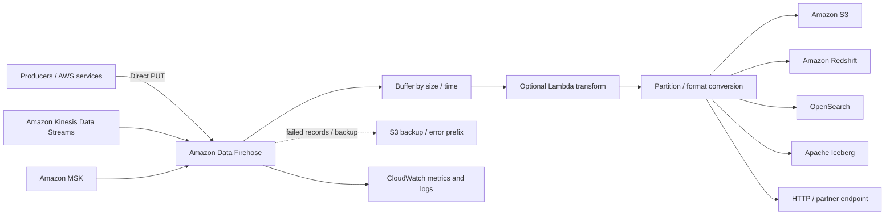

# Amazon Data Firehose and Delivering Data to Destinations

## 1. Role of Amazon Data Firehose

Amazon Data Firehose is a managed service for ingesting, buffering, transforming, and delivering streaming data to destinations. It lets producer applications send records without operating a consumer fleet, managing buffers, merging files, or writing a custom delivery pipeline.

Firehose is commonly used to deliver logs, clickstreams, telemetry, audit events, and business data to:

- Amazon S3 for raw storage, data lakes, and analytics.
- Amazon Redshift for loading data into a data warehouse.
- Amazon OpenSearch Service or OpenSearch Serverless for search and log analytics.
- Apache Iceberg Tables for building lakehouse tables.
- Supported HTTP endpoints and partner services such as Splunk, Datadog, Snowflake, New Relic, and other observability platforms.

Firehose can ingest data directly from producers, read from Amazon Kinesis Data Streams or Amazon MSK, apply Lambda transformations, convert JSON to Parquet/ORC in supported streams, and compress and partition data before delivering it to the destination.

Key point: Firehose is optimized for **managed delivery**. It is not a general-purpose message broker, and it does not replace Kinesis Data Streams when applications need to manage their own consumers, re-read records by sequence, or run continuous streaming logic with custom processing.

## 2. Learning Objectives

After this lesson, learners will be able to:

1. Explain the role of Firehose in streaming and data lake architectures.
2. Distinguish between Direct PUT, Kinesis Data Streams, and Amazon MSK as sources.
3. Choose the appropriate destination among S3, Redshift, OpenSearch, Iceberg, and HTTP endpoints.
4. Design producers using PutRecord/PutRecordBatch with retries and partial failure checks.
5. Configure buffering, delimiters, compression, and S3 object prefixes.
6. Use dynamic partitioning to organize data by business keys.
7. Integrate Lambda to transform records prior to delivery.
8. Convert JSON to Apache Parquet or ORC using the AWS Glue Data Catalog.
9. Design S3 backup, error prefixes, retries, and recovery.
10. Configure IAM roles, KMS encryption, logging, and network access.
11. Monitor data freshness, delivery success, partition count, and processing errors.
12. Optimize cost, file size, and delivery latency.
13. Build and test a delivery stream using the AWS CLI and lab exercises.

## 3. Firehose in a Streaming Architecture

A typical pipeline:



Specific steps depend on the source and destination. For example, Redshift uses S3 as a staging location and runs COPY; dynamic partitioning and format conversion apply to the S3 destination; some partner destinations have their own buffering and retry behavior.

Firehose manages buffering and record delivery automatically, yet producers must still handle errors when sending records to the stream. Applications must also observe the destination, because a stream in the Active state does not guarantee data is arriving within target latency.

## 4. Key Concepts

| Concept | Meaning |
|---|---|
| Delivery stream | Firehose resource holding source, processing, and destination configuration |
| Record | Unit of data sent by a producer into the stream |
| Source | Where Firehose receives records from |
| Destination | Where Firehose delivers records after buffering/processing |
| Buffering hint | Size or time thresholds that trigger delivery |
| Transformation | Modifying payloads before delivery, typically via Lambda |
| Dynamic partitioning | Grouping records into S3 prefixes by keys inside the data |
| Backup | S3 copy of source records or failed records per configuration |
| Data freshness | Age of the oldest record waiting to be delivered |
| Delivery error | Error occurring while processing or delivering data to the destination |

A delivery stream typically has one primary destination. You can use S3 backup to store source data or failed data depending on destination type and settings. If you need to distribute the same data to multiple independent systems, consider having producers write to Kinesis Data Streams/EventBridge/SNS first and then creating separate delivery branches.

## 5. How Does Firehose Differ from Kinesis Data Streams?

Both services can work together, but they solve different problems.

| Criterion | Amazon Data Firehose | Kinesis Data Streams |
|---|---|---|
| Goal | Deliver data to destinations | Ingest streams for applications to read and process themselves |
| Consumers | Firehose manages delivery | Applications manage consumers |
| Buffer/retention | Internal buffer for delivery; Direct PUT retains records up to 24 hours on destination errors | Stream retention configurable within service limits |
| Replay | Not an arbitrary replay stream; depends on backup/source | Consumers can re-read by sequence/timestamp within retention |
| Processing | Lambda transforms and built-in format/partition operations | Consumers implement processing or use stream analytics services |
| Destinations | Supported S3, Redshift, OpenSearch, Iceberg, and HTTP endpoints | Consumers decide their own targets |
| Operations | Less operational effort for delivery | More flexible; requires managing consumers/capacity/checkpoints |

Choose Firehose when the goal is getting records to storage, a warehouse, search, or monitoring destinations with minimal operational code. Choose Kinesis Data Streams when you need multiple independent consumers, replay within the retention window, shard/sequence-ordered processing, or custom streaming logic.

A common pattern is producers writing to Kinesis Data Streams, with Firehose reading the stream to deliver a copy to S3 while other consumers process in near real time.

## 6. Choosing a Source for a Firehose Stream

Firehose supports the following main source categories:

### 6.1. Direct PUT

Producers send records directly via AWS SDK/APIs such as PutRecord or PutRecordBatch. Many AWS services and agents integrate via Direct PUT, including CloudWatch Logs, EventBridge, AWS WAF, API Gateway access logs, AWS IoT, SNS, CloudWatch Metric Streams, Fluent Bit, and Fluentd.

Direct PUT fits when the producer already knows the destination stream and needs to push data directly.

### 6.2. Kinesis Data Streams

Firehose reads data from an existing Kinesis Data Stream and delivers it to the destination. This decouples the ingestion stream from the delivery pipeline, allowing other consumers to read the Kinesis Data Stream as well.

When a destination fails, data retention still relies on the source Kinesis Data Stream's retention. Therefore, set retention long enough for recovery time and monitor iterator/read lag.

### 6.3. Amazon MSK

Firehose can read from an Amazon MSK cluster to deliver data to S3 under supported source/destination configurations. This is a good option when an organization already uses Kafka/MSK and wants to reduce the effort of building consumers to write data to S3.

Verify source/destination compatibility, topics, consumer permissions, network access, and throughput quotas before creating the stream. Never assume every source combination supports every destination.

## 7. Choosing a Destination

| Destination | Purpose | Design points |
|---|---|---|
| Amazon S3 | Data lake, archive, raw/curated files | Prefix, file size, compression, partitioning, format |
| Amazon Redshift | Data warehouse | S3 staging, COPY command, schema, retries |
| OpenSearch Service | Search and log analytics | Bulk indexing, mapping, capacity, index strategy |
| OpenSearch Serverless | Clusterless search | Collection, access policy, capacity, and index |
| Apache Iceberg Tables | Lakehouse tables | Catalog, table schema, S3 storage, and compatibility |
| HTTP endpoint | Send data to systems outside AWS | Request/response contract, authentication, retries |
| Partner destination | Monitoring/observability/SaaS | API key, format, rate limit, and backup |

The list of supported destinations evolves and varies by Region, source, feature, and time. Check current documentation before finalizing a production architecture.

## 8. Designing a Delivery Stream

Before creating a stream, determine:

- Source and destination.
- Region and owner account.
- Stream name, naming convention, and tags.
- IAM service role.
- Buffer size and buffer interval.
- Processing Lambda if needed.
- Compression, data format, and partitioning.
- S3 backup/error bucket.
- CloudWatch log group and alarms.
- KMS key and network access.
- Expected throughput, latency, and retention.

Name streams by domain and purpose, such as **orders-to-s3-raw**, **edge-logs-to-opensearch**, or **device-telemetry-to-lake**. Use tags like Environment, Owner, CostCenter, and DataDomain for cost allocation.

Delivery streams have their own lifecycle: after creation, wait for the Active state before producers send records. When changing destination or processing settings, evaluate the impact on buffering, file formats, prefixes, and downstream consumers.

## 9. Producers: PutRecord and PutRecordBatch

### 9.1. PutRecord

PutRecord sends a single record to a delivery stream. Producers must handle exceptions, timeouts, and retries with backoff.

### 9.2. PutRecordBatch

PutRecordBatch sends multiple records in one request to reduce API overhead. Each batch supports up to 500 records or 4 MB total payload, whichever limit is reached first; each record is limited to 1,000 KB before base64 encoding.

The API can return HTTP success while some individual records fail. Always check **FailedPutCount** and each item in **RequestResponses**. Retry only the failed records instead of resending the entire batch when per-record outcomes are known.

If a timeout or internal error leaves the producer unsure whether the request was processed, retrying can produce duplicates. Attach an eventId/business ID to each record and handle deduplication at the destination when required by business logic.

### 9.3. Example JSON Record

```json
{
  "eventId": "evt-20261120-0001",
  "eventType": "DeviceTelemetry",
  "occurredAt": "2026-11-20T06:30:00Z",
  "tenantId": "tenant-42",
  "deviceId": "device-1008",
  "region": "ap-southeast-1",
  "temperatureC": 28.4,
  "humidityPct": 72.1
}
```

Firehose stores a data blob; it does not automatically parse JSON schemas in every configuration. If you want deaggregation, dynamic partitioning, or format conversion, records must match the required format and corresponding configuration.

## 10. Record Aggregation and Deaggregation

Producers can pack multiple logical records into a single Firehose record to cut API calls. When doing so, ensure Firehose can separate the records before transformation/partitioning.

Deaggregation options include:

- JSON deaggregation: splits JSON objects according to supported formatting.
- Delimiter deaggregation: splits by a delimiter character such as newline.
- KPL aggregation: Firehose can deaggregate records packed by the Kinesis Producer Library when properly configured.

The processing pipeline order may include KPL deaggregation, JSON/delimiter deaggregation, Lambda processing, dynamic partitioning, format conversion, and S3 delivery. Verify processing order because Lambda can receive the logical records after the deaggregation step.

Do not send a JSON array string and assume Firehose will automatically split it into multiple records. Explicitly configure the deaggregation mode and test with real payloads.

## 11. Buffering: Balancing Latency and Object Size

Firehose buffers records before delivering to the destination. Buffering hints include:

- Buffer size: data volume to accumulate.
- Buffer interval: maximum wait time before delivery.

When either threshold is reached, Firehose can flush the buffer. Valid ranges and defaults depend on the destination/processing configuration; consult the destination documentation instead of assuming one default across all streams.

### 11.1. Large Buffers

Advantages: produces larger objects, reduces small requests/objects, and can lower downstream scan/metadata costs.

Disadvantages: increases data freshness latency, making data appear later at the destination; at low volumes, flushes wait for the full interval.

### 11.2. Small Buffers

Advantages: cuts wait time, suiting logs/alerts that need to appear quickly.

Disadvantages: creates many small objects, increases request/metadata overhead, and query engines may spend more time planning/opening files.

Zero buffering is supported only for certain application destinations; it does not apply to S3 backup and is unavailable when dynamic partitioning is enabled. Size buffers to match freshness SLAs and downstream workloads.

## 12. Delivering Data to Amazon S3

S3 is the most common destination for data lakes and archival.

Firehose combines multiple records into one S3 object according to buffering configuration. By default, records are concatenated without automatically adding a delimiter. If consumers expect JSON Lines, enable the newline delimiter or have producers append a consistent delimiter.

An object key can contain a custom prefix, a time prefix in UTC or a configured timezone, stream name/version, timestamp and UUID, and a file extension matching compression/format.

Example prefix:

```text
raw/telemetry/year=!{timestamp:yyyy}/month=!{timestamp:MM}/day=!{timestamp:dd}/
```

An S3 prefix is simply a key naming convention, not a physical directory. Use consistent prefixes so Athena, Glue, and lifecycle policies are easy to manage.

### 12.1. Choosing a File Format

- JSON Lines: easy to debug and schema-flexible.
- GZIP JSON: reduces storage/network usage, though not columnar.
- Parquet: columnar, compresses well, ideal for Athena/EMR/Redshift Spectrum.
- ORC: columnar, ideal for the Hadoop/Hive ecosystem.

Avoid over-compressing tiny files or generating too many small files. The goal is balancing freshness, file size, and query efficiency.

## 13. Dynamic Partitioning for S3

Dynamic partitioning splits records into S3 prefixes based on keys inside the data, such as tenant, region, event type, or business date.

Example prefix:

```text
lake/region=!{partitionKeyFromQuery:region}/event_type=!{partitionKeyFromQuery:eventType}/year=!{timestamp:yyyy}/month=!{timestamp:MM}/day=!{timestamp:dd}/
```

Steps:

1. Select keys with appropriate cardinality and distribution.
2. Extract keys via inline parsing or Lambda.
3. Reference keys in the S3 prefix expression.
4. Monitor active partition counts.
5. Check the error prefix when quotas are exceeded or keys are invalid.

Dynamic partitioning supports only S3 destinations. It must be enabled when creating a new stream; an existing stream created without it cannot enable it later. Once enabled, it cannot be disabled on that stream, although partition keys and prefix expressions can be changed.

### 13.1. Avoiding High-Cardinality Partitions

Do not partition by requestId, transactionId, or millisecond timestamps if each value creates a distinct prefix. That generates excessive active partitions and small objects.

The default quota is 500 active partitions per Firehose stream. When exceeded, new records route to the S3 error prefix with error type activePartitionExceeded. You can request a quota increase up to 2,500 active partitions per AWS-supported limits or split the workload across multiple streams.

### 13.2. Per-Partition Buffering

Each partition maintains its own buffer. If you create many partitions with little data per partition, buffers wait longer to hit size thresholds and produce many small objects. With dynamic partitioning, end-to-end delay can reach roughly 1.5 times the configured buffering interval due to multi-stage buffering.

Design keys around real Athena/Redshift Spectrum query patterns. Do not over-partition merely to make prefixes look granular.

## 14. Lambda Transformation

Firehose can invoke Lambda synchronously in batches to transform records before delivering to the destination.

Use cases:

- Normalize fields and timestamps.
- Mask or strip PII.
- Enrich records with lightweight lookups.
- Parse logs into schema-structured JSON.
- Add partition keys.
- Convert input formats to JSON ahead of format conversion.

Lambda transformation has its own buffer. Size and interval are configured within Firehose limits; synchronous Lambda request/response has a 6 MB payload limit and a maximum function timeout of 5 minutes. Keep functions short, batch-capable, and free of long-running dependencies.

### 14.1. Record Processing Results

Lambda returns results per record ID with statuses such as:

- **Ok:** record processed successfully.
- **Dropped:** record intentionally dropped.
- **ProcessingFailed:** processing failed.

Do not return arbitrary structures. The response must match Firehose's required schema and payload data must be base64-encoded per the contract.

### 14.2. Error Handling

When Lambda times out, throws an exception, or returns a malformed response, Firehose records a processing failure. Configure S3 backup/error output to preserve failed records and monitor ExecuteProcessing.Success, ExecuteProcessing.Duration, SucceedProcessing.Records, and CloudWatch logs.

Do not use Lambda to replace a full ETL engine or run multi-hour jobs. For heavy transformations, land raw data in S3 first and use Glue/EMR/Step Functions.

## 15. Converting JSON to Parquet or ORC

Firehose supports converting JSON to Apache Parquet or ORC before writing to S3. This feature requires:

1. Structurally compatible JSON input.
2. A deserializer to read JSON.
3. An AWS Glue Data Catalog table describing the schema.
4. A serializer to write Parquet or ORC.
5. IAM permissions for Firehose to read the Glue schema and write to S3.

If inputs are CSV or other structured text, use a Lambda transformation to normalize them to JSON before format conversion.

### 15.1. Schema Evolution

The Glue table and record payloads must remain compatible. When producers add fields, change types, or rename fields, format conversion can fail unless the schema is updated accordingly.

Use schema versioning, backward-compatible changes, and sample record tests before modifying production. Unconvertible records need an error output prefix and handling workflow.

### 15.2. When to Choose Parquet?

Parquet fits columnar analytics, reduces data scanned, and typically improves Athena query efficiency. However, Parquet requires a stricter schema than JSON Lines. If data shapes shift frequently or raw payload debugging is needed, store raw JSON alongside it or keep source backups.

## 16. Amazon Redshift Destination

Firehose does not insert records one by one directly into Redshift tables. The flow is:

1. Firehose buffers records.
2. Writes data to an intermediate S3 bucket.
3. Issues a Redshift COPY command to load objects from S3 into the table.
4. Leaves staging objects in S3; Firehose does not automatically delete them after COPY.
5. Use an S3 lifecycle policy to manage retention of staging objects.

Configure the database, table, columns, COPY options, IAM role, and credentials properly. You can use Secrets Manager for credentials where supported by the destination feature.

Retry duration for COPY failures has a configurable limit. Once retries exhaust, monitor errors and handle per your backup/recovery policy. Pay attention to the format, compression, and Region of the S3 staging bucket; COPY options must match the actual data.

## 17. OpenSearch Destination

Firehose buffers records and builds bulk requests to index multiple documents into OpenSearch Service or OpenSearch Serverless.

Design considerations:

- Records must be UTF-8 and typically one JSON object per line.
- Index naming and document ID strategy.
- Mappings and field types.
- Bulk request size and indexing throughput.
- Shard/replica strategy of the OpenSearch domain.
- Retries, failed documents, and S3 backup.
- IAM/resource policies and network access.

If OpenSearch lacks capacity, Firehose can build a backlog and data freshness increases. Scale the destination, tune buffering/concurrency appropriately, and monitor rejected requests. Do not try to fix backlogs by increasing producer rates.

## 18. HTTP Endpoints and Partner Destinations

Firehose supports generic HTTP endpoints and partner destinations listed in documentation. An endpoint must conform to Firehose's request/response contract and return acknowledgements in the supported format.

Configure the endpoint URL and authentication/API key, content encoding, request format and Lambda transformations, acknowledgement timeout, retry duration, S3 backup, and partner-side rate limits and capacity.

If the endpoint fails to return a valid acknowledgement or times out, Firehose retries per policy. Retries can resend batches that the endpoint already processed when the acknowledgement was lost; endpoints should use request IDs/idempotency to prevent duplicates.

Currently, Firehose does not support delivering to HTTP endpoints inside a VPC. For private destinations inside a VPC, verify supported destination types and network models before finalizing the architecture.

## 19. Apache Iceberg Tables Destination

Firehose supports delivering streaming data into Apache Iceberg Tables in Amazon S3 or Amazon S3 Tables in supported Regions. Iceberg manages tables on object storage with schema, metadata, and snapshot semantics for lakehouses.

One stream can route records to different Iceberg tables. Firehose supports insert, update, and delete operations; insert is the default. Updates/deletes require unique keys to identify rows. For Iceberg, Firehose writes Parquet and supports table format V2 and Merge-on-Read within documented scope. Specify the S3 warehouse/table bucket, Glue Data Catalog, database/table names, schema, unique keys, partition spec, IAM/KMS permissions, and error handling.

The Iceberg destination has specific requirements and limitations compared to raw S3 object delivery. For instance, Direct PUT throughput quotas differ by Region; Amazon MSK Serverless sources are currently not supported for the Iceberg destination; concurrent streams writing to the same table can encounter optimistic concurrency control conflicts. Check source/destination compatibility, operation types, schema behavior, and Region support before going to production. Do not assume all S3 features like dynamic partitioning combine identically with the Iceberg destination.

## 20. Backup, Error Prefixes, and Recovery

Firehose can use S3 to back up source records or failed records depending on destination and source. Backup settings are supported for eligible sources like Direct PUT and Kinesis Data Streams; exact options depend on the destination. For example, with S3 destinations, extra backup settings apply when Lambda transformation or format conversion is enabled; with Redshift, when Lambda transformation is enabled. Other application destinations have their own backup support matrix.

Distinguish between:

- **Source record backup:** saves incoming data for reprocessing or auditing.
- **Failed data backup:** saves records classified as failed according to the backup mode and destination behavior. This does not mean every delivery failure immediately lands in the error prefix; many delivery errors are retried first, whereas processing/format-conversion failures may be written to the error output prefix.
- **Error output prefix:** categorizes failed records such as processing-failed, format-conversion-failed, or destination-failed.

S3 backup does not replace database backups or data lake retention policies. Configure separate lifecycle rules, encryption, access controls, and retention. With S3 as the primary destination, Firehose keeps retrying S3 write errors during retention; Lambda processing or Parquet conversion errors may be written to the error prefix. For other destinations, review each destination's retry duration and backup mode.

When replay is needed:

1. Identify the prefix, error type, and time range.
2. Inspect error metadata and source records.
3. Fix the schema, IAM, endpoint, or destination capacity.
4. Scope the exact records to reprocess.
5. Run a producer/replay job to resend them to the appropriate stream.
6. Deduplicate by event ID if side effects or destinations can receive duplicates.
7. Record recovered record counts and any remaining failures.

Do not blindly redrive an entire error bucket before fixing the root cause.

## 21. Retries, Retention, and Delivery Semantics

### 21.1. Retention During Destination Failures

With a Direct PUT source, Firehose retains records for up to 24 hours while attempting delivery to the destination. If the destination does not recover within this window, data can be lost from the internal buffer.

With a Kinesis Data Streams source, data can be re-read per the Kinesis stream's retention. With an Amazon MSK source, evaluate topic retention and consumer offset/lag according to the integration configuration.

Therefore, never treat Firehose as an indefinite durable archive. If multi-day recovery is required, keep source data in Kinesis/MSK or an appropriate S3 backup/landing zone.

### 21.2. Delivery Retries

Retry behavior depends on the destination. Some destinations offer configurable retry durations; S3 delivery retries up to 24 hours for Direct PUT sources and follows Kinesis/MSK source retention when using those sources. Redshift/OpenSearch destinations have their own retry limits.

Once retry duration expires, Firehose acts according to the destination's backup/error configuration. Read each destination's retry semantics carefully before setting RTO/RPO targets.

### 21.3. Duplicate Records

Firehose delivery generally uses at-least-once semantics. Retries after timeouts can produce duplicates at some destinations. Documentation notes delivery semantic exceptions for S3, Apache Iceberg Tables, and Snowflake, yet producer API retries can still submit duplicate records if request outcomes are uncertain.

For workloads requiring deduplication:

- Attach a unique eventId.
- Use a stable document ID in OpenSearch where appropriate.
- Use unique keys/merge logic in the warehouse or downstream.
- Check for duplicates before aggregating.
- Track producer retry counts and FailedPutCount.

Do not rely on the Firehose-returned RecordId as an end-to-end business idempotency key across the pipeline.

## 22. IAM, Encryption, and Network Security

### 22.1. Firehose Service Role

Firehose needs an IAM role to access configured resources:

- Read from Kinesis Data Streams or Amazon MSK if used as a source.
- Invoke Lambda transformation functions.
- Write to S3 destination/backup buckets.
- Read Glue Data Catalog for format conversion.
- Write to Redshift/OpenSearch depending on destination.
- Use KMS keys to encrypt/decrypt as needed.
- Write CloudWatch Logs.

The role trust policy must allow the Firehose service to assume the role. Grant only required actions and resource ARNs; avoid wildcards across all buckets, streams, keys, or Lambdas whenever they can be scoped.

### 22.2. Encryption

- Use TLS for producers and supported delivery paths.
- Enable server-side encryption on the Firehose stream as required.
- Use SSE-S3 or SSE-KMS for S3 destinations.
- Grant KMS key permissions to the Firehose role.
- Protect backup/error buckets with the same rigor as primary data.
- Avoid putting secrets, access tokens, or unnecessary sensitive data into records.

### 22.3. Networking

For VPC-resident destinations supported by Firehose, configure VPC delivery with appropriate subnets and security groups. Verify routes, endpoints, DNS, and network interfaces.

Do not assume every destination supports private VPC delivery. Partner-owned HTTP endpoints currently do not support delivery to endpoints inside a VPC.

## 23. Monitoring with CloudWatch

Firehose emits metrics under the AWS/Firehose namespace, typically at one-minute intervals. Bursts lasting only a few seconds may not stand out clearly in one-minute metrics.

### 23.1. Ingestion Metrics

- IncomingBytes
- IncomingRecords
- ThrottledRecords
- DataReadFromKinesisStream.Bytes
- DataReadFromKinesisStream.Records

Used to verify whether producers are sending data or the stream is reading from its source.

### 23.2. Delivery Metrics

- DeliveryToS3.Success
- DeliveryToS3.Bytes
- DeliveryToS3.Records
- DeliveryToS3.DataFreshness
- DeliveryToRedshift.Success
- DeliveryToAmazonOpenSearchService.Success
- BackupToS3.Success

Continuously rising DataFreshness usually indicates slow delivery or a destination falling behind. A slight dip in Success during retries does not automatically mean data loss; inspect freshness, backups, and error logs together.

### 23.3. Processing and Partition Metrics

- ExecuteProcessing.Success
- ExecuteProcessing.Duration
- SucceedProcessing.Records
- SucceedProcessing.Bytes
- PartitionCount
- PartitionCountExceeded
- ActivePartitionsLimit
- PerPartitionThroughput

Configure alarms for delivery failures, data freshness, throttling, partition limits, and S3 backup/error prefix growth. Firehose uses S3 backup/error outputs rather than a built-in DLQ queue like SQS. Alarms should link to runbooks and owners.

## 24. Common Troubleshooting

| Symptom | Possible cause | Resolution |
|---|---|---|
| No records at destination | Producer not sending, stream not Active, or source permission error | Check IncomingRecords/Bytes, stream status, and IAM |
| S3 receives no objects | Wrong bucket/prefix, missing role permissions, KMS deny, or S3 error | Inspect CloudWatch logs, bucket policy, and KMS policy |
| Data freshness rising | Slow destination, retries, or insufficient capacity | Check destination health, retry metrics, and throughput |
| Records landing in error prefix | Lambda processing, format conversion, or dynamic partition failure | Inspect error type, sample records, and schema |
| OpenSearch rejects documents | Wrong mapping, invalid JSON, or under-provisioned domain | Check bulk errors, mappings, and domain metrics |
| Redshift fails to load | COPY options, credentials, table/schema, or staging access error | Check COPY errors, S3 staging, and IAM |
| Active partitions exceeded | Key cardinality too high or buffer held too long | Reduce cardinality, adjust prefix/stream splits, and check quotas |
| PutRecordBatch errors | Partial failure or throughput limit | Inspect FailedPutCount/RequestResponses and retry failed records |
| Data missing delimiters | Firehose concatenates records without adding newlines | Enable newline delimiter or add delimiters in producer |
| Many small files | Small buffer or many low-volume partitions | Increase buffer, reduce partition cardinality, or compact downstream |

When investigating, correlate identical timestamps across producer logs, Firehose CloudWatch metrics/logs, and destination logs. A stream with rising IncomingRecords but flat Delivery metrics usually points to buffering, processing, or destination errors.

## 25. Designing Effective S3 Prefixes and Data Lakes

For a data lake, prefixes must serve both query patterns and operational costs.

IoT data example:

```text
s3://company-data-lake/
  raw/iot/
    region=ap-southeast-1/
      event_type=temperature/
        year=2026/month=11/day=20/
```

Principles:

- Partition by fields commonly used in query filters.
- Favor time and moderate-cardinality domain/region partitions.
- Avoid partitioning by unique record IDs.
- Use Parquet/ORC for columnar analytical queries.
- Pick compression compatible with downstream engines.
- Enable newline delimiters when using JSON Lines.
- Apply lifecycle rules to raw, backup, and error prefixes.
- Keep raw data immutable when auditing/reprocessing is needed.
- Use Glue Catalog to manage schemas and Athena tables.

Do not over-partition across too many levels. A table with millions of tiny partitions makes metadata and query planning expensive.

## 26. Cost and Optimization

Firehose cost depends on Region, ingested data volume, destination, format conversion, and add-on features per current pricing. Beyond Firehose, account for:

- S3 storage, PUT requests, and lifecycle transitions.
- KMS requests.
- Lambda invocations and duration.
- CloudWatch Logs ingestion/storage.
- Kinesis Data Streams or MSK sources.
- Redshift/OpenSearch destination capacity.
- Data transfer and cross-Region traffic.
- Athena/EMR query scans and downstream compaction.

Optimize by:

- Using PutRecordBatch to reduce request overhead.
- Choosing buffer sizes that avoid tiny objects.
- Using Parquet/ORC for analytical queries.
- Choosing dynamic partition keys with moderate cardinality.
- Avoiding unnecessary Lambda transformations.
- Applying lifecycle policies to staging/backup/error data.
- Scaling destinations before backlogs build.
- Tracking cost per GB delivered and cost per query/use case.

Do not raise buffers too high if freshness SLAs are measured in seconds. Do not lower buffers too far if downstream pays penalties for millions of small objects.

## 27. AWS CLI: Creating and Inspecting a Firehose Stream

The commands below are examples. Replace account ID, role ARN, bucket, and Region with your lab values. The role must have the proper trust policy and permissions.

### 27.1. Creating a Direct PUT Stream Delivering to S3

```bash
aws firehose create-delivery-stream \
  --delivery-stream-name telemetry-to-s3 \
  --delivery-stream-type DirectPut \
  --extended-s3-destination-configuration '{
    "RoleARN": "arn:aws:iam::111122223333:role/FirehoseDeliveryRole",
    "BucketARN": "arn:aws:s3:::company-data-lake",
    "Prefix": "raw/telemetry/!{timestamp:yyyy/MM/dd/HH}/",
    "ErrorOutputPrefix": "errors/!{firehose:error-output-type}/!{timestamp:yyyy/MM/dd/}",
    "BufferingHints": {
      "SizeInMBs": 5,
      "IntervalInSeconds": 300
    },
    "CompressionFormat": "GZIP",
    "CloudWatchLoggingOptions": {
      "Enabled": true,
      "LogGroupName": "/aws/kinesisfirehose/telemetry-to-s3",
      "LogStreamName": "S3Delivery"
    }
  }' \
  --region ap-southeast-1
```

### 27.2. Checking Stream Status

```bash
aws firehose describe-delivery-stream \
  --delivery-stream-name telemetry-to-s3 \
  --region ap-southeast-1 \
  --query "DeliveryStreamDescription.{Name:DeliveryStreamName,Status:DeliveryStreamStatus,Type:DeliveryStreamType,Version:VersionId}"
```

Send records only once the stream is in the Active state.

### 27.3. Sending a Record

The AWS CLI accepts blob data in base64 format. Example on Linux/macOS:

```bash
RECORD_B64=$(printf '%s' '{"eventId":"evt-1001","eventType":"temperature","deviceId":"dev-01","value":28.4}' | base64 | tr -d '\n')

aws firehose put-record \
  --delivery-stream-name telemetry-to-s3 \
  --record "Data=$RECORD_B64" \
  --region ap-southeast-1
```

### 27.4. Checking Streams and Metrics

```bash
aws firehose list-delivery-streams \
  --delivery-stream-type DirectPut \
  --region ap-southeast-1

aws cloudwatch get-metric-statistics \
  --namespace AWS/Firehose \
  --metric-name IncomingRecords \
  --dimensions Name=DeliveryStreamName,Value=telemetry-to-s3 \
  --start-time 2026-11-20T00:00:00Z \
  --end-time 2026-11-20T01:00:00Z \
  --period 60 \
  --statistics Sum \
  --region ap-southeast-1
```

CloudWatch metrics have publish latency and are aggregated per period; never use a single datapoint to conclude data loss.

## 28. Lab Exercise: Building Streaming Delivery to S3

### 28.1. Objective

Create a Direct PUT Firehose stream ingesting JSON telemetry, buffering, and writing S3 objects. Then verify compression, prefixes, CloudWatch metrics, and error handling.

### 28.2. Prerequisites

- Lab AWS account.
- Dedicated S3 bucket for raw data and error prefix.
- IAM role for Firehose.
- CloudWatch log group.
- AWS CLI configured with permissions.
- Producer capable of sending JSON records.

### 28.3. Steps

1. Create the S3 bucket and raw/error prefixes.
2. Create an IAM role with a trust policy for Firehose.
3. Grant PutObject permissions to the required prefixes and KMS permissions if using SSE-KMS.
4. Create the Direct PUT delivery stream following the CLI example.
5. Wait for the Active state.
6. Send multiple telemetry records using PutRecord/PutRecordBatch.
7. Inspect FailedPutCount and individual record responses.
8. Wait for buffer flush and check the resulting S3 object.
9. Verify the UTC time-based object prefix and compression.
10. Verify the newline delimiter or chosen payload format.
11. View IncomingRecords, DeliveryToS3.Success, and DeliveryToS3.DataFreshness.
12. Temporarily misconfigure S3 permissions in the lab environment to observe delivery failure, then restore permissions.
13. If using a Lambda transformation, verify processing success/failure metrics and the error prefix.
14. Clean up lab resources or set lifecycle rules to control costs.

### 28.4. Completion Criteria

- Delivery stream is in the Active state.
- Producer sends records successfully and handles partial failures.
- Records land in the expected S3 bucket/prefix.
- Object format, delimiters, and compression are verified.
- CloudWatch metrics reflect ingestion and delivery.
- IAM role holds only necessary permissions.
- A mechanism exists to detect and recover from delivery failures.
- Storage costs and object sizes are evaluated.

## 29. Self-Check Questions

### Question 1

What problem does Amazon Data Firehose solve?

**Answer:** It is a managed service for ingesting, buffering, transforming, and delivering streaming records to S3, Redshift, OpenSearch, Iceberg, or supported HTTP/partner destinations.

### Question 2

How does Firehose differ from Kinesis Data Streams?

**Answer:** Firehose focuses on managed delivery; Kinesis Data Streams provides streams for applications to manage their own consumers, sequences/checkpoints, and replay within retention.

### Question 3

How do Direct PUT and Kinesis Data Streams sources differ?

**Answer:** With Direct PUT, producers send records straight to Firehose; with a Kinesis source, Firehose reads from an existing stream, and data retention during destination outages depends on Kinesis retention.

### Question 4

Why must you check FailedPutCount after PutRecordBatch?

**Answer:** The HTTP/API call can succeed while individual records in the batch fail. Producers must retry only the failed records.

### Question 5

What do buffering size and interval affect?

**Answer:** They balance data freshness against object size and delivery frequency. Smaller buffers cut latency but increase object count; larger buffers cut object count but increase latency.

### Question 6

Can dynamic partitioning be enabled on an existing S3 stream that was created without it?

**Answer:** No. Dynamic partitioning must be enabled at stream creation; afterward it cannot be disabled on that stream.

### Question 7

Why should you not partition by requestId?

**Answer:** Request IDs have very high cardinality, creating many active partitions and small objects, which can exceed the partition quota.

### Question 8

What conversions does Firehose format conversion support?

**Answer:** Converting JSON to Apache Parquet or ORC for S3 destinations, requiring a deserializer, serializer, and a schema from the AWS Glue Data Catalog.

### Question 9

How does Firehose deliver data to Redshift?

**Answer:** Firehose writes data to an S3 staging bucket and then issues a Redshift COPY command to load it into the table.

### Question 10

When a Direct PUT destination fails for over 24 hours, what can happen?

**Answer:** Firehose retains records for up to 24 hours; if the destination does not recover within that window, data in the internal buffer may become unavailable. External backup/retention is required.

### Question 11

What does continuously rising DeliveryToS3.DataFreshness typically indicate?

**Answer:** The oldest record waiting for delivery is aging increasingly, often due to a slow destination, retries, or insufficient capacity.

### Question 12

Why is an S3 backup/error prefix needed even though Firehose retries automatically?

**Answer:** Retries are bounded or processing/format conversion errors can occur. Backup/error prefixes preserve records for investigation and procedural recovery.

## 30. Production Checklist

### Sources and Producers

- [ ] Source selected to match ingestion architecture.
- [ ] Source/destination compatibility verified.
- [ ] Producer implements retries with exponential backoff and jitter.
- [ ] PutRecordBatch checks FailedPutCount and each response.
- [ ] Records carry an eventId/business key for deduplication when needed.
- [ ] Record sizes and batch sizes stay within quotas.

### Buffering and Processing

- [ ] Buffer size/interval meets freshness and object-size targets.
- [ ] Delimiter matches downstream parsers.
- [ ] Compression selected for destination/consumers.
- [ ] Lambda transformations have appropriate timeouts, payload limits, and error handling.
- [ ] Format conversion uses a compatible Glue schema.
- [ ] Dynamic partitioning enabled at creation time if needed.
- [ ] Partition cardinality and active partition quotas are monitored.

### Destinations and Backup

- [ ] S3 prefixes, lifecycle rules, and retention are designed.
- [ ] Redshift staging bucket and COPY options are tested.
- [ ] OpenSearch mappings/capacity are tested.
- [ ] HTTP endpoint acknowledgement/retry contracts are confirmed.
- [ ] Iceberg catalog/schema compatibility is verified.
- [ ] Source/failed data backups and error prefixes are properly configured.
- [ ] Replay/recovery and deduplication procedures exist.

### Security and Monitoring

- [ ] Firehose role follows least privilege.
- [ ] KMS key policies cover source, destination, and backup.
- [ ] TLS and destination network access are controlled.
- [ ] CloudWatch logs and destination metrics are enabled.
- [ ] Alarms exist for data freshness, delivery failures, throttling, and partition limits.
- [ ] Runbooks cover IAM, KMS, destination capacity, and schema errors.
- [ ] Cost Explorer/Data Exports used to analyze costs.

## 31. Official References

### Amazon Data Firehose Fundamentals

- [What is Amazon Data Firehose?](https://docs.aws.amazon.com/firehose/latest/dev/what-is-this-service.html)
- [Choose source and destination](https://docs.aws.amazon.com/firehose/latest/dev/create-name.html)
- [Understand data delivery](https://docs.aws.amazon.com/firehose/latest/dev/basic-deliver.html)
- [Amazon Data Firehose quotas](https://docs.aws.amazon.com/firehose/latest/dev/limits.html)

### Producers, Buffering, and Processing

- [PutRecord API](https://docs.aws.amazon.com/firehose/latest/APIReference/API_PutRecord.html)
- [PutRecordBatch API](https://docs.aws.amazon.com/firehose/latest/APIReference/API_PutRecordBatch.html)
- [Configure buffering hints](https://docs.aws.amazon.com/firehose/latest/dev/create-configure-backup.html)
- [Transform source data with Lambda](https://docs.aws.amazon.com/firehose/latest/dev/data-transformation.html)
- [Convert input data format](https://docs.aws.amazon.com/firehose/latest/dev/record-format-conversion.html)

### S3, Partitioning, and Destinations

- [Configure destination settings](https://docs.aws.amazon.com/firehose/latest/dev/create-destination.html)
- [Dynamic partitioning](https://docs.aws.amazon.com/firehose/latest/dev/dynamic-partitioning.html)
- [Enable dynamic partitioning](https://docs.aws.amazon.com/firehose/latest/dev/dynamic-partitioning-enable.html)
- [Buffer data for dynamic partitioning](https://docs.aws.amazon.com/firehose/latest/dev/buffering.html)
- [S3 object name format](https://docs.aws.amazon.com/firehose/latest/dev/s3-object-name.html)
- [Amazon Redshift destination](https://docs.aws.amazon.com/firehose/latest/dev/create-destination.html)
- [Deliver data to Apache Iceberg Tables](https://docs.aws.amazon.com/firehose/latest/dev/apache-iceberg-destination.html)
- [Apache Iceberg considerations and limitations](https://docs.aws.amazon.com/firehose/latest/dev/apache-iceberg-considerations.html)

### Backup, Monitoring, and Troubleshooting

- [Configure backup settings](https://docs.aws.amazon.com/firehose/latest/dev/create-configure-backup.html)
- [Handle data delivery failures](https://docs.aws.amazon.com/firehose/latest/dev/retry.html)
- [CloudWatch metrics](https://docs.aws.amazon.com/firehose/latest/dev/monitoring-with-cloudwatch-metrics.html)
- [CloudWatch logging](https://docs.aws.amazon.com/firehose/latest/dev/monitoring-with-cloudwatch-logs.html)
- [Troubleshoot Firehose](https://docs.aws.amazon.com/firehose/latest/dev/troubleshooting.html)
- [Control access with IAM](https://docs.aws.amazon.com/firehose/latest/dev/controlling-access.html)
