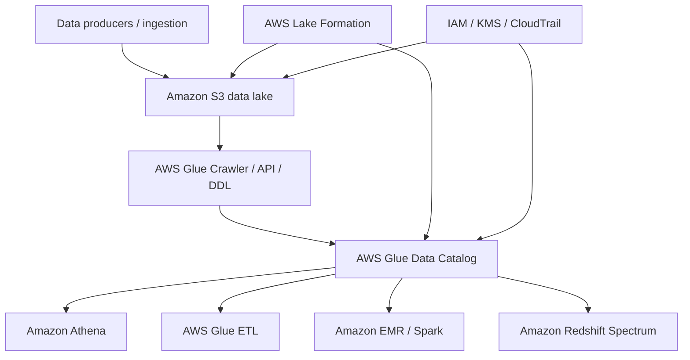
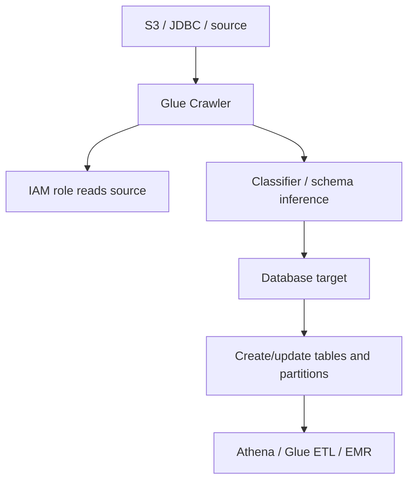

# AWS Glue Data Catalog and Metadata Management

A data lake can store terabytes or petabytes of data in Amazon S3, yet the data is only useful when users and tools know where it lives, how it is structured, which source produced it, and who is allowed to access it. **Metadata** answers those questions. AWS Glue Data Catalog is a centralized metadata repository describing databases, tables, schemas, partitions, storage locations, and governance attributes for analytics services to share.

AWS Glue Data Catalog does not store the contents of data files. It stores definitions about the data: column names, data types, partition keys, file formats, SerDe, S3 locations, table properties, and related information. The physical data remains in S3, databases, or other sources. As a result, Athena, AWS Glue ETL, Amazon EMR, Redshift Spectrum, and Lake Formation can all operate on the same metadata layer.

In the `CLOUD_PROVIDERS_AWS` module, this topic connects storage, IAM, VPC, streaming, data lakes, integration, and security. A well-managed Data Catalog helps organizations discover data, standardize schemas, control permissions by database/table/column, govern changes, and maintain stable querying as the data lake grows.

After this lesson, you can:

- Explain the role of metadata and AWS Glue Data Catalog in a data lake architecture.
- Distinguish between catalog, database, table, partition, crawler, classifier, and connection.
- Create and manage metadata using crawlers, the Glue API, Athena DDL, or Infrastructure as Code.
- Design schemas, partitions, and table properties for data in S3.
- Control schema evolution, crawler behavior, table versions, and metadata quality.
- Integrate Glue Data Catalog with Athena, Glue ETL, EMR, Redshift Spectrum, and Lake Formation.
- Apply IAM, Lake Formation permissions, LF-Tags, encryption, and auditing.
- Build a metadata lifecycle process with ownership, lineage context, classification, and quality checks.

## 1. What Is Metadata in a Data Lake?

Metadata is data that describes data. A Parquet file might contain millions of order records, but without metadata a query engine would have to locate files manually, guess schemas, infer data types, and figure out how partitions are laid out.

Metadata typically falls into three categories:

| Metadata Category | Content | Examples |
|---|---|---|
| Technical metadata | Structure and how to read data | Columns, data types, format, SerDe, S3 location, partition keys |
| Business metadata | Meaning and intended use | Business name, metric definitions, owner, domain, column descriptions |
| Operational/governance metadata | Operations, quality, and permissions | Freshness, classification, retention, access policy, data quality status |

For example, an `orders` table may have technical metadata specifying `order_id string`, `amount decimal(12,2)`, partitioned by `year/month`, stored as Parquet files in S3. Business metadata describes it as paid order data belonging to the Commerce domain and used by Finance. Governance metadata specifies the owner, classification level, retention, and authorized principals.

Not all governance details are automatically inferred by Glue Data Catalog. Organizations need conventions, descriptions, tags, parameters, and integration with appropriate governance workflows.

## 2. What Is AWS Glue Data Catalog?

AWS Glue Data Catalog is a managed metadata repository used to store information about data assets and supply metadata to AWS analytics services. It is a central component in many data lake architectures on AWS.

Key characteristics:
- Serverless service; users do not manage a metadata database server.
- Can hold metadata from multiple sources and formats.
- Supports databases, tables, partitions, connections, and related catalog objects.
- Can be updated by Glue crawlers, Glue API/SDK, ETL jobs, or integrated engine DDL.
- Consumed by Athena, AWS Glue, EMR, Redshift Spectrum, and Lake Formation.
- Integrates with IAM and Lake Formation to control access to metadata and data.
- Supports cross-account metadata sharing through appropriate resource sharing mechanisms.

Each AWS account has a Data Catalog per Region. A table in the catalog is a logical definition of a dataset; it can point to data stored in S3 or supported sources. Creating a table normally does not copy or move data.

### 2.1. Where Does Data Catalog Fit in the Architecture?



Data producers write data to storage. Crawlers or pipelines register schemas and locations in the Catalog. Query engines read metadata to locate files and decode data. Lake Formation and IAM control who can discover or read data under the integrated model.

## 3. Structure of the Data Catalog

The basic structure can be visualized as follows:

```text
AWS Account + Region
└── Data Catalog
    ├── Database: raw
    │   ├── Table: click_events
    │   │   ├── Columns
    │   │   ├── Partition keys
    │   │   ├── Storage descriptor
    │   │   └── Table properties
    │   └── Table: device_telemetry
    ├── Database: curated
    │   ├── Table: orders
    │   └── Table: customers
    └── Database: analytics
        └── Table: sales_daily
```

### 3.1. Catalog

The Catalog is the metadata container scope within an account/Region. The default Glue Data Catalog is typically identified by the account ID. When calling APIs, a catalog ID can be passed to reference the target account's catalog.

### 3.2. Database

A database is a logical grouping of related tables and metadata. A database does not necessarily map 1:1 to a database engine or an S3 folder. Databases can be organized by:
- Data zone: raw, standardized, curated.
- Business domain: sales, finance, customer, operations.
- Product/team: commerce, marketing, platform.
- Environment: development, staging, production.

Do not create a database for every small folder. Choose an organization that makes discovery and permission management clear. Database names should be consistent, avoiding spaces and characters that complicate SQL queries.

### 3.3. Table

A table describes a dataset. Table metadata can include:
- Name and parent database.
- Column list, data types, and descriptions.
- Partition keys.
- Storage descriptor.
- Data location.
- File format, input/output formats, and SerDe.
- Table type, parameters, and classification.
- Creation/update timestamps and metadata version.

A Glue Data Catalog table can be an external table pointing to files in S3. Having a table definition does not mean data has been loaded into Glue. If underlying files are deleted or restructured without updating metadata, queries may fail or return incorrect results.

### 3.4. Partition

Partitions split a table into smaller subsets by partition key values, typically matching a folder layout. For example:

```text
s3://company-data/curated/orders/
  year=2026/month=10/day=19/part-0001.parquet
  year=2026/month=10/day=20/part-0002.parquet
  year=2026/month=11/day=01/part-0003.parquet
```

The table can declare partition keys `year`, `month`, `day`. Queries filtering by time will read only matching partitions if metadata and the query engine support partition pruning.

Partition metadata stores key values and the partition location. If new files are written to S3 without registering the partition, some engines will not see that partition until a crawler, API call, or DDL command updates the catalog.

## 4. Table Metadata and Storage Descriptor

The Storage Descriptor describes how physical data is stored and read. Key fields include:
- `Location`: data location, typically an S3 prefix.
- `Columns`: column schema.
- `InputFormat` and `OutputFormat`: format reader/writer classes.
- `SerdeInfo`: serializer/deserializer and properties.
- `Compressed`: compression indicator.
- `BucketColumns`, `SortColumns`: bucketing/sorting metadata when present.

For example, a Parquet table typically has the appropriate classification/format and a location pointing to the S3 prefix containing Parquet files. A CSV table may require a SerDe and properties specifying delimiter, quote, escape, and header handling.

### 4.1. Schema on Read

Data lakes commonly use schema-on-read: data is stored as files/objects, and schemas are applied at query or processing time. The Data Catalog provides the schema for engines to interpret the files.

Schema-on-read is flexible, but does not mean schemas require no governance. If producers change column names, data types, or formats without notifying consumers, queries can fail or misinterpret data. Contracts, versioning, and schema evolution processes are required.

### 4.2. File Formats and SerDe

Common formats:

| Format | Characteristics | Appropriate Use Cases |
|---|---|---|
| CSV | Easy to exchange, plain text | Small datasets or simple integrations |
| JSON | Flexible, nested structures | Events and semi-structured data |
| Parquet | Columnar, compresses well, column pruning | Analytics and querying on S3 |
| ORC | Columnar, optimized for certain engines | Data warehouse/lakehouse workloads |
| Avro | Row-oriented, schema-based | Data exchange and streaming |
| Apache Iceberg | Open table format with snapshots/metadata | Lakehouse, transactions, and schema evolution |

A SerDe enables engines to deserialize and serialize data according to its format. Choosing the wrong SerDe or delimiter can shift columns, produce unexpected nulls, or fail queries. For Parquet/ORC, format metadata and schemas must align with the actual files.

## 5. Organizing Databases and Tables in a Data Lake

A common approach is dividing the data lake into zones:

| Zone | Goal | Example Database |
|---|---|---|
| Raw/Bronze | Store data close to source, preserve ingest history | `raw` |
| Standardized/Silver | Standardize schema, timezone, data types, and quality | `standardized` |
| Curated/Gold | Data modeled for business/BI consumption | `curated` |
| Sandbox | Controlled experimental analytics | `sandbox` |

A curated table may result from transforming multiple raw tables. Avoid ambiguous database and table names like `db1` or `table_final2`; use names reflecting domain and content.

### 5.1. Naming Conventions

Examples:
- Database: `raw_commerce`, `curated_finance`.
- Table: `orders`, `order_items`, `payment_events`.
- Partition keys: `event_date`, `region` when appropriate.
- Columns: `order_id`, `created_at`, `net_amount`.

Avoid renaming tables/columns arbitrarily when multiple queries depend on them. When a breaking change is needed, create a new table version or compatibility view and plan consumer migration.

### 5.2. Table Locations and Ownership

Each table should have a clear location that does not overlap with another table in a way that causes duplicate reads. An S3 prefix can be referenced by multiple tables, but only with good reason and compatible schemas.

Metadata should record:
- Data owner and technical steward.
- Source lineage and producing pipeline.
- Business description.
- Classification and sensitivity.
- Refresh cadence and SLA.
- Retention and last review date.

You can use table/column comments, parameters, resource tags, or LF-Tags per convention. Attributes like owner, domain, or sensitivity should be maintained automatically via IaC or pipelines to avoid manual entry errors.

## 6. AWS Glue Crawler and Automated Metadata Discovery

AWS Glue Crawler scans data sources, detects formats, infers schemas, and creates/updates databases, tables, or partitions in the Data Catalog.

Crawlers are useful when:
- New data is continuously added to S3.
- Many files have schemas that need discovery.
- You want to bootstrap a catalog quickly.
- You need to detect new partitions.
- Data sources have stable structures whose metadata has not yet been registered.

A crawler is not an ETL job. It does not clean, join, standardize, or transform file contents. It inspects source structure to generate metadata. To transform data, use Glue ETL or another processing engine.

### 6.1. Crawler Components

| Component | Role |
|---|---|
| Crawler name | Name of the crawler |
| Data source target | S3 path, JDBC, or supported source |
| IAM role | Permissions for the crawler to read sources and update Catalog |
| Classifier | Detects format and infers schema |
| Database target | Database where tables are created |
| Schedule | Runs on a schedule or on demand |
| Crawler configuration | Grouping, schema change, and recrawl behavior |
| Logs/metrics | Tracks runs, errors, and table/partition counts |

A crawler can scan one or multiple targets. For S3, restrict the prefix to avoid scanning an entire bucket. The IAM role needs list/read permissions on the exact prefix and permissions to update the Data Catalog.

### 6.2. Classifiers

A classifier determines the data format and infers the schema. Glue provides built-in classifiers for many common formats; custom classifiers can be used for specialized formats.

Examples:
- CSV files with custom headers, delimiters, or quotes.
- JSON files with nested structures.
- Text logs requiring Grok patterns.
- JDBC sources requiring schema inspection from a database.

If a classifier misidentifies a format, the crawler may create tables with wrong data types or unintended grouping. Verify sample data and resulting tables before promoting to production pipelines.

### 6.3. Crawler Workflow



Sequence:
1. Prepare the source and IAM role.
2. Create a crawler with specific targets.
3. Choose an existing target database or create a new one.
4. Configure classifiers and schema change policies.
5. Run the crawler.
6. Inspect created tables, schemas, locations, and partitions.
7. Validate with a query engine.
8. Configure a schedule or event-driven recrawl if needed.

## 7. Managing Crawlers: Schedules, Recrawls, and Schema Changes

### 7.1. Recrawl Modes

A crawler can be configured to:
- Crawl the entire target.
- Crawl new folders only.
- Use event mode for S3 changes tracked via event notifications where supported.

Choose a mode based on how data is written:
- If older files can change schema or content, crawling only new folders may miss updates.
- If data is append-only and new folders represent new partitions, crawling new folders can reduce runtime.
- Event mode can reduce scanning work, but requires properly configured and operated event notifications.

Recrawl modes do not replace schema and partition validation. Test behavior when objects are deleted, folders are renamed, or older files are rewritten.

### 7.2. Schema Change Policy

Crawlers can detect schema changes. You must decide how the Data Catalog should be updated.

Common behaviors:
- `UpdateBehavior=UPDATE_IN_DATABASE`: updates table definitions based on the schema detected by the crawler.
- `UpdateBehavior=LOG`: logs changes without modifying the existing schema.
- `DeleteBehavior=DELETE_FROM_DATABASE`: deletes table metadata if the source is missing per crawler behavior.
- `DeleteBehavior=DEPRECATE_IN_DATABASE`: marks the table as deprecated as supported by the service.
- `DeleteBehavior=LOG`: logs only.

Do not allow crawlers to automatically alter production schemas without a contract. For instance, if a producer changes `amount` from decimal to string, having the crawler update the Catalog can break downstream queries and ETL jobs. For critical datasets, use `LOG` or a review workflow before applying updates.

### 7.3. Table Grouping and Multiple Schemas

If multiple folders share a similar schema, the crawler may group them into a single table depending on settings and heuristics. If each folder represents a distinct dataset, configure targets or table grouping appropriately to avoid incorrect merging.

Do not rely solely on folder names to determine semantic schemas. Inspect sample files, partition layouts, and classifiers.

## 8. Partition Metadata and Query Optimization

Partitions allow engines to skip unnecessary data. For example, on a transactions table partitioned by `year/month/day`, a one-week query can read only the relevant partitions instead of the full history.

### 8.1. Designing Partition Keys

Choose partition keys based on query patterns:
- Event data is commonly partitioned by day or month.
- Multi-tenant data can be partitioned by tenant if tenant count and distribution are suitable.
- Regional data can be partitioned by Region when queries frequently filter by region.

Avoid:
- Overly granular partitions creating millions of partitions.
- High-cardinality partition keys like UUIDs.
- Excessive empty folders.
- Partitioning by columns rarely used in filters.
- Overly large partitions causing heavy data scans.

Partitioning is a physical layout decision. Adding partition keys will not speed up queries if queries do not filter on those keys or if metadata is not kept up to date.

### 8.2. Updating Partition Metadata

Partitions can be registered via:
- Glue Crawler.
- Glue API `CreatePartition` or `BatchCreatePartition`.
- Athena DDL such as `ALTER TABLE ADD PARTITION`.
- Glue ETL or ingestion pipelines.
- Query engine partition projection mechanisms.

With S3 Hive-style paths, crawlers or DDL commands can detect partition values. Ensure the partition key order in the table definition matches the path hierarchy and data types.

### 8.3. Partition Indexes and Partition Projection

Two frequently confused concepts:

- **Glue partition index** is a metadata index that speeds up retrieving partitions via Glue Data Catalog APIs with matching filter predicates. It does not automatically create new partitions.
- **Athena partition projection** lets Athena derive partition values and locations from table property configurations rather than registering every partition in the Catalog. It is an Athena feature, not an index created by Glue crawlers.

Partition projection works well when partitions follow a predictable pattern and the query engine supports it. Ensure location templates, ranges, and formats are accurate; misconfiguration can cause Athena to scan nonexistent paths or miss data.

## 9. Managing Schema Evolution

Schema evolution refers to changes in data structure over time, such as adding a `discount_amount` column, renaming `customer_id`, changing the type of `amount`, or modifying nested JSON structures.

### 9.1. Compatible and Incompatible Changes

| Change | Risk | Mitigation |
|---|---|---|
| Adding an optional column | Usually compatible if consumers tolerate missing/null values | Add to schema and test consumers |
| Adding a new partition | Partition metadata must be updated | Crawler/API/projection |
| Renaming a column | Existing consumers may break | Create compatibility views/versions and migrate |
| Removing a column | Downstream queries may fail | Deprecate, notify, and migrate |
| Changing data type | May cause cast errors or semantic bugs | Contract, transform, and version |
| Modifying nested structures | Parsers/SerDes may fail to read | Version schemas and run compatibility tests |

### 9.2. Do Not Rely on Crawlers as the Sole Schema Authority

Crawlers are good for discovery, but production schemas need owners and contracts. A solid workflow:
1. Producer proposes a schema change.
2. Check backward/forward compatibility.
3. Update the schema contract.
4. Test against sample data.
5. Review impact on queries and ETL.
6. Update the Catalog via IaC/API or a crawler with controlled policies.
7. Monitor consumers after deployment.

If a schema registry is needed for event/streaming payloads, use AWS Glue Schema Registry or a suitable solution. Data Catalog table schemas and Glue Schema Registry serve different purposes.

## 10. Table Versioning and Metadata Lifecycle

Glue Data Catalog supports storing versions of table metadata. When a table definition is updated, a new table version can be created. APIs such as `GetTableVersions` let you inspect definition history within supported limits.

Table versioning is useful for:
- Tracking changes to schemas and table properties.
- Investigating why queries started failing.
- Comparing before/after definitions.
- Rolling back table definitions via process when an invalid change occurs.

However, table versions are not data versions. They do not restore S3 files that were deleted, overwritten, or re-encrypted. To protect data, use S3 Versioning, replication, backups, or equivalent protection mechanisms.

### 10.1. Metadata Lifecycle

A metadata lifecycle can include:
- Register: create database/table.
- Discover: crawler detects schemas/partitions.
- Enrich: add descriptions, owner, classification, and tags.
- Validate: verify schema, location, partitions, and quality.
- Publish: grant access to consumers.
- Monitor: track freshness, usage, and errors.
- Evolve: apply controlled schema changes.
- Deprecate: announce and phase out old tables.
- Retire: remove metadata after retention expires and no consumers remain.

Do not delete databases/tables merely because a pipeline paused temporarily. Before retiring, verify consumers, permissions, lineage, and retention requirements.

## 11. Glue Data Catalog and AWS Lake Formation

AWS Lake Formation provides a governance and authorization layer for data lakes, integrated with Glue Data Catalog. The Catalog describes data; Lake Formation manages permissions on catalog resources and data locations through supported mechanisms.

Lake Formation can control permissions at the level of:
- Database.
- Table.
- Column.
- Row/column filters in supported engines and formats.
- Data locations in S3.

### 11.1. IAM and Lake Formation Working Together

In a Lake Formation-integrated environment, callers typically need IAM permissions to invoke APIs/services and Lake Formation grants to access data per policy. Both layers have distinct roles:
- IAM determines which principals are allowed to call APIs and use services.
- Lake Formation governs data access permissions across integrated engines.

Do not assume having IAM `glue:GetTable` grants permission to read all underlying data. Conversely, do not assume a Lake Formation grant alone is sufficient if IAM, KMS, or S3 configurations block the corresponding access path.

If users have direct S3 permissions to the bucket, they may bypass query-engine-layer controls depending on configuration. For Lake Formation to provide centralized governance, restrict uncontrolled direct S3 read paths.

### 11.2. Data Location Registration

Registering an S3 location in Lake Formation allows the service to manage data access permissions for that location. A service role is typically configured so Lake Formation can access S3 and KMS as required.

Verify:
- Bucket policies.
- IAM roles and trust policies.
- KMS key policies/grants.
- Lake Formation data location permissions.
- Permissions for Glue/Athena/Redshift principals.
- Any direct S3 access paths.

### 11.3. LF-Tags

Lake Formation Tags (LF-Tags) let you attach key-value attributes to databases/tables/columns and grant permissions using tag expressions. For example:
- `domain=finance`
- `classification=confidential`
- `environment=production`

Instead of granting permissions table by table, you can grant a principal access to all tables matching a tag expression. When a new table is assigned LF-Tags, it can inherit policies matching that tag expression.

LF-Tags are a Lake Formation permission governance mechanism, distinct from standard AWS resource tags and cost allocation tags. Do not confuse the three tag types.

### 11.4. Cross-Account Sharing

Lake Formation supports sharing databases/tables with other accounts or organizations via cross-account permissions. A consumer account can create a resource link in its own catalog referencing the shared database/table.

A resource link is a metadata pointer in the consumer's catalog; it does not copy data or automatically grant direct S3 object read access. Consumers still require appropriate permissions and access through supported engines. Coordinate Catalog, Lake Formation, IAM, S3, and KMS permissions.

## 12. Data Catalog Permissions and IAM

Glue Data Catalog APIs are governed by IAM. Common actions include:
- `glue:GetDatabase`, `glue:GetDatabases`.
- `glue:GetTable`, `glue:GetTables`.
- `glue:GetPartitions`.
- `glue:CreateDatabase`, `glue:CreateTable`, `glue:UpdateTable`.
- `glue:CreatePartition`, `glue:BatchCreatePartition`.
- `glue:StartCrawler`, `glue:GetCrawler`.
- `glue:StartJobRun`, `glue:GetJobRun`.

Least privilege principles:
- Data consumers only need to read granted metadata and data.
- Data producers/pipelines have permissions to create or update specific databases/tables.
- Crawler roles only read required source prefixes and update the target catalog.
- Catalog administrators manage metadata without necessarily reading all objects.
- Security administrators manage Lake Formation, KMS, and auditing separately.

Some operations require resource policies or cross-account permissions. Verify action/resource support in the IAM Service Authorization Reference rather than granting `glue:*` to every principal.

## 13. Connecting Data Catalog with Athena

Amazon Athena uses Glue Data Catalog as a common metastore for external tables. When a user runs a query:
1. Athena reads the table definition from the Catalog.
2. It determines schema, location, format, and partitions.
3. It reads objects from S3 according to configured permissions.
4. It writes query results to the S3 query result location.

Example creating a Parquet external table:

```sql
CREATE EXTERNAL TABLE IF NOT EXISTS curated.orders (
    order_id       string,
    customer_id    string,
    order_status   string,
    amount         decimal(12,2),
    created_at     timestamp
)
PARTITIONED BY (
    year string,
    month string
)
STORED AS PARQUET
LOCATION 's3://company-data/curated/orders/';
```

This DDL creates table metadata in the Catalog via Athena; it does not automatically convert files to Parquet. Data at that location must actually be Parquet with a compatible schema.

After adding new partition folders, metadata can be updated using a crawler, Glue API, or appropriate DDL. For Hive-style partitions, for example:

```sql
ALTER TABLE curated.orders
ADD IF NOT EXISTS PARTITION (year='2026', month='11')
LOCATION 's3://company-data/curated/orders/year=2026/month=11/';
```

Query with partition filter:

```sql
SELECT order_status, SUM(amount) AS total_amount
FROM curated.orders
WHERE year = '2026'
  AND month = '11'
GROUP BY order_status;
```

Partition pruning reduces data read when the table layout and query engine support it. Inspect query plans and bytes scanned instead of assuming partitioning automatically speeds up queries.

## 14. Connecting with AWS Glue ETL

Glue ETL jobs can use Data Catalog tables as sources or targets. Jobs can:
- Read data from S3 tables.
- Standardize schemas and data types.
- Clean records.
- Join multiple sources.
- Write curated data.
- Update Catalog tables/partitions when appropriately configured.

Data Catalog stores metadata; Glue ETL performs data transformations. If a job writes new files without updating partition metadata, consumers may not see the new partitions yet. Explicitly design both the data write step and the catalog update step.

For production pipelines, control:
- Input/output schemas.
- Bookmarks or checkpoints if using incremental processing.
- Idempotency and late-arriving data handling.
- Partition overwrite/append behavior.
- Job roles and source/destination permissions.
- Data quality checks before publishing tables.

## 15. Connecting with EMR and Redshift Spectrum

### 15.1. Amazon EMR

EMR can use Glue Data Catalog as an external metastore for Hive/Spark in supported configurations. This enables multiple clusters or applications to share metadata without maintaining a separate metastore.

Configure Glue Catalog access permissions, matching Region/account settings, and engine version compatibility. If EMR uses Lake Formation integration, add the corresponding grants and configurations.

### 15.2. Amazon Redshift Spectrum

Redshift Spectrum enables querying external data in S3 via external schemas and supported metadata catalogs, including Glue Data Catalog. Redshift reads metadata to understand tables, columns, and partitions, then queries objects in S3.

Verify:
- IAM role of the Redshift cluster/workgroup.
- Glue Catalog permissions.
- Lake Formation grants if used.
- S3 access and KMS decrypt permissions.
- Schema/partition compatibility.
- Region and cross-account configuration.

## 16. AWS Glue Data Catalog vs. Glue Schema Registry

These two components have similar names but serve different goals:

| Component | Purpose | Objects Managed |
|---|---|---|
| Glue Data Catalog | Describes datasets/tables so query engines can read data | Databases, tables, columns, partitions, locations |
| Glue Schema Registry | Manages message/event schemas in streaming and enforces compatibility | Schema versions for Avro, JSON, or Protobuf as supported |

Example:
- The `orders` table in S3 is registered in Glue Data Catalog.
- The `OrderPlaced` event emitted via Kinesis or Kafka has its payload schema managed in Glue Schema Registry.

Data Catalog does not replace a schema registry for events. Conversely, Schema Registry is not a metastore for Athena to locate tables and partitions on S3.

## 17. Data Quality and Metadata Quality

Data quality concerns the quality of records; metadata quality concerns the accuracy and completeness of dataset descriptions. The two are related but distinct.

Metadata quality checks:
- Does the table have a description and an owner?
- Do column names/types match the actual files?
- Does the location exist and point to the right prefix?
- Do partition keys match the folder layout?
- Are freshness and refresh cadence documented?
- Are classification and access policies appropriate?
- Is the table still in use or obsolete?
- Are schema changes reviewed and versioned?

AWS Glue Data Quality can run rulesets to validate data inside Glue ETL and supported integrated flows. Example rules:
- `order_id` must not be null.
- `amount` must be greater than or equal to 0.
- Duplicate rate must not exceed a threshold.
- `created_at` must fall within a valid range.

Data quality results can be used by pipelines to decide whether to publish or quarantine a dataset. Do not treat a successful crawler run as proof that data is business-valid.

## 18. Metadata Discovery and Dataset Search

Data Catalog helps tools locate tables by database and schema. To help users find the right dataset, add business context:
- Database/table/column descriptions.
- Domain and data product.
- Owner/steward.
- Classification.
- Refresh schedule and SLA.
- Sample queries or documentation.
- Upstream sources and downstream consumers.
- Access request workflow.

Organizations can use Glue Data Catalog together with Lake Formation, Glue Data Quality, and other catalog/governance tools. If an enterprise data marketplace, glossary, or advanced lineage is needed, evaluate product capabilities and integrations; do not assume Data Catalog alone provides every feature of an enterprise data catalog.

## 19. Encryption, Auditing, and Metadata Protection

Metadata can reveal system names, sensitive datasets, data structures, and cross-domain relationships. Protect both metadata and data objects.

- Use least-privilege IAM for Data Catalog APIs.
- Use Lake Formation to manage data permissions across integrated engines.
- Encrypt S3 data using SSE-S3 or SSE-KMS per policy.
- If encryption is enabled for Data Catalog metadata, manage KMS key policies and key usage permissions.
- Restrict permissions to modify databases/tables/partitions.
- Audit operations via AWS CloudTrail.
- Protect Glue connection secrets and JDBC credentials.
- Never place passwords/tokens in table properties or comments.
- Restrict read access to query results and logs.
- Establish a review process before sharing catalogs cross-account.

CloudTrail records management API activity for Glue/Lake Formation per service scope and configuration. Combine with S3 data access logs, Athena query history, and application audits to investigate who accessed which dataset.

## 20. Managing Metadata with IaC and APIs

Crawlers speed up discovery, but critical production metadata should be reviewable and reproducible. Options include:
- AWS CloudFormation.
- AWS CDK.
- Terraform.
- AWS Glue API/SDK.
- Athena DDL in migration pipelines.

IaC is useful when:
- You want to version database/table schemas in Git.
- You need to reproduce dev/stage/prod environments.
- You want to review changes prior to deployment.
- Consistent policies and tags are required.
- You want to prevent crawlers from accidentally modifying production schemas.

### 20.1. Example: Querying Metadata with AWS CLI

List databases:

```bash
aws glue get-databases \
  --region ap-southeast-1
```

Inspect a table:

```bash
aws glue get-table \
  --database-name curated \
  --name orders \
  --region ap-southeast-1
```

List partitions of a table:

```bash
aws glue get-partitions \
  --database-name curated \
  --table-name orders \
  --region ap-southeast-1
```

Check crawler status:

```bash
aws glue get-crawler \
  --name orders-s3-crawler \
  --region ap-southeast-1
```

These commands only read metadata. In production, paginate results when there are many databases/partitions; `GetPartitions` can return multiple pages via `NextToken`. Never treat the output of a single call as the complete list if a continuation token is returned.

### 20.2. Example: Creating a Database with CloudFormation

```yaml
Resources:
  CuratedDatabase:
    Type: AWS::Glue::Database
    Properties:
      CatalogId: !Ref AWS::AccountId
      DatabaseInput:
        Name: curated
        Description: Curated datasets for analytics
        Parameters:
          owner: data-platform
          domain: commerce
```

This example illustrates managing metadata via IaC. Verify syntax and CloudFormation role permissions in the target account/Region. Avoid managing the same resource with both a crawler and IaC unless a single primary source of truth is clearly defined.

## 21. Operating Crawlers and Catalog in Production

An operational workflow can include:

1. Data producers write files to the raw zone.
2. Events or schedules trigger crawlers/pipelines.
3. Crawlers update schemas/partitions according to reviewed policies.
4. Pipelines validate table metadata and sample data.
5. Glue Data Quality checks the data.
6. Catalog metadata is enriched with owner, description, and classification.
7. Lake Formation grants access to consumers.
8. Athena/EMR/Redshift Spectrum run queries.
9. Monitoring detects freshness issues, schema drift, and query failures.

Crawlers need logs and metrics:
- Execution duration.
- Tables created/updated.
- Partitions added.
- Source read or permission errors.
- Detected schema changes.
- Timestamp of last successful crawler run.

Do not schedule crawlers too frequently if data changes continuously and a more efficient partition update mechanism exists. For streaming pipelines, use micro-batches or APIs to update metadata in batches instead of rescanning entire prefixes.

## 22. Common Errors and Troubleshooting

| Error | Common Cause | Resolution |
|---|---|---|
| Athena reports table does not exist | Wrong database/catalog/Region or table not created | Check Glue Catalog and workgroup Region |
| Table exists but new data is missing | Partition not registered or wrong location | Update partitions and verify S3 path |
| Query data type errors | Catalog schema differs from files | Check schema, SerDe, and producer |
| Crawler creates unintended multiple tables | Target too broad or wrong grouping | Narrow prefix and adjust grouping |
| Crawler cannot read S3 | Missing IAM role/bucket policy/KMS permissions | Check `ListBucket`/`GetObject` and decrypt permissions |
| Crawler unexpectedly overwrites schema | Overly permissive `UpdateBehavior` | Use `LOG`/review or enforce schema contracts |
| Glue API `AccessDenied` | Missing IAM or Lake Formation permissions | Identify the principal and missing permission layer |
| Athena `AccessDenied` on objects | Mismatched S3/KMS/Lake Formation policies | Check data location, grants, and key policy |
| Slow partition queries | Too many partitions or missing pruning/index | Review partition design, index/projection, and query plan |
| Stale table metadata after deploy | IaC, crawler, and DDL all modifying metadata | Assign one metadata owner and update workflow |
| Cross-account table visible but unreadable | Incomplete resource link/grant/IAM/S3/KMS permissions | Verify all catalog and data-path permissions |

When investigating, identify which layer failed: metadata lookup, authorization, object storage, format/schema, or query engine. Do not immediately alter schemas or grant `glue:*` upon encountering `AccessDenied`.

## 23. Practical Scenario: Building a Catalog for an E-Commerce Data Lake

An enterprise stores data in S3 across three zones:
- `raw/commerce/orders/`
- `standardized/commerce/orders/`
- `curated/commerce/sales_daily/`

The data platform team wants:
- Finance to access standardized revenue data.
- Analytics to access clickstream and order data.
- Application teams to write only their own raw data.
- Security team to manage classification and auditing.

### 23.1. Catalog Design

Create databases:
- `raw_commerce`
- `standardized_commerce`
- `curated_commerce`

Register tables:
- Crawlers discover raw sources.
- ETL jobs standardize schemas and write to standardized.
- IaC/DDL creates curated tables with stable schemas.
- Partition by `event_date` or `year/month` based on query patterns.

Each table includes a description, owner, domain, classification, refresh cadence, and S3 location.

### 23.2. Permission Governance

- Application roles write only to their application's raw prefix.
- ETL role reads raw and writes standardized/curated.
- Finance role reads only granted revenue tables.
- Analytics role reads tables needed for analysis.
- Lake Formation LF-Tags classify `domain=commerce`, `classification=internal` or `confidential`.
- KMS key policies and S3 bucket policies restrict object access.
- CloudTrail audits catalog and policy changes.

### 23.3. Controlling Schema Changes

The producer wants to add `discount_amount` to order events. Workflow:
1. Propose the schema change and document column semantics.
2. Check existing consumers.
3. Add the column to the schema contract.
4. Test new files with Glue/Athena.
5. Update Data Catalog via IaC or a controlled crawler policy.
6. Run Glue Data Quality to verify nulls/ranges.
7. Notify consumers and update curated transformations.

With owned and versioned metadata, schema changes can be reviewed instead of letting a crawler alter schemas automatically and discovering failures only after production queries break.

## 24. AWS Glue Data Catalog Management Checklist

- [ ] Every database has a clear purpose and naming convention.
- [ ] Every table has an owner, description, domain, and classification.
- [ ] Schemas match actual files and follow contracts.
- [ ] Locations and formats are verified.
- [ ] Partition keys are chosen based on query patterns.
- [ ] Crawler targets are scoped by prefix/source.
- [ ] Crawler IAM roles follow least privilege.
- [ ] Schema change/delete behaviors have been reviewed.
- [ ] Table versions and metadata rollback procedures are understood.
- [ ] Partition index/projection is selected for the right use case.
- [ ] Lake Formation grants/LF-Tags are consistent.
- [ ] IAM, S3, and KMS policies are not overly permissive.
- [ ] Athena/Glue/EMR/Redshift Spectrum use the same metadata in the right Region/account.
- [ ] Cross-account resource links and grants have been tested.
- [ ] Monitoring exists for metadata freshness, schema drift, and crawler failures.
- [ ] Data quality and metadata quality are validated.
- [ ] Critical metadata changes are managed via IaC/API and reviewed.
- [ ] Dataset deprecation/retirement includes notifications and consumer checks.

## 25. Knowledge Summary

AWS Glue Data Catalog is the centralized metadata repository of the data lake. It stores databases, tables, schemas, partitions, locations, file formats, and governance attributes so Athena, Glue ETL, EMR, Redshift Spectrum, and Lake Formation can share a single data description. Physical data remains in S3 or other sources; the Catalog does not copy or transform files itself.

Crawlers automatically discover schemas and partitions, but do not replace schema contracts or ETL pipelines. Table metadata must be managed with owners, descriptions, classification, locations, and versions. Partitions must match query patterns; Glue partition indexes and Athena partition projection are distinct mechanisms. Schema evolution requires review to avoid breaking consumers when crawlers update automatically.

Lake Formation adds permission governance at the database/table/column and data-location levels; IAM, S3, and KMS remain essential layers to coordinate. Cross-account sharing requires resource grants, resource links, and data-path permissions. Glue Schema Registry manages message/event streaming schemas, distinct from Data Catalog managing table metadata.

A reliable Catalog needs clear metadata quality, data quality, auditing, encryption, monitoring, and lifecycle practices. Use crawlers for discovery, IaC/APIs for stable metadata, Lake Formation for governance, and query engines for data access. When metadata is well-managed, the data lake becomes discoverable, secure, and scalable across many teams.

## References

- [AWS Glue Data Catalog](https://docs.aws.amazon.com/glue/latest/dg/catalog-and-crawler.html)
- [AWS Glue Data Catalog concepts](https://docs.aws.amazon.com/glue/latest/dg/components-overview.html)
- [Defining crawlers and classifiers](https://docs.aws.amazon.com/glue/latest/dg/add-crawler.html)
- [Crawler schema change policies](https://docs.aws.amazon.com/glue/latest/dg/crawler-schema-changes-prevent.html)
- [AWS Glue Data Catalog table and partition APIs](https://docs.aws.amazon.com/glue/latest/dg/aws-glue-api-catalog-tables.html)
- [AWS Glue Data Catalog encryption](https://docs.aws.amazon.com/glue/latest/dg/encrypt-glue-data-catalog.html)
- [AWS Lake Formation permissions](https://docs.aws.amazon.com/lake-formation/latest/dg/lf-permissions-reference.html)
- [Lake Formation cross-account data sharing](https://docs.aws.amazon.com/lake-formation/latest/dg/cross-account-permissions.html)
- [Lake Formation LF-Tags](https://docs.aws.amazon.com/lake-formation/latest/dg/TBAC-assigning-tags.html)
- [Athena use of the AWS Glue Data Catalog](https://docs.aws.amazon.com/athena/latest/ug/data-sources-glue.html)
- [Athena partition projection](https://docs.aws.amazon.com/athena/latest/ug/partition-projection.html)
- [AWS Glue Schema Registry](https://docs.aws.amazon.com/glue/latest/dg/schema-registry.html)
- [AWS Glue Data Quality](https://docs.aws.amazon.com/glue/latest/dg/glue-data-quality.html)
