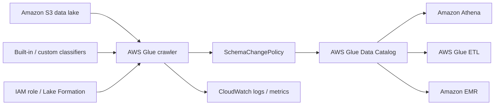

# Glue Crawlers and Schema Change Control

In a data lake, data is often written continuously from multiple systems into Amazon S3. One team may export JSON from applications, another writes Parquet from ETL jobs, while historical data is organized by date or tenant. For Athena, AWS Glue ETL, and analytics services to understand this data, the organization needs metadata describing locations, formats, columns, data types, and partitions. If metadata had to be declared manually for hundreds of datasets, the catalog would quickly fall behind as data and schemas change.

AWS Glue crawler automatically discovers data stores, classifies formats, infers schemas, and updates metadata in the AWS Glue Data Catalog. However, automated updates carry risks: a malformed file, a data type change, or a moved folder can unexpectedly alter the catalog and break downstream queries. Therefore, crawlers must be configured alongside strategies for schema control, partitioning, access permissions, testing, and approvals.

In the AWS ecosystem, Glue crawlers serve as a metadata discovery tool for data lakes. The Data Catalog stores database, table, column, partition, and location definitions for Athena, Glue ETL, EMR, and compatible services. Crawlers do not transform data and do not replace schema governance processes. For event streaming, AWS Glue Schema Registry provides schema versioning and compatibility rules for producers/consumers; that is a separate governance layer from crawlers.

## Learning Objectives

After this lesson, you can:

- Explain how crawlers, classifiers, Data Catalog tables, and partitions work together.
- Design S3 prefixes and partition layouts so crawlers discover datasets accurately.
- Choose built-in classifiers, custom classifiers, table grouping, and table prefixes.
- Configure `UpdateBehavior` and `DeleteBehavior` to control schema changes and metadata deletion.
- Distinguish between full schema updates, adding new columns only, and logging changes without modifying existing schemas.
- Choose between full crawls, incremental new-folder crawls, or S3 event-based crawls.
- Govern schema changes through versioning, compatibility testing, and approval workflows.
- Monitor crawlers, investigate schema drift, and protect the catalog with IAM, KMS, and Lake Formation.

## AWS Glue Crawlers and Data Catalog

A crawler connects to one or more data sources, scans metadata of supported files or systems, uses classifiers to identify formats, and infers data structures. It then creates or updates databases, tables, and partitions in the Glue Data Catalog.



### What Does a Crawler Do?

A crawler run typically performs the following steps:

1. Accesses the data source using the configured IAM role or Lake Formation credentials.
2. Lists locations and objects within the crawl scope.
3. Samples files and applies classifiers to detect formats such as JSON, CSV, Parquet, Avro, or ORC.
4. Infers column names, data types, nested structures, and partition details.
5. Groups files with compatible structures into tables according to grouping settings.
6. Creates or updates metadata in the Data Catalog per the schema change policy and crawler output configuration.
7. Logs run status, duration, table/partition counts, and errors for monitoring.

A crawler is a metadata inference tool. It does not verify that every record's values satisfy business rules, does not fix invalid data, and does not make a new schema compatible with applications. For JSON/CSV files with inconsistent structures, a few sampled files may not represent the entire dataset. Validate actual data using Glue Data Quality, ETL validation, Athena queries, or dedicated test suites.

### Data Catalog Tables Do Not Contain Data

The Glue Data Catalog is a metadata store. A table typically describes:

- Database and table names.
- Columns, data types, comments, and column order.
- Location pointing to an S3 prefix or data source.
- Input/output formats, SerDe, and table properties.
- Partition keys and partition metadata entries.
- Classification, format details, and attributes set by the crawler or users.

When a crawler creates a table for `s3://company-lake/orders/`, the files remain in S3. Athena reads the metadata to know how to interpret the files and locate partitions. Deleting a table from the Data Catalog does not delete S3 objects by default; conversely, deleting S3 objects does not automatically remove table metadata unless a crawler detects and handles that deletion.

### Databases, Tables, and Partitions

A database in Glue Data Catalog is a logical namespace for grouping tables. A table describes a dataset. Partitions divide a dataset into data subsets by keys such as `year`, `month`, `day`, `region`, or `tenant`.

Example layout:

```text
s3://company-lake/orders/
  year=2026/
    month=11/
      day=20/
        part-0001.parquet
        part-0002.parquet
```

A crawler can recognize `year`, `month`, and `day` as partition keys and create the corresponding partition values. When Athena queries by `year=2026` and `month=11`, the engine can prune unrelated partitions, reducing the amount of data read.

Folder names and partition conventions should remain stable. Avoid mixing different datasets under the same prefix or using inconsistent naming formats like `month=11`, `month=Nov`, and `month=2026-11` for the same partition key.

## Data Layout and Table Grouping

A crawler can create multiple tables if it detects groups of files with differing schemas or directory structures. A well-organized data lake helps the crawler identify clear dataset boundaries.

### Designing S3 Prefixes

Separate by domain and dataset:

```text
s3://company-lake/
  raw/
    orders/
    customers/
    payments/
  curated/
    orders/
    customer-360/
  analytics/
    finance/
    marketing/
```

Do not place orders, customers, and payments files under the same prefix if they have different schemas. When a crawler scans a broad root prefix, it can create many tables, group tables unexpectedly, or spend excessive time listing objects.

### Grouping Compatible S3 Paths

By default, the crawler uses S3 structure and schemas to decide how to group files into tables. If multiple prefixes share the same schema and business meaning, you can set `TableGroupingPolicy` to `CombineCompatibleSchemas` to create a single shared table. For example, daily orders data across multiple partition folders can belong to one table.

Do not enable broad grouping when prefixes only happen to share column names while carrying different meanings. Two datasets both containing `id`, `status`, and `created_at` can still represent completely different entities. Table grouping is a metadata and semantic decision; confirm with data owners before merging.

### Table Prefixes and Splitting Crawlers

`TablePrefix` prepends a prefix to created table names, such as `raw_` or `partner_a_`. This reduces naming collisions and helps identify data sources. In large data lakes, create separate crawlers per domain or raw/curated tier instead of a single crawler scanning an entire bucket.

One crawler can target multiple data sources. However, when sources have different permissions, change schedules, or schema policies, separating crawlers reduces blast radius and makes permissions easier to govern.

## Classifiers: Recognizing Data Formats

Classifiers determine how Glue interprets files. AWS Glue provides built-in classifiers for common formats such as JSON, CSV, Avro, Parquet, and ORC. Custom classifiers can be added when data uses proprietary formats or needs specific pattern matching.

### Built-In Classifiers

Built-in classifiers are usually the first choice for standard formats. For example:

- Parquet/ORC store schemas inside file metadata.
- Avro embeds schemas inside container files.
- JSON classifiers infer object structures and nested fields.
- CSV classifiers determine delimiters, quotes, headers, and column data types.

For CSV, files with inconsistent headers or unescaped commas/quotes/newlines inside fields can lead to inaccurate inference. Standardize encoding, headers, and delimiters before crawling.

### Custom Classifiers

Custom classifiers are helpful when files do not follow standard layouts or need custom detection patterns. AWS Glue supports Grok, XML, and JSON custom classifiers. Custom classifiers are registered in the Data Catalog and attached to crawlers.

The crawler evaluates classifiers in configured order. Once a classifier matches, its classification and inferred schema are applied to those files. Test classifiers with representative files, files with missing fields, files with extra fields, and malformed files. Avoid overly broad regex patterns that might misclassify unrelated datasets.

### Schema Inference Is Not a Schema Contract

A crawler observes data to infer the current schema. It does not know whether `amount` is in VND or USD, which business values are valid for `status`, or whether `customer_id` is allowed to be null. Those rules belong to a data contract and must be defined outside the crawler.

For critical datasets, store schema contracts in Git or Glue Schema Registry, validate files before promoting to the curated zone, and update the Data Catalog only after changes are approved.

## Schema Drift and Schema Evolution

Schema drift occurs when data structures change over time compared to the published schema. Some changes are compatible; others break consumers.

| Change Type | Example | Downstream Risk |
|---|---|---|
| Adding a nullable column | Adding `campaign_id` | Usually compatible with consumers ignoring new columns, though `SELECT *` queries may change column counts |
| Adding a required column | Adding `currency` while old records lack values | Consumers or ETL may fail on null/missing values |
| Removing a column | Dropping `legacy_status` | Queries, views, or jobs still referencing the column will fail |
| Renaming a column | `customer_no` to `customer_id` | Typically treated as drop + add; existing consumers may break |
| Changing data type | `amount` from string to decimal | Can cause cast errors, wrong results, or query failures |
| Changing nested structure | `address` from string to struct | SerDe and downstream mappings may become incompatible |
| Changing partition keys/layout | From `dt=...` to `year/month/day` | Partition discovery and query pruning may fail |
| Changing semantics | `amount` switches from gross to net | Schema stays unchanged while meaning changes—dangerous for reporting |

Adding columns is generally more compatible than removing or changing types, yet consumers must still be assessed. In particular, Athena queries using `SELECT *`, positional Glue ETL mappings, dashboards, and BI extracts can break when column order or count changes.

### Versioning Strategy

A safe practice is treating each schema change as a versioned data contract:

1. The producer proposes the new schema and documents purpose, data types, nullability, and rollout timing.
2. Compatibility is checked against active consumers.
3. Tests are added for both new and legacy files; a test crawl is run in a staging database/catalog.
4. Queries, Glue jobs, views, and dashboards are verified to keep working.
5. The change is approved, the producer deploys, and the catalog is updated on schedule.
6. Errors are monitored, maintaining rollback capability or parallel support for old/new schemas.

For breaking changes, consider creating a new dataset/version or prefix instead of overwriting the existing schema. For example, `orders_v1/` and `orders_v2/` allow consumers to migrate on schedule without unexpected breakage.

## SchemaChangePolicy: Controlling How Crawlers Modify the Data Catalog

`SchemaChangePolicy` defines how a crawler reacts when it detects schema changes or deleted objects/tables. The two main properties are `UpdateBehavior` and `DeleteBehavior`.

### UpdateBehavior

| Value | Behavior | When to Use |
|---|---|---|
| `UPDATE_IN_DATABASE` | Updates existing table/partition definitions when schema changes are detected; still creates new tables and partitions | Datasets fully managed by crawlers, accepted schema drift, or sandbox/test environments |
| `LOG` | Does not modify schemas of existing tables/partitions; logs detected changes. Crawler can still create new tables and partitions | When protecting existing schemas and requiring review before updating the catalog |

When a crawler uses `LOG`, detecting a new schema does not mean the crawler updated the table schema. Inspect logs to see what changes were skipped and handle them through an approved process.

### DeleteBehavior

| Value | Behavior | When to Use |
|---|---|---|
| `LOG` | Logs when tables/partitions or catalog objects are detected as missing; does not delete metadata | Safe default for environments requiring metadata preservation and auditing |
| `DEPRECATE_IN_DATABASE` | Marks missing tables as deprecated and records deprecation timestamp | When keeping legacy table traces in the catalog so consumers and owners are aware |
| `DELETE_FROM_DATABASE` | Deletes corresponding table/partition metadata from the Data Catalog when detected as deleted | Only when the catalog must mirror source state and impact has been evaluated |

`DeleteBehavior` affects Data Catalog metadata, not S3 object deletion. Do not enable `DELETE_FROM_DATABASE` expecting it to clean up old bucket files. With transient data sources, verify whether the crawler can reliably determine that an object/table was deleted before allowing metadata removal.

### Choosing Policies by Environment

| Environment | Suggested UpdateBehavior | Suggested DeleteBehavior | Rationale |
|---|---|---|---|
| Sandbox | `UPDATE_IN_DATABASE` | `LOG` or `DELETE_FROM_DATABASE` depending on data | Fast iteration and experimentation are acceptable |
| Raw production | `LOG` or `MergeNewColumns` | `LOG` | Preserve schemas and metadata; detect drift before updating |
| Curated production | Schemas usually managed via ETL/IaC; crawler updates only per workflow | `LOG` or `DEPRECATE_IN_DATABASE` | Curated schemas are consumer contracts requiring review |
| Temporary landing | `UPDATE_IN_DATABASE` | `DELETE_FROM_DATABASE` if retention and ownership are clear | Metadata can be cleaned up along with data lifecycle |

These are reference patterns. Actual decisions depend on data criticality, schema ownership, consumers, and audit requirements.

## Adding New Columns Only: MergeNewColumns

In some cases, an organization wants the crawler to automatically add new columns without modifying or removing existing columns. You can configure crawler output `Tables.AddOrUpdateBehavior` to `MergeNewColumns`.

Example configuration JSON:

```json
{
  "Version": 1.0,
  "CrawlerOutput": {
    "Tables": {
      "AddOrUpdateBehavior": "MergeNewColumns"
    },
    "Partitions": {
      "AddOrUpdateBehavior": "InheritFromTable"
    }
  }
}
```

`MergeNewColumns` lets the crawler append newly discovered columns to an existing table without replacing the existing schema with the newly inferred schema. `InheritFromTable` instructs partition metadata to inherit the table schema, preventing partitions from drifting apart. Specific behavior should be tested with your actual data formats, partitions, and crawler settings.

### Logging All Existing Schema Changes

If you do not want the crawler to update schemas of existing tables, set `UpdateBehavior=LOG`. The crawler still records changes in CloudWatch Logs. You can combine this with `Partitions.AddOrUpdateBehavior=InheritFromTable` so partition schemas inherit from the table.

AWS CLI example:

```bash
aws glue update-crawler \
  --name orders-raw-crawler \
  --schema-change-policy UpdateBehavior=LOG,DeleteBehavior=LOG \
  --configuration '{"Version":1.0,"CrawlerOutput":{"Partitions":{"AddOrUpdateBehavior":"InheritFromTable"}}}'
```

If you only want to merge new columns, use `MergeNewColumns` in `CrawlerOutput.Tables` and verify the matching schema change policy. Do not copy and combine configuration snippets without understanding each option's effect.

## Recrawl Policy: Scan Everything or Scan Changes Only?

S3 crawlers can run under different recrawl strategies:

| RecrawlBehavior | How It Works | Benefits and Limitations |
|---|---|---|
| `CRAWL_EVERYTHING` | Scans the entire dataset on every run | Detects schema and data changes across scope; slower as datasets grow |
| `CRAWL_NEW_FOLDERS_ONLY` | After the initial full crawl, discovers only new folders to add partitions | Faster; does not detect edits or deletions in existing partitions and forces update/delete behaviors to `LOG` |
| `CRAWL_EVENT_MODE` | Uses S3 events to identify changed folders to scan | Avoids listing the entire dataset; requires event mode setup and verifying event coverage |

### Incremental Crawl for New Folders Only

The first run is still a full crawl to establish baseline schemas and existing partitions. Subsequent runs with `CRAWL_NEW_FOLDERS_ONLY` focus only on new folders. This works well when datasets have stable schemas and primarily add new partitions over time.

Important limitation: incremental new-folder crawls do not detect edits or deletions in existing partitions. If a schema is modified in last month's folder or data in an older partition is deleted, the crawler will not synchronize the catalog like a full crawl. When major changes occur, temporarily switch to `CRAWL_EVERYTHING`, verify results, and then re-enable incremental mode.

When this mode is enabled, Glue forces schema update and delete behaviors to `LOG`. If files in new folders have incompatible schemas, the crawler may skip adding them to the Data Catalog and log details to CloudWatch Logs.

### Event-Based Crawl

`CRAWL_EVENT_MODE` uses change information from Amazon S3 events to determine which portions of data to scan. This suits buckets with many objects where only a small fraction of folders change between runs. Configure event notifications per Glue requirements, ensure reliable event delivery, and test delayed, duplicate, or missed events. An initial crawl is still needed to build baseline metadata; event mode does not replace schema validation workflows.

## Glue Crawler vs. Glue Schema Registry

These two features have similar names but solve different problems:

| Criterion | Glue Crawler + Data Catalog | Glue Schema Registry |
|---|---|---|
| Goal | Discover schemas of stored data and create table metadata | Manage versioned schemas and compatibility for producers/consumers |
| Common sources | S3, JDBC, crawler-supported data stores | Kinesis Data Streams, Amazon MSK/Kafka, and integrated applications |
| How schemas are obtained | Inferred from files/data sources | Producers register or reference schema versions |
| Change control | `SchemaChangePolicy` and crawler output configuration | Compatibility modes such as `BACKWARD`, `FORWARD`, `FULL`, and `_ALL` variants |
| Output | Databases, tables, columns, and partitions in Data Catalog | Schema definitions/versions and metadata in Registry |

Crawlers do not replace Schema Registry for streaming event contracts. Conversely, Registry does not discover arbitrary files in S3 to create Data Catalog tables. An architecture can use Schema Registry to govern producers/consumers, write raw events to S3, and use crawlers or ETL to catalog the stored datasets.

### Compatibility Modes

Glue Schema Registry checks new schema versions against the selected compatibility mode. Common modes:

- `BACKWARD`: consumers using the new schema can read data written with the immediately preceding schema version.
- `BACKWARD_ALL`: checks backward compatibility against all prior versions.
- `FORWARD`: consumers using the prior schema version can read data written with the new schema.
- `FORWARD_ALL`: checks forward compatibility against all prior versions.
- `FULL` and `FULL_ALL`: require bidirectional compatibility across the respective version scope.
- `NONE`: performs no compatibility checks.

Choose modes based on how producers and consumers deploy. For example, if consumers can be upgraded before producers, backward compatibility is typically helpful; if new producers emit data before all consumers upgrade, evaluate forward compatibility. Verify specific rules for Avro, JSON Schema, or Protobuf and how applications integrate with the Registry.

## Controlled Crawler Implementation Workflow

### 1. Define Ownership and Data Contracts

Document the data owner, dataset purpose, producing source, expected schema, partition keys, retention, and consumers. Define which changes are considered compatible and which require a new version or approval.

### 2. Standardize S3 Layout

Separate raw, curated, and analytics tiers; separate datasets by domain; use consistent partition keys. Avoid placing temporary files, manifests, checksums, or error files inside main data prefixes if the crawler might misinterpret them as data files.

### 3. Grant Crawler Permissions

Create a dedicated IAM role for the crawler with permissions to read data sources, write metadata to the Data Catalog, and write logs. If data uses SSE-KMS, grant decrypt permissions on the appropriate key. If using Lake Formation, configure the crawler to use Lake Formation credentials and grant corresponding database/table/data location permissions. Never grant account-wide `s3:*` or `glue:*` when only one bucket/database is needed.

### 4. Select Classifiers and Crawl Scope

Prefer built-in classifiers first; add custom classifiers only for specialized formats. Restrict targets to required prefixes, use include/exclude paths where appropriate, and set a table prefix to avoid naming collisions.

### 5. Choose Schema and Delete Policies

For raw production, typically start with `UpdateBehavior=LOG` or `MergeNewColumns` after testing. Choose `DeleteBehavior=LOG` or `DEPRECATE_IN_DATABASE` when audit trails are needed. Use `DELETE_FROM_DATABASE` only when a metadata deletion confirmation process exists.

### 6. Select Recrawl Strategy

Use full crawls when schemas change often or edits/deletions must be detected. Use new-folder incremental crawls when schemas are stable and only partitions are added. Use event mode for large datasets with sparse changes once S3 event coverage is verified.

### 7. Test in an Isolated Catalog

Run the crawler against a test database or canary prefix. Compare tables/columns/partitions before and after crawling; check classifiers, type inference, table grouping, partition inheritance, and logs. Run Athena/Glue ETL tests to confirm downstream consumers still succeed.

### 8. Schedule and Monitor

Pick a crawl schedule aligned with data arrival frequency. There is no need to run every minute if partitions arrive daily. Monitor crawler state, runtime, table/partition counts, errors, and schema drift. Configure alarms or notification workflows when crawlers fail or schema changes are logged.

### 9. Review Schema Changes

Periodically inspect logs, compare Data Catalog table versions, and decide whether changes are approved. If the new schema is valid, apply it via crawler policy or ETL `UpdateTable`/catalog update per process. If invalid, keep the current schema, fix the producer/files, and rerun.

## AWS CLI and Configuration Examples

### Creating a Crawler with a Safe Schema Change Policy

The example below creates a crawler for the raw orders prefix. The role ARN and database must already exist with proper permissions.

```bash
aws glue create-crawler \
  --name orders-raw-crawler \
  --role arn:aws:iam::123456789012:role/GlueCrawlerOrdersRole \
  --database-name raw_catalog \
  --targets '{"S3Targets":[{"Path":"s3://company-lake/raw/orders/"}]}' \
  --schema-change-policy UpdateBehavior=LOG,DeleteBehavior=LOG \
  --table-prefix orders_raw_
```

### Running the Crawler and Checking Status

```bash
aws glue start-crawler --name orders-raw-crawler

aws glue get-crawler --name orders-raw-crawler

aws glue get-crawler-metrics \
  --crawler-name-list orders-raw-crawler
```

Crawlers run asynchronously. `start-crawler` only triggers the job; monitor status until the crawler returns to `READY` and inspect `LastCrawl` details to confirm success.

### Inspecting Tables in the Data Catalog

```bash
aws glue get-tables \
  --database-name raw_catalog

aws glue get-table \
  --database-name raw_catalog \
  --name orders_raw_orders
```

Inspect `StorageDescriptor.Columns`, `PartitionKeys`, `Location`, SerDe, and table properties. Do not check only the crawler status; a successful crawl can still produce a table or schema that does not match business expectations.

## Practical Scenario: Adding a Column to Orders Data

An e-commerce application writes Parquet files to `s3://company-lake/raw/orders/year=2026/month=11/`. The `orders` table currently has columns `order_id`, `customer_id`, `amount`, and `created_at`. The development team wants to add `sales_channel` to analyze order sources.

Recommended workflow:

1. The data owner confirms `sales_channel` is a new string column, nullable for historical data.
2. The producer emits new files containing this column; older files retain the prior schema.
3. Run a test crawler with `MergeNewColumns` or `UpdateBehavior=LOG` per policy; compare results in a test catalog.
4. Check partition schemas. If partition metadata differs from the table, use `InheritFromTable` after confirming appropriate behavior.
5. Run Athena queries and Glue ETL tests covering both old and new partitions.
6. If the new schema is valid, update the production catalog through the approval workflow and notify BI/consumer owners.
7. Monitor query errors, ETL failures, and crawler logs on subsequent runs.

If the change were converting `amount` from string to decimal or removing `customer_id`, do not let the crawler automatically update the production schema. Create a new schema/dataset version, migrate consumers on schedule, and retain access to older data during the transition.

## Monitoring and Troubleshooting

### Metrics and Logs to Track

- Crawler state: `READY`, `RUNNING`, `STOPPING`.
- Last crawl status, duration, and error messages.
- Number of tables/partitions created or updated.
- Crawler duration and abnormal swings in scanned object counts.
- CloudWatch logs for classifiers, schema drift, access permissions, and data source errors.
- CloudTrail for control-plane changes such as `CreateCrawler`, `UpdateCrawler`, `StartCrawler`, `UpdateTable`, and catalog permissions.
- Athena/Glue ETL query failures following schema changes.

Alert on consecutive crawler failures, sudden crawl duration spikes, new table counts exceeding thresholds, or unapproved schema changes appearing in logs.

### Common Errors

| Symptom | Possible Cause | Investigation Steps |
|---|---|---|
| Crawler cannot read S3 | IAM role lacks `s3:ListBucket`/`s3:GetObject`, or bucket policy/KMS key policy blocks it | Check role, bucket policy, KMS decrypt permissions, and CloudTrail |
| No table created | Empty prefix, unsupported files, classifier mismatch, or missing Data Catalog permissions | Check target path, sample files, classifier, and Glue permissions |
| Unexpected multiple tables created | Multiple schemas/formats in the same prefix or wrong grouping | Split prefixes, use separate crawlers, or adjust grouping |
| Unexpected schema changes | `UpdateBehavior=UPDATE_IN_DATABASE` or output config allows merge/update | Inspect crawler config, schema policy, and CloudWatch logs |
| New column not appearing | `UpdateBehavior=LOG`, incremental mode, or classifier not recognizing it | Check policy, recrawl behavior, and sample files |
| Partition schema differs from table | Stale partition metadata or output config not inheriting schema | Check partitions and consider `InheritFromTable` |
| Files deleted yet table still exists | Delete behavior is `LOG`/`DEPRECATE` or crawl did not detect deletion | Check policy, recrawl mode, and logs |
| Changes in old partitions undetected | `CRAWL_NEW_FOLDERS_ONLY` scans only new folders | Run a controlled full crawl to sync changes |
| Slow crawls | Scanning too many objects, broad prefixes, many small files, or complex classifiers | Narrow targets, partition properly, use incremental/event mode, and optimize file layout |
| Athena queries fail after crawl | Incompatible data types, SerDe, column names, or partition metadata | Compare before/after schemas, query samples, and roll back catalog per runbook |

## Best Practices

- Treat Data Catalog as a metadata contract that consumers depend on; changes require an owner and review process.
- Separate S3 prefixes by domain, dataset, and raw/curated tiers; do not mix unrelated files.
- Use built-in classifiers first, custom classifiers only with clear justification, and test with representative data.
- Start production with `UpdateBehavior=LOG`, or `MergeNewColumns` when only column additions are acceptable.
- Set `DeleteBehavior=LOG` or `DEPRECATE_IN_DATABASE` for auditable datasets; delete metadata only with approval.
- Use `InheritFromTable` when partition schemas should match the table and behavior has been tested.
- Choose incremental crawls only when schemas are stable and missing edits/deletions in older partitions is acceptable.
- Use event-based crawls for large datasets with sparse changes after confirming S3 event coverage.
- Do not rely on crawlers to enforce data quality or business contracts.
- Use Glue Schema Registry for streaming schemas needing versioning/compatibility; use crawlers for stored metadata discovery.
- Grant least-privilege IAM/Lake Formation/KMS permissions to crawler roles and monitor CloudTrail.
- Test in a canary catalog or prefix before updating production.
- Monitor crawler logs, table/partition changes, and downstream Athena/ETL failures.
- Record schema versions, approvals, and rollback plans for breaking changes.

## Production Deployment Checklist

- [ ] Defined data owners, consumers, data contracts, and partitioning strategy.
- [ ] Standardized S3 prefixes, file formats, encodings, headers, and naming conventions.
- [ ] Scoped crawler targets narrowly with appropriate table prefixes and grouping policies.
- [ ] Selected built-in/custom classifiers and tested with valid, missing-column, and malformed files.
- [ ] Granted least-privilege IAM role, S3, KMS, Glue Data Catalog, and Lake Formation permissions.
- [ ] Selected `UpdateBehavior` and `DeleteBehavior` based on data source trustworthiness.
- [ ] Considered `MergeNewColumns` if only adding columns; used `LOG` when preventing schema updates.
- [ ] Verified partition schemas and considered `InheritFromTable`.
- [ ] Chosen full, new-folder incremental, or event-mode crawl based on data characteristics.
- [ ] Tested in a staging catalog/prefix and compared before/after schemas.
- [ ] Tested downstream Athena queries, Glue jobs, views, and dashboards.
- [ ] Configured schedules, CloudWatch logs/metrics, alarms, and CloudTrail auditing.
- [ ] Defined schema review, approval, versioning, and rollback workflows.
- [ ] Re-validated after producer schema or partition layout changes.

## Conclusion

Glue crawlers automate data discovery and metadata updates in the Data Catalog, but automatic schema modification must be bounded according to dataset criticality. `UpdateBehavior` controls schema updates; `DeleteBehavior` controls metadata when sources are removed; `MergeNewColumns` supports appending new columns while preserving existing definitions; and recrawl policies govern scan scope. Combining crawlers with data contracts, Schema Registry for streaming, downstream testing, IAM/Lake Formation, and monitoring enables a data lake to maintain accurate catalogs without letting schema drift disrupt consumers.

## References

- [AWS Glue crawlers and Data Catalog](https://docs.aws.amazon.com/glue/latest/dg/catalog-and-crawler.html)
- [Crawler API and SchemaChangePolicy](https://docs.aws.amazon.com/glue/latest/dg/aws-glue-api-crawler-crawling.html)
- [Preventing a crawler from changing an existing schema](https://docs.aws.amazon.com/glue/latest/dg/crawler-schema-changes-prevent.html)
- [Customizing crawler behavior](https://docs.aws.amazon.com/glue/latest/dg/crawler-configuration.html)
- [Incremental crawls for adding new partitions](https://docs.aws.amazon.com/glue/latest/dg/incremental-crawls.html)
- [Schema Registry and schema version compatibility](https://docs.aws.amazon.com/glue/latest/dg/schema-registry.html)
- [Integrating with AWS Glue Schema Registry](https://docs.aws.amazon.com/glue/latest/dg/schema-registry-integrations.html)
- [AWS Glue crawler SchemaChangePolicy API](https://docs.aws.amazon.com/glue/latest/webapi/API_SchemaChangePolicy.html)
- [AWS Glue crawler configuration API](https://docs.aws.amazon.com/glue/latest/webapi/API_Crawler.html)
