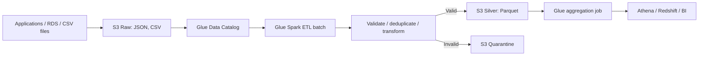

# Glue ETL Jobs with Spark and Batch Data Processing

A data lake typically receives data from many systems with differing formats, schemas, and velocities. Raw data may be JSON from applications, CSV from business systems, Parquet from upstream pipelines, or relational tables read over JDBC. Before data is used for reporting and analytics, organizations must standardize schemas, cleanse records, deduplicate, validate quality, and write outputs to structured storage zones.

AWS Glue provides a managed ETL environment to run Apache Spark without provisioning and operating clusters yourself. A Glue Spark job reads data from Amazon S3, AWS Glue Data Catalog, or JDBC/connector sources; transforms data using DynamicFrames and Spark DataFrames; and writes processed data to S3, databases, or lakehouse tables. Glue Data Catalog stores metadata so Athena, Redshift Spectrum, EMR, and Glue can jointly discover data.

Batch processing fits workloads where data is grouped into time windows or batches, such as hourly orders, end-of-day transactions, reconciliation files, or source system snapshots. A solid batch pipeline must control inputs, bookmarks/incremental processing, safe reruns, data quality, Spark performance, costs, and observability.

## Learning Objectives

After this lesson, you can:

- Explain the roles of AWS Glue, Glue Data Catalog, crawlers, GlueContext, and the Spark runtime.
- Build a batch Glue Spark ETL job using Python/PySpark scripts.
- Choose between DynamicFrame and DataFrame based on processing needs and schema quality.
- Read data from S3/Data Catalog and JDBC, applying partition pruning and pushdown.
- Standardize schemas, handle bad records, deduplicate, and write partitioned Parquet data.
- Use job bookmarks properly and design idempotent outputs.
- Select appropriate Glue versions, worker types, Auto Scaling, Flex, timeouts, and retries.
- Optimize Spark via partitioning, join strategies, file sizing, and bottleneck measurement.
- Secure jobs using IAM, KMS, Secrets Manager, VPC connections, and Lake Formation.
- Orchestrate, monitor, troubleshoot, and control costs of batch pipelines.

## 1. Batch ETL in a Data Lake

ETL stands for **Extract – Transform – Load**:

1. **Extract**: read data from sources such as S3, RDS, external databases, APIs, or file systems.
2. **Transform**: standardize data types, check quality, cleanse, join, aggregate, deduplicate, and apply business rules.
3. **Load**: write results into curated zones, data warehouses, or analytics tables.

In a data lake architecture, data is typically organized into zones:

| Zone | Purpose | Examples |
|---|---|---|
| Raw / Bronze | Preserve data close to source with minimal transformation for replay/auditing | Original JSON/CSV partitioned by arrival date |
| Cleansed / Silver | Standardize schemas, timestamps, data types, and keys | Parquet validated for nulls, formats, and duplicates |
| Curated / Gold | Data modeled for business domains, ready for analytics | Daily revenue table by product and Region |

Example orders pipeline:



Batch ETL processes a bounded dataset on each run. For example, a job runs at 02:00 to process the previous day's files. If late data arrives, the pipeline can rerun a partition or backfill a date range. Distinguish batch from streaming: streaming processes data continuously and typically uses checkpoints; Glue batch job bookmarks are not Spark Structured Streaming checkpoints.

## 2. What Components Make Up AWS Glue?

AWS Glue is a serverless data integration service. In a Spark batch pipeline, common components include:

| Component | Role |
|---|---|
| Glue job | Defines script, runtime, workers, role, timeout, and execution parameters |
| Glue Spark runtime | AWS-managed Apache Spark execution environment |
| GlueContext | Extends SparkContext with Glue DynamicFrames, Catalog, and connectors |
| DynamicFrame | Glue data abstraction supporting heterogeneous schemas and choice types |
| Spark DataFrame | Spark data abstraction with a strict schema leveraging the Spark SQL optimizer |
| Glue Data Catalog | Metadata store for databases, tables, schemas, locations, and partitions |
| Crawler | Scans data sources to infer schemas and partitions, then updates Catalog |
| Connection | Stores network/JDBC connection details or connector configs |
| Job bookmark | Tracks processed source state to support incremental batch runs |
| Trigger / Workflow | Launches jobs on schedules, conditions, or events |
| Glue Data Quality | Evaluates data quality rules using DQDL |

A Glue job runs under an IAM execution role. The role needs permissions to read sources, write targets, access the Catalog, use KMS keys, retrieve secrets, write logs, and create network interfaces if running inside a VPC. Never attach AdministratorAccess just to bypass `AccessDenied` errors.

## 3. Choosing Glue Version and Spark Runtime

The Glue version determines the Apache Spark, Python/Scala, Java, and bundled library versions. It is part of the runtime contract: changing versions can alter Spark SQL behavior, connectors, Python/Java libraries, and serialization.

Per current AWS runtime documentation:

| Glue Version | Apache Spark | Python for Spark Jobs | Java | When to Consider |
|---|---:|---:|---:|---|
| 6.0 | 4.1.1 | 3.13 | 17 | Newer runtime for new jobs after compatibility testing |
| 5.1 | 3.5.6 | 3.11 | 17 | Option when Spark 3.5 and a validated library ecosystem are needed |
| 5.0 | 3.5.4 | 3.11 | 17 | Spark 3.5 baseline for standardized workloads |
| 4.0 | 3.3.0 | 3.10 | 8 | Primarily for legacy jobs needing upgrade runway |

Glue 6.0 is the latest runtime in the version table referenced here. The default Glue version for new jobs can vary over time and by console/API; therefore, production should explicitly pin the Glue version in IaC instead of relying on defaults. Version and worker type availability may vary by Region; verify before deploying.

### Runtime Upgrade Plan

When upgrading Glue versions:

1. Inventory Python modules, Java JARs, JDBC drivers, and custom connectors.
2. Verify compatibility with the new Spark/Python/Java versions.
3. Run unit tests for transforms and integration tests on representative data.
4. Compare schemas, row counts, null rates, duplicate rates, and business totals.
5. Compare execution times, shuffles, memory, worker utilization, and costs.
6. Canary on a single partition or subset of tables before rolling out to full schedules.

Do not check only whether the job reached `SUCCEEDED`. A job can succeed while silently changing outputs due to casts, timestamps, decimal precision, ANSI behavior, or connector libraries.

## 4. Glue Data Catalog and Crawlers

Glue Data Catalog stores metadata, not physical data. A Catalog database is a metadata namespace; a table describes schema, location, input/output formats, SerDe, partition keys, and table properties.

For example, table `raw_orders` may describe data located at:

```text
s3://company-data/raw/orders/
  year=2026/
    month=11/
      day=20/
        part-00001.json
        part-00002.json
```

The Catalog stores schemas for columns such as `order_id`, `customer_id`, `amount`, and `order_ts`, plus partition keys `year`, `month`, and `day`. A Glue Spark job can read the table by database/table name rather than listing raw file paths manually.

### What Do Crawlers Do?

Crawlers connect to sources, scan files or databases, run classifiers if needed, infer schemas, and create/update databases/tables/partitions in the Catalog. Crawlers are useful when onboarding datasets or when schemas/partitions evolve in a controlled way.

A crawler is not mandatory before every ETL run. For production pipelines, you can manage schemas via IaC or update the Catalog inside ETL jobs. Running crawlers continuously over large prefixes can increase discovery time, introduce unexpected schema changes, and slow down pipelines.

### Schema Evolution

When sources add columns, change types, or alter JSON structures, define clear rules:

- Are new columns accepted automatically?
- Does a removed column fail the job or get treated as nullable?
- Does converting `string` to `decimal` require casting and overflow checks?
- Is the raw schema preserved for replay?
- Do curated schemas have versions and migration plans?

Never let crawlers alter curated schemas automatically without review. Use crawlers for discovery; use schema contracts and explicit validation for critical downstream datasets.

## 5. How Does a Spark Job Execute?

A Glue Spark job launches a Spark application consisting of a driver and executors. The driver builds plans, constructs DAGs, coordinates stages/tasks, and collects metadata; executors read, transform, and write data partitions. Spark evaluates lazily: transformations only build an execution plan until an action such as `count`, `collect`, or `write` triggers execution.

Key concepts to understand:

- **Transformation**: `select`, `filter`, `withColumn`, `join`, `groupBy`; usually lazy.
- **Action**: `count`, `show`, `collect`, `write`; triggers computation.
- **Partition**: unit of data processed in parallel.
- **Stage**: group of tasks executed without crossing a shuffle boundary.
- **Shuffle**: data exchange across executors, commonly occurring in `join`, `distinct`, `groupBy`, `repartition`, and `sort`.
- **Skew**: certain partitions holding far more data than others, causing a few tasks to lag.
- **Driver memory**: critical when listing files/partitions, building large plans, or collecting data to the driver.
- **Executor memory/disk**: critical during joins, caching, aggregations, and shuffles.

Adding more workers does not always make a job faster. If the bottleneck is a JDBC source, S3 small files, skew, or driver metadata, more workers may simply increase cost. Measure before scaling.

## 6. DynamicFrame vs. DataFrame

Glue provides DynamicFrame for working with heterogeneous schemas. For example, an `amount` column might be numeric in some records, a string in others, and null in others. DynamicFrame can represent choice types to defer type resolution decisions.

Spark DataFrame has a fixed schema and integrates deeply with the Spark SQL optimizer. For standard SQL transformations, DataFrames are usually more convenient and efficient.

| Criterion | DynamicFrame | Spark DataFrame |
|---|---|---|
| Schema | Flexible, supports choice types | Static/resolved at read time |
| Glue transforms | Supports `ApplyMapping`, `ResolveChoice`, `Relationalize`, and Glue connectors | Uses Spark SQL/DataFrame API |
| Bookmark context | Can use `transformation_ctx` in Glue sources/transforms | Does not natively support Glue bookmark contexts |
| SQL optimizer | Can convert to DataFrame to leverage Spark SQL | Directly uses Catalyst/Tungsten and Spark SQL |
| Best suited for | Semi-structured data, inconsistent schemas, Glue-specific transforms | Joins, aggregations, windows, SQL, and well-defined schemas |

Common conversions:

```python
# DynamicFrame -> Spark DataFrame
df = dynamic_frame.toDF()

# Spark DataFrame -> DynamicFrame
from awsglue.dynamicframe import DynamicFrame
dynamic_frame = DynamicFrame.fromDF(df, glue_context, "curated_frame")
```

When calling `DynamicFrame.fromDF`, column names in the DataFrame must be unique; resolve duplicate column names before converting. When converting a DynamicFrame to a DataFrame, resolve choice types if column types are ambiguous.

### Common Glue Transforms

- `ApplyMapping`: select, rename, or cast columns.
- `ResolveChoice`: decide how to handle choice types, such as casting or keeping structs.
- `DropFields` / `SelectFields`: drop or select fields.
- `Relationalize`: flatten nested structures into relational tables.
- `Filter`: filter records by predicate.
- `errorsAsDynamicFrame`: extract erroring records from certain Glue transforms.
- `stageErrorsCount` / `errorsCount`: retrieve error counts for a stage or transform.

Do not force DynamicFrame usage just because a job runs on Glue. For datasets with well-defined schemas, read a DynamicFrame from the Catalog and convert it to a DataFrame to use `filter`, `join`, `Window`, `groupBy`, and Spark SQL.

## 7. Structure of a Glue Spark Batch Job

A Python script typically follows these steps:

1. Parse job arguments.
2. Create `SparkContext`, `GlueContext`, and `Job`.
3. Call `job.init`.
4. Read sources and apply bookmarks/pushdown where appropriate.
5. Validate schemas and standardize data.
6. Run transformations and data quality checks.
7. Write valid data and quarantine bad records.
8. Call `job.commit` once required steps succeed.

Example skeleton:

```python
import sys
from awsglue.utils import getResolvedOptions
from pyspark.context import SparkContext
from awsglue.context import GlueContext
from awsglue.job import Job

args = getResolvedOptions(sys.argv, ["JOB_NAME"])

sc = SparkContext.getOrCreate()
glue_context = GlueContext(sc)
spark = glue_context.spark_session

job = Job(glue_context)
job.init(args["JOB_NAME"], args)

# Read -> transform -> validate -> write

job.commit()
```

`job.init` and `job.commit` are essential when using job bookmarks. `job.commit` persists bookmark state after the pipeline finishes successfully. If a script omits these calls, bookmarks will not function as expected.

## 8. Reading Data from Amazon S3 via Data Catalog

Reading from the Catalog reuses schema and partition metadata:

```python
orders_dyf = glue_context.create_dynamic_frame.from_catalog(
    database="raw_sales",
    table_name="orders",
    transformation_ctx="orders_source_v1"
)

orders_df = orders_dyf.toDF()
```

If the table has partitions `year`, `month`, and `day`, use `push_down_predicate` to read only needed partitions:

```python
orders_dyf = glue_context.create_dynamic_frame.from_catalog(
    database="raw_sales",
    table_name="orders",
    push_down_predicate="(year == '2026' and month == '11' and day == '20')",
    transformation_ctx="orders_source_v1"
)
```

Pushdown filters partitions before Spark lists and reads files inside those partitions. If a table has a very large number of partitions, `push_down_predicate` may still need to list partition metadata from the Catalog before filtering. You can use `catalogPartitionPredicate` together with Glue Data Catalog partition indexes for server-side partition pruning. These two options target different filtering stages; check the specific source API before configuring.

### Reading Directly from S3

When no Catalog table exists yet or a specific prefix needs reading:

```python
source_dyf = glue_context.create_dynamic_frame.from_options(
    connection_type="s3",
    connection_options={
        "paths": ["s3://company-data/raw/events/"],
        "recurse": True
    },
    format="json",
    transformation_ctx="events_source_v1"
)
```

Direct reads work well for landing paths or temporary data. For long-lived datasets, Catalog tables standardize schemas, partitions, and access control.

## 9. Reading from JDBC Databases

Glue can read databases via a Glue Connection or connection options. Connections store network/JDBC settings and can reference secrets in Secrets Manager.

Example reading a table via a Catalog Connection:

```python
source_dyf = glue_context.create_dynamic_frame.from_options(
    connection_type="postgresql",
    connection_options={
        "useConnectionProperties": "true",
        "connectionName": "sales-postgres-connection",
        "dbtable": "public.orders"
    },
    transformation_ctx="orders_jdbc_source"
)
```

Connection types and options depend on the database/connector. Verify the JDBC driver, URL, TLS, secret, VPC subnets, security groups, and database grants.

### Parallel JDBC Reads

A JDBC source can become a bottleneck if read over a single query/connection. Glue supports parallel reads using `hashfield` or `hashexpression` along with `hashpartitions` for compatible sources.

Conceptual example:

```python
source_dyf = glue_context.create_dynamic_frame.from_options(
    connection_type="postgresql",
    connection_options={
        "useConnectionProperties": "true",
        "connectionName": "sales-postgres-connection",
        "dbtable": "public.orders",
        "hashfield": "order_id",
        "hashpartitions": "8"
    },
    transformation_ctx="orders_jdbc_parallel"
)
```

Pick a field with reasonably even distribution. Too many partitions open many concurrent connections and queries, potentially overloading the source database. With the Spark JDBC reader, `partitionColumn`, `lowerBound`, `upperBound`, and `numPartitions` define parallel read ranges; lower/upper bounds set partitioning strides rather than filtering out rows. If row filtering is needed, use a dedicated query or predicate.

## 10. Standardizing Schemas and Handling Bad Data

CSV/JSON sources often contain inconsistent records. A production pipeline should define a target schema and explicit casting rules.

Example:

```python
from pyspark.sql import functions as F

normalized = (
    orders_df
    .withColumn("order_id", F.trim(F.col("order_id").cast("string")))
    .withColumn("amount", F.col("amount").cast("decimal(18,2)"))
    .withColumn("order_ts", F.to_timestamp("order_ts"))
    .withColumn("region", F.upper(F.trim(F.col("region"))))
    .withColumn("event_date", F.to_date("order_ts").cast("string"))
)
```

Casting can turn invalid values into null or raise errors depending on runtime/configuration. Check for nulls after casting rather than assuming inputs are clean.

### Separating Valid and Rejected Records

```python
bad_condition = (
    F.col("order_id").isNull()
    | F.col("amount").isNull()
    | (F.col("amount") < 0)
    | F.col("order_ts").isNull()
    | F.col("region").isNull()
)

valid_df = normalized.filter(~bad_condition)
reject_df = normalized.filter(bad_condition)
```

Write rejected records to a quarantine zone with metadata such as source path, batch ID, error reason, and ingestion timestamp. Never silently drop invalid records; monitor rejection rates and maintain a fix/replay process.

### Data Quality Definition Language

AWS Glue Data Quality supports defining rules using DQDL, for example:

```text
Rules = [
  IsComplete "order_id",
  IsUnique "event_id",
  ColumnValues "amount" >= 0,
  ColumnValues "currency" in ["USD", "VND", "SGD"]
]
```

Quality can be evaluated inside ETL jobs to catch bad data before loading into curated zones. Data Quality for the Catalog suits ongoing monitoring of registered tables; Data Quality inside ETL jobs checks data mid-pipeline and can emit record-level results for reject handling. Critical business rules still need owner validation and boundary-case testing.

## 11. Joining, Aggregating, and Deduplicating with Spark

The Spark DataFrame API supports SQL operations and window functions.

### Joins

```python
customers = customer_dyf.toDF().select("customer_id", "segment")

enriched = (
    valid_df
    .join(customers, on="customer_id", how="left")
)
```

If the `customers` table is small, consider a broadcast join:

```python
from pyspark.sql.functions import broadcast

enriched = valid_df.join(broadcast(customers), "customer_id", "left")
```

Only broadcast when the table is genuinely small enough to fit in executor memory. Broadcasting overly large tables can trigger out-of-memory failures.

### Aggregations

```python
daily_sales = (
    enriched
    .groupBy("event_date", "region", "currency")
    .agg(
        F.countDistinct("order_id").alias("order_count"),
        F.sum("amount").alias("gross_amount")
    )
)
```

`groupBy`, `distinct`, and joins can trigger shuffles. For large datasets, monitor shuffle read/write, disk spill, task durations, and skew before changing worker counts.

### Deduplicating by Business Key

Do not apply `dropDuplicates()` blindly. When an event has multiple versions, define which record wins—such as the latest update timestamp and highest source sequence. Use `row_number` over a window to select a deterministic winner. Deduplication keys must reflect business semantics, not merely convenient columns.

## 12. Writing Data to S3 and Glue Data Catalog

Parquet is a columnar format well-suited for analytics because it supports column pruning, compression, and embedded schemas. You can write via Spark DataFrame:

```python
(
    daily_sales
    .write
    .mode("overwrite")
    .partitionBy("event_date", "region")
    .option("compression", "snappy")
    .parquet("s3://company-data/curated/daily-sales/")
)
```

Or write a DynamicFrame through a Glue sink:

```python
sales_dyf = DynamicFrame.fromDF(daily_sales, glue_context, "daily_sales")

glue_context.write_dynamic_frame.from_options(
    frame=sales_dyf,
    connection_type="s3",
    connection_options={
        "path": "s3://company-data/curated/daily-sales/",
        "partitionKeys": ["event_date", "region"]
    },
    format="parquet",
    format_options={"compression": "snappy"},
    transformation_ctx="daily_sales_sink"
)
```

`partitionBy`/`partitionKeys` creates a Hive-style directory layout, such as `event_date=2026-11-20/region=SG/`. Choose partitions matching downstream filters. Never partition by `order_id`, `customer_id`, or high-cardinality keys that create excessive small directories/files.

### Updating the Catalog After Writing

You can run a crawler to register partitions after the job, or configure the Glue sink with `enableUpdateCatalog` and `partitionKeys` to add partitions during ETL execution. If allowing schema updates, specify clear behavior; never let jobs unintentionally overwrite Catalog schemas used by consumers.

## 13. Job Bookmarks and Incremental Batches

Job bookmarks persist processed source state so Glue avoids rereading all input on subsequent runs. Bookmarks support JDBC and certain S3 sources; for S3, supported formats include JSON, CSV, Avro, XML, and Parquet/ORC in Glue 1.0+. For S3, bookmarks track object last-modified times. For JDBC, bookmarks use one or more bookmark keys to identify new rows.

### Enabling Bookmarks

In the job configuration, set:

```text
--job-bookmark-option = job-bookmark-enable
```

In the script, call `job.init`, keep `transformation_ctx` stable for bookmarked sources, and call `job.commit` after processing completes.

### Transformation Context

`transformation_ctx` identifies the source/transform state in the bookmark. Changing a source path/table or renaming the context without handling prior state can cause the bookmark to use stale state and miss or reread data. When changing sources, plan a bookmark reset/rewind or create a new job/context.

### Important Limitations

- Bookmarks are not distributed transactions spanning source and sink.
- On S3, objects modified after a prior run may be reprocessed because their last-modified timestamp changed.
- On JDBC, bookmarks default to primary keys only when keys increase/decrease monotonically per Glue rules. When specifying custom bookmark keys, each key must increase or decrease monotonically; gaps are allowed. Bookmarks do not automatically detect updates to existing rows if the bookmark key does not change; use CDC or appropriate watermark/update timestamps.
- Bookmarks do not track or clean up target outputs.
- Resetting/rewinding a bookmark does not delete previously written output files.
- Streaming ETL uses checkpoints, not Glue batch job bookmarks.

Therefore, job bookmarks alone do not guarantee exactly-once processing. Design idempotent sinks using business keys, merge/upsert, deterministic partition overwrites, batch-ID staging prefixes, or transactional table formats. If a retry occurs after writing output but before committing the bookmark, the same input can be reprocessed.

## 14. Designing Idempotent Outputs

A batch pipeline must answer: if the same batch runs twice, will the final output contain duplicates?

Common strategies:

| Strategy | Implementation | Notes |
|---|---|---|
| Deterministic batch path | Write to a prefix determined by batch ID; retries overwrite that exact batch | Requires stable batch IDs and a publish step |
| Partition overwrite | Replace the entire processed date/Region partition | Control Spark overwrite mode and S3 commit behavior |
| Merge/upsert table | Use Iceberg/Hudi/Delta with business keys | Verify Glue version, table format, and transaction semantics |
| Staging + manifest | Write isolated output, validate, then publish manifest/metadata | Consumers read only published batches |
| Downstream deduplication | Write append-only, deduplicate downstream by event ID | Increases query cost and latency |

Never treat S3 `append` plus job bookmarks as exactly-once. With plain Parquet, a retry can create duplicate files. For financial data or order events, prefer staging/publish, partition replacement, or transactional table formats.

## 15. File Formats, Compression, and Partition Layout

| Format | Advantages | When to Use |
|---|---|---|
| CSV | Simple, easy to exchange | Small exports or legacy integrations |
| JSON | Flexible, fits events/documents | Raw landing, evolving schemas |
| Parquet | Columnar, strong compression, explicit schema | Silver/Gold analytics |
| ORC | Columnar, optimized for certain engines/Hive workloads | Compatible Hive/warehouse ecosystems |
| Avro | Row-oriented, schema evolution | Event exchange or pipelines needing a schema registry |

For Parquet, Snappy generally balances speed and size. Zstandard can reduce storage further, though CPU and compatibility must be benchmarked. Choose compression based on consumers, not just the writer job.

### Small Files Problem

Thousands of tiny files inflate listing, planning, and task scheduling overhead. To prevent this:

- Tune partition counts before writing using `repartition` or `coalesce`.
- Write files sized appropriately for the workload; roughly 128–512 MB is a common starting point for benchmarking, not a mandatory rule.
- Run compaction jobs when sources produce many small files.
- For certain input formats like CSV/JSON/XML, Glue supports grouping multiple files into one input partition using `groupFiles` and `groupSize`.

File grouping does not apply to every format; Glue documentation lists formats such as CSV, Ion, GrokLog, JSON, and XML, excluding Avro/Parquet/ORC from that grouping mechanism. When a partition exceeds 50,000 files, Glue may automatically enable grouping for supported cases.

## 16. Optimizing Partition Pruning and Pushdown

Reducing the data read usually yields greater gains than adding workers.

- **Partition pruning**: read only matching partitions by `year/month/day`, `region`, or business dimensions.
- **Pushdown predicates**: push filter conditions down to sources/metadata to reduce files/rows loaded into Spark.
- **Column pruning**: select only required columns.
- **JDBC pushdown**: issue queries/filters that the source database can execute efficiently.
- **Partition indexes**: use Catalog partition indexes for tables with very high partition counts.

Example:

```python
orders = glue_context.create_dynamic_frame.from_catalog(
    database="raw_sales",
    table_name="orders",
    push_down_predicate="(year == '2026' and month == '11')",
    transformation_ctx="orders_source_v1"
)
```

For JDBC, avoid pushing overly complex queries if the source database lacks supporting indexes. Inspect the source database's query and execution plans. A filtered query that triggers a full table scan on the database can still bottleneck the pipeline.

## 17. Optimizing Spark: Joins, Shuffles, and Skew

When a job is slow, identify which stage is slow before tuning settings.

### Join Strategy

- Broadcast small dimension tables to avoid shuffling both sides.
- Use well-distributed join keys.
- Filter and project columns before joining to reduce shuffled data.
- Avoid joining the same dataset repeatedly when results can be reused cleanly.
- Check for duplicate keys in dimension tables; unintended one-to-many joins can inflate row counts.

### Shuffles and Partition Counts

`repartition(n)` triggers a shuffle to redistribute data; `coalesce(n)` typically reduces partitions without a full shuffle. Setting partitions too low leaves executors idle; setting them too high creates tiny tasks and overhead. Measure task duration, shuffle bytes, spill, and executor utilization.

### Data Skew

A key such as `region='UNKNOWN'` or a large tenant can hold most rows, causing a few tasks to run much longer. Mitigate by filtering/normalizing keys, salting, broadcasting dimensions, enabling adaptive query execution, or splitting heavy keys into separate branches.

### Anti-Patterns to Avoid

- Do not call `collect()`/`toPandas()` on large datasets, as it pulls data to the driver.
- Avoid Python UDFs when Spark SQL expressions can perform the same logic.
- Do not cache datasets used only once; caching consumes memory.
- Do not call `count()` repeatedly unless necessary, since each action can trigger another job.
- Do not call `repartition(1)` on large data just to produce a single file.
- Do not run `show()` or debug actions over full production datasets.

## 18. Choosing Workers, Auto Scaling, and Flex

Worker type determines CPU, memory, and local disk. G-type workers are general purpose; R-type workers are memory-optimized. Specs and availability depend on Glue version and Region.

| Worker Type | DPU or M-DPU | vCPU | Memory | Recommendation |
|---|---:|---:|---:|---|
| G.1X | 1 | 4 | 16 GB | Standard batch transforms, moderate data |
| G.2X | 2 | 8 | 32 GB | Larger joins/aggregations |
| G.4X | 4 | 16 | 64 GB | Heavy transforms and shuffles |
| G.8X | 8 | 32 | 128 GB | Large workloads needing high compute/memory |
| R.1X | 1 M-DPU | 4 | 32 GB | Memory-intensive workloads |
| R.2X | 2 M-DPU | 8 | 64 GB | Heavy caching/aggregations |

Start with G.1X/G.2X and measure. Switch to R workers when memory pressure/OOM is observed; scale up G workers when CPU/compute is the bottleneck. G.12X/G.16X and R workers may have higher startup latency and regional availability limits.

### Auto Scaling

Auto Scaling allows Glue to adjust worker counts dynamically based on Spark job demand within configured bounds. Enable it with `--enable-auto-scaling=true` and set maximum workers. Auto Scaling does not fix source bottlenecks, skew, or inefficient queries; monitor actual active worker counts and durations.

### Flex Execution

Flex fits batch jobs that are insensitive to start/completion times. Start and completion times can vary; in return, billing reflects workers actually provisioned during execution. Flex is supported for Glue Spark jobs on version 3.0+, with current worker type restrictions (G.1X/G.2X). Do not choose Flex for pipelines with tight SLAs or downstream consumers requiring strict on-time delivery.

## 19. Job Parameters, Retries, Timeouts, and Concurrency

Pass environment-specific values as job arguments:

- Source database/table or S3 prefix.
- Target path/table.
- Processing date or batch ID.
- Business rule version.
- Environment and log level.

Never pass passwords, tokens, or secrets as arguments because job parameters can appear in configurations and logs. Use Secrets Manager or Glue Connections.

### Retries

Retries help recover from transient errors such as brief network glitches or service throttling. Retries cannot fix schema, permission, or logic errors. Ensure sinks are idempotent before enabling multiple retries.

### Timeouts

Set timeouts based on SLAs and baselines. Current AWS documentation allows up to 7 days (10,080 minutes); for Glue 5.0+, the default timeout if omitted is 480 minutes. Set explicit timeouts so hung jobs do not continue running and accumulating charges.

### Concurrent Runs

Limit concurrent runs to avoid two batches writing to the same partition simultaneously or overloading a shared JDBC table. If a pipeline processes multiple dates in parallel, ensure each run uses isolated partitions/batch IDs with no race conditions in the Catalog or sink.

## 20. Orchestration: Triggers, Workflows, and EventBridge

Glue Triggers can start jobs/crawlers in three main ways:

- **Schedule**: cron or recurring interval.
- **Conditional**: starts when preceding jobs/crawlers reach specified states or conditions.
- **On demand**: invoked manually via console/API/CLI.

Glue Workflows group multiple jobs, crawlers, and triggers into a pipeline. Workflows can start on a schedule, on demand, or from EventBridge events. For example, an S3 object-created event can trigger a workflow when files arrive.

For complex pipelines, AWS Step Functions can orchestrate Glue jobs alongside Lambda, Glue Data Quality, SNS, approvals, and retry policies. Establish a single primary orchestrator so two schedulers never trigger the same batch concurrently.

### Handling Duplicate or Late Events

S3/EventBridge events can be delivered more than once, and event ordering is not guaranteed. Use object keys, version IDs, ETags, or batch manifests as idempotency keys. If data arrives late, define a late-arrival window and partition backfill process. Never assume one event corresponds to exactly one successful run.

## 21. Securing Glue Jobs

### IAM Execution Role

Grant the Glue job role least-privilege permissions for sources and sinks:

- `s3:GetObject`, `s3:ListBucket` for input and script paths.
- `s3:PutObject`, `s3:AbortMultipartUpload` for output/quarantine paths.
- Glue Data Catalog permissions to read tables/partitions and update metadata if required.
- `kms:Decrypt`/`kms:Encrypt`/`kms:GenerateDataKey` for applicable KMS keys.
- `secretsmanager:GetSecretValue` if reading credentials from Secrets Manager.
- Required CloudWatch Logs/metrics permissions.
- Permissions to create/attach network interfaces when running inside a VPC per Glue requirements.

Avoid wildcard resources across all buckets, databases, and keys whenever ARNs or prefixes can be scoped.

### VPC and JDBC Connections

When a job connects to databases in a VPC, configure a Glue Connection, subnets, security groups, and DNS. Security groups must permit traffic to the database port; some Glue configurations require a self-referencing inbound rule for executors to communicate internally. Check routes to NAT or VPC endpoints if the job needs to download packages or call AWS services.

Ensure subnets have enough available IPs for ENIs. IP exhaustion in a subnet can prevent a job from launching even when the database is healthy.

### Encryption and Secrets

- Use SSE-S3 or SSE-KMS for S3 data per policy.
- Use Security Configurations to encrypt CloudWatch logs, S3 outputs, and job bookmarks when required.
- Glue supports only symmetric KMS keys for associated encryption configurations.
- Store database passwords in Secrets Manager/Glue Connections; never hardcode them in scripts.
- Use TLS for JDBC and validate certificate trust.
- Avoid logging raw rows, PII, or secrets in exception traces.

### Lake Formation

If Data Catalog tables are governed by Lake Formation, read/write permissions can be enforced at the database/table/column/row level depending on runtime and table format capabilities. Glue 5.1 added fine-grained access control for Spark DataFrame and Spark SQL writes within supported scopes. Verify Glue version, table format, and access mode before relying on fine-grained permissions; IAM roles alone do not replace Lake Formation grants.

## 22. Monitoring, Logging, and Job Observability

A succeeded job does not prove the output data is valid. Monitor both execution status and output quality.

### CloudWatch Logs

Glue jobs can emit driver/executor logs, stdout/stderr, and continuous logs. In Glue 5.0, default log groups typically include `/aws-glue/jobs/error` and `/aws-glue/jobs/output`; actual configurations can vary by version and job settings. Set appropriate retention, enable encryption if required, and avoid logging sensitive data.

### Job Metrics and Observability Metrics

Enable job metrics/observability metrics to track:

- Bytes read/written from S3 and JDBC.
- Executor/driver memory and CPU.
- Active/completed stages, task duration, and shuffles.
- Skewness, throughput, worker utilization, and disk utilization.
- Job duration, DPUSeconds, worker type, and actual worker counts.

Job Run Insights can analyze common Spark errors and suggest root causes. The Spark UI lets you inspect DAGs, stages, SQL plans, and executors. Protect Spark event logs because they can contain schemas, paths, and queries.

### Essential Alerts

- Job `FAILED`, `TIMEOUT`, `STOPPED`, or SLA breach.
- Missing input partitions or abnormally low row counts.
- Rejection rate exceeding thresholds.
- Missing output partitions or staleness beyond allowed windows.
- Failed replication/bookmark or Catalog updates.
- Sudden spikes in DPUSeconds, worker utilization, or duration.
- Failed data quality rules.

Alerts should include job name, run ID, batch ID, source partition, target path, primary error, and runbook link. Never send raw datasets inside alerts.

## 23. Optimizing Batch ETL Costs

Glue Spark cost depends on worker/DPU or M-DPU type, worker runtime, execution class, and enabled features. Beyond Glue, account for S3 requests/storage, data transfer, KMS, CloudWatch Logs, Catalog, JDBC databases, and downstream queries.

Optimization practices:

- Filter partitions and columns early to reduce scans.
- Use Parquet/ORC and appropriate compression.
- Compact small files and choose reasonable file sizes.
- Avoid unnecessary shuffles, broadcast appropriately sized tables, and address skew.
- Start with smaller workers and scale based on metrics.
- Use Auto Scaling when workloads fluctuate.
- Use Flex for time-insensitive batch jobs.
- Set sensible timeouts, retries, and concurrency limits.
- Avoid running crawlers or full-scan jobs when only a single new partition arrived.
- Track cost per GB processed, cost per batch, and cost per curated record.

Never optimize cost by dropping data quality checks, cutting retries below recoverability, or making non-idempotent appends. Fixing corrupted data and rerunning pipelines can cost far more than compute savings.

## 24. CI/CD and Script Management

Glue job scripts should be managed as source code:

1. Store scripts in Git.
2. Review schema, business logic, and dependency changes.
3. Unit test transform functions with small fixtures using PySpark matching the runtime.
4. Run integration tests against a sandbox S3/Catalog.
5. Package dependencies by Glue version; pin versions rather than installing latest on every run.
6. Deploy scripts/configs via CloudFormation, CDK, or Terraform.
7. Canary the job on one partition before production rollout.
8. Record script version, job configuration, runtime version, and batch ID for traceability.

Glue 5.0+ recommends Python virtual environments for managing Python modules via supported mechanisms; Glue 6.0 offers a service-generated virtual environment option. If `--additional-python-modules` resolves packages from PyPI on every run, upstream releases can alter job behavior. Pin dependencies and test compatibility.

## 25. Complete Example: Orders Batch ETL

Scenario: each day the ordering system writes JSON files to S3 partitioned by `year/month/day`. A Glue job reads one day, standardizes schemas, separates rejects, deduplicates by `event_id`, and writes Parquet to a staging area keyed by `BATCH_ID`.

### Source Data Structure

| Column | Source Type | Target Type | Rules |
|---|---|---|---|
| `event_id` | string | string | Required, unique per event |
| `order_id` | string | string | Required |
| `customer_id` | string | string | Required |
| `amount` | string/number | decimal(18,2) | Non-null, non-negative |
| `currency` | string | string | Normalized to uppercase |
| `order_ts` | string | timestamp | ISO-8601 or agreed format |
| `source_updated_at` | string | timestamp | Used to pick latest version on duplicate events |
| `region` | string | string | Normalized to uppercase |

### PySpark Script

```python
import sys
from datetime import datetime

from awsglue.utils import getResolvedOptions
from awsglue.context import GlueContext
from awsglue.job import Job
from pyspark.context import SparkContext
from pyspark.sql import functions as F
from pyspark.sql.window import Window

args = getResolvedOptions(
    sys.argv,
    [
        "JOB_NAME",
        "SOURCE_DATABASE",
        "SOURCE_TABLE",
        "TARGET_PATH",
        "QUARANTINE_PATH",
        "RUN_DATE",
        "BATCH_ID"
    ]
)

sc = SparkContext.getOrCreate()
glue_context = GlueContext(sc)
spark = glue_context.spark_session

job = Job(glue_context)
job.init(args["JOB_NAME"], args)

# Validate RUN_DATE as ISO-8601 before building the partition predicate.
run_date = datetime.strptime(args["RUN_DATE"], "%Y-%m-%d")
predicate = (
    f"(year == '{run_date:%Y}' and "
    f"month == '{run_date:%m}' and day == '{run_date:%d}')"
)

source_dyf = glue_context.create_dynamic_frame.from_catalog(
    database=args["SOURCE_DATABASE"],
    table_name=args["SOURCE_TABLE"],
    push_down_predicate=predicate,
    transformation_ctx="orders_source_v1"
)

# Resolve choice type before converting to DataFrame (amount may be string or number).
source_dyf = source_dyf.resolveChoice(specs=[("amount", "cast:string")])
source_df = source_dyf.toDF()
required_columns = {
    "event_id", "order_id", "customer_id", "amount", "currency",
    "order_ts", "source_updated_at", "region"
}
missing = required_columns - set(source_df.columns)
if missing:
    raise ValueError(f"Missing required columns: {sorted(missing)}")

normalized = (
    source_df
    .withColumn("event_id", F.trim(F.col("event_id").cast("string")))
    .withColumn("order_id", F.trim(F.col("order_id").cast("string")))
    .withColumn("customer_id", F.trim(F.col("customer_id").cast("string")))
    .withColumn("amount", F.col("amount").cast("decimal(18,2)"))
    .withColumn("currency", F.upper(F.trim(F.col("currency"))))
    .withColumn("order_ts", F.to_timestamp("order_ts"))
    .withColumn("source_updated_at", F.to_timestamp("source_updated_at"))
    .withColumn("region", F.upper(F.trim(F.col("region"))))
    .withColumn("event_date", F.to_date("order_ts").cast("string"))
    .withColumn("processed_at", F.current_timestamp())
)

invalid_condition = (
    F.col("event_id").isNull()
    | F.col("order_id").isNull()
    | F.col("customer_id").isNull()
    | F.col("amount").isNull()
    | (F.col("amount") < F.lit(0))
    | F.col("order_ts").isNull()
    | F.col("source_updated_at").isNull()
    | F.col("region").isNull()
)

valid_df = normalized.filter(~invalid_condition)
reject_df = normalized.filter(invalid_condition)

# Select the latest source_updated_at version for each event_id.
dedup_window = (
    Window.partitionBy("event_id")
    .orderBy(
        F.col("source_updated_at").desc_nulls_last(),
        F.col("order_ts").desc_nulls_last()
    )
)

deduped_df = (
    valid_df
    .withColumn("_row_number", F.row_number().over(dedup_window))
    .filter(F.col("_row_number") == 1)
    .drop("_row_number")
)

# Deterministic prefix by batch ID lets retries overwrite the exact staging batch.
batch_root = f"{args['TARGET_PATH'].rstrip('/')}/_staging/batch_id={args['BATCH_ID']}"
reject_root = f"{args['QUARANTINE_PATH'].rstrip('/')}/batch_id={args['BATCH_ID']}"

(
    deduped_df
    .write
    .mode("overwrite")
    .partitionBy("event_date", "region")
    .option("compression", "snappy")
    .parquet(f"{batch_root}/valid")
)

(
    reject_df
    .write
    .mode("overwrite")
    .option("compression", "snappy")
    .parquet(reject_root)
)

print(
    f"batch_id={args['BATCH_ID']} "
    f"valid_output={batch_root}/valid reject_output={reject_root}"
)

# Commit bookmark only after required outputs have been written successfully.
job.commit()
```

This is a batch staging example. The subsequent publish step should verify row counts, rejection rate, schema, checksums, and business totals before updating the Catalog/manifest or merging into a transactional table. `BATCH_ID` must be stable for the same logical batch; never reuse an ID for different input data. If `source_updated_at` can match exactly, add a deterministic tie-breaker such as source sequence or event version.

Do not call `count()` solely for logging after each write: it triggers another action and may recompute lineage, increasing runtime and cost. If exact row counts are required, use Data Quality results/metrics or persist data carefully before measuring and writing; watch memory pressure when caching. This example focuses on logical flow; production scripts must be benchmarked and tuned for actual data sizes.

### Creating the Glue Job via AWS CLI

Example Glue 6.0 job configuration with G.2X and bookmarks:

```bash
aws glue create-job \
  --name orders-batch-etl \
  --role arn:aws:iam::111122223333:role/GlueOrdersJobRole \
  --command Name=glueetl,ScriptLocation=s3://company-artifacts/glue/orders_batch.py,PythonVersion=3 \
  --glue-version 6.0 \
  --worker-type G.2X \
  --number-of-workers 4 \
  --timeout 120 \
  --max-retries 1 \
  --execution-property MaxConcurrentRuns=1 \
  --default-arguments '{
    "--job-bookmark-option":"job-bookmark-enable",
    "--enable-metrics":"",
    "--enable-observability-metrics":"true",
    "--enable-continuous-cloudwatch-log":"true",
    "--TempDir":"s3://company-artifacts/glue/temp/"
  }' \
  --region ap-southeast-1
```

Confirm Glue 6.0, G.2X, and option availability in your target Region/account before using. Script, TempDir, input, output, and KMS keys must be accessible by the role.

### Starting a Batch Run

```bash
aws glue start-job-run \
  --job-name orders-batch-etl \
  --arguments '{
    "--SOURCE_DATABASE":"raw_sales",
    "--SOURCE_TABLE":"orders",
    "--TARGET_PATH":"s3://company-data/curated/orders/",
    "--QUARANTINE_PATH":"s3://company-data/quarantine/orders/",
    "--RUN_DATE":"2026-11-20",
    "--BATCH_ID":"orders-2026-11-20"
  }' \
  --region ap-southeast-1
```

Monitor `JobRunId` to completion. When rerunning the same logical batch, pass the same `BATCH_ID` to write to the deterministic staging path; then verify bookmark and publish states. Never treat job startup as proof that output has been published.

## 26. Troubleshooting Glue Spark Batch Jobs

| Symptom | Possible Cause | Resolution |
|---|---|---|
| `AccessDenied` when reading S3 | Missing IAM policy, bucket policy, SCP, or KMS key policy permissions | Verify role, ARN/prefix, `kms:Decrypt`, and bucket policy |
| Job fails to initialize ENI | Subnet IP exhaustion, SG/NACL, or missing IAM network interface permissions | Check subnet IPs, routes, SG, and Glue service role |
| JDBC connection timeout | Routing, DNS, SG, database allowlist, or connection config | Test from VPC path; check port and secret/driver |
| `AnalysisException` / column not found | Schema changed, column case mismatch, or stale Catalog | Check actual schema, Catalog table, and mappings |
| Cast produces many nulls | Malformed source data or decimal overflow | Inspect samples, parse formats, quarantine, and schema contract |
| Driver OOM | Too many file/partition metadata entries, `collect`, oversized plan | Use partition pruning, proper S3 file lister/grouping, remove collect, reduce metadata |
| Executor OOM | Large joins/aggregations, excessive caching, skew, or low worker memory | Inspect Spark UI, reduce cache, broadcast properly, fix skew, or switch worker type |
| Single task runs very long | Data skew, oversized partition, or imbalanced JDBC partitions | Check task metrics, apply salting/repartitioning, balance source partitions |
| Slow job due to S3 listing | Too many small files or missing partition pruning | Use partition indexes, pushdown, appropriate file grouping, and compaction |
| Bookmark rereads old files | Missing `transformation_ctx`, changed source/context, or modified object timestamp | Keep source/context stable; check bookmark and sink idempotency |
| Bookmark misses JDBC updates | Bookmark key unchanged on row update | Use CDC or an update timestamp/version key and backfill |
| Duplicate output after retry | Bookmarks do not manage sinks; non-idempotent append sink | Use batch IDs, partition overwrites, merge/upsert, or staging/publish |
| Catalog missing new partitions | Job does not update Catalog or crawler has not run | Use controlled crawlers or `enableUpdateCatalog` |
| Job exceeds timeout | Growing data, skew, retries, or slow dependencies | Compare against baseline, optimize scans/joins, adjust timeout with evidence |
| Job `SUCCEEDED` yet data is wrong | Weak validation, duplicates, timezone issues, or schema drift | Add data quality/business reconciliation and canary checks |

## 27. Hands-On Lab: Building a Raw-to-Curated Pipeline

The goal is to create a Glue Spark job that reads JSON files from S3, standardizes order data, and writes partitioned Parquet.

### Prerequisites

1. A sandbox AWS account and a Region supporting AWS Glue.
2. Two S3 prefixes: `raw/orders/` and `curated/orders/`.
3. Sample JSON data containing `order_id`, `customer_id`, `amount`, `order_ts`, `region`.
4. A Glue database and table in the Data Catalog.
5. An IAM role for the Glue job with S3, Catalog, CloudWatch, and KMS (if used) permissions.

### Steps

1. Upload JSON files to S3 partitioned by `year/month/day`.
2. Run a crawler once to create the raw table, or create the table via IaC.
3. Create a Glue Spark job, selecting Glue version and worker type.
4. Read the source from the Catalog using `from_catalog`.
5. Add a pushdown predicate to read only the target partition.
6. Convert DynamicFrame to DataFrame, cast amount/timestamp, and standardize region.
7. Separate invalid records into quarantine.
8. Write valid records to Parquet partitioned by `event_date`, `region`.
9. Enable job bookmarks, run the first execution, and record the output.
10. Rerun with the same input, observe bookmark behavior, and confirm the sink does not create duplicates.
11. Add new files, rerun, and verify incremental input processing.
12. Test modifying the schema or injecting bad records into the source to validate quality/reject paths.
13. Inspect CloudWatch logs, Glue metrics, Spark UI, and job run details.

### Expected Outcomes

- The job reads only the targeted partitions rather than scanning the full raw dataset.
- Output schema has accurate data types.
- Invalid records are written to quarantine and remain traceable.
- Curated Parquet is partitioned to match query patterns.
- Bookmarks operate reliably with stable source/context settings.
- Retrying the same batch creates no duplicates in the published zone.
- Dashboards/alerts catch job failures, high rejection rates, and stale outputs.

## 28. Common Misconceptions

- **Glue Data Catalog stores data**: the Catalog stores only metadata; actual data resides in S3 or databases.
- **Crawlers are mandatory before every ETL run**: schemas/partitions can be managed via IaC or updated from ETL jobs.
- **DynamicFrame is always better than DataFrame**: DataFrame fits many SQL/join/aggregate operations better once schemas are well-defined.
- **Spark executes immediately after every transformation**: Spark is lazy; actions trigger execution.
- **Adding workers always speeds up jobs**: bottlenecks may be sources, skew, listing, or the driver.
- **Job bookmarks guarantee exactly-once**: bookmarks track source state, not output sinks.
- **Resetting a bookmark deletes old outputs**: resetting/rewinding does not clean up target files.
- **JDBC bookmarks detect every update**: if the bookmark key does not change, row updates may go undetected.
- **More partitions are always better**: overly high partition cardinality creates small files and metadata overhead.
- **Parquet is always the best format for every consumer**: choose formats based on schema, access patterns, and compatibility.
- **Job `SUCCEEDED` means data is accurate**: you still need row counts, quality checks, business invariants, and freshness checks.
- **Retries can be enabled without idempotency**: retrying after a partial sink write can produce duplicates.
- **Glue jobs automatically have VPC/database access**: proper roles, connections, subnets, SGs, routes, and secrets are required.
- **Flex fits jobs with strict deadlines**: start and completion times can vary.

## 29. Production Checklist

Before promoting a Glue Spark batch job to production, confirm:

- [ ] Glue version, Spark/Python versions, and dependencies are explicitly pinned.
- [ ] Scripts are version-controlled and deployed via IaC/CI/CD.
- [ ] Data Catalog schemas/partitions have owners and an evolution workflow.
- [ ] Sources have schema contracts and pre-transform validation.
- [ ] Pushdown/partition pruning limits scans to the batch window.
- [ ] JDBC read parallelism does not overload source databases.
- [ ] DynamicFrame/DataFrame is chosen to fit the use case.
- [ ] Data quality rules and quarantine paths have owners/SLAs.
- [ ] Job bookmarks are enabled on supported sources with stable `transformation_ctx`.
- [ ] Sinks are idempotent with clear batch IDs and publish/commit strategies.
- [ ] Partition layout, compression, and file sizes are benchmarked.
- [ ] Worker type, Auto Scaling, Flex, timeout, retries, and concurrency align with SLAs.
- [ ] Least-privilege IAM, KMS, Secrets Manager, and VPC connections are tested.
- [ ] CloudWatch logs, job metrics, observability metrics, and Spark UI are ready.
- [ ] Alerts include runbooks, owners, job run IDs, and batch IDs.
- [ ] Costs are tracked by job, DPUSeconds, GB processed, and output volume.
- [ ] Plans exist for backfills, late data, replays, and schema rollbacks.
- [ ] Runtime upgrade tests and canaries run before bumping Glue versions.
- [ ] Reconciliation validates business totals and data freshness.
- [ ] Processes clean up staging/temp/quarantine data per approved retention.

## Conclusion

AWS Glue Spark batch jobs combine GlueContext, DynamicFrames, Spark DataFrames, and the Data Catalog to build managed ETL pipelines. Glue handles provisioning and runtime execution; data teams remain responsible for schemas, business rules, data quality, incremental semantics, output idempotency, and operational practices.

Filter data early using partition pruning and pushdown, pick DynamicFrame or DataFrame as needed, tune joins/shuffles from metrics, and write outputs keyed by batch ID or transactional table formats. Job bookmarks track processed inputs, but do not replace sink deduplication. Combined with least-privilege IAM, quality checks, observability, orchestration, and CI/CD, batch pipelines can run safely, control costs, and reliably serve analytics workloads.

## References

- [AWS Glue Developer Guide](https://docs.aws.amazon.com/glue/latest/dg/what-is-glue.html)
- [AWS Glue versions and release notes](https://docs.aws.amazon.com/glue/latest/dg/release-notes.html)
- [Configuring job properties for Spark jobs](https://docs.aws.amazon.com/glue/latest/dg/add-job.html)
- [AWS Glue worker types](https://docs.aws.amazon.com/glue/latest/dg/worker-types.html)
- [Using Auto Scaling for AWS Glue](https://docs.aws.amazon.com/glue/latest/dg/auto-scaling.html)
- [Using job parameters in AWS Glue jobs](https://docs.aws.amazon.com/glue/latest/dg/aws-glue-programming-etl-glue-arguments.html)
- [AWS Glue Data Catalog and crawlers](https://docs.aws.amazon.com/glue/latest/dg/catalog-and-crawler.html)
- [Using crawlers to populate the Data Catalog](https://docs.aws.amazon.com/glue/latest/dg/add-crawler.html)
- [DynamicFrame class](https://docs.aws.amazon.com/glue/latest/dg/aws-glue-api-crawler-pyspark-extensions-dynamic-frame.html)
- [GlueContext class](https://docs.aws.amazon.com/glue/latest/dg/aws-glue-api-crawler-pyspark-extensions-glue-context.html)
- [Connection types and options for Spark ETL](https://docs.aws.amazon.com/glue/latest/dg/aws-glue-programming-etl-connect.html)
- [Tracking processed data using job bookmarks](https://docs.aws.amazon.com/glue/latest/dg/monitor-continuations.html)
- [Using job bookmarks](https://docs.aws.amazon.com/glue/latest/dg/programming-etl-connect-bookmarks.html)
- [Managing partitions for ETL output](https://docs.aws.amazon.com/glue/latest/dg/aws-glue-programming-etl-partitions.html)
- [Optimizing reads with pushdown](https://docs.aws.amazon.com/glue/latest/dg/aws-glue-programming-pushdown.html)
- [Reading input files in larger groups](https://docs.aws.amazon.com/glue/latest/dg/grouping-input-files.html)
- [Reading from JDBC tables in parallel](https://docs.aws.amazon.com/glue/latest/dg/run-jdbc-parallel-read-job.html)
- [AWS Glue Data Quality](https://docs.aws.amazon.com/glue/latest/dg/glue-data-quality.html)
- [AWS Glue triggers](https://docs.aws.amazon.com/glue/latest/dg/about-triggers.html)
- [Overview of workflows in AWS Glue](https://docs.aws.amazon.com/glue/latest/dg/workflows_overview.html)
- [Monitoring with AWS Glue observability metrics](https://docs.aws.amazon.com/glue/latest/dg/monitor-observability.html)
- [Monitoring with AWS Glue job run insights](https://docs.aws.amazon.com/glue/latest/dg/monitor-job-insights.html)
- [Logging for AWS Glue jobs](https://docs.aws.amazon.com/glue/latest/dg/monitor-continuous-logging.html)
- [Setting up encryption in AWS Glue](https://docs.aws.amazon.com/glue/latest/dg/set-up-encryption.html)
- [Using Python libraries with AWS Glue](https://docs.aws.amazon.com/glue/latest/dg/aws-glue-programming-python-libraries.html)
