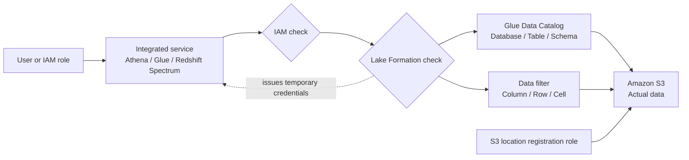

# Lake Formation and Fine-Grained Data Permissions

AWS Lake Formation provides centralized governance over access permissions for data lakes stored on Amazon S3 and described in the AWS Glue Data Catalog. Instead of granting entire-bucket read access to every user, you can grant permissions by database, table, column, and row-filter condition. This approach is helpful when multiple teams share a dataset yet each team should see only the slice of data appropriate to its role.

In the AWS ecosystem, AWS Glue Data Catalog stores metadata such as databases, tables, schemas, and data locations; Amazon S3 stores the actual data files; Athena, AWS Glue, and other analytics services read data through that metadata. Lake Formation sits in the middle of this flow to manage permissions at the data lake layer. Lake Formation does not replace IAM: a request generally must pass both IAM evaluation and Lake Formation permission checks to succeed.

## Learning Objectives

After this lesson, you can:

- Explain the relationship between IAM, Lake Formation, Glue Data Catalog, and Amazon S3.
- Distinguish metadata permissions, data access permissions, and data location permissions.
- Grant table-, column-, row-, and cell-level permissions using named resources and data filters.
- Use LF-Tags to manage permissions across large numbers of resources.
- Choose hybrid access mode when gradually migrating from IAM-based access to Lake Formation.
- Share Data Catalog resources across AWS accounts and troubleshoot common permission errors.

## 1. Where Does Lake Formation Fit in a Data Lake Architecture?

A data lake typically ingests multiple data sources into S3, uses crawlers or ETL processes to register metadata in the Glue Data Catalog, and serves queries via Athena or other analytics engines. Lake Formation governs who can see metadata and who can read or write the underlying data behind that metadata.



General workflow:

1. An administrator registers an S3 bucket or prefix with Lake Formation and designates an IAM role authorized to access that location.
2. A data engineer creates databases, tables, or partitions in the Glue Data Catalog.
3. The administrator grants Lake Formation permissions to IAM users, IAM roles, or supported principals.
4. A user runs a query through an integrated service. The service checks IAM and Lake Formation; when needed, Lake Formation issues temporary credentials allowing the service to access S3 using the registered role.

Lake Formation enforces permissions per Region. If the same data lake spans multiple Regions, manage corresponding permissions in each Region.

## 2. Two Control Layers: IAM and Lake Formation

The two systems have distinct scopes of responsibility:

| Control Layer | Role | Examples |
|---|---|---|
| IAM | Permits principals to call AWS APIs and use services | `athena:StartQueryExecution`, `glue:GetTable`, `lakeformation:GetDataAccess` |
| Lake Formation | Determines what a principal can do with data lake resources | `DESCRIBE` database, `SELECT` table, `DATA_LOCATION_ACCESS` on S3 location |
| Amazon S3 and KMS | Directly protects objects, buckets, and encryption keys | Bucket policies, S3 IAM actions, KMS key decrypt permissions |

For example, an analyst may hold `SELECT` on `sales.orders` in Lake Formation, yet if their IAM policy denies `glue:GetTable` or `lakeformation:GetDataAccess`, queries can still fail. Conversely, an IAM policy allowing Glue API calls does not automatically grant `SELECT` on a table governed by Lake Formation.

For registered S3 locations, Lake Formation uses the location registration role to vend temporary access credentials to integrated services. Querying principals also need the IAM permission `lakeformation:GetDataAccess`; Athena requires this on the calling principal, whereas some integrated services require it on their execution role.

One security boundary to keep in mind: Lake Formation permissions do not automatically block all direct S3 access paths. If an IAM policy or bucket policy still allows a principal to call S3 APIs directly, that principal can read objects outside Lake Formation's query-engine controls. Audit direct S3 permissions and allow only intended access paths.

## 3. Permission Groups in Lake Formation

Lake Formation manages three common permission groups. They serve different purposes and should not be granted interchangeably.

| Permission Group | Resource | Typical Permissions | Meaning |
|---|---|---|---|
| Data Catalog permissions | Catalog | `CREATE_DATABASE`, `DESCRIBE` | Create databases or view catalog info |
| Data Catalog permissions | Database | `CREATE_TABLE`, `ALTER`, `DROP`, `DESCRIBE` | Create tables, edit metadata, drop database, or inspect database metadata |
| Data Catalog permissions | Table or view | `SELECT`, `INSERT`, `DELETE`, `ALTER`, `DROP`, `DESCRIBE` | Read/write data or manage metadata of tables and views |
| Data location permissions | Registered S3 bucket or prefix | `DATA_LOCATION_ACCESS` | Allows creating or modifying metadata pointing to that S3 location |

### 3.1 Metadata Permissions and Data Permissions

`DESCRIBE` permits viewing database or table metadata. It does not grant permission to query data. Users may see table names and schemas yet still fail to run queries without `SELECT`.

`SELECT`, `INSERT`, and `DELETE` are table permissions affecting underlying data. Specifically, `SELECT` permits reading data; `INSERT` permits adding data; `DELETE` permits deleting data. Actual execution also depends on the integrated service and matching IAM permissions.

`ALTER`, `DROP`, and `CREATE_TABLE` primarily govern metadata operations. `CREATE_TABLE` is granted on a database because it permits creating tables inside that database. Table creators also need appropriate data location permissions if the table points to a Lake Formation-managed S3 location.

### 3.2 Data Location Permission `DATA_LOCATION_ACCESS`

This permission controls which principals may create or alter databases/tables referencing a registered S3 location. It is not an object-read permission and does not replace `SELECT` or `INSERT` on a table.

For example, a data engineer has `CREATE_TABLE` on database `sales`, but should only create tables under `s3://company-lake/sales/`. Lake Formation can grant `DATA_LOCATION_ACCESS` on that prefix to constrain where metadata may point. Location permissions are granted on buckets or prefixes, not individual S3 objects.

To access data in a registered location, the flow generally requires all of the following:

- The S3 location is registered with Lake Formation.
- The role registering the location has required S3 permissions on that path.
- The principal holds Lake Formation permissions on the table, such as `SELECT` or `INSERT`.
- The principal or execution role holds IAM permission `lakeformation:GetDataAccess` when required by the service.
- S3, KMS, and organizational policies do not block the required actions.

### 3.3 Grant Option and Administrative Permissions

When granting a permission, the grantor can include `grant option`. The recipient is then allowed to delegate that permission to other principals. Grant this capability only to teams responsible for permission administration.

A data lake administrator is a principal designated in Lake Formation settings with administrative authority over the data lake, including granting permissions. This differs from holding `Super` on a specific database or table. An administrator added after resources already exist does not automatically hold `SELECT` or `DESCRIBE` on pre-existing resources; grant appropriate data access permissions when they genuinely need to query data.

## 4. Fine-Grained Permissions by Column, Row, and Cell

Lake Formation supports data filters when granting `SELECT` on a table. A data filter defines which columns are visible and which rows may appear in query results. Filters can also target nested column structures where supported by the query engine.

| Control Type | How It Works | Example |
|---|---|---|
| Table-level | Grants full table read access | Analysts can query all of `sales.orders` |
| Column-level | Includes or excludes specific columns | Analysts cannot view `customer_email` |
| Row-level | Returns only rows matching a predicate | APAC team sees only orders with `region = 'APAC'` |
| Cell-level | Combines row predicates and column selection | Certain columns are visible only for rows matching a condition |

Data filters apply only to reads, so the permission granted with a filter is `SELECT`. Do not use data filters to control `INSERT`, `DELETE`, `ALTER`, or `DROP`.

### 4.1 Example: Restricting Data by Region

Suppose table `sales.orders` has columns:

| Column | Content |
|---|---|
| `order_id` | Order ID |
| `order_date` | Order date |
| `region` | Business region |
| `product` | Product |
| `amount` | Order value |
| `customer_email` | Customer email |

The APAC analyst team needs to view orders in the APAC region without seeing customer emails. A data filter can be defined as follows:

```json
{
  "TableCatalogId": "111122223333",
  "DatabaseName": "sales",
  "TableName": "orders",
  "Name": "apac_analyst",
  "RowFilter": {
    "FilterExpression": "region = 'APAC'"
  },
  "ColumnNames": [
    "order_id",
    "order_date",
    "region",
    "product",
    "amount"
  ]
}
```

In this configuration, `RowFilter` restricts rows where `region` equals `APAC`; `ColumnNames` lists visible columns. Because `customer_email` is excluded, queries run by principals using this filter will not return that column. Row expressions use the PartiQL syntax supported by Lake Formation, not arbitrary full SQL syntax.

After creating the data filter, grant `SELECT` on that filter. Example with AWS CLI:

```bash
aws lakeformation grant-permissions \
  --principal DataLakePrincipalIdentifier=arn:aws:iam::111122223333:role/RegionalAnalyst \
  --resource '{"DataCellsFilter":{"TableCatalogId":"111122223333","DatabaseName":"sales","TableName":"orders","Name":"apac_analyst"}}' \
  --permissions SELECT
```

Account IDs, role ARNs, and table names in examples are illustrative; replace them with your environment's actual resources. A data filter is scoped to a specific Data Catalog table. Multiple filters can be created on the same table to serve different user groups.

### 4.2 Distinguishing Row-Level and Cell-Level

If a filter allows all columns while selecting a subset of rows, that is row-level security. If a filter allows all rows while selecting a subset of columns, that is column-level security. When a filter restricts both rows and columns, that is cell-level security.

For example, HR may view addresses for employees in the United States, but only basic profile attributes for employees in the United Kingdom. Such rules combine row predicates on `country` with column inclusion lists. Verify query engine support before deploying complex filters, especially on nested columns.

## 5. Two Metadata Permission Models: Named Resource and LF-TBAC

Lake Formation provides two primary ways to bind permissions to Data Catalog resources.

### 5.1 Named Resource

Named resource permissions grant access directly on specified databases, tables, or sets of tables. This is straightforward when resource counts are small and access requirements are explicit.

Example granting read access to the entire `sales.orders` table for an analyst role:

```bash
aws lakeformation grant-permissions \
  --principal DataLakePrincipalIdentifier=arn:aws:iam::111122223333:role/SalesAnalyst \
  --resource '{"Table":{"DatabaseName":"sales","Name":"orders"}}' \
  --permissions SELECT
```

To revoke the corresponding permission:

```bash
aws lakeformation revoke-permissions \
  --principal DataLakePrincipalIdentifier=arn:aws:iam::111122223333:role/SalesAnalyst \
  --resource '{"Table":{"DatabaseName":"sales","Name":"orders"}}' \
  --permissions SELECT
```

Named resources work well for a few explicit exceptions. When table counts grow rapidly, granting and revoking permissions resource by resource becomes difficult to maintain.

### 5.2 Lake Formation Tag-Based Access Control (LF-TBAC)

LF-TBAC uses key-value attributes called LF-Tags to describe resources and construct permission policies. For example:

```text
domain = finance
classification = confidential
environment = production
```

Administrators attach LF-Tags to databases, tables, or columns, then grant permissions to principals based on tag expressions. Principals holding permissions on matching tag values gain access to the corresponding resources.

For example, the `FinanceAnalyst` role is granted read access to resources tagged `domain=finance` and `classification=internal`. When a new table receives matching tags, tag-based policies apply automatically without creating separate per-table grants.

Key points to remember:

- Tables can inherit LF-Tags from databases; columns can inherit LF-Tags from tables. Inherited values can be overridden when needed.
- Within an LF-Tag expression, different keys are combined with logical `AND`; multiple values for the same key can be combined with logical `OR`.
- LF-Tags are governance metadata specific to Lake Formation permissions. They are not the same as AWS resource tags or S3 object tags.
- Separate permissions should govern who creates tags, who attaches tags to resources, and who grants permissions via tag expressions.

LF-TBAC scales well when a data lake has many databases, tables, views, and columns, or when permissions align with domains, data classification levels, or business units. Named resources remain useful for small exceptions and direct resource grants. When both approaches are used together, a principal's effective permissions are the union of grants from both models; audit legacy grants whenever changing permission models.

## 6. Hybrid Access Mode During Migration

Many data lakes already rely on IAM policies for Glue and S3 before adopting Lake Formation. Enabling Lake Formation enforcement across the board can disrupt existing workloads if permissions have not been reviewed. Hybrid access mode lets you selectively opt in principals and resources to Lake Formation incrementally.

Hybrid access mode operates with two paths:

- Opted-in principals on a resource: must satisfy both Lake Formation permissions and relevant IAM permissions.
- Non-opted-in principals: continue accessing via IAM policies for AWS Glue and S3 as before.

When registering an S3 location in hybrid mode, Lake Formation enforces certain permissions such as `CREATE_TABLE`, `CREATE_PARTITION`, and `UPDATE_TABLE` by default. Opted-in principals use Lake Formation permissions on the selected databases or tables; other principals continue using the IAM path.

A typical migration workflow:

1. Inventory existing workloads, principals, IAM policies, and Data Catalog resources.
2. Register S3 locations in hybrid access mode.
3. Grant Lake Formation permissions for the target principals and resources being migrated.
4. Opt in the specific principal/resource pairs to enforce Lake Formation.
5. Test with the actual workload roles before tightening legacy IAM policies.
6. Monitor access errors and expand opt-in scope wave by wave.

Do not remove `IAMAllowedPrincipals` permissions blindly before understanding active workloads. For resources fully governed by Lake Formation, review and configure default permissions so `IAMAllowedPrincipals` does not retain unintended `Super` privileges. Under hybrid mode, that group may still be required for the IAM access path of non-opted-in principals.

## 7. Sharing Data Across AWS Accounts

Lake Formation supports sharing databases and tables with other AWS accounts, AWS Organizations, organizational units, or IAM principals in external accounts. When granting cross-account permissions on Data Catalog resources, Lake Formation uses AWS Resource Access Manager (AWS RAM) to create resource shares.

If the recipient account belongs to the same Organization, the resource share can become available immediately. If outside the Organization, AWS RAM sends an invitation for the recipient account to accept or decline. Once accepted, the recipient account's data lake administrator can grant permissions to internal principals according to the shared model.

Two cross-account granting approaches:

- Named resource: specify exact databases or tables to share.
- LF-TBAC: share using LF-Tag expressions; well-suited for managing many resources across multiple accounts.

Services such as Athena and Redshift Spectrum typically require a resource link in the recipient account's Data Catalog pointing to the shared resource. A resource link is a metadata reference; it does not grant data access by itself. Principals still need appropriate permissions on the resource link, the shared resource, and the underlying APIs.

When implementing cross-account sharing, verify Lake Formation cross-account version settings, AWS RAM configuration, grant options, recipient administrator permissions, and opt-in status if using hybrid access mode. Never assume metadata sharing alone satisfies every S3 or KMS access requirement.

## 8. Secure Permission Implementation Workflow

A practical workflow for a new data lake:

1. **Identify principals and roles.** Separate data lake administrators, data engineers, analysts, and workload execution roles.
2. **Register S3 locations.** Select buckets or prefixes, designate registration roles, and scope each role's S3 permissions to only what is required.
3. **Configure Data Catalog.** Create databases/tables and define owners, data locations, schemas, and data classifications.
4. **Choose a permission model.** Use named resources for small counts; use LF-TBAC when resources are tag-classified and continually growing.
5. **Apply least privilege.** Analysts usually need only `DESCRIBE` and `SELECT`; data engineers need metadata creation/alter permissions and appropriate location access.
6. **Apply filters.** Create data filters to restrict columns, rows, or cells when a single table serves multiple groups.
7. **Audit IAM and S3 paths.** Ensure principals have necessary API permissions while eliminating unintended direct S3 access paths.
8. **Test and monitor.** Run queries using actual workload roles, verify returned data, review grants, and use AWS CloudTrail to audit related activity.

### Reference Permission Matrix

| Role | Typical Lake Formation Permissions Needed | Notes |
|---|---|---|
| Data lake administrator | Lake Formation admin permissions and IAM permissions for admin operations | Must be designated in Lake Formation settings |
| Data engineer | `CREATE_TABLE`, `ALTER`, `DESCRIBE`, `DATA_LOCATION_ACCESS`, and ETL-required grants | Scope S3 locations by domain |
| Data analyst | `DESCRIBE`, `SELECT`, and data filters if required | Do not grant `INSERT` or `DELETE` for read-only analysts |
| ETL execution role | Appropriate table read/write grants and IAM API permissions | Verify KMS permissions if data uses customer managed keys |

This is a starting matrix, not a universal policy for every workload. Tailor permissions to actual operations and execution engines.

## 9. Diagnosing Permission Errors

When Athena or AWS Glue raises `AccessDeniedException`, inspect layer by layer:

| Symptom | Points to Check |
|---|---|
| Database or table not visible | `DESCRIBE` in Lake Formation, `glue:GetDatabase`/`glue:GetTable` in IAM, active Region |
| Table visible but cannot query | `SELECT`, data filters, `lakeformation:GetDataAccess`, Athena permissions, and opt-in status |
| Holds `CREATE_TABLE` yet table creation fails | `DATA_LOCATION_ACCESS`, registered S3 location, `glue:CreateTable`, and location registration role |
| Only partial rows or columns appear | Row filters, included/excluded column lists, and filter expressions |
| Principal can query yet direct S3 read fails | This may be expected behavior; verify whether direct access is supposed to be allowed |
| Cross-account access fails | AWS RAM share/invitation, grant options, resource links, recipient permissions, and cross-account version settings |
| Only legacy workloads fail after enabling Lake Formation | `IAMAllowedPrincipals`, hybrid opt-in status, and pre-migration IAM policies |

Always test permissions using the exact IAM role used by the application. Testing as an administrator can mask errors because administrators may hold broader privileges than workload principals.

## 10. Design Principles to Remember

- Grant least-privilege permissions per role and per required resource.
- Use `DESCRIBE` for metadata discovery; grant `SELECT` only when a principal genuinely needs to read data.
- Use data filters when multiple groups share one table but need different column or row visibility.
- Use LF-TBAC to reduce manual grants in large data lakes; manage tag lifecycles as part of your data classification model.
- Restrict direct S3 permissions so users cannot bypass Lake Formation policies.
- Review `IAMAllowedPrincipals` and choose full Lake Formation mode or hybrid access mode based on current workloads.
- Test both the query path and data access path, covering IAM, Lake Formation, S3, KMS, and cross-account sharing.

## References

- [Overview of Lake Formation permissions](https://docs.aws.amazon.com/lake-formation/latest/dg/lf-permissions-overview.html)
- [Lake Formation permissions reference](https://docs.aws.amazon.com/lake-formation/latest/dg/lf-permissions-reference.html)
- [Underlying data access control](https://docs.aws.amazon.com/lake-formation/latest/dg/access-control-underlying-data.html)
- [Data filtering and cell-level security](https://docs.aws.amazon.com/lake-formation/latest/dg/data-filtering.html)
- [Lake Formation tag-based access control](https://docs.aws.amazon.com/lake-formation/latest/dg/tag-based-access-control.html)
- [Hybrid access mode](https://docs.aws.amazon.com/lake-formation/latest/dg/hybrid-access-mode.html)
- [Cross-account data sharing](https://docs.aws.amazon.com/lake-formation/latest/dg/cross-account-permissions.html)
