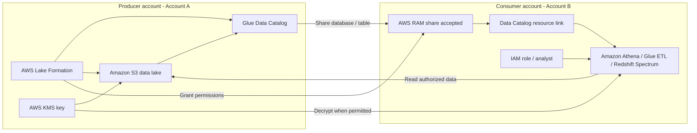

# Cross-Account Data Sharing and Access Governance

A data lake is often split across multiple AWS accounts to separate environments, data-owning teams, and operational responsibilities. A data account may store sales, financial, or customer data; an analytics account needs to query those datasets with Athena, AWS Glue ETL, or Amazon Redshift Spectrum. Granting read access to an entire S3 bucket exposes more data than necessary. Sharing only metadata in AWS Glue Data Catalog without the underlying data permissions still causes queries to fail.

AWS Lake Formation provides a centralized data lake governance model enabling permissions on databases, tables, columns, and filtered rows. When sharing Data Catalog resources across accounts, Lake Formation uses AWS Resource Access Manager (AWS RAM) to establish resource shares. The recipient account creates resource links in its own Data Catalog so tools such as Athena or Redshift Spectrum can query the shared resources. Metadata access, S3 data read permissions, KMS permissions, and query execution permissions must all be coordinated properly.

In the AWS ecosystem, cross-account sharing helps organizations separate data producers from data consumers, enforce least privilege, enable self-service analytics, and preserve data ownership. This lesson focuses on AWS Lake Formation, AWS Glue Data Catalog, AWS RAM, Amazon S3, IAM, AWS KMS, and analytics engines consuming shared data.

## Learning Objectives

After this lesson, you can:

- Distinguish Lake Formation data sharing from direct access via IAM, Glue resource policies, and S3 bucket policies.
- Design producer account and consumer account models, including administrative roles and data ownership.
- Choose between named-resource sharing and Lake Formation tag-based access control (LF-TBAC).
- Explain the role of AWS RAM, resource links, and the resource share acceptance workflow.
- Grant database, table, column, row, and data location permissions following least privilege.
- Understand `IAMAllowedPrincipals`, Lake Formation mode, and hybrid access mode when transitioning governance models.
- Coordinate IAM, S3 bucket policies, Lake Formation, and KMS key policies to query encrypted data cross-account.
- Test, monitor, revoke permissions, and troubleshoot access errors in multi-account data lakes.

## Cross-Account Data Sharing Model

A common model has two roles:

- **Producer account (data-owning account):** stores objects in S3, owns the Glue Data Catalog, manages Lake Formation permissions, and decides who can use datasets.
- **Consumer account (data-consuming account):** holds IAM roles for analysts, Athena workgroups, Glue ETL jobs, or Redshift workgroups; receives shared permissions and creates resource links to access datasets.



The diagram shows logical relationships. Data remains in the producer account's bucket; Lake Formation shares metadata and access permissions. When consumers query, engines must hold the required permissions to read source data through supported integrations. Creating a RAM share or resource link does not automatically grant all IAM, S3, KMS, or Athena execution permissions.

### Separation of Responsibilities

| Role | Primary Responsibilities |
|---|---|
| Data lake administrator in producer | Configures Lake Formation, registers data locations, approves sharing grants, and manages catalog |
| Data owner / steward | Defines data classification, intended use, shareable columns/rows, and access duration |
| Consumer account administrator | Accepts RAM shares, creates resource links, and distributes permissions to internal principals |
| Analyst / ETL role | Queries or processes data within granted permissions |
| Security / audit | Audits IAM, bucket/KMS policies, CloudTrail, Lake Formation grants, and revocation procedures |

The data owner should decide who has access and which data is shared. Consumer accounts manage their own internal users, but cannot expand data access beyond the scope granted by the producer.

## Permission Layers That Must Align

Cross-account data queries succeed only when all required control layers permit the operation. A useful way to analyze access is to split permissions into four layers:

1. **Identity and API permissions:** the user/engine IAM role is allowed to call the necessary Athena, Glue, Lake Formation, S3, and KMS APIs.
2. **Catalog permissions:** `DESCRIBE`, `SELECT`, and other database/table/column permissions managed by Lake Formation or Glue Data Catalog resource policies depending on the model.
3. **Storage permissions:** permissions to read objects and list prefixes in S3, typically enforced by Lake Formation through the data access role when locations are registered; direct IAM models may require IAM and bucket policies in both accounts.
4. **Encryption permissions:** if objects use SSE-KMS, the accessing role must be permitted to use the corresponding key; the key policy in the key-owning account must allow it.

An IAM `Allow` policy does not automatically override a Lake Formation denial. Conversely, a Lake Formation grant does not create permission to run Athena or write query results to a consumer's bucket. Check each layer individually when investigating `AccessDenied`.

## Sharing with AWS Lake Formation

Lake Formation provides a `GRANT`/`REVOKE` model for Data Catalog resources. You can share a database, one table, multiple tables, or all tables in a database. For tables, data filters can restrict access to specific columns or rows.

The two primary methods for sharing catalog resources are:

| Method | How Shared Resources Are Identified | When Appropriate |
|---|---|---|
| Named resources | Select specific databases/tables and grant to target accounts or principals | Infrequently changing datasets needing exact per-resource control |
| LF-TBAC (Lake Formation tag-based access control) | Attach LF-Tags to databases/tables/columns and grant by tag expression | Many datasets, many consumers, and classification-driven governance |

Lake Formation cross-account sharing uses AWS RAM. If the recipient account belongs to the same AWS Organization and RAM sharing is enabled, resources can become available without manually accepting an invitation. If the account is outside the Organization, RAM generally sends an invitation; the recipient's data lake administrator must accept it before using the share.

### Named-Resource Sharing

Named-resource sharing fits when the producer knows exactly which databases or tables to share. For example, Account A grants `DESCRIBE` on database `sales_curated` and `SELECT` on table `orders` to Account B. If the consumer needs to delegate permissions internally within the permitted scope, the producer can grant the corresponding grant option; grant this only when governance clearly requires it.

Common permissions:

- `DESCRIBE`: view database/table metadata.
- `SELECT`: read table data; can combine with data filters to restrict columns/rows.
- `CREATE_TABLE`: create tables in a database when needed and permitted.
- `ALTER`, `DROP`: modify or delete metadata; do not grant to read-only analysts.
- `DATA_LOCATION_ACCESS`: allows creating catalog resources pointing to a registered S3 location under matching conditions.

Permission names and scopes depend on resource type. Holding `SELECT` on a table does not imply `DROP` or `ALTER` on the database.

### LF-TBAC: Attribute-Based Governance

LF-TBAC attaches LF-Tag key/value pairs to catalog resources and grants permissions based on tag expressions. For example:

```text
classification = public | internal | confidential | restricted
domain         = sales | finance | customer | operations
environment    = production | nonproduction
```

A policy can grant read access to role `FinanceAnalyst` on tables with `domain=finance` and `classification=internal`. When a new table receives matching LF-Tags, it inherits permissions via the expression without manual per-table grants.

LF-Tags do not replace data owner reviews. Mistakenly attaching `classification=public` can unintentionally broaden access. Control who can create, edit, attach, and remove LF-Tags; enforce mandatory tags; monitor tag drift; and test permissions after every change.

LF-TBAC supports sharing with AWS accounts, Organizations, and organizational units (OUs). Some cross-account sharing capabilities for Organizations/OUs depend on Cross-account version settings; verify current version requirements before configuring. Per current AWS documentation, LF-TBAC sharing with Organizations/OUs requires cross-account version 3 or higher; sharing resources in hybrid access mode and federated catalogs requires version 4.

### Sharing Directly with External IAM Principals

Lake Formation supports granting directly to IAM roles/users in another account, in addition to account-level grants. This helps when the producer wants to specify the exact role receiving access rather than the entire recipient account. Principals receiving direct grants cannot further share those resources with other principals.

Use specific principal ARNs rather than granting to an entire account when only one workload needs the data. Consumers still need appropriate IAM permissions to invoke related services.

### No Transitive Sharing

Lake Formation cross-account sharing is not transitive. If Account A shares a table with Account B, Account B cannot re-share that table with Account C. Producer A must grant directly to C, or B must build a new data product owned by B. This rule keeps sharing authority with the data-owning account.

## AWS RAM and Resource Links

### Role of AWS RAM

AWS RAM manages resource shares between accounts. When a producer grants a catalog resource via Lake Formation, the service creates or updates the corresponding RAM share. The recipient account can inspect invitations, accept shares, and view shared resources.

General workflow:

1. Producer creates a Lake Formation grant for the target account or principal.
2. Lake Formation uses RAM to share the Glue Data Catalog resource.
3. If needed, the recipient account accepts the RAM invitation.
4. The shared database/table appears in the recipient's catalog view.
5. The recipient creates a resource link pointing to the shared database/table.
6. The recipient grants `DESCRIBE` on the resource link and required permissions on the shared resource to internal IAM principals.
7. Analysts or engines query via the resource link.

### What Is a Resource Link?

A resource link is a metadata object in the recipient's Data Catalog pointing to a database or table residing in another account's catalog. It acts like a logical pointer; it does not copy S3 objects or duplicate tables.

Example:

```text
Producer account A:
  catalog A
    database: sales_curated
      table: orders

Consumer account B:
  catalog B
    database: shared_sales
      resource link: orders_from_a
        -> catalog A / sales_curated / orders
```

Resource links allow Athena and Redshift Spectrum in the consumer account to reference shared tables via their local catalog. Users need `DESCRIBE` on the resource link plus granted permissions on the target resource. Resource links do not escalate underlying permissions and cannot be used to bypass Lake Formation.

### Resource Links for Databases and Tables

Creating a database-level resource link lets consumers see shared tables inside that database. Table-level resource links are useful when only a few tables are shared or when clearer local naming is desired. Avoid creating duplicate link names or links that obscure ownership or Region.

Resource links do not automatically inherit all permissions from the target database. Grant `DESCRIBE` on the link and grant properly scoped permissions on the target resource. When a producer revokes a share or drops a target table, the resource link becomes a dangling reference; consumers should clean up stale links per process.

## Data Filters: Restricting Columns and Rows

Lake Formation data filters let you share a table while exposing only a subset of its data. A filter can combine:

- **Column-level access:** specify allowed columns or exclude sensitive columns.
- **Row-level access:** row predicate expressions, such as allowing only `region = 'APAC'` or `tenant_id = 'tenant-42'`.
- **Cell-level access:** combine row filters and column filters to restrict individual cells visible to a principal.

Example table `orders` with columns:

```text
order_id, customer_id, region, order_total, payment_token, created_at
```

The regional analytics team needs only `order_id`, `region`, `order_total`, and `created_at`, and only rows with `region = 'APAC'`. A data filter can exclude `customer_id` and `payment_token` while filtering rows by region. Verify row filter syntax, data types, and engine support before use.

Data filters bind to the `SELECT` permission on a table. Avoid duplicating tables just to hide columns if Lake Formation filters satisfy the requirement; however, if data transformation, value masking/encryption, or de-identified datasets are required, use ETL to build dedicated curated views/tables.

### Limitations and Engine Selection

Not every engine, table format, and operation supports the same set of data filters. Check Lake Formation's current integration matrix for Athena, Redshift Spectrum, Glue ETL, EMR, and other engines. For Iceberg, Hudi, or Delta Lake, verify supported versions and integration modes before relying on row/cell filtering. If an engine does not enforce filters, never leave direct S3 access paths open that could bypass those controls.

## Glue Data Catalog Resource Policies and IAM: An Alternative Mechanism

AWS Glue supports Data Catalog resource policies to grant catalog API access to other accounts or IAM principals. Consumers need IAM identity policies permitting the corresponding actions. This helps when applications require IAM-based catalog access.

However, Glue resource policies govern only Data Catalog resources. They do not grant permission to read objects in S3. For an ETL job in Account B to read S3 in Account A under direct IAM access, coordinate Account B's role IAM policy and Account A's S3 bucket policy; if data uses SSE-KMS, configure KMS key policies and identity policies as well.

| Mechanism | Primary Scope | Data Control Granularity |
|---|---|---|
| Lake Formation grants | Catalog resources and data permissions enforced by Lake Formation | Can reach table/column/row/cell level depending on engine |
| Glue Data Catalog resource policy | API access to catalog/database/table metadata | Does not grant S3 object or KMS access |
| IAM identity policy | Actions of principals within an account | Can grant API, S3, KMS; scope depends on resources and conditions |
| S3 bucket policy | Access permissions to buckets/objects | Storage-level control, typically by bucket/prefix/principal/condition |
| KMS key policy | Who can use an encryption key | Controls encrypt/decrypt/data key operations and grants per key |

AWS recommends Lake Formation permissions as a consistent data lake governance model rather than mixing ad-hoc permission sources. If Glue resource policies and Lake Formation grants coexist, inspect the existing policy before editing. A catalog has only one resource policy, and updating it can impact existing cross-account grants. When using both together, configure `glue:ShareResource` and `--enable-hybrid` where applicable per AWS documentation.

### Glue Resource Policy Example

The JSON below illustrates granting `glue:GetDatabase` and related read actions to a role in Account B on a database in Account A. This is an IAM-based catalog access example, not a complete Lake Formation grant setup, and does not grant S3 access.

```json
{
  "Version": "2012-10-17",
  "Statement": [
    {
      "Effect": "Allow",
      "Principal": {
        "AWS": "arn:aws:iam::222233334444:role/AnalyticsReadRole"
      },
      "Action": ["glue:GetDatabase", "glue:GetTable", "glue:GetTables"],
      "Resource": [
        "arn:aws:glue:ap-southeast-1:111122223333:catalog",
        "arn:aws:glue:ap-southeast-1:111122223333:database/sales_curated",
        "arn:aws:glue:ap-southeast-1:111122223333:table/sales_curated/*"
      ]
    }
  ]
}
```

Account B also needs an identity policy on `AnalyticsReadRole` permitting the corresponding APIs. If querying S3 data directly, add storage and KMS permissions; if aiming for Lake Formation fine-grained access, use Lake Formation grants and matching storage enforcement.

## Hybrid Access Mode and IAMAllowedPrincipals

Many data lakes existed before adopting Lake Formation. Glue databases/tables may still grant `Super` or `All` to `IAMAllowedPrincipals`, meaning catalog access is governed via IAM and S3 permissions. Switching every resource straight to Lake Formation mode can break active workloads.

### Lake Formation Mode

In traditional Lake Formation mode, data locations are registered with Lake Formation and data access is enforced via Lake Formation grants. Before sharing certain catalog resources cross-account in Lake Formation mode, revoke `IAMAllowedPrincipals` permissions on the affected resources per AWS prerequisites. Leaving that grant intact outside hybrid mode can cause Lake Formation to reject cross-account grants or produce unexpected effective permissions.

### Hybrid Access Mode

Hybrid access mode lets a registered data location and associated catalog resources continue serving some principals via IAM-based permissions while enforcing Lake Formation permissions for opted-in principals. This creates a phased migration path without disrupting all existing workloads simultaneously.

A typical workflow:

1. Register the S3 location with Lake Formation in hybrid access mode.
2. Keep existing IAM-based principals configured and tested.
3. Grant Lake Formation permissions to new or migrating principals.
4. Opt in target principals and resources to hybrid access mode.
5. Test queries with both opted-in principals and legacy IAM-based principals.
6. Once workloads finish migrating, phase out legacy IAM permissions on schedule and transition to Lake Formation mode if appropriate.

In cross-account hybrid sharing, the producer shares resources and grants permissions; the recipient's data lake administrator distributes permissions to internal principals and opts in principals/resources per workflow. AWS requires matching Cross-account version settings; current documentation specifies Version 4 for sharing catalog resources in hybrid access mode and federated catalogs.

Hybrid mode does not automatically protect every principal with Lake Formation. Only opted-in principals and resources are enforced by Lake Formation; non-opted-in principals can still follow the IAM-based path if policies permit. Inventory and track opt-ins to avoid governance gaps.

## Registering S3 Locations and Data Access Permissions

Lake Formation needs to know which S3 locations fall under data lake governance. When registering a location, Lake Formation uses an IAM role to access S3. That role needs appropriate permissions on the bucket and objects; the bucket policy must permit the role if the bucket resides in another account.

### S3 Buckets in Another Account

For example, Glue Data Catalog and Lake Formation reside in Account A, while the S3 bucket resides in Account B. To register the location:

- The IAM role in Account A must be permitted to access the bucket/objects in Account B.
- The bucket policy in Account B must allow Account A's role to perform the required actions.
- If the bucket uses SSE-KMS, the KMS key policy in the key-owning account must permit the role to use the key, and the role must hold matching identity permissions.
- Check S3 Block Public Access, VPC endpoint policies, bucket owner enforced/Object Ownership, and encryption conditions.

Never enable public access to resolve cross-account errors. Use bucket policies scoped to specific principals, role ARNs, actions, and prefixes.

### SSE-KMS and Decryption Permissions

For objects encrypted with a customer managed KMS key, principals need permission to use the key for decryption. Cross-account, the key policy in the key-owning account must allow the external role/account, and the role's identity policy must also allow the relevant KMS actions. Identify the exact Lake Formation data access role, Glue job role, or engine role required by your integration model.

If the KMS key resides in Account B and the data lake in Account A, check both policies. Adding `kms:Decrypt` to the IAM role in A alone fails if the key policy in B denies it. AWS managed keys in certain services do not support cross-account sharing like customer managed keys; choose customer managed keys when cross-account encrypted sharing is needed and verify service limits.

### Permissions to Write Query Results

Athena query results are typically written to an S3 bucket configured by the consumer account. Permission to read a shared table does not grant permission to write query results. Consumers need write access to their output bucket, KMS permissions if encrypted, and read access to results per policy. Keep query results buckets separate from source data lake buckets to prevent accidental writes into source data.

## Querying with Athena in the Consumer Account

A typical usage flow:

1. Producer shares database/table via Lake Formation.
2. Consumer accepts the RAM share if needed.
3. Consumer creates a resource link in its own Glue Data Catalog.
4. Consumer Lake Formation administrator grants `DESCRIBE` on the resource link and required permissions on the shared resource to the analyst role.
5. The analyst IAM role holds permissions to run Athena queries, invoke required Glue/Lake Formation APIs, and write query results to the S3 output bucket.
6. The analyst runs queries via the resource link.

Example query:

```sql
SELECT
    region,
    date_trunc('day', order_timestamp) AS order_day,
    count(*) AS order_count,
    sum(order_total) AS gross_sales
FROM shared_sales.orders_from_a
WHERE region = 'APAC'
  AND order_timestamp >= TIMESTAMP '2026-11-01 00:00:00'
GROUP BY 1, 2
ORDER BY 2;
```

The query succeeds only if the role has permissions on both the resource link and the underlying table, Lake Formation filters allow the referenced columns/rows, the engine can access storage under the configured model, and the output location permits writes. When Athena reports `AccessDenied`, isolate whether the failure occurred at the catalog, Lake Formation, S3 source, KMS key, or output bucket.

## Organization-Scale Sharing and Governance

With many producer and consumer accounts, avoid manually granting individual tables to every analyst. Use AWS Organizations, OUs, and LF-Tags to standardize sharing by domain or classification.

Reference model:

```text
AWS Organization
  Data Platform OU
    Account A: central data lake / producer
    Account B: finance producer
  Analytics OU
    Account C: finance analytics
    Account D: marketing analytics
  Application OU
    Account E: customer application
```

Example policies:

- Tables with `domain=finance` and `classification=internal` are shared with the Finance OU.
- Tables with `classification=restricted` are shared only with approved roles in specific accounts.
- Tables with `domain=marketing` are shared with the Marketing OU using data filters restricting regions or columns.
- Data owners periodically review grants and tags; Security audits over-privileged access.

When sharing with Organizations or OUs, confirm AWS RAM organization sharing is enabled and cross-account version settings satisfy requirements. Lake Formation sharing is non-transitive; if a consumer account needs to share onward, the producer must grant directly to the final destination account or the consumer must build a new consumer-owned data product.

## Revoking Permissions and Sharing Lifecycle

Data shares must have a start date, purpose, owner, and termination criteria. When a partner or analytics team no longer needs data:

1. Revoke Lake Formation permissions at the producer or remove LF-Tag grants per approved scope.
2. Delete or update the RAM resource share if no recipients remain.
3. In the consumer account, remove IAM role/analyst permissions on the resource link and shared resource.
4. Delete the resource link when no longer used.
5. Audit Glue resource policies, S3 bucket policies, IAM policies, KMS key policies, and grants to confirm no alternate access path remains.
6. Review active sessions, query history, CloudTrail, and any data copies created by the consumer.
7. Record revocation evidence, approver, and completion timestamp.

Revoking a Lake Formation grant does not delete data copies already exported by consumers into their own buckets. Sharing agreements should specify whether consumers must purge exported data, backups, and caches when access ends.

## Monitoring, Auditing, and Troubleshooting

### Logs and Evidence

- **AWS CloudTrail:** records API changes such as permission grants/revocations, Data Catalog edits, RAM shares, S3 bucket policies, IAM policies, and KMS policies.
- **Lake Formation audit logs:** help track access and Lake Formation-managed actions; configure log destinations and retention per requirements.
- **Athena query history:** shows queries, principals, timestamps, and statuses; correlate with CloudTrail during investigations.
- **S3 server access logging or CloudTrail data events:** provide object access evidence as configured, incurring associated costs.
- **AWS RAM console/API:** inspect resource shares, principals, invitations, and share statuses.

Never log sensitive data contents. Restrict read access to audit logs and retain them per security/compliance policy.

### AccessDenied Investigation Checklist

| Failure Layer | Questions to Check |
|---|---|
| RAM share | Was the invitation accepted? Does the resource share target the right account/OU/principal? |
| Lake Formation grant | Are `DESCRIBE` on database/table and `SELECT` on the matching table/filter granted? Was a grant revoked or did a tag expression stop matching? |
| Resource link | Does the link point to the right catalog/database/table/Region? Does the principal hold `DESCRIBE` on the link? |
| IAM | Does the role permit calling Athena, Glue, Lake Formation, and related APIs? Are SCPs, permission boundaries, or session policies denying it? |
| S3 | Is the data location registered? Does the data access role have permissions? Are bucket policies, VPC endpoint policies, or explicit denies blocking it? |
| KMS | Do both key policy and IAM policy allow decrypt? Is the key in the right Region and enabled? |
| Hybrid mode | Are both principal and resource opted in? Is the cross-account version setting correct? Is the principal using the IAM path or Lake Formation path? |
| Athena output | Do the output bucket, KMS key, and workgroup policy allow writing/reading results? |

When queries fail, test a simple query on one known table before troubleshooting complex joins or data filters. Test using the actual workload role rather than only an administrator role, since admin privileges can mask missing application permissions.

## Practical Scenario: Sharing Order Data with Analytics

A company has two accounts:

- Account A (`111122223333`) owns bucket `company-data-lake` and Glue database `sales_curated`.
- Account B (`222233334444`) runs Athena for the APAC regional analytics team.

Table `orders` has columns `order_id`, `customer_email`, `region`, `order_total`, `payment_token`, `order_timestamp`. The APAC team needs only region, revenue, and order timestamp; they must not view emails or payment tokens and must only see rows with `region='APAC'`.

### Permission Design

1. The data owner in Account A classifies `customer_email` and `payment_token` as restricted.
2. Account A registers the S3 data location with Lake Formation and ensures the data access role has S3/KMS permissions.
3. Account A creates a data filter on table `orders`: excludes `customer_email` and `payment_token`; row filter restricts `region='APAC'`.
4. Account A grants `DESCRIBE` on database/table and `SELECT` with the data filter to Account B or the designated IAM role.
5. Lake Formation creates a RAM share; Account B accepts the invitation if not auto-shared within the same Organization.
6. The Lake Formation administrator in B creates resource link `orders_from_a` inside database `shared_sales`.
7. Account B grants `DESCRIBE` on the resource link and required permissions to `APACAnalystRole`.
8. The role holds permissions to run Athena and write query results to Account B's own output bucket; the output KMS key permits the role to encrypt.
9. Analysts query via the resource link. If a query attempts to read `customer_email` or non-APAC rows, Lake Formation filters constrain the data per policy.
10. CloudTrail, Lake Formation audit logs, and Athena query history are retained to audit usage.

If Account B needs raw data to build new datasets, the data owner must reassess the purpose and grant appropriate permissions; never automatically expand filtered query access into full S3 prefix read access.

## Best Practices

- Prefer Lake Formation as the consistent data governance model for the Data Catalog and data lake.
- Separate producer/consumer accounts by ownership, environment, and responsibility.
- Share specific databases/tables, or use LF-TBAC as dataset counts grow.
- Use LF-Tags with a clear taxonomy; control who can assign classification/domain tags.
- Grant minimal `DESCRIBE` and `SELECT`; avoid granting `ALTER`, `DROP`, `ALL`, or grant options to analysts unless needed.
- Use data filters for row/column/cell-level access where engines support them; do not rely on filters if consumers still have direct S3 read paths bypassing Lake Formation.
- Create resource links in the consumer account and grant permissions on both the link and the underlying resource.
- Verify AWS RAM organization sharing and invitation states.
- Distinguish Lake Formation grants from Glue resource policies, IAM, S3 bucket policies, and KMS key policies.
- Use hybrid access mode for phased migrations; track opted-in principals/resources.
- Review `IAMAllowedPrincipals` before switching to Lake Formation mode or sharing cross-account.
- Use customer managed KMS keys for SSE-KMS with cross-account sharing; check both key policies and identity policies.
- Remember sharing is non-transitive; producers must grant directly to final recipient accounts.
- Revoke permissions per contract lifecycle and audit direct access paths outside Lake Formation.
- Enable CloudTrail and audit logs, and validate queries using actual workload roles.

## Production Deployment Checklist

- [ ] Identified producer, consumer, data owner, data steward, and administrator in each account.
- [ ] Selected approved datasets, Regions, databases/tables, and intended usage.
- [ ] Verified Lake Formation cross-account version settings and AWS RAM organization sharing.
- [ ] Selected named-resource or LF-TBAC; verified tag taxonomy and grant scope.
- [ ] Reviewed `IAMAllowedPrincipals` and selected Lake Formation mode or hybrid access mode.
- [ ] Registered S3 locations and granted permissions to the data access role.
- [ ] If buckets or KMS keys reside in another account, verified bucket policies, IAM policies, and key policies on both sides.
- [ ] Granted least-privilege catalog/data permissions; created data filters where column/row restrictions are needed.
- [ ] Verified RAM share/invitation and recipient state.
- [ ] Created resource links in consumer catalogs and granted `DESCRIBE` on links plus permissions on shared resources.
- [ ] Granted Athena/Glue/Redshift, query output bucket, and KMS key permissions for workloads.
- [ ] Tested with the consumer's exact IAM role, verifying both permitted and denied actions.
- [ ] Configured CloudTrail, Lake Formation audits, Athena query history, and alerts.
- [ ] Documented owner, purpose, expiration date, revocation workflow, and data-copy deletion obligations.

## Conclusion

Secure cross-account data sharing requires coordinating metadata, data access permissions, and encryption. Lake Formation manages grants at database/table/column/row levels; AWS RAM establishes resource shares; resource links let consumers reference shared resources in their local catalog. LF-TBAC supports governance by classification and domain, while named-resource sharing fits targeted grants. IAM, S3 bucket policies, KMS key policies, and Athena execution permissions must still be configured accurately. Hybrid access mode enables phased migration from IAM-based access to Lake Formation; managing `IAMAllowedPrincipals`, opt-ins, and cross-account version settings is essential. With clear ownership, least privilege, auditing, and revocation processes, multi-account data lakes can share data flexibly while preserving owner control.

## References

- [Cross-account data sharing in Lake Formation](https://docs.aws.amazon.com/lake-formation/latest/dg/cross-account-permissions.html)
- [Cross-account data sharing: named resources and LF-TBAC](https://docs.aws.amazon.com/lake-formation/latest/dg/cross-data-sharing-lf.html)
- [Cross-account data sharing prerequisites](https://docs.aws.amazon.com/lake-formation/latest/dg/cross-account-prereqs.html)
- [Cross-account data sharing best practices](https://docs.aws.amazon.com/lake-formation/latest/dg/cross-account-notes.html)
- [Creating resource links](https://docs.aws.amazon.com/lake-formation/latest/dg/resource-links-about.html)
- [Hybrid access mode](https://docs.aws.amazon.com/lake-formation/latest/dg/hybrid-access-mode.html)
- [Sharing a Glue resource using hybrid access mode](https://docs.aws.amazon.com/lake-formation/latest/dg/hybrid-access-mode-cross-account.html)
- [Managing permissions with both AWS Glue and Lake Formation](https://docs.aws.amazon.com/lake-formation/latest/dg/hybrid-cross-account.html)
- [Registering an S3 location in another account](https://docs.aws.amazon.com/lake-formation/latest/dg/register-cross-account.html)
- [Registering an encrypted S3 location across accounts](https://docs.aws.amazon.com/lake-formation/latest/dg/register-cross-encrypted.html)
- [AWS Glue cross-account access](https://docs.aws.amazon.com/glue/latest/dg/cross-account-access.html)
- [AWS Glue resource policies and IAM](https://docs.aws.amazon.com/glue/latest/dg/security_iam_service-with-iam.html)
