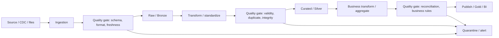
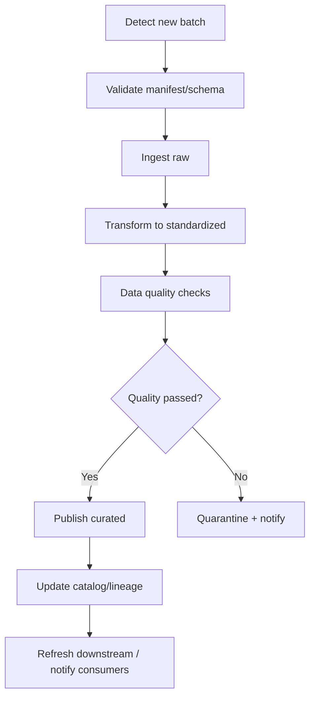
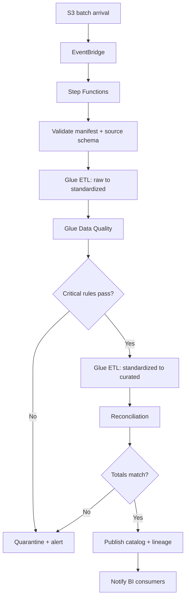

# Data Quality, Lineage, and Data Pipeline Orchestration

A data pipeline is complete only when data is delivered accurately, can be trusted, and operators understand every step the data passed through. An ETL job ending with `SUCCEEDED` does not prove the output is business-valid. A table with all expected columns can still contain duplicate keys, invalid values, late-arriving records, or data from untrusted sources. When a dashboard is wrong, engineering teams must trace back through sources and transformations to locate the root cause; when a step fails, the pipeline must know whether to retry, quarantine data, or halt publishing.

Three capabilities solve distinct parts of this problem:

- **Data quality** measures and validates whether data satisfies technical, business, and timeliness rules.
- **Data lineage** records provenance, transformation flows, and dependencies across datasets, jobs, and consumers.
- **Pipeline orchestration** coordinates step ordering, triggers, dependencies, retries, timeouts, error branches, and execution state.

In the `CLOUD_PROVIDERS_AWS` module, these capabilities combine AWS Glue Data Quality, Data Catalog, Glue ETL, Lake Formation, Amazon S3, AWS Step Functions, Glue Workflows, Amazon EventBridge, Amazon MWAA, CloudWatch, and analytics services. The goal is to build pipelines that can be validated, traced, recovered, and operated across multiple accounts or data domains.

After this lesson, you can:

- Define data quality dimensions and translate business requirements into measurable quality rules.
- Author rules using Data Quality Definition Language (DQDL) and use AWS Glue Data Quality.
- Place quality gates across ingest, transform, and publish stages.
- Distinguish technical lineage, business lineage, dataset lineage, and column-level lineage.
- Capture and use lineage via Glue, OpenLineage, and Amazon SageMaker Unified Studio.
- Choose Glue Workflows, Step Functions, EventBridge, or MWAA to orchestrate pipelines.
- Design retries, backoff, idempotency, checkpoints, quarantine, and backfills.
- Monitor freshness, quality scores, job status, lag, and cost to detect incidents.

## 1. Three Pillars of Reliable Pipelines

A pipeline can execute in the exact right order yet emit bad data; a dataset can score high on quality checks while its origin remains unknown; and a complete lineage graph cannot recover an upstream job failure on its own. Therefore, design all three pillars together.

| Capability | Core Question | Outputs |
|---|---|---|
| Data quality | Is the data accurate, complete, consistent, and timely? | Rules, metrics, scores, failed records, quality gates |
| Data lineage | Where did the data come from, which jobs touched it, and who depends on it? | Upstream/downstream graphs, column mappings, provenance |
| Orchestration | Which step runs first, when to retry, and when to halt or publish? | Workflow state, dependencies, triggers, retries, audit trails |

For example, an orders pipeline receives files from S3, standardizes schemas, deduplicates, checks foreign keys, and writes a curated table. Quality rules confirm `order_id` is non-null and unique and `amount` is valid. Lineage records the source file, Glue job, output table, and transformed columns. The orchestrator permits publishing only after both ETL and quality gates pass.

## 2. What Is Data Quality?

Data quality describes how well data fits its intended use. No dataset has universal absolute quality across every context. A telemetry table may tolerate a small fraction of missing temperature readings, whereas a payments table may require every transaction to carry a valid currency code and amount.

Common quality dimensions:

| Dimension | Question | Example Check |
|---|---|---|
| Completeness | Do required fields contain values? | `order_id` is non-null |
| Uniqueness | Are keys free of duplicates? | Each `order_id` appears only once |
| Validity | Do values fall within valid domains? | `amount >= 0`, status is in allowed list |
| Accuracy | Do values match reality? | Order totals reconcile with transactional system |
| Consistency | Are fields and tables mutually consistent? | Currency and amount align properly |
| Timeliness/Freshness | Did data arrive on time? | Current day's partition is loaded |
| Integrity | Are cross-dataset relationships valid? | Every `customer_id` exists in customers table |
| Schema validity | Does structure match contract? | Columns, data types, and version align |

Not every dimension can be checked by a single simple rule. Accuracy typically requires reconciling against a trusted source or operational system. Completeness and uniqueness are easier to automate; timeliness requires timestamps and SLAs; consistency often requires comparing multiple columns or datasets.

### 2.1. Translating Business Requirements into Measurable Rules

A requirement like "order data must be clean" is too vague. Translate it into testable conditions:

- Every record must contain `order_id`.
- `order_id` must be unique within the business key scope.
- `amount` must be non-negative and `currency` must belong to the supported list.
- `status` may contain only defined values.
- `customer_id` must exist in the published customers table.
- Day D's partition must be ready before 06:00 UTC.
- Daily total `amount` must stay within agreed variance thresholds or reconcile with the source system.

Each rule needs an owner, purpose, data scope, threshold, frequency, failure action, and documented exceptions. A rule without an owner quickly turns into an ignored alert.

## 3. Where Should Quality Checks Live in the Data Lifecycle?

Do not wait until the Gold table to check data. Catching errors early typically lowers both remediation and investigation costs.



| Stage | Goal | Appropriate Checks |
|---|---|---|
| Ingestion | Ensure files/events are readable and match contract | Schema, encoding, file format, checksum, freshness |
| Raw/Bronze | Preserve raw data and detect baseline errors | Required fields, parse errors, source metadata |
| Standardized/Silver | Standardize and validate logic | Types, ranges, uniqueness, referential integrity |
| Curated/Gold | Validate business logic | Reconciliation, totals, business invariants |
| Consumption | Monitor quality during use | Freshness SLA, distribution drift, null rates |

The raw zone should preserve immutable or versioned originals for reprocessing. Invalid records can be quarantined alongside reason codes, source file, batch ID, and timestamp. Never delete bad records immediately if they are needed for auditing or investigation.

## 4. AWS Glue Data Quality

AWS Glue Data Quality is a managed service for measuring and monitoring data quality, built on open-source Deequ and using Data Quality Definition Language (DQDL) to express rules.

There are two main integration points:

1. **Data Catalog**: evaluates tables registered in Glue Data Catalog and supported sources. Suited for data stewards or analysts monitoring cataloged datasets.
2. **Glue ETL jobs**: runs checks mid-pipeline, capable of identifying failing records to filter or quarantine before writing outputs.

Key differences to remember:

| Capability | Data Catalog | Glue ETL |
|---|---|---|
| Author rules in DQDL | Yes | Yes |
| Rule recommendations | Yes | No |
| Check data inside ETL flow | Evaluates cataloged tables | Can run between ETL steps |
| Identify record-level failures | Not supported in the same way | Can output record-level results |
| DQDL analyzers | DQDL analyzers not supported at Data Catalog entry point | Analyzers usable in ETL for supported rule types |
| Scheduling | Evaluation runs and evaluation configs | Workflows/Step Functions or job schedules |
| CloudWatch/EventBridge | Integrated | Integrated |

Glue Data Quality does not replace data governance processes. Rules must be approved by data owners, thresholds must match business contracts, and results must drive operational decisions.

### 4.1. Data Quality Definition Language (DQDL)

DQDL is a declarative language for defining rules. A ruleset groups multiple rules to evaluate a dataset.

Example ruleset for an orders table:

```text
Rules = [
    IsComplete "order_id",
    IsUnique "order_id",
    ColumnValues "amount" >= 0,
    ColumnValues "status" in ["PAID", "PENDING", "CANCELLED"],
    RowCount > 0
]
```

Meaning:
- `IsComplete` verifies the field is non-null.
- `IsUnique` verifies values are unique.
- `ColumnValues` checks value domains.
- `RowCount` ensures the dataset contains records.

DQDL is case-sensitive in rule names and ruleset syntax. Column names must match actual schemas. Test rulesets against representative data before promoting to production.

### 4.2. Ratio and Threshold Rules

Not every rule requires 100% compliance. For instance, telemetry data might allow up to 0.5% missing optional fields, whereas payment data demands 100% completeness on keys and amounts.

Statistical thresholds can be expressed in DQDL, for example:

```text
Rules = [
    Completeness "device_id" >= 0.995,
    Completeness "temperature" >= 0.98,
    Mean "temperature" between -20 and 80,
    RowCount > 100
]
```

Thresholds must reflect SLAs and source behavior. Never copy thresholds from one dataset to another merely because their schemas look similar.

### 4.3. Composite Rules

DQDL supports combining rules with `and` and `or`. Example:

```text
Rules = [
    (IsComplete "order_id") and (IsUnique "order_id"),
    (ColumnValues "amount" >= 0) and (ColumnValues "currency" in ["USD", "EUR", "VND"])
]
```

By default, composite rules evaluate each sub-rule across the entire dataset and combine results. If row-by-row SQL-like semantics are required, set composite rule evaluation mode to `ROW` in additional options. Without understanding evaluation scope, `OR` expressions can yield unexpected business outcomes.

### 4.4. Cross-Dataset Rules

Some rules validate relationships across two datasets:
- Referential integrity: keys in the primary dataset exist in a reference dataset.
- Dataset match: two datasets match under specified conditions.
- Aggregate match: aggregated metrics match across datasets.
- Schema match: schemas of two datasets align.

For example, `orders.customer_id` should reference `customers.customer_id`. If the customers table updates slower than the order stream, the rule may fail transiently. Pipelines must distinguish genuine data defects from timing skew between sources.

### 4.5. Limitations to Know

- AWS Glue Data Quality does not evaluate nested/list-type fields with standard rules directly; flatten or normalize structures first.
- The Data Catalog entry point does not provide the same record-level failure identification as Glue ETL.
- Certain rules require supported reference datasets or source types.
- Rulesets have size and rule-count limits; split them by domain or objective.
- A Data Quality score reflects the percentage of rules passed, not the percentage of clean records or a comprehensive measure of trustworthiness.

Never treat a 100% score as proof of data accuracy if the ruleset fails to cover critical risks.

## 5. Rulesets, Evaluation, and Monitoring

A Data Catalog quality workflow typically involves:

1. Selecting the target database/table to evaluate.
2. Authoring a DQDL ruleset or starting from rule recommendations.
3. Reviewing and tuning rules with the data owner.
4. Assigning an IAM role authorized to access the source, Glue, and result locations.
5. Running the evaluation.
6. Reviewing per-rule pass/fail status, metrics, and quality score.
7. Sending results to CloudWatch/S3 or monitoring systems as configured.
8. Setting up schedules or evaluation configurations for continuous tracking.

Rule recommendations speed up onboarding, yet always require review. Profiling can detect that a column looks unique or rarely null, without knowing full business semantics. For example, historical `amount` values always being positive does not prove business policy forbids negative adjustment rows.

### 5.1. Catalog/Database-Level Monitoring

AWS Glue Data Quality supports data quality evaluation configurations at the catalog, database, or table level. At the catalog or database level, organizations can define checks once and apply them across all tables in scope, including newly added tables. Evaluations can run once, on schedules, or on table metadata changes as configured.

This works well for baseline hygiene such as:
- Every table must carry owner/classification metadata.
- Every transactional table must meet a standard baseline rule group.
- New datasets in a database must be evaluated before publishing.

However, baseline rules do not replace specialized rules. Clickstream tables and financial ledgers have very different requirements; use domain- or table-specific rulesets where needed.

### 5.2. Interpreting Data Quality Scores

The Glue Data Quality score represents the proportion of evaluated rules in a ruleset that passed. For instance, 8 of 10 rules passing equals an 80% score.

Scores do not automatically reflect:
- Severity of individual rules.
- Number of affected records.
- Business weight of each rule.
- Accuracy relative to external reality.
- Quality dimensions lacking rules.

One failing primary-key rule can be far more severe than many passing optional-description rules. Dashboards should display scores alongside individual rule outcomes, severity, failed record counts (when available), trends, and owners.

## 6. Designing Quality Gates

A quality gate decides whether a pipeline may proceed or publish a dataset. A pipeline typically has three outcomes:

- **Pass**: all mandatory rules pass.
- **Warn/Degraded**: warning rules fail, yet continuation is permitted per policy.
- **Fail/Quarantine**: blocking rules fail; halt publishing and isolate outputs.

Example:

| Rule | Severity | Result | Action |
|---|---|---|---|
| `order_id` completeness | Critical | Fail | Halt publish |
| `order_id` uniqueness | Critical | Pass | Continue |
| `amount >= 0` | Critical | Pass | Continue |
| Optional phone completeness | Warning | Fail | Publish with warning |
| Partition freshness | High | Fail | Wait for data or alert SLA breach |

Do not gate solely on a single aggregate score when rules differ in criticality. Use critical rules as blockers and lower-severity rules as warnings.

### 6.1. Quarantine and Bad-Record Handling

When ETL detects invalid records:
- Write bad records to an isolated prefix/quarantine dataset.
- Attach reason codes and failing rule names.
- Preserve source file, batch ID, event ID, and timestamp.
- Protect access permissions since bad records may contain sensitive data.
- Enable fixes and replays after approval.
- Never silently drop records if doing so skews financial totals or business obligations.

For financial data, include reconciliation comparing record counts and total amounts across source, accepted, and quarantined sets to catch unintended drops.

## 7. What Is Data Lineage?

Data lineage describes the origin and journey of data through systems. Lineage answers:
- Which source produced the dataset?
- Which jobs or queries read and wrote it?
- Which transformations were applied?
- Which source columns feed each output column?
- Which downstream datasets break if a schema or pipeline changes?
- Which reports depend on a faulty table?

Common lineage levels:

| Lineage Type | Scope | Example |
|---|---|---|
| Dataset/table-level | Relationships between datasets | `raw.orders` -> `curated.orders` |
| Job/run-level | Which job created or updated a dataset | Glue job `orders-standardize`, run ID |
| Column-level | Source-to-target column relationships | `raw.total` -> `curated.net_amount` |
| Business lineage | Business concepts and metrics | Net Revenue computed as order amount minus refunds |
| Operational lineage | Execution history, status, and incidents | Which runs failed, retried, published, or backfilled |

Lineage is more than a list of job names. Useful lineage captures stable dataset/job identifiers, timestamps, run IDs, inputs/outputs, and transformation relationships.

## 8. Why Does Lineage Matter?

### 8.1. Root Cause Analysis

When a revenue report is wrong, lineage reveals which curated table fed the report, which job transformed it, and which raw source supplied the data. Engineers can trace backward to the first point of divergence.

### 8.2. Impact Analysis

When a column changes data type or a table is deprecated, lineage identifies all downstream consumers, dashboards, jobs, and applications requiring review.

### 8.3. Compliance and Auditing

Lineage provides evidence of data origin, movement of sensitive data, and applied transformations. However, lineage alone does not prove authorized access; pair it with Lake Formation, IAM, and audit logs.

### 8.4. Trust and Data Products

Data consumers can inspect where a dataset originated, which jobs processed it, whether quality gates passed, and who owns it—helping teams assess trustworthiness before using data in reports or ML models.

## 9. Lineage in AWS: Glue Data Catalog and OpenLineage

AWS Glue Data Catalog stores dataset metadata and can maintain records of operations/transformations. To build cross-tool lineage graphs, you can use OpenLineage-compatible lineage capabilities in Amazon SageMaker Unified Studio.

Distinguish clearly:
- **Glue Data Catalog** is the metastore holding databases, tables, schemas, locations, and metadata.
- **OpenLineage** is an event specification describing jobs, job runs, datasets, and input/output relationships.
- **Amazon SageMaker Unified Studio** provides OpenLineage-compatible lineage collection and visualization, combining catalog assets and events emitted by supported tools.

A lineage graph displays upstream sources, processing jobs, output datasets, and downstream consumers. Column-level lineage shows which source columns feed output columns when emitting tools and events supply sufficient detail.

### 9.1. Automated Lineage Capture and Limitations

Capture capabilities depend on sources and versions:

- Glue crawlers inside SageMaker Unified Studio can automatically capture lineage for supported sources when configured.
- Glue jobs launched from the standard Glue console do not emit all lineage events automatically by default; enable lineage event generation and supply the domain ID per guidance.
- OpenLineage Spark libraries are integrated into AWS Glue 5.0+ for Spark DataFrames; Glue DynamicFrames are not supported by this mechanism.
- For jobs reading raw S3 paths directly, lineage events may identify datasets by S3 path instead of Glue tables. To link against Glue catalog assets, read Glue Catalog tables in the job.
- Lineage carries event size limits and depends on IAM/networking/KMS; monitor publishing errors.

Do not assume every Glue job or AWS service appears in lineage graphs automatically. Check the support matrix, configurations, and event status.

### 9.2. Anatomy of an OpenLineage Event

A lineage event typically contains:
- Job namespace/name.
- Run ID and lifecycle state.
- Input datasets.
- Output datasets.
- Schema facets.
- Column lineage facets when supported.
- Optional environment, code version, or custom metadata.

Logical illustration:

```text
Job: orders-standardize
Run: 2026-11-20T02:00Z / run-001
Inputs:
  - glue://raw_commerce/orders
Outputs:
  - glue://standardized_commerce/orders
Transformation:
  - normalize currency
  - parse created_at
  - derive order_date
```

This is a conceptual summary, not a full OpenLineage JSON payload. In production systems, use compatible libraries or APIs to emit compliant OpenLineage events.

### 9.3. Lineage and Metadata Enrichment

Lineage graphs are far more actionable when datasets carry business context:
- Owner and steward.
- Business definitions.
- Classification.
- Refresh cadence/SLA.
- Quality status.
- Source system.
- Consumers and usage policies.

Enrich context via Data Catalog metadata and catalog assets in SageMaker Unified Studio. Avoid relying on free-text comments as the sole source of truth for ownership or classification; enforce synchronized and auditable processes.

## 10. What Is Orchestration?

Orchestration coordinates pipeline steps according to dependencies and execution state. An orchestrator can:
- Launch jobs on schedules or events.
- Wait for job completion.
- Trigger subsequent steps once conditions are met.
- Retry on transient failures.
- Branch based on quality results.
- Alert or quarantine data on failure.
- Bound concurrency.
- Track run history and inputs/outputs.

Orchestration differs from scheduling:
- Scheduling decides **when** to start.
- Orchestration decides **which steps** run, in what order, and under which conditions.

Complex pipelines often use both. EventBridge Scheduler can start Step Functions daily; Step Functions orchestrates Glue jobs, quality checks, publishing, and notifications.

## 11. Choosing an Orchestration Tool on AWS

| Tool | Best Fit When | Strengths |
|---|---|---|
| AWS Glue Workflows | Chains of Glue jobs, crawlers, and triggers | Native Glue integration, workflow graph, and run properties |
| AWS Step Functions | Multi-service pipelines with branching, retries, waits, and approvals | Explicit state machines, execution history, service integrations |
| Amazon EventBridge | Event-triggered flows and routing | Event-driven filtering, decoupling producers and consumers |
| Amazon MWAA | Organizations already using Apache Airflow with complex DAGs | Rich operator/provider ecosystem, flexible scheduling and dependencies |
| EventBridge Scheduler | Schedules and crons targeting AWS services | Centralized schedule management decoupled from apps |
| AWS Batch / EMR / Glue | Executing data processing workloads | Compute engines typically invoked by an orchestrator |

No single tool fits every scale. Glue Workflows are simpler when pipelines consist mainly of Glue components. Step Functions shines when coordinating multiple AWS services with explicit error handling. MWAA fits teams invested in Airflow DAGs, plugins, and existing Airflow operations—at the cost of managing and paying for Airflow environments.

## 12. AWS Glue Workflows

AWS Glue Workflows group multiple Glue jobs, crawlers, and triggers into one workflow. Workflows track run state, dependency ordering, and component execution history.

Start trigger types:
- Schedule.
- On demand.
- EventBridge event.

Triggers inside a workflow can start jobs/crawlers when upstream components finish or satisfy conditions. The workflow graph visualizes structure and live run status.

### 12.1. Workflow Run Properties

Workflow run properties are key/value pairs sharing state across jobs within a single workflow run. Examples:
- Data date to process.
- S3 source prefix.
- Target database.
- Batch ID.
- Environment or run mode.

Updated properties apply only to that specific run. Never place passwords, tokens, or plaintext secrets in run properties since values may be logged. Retrieve secrets from Secrets Manager or Glue Connections.

### 12.2. When to Use Glue Workflows?

Use when:
- Pipelines consist of multiple Glue jobs and crawlers.
- Dependencies are straightforward and largely within Glue.
- You need run history and execution graphs.
- You want S3/EventBridge events to trigger Glue workflows.

If workflows need complex business branching, human approvals, diverse non-Glue AWS services, or long-running coordination, Step Functions is usually a better fit.

## 13. AWS Step Functions for Multi-Service Pipelines

AWS Step Functions models pipelines as state machines. Common states:
- `Task`: invoke Glue, Lambda, Athena, or other services.
- `Choice`: branch based on quality results.
- `Wait`: pause for a duration or callback.
- `Parallel`/`Map`: process branches or items concurrently.
- `Retry`/`Catch`: retry or route failures.
- `Succeed`/`Fail`: terminate workflow.

Step Functions provides optimized integration with AWS Glue `StartJobRun`. The `.sync` pattern lets Standard Workflows wait for a Glue job to complete before advancing to the next state. Express Workflows support only Request-Response for optimized integrations; do not use `.sync` as in Standard Workflows.

### 13.1. State Machine Example

The example below runs Glue ETL, invokes a quality check function, and branches. The `validate-orders` function represents reading Data Quality results and returning a boolean `passed` field.

```json
{
  "Comment": "ETL and data quality pipeline",
  "StartAt": "TransformOrders",
  "States": {
    "TransformOrders": {
      "Type": "Task",
      "Resource": "arn:aws:states:::glue:startJobRun.sync",
      "Parameters": {
        "JobName": "orders-transform"
      },
      "Retry": [
        {
          "ErrorEquals": ["States.Timeout", "States.TaskFailed"],
          "IntervalSeconds": 30,
          "MaxAttempts": 2,
          "BackoffRate": 2
        }
      ],
      "Catch": [
        {
          "ErrorEquals": ["States.ALL"],
          "ResultPath": "$.failure",
          "Next": "Quarantine"
        }
      ],
      "Next": "ValidateQuality"
    },
    "ValidateQuality": {
      "Type": "Task",
      "Resource": "arn:aws:states:::lambda:invoke",
      "Parameters": {
        "FunctionName": "validate-orders",
        "Payload": {
          "dataset": "curated.orders"
        }
      },
      "ResultPath": "$.quality",
      "Catch": [
        {
          "ErrorEquals": ["States.ALL"],
          "ResultPath": "$.failure",
          "Next": "Quarantine"
        }
      ],
      "Next": "QualityGate"
    },
    "QualityGate": {
      "Type": "Choice",
      "Choices": [
        {
          "Variable": "$.quality.Payload.passed",
          "BooleanEquals": true,
          "Next": "Publish"
        }
      ],
      "Default": "Quarantine"
    },
    "Publish": {
      "Type": "Succeed"
    },
    "Quarantine": {
      "Type": "Task",
      "Resource": "arn:aws:states:::lambda:invoke",
      "Parameters": {
        "FunctionName": "quarantine-orders",
        "Payload.$": "$"
      },
      "Next": "PipelineFailed"
    },
    "PipelineFailed": {
      "Type": "Fail",
      "Error": "PipelineFailed",
      "Cause": "ETL or data quality validation failed"
    }
  }
}
```

This is an illustrative template; substitute your own job/function names, IAM roles, and quarantine logic. Retries suit only recoverable errors. Never retry schema errors or business-rule failures indefinitely. Ensure Glue jobs are idempotent so retries never produce duplicate data.

### 13.2. Retry, Catch, and Timeouts

- `Retry` handles transient failures such as throttling, timeouts, or brief dependency blips.
- `Catch` routes failures to remediation branches like quarantine, alerts, or rollback.
- Timeouts cap how long a state may run.
- Backoff eases pressure on struggling downstream services.
- Max attempts prevent infinite retry loops.

Distinguish transient failures from permanent ones. If a Glue job fails due to a missing required column, immediate retries will not help. If it fails due to throttling, retrying with backoff often succeeds.

## 14. EventBridge and Event-Driven Pipelines

Amazon EventBridge receives events from AWS services or applications, matches event patterns, and routes to targets. For data pipelines, common events include:
- Object created in S3.
- Ingest batch completed.
- Glue job completed.
- Data quality evaluation results emitted.
- External source announcing a new batch.

EventBridge can target Step Functions, Lambda, SQS, or Glue Workflows where supported. Design for idempotency because events can be redelivered or pipelines may receive multiple events for one batch.

### 14.1. S3 Events and Duplicates

S3 event notifications guarantee at-least-once delivery without strict ordering. A single object event can arrive more than once. Therefore:
- Use bucket/key/version ID or batch ID as an idempotency key.
- Never assume events arrive in chronological order.
- Validate object metadata and manifests before processing.
- Use SQS buffering to absorb bursts when needed.
- Batch/window events when individual files are too granular as processing units.
- Avoid launching crawlers or heavy ETL per tiny object when batching is viable.

### 14.2. Scheduled vs. Event-Driven Triggers

| Trigger Type | When to Use | Example |
|---|---|---|
| Schedule | Data arrives on a predictable schedule | Daily batch at 02:00 UTC |
| Event-driven | New data arrives or state changes | S3 object created |
| Manual/on-demand | Backfills, bug fixes, or operations | Rerun a missing day |
| Hybrid | Event-driven plus a safety-net schedule | Event trigger + end-of-day completeness check |

Event-driven does not eliminate the need for reconciliation. If an event fails or a producer skips emitting one, a scheduled completeness check catches missing partitions.

## 15. Amazon MWAA and Apache Airflow

Amazon Managed Workflows for Apache Airflow (MWAA) provides managed Apache Airflow environments. Airflow models pipelines as DAGs (Directed Acyclic Graphs), defining tasks and dependencies in Python.

MWAA fits when:
- The organization already has Airflow DAGs and expertise.
- Rich operators/providers are needed across AWS and external systems.
- Complex dependencies and varied schedules are required.
- Orchestration is standardized on Airflow across multiple platforms.

Considerations:
- Environment and worker costs.
- Airflow and provider package versions.
- Networking, private subnets, execution roles, and secrets backends.
- DAG parsing, scheduler health, and worker capacity.
- Retries/backfills/catchup creating heavy load if misconfigured.
- Managing dependencies across DAGs and external systems.

Do not adopt MWAA simply because a pipeline has multiple steps. If workflows mainly coordinate a few Glue jobs, Glue Workflows or Step Functions can be simpler with far less operational overhead.

## 16. Designing DAGs and Dependencies

Pipelines typically form a DAG:



A DAG must never contain cycles. If Task A depends on B and B depends on A, the orchestrator cannot resolve execution order. For cyclic dataset dependencies, split pipelines into stages or enforce explicit event/state boundaries.

### 16.1. Task Granularity

Coarse tasks are hard to retry and pinpoint failures in. Overly fine tasks increase orchestration overhead and API call volume. Choose boundaries around independently retryable units:
- One batch/partition.
- One dataset/domain.
- One transformation step.
- One quality gate.
- One publish step.

Never spawn one task per record when batching is possible. For high event volumes, use streaming engines or worker pools instead of launching millions of state machine executions.

## 17. Idempotency, Checkpoints, and Late-Arriving Data

Pipelines may rerun due to retries, operator restarts, duplicate events, or backfills. **Idempotency** ensures rerunning the same input never corrupts or duplicates outputs.

Techniques:
- Assign stable batch IDs or run IDs.
- Identify inputs via source object versions/checksums.
- Write outputs to staging prefixes before publishing.
- Use atomic commits or table format transactions.
- Use upserts/merges keyed by business keys when required.
- Persist processed batch state.
- Advance checkpoints only after outputs commit successfully.
- Clean up staging data when runs fail.

AWS Glue Job Bookmarks help track processed inputs for supported sources and jobs, yet do not guarantee end-to-end exactly-once across an entire pipeline. If jobs have side effects outside Glue, enforce separate idempotency.

### 17.1. Late-Arriving Data and Backfills

Data may arrive after its expected partition date. Define:
- Watermark: point when a batch is considered complete.
- Allowed lateness: window during which late records are accepted.
- Correction window: timeframe allowed for recomputing older partitions.
- Backfill policy: procedure for reprocessing historical days/months.
- Consumer notifications: who must be informed when historical figures change.

Do not seal partitions permanently too early if sources produce late data. Conversely, avoid keeping all partitions open indefinitely, which raises costs and prevents finalizing metrics.

## 18. Managing State and Concurrency

Pipelines must cap concurrent executions to avoid:
- Two jobs writing the same partition simultaneously.
- Concurrent runs overloading source databases.
- Event bursts spawning excessive Glue jobs.
- Backfills starving daily production capacity.

Controls:
- `MaxConcurrentRuns` on Glue jobs/workflows.
- Queues or semaphores before launching jobs.
- Step Functions concurrency controls and `Map` limits.
- MWAA pools, task concurrency, and DAG concurrency.
- Partition-level locks or transaction controls.
- Isolating backfill workloads from production SLAs.

Workflow run properties can pass batch IDs, dates, or target prefixes between jobs. Never pass plaintext secrets through workflow properties or state payloads.

## 19. Pipeline Observability and Alerting

Monitor orchestration status and data quality together.

| Category | Metrics/Signals | Questions |
|---|---|---|
| Freshness | Time from source event to publish | Is the dataset meeting its SLA? |
| Completeness | Expected vs. actual partitions/batches | Are any batches missing? |
| Quality | Rule pass/fail, scores, failed records | Did data violate contracts? |
| Lineage | Event capture success, upstream/downstream | Can sources and consumers be traced? |
| Orchestration | Job duration, retry counts, failure rates | Is the pipeline running reliably? |
| Backlog | SQS age/depth, event lag | Is data backing up? |
| Cost | DPU-hours, query scans, storage growth | Is the pipeline exceeding budget? |

Use:
- CloudWatch metrics, logs, dashboards, and alarms.
- EventBridge to route status updates or findings.
- SNS or incident management tools for notifications.
- Glue workflow/job run histories.
- Step Functions execution histories.
- MWAA/Airflow task logs and metrics.
- S3 manifests or batch registries to verify completeness.

Alert on business SLAs. A job succeeding in 5 minutes while producing an empty partition is still a data incident. Conversely, a job running longer than normal can give early warning before a freshness SLA breach.

## 20. Failure Handling and Pipeline Recovery

A runbook should classify failure types:

| Failure | Appropriate Action |
|---|---|
| Source not arrived | Wait, check SLA, retry on schedule |
| Incompatible schema | Quarantine, alert producer, avoid blind type coercion |
| Critical data quality failure | Halt publish, retain failed records and run context |
| Glue throttling | Backoff, lower concurrency, or request quota increase |
| IAM/KMS `AccessDenied` | Fix policy/role/key; avoid infinite retries |
| Transient S3 error | Bounded retries, inspect object/version |
| Downstream unavailable | Buffer, circuit-break, or pause consumers |
| Partial write | Clean staging or recommit per transaction design |
| Lineage event publish failure | Log and retry separately; need not drop data if policy permits |
| Orchestrator timeout | Verify job status before rerunning to prevent duplicates |

Not every lineage failure must halt data processing. Organizations can designate lineage capture as a blocking control for regulated datasets or a non-blocking observability step for internal datasets, based on compliance and impact assessments.

### 20.1. Quarantine and Replay

Quarantine records must preserve:
- Input reference and checksum/version.
- Batch/run ID.
- Failed rule and metric.
- Error code/stack trace scrubbed of secrets.
- Timestamp and pipeline version.
- Review/approval status.

After fixing data or logic, replay by batch ID. Never replay full history when only one partition is affected. Check downstream side effects before replaying, especially if pipelines trigger emails, payments, or external API calls.

## 21. Practical Scenario: E-Commerce Orders Pipeline

A system receives order events in S3 in 15-minute batches. Data moves through three tiers:
- Raw: stores original events untouched.
- Standardized: normalizes timezones, currencies, and schemas.
- Curated: aggregates revenue and order statuses for BI.

Targets:
- Publish partitions within 30 minutes.
- `order_id` non-null and unique within batch.
- `amount` non-negative.
- Every currency within supported list.
- Daily total revenue reconciles with the order source system within approved tolerance.
- End-to-end traceability from dashboards back to source batches and Glue job runs.

### 21.1. Pipeline



### 21.2. Quality Rules

Ruleset checks:
- `order_id` complete and unique.
- `amount` greater than or equal to 0.
- `currency` in allowed list.
- Row count greater than 0.
- Foreign key `customer_id` exists in customers dataset.

If any critical rule fails, do not publish the curated partition. Failing records are written to quarantine with failure reasons. If warning rules fail, the pipeline may publish with quality status `DEGRADED` and notify owners per policy.

### 21.3. Lineage and Investigation

Lineage records:
- Input batch and raw table.
- Standardizing Glue job/run.
- Standardized table.
- Aggregation job producing curated sales table.
- Dashboards or projects consuming the dataset when the catalog platform captures subscription/usage lineage.

When dashboard revenue looks wrong, engineers inspect lineage to locate upstream tables and jobs, then cross-check quality results and batch IDs to isolate the faulty partition.

### 21.4. Orchestration and Recovery

Step Functions coordinates:
1. Validate manifest.
2. Run Glue transform using `.sync`.
3. Evaluate quality results.
4. Branch to publish or quarantine.
5. Emit notifications.
6. Persist batch state.

If an S3 event arrives twice, batch ID and object version let the state machine recognize the completed run. If a job fails after writing staging data, retries inspect run state and clean staging before recommitting.

## 22. Data Contracts and Ownership

A data contract is an agreement between producers and consumers covering data structure, semantics, quality, and behavior. It eliminates consumers guessing schemas and semantics independently.

A contract should include:
- Dataset name and version.
- Schema and field descriptions.
- Required/optional fields.
- Primary/business keys.
- Allowed values and constraints.
- Event time vs. processing time.
- Freshness and delivery SLAs.
- Retention.
- Owner, steward, and escalation contacts.
- Compatibility policy.
- Quality rules and severities.
- Lineage expectations.

When a producer updates a contract:
1. Propose schema/version change.
2. Analyze downstream impact via lineage.
3. Test with consumers.
4. Update DQ rules.
5. Roll out in phases.
6. Monitor quality/freshness post-release.
7. Deprecate prior version after transition period.

## 23. Security and Governance

Quality results, lineage graphs, and orchestration metadata can reveal dataset names, customer attributes, data sources, or error details. Protect these artifacts:

- Separate IAM roles for producers, ETL, quality evaluators, and orchestrators.
- Lake Formation grants by database/table/column and LF-Tags.
- KMS encryption for S3, catalog metadata, and logs where appropriate.
- Restrict read access to quarantine zones since failing records may contain sensitive data.
- Never place secrets in workflow inputs, run properties, or logs.
- Audit IAM, Glue, Step Functions, EventBridge, and Lake Formation changes with CloudTrail.
- Separate permissions to edit rulesets from permissions to approve publishing when required.
- Retain lineage events and quality results according to policy.
- Govern cross-account access and data sharing.

The orchestrator role should only invoke jobs, poll statuses, and branch execution. It does not need read access across all S3 data when job execution roles perform data access.

## 24. Common Mistakes

| Mistake | Consequence | Best Practice |
|---|---|---|
| Checking only job status | Job succeeds yet outputs wrong data | Add quality gates and reconciliation |
| Relying solely on quality score | Critical rules equated with minor ones | Assign severities and block on critical rules |
| Treating crawlers as quality tests | Schemas discovered while values are corrupt | Use DQ rules and business validation |
| Lineage captures only job names | Cannot identify affected datasets/columns | Capture inputs/outputs, run IDs, and column mappings |
| Assuming all Glue jobs emit lineage automatically | Incomplete lineage graphs | Verify versions, capture configs, and OpenLineage support |
| Retrying all errors indefinitely | Inflated costs and duplicate records | Cap retries and separate transient from permanent errors |
| Treating S3 events as exactly-once | Duplicate triggers and writes | Use idempotency keys and batch registries |
| Publishing before quality checks finish | Consumers read bad data | Use staging and atomic publish after gates |
| Single orchestrator micromanaging trivial steps | Added complexity and cost | Choose sensible task granularity |
| No backfill policy | Historical data cannot be fixed safely | Define correction windows and replay workflows |
| Passing secrets in workflow inputs | Credentials exposed in logs/history | Use Secrets Manager or Glue Connections |
| Not measuring freshness | Pipeline stays green yet misses SLAs | Track source-to-publish latency |

## 25. Checklist for Pipelines with Quality, Lineage, and Orchestration

- [ ] Data owner and technical owner assigned for every dataset.
- [ ] Data contracts specify schemas, semantics, and SLAs.
- [ ] Quality dimensions and critical rules defined.
- [ ] DQDL rulesets version-controlled and reviewed.
- [ ] Quality gates enforce pass/warn/fail and quarantine policies.
- [ ] Data Quality results stored and monitored.
- [ ] Lineage captures inputs, outputs, jobs, run IDs, and schemas.
- [ ] Column-level lineage enabled where required and supported.
- [ ] Orchestrator fits pipeline complexity.
- [ ] Retries, backoff, timeouts, and `Catch` branches tailored to failure types.
- [ ] Jobs and publish steps are idempotent.
- [ ] Duplicate events and late-arriving data are handled.
- [ ] Backfills/replays have runbooks and controlled permissions.
- [ ] Concurrency is bounded to protect downstream systems.
- [ ] Alarms cover freshness, quality, lineage capture, and job health.
- [ ] IAM, KMS, Lake Formation, and quarantine access follow least privilege.
- [ ] Dashboards and incident runbooks exist.
- [ ] Drilled source outages, schema drift, quality failures, and retries.

## 26. Knowledge Summary

Data quality verifies that data fits its intended use across completeness, uniqueness, validity, accuracy, consistency, timeliness, and integrity. AWS Glue Data Quality uses DQDL to evaluate Data Catalog tables or data mid-flow in Glue ETL. Quality gates determine whether to publish, warn, or quarantine; quality scores are summary indicators that must be interpreted alongside per-rule results.

Data lineage captures origins, jobs, runs, transformations, and upstream/downstream relationships. Glue Data Catalog stores metadata, while OpenLineage and Amazon SageMaker Unified Studio provide cross-tool lineage graphs when supported sources and configurations are used. Verify versions, Spark DataFrame/DynamicFrame behavior, and how jobs reference datasets so lineage links accurately.

Orchestration coordinates dependencies, triggers, retries, timeouts, branching, and recovery. Glue Workflows fit chains of Glue jobs/crawlers; Step Functions fits multi-service pipelines needing state machines and rich error handling; EventBridge triggers on events; and MWAA fits teams already operating Airflow. Reliable pipelines require idempotency, quarantine, backfills, observability, and least-privilege permissions. When quality, lineage, and orchestration are designed together, data lakes deliver trustworthy data reliably at scale.

## References

- [AWS Glue Data Quality](https://docs.aws.amazon.com/glue/latest/dg/glue-data-quality.html)
- [Data Quality Definition Language (DQDL)](https://docs.aws.amazon.com/glue/latest/dg/dqdl.html)
- [DQDL rule type reference](https://docs.aws.amazon.com/glue/latest/dg/dqdl-rule-types.html)
- [Getting started with AWS Glue Data Quality for the Data Catalog](https://docs.aws.amazon.com/glue/latest/dg/data-quality-getting-started.html)
- [AWS Glue Data Quality API](https://docs.aws.amazon.com/glue/latest/dg/aws-glue-api-data-quality-api.html)
- [Overview of workflows in AWS Glue](https://docs.aws.amazon.com/glue/latest/dg/workflows_overview.html)
- [Getting and setting workflow run properties](https://docs.aws.amazon.com/glue/latest/dg/workflow-run-properties-code.html)
- [Start an AWS Glue job with Step Functions](https://docs.aws.amazon.com/step-functions/latest/dg/connect-glue.html)
- [Step Functions service integration patterns](https://docs.aws.amazon.com/step-functions/latest/dg/connect-to-resource.html)
- [Amazon EventBridge User Guide](https://docs.aws.amazon.com/eventbridge/latest/userguide/eb-what-is.html)
- [Using EventBridge with Amazon S3](https://docs.aws.amazon.com/AmazonS3/latest/userguide/EventBridge.html)
- [Amazon MWAA User Guide](https://docs.aws.amazon.com/mwaa/latest/userguide/what-is-mwaa.html)
- [Data lineage in Amazon SageMaker Unified Studio](https://docs.aws.amazon.com/sagemaker-unified-studio/latest/userguide/datazone-data-lineage.html)
- [Data lineage support matrix](https://docs.aws.amazon.com/sagemaker-unified-studio/latest/userguide/datazone-support-matrix.html)
- [Automate lineage capture from tools](https://docs.aws.amazon.com/sagemaker-unified-studio/latest/userguide/datazone-data-lineage-automate-capture-from-tools.html)
- [Troubleshooting data lineage](https://docs.aws.amazon.com/sagemaker-unified-studio/latest/userguide/datazone-lineage-troubleshooting.html)
