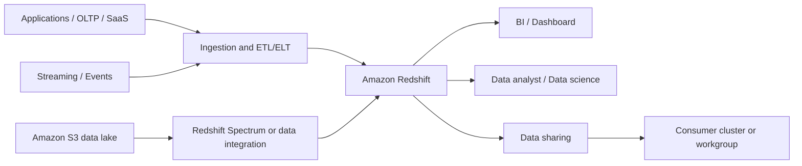
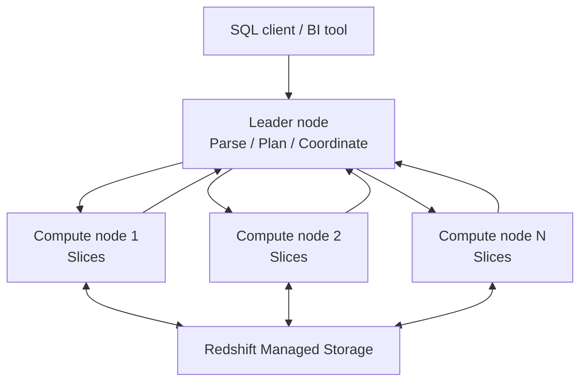
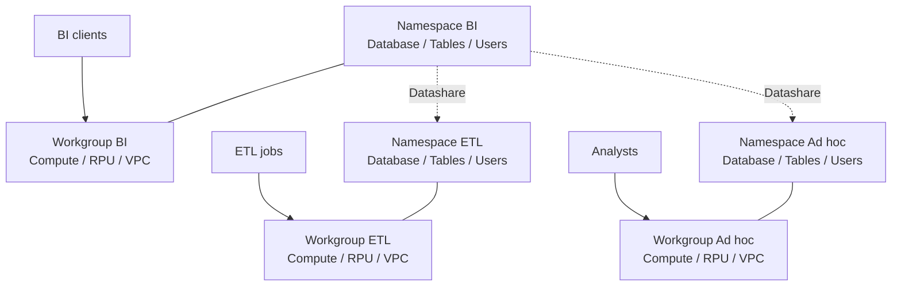

# Redshift Provisioned, Serverless, and Workload Management

Amazon Redshift is AWS's managed data warehouse service for analyzing structured and semi-structured data with SQL at scale. When designing a Redshift system, you must decide how compute is provisioned, how data is stored, and how resources are allocated across queries. AWS provides two primary deployment models: **Redshift provisioned** with clusters and nodes you choose, and **Redshift Serverless** where compute is provisioned automatically based on workload demand.

Both models share many SQL, security, and analytical capabilities. Key differences lie in compute management, scaling mechanics, billing models, and infrastructure control. Once you select a model, workload management (WLM) ensures ETL jobs, BI reports, and ad hoc queries coexist without one query group monopolizing resources.

## Learning Objectives

After this lesson, you will be able to:

- Describe provisioned cluster architecture and how Redshift Serverless separates namespaces from workgroups.
- Choose between provisioned and Serverless models based on load patterns, predictability, and control requirements.
- Manage nodes, resizing, pause/resume, base RPUs, and usage limits.
- Configure Auto WLM, query priorities, short query acceleration, query monitoring rules, and concurrency scaling.
- Analyze query plans, optimize tables, and use materialized views to improve performance.
- Monitor performance, costs, backups, and recovery for Redshift workloads.

## 1. Redshift in Data Analytics Architectures

Redshift is a columnar data warehouse that executes SQL queries in parallel across multiple compute units. A common analytics architecture ingests data from applications, operational databases, logs, and streaming systems into Amazon S3 or directly into Redshift. ETL/ELT standardizes data into fact and dimension tables; BI users, data analysts, and data scientists query data via SQL.



Redshift suits analytical queries, aggregations over large record counts, multi-dimensional reporting, and parallel read workloads. It is not a default replacement for OLTP transactional databases handling frequent low-latency single-row updates. Choose an appropriate transactional store and move analytical data into Redshift.

## 2. Two Deployment Models

| Criterion | Provisioned | Serverless |
|---|---|---|
| Compute unit | Cluster composed of nodes | Workgroup with capacity measured in RPUs |
| Capacity management | Choose node type and node count; resize proactively | Set base capacity, cap max capacity, and let the service auto-scale |
| Compute and storage separation | RG/RA3 use Redshift Managed Storage | Namespace stores databases and data; workgroup provides compute |
| Suitable workloads | Steady load, continuous operation, cluster-level tuning control | Variable load, bursty workloads, teams reducing capacity operations |
| Workload management | WLM in parameter groups, Auto or Manual WLM | Automatic capacity adjustment; still provides workload management and limits |
| Compute cost | By node and running cluster hours; eligible clusters can pause | By RPU-hours consumed |
| Operational control | Finer control over nodes, parameter groups, and cluster schedules | Focused on namespaces, workgroups, base/max RPUs, and usage limits |

Neither model is universally cheaper. Compare using real workloads: query durations, active hours, concurrency, data volume, latency requirements, and idle time. Benchmark with representative data before committing.

## 3. Redshift Provisioned: Clusters and Nodes

### 3.1 Cluster Architecture

A provisioned cluster has a leader node and compute nodes. The leader node accepts connections, parses SQL statements, builds execution plans, and coordinates work. Compute nodes store and process data in parallel; data is divided into slices so multiple parts of a query run concurrently.



In a multi-node cluster, the leader node coordinates while compute nodes perform most reads, joins, aggregations, and sorts. Thus, adding nodes increases parallel resources, though not every query speeds up linearly. Queries with skewed data distribution, large joins, or sequential execution steps can still become bottlenecks.

### 3.2 RG and RA3 with Redshift Managed Storage

For new deployments needing storage that scales independently of compute, evaluate RG or RA3 node types based on Region, features, and workload characteristics.

- **RA3** uses Redshift Managed Storage (RMS). Nodes have high-performance SSDs as local cache; durable data is managed on Amazon S3. Redshift automatically moves data between tiers as needed. You size compute for query performance and pay separately for consumed storage.
- **RG** is a node family based on AWS Graviton. RG also uses managed storage and includes a built-in data lake query engine running on cluster compute. With RA3, data lake queries typically use Amazon Redshift Spectrum.
- **Node type and node count** determine CPU, RAM, parallel slice capacity, and compute throughput. Size configurations around daily data processed, join sizes, concurrent queries, and SLAs.

Do not choose nodes based solely on total data volume. A warehouse with lots of cold data and few queries may need less compute than a smaller warehouse running many heavy concurrent queries. Managed storage decouples storage from compute sizing, though you still need to check per-node-type storage limits.

### 3.3 Resizing a Cluster

When load grows, you can increase node count or change node type. When load drops, you can resize down to cut compute costs.

| Method | How it works | When appropriate |
|---|---|---|
| Elastic resize | Changes node count or node type within supported bounds; typically finishes faster | Frequent capacity adjustments within elastic resize limits |
| Classic resize | Creates a target cluster and migrates data via backup/restore; typically takes longer | Major changes or configurations unsupported by elastic resize |

Elastic resize is usually the first choice when eligible. During certain resize phases, connections or queries may be interrupted; changing node types can terminate running queries. Classic resize can take significant time depending on data size. Schedule resizes during low-traffic windows, notify workload owners, and verify backups beforehand.

Resizes can be scheduled to scale up ahead of ETL windows or peak BI hours and scale down afterward. After resizing, inspect query latency, queue time, connection counts, and data distribution to confirm the change genuinely improved workloads.

### 3.4 Pause and Resume

For eligible provisioned clusters, you can pause when the warehouse does not need to serve queries and resume when needed. While paused, on-demand compute charges stop; storage charges continue. Redshift takes a snapshot when pausing and terminates active queries.

Pause/resume fits development, testing, or scheduled-only warehouses. While paused, clients cannot connect and query monitoring emits no new hardware metrics. Resuming can take several minutes; afterward, data hydrates back into cache so performance may take time to stabilize. Do not use pause on systems needing continuous querying or instant response SLAs.

## 4. Redshift Serverless: Namespaces and Workgroups

Serverless separates storage and compute into two management objects:

- **Namespace** holds database objects, schemas, tables, users, permissions, encryption settings, datashares, recovery points, and storage/security attributes.
- **Workgroup** is the set of compute resources executing queries. A workgroup holds VPC, subnet, security group, endpoint, and capacity configurations.

Each namespace can associate with only one workgroup, and each workgroup associates with only one namespace. This separation lets you manage data attributes and compute independently within a namespace/workgroup pair. If you need multiple isolated workgroups, create separate namespace/workgroup pairs and consider data sharing to share data between them.



### 4.1 RPU and Base Capacity

A Redshift Processing Unit (RPU) measures Serverless compute capacity. You pick a base capacity for a workgroup to set baseline resources. Higher capacity helps heavy workloads finish faster, while also increasing compute consumption.

Serverless can scale compute above base capacity automatically when workloads demand more resources. You can set maximum capacity to cap peak scaling. Automatic price-performance optimization balances cost and performance according to the workgroup's target—allowing priorities oriented toward cost savings, balance, or performance.

When changing price-performance targets, effects may not appear immediately. Observe the workload over an adequate period—such as several days—and evaluate query durations, RPU usage, and costs before drawing conclusions.

### 4.2 Usage Limits and Cost Control

Serverless supports capping RPU-hour consumption on a daily, weekly, or monthly cycle. When a limit is reached, you can log, emit metrics/alerts, or deactivate user queries. Additional limits can be configured for cross-Region shared data.

Distinguish two limit types:

- **Maximum capacity** caps peak compute a workgroup can scale to at any instant.
- **Maximum RPU-hours** caps cumulative compute consumed over a billing window.

Capping peak capacity alone does not keep total bills within budget if workloads run continuously. Conversely, usage limits can terminate queries when hit; select actions aligned with your SLAs. For production workloads, start with alerts and monitoring before enabling query deactivation.

### 4.3 When to Use Multiple Workgroups?

Creating separate namespace/workgroup pairs helps when ETL, BI, and ad hoc queries have distinct load patterns or need separate compute, network, and cost boundaries. For example, the BI pair has steady base capacity and latency targets; the ETL pair scales higher during ingestion windows; the ad hoc pair has tighter usage limits. When teams need shared datasets, share via datashares instead of trying to attach multiple workgroups to one namespace.

Do not create dedicated workgroups per individual user. Too many workgroups complicate monitoring, permissions, networking, and cost forecasting. Choose boundaries based on workload groups with clearly distinct requirements.

## 5. Choosing Provisioned vs. Serverless

| Situation | Option to Consider | Reason |
|---|---|---|
| Warehouse runs most of the day with steady load and concurrency | Provisioned | Size cluster to baseline with granular node control |
| Dev/test environment used only for specific hours | Provisioned with pause/resume or Serverless | Compare active-hour compute cost against operational overhead |
| Analytical load spikes sharply at specific times | Serverless | Service automatically scales capacity with workload |
| Need detailed cluster configuration and resize schedules | Provisioned | Control nodes, parameter groups, resizes, and pause/resume |
| Multiple teams need independent compute over shared data | Multiple Serverless namespace/workgroup pairs or multiple clusters with data sharing | Isolate compute and workloads per team |
| Organization already runs a stable cluster with DBA processes | Provisioned | Continue tuning existing setup if total cost and performance fit |

Practical selection workflow:

1. Measure the workload: queries per hour, durations, data scanned, concurrency, and idle periods.
2. Classify queries: ETL batch, interactive dashboards, ad hoc analysis, data science, and administrative tasks.
3. Define targets: p95/p99 latency, throughput, batch completion windows, and budget.
4. Estimate costs across candidate provisioned configurations and expected Serverless RPU consumption.
5. Benchmark using representative data, queries, and load schedules.
6. Evaluate operations: backups, networking, IAM, monitoring, capacity planning, and recovery procedures.

## 6. Workload Management (WLM)

WLM governs how Redshift allocates resources across queries. When multiple workloads share a warehouse, a large ETL query can consume memory and slots, forcing dashboards to wait. WLM lets you classify queries, set priorities, and monitor resource-heavy queries.

In provisioned, WLM settings live in a parameter group attached to the cluster. AWS recommends Auto WLM for most workloads. Serverless manages compute capacity automatically, yet still supports query queues and query monitoring rules to classify workloads, bound queries, and monitor performance. Serverless queues do not expose provisioned-style priority, slot, and concurrency scaling controls.

### 6.1 Auto WLM

Auto WLM dynamically determines concurrency and memory for queued queries. Heavy join queries may run at lower concurrency so they receive enough memory; lighter queries can run at higher concurrency. Administrators can create queues per workload group, set priorities, and attach query monitoring rules.

Auto WLM supports up to eight user queues. Priority levels are `highest`, `high`, `normal`, `low`, and `lowest`. Priority expresses relative importance between workloads; it does not substitute for fixing poor query plans or adding capacity when a warehouse is under-provisioned.

Example workload classification:

| Queue | Workload | Reference Priority |
|---|---|---|
| `etl` | Scheduled data loading and transformations | `high` during batch window |
| `bi` | Dashboards and interactive reporting queries | `highest` or `high` per SLA |
| `adhoc` | Exploratory data queries | `normal` or `low` |
| `maintenance` | Maintenance and validation tasks | Based on schedule and impact |

This is an illustrative classification, not a universal default. Measure queue wait times and execution times to set appropriate priorities. Marking every queue high priority defeats prioritization.

### 6.2 Manual WLM

Manual WLM lets administrators configure query slot counts and memory percentages per queue. This can fit specialized, thoroughly benchmarked workloads with strict static allocation needs. However, pre-allocated resources go idle when one queue is empty while another is overloaded.

If using Manual WLM, watch queue waits, query spills, and memory utilization. AWS recommends keeping total Manual WLM query slots at or below 15 in most cases; although a queue can be configured up to 50 slots, more slots do not automatically yield higher throughput.

### 6.3 Routing Queries with User Groups and Query Groups

WLM can route queries based on user groups, user roles, or query groups. A query group is a session-level label set by clients to tag queries from an application or job.

Example setting a query group for a session:

```sql
SET query_group TO 'etl';

-- ETL statements in this session are tagged with etl.
INSERT INTO analytics.daily_sales
SELECT order_date, region, SUM(amount)
FROM staging.orders
GROUP BY order_date, region;

RESET query_group;
```

Queues must be configured to match the exact query group or user group. If clients forget to reset the query group, subsequent statements in the same session retain the old label; set and reset labels inside connection management code.

### 6.4 Short Query Acceleration (SQA)

SQA automatically identifies short-running queries and executes them in dedicated resources so small queries do not wait behind long-running ones. SQA suits dashboards and short interactive queries, but does not cure queries that are slow due to massive scans or inefficient joins.

SQA can be enabled alongside Auto WLM. Compare queue and execution times before and after enabling to verify users actually experience improvements.

### 6.5 Query Monitoring Rules (QMR)

QMR tracks query metrics and triggers actions when thresholds are exceeded. On provisioned clusters, rules can log, abort queries consuming excessive resources, or adjust priority in Auto WLM. The `hop` action applies only to Manual WLM; `change_query_priority` applies to Auto WLM. On Serverless, rules support `log` and `abort` actions; `hop` and `change_query_priority` do not apply.

Example operational policies:

- Log queries exceeding target duration to analyze trends.
- Abort ad hoc queries scanning excessive rows beyond agreed limits.
- Lower priority of background workloads when interactive dashboards experience pressure.
- Emit alerts when queue wait rises continuously.

Base metrics and thresholds on empirical baselines. Avoid setting thresholds so tight that legitimate queries are routinely aborted. Validate rule actions on test workloads before rolling out to production. On Serverless, suitable metrics include query execution time, queue time, scan row count, blocks read, temporary blocks to disk, and rows joined; do not rely on CPU time/CPU percentage metrics removed from Query Limits.

### 6.6 Concurrency Scaling

Concurrency scaling temporarily expands compute for provisioned clusters when concurrent query demand exceeds queue capacity. With `auto` mode enabled on an eligible queue, Redshift routes eligible queries to concurrency scaling clusters to cut queue wait times. Once the primary cluster frees slots, new queries run on the primary cluster again.

Concurrency scaling helps read workloads with sharp spikes, such as many dashboards refreshing at the top of the hour. Certain queries are ineligible—for example, queries using temporary tables, interleaved sort keys, system tables, or certain UDFs and external resources with network restrictions. Never assume every query will scale out.

Concurrency scaling charges depend on active query runtime on scaling clusters; track usage and credits under current Regional pricing. It is a provisioned concurrency mechanism and does not replace fixing query plans or sizing baseline clusters. Serverless manages scaling automatically and does not configure concurrency scaling queues like provisioned.

### 6.7 Query Queues on Serverless

Redshift Serverless supports queue-based query resource management. You can create up to eight query queues per workgroup and route by user role or query group. Each queue can have its own monitoring rules—up to 25 rules total, each with up to three predicates. If dedicated queues are not enabled, workgroup-level query monitoring applies across all queries.

Unlike provisioned, Serverless manages compute allocation automatically. Serverless queues do not let you configure query slots, memory percentages, or priorities; `hop` and `change_query_priority` actions are also unsupported. Serverless rules use `log` or `abort`. You can define queues such as `bi`, `etl`, and `adhoc` to apply tailored monitoring thresholds per workload without statically carving up compute.

For instance, a workgroup queue configuration can route dashboards tagged with query group `bi` under a strict runtime threshold while logging long-running ETL queries for review. Enabling query queues is a permanent change: once enabled, you cannot revert to queue-less monitoring. Design queue names, roles, query groups, and rules carefully before enabling in production.

## 7. Query Optimization and Table Design

WLM determines how queries are queued and allocated resources. Query tuning determines how much data queries must read, move, and process. Both are needed to improve latency and throughput.

### 7.1 Reading Query Plans with EXPLAIN

`EXPLAIN` displays the projected execution plan without running the query. Use it to spot large scans, expensive sorts, poor joins, and cross-node data redistribution.

```sql
EXPLAIN
SELECT d.region, SUM(f.net_amount) AS revenue
FROM fact_sales AS f
JOIN dim_customer AS d
  ON f.customer_id = d.customer_id
WHERE f.sale_date >= DATE '2026-01-01'
GROUP BY d.region;
```

When reading the plan, look for:

- `DS_DIST_BOTH` may indicate both sides of a join must be redistributed.
- `DS_BCAST_INNER` broadcasts the inner table to all nodes; reasonable for small tables, expensive for large ones.
- `Nested Loop` often signals a need to review join predicates or query structure.
- Sorts or scans dominating cost should be investigated via filters, sort keys, distribution, and column selection.

Costs in `EXPLAIN` are relative measures across steps of one query plan, not actual wall-clock durations. After running the query, inspect execution details to compare actual row counts, bytes, queue time, and runtime.

### 7.2 Distribution Style

Redshift distributes table rows across compute nodes according to distribution style, aiming to minimize data movement during joins and aggregations.

| Distribution Style | Behavior | Common Use Case |
|---|---|---|
| `AUTO` | Redshift selects automatically and can adapt as size and workload evolve | Good starting point for most tables |
| `EVEN` | Distributes rows round-robin across slices | No clear join key or table rarely participates in joins |
| `KEY` | Distributes by values of one column | Large fact/dimension tables frequently joined on the same unskewed key |
| `ALL` | Copies the entire table to every node | Small, heavily read dimensions where storage/write overhead is acceptable |

When using `KEY`, choose a column with suitable cardinality and distribution. A key with many duplicate values causes skew, forcing one node to process far more data than others. For small dimensions, `ALL` avoids join broadcasts at the cost of extra storage and write overhead.

### 7.3 Sort Key

Sort keys dictate physical storage order of data blocks. Redshift stores min/max block metadata and can skip blocks outside filter predicates. If dashboards consistently filter by date ranges, the date column is a strong sort key candidate.

For new tables, `SORTKEY AUTO` lets Redshift pick sort keys based on query patterns. Only pin manual sort keys once workloads stabilize and benchmarks prove the manual choice outperforms `AUTO`. Avoid wrapping sort-key columns in functions or unnecessary casts in `WHERE` predicates, as that can inhibit block pruning.

### 7.4 Automatic Table Optimization and Maintenance

Automatic table optimization (ATO) monitors workloads and adjusts sort keys and distribution styles to improve performance. Leaving tables on `AUTO` reduces upfront physical design guesswork. Check recommendations and change history in system views such as `SVV_ALTER_TABLE_RECOMMENDATIONS` and `SVL_AUTO_WORKER_ACTION` when investigating.

Redshift also performs automatic maintenance such as vacuum sort, vacuum delete, and analyze. Avoid running `VACUUM` or `ANALYZE` on rigid schedules without checking table state and background activity. Inspect unsorted row percentages, statistics, and vacuum/analyze history before intervening manually.

### 7.5 Materialized Views

Materialized views persist query results so later queries read precomputed answers. Redshift can automatically rewrite queries to leverage an eligible materialized view even when the query does not reference the view directly, provided the view is up to date and meets rewrite conditions.

```sql
CREATE MATERIALIZED VIEW mv_daily_sales AS
SELECT sale_date, region, SUM(net_amount) AS revenue
FROM fact_sales
GROUP BY sale_date, region;

-- Refresh materialized view results when needed.
REFRESH MATERIALIZED VIEW mv_daily_sales;

SELECT region, SUM(revenue)
FROM mv_daily_sales
WHERE sale_date >= DATE '2026-01-01'
GROUP BY region;
```

Automatic refresh can be configured so Redshift updates the view when source data changes and resources allow. When strict data freshness SLAs apply, choose appropriate refresh schedules and measure refresh runtime. Stale views may not qualify for automatic query rewrite; balance data freshness, refresh cost, and query latency.

## 8. Managing ETL and BI Loads

A warehouse typically serves diverse query patterns:

| Workload | Characteristics | Management Strategy |
|---|---|---|
| ETL/ELT batch | Heavy scans and writes, scheduled windows | Provisioned: dedicated queue; Serverless: role/query-group queue; monitor spills and completion time |
| BI dashboard | Repetitive queries needing steady latency | Provisioned: priority/SQA; Serverless: query queue with tailored thresholds; use materialized views where helpful |
| Ad hoc analytics | Unpredictable patterns, potentially large scans | Provisioned: lower priority and QMR; Serverless: query monitoring rules and usage limits |
| Data science | Experimental queries, variable joins and aggregations | Separate workload groups or namespace/workgroup pairs when compute isolation is needed |

To protect dashboards while ETL runs, give BI queues higher priority, bound ad hoc queries, and avoid heavy ingestion during peak hours. On provisioned, use Auto WLM priority and SQA; on Serverless, configure workload-specific query queues and monitoring rules. When workloads demand strong isolation, separate compute via dedicated namespace/workgroup pairs or consumer clusters using data sharing.

### Data Sharing for Compute Isolation

Redshift data sharing lets a producer share live data with consumer clusters or workgroups without copying data via separate ETL pipelines. Consumers query using their own compute while data remains governed by the producer. This works well when multiple teams analyze the same dataset yet require independent workload control.

For cross-account data sharing, the producer authorizes the consumer account and the consumer administrator associates the datashare. Both producer and consumer clusters must be encrypted for cross-account sharing. Write permissions on a datashare exist only when explicitly granted by the producer and permitted on the consumer side; never assume datashares are always read-only or always writable—verify granted privileges.

## 9. Cost Models and FinOps

### 9.1 Provisioned

Provisioned cost is driven mainly by node type, node count, cluster uptime, and storage consumed. With RG/RA3, compute and managed storage are billed independently, letting you scale compute up or down without resizing storage correspondingly. Snapshots, data transfer, and related services add incremental costs.

Pausing eligible clusters cuts compute costs during idle hours, though storage charges continue. If frequent resumes and cache hydration delays hurt productivity, cost savings may be offset by startup latency and user friction.

### 9.2 Serverless

Serverless bills compute by RPU-hours consumed and storage by stored volume. Higher base capacity can speed up execution while also raising baseline consumption. After scaling up, elevated capacity can remain active briefly as load subsides; monitor usage limits and actual billing.

Compute usage is billed by duration with a per-session minimum charge. Querying system tables also consumes compute. For S3 data lake queries, Serverless bills by compute duration rather than adding a separate Spectrum charge as in some older models. Always cross-check Regional pricing and workload profiles before forecasting.

### 9.3 Cost Controls

- Tag resources by owner, environment, cost center, and workload for cost allocation.
- Set usage limits and CloudWatch/SNS alerts for Serverless; use maximum capacity to cap peak RPUs.
- For provisioned, measure baseline utilization and right-size node counts/types; schedule resizes and pause/resume where suitable.
- Optimize query scans, distribution, and materialized views to cut compute time.
- Monitor storage growth, snapshot retention, cross-Region data sharing, and unused datasets.
- Measure unit economics—such as cost per completed batch or cost per dashboard refresh—rather than raw RPU-hours or node-hours alone.

## 10. Security and Data Protection

Redshift runs inside a VPC and supports encryption at rest with AWS KMS. Restrict inbound traffic with security groups, use private connectivity when public endpoints are unnecessary, and manage permissions with IAM roles. Workloads reading/writing S3 via `COPY` or `UNLOAD` must attach an IAM role to the cluster/workgroup scoped strictly to required buckets/prefixes.

Operational principles:

- Separate cluster/workgroup administration, database access, and S3 read/write permissions.
- Use IAM authentication or secure credential management; never hardcode passwords in code or pipelines.
- Enable audit logging and monitor connections, configuration changes, and sensitive queries.
- Apply least-privilege KMS key policies and IAM policies; verify key permissions for snapshot restores and data sharing.
- Segment subnets and security groups by network architecture; control access paths from BI, ETL, and dev environments.
- For cross-account data sharing, verify both producer authorization and consumer association.

## 11. Backup, Snapshots, and Recovery

### 11.1 Provisioned

Provisioned clusters support automated and manual snapshots. Snapshots allow restoring clusters after operational mistakes or data incidents. Set retention based on RPO, RTO, and compliance requirements; if Regional resilience is required, evaluate cross-Region snapshot copying.

Before major changes such as resizes, migrations, or structural overhauls, confirm a recent snapshot exists and restore procedures have been tested. An untested snapshot does not prove the system meets RTO.

### 11.2 Serverless

Serverless creates periodic recovery points automatically—typically every 30 minutes or after crossing a per-node data change threshold; automatic recovery points are retained for 24 hours. Manual snapshots can also be created for longer retention.

Snapshots can be restored between Serverless and provisioned along supported paths. Restoring a snapshot into a Serverless namespace replaces current database data in the target namespace with the snapshot contents. Treat this as a major data change requiring explicit approval and post-restore validation.

Serverless restores can complete in two phases: data becomes queryable early while background database optimization continues. During the latter phase, performance may initially vary and stabilize over time.

## 12. Workload Monitoring and Diagnostics

Do not look only at CPU or total query count. Break query duration into queue time, execution time, and data processing phases to distinguish compute shortages from inefficient query plans.

| Signal | Question to Answer | Action Path |
|---|---|---|
| Rising queue time | Are queries waiting on competing workloads? | Inspect WLM, concurrency, priorities, and ETL schedules |
| Rising execution time | Did the query plan or data volume read change? | Check `EXPLAIN`, `SYS_QUERY_DETAIL`, scans/joins/sorts |
| Rising RPU usage | Is Serverless scaling for real load or inefficient queries? | Inspect query history, maximum capacity, and usage limits |
| Sustained high CPU or node utilization | Is baseline compute undersized? | Optimize queries first, then benchmark a resize |
| Rapid disk/storage growth | Where are data, staging tables, or snapshots growing? | Audit retention, staging cleanup, and snapshot policies |
| Aborted queries | Did QMR, usage limits, or SQL errors trigger the abort? | Inspect rules, query history, and error messages |

### 12.1 SYS Monitoring Views

`SYS_QUERY_HISTORY` provides query history covering DDL, DML, `COPY`, `UNLOAD`, and Spectrum queries. `SYS_QUERY_DETAIL` exposes multi-level execution metrics. These views are the right starting point for investigating slow queries on modern Redshift deployments.

Example inspecting recent queries:

```sql
SELECT
    query_id,
    query_type,
    status,
    start_time,
    elapsed_time,
    queue_time,
    execution_time,
    LEFT(query_text, 300) AS query_text
FROM sys_query_history
ORDER BY start_time DESC
LIMIT 20;
```

Visibility into system views depends on the principal. Standard users may see only their own queries; superusers see broader scope. When migrating from provisioned to Serverless, legacy monitoring queries built on provisioned-only STL/STV/SVL tables must be updated to `SYS` monitoring views.

### 12.2 Slow Query Investigation Workflow

1. Locate `query_id` in `SYS_QUERY_HISTORY` and check status, queue time, and execution time.
2. If queue time is high, examine WLM queues, priorities, concurrency, and QMR.
3. If execution time is high, run `EXPLAIN` on an equivalent statement and inspect the plan.
4. Check `SYS_QUERY_DETAIL` to pinpoint expensive scan, join, sort, or redistribution steps.
5. Inspect table statistics, sort/distribution keys, skew, and materialized views.
6. Re-benchmark under comparable conditions and compare p50/p95 latency, bytes scanned, and cost.

## 13. Common Operational Scenarios

### Scenario A: Dashboards Slow Down at the Top of the Hour

Many dashboards refresh simultaneously while ETL is still running. Check queue time first. On provisioned, separate BI and ETL queues, adjust priorities, or enable SQA for short queries; evaluate concurrency scaling for eligible queries. On Serverless, apply workload-specific query queues and monitoring rules. If BI demands dedicated compute, consider a consumer cluster or another namespace/workgroup pair via data sharing.

### Scenario B: Unexpected Serverless Bill Spike

Check RPU-hours by workgroup and how long capacity remained scaled up. Identify top consumers in `SYS_QUERY_HISTORY`; inspect query details for full scans, bad joins, or application query loops. Configure maximum capacity, usage limits, and budget alerts. Do not blindly lower base RPU if doing so prolongs queries and increases total compute time.

### Scenario C: ETL Still Slow After Adding Nodes

Adding nodes will not resolve data skew or heavy redistribution. Use `EXPLAIN` and query details to inspect data movement, `DISTKEY` choices, filters, and post-filter table sizes. Re-benchmark after refining table design.

### Scenario D: Provisioned Cluster Used Only During Business Hours

Measure actual active query hours versus idle hours. If resume latency is acceptable, schedule pause/resume and send pre-pause warnings. Confirm no pipelines, datashare consumers, or admin jobs depend on the cluster during paused hours.

### Scenario E: Queries Are Slow Immediately After Restore

Check restore status and background tuning state. On Serverless, data becomes queryable before background optimization finishes. Track performance over time and verify plans and statistics before concluding capacity is insufficient from the first few post-restore queries.

## 14. Hands-On: Classifying and Monitoring Workloads

Suppose a retail enterprise runs three workloads: hourly order ingestion, regional revenue dashboards, and ad hoc analyst queries. The goal is steady low latency for dashboards, on-time ETL before business hours, and bounded ad hoc query costs.

### Step 1: Classify Workloads

| Workload | Label | Objective |
|---|---|---|
| Data ingestion | `etl` | Complete batches on schedule |
| Dashboards | `bi` | Maintain steady latency |
| Analysts | `adhoc` | Allow exploration within reasonable guardrails |

### Step 2: Set Query Group in the Application

```sql
SET query_group TO 'bi';
SELECT region, SUM(net_amount)
FROM analytics.daily_sales
WHERE sale_date >= CURRENT_DATE - 7
GROUP BY region;
RESET query_group;
```

On provisioned, configure Auto WLM queues to route `bi`, `etl`, and `adhoc` labels and set matching priorities. On Serverless, configure query queues and monitoring rules in the workgroup to route labels per workload. When independent compute/network boundaries are required, create separate namespace/workgroup pairs and use datashares for shared data.

### Step 3: Inspect Query Plan and History

```sql
EXPLAIN
SELECT region, SUM(net_amount)
FROM analytics.daily_sales
WHERE sale_date >= CURRENT_DATE - 7
GROUP BY region;

SELECT query_id, status, queue_time, execution_time,
       LEFT(query_text, 200) AS query_text
FROM sys_query_history
WHERE start_time >= DATEADD(hour, -2, GETDATE())
ORDER BY start_time DESC;
```

Compare queue time against execution time. If queue time increases, check classification and concurrency. If execution time increases, check scans, sorts, joins, and source data changes.

### Step 4: Configure Limits and Alerts

- Set daily/weekly/monthly RPU usage limits on Serverless workgroups.
- Choose log or alert actions before considering deactivation.
- Create QMR rules for queries exceeding benchmarked resource thresholds; on Serverless, use per-workload query queues/rules.
- Monitor query latency, queue waits, RPU-hours, and costs by workload owner.

### Step 5: Test One Change at a Time

Adjust one variable at a time: priority, base capacity, maximum capacity, distribution style, or materialized views. Run the same query suite under comparable data and concurrency. Record p50/p95 latency, throughput, cost, and side effects on other workloads before rolling out broadly.

## 15. Production Deployment Checklist

- [ ] Choose provisioned or Serverless based on benchmarks and cost modeling.
- [ ] Define Region, VPC, subnets, security groups, and private endpoints.
- [ ] Establish least-privilege IAM roles for administration, workloads, and S3 access.
- [ ] Enable KMS encryption and verify key policies.
- [ ] Classify ETL, BI, ad hoc, and data science workloads.
- [ ] For provisioned, configure Auto WLM, priorities, SQA, and QMR from baselines; for Serverless, configure appropriate query queues and query monitoring rules.
- [ ] Enable concurrency scaling only for eligible provisioned queues and queries.
- [ ] Track query history, queue time, execution time, and cost.
- [ ] Use `AUTO` for sort/distribution until empirical evidence warrants manual overrides.
- [ ] Define snapshot retention, recovery points, and RPO/RTO targets.
- [ ] Test restores, resizes, pause/resume, or usage-limit actions in non-production environments.
- [ ] Review datashare permissions and producer/consumer responsibilities.
- [ ] Attach cost allocation tags and assign owners accountable for budgets.

## 16. Common Misconceptions

| Misconception | Accurate Understanding |
|---|---|
| Serverless means zero configuration needed | Still requires designing namespaces, workgroups, networking, security, base/max RPUs, and usage limits |
| Provisioned is always faster than Serverless | Performance depends on workload, capacity, query plans, and concurrency; benchmark both |
| Adding nodes speeds up every query | Data skew, redistribution, query plans, and sequential steps can remain bottlenecks |
| WLM priority fixes slow queries | Priority only governs queuing/ordering; bad query plans still need tuning |
| Concurrency scaling handles all queries | Only eligible queries route to concurrency scaling clusters |
| Maximum RPU and RPU-hours are the same limit | One caps peak instantaneous capacity; the other caps cumulative compute over a cycle |
| Pausing a cluster eliminates all charges | Compute billing pauses, while storage charges continue |
| `EXPLAIN` shows actual execution time | `EXPLAIN` shows the plan and relative cost without executing the query |
| Materialized views always hold the latest data | Requires refresh; automatic rewrite uses views meeting freshness conditions |
| Taking a snapshot guarantees a successful restore | Restores must be tested and actual recovery times measured |

## References

- [Amazon Redshift provisioned clusters](https://docs.aws.amazon.com/redshift/latest/mgmt/working-with-clusters.html)
- [Workgroups and namespaces in Redshift Serverless](https://docs.aws.amazon.com/redshift/latest/mgmt/serverless-workgroup-namespace.html)
- [Compute capacity for Redshift Serverless](https://docs.aws.amazon.com/redshift/latest/mgmt/serverless-capacity.html)
- [Billing for Redshift Serverless](https://docs.aws.amazon.com/redshift/latest/mgmt/serverless-billing.html)
- [Setting Serverless usage limits](https://docs.aws.amazon.com/redshift/latest/mgmt/serverless-workgroup-max-rpu.html)
- [Setting query queues for Redshift Serverless](https://docs.aws.amazon.com/redshift/latest/mgmt/serverless-workgroup-query-queues.html)
- [Workload management](https://docs.aws.amazon.com/redshift/latest/mgmt/workload-mgmt-config.html)
- [Implementing automatic WLM](https://docs.aws.amazon.com/redshift/latest/dg/automatic-wlm.html)
- [Query priority](https://docs.aws.amazon.com/redshift/latest/dg/query-priority.html)
- [Concurrency scaling](https://docs.aws.amazon.com/redshift/latest/dg/concurrency-scaling.html)
- [Resizing a cluster](https://docs.aws.amazon.com/redshift/latest/mgmt/resizing-cluster.html)
- [Pausing and resuming a cluster](https://docs.aws.amazon.com/redshift/latest/mgmt/rs-mgmt-pause-resume-cluster.html)
- [Automatic table optimization](https://docs.aws.amazon.com/redshift/latest/dg/c_ato-enabling-disabling-monitoring.html)
- [Distribution styles](https://docs.aws.amazon.com/redshift/latest/dg/c_choosing_dist_sort.html)
- [Choosing a sort key](https://docs.aws.amazon.com/redshift/latest/dg/c_best-practices-sort-key.html)
- [Creating and interpreting a query plan](https://docs.aws.amazon.com/redshift/latest/dg/c-the-query-plan.html)
- [Materialized views](https://docs.aws.amazon.com/redshift/latest/dg/materialized-view-overview.html)
- [SYS_QUERY_HISTORY](https://docs.aws.amazon.com/redshift/latest/dg/SYS_QUERY_HISTORY.html)
- [SYS_QUERY_DETAIL](https://docs.aws.amazon.com/redshift/latest/dg/SYS_QUERY_DETAIL.html)
- [Snapshots and recovery points for Serverless](https://docs.aws.amazon.com/redshift/latest/mgmt/serverless-snapshots-recovery-points.html)
- [Sharing data across AWS accounts](https://docs.aws.amazon.com/redshift/latest/dg/across-account.html)
