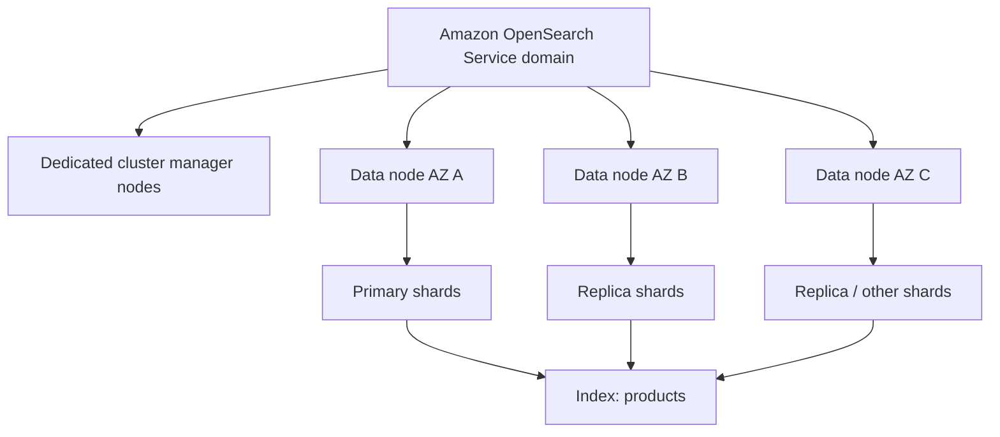

# Amazon OpenSearch Service and Search Index Design

An e-commerce application might store millions of products, articles, or events. Users expect keyword search, filtering by price and category, sorting by time or relevance, and fast results even as data updates continuously. Transactional databases are typically optimized for keyed lookups and transactional consistency; they are not always suited for full-text search, log analytics, or approximate vector similarity queries.

Amazon OpenSearch Service is an AWS-managed service for searching, analyzing, and visualizing data with OpenSearch. Data is organized as documents inside indexes; mappings define field types and analysis rules; shards distribute an index across data nodes; replicas improve fault tolerance and can boost read capacity. Index design directly affects query latency, write throughput, storage footprint, scalability, and cost.

Within the AWS ecosystem, OpenSearch can ingest data from Amazon Kinesis Data Streams, Amazon Data Firehose, Amazon S3, AWS Lambda, Amazon CloudWatch, and Java applications. Search results power APIs, dashboards, log analytics, anomaly detection, and semantic search/RAG applications. This lesson focuses on choosing deployment models, designing documents and mappings, sizing shards, managing index lifecycles, security, and operations.

## Learning Objectives

After this lesson, you will be able to:

- Explain domains, clusters, nodes, indexes, documents, shards, replicas, and mappings.
- Distinguish Amazon OpenSearch Service provisioned domains from OpenSearch Serverless collections.
- Choose document structures, field types, analyzers, and dynamic mapping settings by query pattern.
- Design primary shards, replicas, index templates, aliases, and data streams.
- Optimize bulk indexing, refresh intervals, queries, and pagination.
- Manage time-based indexes with Index State Management (ISM), UltraWarm, and cold storage.
- Secure domains/collections with VPCs, IAM, fine-grained access control, encryption, and network/data access policies.
- Monitor performance, troubleshoot shard imbalance, and scale capacity.

## What Is Amazon OpenSearch Service?

Amazon OpenSearch Service is a managed service built on OpenSearch, a distributed search and analytics engine. The service supports two primary deployment models:

1. **Provisioned domain:** AWS manages hardware, software, and baseline operations, while you choose instance types, node counts, storage, Availability Zones, shard layouts, replicas, index lifecycles, and cluster settings.
2. **OpenSearch Serverless:** you create collections and indexes; the service automatically manages compute/storage infrastructure, capacity scaling, and most operational tasks. You still design mappings, documents, queries, collection policies, and data access.

OpenSearch is commonly used for:

- **Full-text search:** searching products, documents, articles, or customer support content.
- **Log analytics and observability:** analyzing application logs, traces, infrastructure events, and security events.
- **Time-series analytics:** querying timestamped data over time windows.
- **Vector search:** finding documents or products by embedding semantics for semantic search and RAG.
- **Dashboards and analytics:** aggregating, filtering, visualizing, and exploring data.

OpenSearch is not the single transactional system of record for every application. In many architectures, a database or data lake remains the source of truth; OpenSearch holds a search-optimized projection that can be rebuilt from source when needed.

## Domains, Clusters, Nodes, and Indexes

In a provisioned domain, core concepts relate as follows:

| Component | Meaning | Design Role |
|---|---|---|
| Domain | Managed OpenSearch Service environment in a Region | Deployment, endpoint, security, and scaling boundary |
| Cluster | Group of nodes coordinating data storage and processing | Distributes indexes, queries, and replication |
| Cluster manager node | Coordinates cluster state, mappings, indexes, and shard allocation | Dedicated managers offload coordination from data nodes |
| Data node | Stores shards and executes indexing/search | CPU, RAM, JVM heap, disk, and network dictate performance |
| Index | Collection of documents sharing mappings and settings | Unit of schema, shard, replica, and lifecycle design |
| Document | A JSON record | Unit of search and update |
| Primary shard | Primary partition of index data | Partitions data and parallelizes processing |
| Replica shard | Copy of a primary shard | Fault tolerance and serving read queries |
| Mapping | Defines field types and how fields are indexed | Determines semantics, storage footprint, and query capabilities |



The diagram illustrates a Multi-AZ domain. Actual shard allocation is managed by OpenSearch and influenced by replica counts, awareness attributes, node counts, disk watermarks, and deployment options.

### Documents and Indexes

A document is a JSON payload describing an entity your application searches. In a product catalog, each document might represent an SKU or variant. In log analytics, each document might be a log event. Choose document boundaries around how the application queries, updates, and deletes data.

Avoid stuffing every relational table into one index as if OpenSearch were a relational database. OpenSearch favors denormalized documents where fields needed for filtering, sorting, and display sit together. When related entities change, pipelines must update the corresponding documents.

### Primary Shards and Replicas

An index is split into one or more primary shards. Each document routes to a primary shard based on document ID and routing. A replica is a copy of a primary shard placed on a different node—and in Multi-AZ architectures, across different AZs for fault tolerance.

Replicas provide two main benefits:

- Maintain data copies if a node or AZ fails.
- Distribute read queries across copies, increasing read throughput when workloads permit.

Replicas also consume storage, CPU, network bandwidth, and add write replication work. Adding replicas does not raise write throughput of an individual primary shard; if indexing bottlenecks, inspect primary shards, mappings, bulk sizing, refresh intervals, and node capacity.

## Provisioned Domain vs. OpenSearch Serverless

| Criterion | Provisioned Domain | OpenSearch Serverless |
|---|---|---|
| Deployment unit | Domain/cluster composed of nodes | Collection containing one or more indexes |
| Capacity | Select instance types/counts, storage, shards, and replicas | Service auto-scales via OpenSearch Compute Units (OCUs) |
| Operations | Responsible for sizing, shards, nodes, lifecycles, and configured upgrades | AWS manages most cluster, shard/lifecycle, and software updates |
| Cost optimization | Suits steady loads needing granular resource control | Suits variable, intermittent, or unpredictable loads; has minimum capacity/OCU costs per config |
| Index features | Broad access to service-supported OpenSearch APIs and features | Some APIs/features differ from domains; no user-managed node/cluster concepts |
| Workload types | Search, log analytics, time-series, vector, and deep-tuning use cases | Search, Time series, and Vector search collection types |
| Lifecycle | Supports ISM, UltraWarm, and cold storage per configuration | Service manages capacity/lifecycle by collection type and data lifecycle policies |

### When to Choose a Provisioned Domain?

Provisioned fits when:

- Workloads are steady and CPU, RAM, storage, ingest rates, and query concurrency are predictable.
- You need control over shard counts, replicas, instance families, EBS, dedicated cluster managers, and topology.
- You need domain-specific capabilities such as UltraWarm/cold tiers or deep tuning.
- An operations team is ready to monitor cluster health, shard allocation, JVM pressure, and software upgrades.

### When to Choose Serverless?

Serverless fits when:

- Traffic is irregular, bursty, or hard to forecast.
- You want to eliminate node, cluster, shard, and software maintenance.
- Workloads fit Serverless-supported collection types and APIs.
- You can manage costs via min/max indexing/search OCUs and shared capacity within collection groups.

Serverless measures capacity in OCUs, where each OCU bundles memory and compute. Collection groups let you set separate minimum/maximum OCUs for indexing and search. Minimum OCUs help avoid cold starts when scaling from zero; maximum OCUs cap scaling as a budget guardrail. Search and vector collections keep data on hot indexes for low latency; time-series collections can combine hot and warm storage. Check collection types, quotas, and Regional pricing before designing.

Serverless does not eliminate schema design. You still need accurate mappings, sensible documents, efficient queries, access policies, and retention rules. However, do not blindly apply provisioned domain shard/node sizing rules to Serverless since the service manages that layer.

## Designing Documents and Mappings

Mappings define how OpenSearch stores, analyzes, and queries each field. Choose field types based on operations the application performs rather than mechanically copying input JSON types.

### `text` and `keyword`

The two most important string types:

- `text`: analyzes strings into tokens for full-text search. Fits product titles, descriptions, article bodies, and word-matched fields.
- `keyword`: preserves the exact value as a single term for exact matches, filtering, sorting, and aggregations. Fits SKUs, order IDs, statuses, category IDs, emails, or canonical names.

A field often needs both capabilities via multi-fields:

```json
{
  "mappings": {
    "properties": {
      "product_name": {
        "type": "text",
        "fields": {
          "raw": { "type": "keyword", "ignore_above": 256 }
        }
      }
    }
  }
}
```

A `match` query on `product_name` uses text analysis; exact filters or aggregations on canonical names use `product_name.raw`. When sorting by strings, typically use `keyword` or a field with appropriate `doc_values` rather than `text`.

### Common Field Types

| Type | Used For | Notes |
|---|---|---|
| `keyword` | IDs, codes, categories, statuses, tags | Exact match, sorting, and aggregations |
| `text` | Titles, descriptions, bodies | Analyzer tokenizes text; not used directly for standard aggregations/sorts |
| `long`, `integer`, `double`, `scaled_float` | Prices, quantities, scores | Choose appropriate precision and units |
| `date` | Timestamps, created dates, event times | Standardize timezones and formats |
| `boolean` | Status flags | Avoid representing booleans as arbitrary strings |
| `ip` | IPv4/IPv6 addresses | Supports IP/CIDR range queries |
| `geo_point` | Geographic coordinates | Fits geo-distance and bounding-box queries |
| `object` | Nested JSON objects | Subfields are indexed independently; object arrays can flatten cross-element relationships |
| `nested` | Object arrays needing per-element correlation | More resource-intensive; use when queries bind multiple fields within the same object |
| `knn_vector` | Embedding vectors | Dimension must match model output and vector search config |

### Object or Nested?

Suppose a product has multiple variants:

```json
{
  "variants": [
    { "color": "black", "size": "M", "stock": 4 },
    { "color": "white", "size": "L", "stock": 9 }
  ]
}
```

If `variants` is `object`, OpenSearch flattens subfields so a query could match `color=black` from the first object together with `size=L` from the second object. If business rules require color and size to belong to the exact same variant, use `nested` to isolate each object and query with a `nested` query. Nested fields add indexing/search overhead; use them only when those semantics are required.

### Dynamic Mapping and Mapping Explosion

Dynamic mapping automatically adds fields when new properties appear. While handy for prototypes, it is risky if producers emit uncontrolled fields, dynamic field names, or deeply nested objects. Excessive fields bloat cluster state, memory, mapping metadata, and index management times.

Common modes:

- `dynamic: true`: automatically infers and adds new fields.
- `dynamic: false`: stores undeclared fields in `_source` without indexing them.
- `dynamic: strict`: rejects documents containing undeclared fields.

For production indexes with clear data contracts, declare explicit mappings and consider `strict`. For evolving sources, `false` or dynamic templates balance data retention with mapping control. Never raise `total_fields.limit` to mask producers sending uncontrolled schemas; identify which fields actually need to be searchable.

### Analyzers and Full-Text Search

Analyzers determine how text is normalized and tokenized during indexing and querying. An analyzer typically combines character filters, a tokenizer, and token filters.

Example custom analyzer using standard tokenizer, lowercase, and asciifolding:

```json
{
  "settings": {
    "analysis": {
      "analyzer": {
        "product_text": {
          "type": "custom",
          "tokenizer": "standard",
          "filter": ["lowercase", "asciifolding"]
        }
      }
    }
  },
  "mappings": {
    "properties": {
      "title": {
        "type": "text",
        "analyzer": "product_text",
        "search_analyzer": "product_text"
      }
    }
  }
}
```

Test analyzers using `_analyze` on representative samples. Diacritic languages such as Vietnamese, proper nouns, product codes, and synonyms may require tailored tokenization/synonym strategies. Do not assume default analyzers understand domain-specific language. For custom plugins or dictionaries, check OpenSearch Service support, package upload workflows, and blue/green deployment impacts before using in production.

## Choosing Primary Shard and Replica Counts

Shard count is a critical decision before indexing data. In OpenSearch, the primary shard count of an existing index cannot be changed directly like an ordinary setting. Changing primary counts requires split/shrink where eligible, or creating a new index and reindexing.

### Shard Sizing

AWS recommends these reference targets:

- Roughly 10–30 GiB per shard for latency-sensitive search workloads.
- Roughly 30–50 GiB per shard for write-heavy workloads such as log analytics.
- Avoid oversized shards; 50 GiB is a common upper target to keep recovery and relocation manageable.
- Avoid excessive tiny shards because every shard carries CPU, memory, and cluster metadata overhead.

These are guidelines, not hard quotas for every workload. For Multi-AZ with Standby, AWS imposes specific limits on shard size and total shard count; verify domain/version rules before sizing.

### Estimating Shard Count

Estimate total index size after indexing rather than relying solely on raw JSON size. Analyzers, doc values, inverted indexes, stored fields, vectors, and compression alter the source-to-index ratio.

```text
estimated_index_size = source_data_size * measured_index_ratio
primary_shards = ceil(estimated_index_size / target_shard_size)
total_shard_copies = primary_shards * (1 + replica_count)
```

For example, raw JSON data is 100 GiB. After testing, the measured index/source ratio is 1.2, yielding an estimated 120 GiB index. With a 20 GiB target shard size:

```text
primary_shards = ceil(120 / 20) = 6
replicas = 1
total_shard_copies = 6 * (1 + 1) = 12
```

Thus the index has 6 primary shards and 6 replica shards—12 total shard copies distributed across data nodes. If the workload requires Multi-AZ with Standby, replica and node counts must satisfy deployment rules—for example, standby configurations require at least two replicas per index or three total data copies.

### Balancing Shards Across Data Nodes

Shard count should be large enough to parallelize data and queries, yet not excessive relative to data nodes and JVM heap. With multiple primary shards, picking a count compatible with node count helps reduce imbalance. Still, target shard size and throughput matter more than forcing shard counts into neat multiples.

In provisioned domains, shard counts affect cluster managers, shard allocation, recovery times, and startup. Monitor shards per node, unassigned shards, disk watermarks, and cluster state updates. A small 5 GiB index rarely needs 10 primary shards just to "spread evenly" across a cluster.

### Replica Counts and Availability

For production domains, deploy across multiple AZs with replicas so primaries and replicas sit in distinct AZs. Multi-AZ with Standby is AWS's recommended option for high-availability production; it spans three AZs with dedicated cluster manager nodes, data nodes, and at least two replicas per index (or multiples of three data copies). One AZ stays on standby and activates during infrastructure events.

Multi-AZ without Standby still allows selecting nodes, AZs, and replica counts; ensure replicas are balanced properly. Without replicas, the service has no shard copy to serve reads if a primary node or AZ fails.

## Index Templates, Aliases, and Versioning

### Index Templates

Index templates apply default settings and mappings automatically when new indexes match a pattern. Templates standardize shard counts, replicas, refresh intervals, analyzers, dynamic mappings, and field types across indexes.

Example template for product indexes:

```json
PUT _index_template/products_template
{
  "index_patterns": ["products-v*"] ,
  "priority": 100,
  "template": {
    "settings": {
      "number_of_shards": 3,
      "number_of_replicas": 1,
      "refresh_interval": "30s"
    },
    "mappings": {
      "dynamic": "strict",
      "properties": {
        "product_id": { "type": "keyword" },
        "title": {
          "type": "text",
          "fields": {
            "raw": { "type": "keyword", "ignore_above": 256 }
          }
        },
        "category_id": { "type": "keyword" },
        "price": { "type": "scaled_float", "scaling_factor": 100 },
        "in_stock": { "type": "boolean" },
        "updated_at": { "type": "date" }
      }
    }
  }
}
```

Templates apply at index creation time; editing a template does not retroactively change mappings/settings of existing indexes. When multiple composable templates match, `priority` determines precedence per OpenSearch rules. Validate templates via API before creating production indexes.

### Aliases for Stable Endpoints

An alias is a logical name pointing to one or more indexes. Applications can read via `products-read` and write via `products-write` while the backend transitions from `products-v1` to `products-v2`.

```json
POST _aliases
{
  "actions": [
    { "add": { "index": "products-v2", "alias": "products-read" } },
    { "add": { "index": "products-v2", "alias": "products-write", "is_write_index": true } }
  ]
}
```

To cut over traffic after reindexing:

```json
POST _aliases
{
  "actions": [
    { "remove": { "index": "products-v1", "alias": "products-read" } },
    { "remove": { "index": "products-v1", "alias": "products-write" } },
    { "add": { "index": "products-v2", "alias": "products-read" } },
    { "add": { "index": "products-v2", "alias": "products-write", "is_write_index": true } }
  ]
}
```

Alias updates within one `_aliases` request execute atomically at the cluster state level. Applications keep using alias names without updating endpoints whenever a new index version rolls out.

### Reindexing on Mapping Changes

Many mapping parameters cannot be modified once an index holds data. Changing `text` to `keyword`, updating analyzers, or resizing primary shard counts typically requires creating a new index and reindexing from the old one.

Reference zero-downtime workflow:

1. Create templates/mappings for the new index.
2. Create `products-v2` and verify settings.
3. Run `_reindex` from `products-v1` to `products-v2`.
4. Sync updates arriving during reindexing via dual-writes, change streams, or a catch-up step.
5. Verify document counts, sample queries, aggregations, latency, and mapping errors.
6. Swap read/write aliases to the new index.
7. Monitor before deleting the old index after an agreed rollback window.

Never run `_reindex` and immediately flip aliases if the application is still writing to the old index during the job. Ensure concurrent writes during migration also reach the new index.

## Designing Indexes by Workload Type

### Search Catalogs

For product catalogs, use one index per domain or entity type, with documents representing products/variants and denormalizing attributes frequently displayed or filtered. Avoid joining across multiple indexes at runtime per request when search documents can be prebuilt.

Example:

```json
{
  "product_id": "SKU-10042",
  "title": "Wireless noise-cancelling headphones",
  "brand": "AudioLab",
  "category_id": "electronics-audio",
  "price": 2490000,
  "currency": "VND",
  "in_stock": true,
  "rating": 4.7,
  "tags": ["wireless", "noise-cancelling"],
  "updated_at": "2026-11-20T06:00:00Z"
}
```

`title` needs full-text search; `brand`, `category_id`, `currency`, and `tags` typically need exact filters/aggregations; `price` and `rating` need range filters/sorts; `updated_at` needs date ranges. Use multi-fields when one attribute needs both full-text search and exact matching.

### Logs and Time-Series

For logs, create daily indexes or use data streams. Names such as `app-logs-2026.11.20` simplify retention and rollover. Limit total field count in mappings and assign exact types for `@timestamp`, `service`, `host`, `level`, `trace_id`, and `message`.

Avoid creating tiny per-minute indexes on low-volume streams; index/shard counts explode and create overhead. Conversely, overly huge indexes complicate recovery, merges, and lifecycles. Use rollover by age, size, or document count to keep shards balanced.

### Data Streams

A data stream is an abstraction for append-oriented time-series data. It comprises backing indexes: writes target the current write index, while searches span all backing indexes. Data streams typically require a timestamp field and an index template. ISM can automatically roll over backing indexes and govern lifecycles.

Data streams fit logs, metrics, and events. If you frequently update/delete older documents or need complex multi-write aliases, evaluate standard indexes/aliases first.

### Vector Search

Vector search stores embeddings in `knn_vector` fields and finds nearby vectors using distance/similarity metrics. It underpins semantic search, recommendations, and RAG.

Example vector mapping on a provisioned domain or Classic vector collection:

```json
PUT product-vectors
{
  "settings": {
    "index.knn": true
  },
  "mappings": {
    "properties": {
      "product_id": { "type": "keyword" },
      "description": { "type": "text" },
      "embedding": {
        "type": "knn_vector",
        "dimension": 768
      }
    }
  }
}
```

`dimension` must match the embedding size produced by your model; vectors with mismatched dimensions cannot be indexed. Pick metrics and engines based on model, scale, and recall/latency targets—such as HNSW for approximate nearest-neighbor search. When filtering by metadata, verify filtered k-NN support and configurations.

With OpenSearch Serverless, select the `Vector search` collection type. Collection types and generations differ in mapping parameters, compression, index builds, and refresh latency. NextGen vector collections simplify several engine/method parameters; do not copy Classic settings mechanically. Check current collection docs before creating production indexes.

## Bulk Indexing and Update Latency

### Bulk API

Sending multiple documents via `_bulk` outperforms single-document requests by cutting network round trips and overhead. Bulk payloads use NDJSON: each action metadata line and document body sits on its own line.

```text
POST _bulk
{ "index": { "_index": "products-v1", "_id": "SKU-10042" } }
{ "product_id": "SKU-10042", "title": "Wireless headphones", "price": 2490000 }
{ "index": { "_index": "products-v1", "_id": "SKU-10043" } }
{ "product_id": "SKU-10043", "title": "Mechanical keyboard", "price": 1890000 }
```

AWS recommends starting tests with 3–5 MiB bulk requests and increasing gradually until throughput plateaus. Optimal size depends on document size, mappings, node type, concurrency, and workload. Avoid oversized bulk payloads that trigger memory pressure or timeouts.

A bulk response can succeed at the HTTP level while individual items fail. Producers must inspect `errors` and per-item status, apply bounded retries for failed items, and route unprocessable records to a DLQ or error store. Use deterministic document IDs for idempotent index/upsert operations.

### Refresh Interval and Near-Real-Time Search

OpenSearch provides near-real-time read consistency. A successfully indexed document is not immediately searchable until a refresh makes new segments visible. The default refresh interval is typically 1 second for actively written indexes.

Refreshing too often increases indexing and segment-merge overhead. For batch/log ingestion, raise `refresh_interval` to 30 seconds or more if visibility delay is acceptable. For autocomplete or price updates needing rapid visibility, balance freshness against throughput. Avoid passing `refresh=true` on every production write request, as it severely degrades performance.

### Ingestion Pipelines

Common ingestion patterns:

- Applications calling the OpenSearch API directly via SDKs.
- Kinesis Data Streams with Lambda/KCL consumers processing events and bulk-indexing.
- Amazon Data Firehose or OpenSearch Ingestion pipelines streaming data into domains/collections.
- S3 object events triggering Lambda or ETL pipelines to index metadata/documents.
- Database CDC or application outboxes emitting search document update events.

Pipelines must handle retries, duplicates, backpressure, schema validation, and dead-lettering. Because OpenSearch is typically a read model, keep source data safely retained for replays if indexing lags.

## Query Design and Search Optimization

### Match and Term Queries

- `match` runs analyzers for full-text search on `text` fields.
- `term` performs exact comparisons on indexed terms, suited for `keyword`, IDs, statuses, and booleans.
- `range` filters numbers or dates.
- `bool` combines `must`, `filter`, `should`, and `must_not`.

Example searching products by keywords, category, and price range:

```json
GET products-read/_search
{
  "size": 20,
  "query": {
    "bool": {
      "must": [
        { "match": { "title": "noise-cancelling headphones" } }
      ],
      "filter": [
        { "term": { "category_id": "electronics-audio" } },
        { "range": { "price": { "gte": 1000000, "lte": 5000000 } } },
        { "term": { "in_stock": true } }
      ]
    }
  },
  "sort": [
    { "_score": "desc" },
    { "rating": "desc" }
  ]
}
```

Placing non-relevance filters inside `filter` lets OpenSearch skip scoring overhead and leverage the filter cache. Running `term` on a `text` field rarely behaves as expected because `text` values have been tokenized.

### Aggregations and Sorting

Use `keyword` for brand or category facets; use range aggregations or histograms for numeric fields. Sorting by price, time, or rating requires suitable field types and `doc_values`. Avoid aggregating on `text` fields unless a dedicated `keyword` sub-field is configured.

### Pagination

`from`/`size` fits shallow pagination. Deep pagination across thousands of results amplifies per-shard work and memory usage. For large result sets or exports, use `search_after` with a stable sort key; combine with Point in Time (PIT) for consistent snapshots across pages where supported by engine/version.

### Avoiding Expensive Queries

- Minimize leading wildcards such as `*phone` on large datasets.
- Avoid `script` or broad regex queries when normalized fields can serve the filter.
- Bound returned fields, aggregation bucket counts, and response sizes.
- Avoid sorting/aggregating on fields lacking appropriate `doc_values`.
- Use custom `routing` only with stable partition keys and clear understanding of hotspot/query-coverage trade-offs.
- Measure p50/p95/p99 and query profiles across representative workloads rather than tuning from a single sample query.

## Index Lifecycle Management with ISM and Storage Tiers

Index State Management (ISM) lets you define policies with states, actions, and transition conditions. Policies automate rollovers, switch indexes to read-only, migrate to UltraWarm/cold storage, reduce replicas, or delete indexes once age/size thresholds are met.

Example log lifecycle:

| Index Age | State / Tier | Actions |
|---|---|---|
| 0–7 days | Hot | Active writes, frequent queries, latency priority |
| 7–30 days | UltraWarm | Read-only, cost-optimized for infrequently modified data |
| 30–180 days | Cold | Infrequently accessed long-term retention |
| After 180 days | Delete | Deleted per approved retention policy |

Thresholds are illustrative only; align with audit, retention, and cost requirements.

### UltraWarm and Cold Storage

UltraWarm stores infrequently accessed data at lower cost than hot storage, suited for read-only indexes. Cold storage retains long-term data at even lower cost; cold indexes are attached/restored prior to querying via service mechanisms. Check domain version, instance types, warm node counts, and capacity limits before enabling.

### Sample ISM Policy

Simple policy transitioning indexes to read-only after 30 days and deleting after 90 days:

```json
PUT _plugins/_ism/policies/log-retention
{
  "policy": {
    "description": "Retain logs for 90 days",
    "default_state": "hot",
    "states": [
      {
        "name": "hot",
        "actions": [],
        "transitions": [
          {
            "state_name": "read_only",
            "conditions": { "min_index_age": "30d" }
          }
        ]
      },
      {
        "name": "read_only",
        "actions": [ { "read_only": {} } ],
        "transitions": [
          {
            "state_name": "delete",
            "conditions": { "min_index_age": "90d" }
          }
        ]
      },
      {
        "name": "delete",
        "actions": [ { "delete": {} } ],
        "transitions": []
      }
    ]
  }
}
```

This is an illustrative policy. For UltraWarm/cold, configure corresponding migrate actions and ensure indexes are snapshotted/eligible. Test policies on a canary index before applying broad patterns; deleting an index is irreversible without a snapshot.

## Security and Networking

OpenSearch domains frequently hold searchable data containing PII, internal records, or security logs. Protect endpoints, indexes, documents, and fields in depth.

### VPCs and Access Policies

For production workloads, AWS recommends deploying domains inside a VPC. With VPC endpoints, clients require network paths from the VPC or connected networks such as VPN, Transit Gateway, Direct Connect, or proxies. Security groups control network sources reaching the endpoint; access policies and fine-grained access control enforce API/data permissions.

Public endpoints are reachable from the Internet if network paths and access policies allow; use them only with clear justification and tight source/identity restrictions. Never leave broad anonymous principals enabled on domains holding sensitive data.

### IAM and Fine-Grained Access Control

Fine-grained access control (FGAC) enforces permissions at cluster, index, document, and field levels. It maps IAM roles, internal user databases, SAML, or supported identity providers. Application roles should receive strictly necessary index/query rights; never embed master user credentials in applications.

FGAC on domains mandates HTTPS for all requests, encryption at rest, and node-to-node encryption. Node-to-node encryption secures inter-node traffic with TLS. Once FGAC is enabled, these security controls are mandatory and must not be treated as optional add-ons.

### Encryption

- **At rest:** uses AWS KMS to encrypt storage and snapshots per domain configuration.
- **In transit:** enforces HTTPS/TLS between clients and endpoints.
- **Node-to-node:** encrypts internal traffic between nodes.
- **Serverless:** collections are always encrypted; select AWS owned keys or customer managed keys per requirements.

Manage KMS key policies, IAM permissions, key rotation, and snapshot/restore permissions. When using customer managed keys, verify operational roles and the service hold required grants.

### Serverless Security Policies

OpenSearch Serverless uses encryption policies, network policies, and data access policies to govern collections. Network policies control public vs. VPC endpoint access; data access policies specify which principals may execute operations on collections/indexes. Manage policy patterns carefully because a single policy can apply across multiple matching collections.

## High Availability and Domain Scaling

### Multi-AZ with Standby

For production workloads demanding high availability, AWS recommends Multi-AZ with Standby. This topology spans three AZs with three dedicated cluster manager nodes and data nodes per deployment rules; one AZ remains on standby. During infrastructure disruptions, the service activates standby capacity to maintain availability.

Multi-AZ with Standby requires a supported OpenSearch version (1.3 or higher per current documentation) and a Region with at least three AZs. The deployment option imposes constraints on instance types, node counts, replicas, and storage. Not every legacy domain can transition without configuration adjustments.

### Dedicated Cluster Manager Nodes

Dedicated cluster manager nodes manage cluster state, index metadata, and shard allocation without serving search/indexing directly like data nodes. For large or production domains, run three dedicated cluster manager nodes to preserve quorum if a node or AZ fails. Size RAM for node, index, shard, and mapping counts; excessive shards can exhaust cluster manager memory even when data nodes still have free disk.

### Scaling Domains

Scaling a domain can involve adding data nodes, changing instance types, increasing EBS throughput/size, or adding AZs/replicas. Some changes trigger blue/green deployments where AWS provisions a new environment and shifts traffic. Schedule changes within maintenance windows, monitor cluster health, and verify free storage beforehand.

Auto-Tune can recommend or apply adjustments to certain queue/cache/JVM settings depending on configuration. Review recommendations and maintenance windows; Auto-Tune does not replace proper shard, mapping, and query design.

## Monitoring and Performance Diagnostics

CloudWatch provides domain/cluster metrics; OpenSearch slow logs, application logs, and audit logs aid deeper investigation.

| Metric / Signal | Meaning | Investigation Action |
|---|---|---|
| Cluster status (green/yellow/red) | Shard allocation health | Check unassigned shards, node health, and allocation explain |
| CPU utilization | Compute load on nodes | Inspect query concurrency, bulk ingestion, and instance sizing |
| JVM memory pressure | Heap utilization pressure | Check shard counts, fielddata, aggregations, mappings, and caches |
| Free storage / disk watermarks | Remaining disk space | Check shard growth, replicas, merges, and retention |
| Search latency / indexing latency | Serving and ingest latency | Inspect query profiles, bulk size, refresh intervals, and downstream pipelines |
| Thread pool rejections | Overloaded queues/thread pools | Reduce concurrency, add capacity, or optimize queries/bulks |
| Unassigned shards | Shards failing to allocate | Check replica placement, disk watermarks, zone awareness, and node failures |
| Search/Indexing OCU | Active Serverless capacity | Compare min/max OCUs against traffic over time |
| Slow logs | Slow search/index operations | Identify offending queries, indexes, shards, and fields |

Create alarms for CPU, JVM pressure, free storage, cluster status, rejected requests, and latency. Track p95/p99 percentiles rather than averages alone since users feel tail latency. Monitor shards per node and field counts to catch mapping/shard explosion before cluster health degrades.

### Slow Query Investigation Workflow

1. Identify the index, query type, timestamp, and caller.
2. Check p95/p99 latency, CPU, JVM pressure, thread pool rejections, and shard distribution.
3. Inspect query profiles/slow logs to break down time per phase and shard.
4. Audit mappings: verify `keyword`/`text` usage, analyzer complexity, and high-cardinality aggregations.
5. Check pagination depth, wildcards, scripts, nested queries, and participating shard count.
6. Benchmark on representative data before and after mapping or query changes.
7. If cluster capacity is the bottleneck, consider adding data nodes/storage or upgrading instance types; afterward, verify downstream load and tail latency.

## Real-World Scenario: E-Commerce Catalog Search

An online store carries 5 million SKUs with continuous price and inventory updates. Users search by product title, filter by brand/category/price, sort by rating, and view similar-product recommendations.

### Data Design

- Each SKU/variant is one document with a stable ID.
- `title` is `text` with an appropriate analyzer; add a `title.raw` multi-field if exact sort/filter is needed.
- `brand`, `category_id`, `currency`, and `tags` are `keyword`.
- `price` is `scaled_float` or an appropriate numeric type; `rating` is `float`.
- `in_stock` is `boolean`; `updated_at` is `date`.
- Variants use `nested` if filters must match color and size on the exact same variant.
- Embeddings live in a dedicated vector index or a `knn_vector` field if semantic search shares the same document and workload fits.

### Capacity and Ingestion Design

1. Measure actual index size on a representative sample.
2. Pick shard counts from index size and query throughput; avoid excessive tiny shards.
3. Use Multi-AZ with replicas and sufficient node capacity to survive an AZ loss per availability requirements.
4. Producers send batched bulk requests, inspect per-item responses, and retry transient failures.
5. Tune refresh interval around product visibility SLAs for price/stock updates.
6. Use `products-read` and `products-write` aliases so reindexing is seamless when analyzers or mappings change.
7. Monitor query latency, indexing latency, rejected requests, JVM pressure, and storage.

### Query Flow

The search API uses `match` on title, `term` on brand/category/in_stock, `range` on price, and sorts by `_score`, rating, or price. Place non-scoring filters in `filter` context. For semantic queries, generate query embeddings using the exact same model/version as documents and run k-NN—optionally combining metadata filters for category or stock availability.

OpenSearch serves as a search read model. When price or stock updates, database/outbox events update the corresponding document. If events lag, the application can verify live status against the transactional source before confirming orders; never rely solely on search results for transactional decisions.

## Common Design Mistakes

| Mistake | Consequence | Fix |
|---|---|---|
| Using `text` for every string | Exact filters, sorts, and aggregations fail or waste resources | Use `keyword` and multi-fields purposefully |
| Uncontrolled dynamic mapping | Mapping explosion and bloated cluster state | Declare mappings, dynamic templates, or `strict` |
| Too many primary shards | Memory/CPU overhead and cluster manager strain | Estimate shard sizes and concurrency before indexing |
| Oversized shards | Slow recovery, relocation, and segment merges | Split/roll over indexes by appropriate size/age |
| No replicas in production | Zero redundancy on node/AZ failure | Configure replicas and Multi-AZ per HA targets |
| Oversized bulk requests | Memory pressure, timeouts, and brittle retries | Start at 3–5 MiB and benchmark |
| Refreshing too frequently | Degraded indexing throughput | Increase refresh interval if freshness allows |
| Modifying mappings directly on live indexes | Unsupported changes or unconverted legacy data | Create a new index version, reindex, and swap aliases |
| Missing ISM/retention policies | Unbounded storage growth and budget overruns | Automate rollover, tiering, snapshots, and deletion |
| Public endpoints or overly broad access policies | Unintended data exposure | Enforce VPCs, restrictive policies, FGAC, and encryption |
| Treating OpenSearch as transactional system of record | Sync drift and complex update semantics | Keep databases as source of truth; build a search read model |

## Production Deployment Checklist

- [ ] Identify use case: full-text, log/time-series, analytics, or vector search.
- [ ] Choose provisioned domain or Serverless based on load, features, and operations.
- [ ] Define document boundaries, stable IDs, data sources, and data contracts.
- [ ] Design mappings for `text`, `keyword`, numerics, dates, objects/nested, and vectors.
- [ ] Govern dynamic mapping and total field count.
- [ ] Create index templates before indexing data.
- [ ] Estimate source-to-index ratio, shard size, primary count, replicas, and node capacity.
- [ ] Choose Multi-AZ/Standby and replicas aligned with RTO/availability targets.
- [ ] Use bulk APIs with partial-failure handling, retries, and DLQs.
- [ ] Tune refresh intervals to freshness SLAs.
- [ ] Set up aliases, versioning, and reindex/rollback procedures.
- [ ] Configure ISM, rollover, snapshots, UltraWarm/cold tiers, and retention.
- [ ] Protect endpoints with VPC/network policies, IAM, FGAC, HTTPS, KMS, and node-to-node encryption.
- [ ] Build dashboards/alarms for cluster health, CPU, JVM, storage, latency, rejections, and shard allocation.
- [ ] Load test with production-like data, query mixes, and concurrency.
- [ ] Test backup/restore, node/AZ failures, reindexing, and lifecycle policies.
- [ ] Track node/OCU, storage, data transfer, snapshot, and log retention costs.

## Conclusion

Amazon OpenSearch Service provides a distributed platform for search and analytics. System effectiveness hinges on document modeling, mappings, analyzers, shard counts, replicas, bulk ingestion, refresh intervals, and query design. Provisioned domains fit when deep cluster and index control is required; Serverless offloads capacity management while still demanding solid schema, query, and policy design. Index templates, aliases, reindexing, and ISM enable controlled schema evolution and data lifecycles. Combining Multi-AZ, VPCs, FGAC, KMS, CloudWatch, and load testing yields a search platform that scales reliably with business demand.

## References

- [What is Amazon OpenSearch Service?](https://docs.aws.amazon.com/opensearch-service/latest/developerguide/what-is.html)
- [Comparing OpenSearch Service and OpenSearch Serverless](https://docs.aws.amazon.com/opensearch-service/latest/developerguide/serverless-comparison.html)
- [Amazon OpenSearch Serverless collections](https://docs.aws.amazon.com/opensearch-service/latest/developerguide/serverless-collections.html)
- [Managing capacity limits for OpenSearch Serverless](https://docs.aws.amazon.com/opensearch-service/latest/developerguide/serverless-scaling.html)
- [Operational best practices for Amazon OpenSearch Service](https://docs.aws.amazon.com/opensearch-service/latest/developerguide/bp.html)
- [Choosing the number of shards](https://docs.aws.amazon.com/opensearch-service/latest/developerguide/bp-sharding.html)
- [Configuring a Multi-AZ domain](https://docs.aws.amazon.com/opensearch-service/latest/developerguide/managedomains-multiaz.html)
- [Indexing data in Amazon OpenSearch Service](https://docs.aws.amazon.com/opensearch-service/latest/developerguide/indexing.html)
- [Managing indexes](https://docs.aws.amazon.com/opensearch-service/latest/developerguide/managing-indices.html)
- [Index State Management](https://docs.aws.amazon.com/opensearch-service/latest/developerguide/ism.html)
- [Managing time-series data with data streams](https://docs.aws.amazon.com/opensearch-service/latest/developerguide/data-streams.html)
- [Fine-grained access control](https://docs.aws.amazon.com/opensearch-service/latest/developerguide/fgac.html)
- [Launching domains within a VPC](https://docs.aws.amazon.com/opensearch-service/latest/developerguide/vpc.html)
- [Node-to-node encryption](https://docs.aws.amazon.com/opensearch-service/latest/developerguide/ntn.html)
- [Vector search](https://docs.aws.amazon.com/opensearch-service/latest/developerguide/vector-search.html)
- [Working with vector search collections](https://docs.aws.amazon.com/opensearch-service/latest/developerguide/serverless-vector-search.html)
