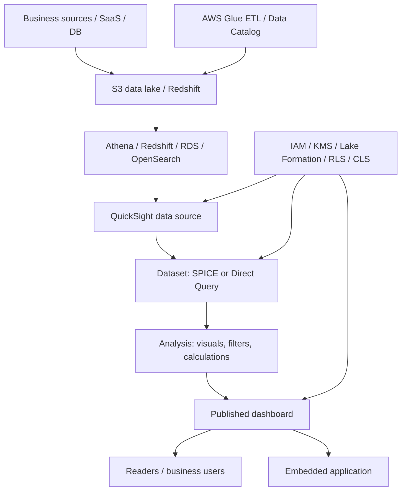
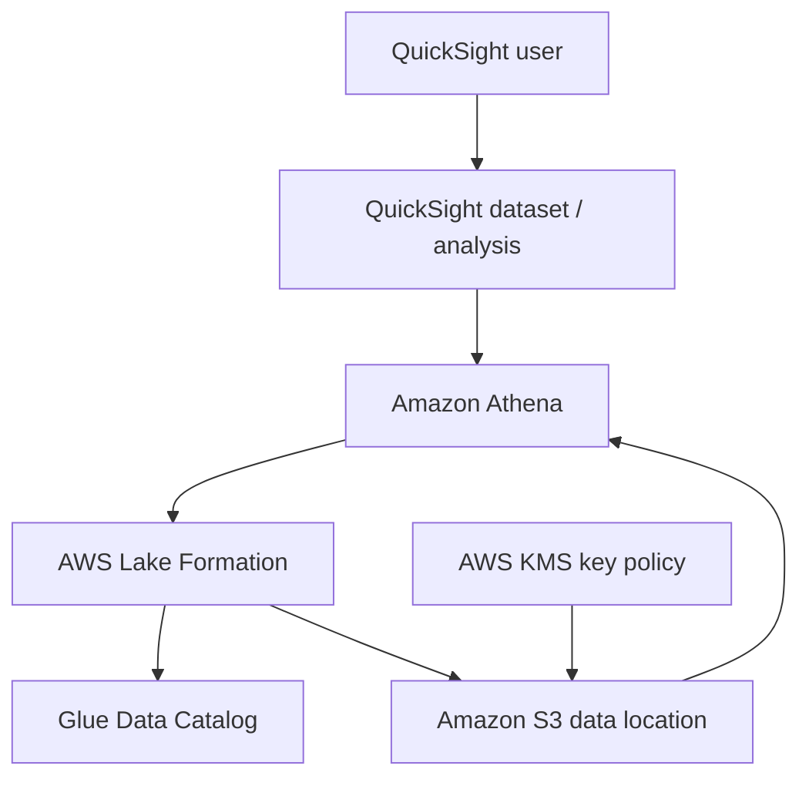

# Amazon QuickSight, Dashboards, and Reporting Data Access Control

Amazon QuickSight is AWS's managed business intelligence (BI) service. The service connects to multiple data sources, prepares datasets, builds analyses, visualizes metrics with charts and tables, and publishes dashboards so users can monitor KPIs and make decisions. Dashboards can be shared across an organization or embedded inside applications; data access permissions must be designed alongside dashboard viewing rights.

**Service naming update:** effective November 9, 2026, AWS rebranded the Amazon Quick platform as **AWS Quick** and the BI component previously called Amazon QuickSight as **AWS Quick Sight**. Existing dashboards, datasets, analyses, and SPICE capabilities continue working as before. This lesson uses "Amazon QuickSight" to align with the lesson topic and familiar ecosystem terminology; newer documentation or consoles may show "AWS Quick Sight". APIs, SDKs, and the AWS CLI continue using the `quicksight` service identifier.

Within the `CLOUD_PROVIDERS_AWS` module, QuickSight connects directly to knowledge of S3, Athena, Glue Data Catalog, Redshift, RDS, OpenSearch, IAM, KMS, VPC, and Lake Formation. A sound BI system ensures accurate data, responsive queries, clear dashboards, and strict enforcement so each user sees only authorized data.

After this lesson, you will be able to:

- Describe the flow from data sources to datasets, analyses, and dashboards.
- Distinguish SPICE from Direct Query and choose modes based on latency, performance, cost, and data size.
- Connect QuickSight to S3, Athena, Redshift, RDS, OpenSearch, and other supported sources.
- Design datasets, calculated fields, filters, parameters, controls, and visuals.
- Organize analyses, sheets, dashboards, publishing, and refreshes.
- Distinguish IAM permissions, QuickSight user roles, resource permissions, and data access permissions.
- Apply row-level security (RLS), column-level security (CLS), and Lake Formation.
- Share dashboards securely and embed dashboards for registered or anonymous users.
- Monitor refreshes, SPICE capacity, query performance, costs, and auditing.

## 1. QuickSight in BI Architectures

QuickSight is the analytics and presentation layer. It does not replace a data lake, data warehouse, or transactional system. Data is typically prepared in upstream storage/processing layers before QuickSight connects to build datasets and dashboards.

Example architecture:



Core components:

| Component | Role |
|---|---|
| Data source | Connection details to a database, warehouse, S3, or source service |
| Dataset | Data model selecting, joining, filtering, and preparing fields for analysis |
| SPICE | In-memory engine storing imported dataset snapshots |
| Direct Query | Sends queries directly to the data source when data is needed |
| Analysis | Authoring workspace for building visuals, sheets, filters, and calculations |
| Dashboard | Published version of an analysis for sharing and consumption |
| User/group | Identities of creators, administrators, or consumers |
| RLS/CLS | Restricts rows or columns visible to users |

A dashboard does not permanently freeze data like an invoice snapshot. A dashboard preserves the analytical layout at publish time; displayed data reflects the underlying dataset and active query/refresh mode.

## 2. Data Sources and Supported Inputs

QuickSight connects to many structured data sources, including:

- Amazon Athena.
- Amazon Redshift and Redshift Spectrum.
- Amazon RDS and Amazon Aurora.
- Amazon S3.
- Amazon OpenSearch Service.
- Databases such as PostgreSQL, MySQL, SQL Server, and Oracle.
- Supported SaaS sources and external data platforms.

Connectivity and query modes depend on the connector, Region, network path, and source capabilities. For example, S3 is typically imported into SPICE; Athena supports Direct Query or SPICE; relational databases often support both modes.

### 2.1. Creating a Data Source

General workflow:

1. Open QuickSight / AWS Quick Sight in the right AWS account and Region.
2. Choose to create a data source.
3. Pick the source type.
4. Enter connection parameters or pick an AWS resource.
5. Configure credentials, IAM roles, and network access.
6. Test the connection.
7. Build datasets from tables, views, or custom SQL.

Never store database passwords in documentation or source code. Use supported credential mechanisms, enforce rotation, and limit database privileges to read-only access.

### 2.2. Connecting to Athena

When QuickSight uses Athena:
- Enable Athena access inside QuickSight administrative settings.
- Grant read permissions on the source S3 buckets.
- Grant read/write permissions on Athena's query result location.
- If source data or query results use SSE-KMS, grant matching KMS permissions to the relevant role.
- If Athena uses Lake Formation, configure integration and grants per the chosen identity model.

QuickSight does not bypass Athena, S3, Glue Catalog, or KMS permissions. A data source connection may succeed while queries still fail if table, object, or query result permissions are missing.

### 2.3. Connecting to Redshift and RDS

For Redshift, RDS, or Aurora, verify:
- Endpoint, port, database, and schema.
- Database credentials or supported authentication mechanism.
- Security group inbound rules limited strictly to required network interfaces/paths.
- Route tables, subnets, NACLs, and DNS.
- TLS and certificates if required.
- `SELECT` privileges on schemas/tables/views.
- Cross-Region or cross-service data transfer costs.

If the database is reachable only over private networks, evaluate a QuickSight VPC connection.

## 3. VPC Connections for Private Data Sources

A VPC connection lets QuickSight reach certain VPC-hosted data sources over a private network path without exposing databases to the public internet. It fits private RDS/Aurora, Redshift, OpenSearch, and compatible supported databases.

When configuring, you must:
- Select the Region and VPC hosting the data source.
- Pick subnets with available IPs and routing to the source.
- Create a security group for QuickSight's network interfaces.
- Configure an execution role with the required trust relationship and EC2 permissions to create/manage network interfaces.
- Allow inbound traffic on the database security group from the VPC connection security group on the target port.
- Verify DNS, routes, NACLs, and any on-premises connectivity.

Not every data source supports VPC connections. Under current support matrices, sources such as Redshift, RDS, Aurora, and OpenSearch can use VPC connections; Athena, S3, and several other sources do not use this mechanism. Never attach a VPC connection to an unsupported connector or requests may fail.

## 4. Datasets: Data Models for Reporting

A dataset is the data modeling layer authors use to build analyses. A dataset can pull from a table, view, custom SQL, or join multiple sources within supported limits.

During dataset preparation, you can:
- Include or exclude columns.
- Rename fields.
- Set data types.
- Join tables.
- Filter records.
- Create calculated fields.
- Choose SPICE or Direct Query.
- Schedule refreshes.
- Apply RLS/CLS according to edition and supported features.

A good dataset has an explicit grain. For instance, `sales_order_line` has one row per order line item; joining it carelessly with an order-level table without checking cardinality can multiply total revenue.

### 4.1. Defining Grain and Join Keys

Before joining:
1. Define what each row represents.
2. Identify primary/business keys.
3. Verify uniqueness on both sides.
4. Determine whether the relationship is one-to-one, one-to-many, or many-to-many.
5. Check row counts and measure totals before and after joining.

For example, one order has multiple line items. Joining the order header to order line items repeats the header across multiple rows. Summing `order_total` from the header post-join inflates revenue by the line-item count. Measure at the proper grain or aggregate before joining.

### 4.2. Shared Datasets

Standardized datasets can serve multiple analyses:
- `sales_daily`: revenue by day, product, and region.
- `customer_support`: tickets, SLAs, and statuses.
- `cloud_costs`: spend by account, service, and team.

Shared datasets standardize metrics and access controls. However, schema or calculated field changes can impact many dashboards—establish ownership, versioning, and review workflows.

## 5. SPICE and Direct Query

QuickSight offers two primary query modes.

**SPICE** (Super-fast, Parallel, In-memory Calculation Engine) imports data into QuickSight's managed in-memory engine. Visuals query imported data inside SPICE.

**Direct Query** sends queries directly to the data source instead of importing the full dataset into SPICE.

| Criterion | SPICE | Direct Query |
|---|---|---|
| Where queries execute | SPICE in-memory | Data source |
| Interactive speed | Usually faster and steadier once loaded | Depends on source, network, and query |
| Data freshness | As of the latest ingestion | Fetched at query time, subject to caching |
| Cost | Consumes SPICE capacity and refresh runs | Can incur query/compute cost on the source |
| Load on source | Offloads repeated dashboard queries post-ingest | Dashboards generate direct query load |
| Refresh | Full or incremental where supported | No SPICE ingestion; data reflects source |
| Use case | High-traffic interactive dashboards with scheduled updates | Real-time freshness needs or huge sources unsuitable for import |

### 5.1. When to Choose SPICE?

SPICE fits when:
- Dashboards have many viewers issuing repeated queries.
- Filters and controls demand snappy interactive response.
- The underlying source has high query costs or needs load offloading.
- Scheduled refresh cadence satisfies data freshness requirements.
- The dataset fits within SPICE capacity and data source limits.

SPICE capacity is provisioned per AWS Region. Administrators monitor utilization, purchase additional capacity, or release unused capacity. A dataset consumes capacity until removed from SPICE or switched to Direct Query. SPICE data is encrypted at rest in Enterprise edition.

### 5.2. When to Choose Direct Query?

Direct Query fits when:
- Data must reflect the latest state in the source on query.
- The dataset is too large or should not be copied into SPICE.
- The data source has sufficient query processing capacity and concurrency.
- You want to leverage data-engine-level access controls where supported.

Direct Query does not guarantee every dashboard displays instantaneous live data. Query caches, refresh controls, connectors, and source engines affect freshness. Measure latency, concurrency, and load on the data source.

### 5.3. Combining Multiple Datasets

An analysis can include multiple datasets, though joining has constraints. Same-source joins may support Direct Query if the connector permits. Cross-source joins generally require SPICE; SPICE joins impose size limits on secondary tables. Review current join limits before modeling large datasets.

## 6. SPICE Ingestion and Refresh

SPICE ingestion imports data from sources into SPICE. Upon creating a dataset, QuickSight can trigger an initial ingestion; subsequent runs execute manually, via API, or on a schedule.

Refresh types:
- **Full refresh**: reloads the entire dataset.
- **Incremental refresh**: loads new/updated slices based on a timestamp column or configured look-back window for supported sources and editions.

Incremental refreshes suit append-only or timestamped tables. If historical rows can be updated or deleted, design a look-back window and periodic full refreshes so corrections are not missed.

### 6.1. Scheduling Refreshes

Refreshes can run on configured schedules and timezones. Available frequencies depend on dataset type, edition, and refresh mode; incremental refreshes often support tighter cadences than full refreshes. Verify ingestion history and API limits instead of assuming every dataset supports identical frequencies.

### 6.2. Monitoring Ingestion

Monitor:
- Ingestion status: completed, failed, or skipped.
- Ingestion duration.
- Rows ingested, skipped, or errored.
- Error codes and root causes.
- Timestamp of last successful refresh.
- Remaining SPICE capacity post-ingestion.

Enable failure notifications for dataset owners where appropriate. Critical dashboards should display a freshness indicator so viewers know how current the data is.

### 6.3. Manually Uploaded Files

Files uploaded directly to QuickSight lack the connection metadata and location of an S3 data source. QuickSight will not auto-refresh uploaded files when local copies or S3 objects change. To automate refreshes from S3, build the dataset from an S3 data source rather than manual file uploads.

## 7. Data Preparation and Calculated Fields

Calculated fields derive new measures or dimensions from existing fields. Examples:
- `net_revenue = gross_revenue - refund_amount`
- `conversion_rate = converted_sessions / total_sessions`
- `order_age_days = dateDiff({created_at}, now(), 'DD')`

Functions and syntax must follow the QuickSight expression language. Choose the right aggregation:
- `sum` for total revenue.
- `avg` for mean values.
- `count` or `distinct_count` for counts.
- `min`, `max` for bounds.
- Level-aware calculations when controlling aggregation grain.

Never compute ratios by taking an unweighted average of per-group ratios when denominators differ. Overall conversion rate should be total converted sessions divided by total sessions, not the simple average of daily conversion rates.

### 7.1. Data Types and Timezones

Verify:
- Explicit timezones on date/time fields.
- Currency and decimal precision.
- IDs are not cast to numbers, which strips leading zeros.
- Consistent boolean and categorical values.
- Distinction between `NULL` and empty strings if business logic differentiates them.

Wrong data types distort filters, aggregations, and sorting.

## 8. Analyses, Sheets, and Visuals

An analysis is where authors design reports. One analysis can hold multiple sheets, each focusing on a distinct lens such as executive summary, sales performance, customer behavior, or operations.

Common visual types:
- KPI card: headline metric such as revenue, orders, or SLA.
- Line chart: trends over time.
- Bar/column chart: categorical comparisons.
- Table/pivot table: detailed breakdowns.
- Pie/donut: proportions across a few categories.
- Scatter plot: correlation between two measures.
- Heat map: density or performance across two dimensions.
- Geospatial map: location-based metrics.
- Combo chart: combining measures with different units.

Match visuals to questions:
- "How is it trending?" → line chart.
- "Which group is highest/lowest?" → bar chart.
- "What is the current value?" → KPI.
- "What are the row-level details?" → table.
- "Is there a relationship between two variables?" → scatter plot.

Avoid cramming too many visuals onto one sheet. Every visual should answer one clear question with an insight-oriented title.

## 9. Filters, Controls, and Parameters

**Filters** restrict data displayed in visuals or sheets. **Controls** are UI widgets letting viewers pick filter/parameter values. **Parameters** are input variables referenced in calculated fields, filters, or URL/custom actions.

For example, a revenue dashboard might include:
- A `region` filter.
- A `month` selector control.
- A `p_target_margin` parameter to adjust margin targets.
- A calculated field evaluating target attainment.

Parameters accept single or multiple values depending on type. Controls can render as dropdowns, lists, date pickers, or sliders as data types permit. Define whether a filter scopes to one visual, one sheet, or multiple sheets so viewers interpret results accurately.

### 9.1. Cascading Controls

Cascading controls narrow downstream control options based on upstream selections. Example:
1. Pick Region.
2. The Country control displays only countries in that Region.
3. The City control displays only cities in that Country.

This keeps dashboards usable when lists are long. Watch cardinality and query performance when controls fetch distinct values via Direct Query.

### 9.2. URLs and Custom Actions

Parameters can be passed via URLs or used in custom actions to navigate, filter, or launch external apps. Never put secrets or access grants in URLs. URL parameters are user-modifiable inputs; all authorization must remain enforced on the backend or data security layer.

## 10. Publishing an Analysis as a Dashboard

A dashboard is the published output of an analysis for end-user consumption. Dashboard viewers typically view, filter, and interact within published limits; they cannot edit the underlying analysis like authors.

Workflow:
1. Finalize datasets and verify permissions.
2. Build the analysis with sheets and visuals.
3. Test filters, parameters, calculations, and drill-downs.
4. Validate RLS/CLS across user groups.
5. Choose Publish.
6. Publish a new dashboard or replace an existing one.
7. Select sheets to include.
8. Configure interactivity, download, and filter permissions.
9. Share the dashboard with target users/groups.
10. Test using real viewer accounts.

Publishing snapshots the analysis layout at publish time. Edits to the analysis do not appear on the dashboard until republished. Displayed data still updates via SPICE refreshes or Direct Query.

### 10.1. Dashboards Are Not Data Snapshots

A dashboard is a read-only view of a published analysis; it does not freeze data permanently at publish time. When the dataset refreshes, the dashboard reflects fresh data without needing to republish as long as layout configuration stays unchanged.

This separates two lifecycles:
- Layout/design changes → require republishing.
- Underlying dataset updates → require SPICE refreshes or Direct Query source reads.

## 11. Dashboard Sharing and Resource Permissions

By default, a new dashboard is accessible only to its owner. After publishing, the owner can share it with users, groups, or everyone in the Quick account per supported options.

Common permission levels:
- Viewer: views and interacts with the dashboard within enabled capabilities.
- Co-owner: manages/edits or shares the dashboard according to role.
- Owner: owns the content and administers the asset.

Capabilities depend on Quick role (Reader/Author/Admin) and asset type. Readers normally receive Viewer access only; Authors may be granted Co-owner per policy.

### 11.1. Sharing via Groups

Share dashboards with groups rather than individuals when team members share identical access:
- `Sales-Readers`
- `Finance-Readers`
- `Operations-Authors`

When employees join or leave, identity admins update group membership—eliminating per-dashboard permission edits.

### 11.2. Dashboard Permissions Do Not Replace RLS/CLS

Anyone granted dashboard access can view data surfaced by that analysis. If a dashboard covers multiple tenants, regions, or customers, sharing controls alone cannot isolate data. Configure RLS/CLS or source-level data protections.

Never use standard visual filters as a security control. Viewers can alter filters whenever allowed; filters govern presentation, not authorization.

## 12. User Roles and Identities in QuickSight

QuickSight supports QuickSight-managed identities, IAM, or IAM Identity Center depending on account configuration and features. Common BI roles:

| Role | General Capabilities |
|---|---|
| Reader | Views dashboards |
| Author | Creates data sources, datasets, analyses, and dashboards |
| Admin | Author capabilities plus account/settings administration |
| Reader Pro / Author Pro / Admin Pro | Pro tiers adding Generative BI capabilities per licensing and current config |

Never grant Admin to users who only read reports. Separate dataset creators, dashboard publishers, and user/permission administrators when separation of duties applies.

### 12.1. IAM Permissions and QuickSight Roles Are Separate Layers

IAM policies authorize principals to invoke admin APIs or access AWS resources. QuickSight roles define what users can do inside the BI environment. Resource permissions control who accesses specific assets such as datasets, data sources, analyses, dashboards, folders, or themes.

Having IAM permission to call QuickSight APIs does not automatically grant access to every dashboard. Conversely, sharing a dashboard does not grant AWS account admin privileges or direct S3 bucket read access.

### 12.2. API and CLI Identifier

Although newer UIs may display the AWS Quick Sight name, the API namespace and CLI command continue using `quicksight` for compatibility. Example:

```bash
aws quicksight list-dashboards \
  --aws-account-id 111122223333 \
  --region ap-southeast-1
```

Example inspecting dataset metadata:

```bash
aws quicksight describe-data-set \
  --aws-account-id 111122223333 \
  --data-set-id sales-dataset-01 \
  --region ap-southeast-1
```

These commands only list/describe metadata. Specify the exact account and Region; QuickSight resource ARNs embed both Region and account ID.

## 13. Row-Level Security (RLS)

RLS restricts which rows a user can view. For example, a dataset holds multi-region revenue; the APAC Sales Manager sees only APAC rows, while the EMEA Manager sees only EMEA rows.

QuickSight Enterprise supports RLS via:
- User/group-based rules for users or groups provisioned in QuickSight.
- Tag-based rules for supported anonymous embedded dashboard scenarios.
- Combinations of approaches within supported scopes.

### 13.1. User-Based RLS

Create a permissions dataset mapping users/groups to permitted values.

Example:

| UserName | region | business_unit |
|---|---|---|
| sales-apac | APAC | Retail |
| sales-emea | EMEA | Retail |
| finance-lead | NULL | NULL |

Here, `sales-apac` sees only APAC/Retail rows; `sales-emea` sees only EMEA/Retail rows. Rows with `NULL` in restricted fields can signify unrestricted access on that field per supported RLS semantics—test exact `NULL`/empty handling carefully.

Key rules:
- Column names and values must match exactly and are case-sensitive.
- Permissions datasets should not contain duplicate rules.
- RLS applies to readers; dataset owners may still view the full dataset.
- Fields used for RLS must be text/string under current constraints.
- `NULL` and empty strings carry distinct semantics; blank rules may be ignored to avoid accidentally granting full access.
- With Direct Query, filter value counts are subject to source-specific limits.

Test with accounts from each group as well as an account lacking rules. Never use the owner account to validate RLS since owners can view all rows.

### 13.2. Tag-Based RLS for Anonymous Embedding

Tag-based RLS fits embedded dashboards served to external customers not provisioned as QuickSight users. The backend authenticates the user, resolves permitted tenants, and passes session tags when generating the embed URL via the supported anonymous embedding API.

Example:
- The dataset contains a `tenant_id` column.
- A tag rule maps `tenant_id` to the `tenant` tag.
- The backend authenticates Customer A's session.
- The backend generates an embed session with tag `tenant=A`.
- QuickSight returns only Tenant A's rows.

Tag values must be set by a trusted backend. Never accept an arbitrary tenant ID from the browser and forward it into the embed request unvalidated. Tag-based RLS currently applies only to anonymous embedding via `GenerateEmbedUrlForAnonymousUser`, not as a universal mechanism for all dashboards/APIs.

## 14. Column-Level Security (CLS)

CLS restricts which users/groups can view specific columns. Examples:
- Sales sees `order_id`, `region`, `sales_amount`.
- Finance additionally sees `discount_amount`, `margin`.
- Only HR sees `employee_salary`.

CLS works well when one dataset holds sensitive fields yet can share a single data model. In Enterprise edition, administrators select restricted columns and authorized users/groups.

When a user lacks access to a column:
- Visuals referencing restricted columns may fail to render.
- Tables/pivots may display permitted fields and mark unauthorized columns as Not Authorized depending on field placement.
- Authors must test visuals so dashboards do not break or mislead viewers.

CLS does not replace RLS:
- RLS restricts **rows**.
- CLS restricts **columns**.
- Both can be combined.

## 15. Lake Formation and QuickSight via Athena

When S3 data is cataloged in Glue Data Catalog, AWS Lake Formation can enforce database/table/column/row access for Athena. QuickSight can use Athena as its query engine and integrate with Lake Formation.

Access flow:



For queries to succeed, coordinate:
- Athena access enabled in the QuickSight account.
- IAM role permissions for Athena, Glue Catalog, and S3 query results.
- Lake Formation grants for the appropriate principal/identity model.
- Registered and authorized data locations.
- KMS key decrypt permissions if objects use SSE-KMS.
- Configured Athena workgroup and output bucket.

QuickSight Enterprise and Standard integrate with Lake Formation differently. Enterprise can grant fine-grained permissions per user/group; Standard typically grants permissions to an IAM role. With trusted identity propagation via IAM Identity Center, Lake Formation evaluates permissions per end user and group. Certain features may be unavailable in this mode—including SPICE datasets, Custom SQL, email reports, and some export/analytics features. Verify compatibility before selecting this pattern.

## 16. Dashboard Sharing and Embedded Analytics

Dashboards can be embedded inside internal portals or customer applications. Two common patterns:

- **Registered-user embedding**: users are managed in QuickSight/identity systems and granted dashboard permissions.
- **Anonymous embedding**: application users lack QuickSight user accounts; the backend generates scoped embed sessions.

### 16.1. Registered-User Embedding

The backend uses an IAM role authorized to generate embed URLs for the target user/namespace. Users must hold matching identity and resource permissions. Dashboards render only data the user is permitted to see, including RLS/CLS.

### 16.2. Anonymous Embedding

The backend authenticates the application user, then calls `GenerateEmbedUrlForAnonymousUser` with:
- Account ID and namespace.
- Dashboard ARN.
- Session lifetime.
- Allowed domains when using runtime allow-lists.
- Session tags when tag-based RLS is needed.
- Experience configuration options.

Embed URLs expire and must be generated server-side. Never hardcode AWS credentials or administrative rights in frontend code. Allowed domains must use HTTPS and be restricted tightly to application origins.

### 16.3. Securing Embedded Dashboards

- Never trust tenant/region values sent directly by browsers.
- Mint sessions from authenticated server-side identities.
- Enforce RLS/CLS and resource permissions.
- Lock down allowed embedding domains.
- Disable public/anonymous sharing unless explicitly justified.
- Audit embed URL generation APIs and dashboard permissions.
- Handle logout/session expiration and revocation as needed.
- Avoid logging full embed URLs/tokens while still valid.

## 17. Folders, Namespaces, and Asset Organization

As dashboard counts grow, establish conventions for folders, namespaces, groups, and owners.

Examples:
- `Executive` folder: executive dashboards.
- `Finance` folder: financial reports.
- `Operations` folder: operational monitoring.
- `Sandbox` folder: controlled experimentation.

Namespaces isolate user scopes per identity configuration. Folder permissions streamline group sharing and asset governance. Still, folder access never replaces dataset-level RLS/CLS.

Every dashboard should document:
- Business owner.
- Technical owner.
- Description and purpose.
- Dependent datasets.
- Refresh SLA.
- Data classification.
- Authorized audience/groups.
- Review date and deprecation process.

## 18. Filters, Alerts, and Email Reports

Dashboards can allow viewers to filter data, subscribe to scheduled reports, or set threshold alerts depending on edition, settings, and dataset mode.

### 18.1. Threshold Alerts

Threshold alerts fit numeric KPIs, such as:
- Today's revenue drops below target.
- Error count exceeds limit.
- SLA breach rate exceeds 2%.
- SPICE refresh failures or stale datasets breaching SLAs can be monitored via dedicated CloudWatch/notification pipelines.

Not every visual/measure or data mode supports threshold alerts. Verify current feature support and ensure recipients have dashboard access.

### 18.2. Email Reports

Scheduled dashboard reports can email authorized users. Because emails/attachments can contain sensitive data, govern recipients, groups, subscriptions, and retention. Do not assume sharing a dashboard account-wide automatically mails reports to every user.

## 19. Securing Data and Dashboards

A dashboard can expose revenue, salaries, customer PII, costs, or internal operations. Apply defense in depth:

1. Identity: use IAM Identity Center/federation or suitable identity management.
2. Quick roles: assign Reader/Author/Admin by job function.
3. Resource permissions: share exact datasets, analyses, dashboards, and folders.
4. Data source permissions: scope databases/tables and credentials.
5. RLS/CLS: restrict rows/columns inside datasets.
6. Lake Formation: govern data lake access through Athena.
7. S3/KMS: protect objects and encryption keys.
8. Network: use VPC connections, security groups, and private routing where needed.
9. Audit: enable CloudTrail and appropriate access logging.
10. Lifecycle: revoke permissions when users change roles or depart.

Never use filter controls or hidden sheets as security boundaries. If users hold dataset access without RLS/CLS, they may reach data outside intended dashboard views depending on granted privileges.

## 20. CloudTrail and Auditing

CloudTrail captures supported QuickSight API activity. Auditing helps:
- Identify who created or modified datasets.
- Track dashboard permission changes.
- Audit user/group provisioning.
- Investigate data source or refresh changes.
- Monitor embed URL generation and account settings.

Correlate CloudTrail with:
- Dataset ingestion history.
- Athena query history.
- S3 access logs / CloudTrail data events where needed.
- KMS events.
- Lake Formation permission changes.
- Application logs for embedded sessions.

Logs should carry correlation IDs while omitting secrets, passwords, tokens, or full embed URLs.

## 21. Dashboard Performance

Performance depends on both QuickSight and underlying data sources.

Common bottlenecks:
- Overly wide datasets or too many columns.
- Visuals with excessive dimensions.
- Filter controls holding tens of thousands of distinct values.
- Direct Query bursts creating high source concurrency.
- Wrong-grain joins or high-cardinality joins.
- Complex Custom SQL.
- Slow or failing SPICE ingestions.
- Under-indexed or undersized source databases.
- Data sources and QuickSight sitting in different Regions.

Improvements:
- Keep only required columns in datasets.
- Pre-aggregate in the data warehouse before BI.
- Use Parquet and S3 partitioning when querying via Athena.
- Choose SPICE for repeated queries where freshness allows.
- Use Direct Query only when the source handles the concurrency.
- Optimize SQL, filters, and joins.
- Limit visuals per sheet.
- Keep parameter/control cardinality manageable.
- Monitor ingestion durations, query latencies, and dashboard load times.

## 22. QuickSight and Data Source Costs

Cost components can include:
- User subscriptions by role/edition.
- SPICE capacity.
- Query/compute charges in Athena, Redshift, RDS, or other sources.
- S3 storage and requests.
- Cross-Region or cross-service data transfer.
- VPC/networking and supporting components.
- Embedded analytics under current pricing models.

SPICE eliminates repeated source queries post-import while requiring SPICE capacity and refreshes. Direct Query avoids SPICE capacity for that dataset while potentially raising source query costs and load. Never choose a mode by looking at one service's bill alone; calculate total cost across ingestion, queries, storage, users, and data transfer.

## 23. Real-World Scenario: Multi-Region Revenue Dashboard

An enterprise sells across APAC, EMEA, and the Americas. Order data is processed in S3, cataloged in Glue, and queried via Athena. Finance wants a daily revenue dashboard where each regional manager sees only their own region.

### 23.1. Architecture

- S3 stores curated Parquet partitioned by day.
- Glue Data Catalog defines the `sales_orders` table.
- Athena executes queries.
- QuickSight configures an Athena data source and dataset.
- SPICE serves high-concurrency viewer traffic on a scheduled refresh.
- The analysis includes Executive, Region, and Product sheets.
- The dashboard is published and shared with groups.
- RLS restricts `region` by user/group.
- Finance leadership sees all regions per the permissions dataset.
- CloudTrail audits permission and asset modifications.

### 23.2. RLS Permissions Dataset

| GroupName | region |
|---|---|
| APAC-Managers | APAC |
| EMEA-Managers | EMEA |
| Americas-Managers | AMERICAS |
| Finance-Leadership | NULL |

Attach the permissions dataset to the sales dataset. Test with users in each group and a user without any rule. Owners/admins may retain broader visibility; verify using actual viewer roles.

### 23.3. Dashboard and Publishing

- KPIs: total revenue, orders, average order value.
- Line chart: revenue trend.
- Bar chart: revenue by product category.
- Table: top customers and order status.
- Filter controls: date range, product category.
- Publish the dashboard and share with the target groups.
- Confirm users cannot view data from other regions.
- Monitor SPICE refreshes and dashboard freshness.

## 24. Secure QuickSight Deployment Checklist

- [ ] Identify business owners and target audience for the dashboard.
- [ ] Select appropriate data sources and verify Region/networking.
- [ ] Configure least-privilege IAM roles and database credentials.
- [ ] Verify Glue Catalog, Athena, S3, KMS, and Lake Formation permissions.
- [ ] Choose SPICE or Direct Query based on freshness, performance, and cost.
- [ ] Define dataset grain, join keys, and calculated fields.
- [ ] Validate schemas, nulls, duplicates, and aggregations.
- [ ] Build analyses with clear visuals, filters, and parameters.
- [ ] Publish dashboards after thorough testing.
- [ ] Share strictly with authorized users/groups.
- [ ] Configure RLS/CLS when data must be scoped.
- [ ] Test using real user accounts across every role and data slice.
- [ ] Never use filters or hidden sheets as security boundaries.
- [ ] For embedding, allow-list domains and mint URLs server-side.
- [ ] For anonymous embedding, validate tag-based RLS and tenant identity.
- [ ] Monitor ingestion/refreshes and SPICE capacity.
- [ ] Monitor query latency, errors, and source database load.
- [ ] Enable auditing and access revocation workflows.
- [ ] Periodically review dashboard owners, classifications, and usage.

## 25. Common Errors

| Symptom | Possible Cause | Investigation Path |
|---|---|---|
| Dataset fails to connect to Athena | Athena/S3 access not enabled or missing IAM | Quick account permissions, Athena workgroup, S3 |
| Query fails with AccessDenied | Missing Glue, S3, Lake Formation, or KMS permissions | Check each permission layer and executing principal |
| Dashboard stops updating | SPICE refresh unscheduled or failing | Ingestion history, schedule, failure alerts |
| Direct Query is slow | Undersized source or complex SQL | Query plans, DB load, indexes, filters |
| Dashboard shows doubled figures | Wrong-grain or high-cardinality join | Check join keys and aggregate before joining |
| Users see overly broad data | RLS disabled or relying on visual filters | Check dataset RLS rules and user roles |
| RLS filters unexpectedly | Mismatched username/group/value or `NULL`/blank behavior | Inspect permissions dataset and identities |
| Anonymous embed sees wrong tenant | Backend passed wrong tag or trusted client input | Authenticate tenant server-side and check session tags |
| Visual disappears when CLS is enabled | User lacks permission on a referenced column | Check column permissions and field wells |
| VPC connection fails | Unsupported source or wrong SG/routing | Support matrix, ENIs, subnets, SGs, NACLs |
| Dashboard edits do not appear | Analysis not republished | Republish and check dashboard version |
| User cannot see dashboard | Resource not shared or wrong namespace | Dashboard permissions and group membership |

## 26. Knowledge Summary

Amazon QuickSight—now called AWS Quick Sight within the AWS Quick platform—is the BI layer for connecting data sources, modeling datasets, building analyses, and publishing dashboards. Data sources supply connectivity; datasets define grain, schemas, joins, and calculations; SPICE loads data into an in-memory engine; Direct Query queries sources directly. Mode selection balances freshness, latency, source load, capacity, and cost.

Analyses are where authors craft sheets, visuals, filters, controls, and parameters. Dashboards are published views for sharing, not immutable data snapshots. Dashboard permissions, Quick user roles, IAM, and data source permissions operate as distinct layers. RLS restricts rows and CLS restricts columns; for S3 data lakes queried via Athena, Lake Formation provides fine-grained governance. Anonymous embedding can use tag-based RLS when a trusted backend authenticates users and passes tags securely.

A trustworthy dashboard requires accurate dataset grain, well-defined metrics, monitored refreshes, permissions tested with real identities, and ongoing performance/cost tracking. Never treat UI filters as security controls. Design security from data sources through dashboards, publish deliberately, and audit critical changes.

## References

- [Amazon QuickSight / AWS Quick Sight — What's new and service naming](https://aws.amazon.com/about-aws/whats-new/2026/11/amazon-quick-aws-quick/)
- [What is AWS Quick?](https://docs.aws.amazon.com/quick/latest/userguide/what-is.html)
- [Supported data sources](https://docs.aws.amazon.com/quick/latest/userguide/supported-data-sources.html)
- [Creating datasets from data sources](https://docs.aws.amazon.com/quick/latest/userguide/creating-data-sets-new.html)
- [SPICE and importing data](https://docs.aws.amazon.com/quick/latest/userguide/spice.html)
- [Refreshing data in AWS Quick](https://docs.aws.amazon.com/quick/latest/userguide/refreshing-data.html)
- [Refreshing SPICE datasets](https://docs.aws.amazon.com/quick/latest/userguide/refreshing-imported-data.html)
- [Publishing dashboards](https://docs.aws.amazon.com/quick/latest/userguide/creating-a-dashboard.html)
- [Sharing dashboards](https://docs.aws.amazon.com/quick/latest/userguide/sharing-a-dashboard.html)
- [Working with dashboards and reports](https://docs.aws.amazon.com/quick/latest/userguide/working-with-dashboards.html)
- [Row-level security](https://docs.aws.amazon.com/quick/latest/userguide/row-level-security.html)
- [User-based row-level security rules](https://docs.aws.amazon.com/quick/latest/userguide/restrict-access-to-a-data-set-using-row-level-security.html)
- [Tag-based RLS for anonymous embedding](https://docs.aws.amazon.com/quick/latest/userguide/quicksight-dev-rls-tags.html)
- [Column-level security](https://docs.aws.amazon.com/quick/latest/userguide/restrict-access-to-a-data-set-using-column-level-security.html)
- [VPC connections and supported data sources](https://docs.aws.amazon.com/quick/latest/userguide/vpc-connection-supported-data-sources.html)
- [Using VPC connections](https://docs.aws.amazon.com/quick/latest/userguide/working-with-aws-vpc.html)
- [Using Lake Formation with Quick](https://docs.aws.amazon.com/lake-formation/latest/dg/qs-integ-lf.html)
- [Authorizing Athena connections](https://docs.aws.amazon.com/quick/latest/userguide/athena.html)
- [Embedding security](https://docs.aws.amazon.com/quicksight/latest/developerguide/embedded-analytics-security.html)
- [Embedding dashboards with the APIs](https://docs.aws.amazon.com/quick/latest/userguide/embedded-analytics-api.html)
- [QuickSight resource permissions](https://docs.aws.amazon.com/quicksight/latest/developerguide/resource-permissions.html)
