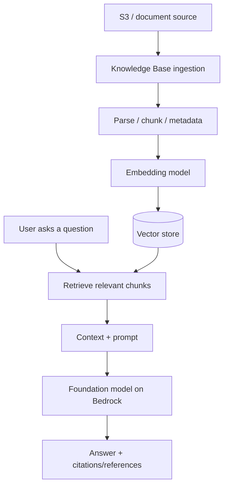
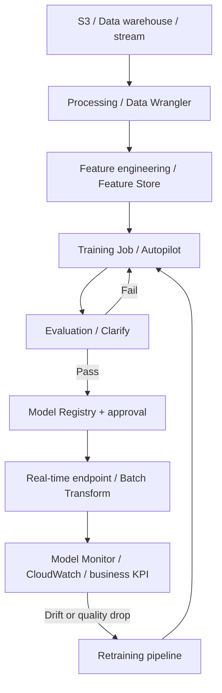

# Choosing Managed AI Services, Bedrock, and SageMaker

AWS provides multiple ways to bring AI into applications. You can call a specialized AI API to recognize images, extract data from invoices, convert speech to text, or translate languages. You can use foundation models to build chatbots, summarize documents, generate content, and build agents. For business-specific prediction problems, an ML team can prepare data, train, evaluate, and deploy their own models.

No single service fits every problem. Selection should start with the required business output, degree of model customization, data permitted for processing, latency/throughput requirements, team skills, and required level of infrastructure control. AWS has specialized AI services, Amazon Bedrock for generative AI applications based on foundation models, and Amazon SageMaker AI for the lifecycle of building, training, customizing, and deploying models. These services can be combined within the same architecture.

This lesson covers how to select services by use case, how to use Bedrock and SageMaker AI, security/evaluation/operations components, and practical scenarios to decide when to use a pre-built AI API, when to use a foundation model, and when to develop a custom model.

## Learning Objectives

After this lesson, you will be able to:

- Distinguish between specialized AI services, foundation model platforms, and ML development platforms.
- Choose the right AWS service for inputs/outputs such as images, documents, text, audio, conversation, and predictions.
- Explain the roles and limitations of Amazon Bedrock, Amazon SageMaker AI, and related tools.
- Use the Bedrock Model Catalog, Converse API, Knowledge Bases, Guardrails, and agent capabilities at the architecture level.
- Design RAG so models answer based on enterprise data.
- Describe the ML lifecycle on SageMaker AI from data preparation, training, and evaluation to inference and monitoring.
- Compare inference options, costs, latency, throughput, and levels of infrastructure control.
- Design IAM, encryption, data governance, responsible AI, and human review for AI workloads.
- Build a workflow for experimenting, evaluating, deploying, monitoring, and improving AI solutions.

## 1. Map of AI Services on AWS

AI spans a broad scope including recognition, classification, prediction, search, content generation, and decision support. Machine learning (ML) is a set of techniques for systems to learn patterns from data. Generative AI uses models trained on large datasets to generate new content such as text, code, images, audio, or video.

AWS provides different layers of services:

| Layer | How it is used | Service examples |
|---|---|---|
| Specialized AI service | Call an API for a pre-packaged task | Rekognition, Textract, Comprehend, Transcribe, Polly, Translate, Lex, Personalize |
| Generative AI platform | Select and invoke foundation models, combining RAG/guardrails/agents | Amazon Bedrock, Bedrock AgentCore |
| ML development platform | Prepare data, train, tune, deploy, and monitor models | Amazon SageMaker AI |
| Large-scale model infrastructure | Provide compute and orchestration for large models | SageMaker HyperPod, EC2 GPU, AWS Trainium, AWS Inferentia, EKS |
| AI assistant/application | Use pre-built AI applications without building models yourself | Amazon Quick Suite, Kiro, and specialized products |

These layers can coexist. For example, Textract extracts content from invoices; SageMaker AI trains a risk classification model; Bedrock generates human-readable explanations based on the results; and the business application calls the APIs and stores audit records.

## 2. Start from the Problem, Not the Service Name

Before selecting a service, describe the use case using these questions:

1. **What is the input?** Images/video, PDF, text, audio, tabular data, events, or natural-language questions?
2. **What is the required output?** Labels, data fields, transcripts, translations, numeric predictions, answers, new content, or actions in a system?
3. **Is there an existing suitable model?** Can a specialized API satisfy it directly, or must it learn from proprietary data?
4. **Does proprietary data need to participate in inference?** If so, use a feature pipeline, RAG, fine-tuning, or training depending on the goal.
5. **What level of customization is needed?** Only prompt/configuration, RAG, fine-tuning, or custom training?
6. **Operational requirements?** Latency, throughput, concurrency, availability, batch window, Region, and RTO/RPO.
7. **Security constraints?** PII, data residency, encryption, model provider terms, audit, retention, and human approval.
8. **Skills and budget?** Will an application team, data engineer, data scientist, or ML platform engineer own the solution?

Define a business metric to evaluate success. For example, for an invoice processing system, the metric might be the accuracy rate of extracting critical fields and the processing time per document, not just the number of successful API requests.

## 3. When to Use a Specialized AI Service?

Specialized AI services fit when the input/output is well-defined and AWS already provides an API trained for that task. You do not need to build a training pipeline, select a model, or operate an endpoint yourself.

| Need | Service | Typical input / output |
|---|---|---|
| Image/video analysis | Amazon Rekognition | Image/video → objects, labels, face attributes, moderation, or video insights per supported API |
| Form/document reading | Amazon Textract | PDF/scanned image → text, tables, form fields, layout, and extracted data |
| Language analysis | Amazon Comprehend | Text → sentiment, entities, key phrases, language, or classification per supported API |
| Speech-to-text | Amazon Transcribe | Audio/video → transcript and timing/speaker information per feature |
| Text-to-speech | Amazon Polly | Text → synthesized speech audio |
| Language translation | Amazon Translate | Text → translation between supported languages |
| Chatbot/conversation | Amazon Lex | Text/voice → intents, slots, and conversation flows |
| Recommendation | Amazon Personalize | User/item interactions → personalized recommendations |
| Enterprise search | Amazon Kendra | Natural query → search results across connected document repositories |

API names, languages, Regions, quotas, and features vary by service. Check the documentation and Region support table before committing to an SLA.

### Quick Selection Examples

- Want to read invoice numbers, tax IDs, tables, and form fields from scanned PDFs: start with Textract.
- Want to analyze customer review sentiment or detect entities in text: look at Comprehend.
- Want to recognize objects in images or moderate visual content: look at Rekognition.
- Want to convert calls into transcripts: look at Transcribe.
- Want to read text aloud as speech: look at Polly.
- Want to translate product descriptions: look at Translate.
- Want a chatbot with well-defined intents/slots and conversation flows: look at Lex.
- Want recommendations based on user behavior: look at Personalize.

### When Is an AI Service Not Enough?

If you need to synthesize multiple data sources, explain results in natural language, perform multiple steps, or handle open-ended questions, a specialized API may only solve part of the problem. You can combine multiple AI services with Bedrock or SageMaker AI. Do not use an LLM merely to replace a deterministic API if that API already returns the right structure, is faster, and is easier to test.

## 4. What Is Amazon Bedrock?

Amazon Bedrock is a managed/serverless service for accessing foundation models from Amazon and model providers via API. Applications can experiment with models, choose models by use case, invoke inference, build RAG, apply guardrails, customize models, and create agents/workflows without managing GPU clusters for each model.

Bedrock is suitable when:

- Building chatbots, internal assistants, summarization, content generation, or document Q&A.
- Needing to try multiple foundation models and swap models without rewriting the entire system.
- Needing RAG to answer based on enterprise documents.
- Needing guardrails, prompt management, model evaluation, and AWS integration.
- Needing agents that use APIs/tools to perform multi-step tasks.
- The team wants to focus on the application, data, and evaluation rather than operating model servers.

Bedrock does not automatically solve every quality issue. Models can still produce wrong answers, lack grounding, fall victim to prompt injection, or violate policies. The application must authenticate users, control access to data sources, evaluate outputs, and include fallback/human review.

## 5. Foundation Models and the Model Catalog

A foundation model (FM) is a model pre-trained on large datasets that can adapt to many tasks. Some models focus on text/chat, while others support images, audio, video, embeddings, or reranking. Not every model supports every modality or the same API.

The Amazon Bedrock Model Catalog helps discover models, providers, modalities, limits, and usage instructions. The model catalog changes frequently; do not hardcode model names in long-term architecture documentation without an update process.

### Model Selection Criteria

| Criterion | Question |
|---|---|
| Quality | Does the model accurately handle the required task and language? |
| Context window | Does it have enough capacity for prompts, history, and retrieved context? |
| Modality | Does it support the required text/image/audio/video/embedding capabilities? |
| Latency | Does response time meet UX and SLA requirements? |
| Throughput | Can it handle requests/sec, tokens/sec, and concurrency? |
| Cost | Are input/output, cache, batch, or throughput costs acceptable? |
| Region | Is the model available in the required Region? Is cross-Region inference needed? |
| Customization | Does it support suitable fine-tuning, distillation, continued pre-training, or custom import? |
| Terms | Are the EULA, license, use case restrictions, and data terms acceptable? |

Do not choose a model solely because of general benchmarks or large parameter size. Run evaluations on a prompt set representative of your product's actual data, language, query style, and edge-case errors.

### Model Access and Usage Conditions

Many models can be used immediately once the account has appropriate IAM permissions and Marketplace conditions; some models require an enablement step, subscription, use-case details, or accepting a separate EULA. The process can differ across providers/models and change over time. Check model access status in the account/Region; do not assume a model appearing in the catalog means requests are permitted.

Within an Organization, different accounts may have different access statuses. Administrators can use IAM/SCPs to control which models are permitted and enforce a license review process before enabling access.

## 6. Invoking Models with Bedrock Runtime

Bedrock provides inference APIs. `Converse`/`ConverseStream` offers a unified conversational interface for compatible models; `InvokeModel`/`InvokeModelWithResponseStream` allows using a model's specific request/response format. Choose the API based on model capabilities and required features.

Python example using Boto3 Converse:

```python
import boto3

bedrock = boto3.client(
    "bedrock-runtime",
    region_name="us-east-1"
)

response = bedrock.converse(
    modelId="MODEL_ID_OR_INFERENCE_PROFILE_ARN",
    messages=[
        {
            "role": "user",
            "content": [
                {"text": "Summarize the following content in 5 bullet points: ..."}
            ]
        }
    ],
    inferenceConfig={
        "maxTokens": 500,
        "temperature": 0.2
    }
)

answer = response["output"]["message"]["content"][0]["text"]
print(answer)
```

Replace the model placeholder with a compatible model ID or inference profile ARN. Supported parameters and content structures may vary by model; check the model-specific API documentation before deployment.

### Streaming

For chatbots, streaming can send chunks of the response to the client to reduce perceived wait time. Streaming does not make the model infer faster; it changes how results are delivered. The backend must handle stream events, mid-stream errors, timeouts, client disconnects, and final token usage.

### Inference Profiles and Cross-Region Inference

An inference profile can route requests to a model in one or more configured Regions. This mechanism helps increase availability or distribute load when a model/Region has limited capacity. Before using it, verify:

- Which source and destination Regions are supported.
- Which Regions prompt/response data may be processed in.
- Whether IAM policies and SCPs allow invoking the destination profile/Region.
- Data residency, compliance, and customer contract requirements.
- Costs, latency, and logging incurred across the involved Regions.

Do not enable cross-Region inference by default if data is restricted to processing within a single Region.

## 7. Choosing Inference Modes and Capacity on Bedrock

Inference serving models offer several capacity billing options:

| Usage mode | Characteristics | When to consider |
|---|---|---|
| On-demand | Pay per inference usage, no fixed capacity reservation | Variable traffic, experimentation phase, or unpredictable load |
| Provisioned Throughput | Reserve capacity for an eligible model/unit under commitment | Steady traffic, predictable throughput/SLA requirements |
| Batch inference | Process a batch of requests asynchronously | Summarizing/classifying many records without needing immediate results |
| Inference profile | Route models across supported Regions/profiles | Increase availability or meet routing policies |
| Service tier | Some models/Regions offer priority/speed/cost tiers | Need to balance priority, cost, and response time |

Names, capabilities, limits, and pricing can change by model. Read the pricing page and model-specific guide before estimating production costs.

## 8. RAG and Bedrock Knowledge Bases

Retrieval-Augmented Generation (RAG) combines a model's language generation ability with external data. Instead of requiring the model to memorize all documents, the application retrieves relevant passages and passes them into the context for the model to answer.

Amazon Bedrock Knowledge Bases manages many steps of RAG such as connecting data sources, syncing data, chunking, generating embeddings, storing vectors, and retrieving context. Applications can call the retrieve or retrieve-and-generate API depending on the desired level of control.

### Basic RAG Architecture



### Key Decisions in RAG

- **Data source**: S3, supported sources, or a custom ingestion pipeline.
- **Parsing**: PDF, HTML, DOCX, CSV, images, and complex content may require appropriate parsers.
- **Chunking**: chunks that are too small lose context; chunks that are too large reduce retrieval accuracy and waste tokens.
- **Metadata**: document ID, owner, tenant, classification, timestamp, source URI, and access scope.
- **Embedding model**: choose based on language, semantic quality, dimensions, and cost.
- **Vector store**: choose based on supported service, throughput, backup, encryption, filtering, and cost.
- **Retrieval**: top-K, metadata filters, hybrid search, reranking, and thresholds.
- **Grounding**: instruct the model to answer from retrieved sources, state when evidence is missing, and cite sources.
- **Evaluation**: measure retrieval relevance, answer correctness, faithfulness, and citation accuracy.

### Protecting Access Control in RAG

Never treat a vector database as automatically enforcing authorization. If data spans multiple tenants or permission groups, access filters must be applied before or during retrieval. Tenant/user context must come from an authenticated identity; never trust metadata filters sent directly by the client.

Document syncing must preserve ACLs and metadata. When a document is deleted or a user loses access, the index must be updated within SLA. If a chunk that the user is not authorized to view is retrieved, guardrails at the generation step cannot fix that authorization breach.

### When Is RAG Better Than Fine-Tuning?

- Data changes frequently and needs updates without retraining the model: prefer RAG.
- Need grounded answers with document citations: RAG is usually appropriate.
- Need the model to learn a consistent style, format, or behavior from examples: consider fine-tuning.
- Need both new knowledge and new behavior: combine RAG with fine-tuning.

Fine-tuning is not a reliable mechanism for storing an entire knowledge base or guaranteeing the model remembers every fact accurately.

## 9. Guardrails and Responsible AI on Bedrock

Generative AI can answer incorrectly, generate unsafe content, or be exploited via prompt injection. Bedrock Guardrails provides input/output protection policies that can combine:

- Content filters for inappropriate content categories.
- Denied topics to block out-of-scope subjects.
- Sensitive information filters to detect/mask sensitive data per policy.
- Word filters for prohibited terms.
- Image content filters for supported use cases/models.
- Automated reasoning checks or advanced safeguard mechanisms depending on feature/model.

Guardrails can be referenced when invoking a model and integrated with Knowledge Bases/Agents within supported API boundaries. Not every model/modality supports every guardrail type; for example, embeddings, reranking, and image generation have different limitations than text/chat inference. Check the current compatibility matrix.

Guardrails do not replace:

- Authentication and authorization in the application.
- Document access control in RAG.
- Output validation against schemas and business rules.
- Human approval for actions with financial/legal impact.
- Protection against prompt injection in tools/data sources.
- Abuse testing, red-teaming, and production monitoring.

## 10. Agents, Flows, and AgentCore

An agent uses a model to understand a goal, plan, and invoke tools/APIs to complete multi-step tasks. Agents fit when the request requires not just generating a paragraph, but also looking up data, checking state, or taking action in a system.

### Agents for Amazon Bedrock

Bedrock Agents supports orchestration based on foundation models, action groups, knowledge bases, and session context. An agent can call Lambda/APIs or retrieve data to execute steps according to instructions. Developers must clearly define:

- Instructions and task scope.
- Action group/API schemas and invocation permissions.
- Knowledge bases permitted for retrieval.
- Session state, timeouts, and loop limits.
- Confirmation/approval before impactful actions.
- Logging, tracing, and tool error handling.

### Amazon Bedrock Flows

Flows helps connect steps such as prompts, models, knowledge bases, conditions, and Lambda into a visual workflow. Flows fits when logic has pre-defined steps; an agent fits better when the sequence of tools must be decided dynamically based on the request and state.

### Amazon Bedrock AgentCore

AgentCore is a set of capabilities for building, deploying, and operating agents across multiple frameworks/models. It focuses on runtime and operational components for production-scale agents. Distinguish AgentCore from Bedrock Agents: Bedrock Agents is a specific managed orchestration feature; AgentCore provides a broader platform for running developer-built agents.

### Guardrails for Tool Execution

Do not grant the model broad permissions directly. Use a backend tool adapter with least-privilege IAM roles, action allowlists, input validation, idempotency keys, and approvals. For actions like transferring funds, deleting data, granting permissions, or sending bulk notifications, require confirmation from an authorized person before committing.

## 11. Prompt Management, Model Evaluation, and Customization

### Prompt Management

Prompt management helps manage versioned prompt templates, input variables, and reuse. Prompts should have an owner, version, test cases, and a release process. Do not embed secrets or static personal data in prompt templates.

### Model Evaluation

Bedrock supports model evaluation using automatic evaluation and human evaluation in supported scenarios. Build a test suite from real questions, including:

- Common questions and edge-case questions.
- Incomplete or ambiguous inputs.
- Out-of-scope questions.
- Prompt injection and malicious content.
- Domain-specific language, terminology, and formatting.
- Data that could trigger bias or information leakage.

Measure multiple dimensions: correctness, relevance, groundedness, helpfulness, refusal behavior, toxicity, latency, and cost. A single aggregate score can hide severe failures for a specific user group.

### Model Customization

Depending on the model and Region, Bedrock supports customization methods such as fine-tuning, continued pre-training, distillation, reinforcement fine-tuning, and custom model import. Each method has different data requirements, model support, compute, cost, and license conditions.

Choose the method based on the goal:

- RAG: inject external knowledge at inference time.
- Fine-tuning/SFT: learn patterns/behavior from input-output examples.
- Continued pre-training: continue training on a domain corpus where supported.
- Distillation: transfer behavior from a teacher model to a smaller model.
- Reinforcement fine-tuning: optimize behavior based on reward/evaluation signals in suitable use cases.
- Custom model import: bring a model customized elsewhere into Bedrock if requirements are met.

Do not fine-tune just to update a few new documents; RAG is usually easier to update and audit.

## 12. What Is Amazon SageMaker AI?

Amazon SageMaker AI (formerly Amazon SageMaker) is a managed platform for preparing data, building, training, tuning, deploying, and monitoring AI/ML models. SageMaker AI fits both classical ML like regression/classification and deep learning/foundation models that require customization or inference control.

Choose SageMaker AI when:

- You need custom predictive models built from labeled data or business data.
- You need to train/customize models with specific algorithms, frameworks, containers, or hyperparameters.
- You need to manage ML pipelines, experiments, model registry, lineage, and approvals.
- You need control over instances, GPUs, throughput, latency, autoscaling, or networking.
- You need to deploy custom/open-weight/proprietary models without a suitable Bedrock option.
- You need to build a repeatable and auditable MLOps process.

SageMaker AI is not only for researchers. Capabilities like Canvas/Autopilot can help users with less ML experience build predictive models within supported problem scopes. However, training jobs, distributed training, and production inference still require appropriate data/operations skills.

## 13. Key Components of SageMaker AI

| Component | Role |
|---|---|
| SageMaker Studio | Web environment for developing and managing ML workflows |
| Data Wrangler | Explore, clean, and transform data |
| Ground Truth | Organize labeling/human annotation for training data |
| Autopilot | Automatically test candidate pipelines/models for certain tabular ML problems |
| Training Jobs | Train models on managed compute |
| Hyperparameter Tuning | Test hyperparameter configurations to optimize metrics |
| Processing Jobs | Run data preparation, evaluation, or batch processing |
| Feature Store | Store and serve features for training/inference |
| Pipelines | Orchestrate repeatable ML steps |
| Experiments / MLflow | Track runs, parameters, metrics, and artifacts |
| Model Registry | Model versioning, metadata, approval, and lineage |
| Endpoints | Serve real-time inference |
| Batch Transform | Run inference on large datasets in batches |
| Model Monitor | Monitor data/model quality and drift where supported |
| Clarify | Analyze bias and explain predictions |
| Model Cards / Model Dashboard | Document information and track models in operations |
| HyperPod | Resilient, large-scale infrastructure for training/inference of large models |

Names, features, and integrations vary by version. SageMaker Unified Studio is a unified environment for data/analytics/AI that can integrate capabilities like Bedrock and SageMaker AI; it is not another name for a model or an endpoint.

## 14. The ML Lifecycle on SageMaker AI

An ML workflow may include:

1. **Business framing**: define the objective, labels, metrics, and business decisions driven by the model.
2. **Data collection**: ingest data from S3, databases, streams, or data warehouses.
3. **Data preparation**: clean, join, split train/validation/test, and prevent data leakage.
4. **Feature engineering**: create features, normalize them, and store shared features.
5. **Training**: select algorithm/framework, instances, hyperparameters, and training script.
6. **Evaluation**: measure metrics on holdout data, check bias, robustness, and calibration.
7. **Model registration**: store artifacts, metadata, lineage, and approval state.
8. **Deployment**: deploy an endpoint or batch transform.
9. **Monitoring**: track latency, errors, data drift, model quality, and business KPIs.
10. **Retraining/rollback**: update the model when data shifts or quality degrades.



### Preventing Data Leakage

Data leakage happens when features or information in the training set contain data that would not yet exist at actual prediction time. For example, using the final chargeback status to predict fraud at the moment of checkout. The model might achieve very high test metrics but fail in production.

Split data by time or by entity appropriately, construct features only from information available at prediction time, and document how labels are generated.

## 15. Training and Inference on SageMaker AI

### Training Jobs

A Training Job runs a script/container on specified compute. Inputs are typically in S3 or supported sources; output model artifacts are saved back to S3. You must specify:

- Framework/container image and version.
- Instance type, GPU/CPU, instance count, and distributed strategy.
- Training data, channels, hyperparameters, and random seed.
- IAM execution role, KMS encryption, VPC, and network access.
- Checkpoints, logs, metrics, and model artifact location.
- Budget, max runtime, and stopping conditions when thresholds are exceeded.

### Inference Types

| Type | Characteristics | When to use |
|---|---|---|
| Real-time endpoint | Always-ready endpoint, returns synchronous results | APIs requiring low latency and continuous requests |
| Serverless Inference | Automatically manages capacity per request within supported limits | Irregular traffic, no desire to keep instances running continuously |
| Asynchronous Inference | Accepts requests and processes asynchronously, supports larger payloads within service limits | Long-running requests or no need for immediate response |
| Batch Transform | Processes S3 input datasets into outputs in batches | Scoring millions of records on a schedule |
| Multi-model endpoint | One endpoint serves multiple model artifacts in supported configurations | Many small models with low/medium traffic |

Do not choose a real-time endpoint just because it is familiar. If scoring only runs overnight, Batch Transform is usually simpler and more economical. If requests can wait, asynchronous inference may be appropriate.

### Invoking Inference via SDK

Example calling a deployed endpoint:

```python
import json
import boto3

runtime = boto3.client("sagemaker-runtime", region_name="us-east-1")

response = runtime.invoke_endpoint(
    EndpointName="fraud-risk-endpoint",
    ContentType="application/json",
    Accept="application/json",
    Body=json.dumps({"features": [0.12, 42, 3, 0.81]})
)

prediction = json.loads(response["Body"].read())
print(prediction)
```

Payload and response schemas depend on the deployed container/model. The endpoint name is not the model name; endpoint configuration, model artifacts, variants, instance types, and autoscaling must be managed separately.

## 16. SageMaker Canvas, Autopilot, and JumpStart

Not every ML project requires writing training code from scratch.

- **SageMaker Canvas**: low-code/no-code interface to analyze data, build models, and generate predictions in supported use cases.
- **SageMaker Autopilot**: automatically evaluates candidate models/pipelines for classification, regression, and eligible tabular problems.
- **SageMaker JumpStart**: discover models/solutions, foundation models, and deployment templates to start customizing or deploying.
- **SageMaker Studio**: development environment for data scientists/ML engineers.
- **SageMaker HyperPod**: serves large-model training/inference with high-scale clusters and orchestration.

Accelerating tools help you get started, but do not replace understanding data leakage, metrics, label quality, bias, licensing, and deployment constraints. A model chosen by Autopilot must still be evaluated on production-like data and approved before making real decisions.

## 17. Bedrock vs. SageMaker AI: Comparing to Choose

The two services overlap, especially around foundation models, fine-tuning, and inference. The decision point is the desired level of management versus the required level of control.

| Criterion | Amazon Bedrock | Amazon SageMaker AI |
|---|---|---|
| Primary goal | Build applications/agents with managed foundation models | Build, train, customize, and deploy AI/ML models |
| How to start | Choose a model and call an API | Prepare data, choose a framework/model, and build workflows |
| Infrastructure | Serverless/API-centric for many use cases | Managed compute; multiple control levels from serverless to clusters |
| Customization | Prompt, RAG, fine-tuning/distillation/custom import per model support | Training jobs, custom containers, fine-tuning, and HyperPod |
| Models | Catalog models from Amazon and external providers | Built-in, open, proprietary, and custom models per deployment support |
| Inference | API, batch, provisioned throughput, inference profiles | Endpoints, serverless/asynchronous inference, Batch Transform, HyperPod |
| Primary users | Application developers, solution architects, product teams | Data scientists, ML engineers, AI platform teams |
| Cost | Typically per token/throughput/service tier and features used | Compute/training/endpoint/storage/data processing or corresponding serverless mode |
| Best fit | Chatbots, RAG, content generation, agents, model APIs | Custom predictions, custom models, MLOps, training/deployment control |

### Decision Rules

- If you need an off-the-shelf model to build a chatbot/RAG/agent quickly: start with Bedrock.
- If you need classification/prediction based on proprietary features and labels: look at SageMaker AI.
- If you need a specialized model for images/documents/speech and a dedicated API fits: start with the corresponding AI service.
- If you need a customized model but want serverless inference: evaluate supported customization and deployment paths through Bedrock.
- If you need control over containers, frameworks, GPUs, throughput, latency, or the training loop: lean toward SageMaker AI/HyperPod.
- If you need a large-scale system: you can train/customize on SageMaker AI and serve via a SageMaker endpoint or Bedrock, depending on model support and operational goals.

AWS recommends starting with the most managed option that meets your requirements, then increasing control when there is a specific reason. Do not switch to self-managing GPUs just for "more customization" if Bedrock or SageMaker AI already meets your needs.

## 18. Combining AI Services, Bedrock, and SageMaker AI

The services are not mutually exclusive. An architecture can divide responsibilities according to each service's strengths.

### Example: Loan Application Processing

1. Textract extracts information from PDFs/scanned images.
2. Comprehend or business logic detects entities/content categories where appropriate.
3. SageMaker AI runs a risk prediction model based on normalized features.
4. Bedrock generates a human-readable explanation from the results and permitted policies.
5. Business rules and a human reviewer decide approval/rejection.
6. CloudTrail/application audit logs store the input reference, model version, output, and approver.

### Example: Internal Technical Assistant

1. Documents are stored in S3 and synced into a Bedrock Knowledge Base.
2. Users sign in via IdP; the backend verifies group/tenant memberships.
3. The backend retrieves data according to user permissions.
4. A Bedrock model generates an answer based on context, along with cited sources.
5. Guardrails filter inputs/outputs per policy.
6. If system actions are needed, the agent calls APIs through a tool adapter with least-privilege IAM roles and approval.

### Example: Demand Forecasting

1. Glue/Redshift prepares historical data.
2. SageMaker AI trains and evaluates a suitable forecasting model.
3. Batch Transform generates daily forecasts.
4. Bedrock can summarize fluctuations and explain results to operators.
5. QuickSight/dashboards display metrics; business owners confirm decisions.

## 19. Security, IAM, and Data Governance

AI workloads process sensitive data and can invoke tools, so security must be designed from the start.

### IAM Least Privilege

- Separate roles for application runtime, Bedrock invocation, Knowledge Base ingestion, SageMaker training, and SageMaker inference.
- Grant `bedrock:InvokeModel` only for required models/profiles; add `bedrock:InvokeModelWithResponseStream` when the application uses streaming.
- Separate permissions for creating models, fine-tuning, deploying endpoints, and invoking endpoints.
- Scope S3 buckets/prefixes, KMS keys, and secrets per workload.
- Use SCPs/permission boundaries to block unapproved models/services.
- Do not grant a single shared role permission to call all models or access the entire data lake.

### Data Protection

- Encrypt data at rest with KMS and in transit with TLS.
- Identify where prompts, responses, embeddings, model artifacts, training data, and logs are stored.
- Mask/tokenize PII before sending it to a model if the use case does not require raw values.
- Set retention and access controls for CloudWatch logs, S3 outputs, vector stores, and experiment artifacts.
- Check model provider terms, licenses, data handling, and Region support before production.
- Do not log sensitive prompts/responses just for debugging; use sampling/masking and access reviews.

### Bedrock Model Access

Administrators need to control which models are used, which accounts have access, Marketplace/EULA conditions, and Regions. A model appearing in the catalog does not mean every principal or account can invoke it. Troubleshoot `AccessDeniedException` by verifying model availability, IAM, Marketplace permissions, account-level requirements, and provider conditions.

### SageMaker Network Isolation

Training jobs, processing jobs, and endpoints can configure VPC/network controls depending on the workload type. Identify data sources, S3 endpoints, package repositories, ECR, KMS, logging, and outbound access. When enabling network isolation, ensure all dependencies are pre-packaged or accessed via permitted paths.

## 20. Responsible AI, Quality, and Human Review

A model that performs well on a test set is not guaranteed to be appropriate for every user and every situation. Responsible AI covers fairness, explainability, privacy, robustness, transparency, and accountability.

### For Predictive Models

- Evaluate bias across permitted user groups/attributes.
- Check false positives/false negatives against business cost.
- Check calibration, drift, and data leakage.
- Use Clarify/Model Monitor or appropriate tools to support bias/explainability/monitoring.
- Record model version, dataset version, feature definitions, and approval records.

### For Generative AI

- Evaluate hallucination, groundedness, and citation correctness.
- Test for prompt injection, jailbreaking, and data exfiltration.
- Set limits on tools/actions and data permissions.
- Include refusal behavior and fallback when the model is uncertain.
- Evaluate outputs across languages, cultures, and user groups.
- Include human review for high-impact decisions.

Do not use model outputs as the sole evidence for legal, credit, medical, hiring, or high-risk actions without appropriate controls and approvals.

## 21. Evaluation and Pre-Production Testing

AI evaluation must reflect real-world goals, not just a generic benchmark.

| Test category | Example metrics/questions |
|---|---|
| Functional | Does the API return the right schema, format, tool results, and error handling? |
| Quality | Are accuracy, F1, precision/recall, BLEU/ROUGE, or domain-specific metrics acceptable? |
| Grounding | Are answers supported by the retrieved documents? |
| Safety | Are toxicity, PII leakage, denied topics, and prompt injection blocked? |
| Fairness | Does performance vary unreasonably across groups? |
| Robustness | How does the model handle typos, long inputs, missing data, and adversarial inputs? |
| Performance | What are p50/p95/p99 latency, throughput, concurrency, and timeouts? |
| Cost | What is the cost per request, token, document, prediction, or business transaction? |
| Reliability | How are retries, throttling, model unavailability, and failover handled? |

Create a golden dataset with expected outputs/criteria, hold out test data not used in prompt tuning/training, and run regressions whenever changing models, prompts, embeddings, chunking, or guardrails.

### Canary and A/B Testing

Deploy new models to a subset of traffic or user group first. Compare quality, latency, cost, refusals, escalations, and business KPIs. Maintain a rollback to the previous model/prompt version if metrics exceed thresholds. Do not compare two models on different request sets without controlling traffic distribution.

## 22. Monitoring and Production Operations

Monitor the model, the application, and the business process.

### Bedrock

- Request count, input/output tokens, latency, and throttling.
- Model invocation errors, access denied, and quota/throughput utilization.
- Guardrail interventions, refusals, and user feedback.
- Knowledge Base ingestion status, retrieval latency, and data freshness.
- Agent tool success/failure, loop count, timeouts, and approval outcomes.
- Cost per session/task and answer quality.

### SageMaker AI

- Endpoint invocation count, latency, 4xx/5xx errors, and instance utilization.
- Training job status, duration, resource usage, and failure reasons.
- Data capture/quality, drift, and model quality metrics.
- Model Registry approval state and deployed model version.
- Feature freshness, training-serving skew, and pipeline success.
- Costs by training job, endpoint instance-hours, storage, and data processing.

### Incident Runbook

1. Identify scope: model, Region, endpoint, account, tenant, or dataset.
2. Check service health, quotas, IAM, model access, and networking.
3. Isolate whether the fault lies in prompts/data/retrieval/model/tools or application integration.
4. Switch to a backup model/endpoint or fallback rules if already evaluated.
5. Disable dangerous tools/actions if there is a risk of abuse.
6. Preserve audit evidence, request IDs, and model versions.
7. Assess data impact and notify owners per incident policy.
8. Re-open traffic only after quality/security regressions pass.

## 23. Cost and Optimization

AI costs depend on service type and inference mode.

| Service/usage mode | Common cost components |
|---|---|
| Specialized AI service | Number of requests, document pages, audio/video minutes, images, or processing units per service pricing |
| Bedrock on-demand | Input/output tokens, modality, model, and service tier |
| Bedrock provisioned throughput | Provisioned capacity and commitment duration |
| Bedrock batch inference | Tokens/requests processed per batch pricing and model support |
| Knowledge Bases | Ingestion, embeddings, vector store, retrieval/generation, and storage |
| Guardrails/Agents/AgentCore | Requests/capacity/resources and supporting services per feature used |
| SageMaker training | Instance/GPU hours, storage, data processing, and transfer |
| SageMaker endpoints | Instance hours, serverless invocation/capacity, or async/batch resources |
| SageMaker HyperPod | Cluster compute, orchestration, and associated storage |

### Optimizing Bedrock

- Choose a smaller model if quality still meets the threshold.
- Reduce redundant prompt text; cap output tokens and context windows.
- Use retrieval to pass only relevant context instead of entire documents.
- Use prompt caching, batch inference, or an appropriate service tier when supported by the model.
- Use routing between models based on task difficulty if quality permits.
- Track tokens/request, cache hits, retrieval counts, and cost per successful task.

### Optimizing SageMaker AI

- Select instances based on benchmarks and workload; do not default to GPUs.
- Shut down unused endpoints or use serverless/batch/async inference.
- Use autoscaling and scale-to-zero within service limits.
- Optimize data pipelines, training duration, checkpoints, and hyperparameter search budgets.
- Use Spot Training when workloads tolerate interruption and support checkpointing.
- Delete old artifacts/volumes per retention policies; keep model versions needed for audit.

Do not optimize by cutting necessary evaluation, guardrails, or logging. Compare cost per business outcome rather than just cost per token or cost per instance-hour.

## 24. Region, Quota, and Availability

Models, features, and inference modes are not necessarily available in every Region. Before production, verify:

- Whether the model ID and modality are available in the target Region.
- Whether Knowledge Bases, vector store integrations, Agents, Guardrails, and customization are supported in the Region.
- Whether SageMaker instance/GPU/HyperPod capacity and quotas are available.
- Whether cross-Region inference aligns with residency and policies.
- Quotas for requests, tokens, concurrent jobs, endpoints, and training resources.
- Service-linked roles, KMS keys, VPC endpoints, and logging configurations.

A quota increase does not guarantee capacity will be granted instantaneously. For critical workloads, load test at production-like scale and have a fallback/queueing strategy.

## 25. Initial CLI and SDK Checks

### List foundation models in a Region

```bash
aws bedrock list-foundation-models \
  --region us-east-1
```

The list changes by Region and over time; do not use this output as a substitute for checking model access/Marketplace requirements.

### List SageMaker endpoints

```bash
aws sagemaker list-endpoints \
  --status-equals InService \
  --region us-east-1
```

### Call a specialized AI service: Comprehend

```python
import boto3

comprehend = boto3.client("comprehend", region_name="us-east-1")
result = comprehend.detect_sentiment(
    Text="The delivery was fast and the support team was very helpful.",
    LanguageCode="en"
)

print(result["Sentiment"], result["SentimentScore"])
```

Check supported languages for the specific API before use. If the input language is not supported, add a language detection/translation step or choose another model.

### Call Bedrock using Converse

```python
import boto3

client = boto3.client("bedrock-runtime", region_name="us-east-1")
result = client.converse(
    modelId="MODEL_ID_OR_INFERENCE_PROFILE_ARN",
    messages=[{
        "role": "user",
        "content": [{"text": "Explain RAG with a short example."}]
    }],
    inferenceConfig={"maxTokens": 300, "temperature": 0.2}
)

print(result["output"]["message"]["content"][0]["text"])
```

### Call a SageMaker endpoint

```python
import json
import boto3

runtime = boto3.client("sagemaker-runtime", region_name="us-east-1")
result = runtime.invoke_endpoint(
    EndpointName="my-model-endpoint",
    ContentType="application/json",
    Body=json.dumps({"instances": [[0.1, 0.2, 0.3]]})
)

print(result["Body"].read().decode("utf-8"))
```

The payload depends on the model/container. Do not copy this example request to another endpoint without checking the input contract.

## 26. Service Selection Scenarios

### Scenario A: Reading Invoices and Validating Data Fields

An enterprise receives PDF invoices from multiple suppliers. Textract extracts text/tables/forms; the backend validates required fields and correctness; Bedrock can summarize anomalies for accounting staff. If a custom model is needed to classify invoice risk, SageMaker AI can train a classifier from labeled data.

### Scenario B: Internal Document Q&A Assistant

Documents are stored in S3. Bedrock Knowledge Bases creates embeddings/indexes; the application authenticates users and filters documents by permissions; a Bedrock model generates answers with citations; Guardrails controls inputs/outputs. There is no need to train a custom LLM if RAG satisfies quality and data permission requirements.

### Scenario C: Transaction Fraud Detection

Transactions have features like amount, device risk, velocity, merchant, and history. SageMaker AI is suitable for training a classification model, evaluating precision/recall against the cost of false positives/negatives, and deploying an endpoint. Bedrock can help analysts summarize cases, but should not replace a scoring model with free-form LLM answers when decisions require stable scores.

### Scenario D: Product Content Generation

The application needs to generate product descriptions from attributes and guidelines. An off-the-shelf Bedrock model, prompt templates, and guardrails may suffice. If a specific style is required, evaluate prompts/RAG first; fine-tune when you have a quality example dataset and require consistent behavior.

### Scenario E: Open-Weight Model Needing Optimized Throughput

The ML team needs control over GPUs, batching, quantization, containers, and the serving stack to hit cost/latency targets. A SageMaker AI endpoint or HyperPod may be more suitable than the Bedrock managed API. In return, the team takes on more responsibility for capacity, model serving, scaling, and patching.

## 27. Hands-On Lab: Testing Bedrock and Building a Model Selection Decision

The goal is to create a text summarization prototype, compare models on quality/latency/cost, and identify required pre-production controls.

### Preparation

1. A sandbox AWS account and a Region with the desired Bedrock models.
2. An IAM role with permissions to read the model catalog and invoke appropriate models.
3. Verify model access, Marketplace prerequisites, and EULAs.
4. A set of 20–50 text passages representative of the use case, with sensitive data removed.
5. An evaluation rubric for quality, latency, and cost.

### Execution

1. Use the Bedrock Model Catalog to pick two models suitable in modality/language.
2. Invoke each model via Converse with the same prompt and the same input set.
3. Record input/output token usage, latency, and errors.
4. Score outputs on correctness, completeness, groundedness, and format.
5. Test prompt injection and out-of-scope questions.
6. Add a Guardrail and verify blocked/refusal behavior.
7. If answers require internal knowledge, create a trial Knowledge Base/RAG using a non-sensitive document set.
8. Compare RAG results against prompt-only results.
9. Estimate cost per successful task and throughput as concurrency increases.
10. Write a decision record: selected model, rationale, risks, Region, quotas, IAM, and fallback.

### Extension Branch with SageMaker AI

1. Choose a labeled tabular dataset and define the prediction target.
2. Prepare train/validation/test splits by time or entity to avoid leakage.
3. Try Autopilot or a training job with a baseline model.
4. Evaluate metrics aligned with business cost and check for bias.
5. Register the candidate model and approve it before deploying an endpoint.
6. Invoke the test endpoint, measure latency, and monitor CloudWatch metrics.
7. Write a rollback plan and retraining triggers.

### Expected Outcomes

- A model comparison table covering quality, latency, tokens/cost, and safety.
- A decision record explaining why an AI service, Bedrock, or SageMaker AI was chosen.
- Identified data/Region/IAM/EULA constraints.
- Regression tests and guardrail scenarios.
- For the SageMaker branch, a baseline model, evaluation report, and deployment plan.

## 28. Common Misconceptions

- **Bedrock and SageMaker AI are two names for the same service**: Bedrock focuses on managed foundation model applications; SageMaker AI focuses on the build/train/customize/deploy ML lifecycle.
- **Bedrock is always better because it is serverless**: if deep training/serving control is required or a model is not in Bedrock, SageMaker AI/self-managed infrastructure may be appropriate.
- **SageMaker AI is only for data scientists**: Canvas/Autopilot supports some low-code workflows, though production still requires evaluation and governance.
- **The largest model is always the most accurate**: models must be benchmarked on your actual use case, language, and data.
- **RAG eliminates hallucination completely**: faulty retrieval, missing context, or model misinterpretation can still produce inaccurate answers.
- **Guardrails replace IAM**: guardrails control content; they do not replace authorization and data access controls.
- **Fine-tuning is how you update a knowledge base**: frequently changing data usually fits RAG better.
- **Being able to invoke a model means it is fully authorized**: model access, Marketplace/EULA, Region, and IAM can vary by account.
- **Endpoints are always cheaper than batch**: endpoints incur capacity holding costs; batch usually fits non-real-time scoring.
- **Model drift only means model code changed**: input distribution, labels, business behavior, and feature pipelines can also shift.
- **AI output can automatically execute any action**: tool execution requires allowlists, least privilege, idempotency, and risk-based approvals.
- **Benchmarks are enough for production**: you must test safety, latency, cost, data governance, monitoring, and fallbacks.

## 29. Production Checklist

Before deploying an AI workload to production, confirm:

- [ ] Use case, owner, user impact, and business success metric are defined.
- [ ] Specialized AI services, Bedrock, SageMaker AI, and self-managed options have been compared.
- [ ] Models/features are available in the target Region and quotas are sufficient.
- [ ] Model access, Marketplace prerequisites, EULAs, and provider terms have been reviewed.
- [ ] Representative test sets have expected outcomes/criteria and sensitive data is handled properly.
- [ ] Models are evaluated on quality, latency, throughput, cost, robustness, and safety.
- [ ] RAG has metadata/ACL filtering, data freshness, and citation validation.
- [ ] Guardrails, prompt injection defenses, and tool allowlists are tested.
- [ ] IAM roles are separated with least privilege; KMS, VPC, and secrets are configured.
- [ ] Prompts, model versions, datasets, features, and model artifacts have versioning/lineage.
- [ ] Human approval is required for high-impact actions.
- [ ] Monitoring covers requests/errors/latency/tokens/cost/quality/drift appropriately.
- [ ] Rate limits, quotas, retries, timeouts, circuit breakers, and fallbacks are in place.
- [ ] Canary/A-B testing, rollback, and incident runbooks exist.
- [ ] Retention policies exist for prompts, responses, vector stores, logs, and model artifacts.
- [ ] Cost budgets, alerts, and unit economics per business outcome are established.
- [ ] A periodic review process exists when models, providers, licenses, or Regions change.

## Conclusion

Choosing AI services on AWS should be based on the task, inputs/outputs, degree of customization, and required level of control. Specialized AI services fit clear tasks like image recognition, document reading, text analysis, speech, translation, and recommendations. Amazon Bedrock fits building generative AI applications and agents with managed foundation models, combining RAG, Guardrails, and orchestration tools. Amazon SageMaker AI fits when you need to build, train, customize, deploy, and manage models across the ML lifecycle.

You do not have to pick a single service for the entire system. You can use Textract to extract documents, SageMaker AI for predictions, and Bedrock to generate explanations, with business rules/human review governing the final decision. Start with the most managed option that meets requirements, evaluate on representative data, protect access controls, and measure cost per successful task before scaling to production.

## References

- [Choosing an AWS machine learning service](https://docs.aws.amazon.com/decision-guides/latest/decision-guides/ml-guide.html)
- [Amazon Bedrock or Amazon SageMaker AI?](https://docs.aws.amazon.com/decision-guides/latest/decision-guides/bedrock-or-sagemaker.html)
- [Choosing a generative AI service](https://docs.aws.amazon.com/decision-guides/latest/decision-guides/genai-guide.html)
- [Amazon Bedrock documentation](https://docs.aws.amazon.com/bedrock/)
- [Amazon Bedrock model access](https://docs.aws.amazon.com/bedrock/latest/userguide/model-access.html)
- [Amazon Bedrock Converse API](https://docs.aws.amazon.com/bedrock/latest/userguide/conversation-inference.html)
- [Amazon Bedrock inference profiles](https://docs.aws.amazon.com/bedrock/latest/userguide/inference-profiles.html)
- [Amazon Bedrock Knowledge Bases](https://docs.aws.amazon.com/bedrock/latest/userguide/knowledge-base.html)
- [Amazon Bedrock Guardrails](https://docs.aws.amazon.com/bedrock/latest/userguide/guardrails.html)
- [Agents for Amazon Bedrock](https://docs.aws.amazon.com/bedrock/latest/userguide/agents.html)
- [Amazon Bedrock AgentCore](https://docs.aws.amazon.com/bedrock-agentcore/latest/devguide/what-is-bedrock-agentcore.html)
- [Amazon SageMaker AI Developer Guide](https://docs.aws.amazon.com/sagemaker/latest/dg/whatis.html)
- [Amazon SageMaker AI features](https://docs.aws.amazon.com/sagemaker/latest/dg/whatis-features.html)
- [Amazon SageMaker AI training](https://docs.aws.amazon.com/sagemaker/latest/dg/how-it-works-training.html)
- [Deploy models with SageMaker AI](https://docs.aws.amazon.com/sagemaker/latest/dg/how-it-works-deployment.html)
- [Amazon SageMaker Feature Store](https://docs.aws.amazon.com/sagemaker/latest/dg/feature-store.html)
- [Amazon SageMaker Model Registry](https://docs.aws.amazon.com/sagemaker/latest/dg/model-registry.html)
- [Amazon SageMaker Model Monitor](https://docs.aws.amazon.com/sagemaker/latest/dg/model-monitor.html)
- [Amazon SageMaker Clarify](https://docs.aws.amazon.com/sagemaker/latest/dg/clarify.html)
- [Amazon Textract Developer Guide](https://docs.aws.amazon.com/textract/latest/dg/what-is.html)
- [Amazon Rekognition Developer Guide](https://docs.aws.amazon.com/rekognition/latest/dg/what-is.html)
- [Amazon Comprehend Developer Guide](https://docs.aws.amazon.com/comprehend/latest/dg/what-is.html)
- [Amazon Transcribe Developer Guide](https://docs.aws.amazon.com/transcribe/latest/dg/what-is.html)
- [Amazon Polly Developer Guide](https://docs.aws.amazon.com/polly/latest/dg/what-is.html)
- [Amazon Translate Developer Guide](https://docs.aws.amazon.com/translate/latest/dg/what-is.html)
- [Amazon Lex Developer Guide](https://docs.aws.amazon.com/lexv2/latest/dg/what-is.html)
- [Amazon Personalize Developer Guide](https://docs.aws.amazon.com/personalize/latest/dg/what-is-personalize.html)
