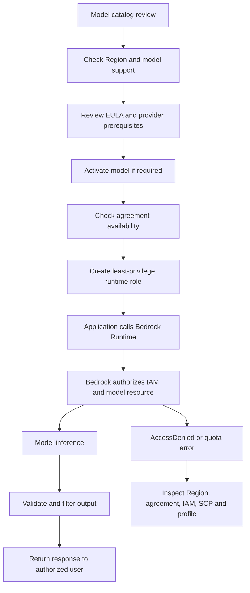

# Amazon Bedrock, Foundation Models, and Model Access Permissions

Amazon Bedrock is a managed AWS service for building generative AI applications using foundation models (FMs) from Amazon and third-party providers. Instead of deploying GPU infrastructure and operating endpoints for each model yourself, applications call Bedrock APIs to send prompts or input data and receive inference results. Bedrock provides a model catalog, a unified API across multiple models, inference profile options, protection tools, and IAM-based access control mechanisms.

A foundation model is a model pre-trained on large datasets that can be adapted to many tasks. Depending on the model, inputs and outputs can be text, images, audio, video, multimodal data, or embedding vectors. Each model has its own provider, model ID, supported Regions, modalities, context window, throughput limits, pricing, and terms of use.

To use a model, an application must satisfy multiple conditions simultaneously: the model is available in the selected Region or inference profile; the account has met the provider's activation requirements; the IAM principal has permission to invoke the API on the exact model resource; and Organizations policies, SCPs, permission boundaries, session policies, or VPC endpoint policies do not block the request. Having console access does not mean having inference invocation permissions, and having API invocation permissions does not automatically mean the account has completed all model access prerequisites.

This lesson focuses on selecting foundation models, identifying model IDs, invoking inference, and designing secure access permissions in Amazon Bedrock.

After this lesson, you will be able to:

- Explain the role of Amazon Bedrock and foundation models in generative AI architectures.
- Distinguish between model provider, model ID, model ARN, inference profile, and provisioned model ARN.
- Select models based on modality, quality, latency, context window, Region, throughput, cost, and terms.
- Distinguish between `Converse`, `ConverseStream`, `InvokeModel`, and `InvokeModelWithResponseStream`.
- Explain the current model access mechanism in commercial AWS Regions, AWS Marketplace subscriptions, and specific provider requirements.
- Write IAM policies restricting invocation permissions to specific model resources.
- Analyze additional permissions required when using cross-Region inference or application inference profiles.
- Diagnose `AccessDeniedException`, model availability issues, and Region configuration errors.

## 1. Amazon Bedrock and Foundation Models

### 1.1. What Does Bedrock Provide?

Amazon Bedrock provides a managed service layer between applications and foundation models. Applications can select models from the Model catalog, send requests to the runtime API, and receive results without managing provider GPU servers themselves.

Common capability groups:

| Capability | Purpose | Usage example |
|---|---|---|
| Foundation model inference | Generate content from prompts or input data | Chatbots, summarization, classification, content generation |
| Embeddings | Convert data into vectors | Semantic search, retrieval-augmented generation (RAG) |
| Multimodal inference | Combine multiple input/output data types | Image Q&A, audio/video analysis if supported by the model |
| Model evaluation | Compare model quality and behavior | Selecting a model for a business test suite |
| Model customization | Adapt models using training/validation data per supported features | Fine-tuning or continued pre-training |
| Provisioned Throughput | Provide dedicated throughput per purchased configuration | Workloads with steady throughput requirements |
| Guardrails | Apply content filtering policies and input/output controls | Reduce inappropriate content, detect sensitive data |
| Inference profiles | Route requests across Regions or track usage/cost | Cross-Region inference, application-level cost attribution |

Not every model supports every capability. A text generation model may not generate images; an embedding model may not support chat; some models have limitations on tool use, streaming, structured output, or multimodal input. Always check feature support on the model detail page before designing your application.

### 1.2. What Is a Foundation Model?

A foundation model is pre-trained on a broad dataset, has a large number of parameters, and can be used for many tasks after training. Models can be used directly via prompting, combined with enterprise data through RAG, or customized using methods supported by Bedrock.

Common model groups:

| Group | Primary input/output | Example tasks |
|---|---|---|
| Text generation/chat | Text → text | Conversation, explanation, content writing, reasoning |
| Embedding | Text/image → vector | Semantic search, clustering, retrieval |
| Image generation | Text prompt → image | Illustration generation, concept design |
| Multimodal | Combination of text, image, audio, or video | Multimodal content Q&A |
| Speech/audio | Audio or text → audio/text | Transcription, speech generation, audio understanding |
| Reranking | Query and document list → ranking | Ordering retrieval results |

Model providers can be Amazon or third-party providers. The model catalog evolves over time: new models are added, older versions may be deprecated, and the same model family may have multiple model IDs with different capabilities or pricing.

### 1.3. Base Models, Custom Models, and Provisioned Models

| Concept | Meaning | How it is used |
|---|---|---|
| Base foundation model | Original model provided by Amazon or a provider | Invoked using base model ID or inference profile |
| Custom model | Model customized with the organization's data | Usually requires purchasing Provisioned Throughput before inference |
| Imported model | Model imported into Bedrock via a supported workflow | Invoked using imported model ARN |
| Provisioned model | Model endpoint/throughput that has been provisioned | Uses the ARN returned from creating Provisioned Throughput |
| Inference profile | Identifier for model routing or tracking usage/cost | Passed as `modelId` in supported requests |

Do not confuse model customization with simply changing the system prompt. Prompting changes how the application asks the model to respond; customization modifies the model via a training/customization process and has separate data, cost, permission, and throughput requirements.

### 1.4. What Applications Are Still Responsible For

Bedrock manages endpoints and model serving, but the application still needs to:

- Authenticate users and verify data access permissions before placing data into prompts.
- Design prompts, context, conversation state, and output handling.
- Validate input/output content, defend against prompt injection, and protect secrets.
- Enforce token limits, timeouts, retries, concurrency, and cost controls.
- Evaluate quality, hallucination, latency, and behavior per model version.
- Store logs in a controlled manner, protect PII, and define retention.
- Comply with EULAs, privacy, data residency, and organizational policies.

Model access is only one layer in AI application security. End users should not be granted direct IAM permissions to freely pick any model if the application needs to enforce a model allowlist or business policies.

## 2. Selecting the Right Foundation Model

### 2.1. Choose by Problem, Not Just by Model Name

Start by defining the task, data, and acceptance criteria:

1. Is the task chat, generation, summarization, classification, extraction, embeddings, reranking, or multimodal?
2. Which languages are used? Are Vietnamese, multilingual, or domain-specific terminology required?
3. How long is the input context? What is the maximum output token length needed?
4. Are tool use, JSON/structured output, streaming, or reasoning required?
5. What are the required latency, throughput, and concurrency levels?
6. Is the data sensitive or Region-constrained?
7. How do input/output token pricing, caching, batch, or provisioned throughput affect cost?
8. Are the provider terms, license, and usage conditions suitable?

Do not choose a model merely because of high public benchmarks. Evaluate on a dataset representative of your application, real prompts, and concrete measurement criteria.

### 2.2. Model Evaluation Matrix

| Criterion | Evaluation question | How to verify |
|---|---|---|
| Quality | Are the results accurate and useful? | Golden dataset, human review, task metrics |
| Language | Does the model understand and respond well in Vietnamese? | Vietnamese test suite, terminology, and diacritic errors |
| Context window | Is it large enough for system prompt, history, and retrieved context? | Measure tokens of actual requests |
| Output limit | Does it generate enough required content? | Test output token limits and truncation |
| Latency | What are time-to-first-token and total response latency? | Load test across concurrency levels |
| Throughput | Does it meet requests/tokens per minute? | Test peak load and quotas |
| Modality | Does it support required image/audio/video/embedding capabilities? | Model detail page and API feature support |
| Tool/structured output | Does it support tool use and required output formats? | Integration test |
| Region | Is it available in an allowed Region or inference profile? | Model catalog and inference profile details |
| Cost | What is the total cost under actual traffic? | Calculate input/output tokens, cache, batch, profile |
| License/EULA | Are the provider terms acceptable? | Review agreement with the responsible team |
| Lifecycle | How long will the model version remain supported? | Model lifecycle and deprecation notices |

### 2.3. Model ID and Model ARN

The Model ID is the identifier passed in the `modelId` field when calling Bedrock Runtime. Depending on the model type and invocation method, this value can be:

- Base model ID, e.g., in the form `provider.model-family-version`.
- System-defined inference profile ID.
- Application inference profile ARN.
- Provisioned model ARN.
- Custom model ARN or imported model ARN in supported flows.

A foundation model ARN typically has the format:

```text
arn:aws:bedrock:<REGION>::foundation-model/<MODEL_ID>
```

Illustrative example:

```text
arn:aws:bedrock:ap-southeast-1::foundation-model/<MODEL_ID>
```

Do not guess or piece together a model ID from the display name. Retrieve the ID from the Model catalog/model detail page or the `ListFoundationModels` API. Region, model version, and inference profiles can affect the exact identifier needed.

### 2.4. Checking Model and Region Before Deployment

Model support varies by AWS Region and by feature. A model may exist in Region A but not in Region B; a model may also support `InvokeModel` while lacking support for a specific secondary feature.

You can list models using the AWS CLI:

```bash
aws bedrock list-foundation-models \
  --region <REGION> \
  --query "modelSummaries[].{id:modelId,provider:providerName,input:inputModalities,output:outputModalities}" \
  --output table
```

Use `GetFoundationModel` or the model detail page to view detailed information. For models requiring account-level access, also check availability/agreement status. Do not treat `ListFoundationModels` output as proof that the current principal already has permission to invoke the model.

### 2.5. Evaluating Through Controlled Experiments

Create a set of prompts and expected outcomes representative of your business needs. For each model:

- Send the same input and system instructions.
- Measure task accuracy, factuality, completeness, and format validity.
- Measure first-token latency, total latency, and throughput.
- Record input/output tokens and estimated cost.
- Check behavior when prompts have missing data, contradictions, or malicious content.
- Check responses when the model is throttled, times out, or returns errors.
- Repeat multiple times to observe stability.

If you change the model or version, re-run regression evaluation before releasing. A new model version can alter quality, output style, token usage, or tool-calling behavior.

## 3. Calling Foundation Models with Bedrock Runtime

### 3.1. Control Plane and Runtime Plane

Amazon Bedrock has APIs for resource management and APIs for inference:

| Group | Endpoint/client | Example operations |
|---|---|---|
| Control plane | Bedrock control plane | List/get foundation models, get inference profile, check model availability |
| Runtime plane | Bedrock Runtime | Converse, InvokeModel, streaming inference |
| Async inference | Bedrock Runtime and related resources | Submit asynchronous inference jobs for supported models |
| Model agreement | Bedrock control plane | Check offers, create or delete agreements when needed |

In the AWS SDK for Java 2.x, the control plane uses `BedrockClient`; inference uses `BedrockRuntimeClient`. The two clients have different endpoints and permissions. Do not call `Converse` using the control-plane client.

### 3.2. Converse API and InvokeModel API

| API | How requests are sent | When suitable |
|---|---|---|
| `Converse` | Unified message structure with role and content | Chat and multi-turn conversations with models supporting Converse |
| `ConverseStream` | Similar to Converse, but receives an event stream | Streaming tokens/results progressively to users |
| `InvokeModel` | Body matching the model/provider's native schema | Need model-specific parameters or model does not yet support Converse |
| `InvokeModelWithResponseStream` | Provider-specific body and response stream | Need streaming with a model using the Invoke schema |

The Converse API allows using a common request structure across many models, including system instructions, messages, tool configurations, and inference configurations within model-supported boundaries. Applications can switch models with minimal changes to conversation structure.

InvokeModel lets you send a request body using the provider's schema. This approach is more flexible, but the application must know each model's request/response format. Do not send an Anthropic payload to an Amazon Nova model or vice versa if schemas are incompatible.

Not every model supports all four APIs. Check feature support on the model detail page before choosing an API.

### 3.3. Converse Example Using AWS SDK for Java 2.x

The following example invokes a model that supports Converse. Replace `MODEL_ID` with a model ID or inference profile ID verified in the Region. Credentials are obtained from the AWS SDK default credentials provider chain, such as an EC2/ECS/EKS IAM role.

```java
import software.amazon.awssdk.regions.Region;
import software.amazon.awssdk.services.bedrockruntime.BedrockRuntimeClient;
import software.amazon.awssdk.services.bedrockruntime.model.ContentBlock;
import software.amazon.awssdk.services.bedrockruntime.model.ConverseRequest;
import software.amazon.awssdk.services.bedrockruntime.model.ConverseResponse;
import software.amazon.awssdk.services.bedrockruntime.model.ConversationRole;
import software.amazon.awssdk.services.bedrockruntime.model.InferenceConfiguration;
import software.amazon.awssdk.services.bedrockruntime.model.Message;

public class BedrockChatExample {
    public static void main(String[] args) {
        String region = System.getenv("AWS_REGION");
        String modelId = System.getenv("BEDROCK_MODEL_ID");

        try (BedrockRuntimeClient client = BedrockRuntimeClient.builder()
                .region(Region.of(region))
                .build()) {

            Message userMessage = Message.builder()
                .role(ConversationRole.USER)
                .content(ContentBlock.fromText("Explain foundation models in English."))
                .build();

            ConverseRequest request = ConverseRequest.builder()
                .modelId(modelId)
                .messages(userMessage)
                .inferenceConfig(InferenceConfiguration.builder()
                    .maxTokens(300)
                    .temperature(0.2F)
                    .build())
                .build();

            ConverseResponse response = client.converse(request);
            String answer = response.output()
                .message()
                .content()
                .get(0)
                .text();

            System.out.println(answer);
        }
    }
}
```

This is a minimal example for a single user message. Multi-turn conversational applications must resend the necessary messages with the right roles and order. In production, do not hardcode environment-sensitive prompts or model IDs; retrieve them from managed configuration, validate inputs, limit tokens, handle errors, and record usage in a controlled manner.

### 3.4. Converse Example Using AWS CLI

```bash
aws bedrock-runtime converse   --region <REGION>   --model-id <MODEL_ID_OR_PROFILE_ID>   --messages '[{"role":"user","content":[{"text":"Summarize the role of Amazon Bedrock."}]}]'   --inference-config '{"maxTokens":256,"temperature":0.2}'
```

The request uses a model ID or inference profile ID. If using a profile, the IAM policy requires invocation permissions on the profile and related model resources as required by that profile type.

### 3.5. InvokeModel and Provider-Specific Schemas

With `InvokeModel`, the `body` field contains JSON conforming to the model's schema. For example, field names for output token limits or message structures can differ across providers. The `contentType` and `accept` headers are typically `application/json` for JSON-based models, though specific modalities and APIs may require different formats.

Integration workflow:

1. Select a model and read the API request/response examples on the model detail page.
2. Identify the `modelId`, Region, content type, and output format.
3. Build a payload matching the schema, including token limits and inference parameters.
4. Call `InvokeModel` or the streaming variant.
5. Parse the response according to the model's schema; do not assume every response has a `content[0].text` field.
6. Protect prompts, outputs, and metadata in logs.

### 3.6. Streaming and Request Limits

Streaming APIs send the response across multiple events. Clients can display received chunks while the model continues generating. Applications must handle stream events, mid-stream errors, client disconnects, and timeouts; an incomplete response must not be treated as a complete answer.

Limits to manage:

- Input tokens + output tokens must not exceed the context window and model-specific limits.
- Request rate and token throughput must stay within model/Region/profile quotas.
- Timeouts should be long enough for the task, yet bounded to avoid holding connections indefinitely.
- Retry only retryable errors; use exponential backoff and jitter for throttling.
- Never infinitely retry a request that has downstream side effects.
- Use a correlation ID to link requests, logs, and metrics without logging sensitive prompts.

## 4. Model Access in Commercial AWS Regions

### 4.1. Understanding the Current Access Mechanism

In commercial AWS Regions, many foundation models have a default/auto-enablement access mechanism. For third-party models that have an AWS Marketplace product, the first invocation can automatically initiate a subscription in the background. This differs from the older workflow that required users to open the Model access page and submit access requests per model.

While the subscription is finalizing, some initial requests may succeed while subsequent ones return `AccessDeniedException` if activation conditions are not yet satisfied. The process can take up to about 15 minutes; after granting additional required permissions, completion can take several more minutes. Therefore, verify and complete prerequisites before putting a model into production.

Key points to remember:

- The model must be supported in the Region or inference profile being called.
- The IAM principal needs `bedrock:InvokeModel` or the appropriate streaming action.
- For models with a Marketplace product ID, first-time activation requires Marketplace permissions.
- The AWS account needs a valid payment method for AWS Marketplace when applicable.
- Some models/providers have additional requirements such as Anthropic First Time Use (FTU).
- Some models require separate account-level access even when activation steps are complete.
- The provider's agreement/EULA applies when using the model.

The Model access page in the Bedrock console is now primarily used for the AWS GovCloud (US) workflow. In commercial Regions, many models are enabled automatically on first use; users should not be instructed to look for the legacy access-request workflow as a universal step for every model.

### 4.2. AWS Marketplace Permissions

For serverless third-party models with a product ID on AWS Marketplace, the role performing the first-time activation needs Marketplace permissions:

| IAM action | Purpose |
|---|---|
| `aws-marketplace:Subscribe` | Allows automatic model subscription |
| `aws-marketplace:Unsubscribe` | Allows canceling subscriptions when needed |
| `aws-marketplace:ViewSubscriptions` | Allows viewing subscriptions |

These permissions are only needed for the model's initial activation in the account. Once the model is enabled, users invoking inference do not need Marketplace subscription permissions if those permissions were already granted to the account previously.

You can scope `aws-marketplace:Subscribe` with the `aws-marketplace:ProductId` condition key to allow subscriptions only to approved products. Not every provider or model has a product ID. Models without a product ID must be controlled using Amazon Bedrock IAM policies, for example denying `bedrock:InvokeModel` on the model ARN.

A common pitfall: denying only `aws-marketplace:Subscribe` is not enough to block the first invocation, because Bedrock initiates the subscription automatically in the background. To block model usage, deny the Bedrock invocation actions on the exact resource or apply an appropriate SCP.

### 4.3. Anthropic First Time Use (FTU)

Certain Anthropic models require customers to submit use case details the first time before invoking them. According to current documentation, the FTU requirement applies to models prior to Claude Opus 4.7; models from Opus 4.7 onward do not require this form. The rules also differ for models accessed via the `bedrock-mantle` endpoint.

Submitted information typically includes an organization description, website or URL describing the use case, user type, and intended purpose. An organization can complete this in the management account; the details can be inherited across the AWS Organization per AWS rules.

After submitting the form, the agreement status may be `PENDING`. During this period, requests may still return `AccessDeniedException`. Use `GetFoundationModelAvailability` to check `agreementAvailability.status`; only `AVAILABLE` indicates the agreement is ready.

Do not automatically apply the FTU requirement to every Anthropic model or every endpoint. Always check requirements for the specific model/version and endpoint.

### 4.4. Models Requiring Separate Account-Level Access

Some models may require additional account-level permissions. Completing a Marketplace subscription or provider prerequisites does not guarantee the account is granted access to use the model. This permission is evaluated per AWS account; two accounts in the same Organization may have different statuses.

If you receive `AccessDeniedException`, check in order:

1. Is the model ID correct and is the model still supported?
2. Is the model available in the Region or inference profile?
3. Is the agreement/Marketplace subscription `AVAILABLE`?
4. Do FTU/provider prerequisites apply and have they been completed?
5. Does the IAM policy allow invocation on the exact resource ARN?
6. Do SCPs, permission boundaries, session policies, or endpoint policies deny it?
7. If all the above conditions pass, the model may require additional account-level access; follow the AWS guidance for that model.

### 4.5. Checking Model Availability via CLI

You can check a model's agreement status and access availability:

```bash
aws bedrock get-foundation-model-availability   --region <REGION>   --model-id <MODEL_ID>
```

Inspect the availability fields in the output, especially `agreementAvailability.status`, `authorizationStatus`, `entitlementAvailability`, and `regionAvailability` if returned. `PENDING` means the agreement is being provisioned; `NOT_AVAILABLE` or `ERROR` must be addressed according to the error details. This API helps distinguish model activation issues from IAM invocation errors.

## 5. IAM Permissions for Model Invocation

### 5.1. API Permissions and Resource Permissions

IAM authorization for Bedrock consists of two main parts:

1. Action: which APIs the principal can call.
2. Resource: which model or inference resources can be called.

Key invocation actions:

| IAM action | APIs controlled | When needed |
|---|---|---|
| `bedrock:InvokeModel` | `InvokeModel` and `Converse` | Non-streaming inference |
| `bedrock:InvokeModelWithResponseStream` | `InvokeModelWithResponseStream` and `ConverseStream` | Streaming inference |
| `bedrock:GetInferenceProfile` | Read inference profile details required for invocation | When using inference profiles |
| `bedrock:ListInferenceProfiles` | List profiles for selection in the console | When browsing profiles in the console |
| `bedrock:GetGuardrail` | Retrieve guardrail to apply during inference | When requests use Guardrails |
| `bedrock:ApplyGuardrail` | Apply guardrail | When requests use Guardrails |

`Converse` does not have a standalone IAM action named `bedrock:Converse`; permissions are controlled by `bedrock:InvokeModel`. Similarly, `ConverseStream` requires `bedrock:InvokeModelWithResponseStream`.

### 5.2. Resource ARN for Foundation Models

A foundation model ARN typically takes the form:

```text
arn:aws:bedrock:<REGION>::foundation-model/<MODEL_ID>
```

A minimal policy for an approved model might look like this:

```json
{
  "Version": "2012-10-17",
  "Statement": [
    {
      "Sid": "InvokeApprovedFoundationModel",
      "Effect": "Allow",
      "Action": [
        "bedrock:InvokeModel",
        "bedrock:InvokeModelWithResponseStream"
      ],
      "Resource": "arn:aws:bedrock:ap-southeast-1::foundation-model/<MODEL_ID>"
    }
  ]
}
```

Replace `ap-southeast-1` and `<MODEL_ID>` with the actual approved Region/model. The policy above only grants invocation permissions for that model resource; it does not grant permission to create models, edit guardrails, manage agreements, or access enterprise data.

If the application only uses non-streaming requests, you can omit `bedrock:InvokeModelWithResponseStream`. If the application uses streaming, keep that action. Granting only the exact actions needed narrows permissions.

### 5.3. Permissions for Viewing the Model Catalog and Console

Permissions to list models or select resources in the console differ from permissions to invoke inference. For example:

- `bedrock:ListFoundationModels` to list foundation models.
- `bedrock:GetFoundationModel` to read model metadata.
- `bedrock:ListInferenceProfiles` to browse inference profiles.
- `bedrock:GetInferenceProfile` to read profile details.

Some list APIs do not support resource-level restrictions and require `Resource: "*"`. Separating discovery/console permissions from invocation permissions keeps policies cleaner. An application runtime role typically does not need model catalog management permissions if the model ID is already pre-configured.

### 5.4. Least Privilege by Environment

One way to organize permissions:

| Principal | Appropriate permissions |
|---|---|
| Developer sandbox | Invocation to an experimental model set, restricted by Region and quota |
| Application runtime role | Invoke the exact model/profile of the application; no subscription permissions if the account is already activated |
| Model platform administrator | Manage catalog, agreements, inference profiles, throughput, and policies |
| Security reviewer | Read policies, agreement metadata, CloudTrail, and configurations; not necessarily allowed to invoke |
| CI/CD deployment role | Create/update Bedrock resources needed for deployment; not allowed by default to invoke every model |

Do not attach `AmazonBedrockFullAccess` to a runtime role just to resolve an invocation error. Broad managed policies can grant model and resource management permissions beyond what the application needs. Use a custom policy scoped to the exact model ARN and required actions.

### 5.5. Marketplace Subscription and IAM Invocation Are Two Separate Layers

Marketplace permissions handle initial subscription activation for models with a product ID. Bedrock invocation permissions handle sending requests to the model. They do not replace one another.

For example:

- A role with `aws-marketplace:Subscribe` but missing `bedrock:InvokeModel`: can activate the subscription but cannot invoke the model.
- A role with `bedrock:InvokeModel` where the model is not yet enabled and lacks necessary activation permissions/conditions: the initial request may fail.
- Model already enabled in the account: the runtime role can invoke it without Marketplace subscription permissions, provided the IAM Bedrock policy allows it.

This is why you should separate the role/bootstrap process holding Marketplace permissions from the standing runtime role. Subscription permissions should not be kept broadly across all applications once models are activated.

## 6. Inference Profiles and Cross-Region Permissions

### 6.1. What Is an Inference Profile?

An inference profile is an identifier for how Bedrock routes requests or tracks model usage. Two common types:

| Type | Purpose |
|---|---|
| System-defined cross-Region inference profile | AWS defines the source/destination Regions to which requests can be routed |
| Application inference profile | Organizations create profiles to track usage/cost by application or workload; can be based on supported models/profiles |

In inference requests, pass the inference profile ARN in the `modelId` field instead of the base model ID when supported by the API and model. For system-defined cross-Region profiles, either ID or ARN can be used; for application inference profiles, use the ARN. Before using, call `GetInferenceProfile` or inspect the model detail page to identify the profile, status, and target model ARN list.

### 6.2. How Does Cross-Region Inference Work?

Cross-Region inference receives a request in a source Region and routes it to a destination Region belonging to the profile. This routing can help increase throughput availability and utilize capacity across multiple Regions.

Distinguish between:

- Source Region: the Region where the application calls the API/profile.
- Destination Region: the Region Bedrock may use to process inference.
- Geographic profile: routes within a specific geographic boundary such as US or EU, based on a Region list defined by AWS.
- Global profile: routes across global commercial Regions for supported models/profiles.

The destination Region list depends on the model, profile, and source Region. Global profiles can change as AWS adds Regions; geographic profiles have a fixed destination list for that profile. Do not hardcode Region lists based on an old example.

### 6.3. IAM Permissions for Cross-Region Inference

When calling cross-Region inference, the policy typically must allow:

1. The inference profile resource in the source Region.
2. The foundation model resource in the source Region.
3. The foundation model resource in the destination Regions that the profile can choose.

For Global cross-Region inference, AWS requires a three-part policy. The global model ARN has a special format without Region or account:

```text
arn:aws:bedrock:::foundation-model/<MODEL_ID>
```

Simplified example illustrating the three resource types to consider:

```json
{
  "Version": "2012-10-17",
  "Statement": [
    {
      "Sid": "InvokeGlobalProfile",
      "Effect": "Allow",
      "Action": [
        "bedrock:InvokeModel",
        "bedrock:InvokeModelWithResponseStream"
      ],
      "Resource": "arn:aws:bedrock:<SOURCE_REGION>:<ACCOUNT_ID>:inference-profile/global.<MODEL_NAME>"
    },
    {
      "Sid": "InvokeSourceRegionModel",
      "Effect": "Allow",
      "Action": [
        "bedrock:InvokeModel",
        "bedrock:InvokeModelWithResponseStream"
      ],
      "Resource": "arn:aws:bedrock:<SOURCE_REGION>::foundation-model/<MODEL_ID>"
    },
    {
      "Sid": "InvokeGlobalModel",
      "Effect": "Allow",
      "Action": [
        "bedrock:InvokeModel",
        "bedrock:InvokeModelWithResponseStream"
      ],
      "Resource": "arn:aws:bedrock:::foundation-model/<MODEL_ID>"
    }
  ]
}
```

This is a skeleton for understanding the three resource types, not a complete policy for every profile. For geographic profiles, you must allow the foundation model ARN in each destination Region within the profile. For application inference profiles, you must allow the application profile ARN and underlying model resources per that profile's IAM guidance.

### 6.4. SCPs and Region Restrictions

IAM policies and Service Control Policies (SCPs) jointly determine whether cross-Region inference is allowed. If an SCP blocks any destination Region in the profile, the request may fail even if the remaining destination Regions are permitted.

When using cross-Region inference:

- Verify all destination Regions from `GetInferenceProfile`.
- Ensure SCPs allow Bedrock inference actions in all required destination Regions.
- Ensure the IAM role allows the profile resource and corresponding foundation model resources.
- Review any opt-in Regions that the profile may use.
- Check data residency, privacy, and compliance requirements before enabling.

Cross-Region inference can route to an opt-in Region even if the account has not actively opted into that Region. Prompts and outputs may be stored in the opt-in Region for abuse detection. If data must remain within a specific geography, use an in-Region or appropriate geographic inference profile and verify the current destination list.

### 6.5. Application Inference Profiles and Cost Attribution

Application inference profiles help associate inference usage with an application or workload for cost tracking. You can create separate profiles for dev, staging, production, or each business unit, then use the profile as the model target in supported requests.

This approach supports:

- Separating usage/cost by application.
- Tracking model usage via tags or profile metadata.
- Comparing consumption across environments.
- Building workload-level dashboards and budgets.

Profiles do not replace IAM. The runtime role still must be granted invocation permissions on the profile and underlying models as required. Do not grant permissions on a profile and assume any model in the account can be invoked.

## 7. EULA Governance and Model Control in Organizations

### 7.1. EULA and Model Agreements

Some third-party foundation models include an End User License Agreement (EULA) or provider-specific terms. Invoking a model for the first time may be treated as accepting the applicable terms. Organizations must define who has authority to review and accept EULAs before enabling models for production workloads.

Reference governance workflow:

1. Compile the list of proposed models/providers.
2. Review licenses, EULAs, pricing, data handling, and permitted use cases.
3. Evaluate Regions, data residency, and compliance requirements.
4. Designate accounts or platform teams authorized to activate models.
5. Use SCPs/IAM to block unapproved models.
6. After review is complete, grant invocation permissions to runtime roles according to the model allowlist.
7. Monitor model versions, agreements, costs, and term changes.

AWS recommends that organizations needing EULA review prior to use can initially block model access via SCP or IAM policy, review the terms, and then open permissions. Denying only Marketplace subscribe is not enough to prevent auto-enablement when a user invokes a model for the first time.

### 7.2. Blocking Unapproved Models

Example policy denying a specific model:

```json
{
  "Version": "2012-10-17",
  "Statement": [
    {
      "Sid": "BlockUnapprovedFoundationModel",
      "Effect": "Deny",
      "Action": [
        "bedrock:InvokeModel",
        "bedrock:InvokeModelWithResponseStream"
      ],
      "Resource": "arn:aws:bedrock:*::foundation-model/<UNAPPROVED_MODEL_ID>"
    }
  ]
}
```

This can be applied at the IAM identity policy or SCP level depending on organizational scope. With cross-Region inference, both inference profile resources and foundation model resources in the involved Regions must be considered. If you deny only one ARN while a profile can evaluate another resource, the policy may not block it completely.

If using a Marketplace product ID, you can add a subscription deny by product:

```json
{
  "Version": "2012-10-17",
  "Statement": [
    {
      "Sid": "BlockMarketplaceSubscriptionForUnapprovedProduct",
      "Effect": "Deny",
      "Action": "aws-marketplace:Subscribe",
      "Resource": "*",
      "Condition": {
        "ForAnyValue:StringEquals": {
          "aws-marketplace:ProductId": "<PRODUCT_ID>"
        }
      }
    }
  ]
}
```

The Marketplace policy above only prevents the subscription action. To block invocation, you still must deny Bedrock invocation actions on the model resource. For models without a product ID, use model ARNs and Bedrock actions to enforce control.

### 7.3. Separating Bootstrap Roles from Runtime Roles

A secure permission model:

- **Model activation role:** only an authorized platform/admin group holds Marketplace subscription permissions and executes activation/agreement workflows.
- **Application runtime role:** can only invoke approved models/profiles, with no subscribe/unsubscribe permissions.
- **Security governance role:** reads agreement status, CloudTrail, and policies for auditing; does not necessarily have invocation permissions.
- **Deployment role:** creates application inference profiles or related configurations within scope; is not permitted by default to invoke all models.

This separation helps prevent an application from activating a new model on its own simply by trying to call an arbitrary model ID.

### 7.4. Controls by Region and Inference Profile

Beyond a model allowlist, requests can be restricted using `aws:RequestedRegion` and the `bedrock:InferenceProfileArn` condition when appropriate. With cross-Region inference, you must understand how Bedrock evaluates Regions and resources: Global inference may include a global resource evaluation step where `aws:RequestedRegion` is `unspecified`.

Do not apply a naive Region deny policy without testing it against actual profiles. If an SCP blocks any destination Region of a profile, requests can fail. Verify the profile via API and test with a production-like role before rollout.

### 7.5. Model Access Does Not Replace Guardrails and Data Authorization

IAM determines whether a principal can call a model. It does not determine which documents an end user may read, what data a prompt contains, or whether an output may be displayed.

A secure application must combine:

- Application-layer authentication and authorization.
- ACL/tenant checks before retrieving data to include in prompts.
- Guardrails or appropriate filters for input/output content.
- Encryption, secret management, and log redaction.
- Token, request rate, and cost limits per user/tenant.
- Testing for prompt injection, data exfiltration, and unsafe content.

Do not use guardrails as a substitute for IAM or ACLs. Guardrails help enforce content policies within supported capabilities; they do not grant data access permissions or replace application authorization.

## 8. Troubleshooting Model Access and IAM

### 8.1. Distinguishing Model Access Errors from Invocation Errors

`AccessDeniedException` can occur when a model is not yet enabled, provider prerequisites are incomplete, account-level access is missing, or an IAM policy disallows the request. Do not fix it by immediately attaching full access.

| Symptom | Possible cause | How to verify |
|---|---|---|
| `AccessDeniedException` on first attempt | Missing Marketplace permissions, payment method, or FTU | Check model access prerequisites |
| First request succeeds, subsequent requests denied | Auto-subscription incomplete or failed | Wait for agreement status and check `GetFoundationModelAvailability` |
| Agreement `PENDING` | Provider setup or FTU not yet completed | Check `agreementAvailability.status` |
| Model not supported in Region | Correct model ID but wrong Region | Check model detail page and regional support |
| IAM deny even though model is available | Wrong resource ARN, missing action, or explicit deny | Check IAM policy simulator, SCP, boundary, session policy |
| Profile invoke denied | Missing permissions on profile or underlying model ARN | Check `GetInferenceProfile` and policy for each resource |
| Cross-Region request fails | SCP blocks destination Region or missing destination model ARN | Check all Regions in the profile |
| Streaming denied while regular Converse works | Missing `bedrock:InvokeModelWithResponseStream` | Add the streaming action |
| Console sees model but runtime role cannot invoke | Console permissions differ from runtime permissions | Check the actual role the application assumes |

### 8.2. Procedure for Troubleshooting AccessDeniedException

1. Record the account, Region, model ID/profile ID, API action, and principal ARN.
2. Verify whether the model is supported in the Region.
3. Call `GetFoundationModelAvailability` if agreement/provider access needs verification.
4. Check Marketplace permissions and provider FTU prerequisites if required by the model.
5. Verify `bedrock:InvokeModel` or `bedrock:InvokeModelWithResponseStream`.
6. Match the Resource ARN against the base model, inference profile, or provisioned model being used.
7. Check for explicit Denies across identity policies, SCPs, permission boundaries, session policies, and VPC endpoint policies.
8. For cross-Region profiles, verify destination Regions and underlying foundation model ARNs.
9. If the model is still denied even when activation, Region, and IAM are correct, check for additional account-level access requirements.

### 8.3. Checking Effective Identity and Policy

Use STS to confirm the principal the application is actually using:

```bash
aws sts get-caller-identity
```

Do not inspect the policy of a console-logged-in user and assume the application has the same permissions. The application may assume a different role, use a task role, instance profile, or web identity role.

When checking policies:

- Verify the exact action for the API being called.
- Verify the model/profile ARN matches the Region, account, and resource type.
- Look for explicit Denies across every policy layer.
- Check condition keys such as `aws:RequestedRegion`, `aws:SourceIp`, and `bedrock:InferenceProfileArn`.
- For Marketplace activation, check whether the principal making the first invocation satisfies policy conditions.

### 8.4. Using CloudTrail to Investigate

CloudTrail records Bedrock API activity according to the account's audit configuration. Use event history or trails to identify the principal, API action, Region, timestamp, and error. For policies using `aws:SourceIp`, inspect `sourceIPAddress` in CloudTrail because this value may differ from the self-reported host address.

Do not write raw prompts, personal data, or secrets into logs just for debugging convenience. Log correlation IDs and minimal metadata; if request/response storage is needed for investigation, enforce dedicated retention, encryption, and access controls.

## 9. Deploying Model Access for an Application

### 9.1. Scenario: Internal Assistant

An enterprise wants to build an internal assistant to answer questions about operational procedures. The application runs on ECS, calls Amazon Bedrock using a task role, and is only allowed to use one approved model. Document data is retrieved from a knowledge base or search system with ACLs.

Deployment steps:

1. Select a model with suitable Vietnamese-language quality, Converse support, and availability in the approved Region.
2. The platform team reviews the model agreement, EULA, pricing, and provider prerequisites.
3. If the model has a Marketplace product ID, use an activation role to complete auto-subscription or the agreement.
4. If the provider requires FTU, complete the form and verify availability status.
5. Create a runtime role allowing only `bedrock:InvokeModel` on the exact foundation model ARN.
6. If streaming is used, add `bedrock:InvokeModelWithResponseStream`.
7. If an inference profile is used, add permissions on the profile and underlying model resources per profile type.
8. Deploy the application with the model ID in configuration and invoke it via `BedrockRuntimeClient`.
9. Verify user ACLs before retrieving documents to include in prompts.
10. Enable metrics, alarms, log redaction, and application-level budgets.

### 9.2. Access and Inference Flow



### 9.3. Separating Activation Permissions from Runtime

Example activation permissions for a model with a product ID (restrict `ProductId` to the approved catalog):

```json
{
  "Version": "2012-10-17",
  "Statement": [
    {
      "Sid": "EnableApprovedMarketplaceModel",
      "Effect": "Allow",
      "Action": [
        "aws-marketplace:Subscribe",
        "aws-marketplace:Unsubscribe",
        "aws-marketplace:ViewSubscriptions"
      ],
      "Resource": "*"
    }
  ]
}
```

The policy above illustrates the Marketplace permission group. In production, scope `aws-marketplace:Subscribe` using the `aws-marketplace:ProductId` condition when the model has a product ID; the remaining actions should be configured per AWS Marketplace guidelines. Do not attach this policy to a task role meant only for inference.

The runtime role should only have the required invocation actions and specific model resources as shown in the IAM section. If an organization has multiple applications, use separate roles or policies per application to isolate permissions, cost attribution, and auditing.

### 9.4. Explicit Model Agreements via SDK/CLI

Beyond auto-enablement, AWS documentation provides APIs to manage third-party model agreements via SDK/CLI. General flow:

1. `ListFoundationModelAgreementOffers` to list offers and retrieve an offer token.
2. For Anthropic models requiring FTU, call `PutUseCaseForModelAccess` first.
3. `CreateFoundationModelAgreement` to create an agreement for the model/offer.
4. `GetFoundationModelAvailability` to check status.
5. Allow the runtime role to invoke only once model availability and policies are ready.

CLI illustrating the availability check step:

```bash
aws bedrock get-foundation-model-availability   --region <REGION>   --model-id <MODEL_ID>
```

Agreement management operations apply to third-party models and have model-specific conditions. For commercial Regions, most models use auto-enablement on first invocation; you do not need to run the manual agreement process for every model.

### 9.5. Production Readiness Checklist Before First Invocation

- Model ID is retrieved from the model detail page/API.
- Region supports the model and features used by the application.
- EULA/terms are reviewed and accepted by an authorized person.
- Marketplace permissions and payment method are ready if the model requires them.
- FTU or provider prerequisites are completed if applicable.
- Agreement availability is in the ready state.
- Runtime role only has required invocation actions and model resources.
- SCPs, permission boundaries, session policies, and endpoint policies do not block requests.
- If using an inference profile, all destination Regions and ARNs have been verified.
- Tests exist for timeouts, throttling, AccessDenied, and quota exhaustion.

## 10. Hands-On Lab: Granting Least-Privilege Access for a Bedrock Model

### Context

A Java application running on ECS needs to invoke a foundation model in the `ap-southeast-1` Region. The application only needs non-streaming chat. The organization wants to restrict the runtime role to a single approved model and requires the platform team to manage model activation.

### Tasks

1. Open the Bedrock Model catalog and select a model suitable for Vietnamese tasks.
2. Check the model ID, input/output modalities, Converse support, and Region availability.
3. Determine whether the model has a Marketplace product ID or any provider prerequisites.
4. Review the EULA and complete activation with an appropriate role if needed.
5. Use `GetFoundationModelAvailability` to verify status.
6. Write a runtime IAM policy allowing only `bedrock:InvokeModel` on the chosen model ARN.
7. Do not grant `aws-marketplace:Subscribe` to the runtime role.
8. Configure the Java SDK `BedrockRuntimeClient` using the task role and invoke `Converse`.
9. Attempt to invoke a different model ID to confirm it is denied.
10. Attempt to invoke the same model in an unsupported Region to observe the error.
11. If using cross-Region inference, add the profile ARN and model ARNs for each destination Region, then test SCP behavior.
12. Record the principal ARN, model ID, Region, API action, agreement status, and test results.

### Completion Criteria

- The application can invoke the approved model.
- The runtime role lacks model subscription permissions.
- The runtime role cannot invoke models outside the allowlist.
- The policy contains the exact action for the non-streaming API.
- Region and model ID are verified from official sources.
- `AccessDeniedException` errors are categorized as model access, IAM, Region, or SCP.
- Sensitive prompts/responses are not written to logs.
- Documentation records the owner and process for changing models/versions.

## 11. Self-Check Questions

1. How does a foundation model differ from a customized model?
2. Why can a model ID not be inferred solely from its display name?
3. How do model ID, model ARN, and inference profile differ?
4. When should you use Converse instead of InvokeModel?
5. Which IAM action allows calling the Converse API?
6. Why does access to the Bedrock console not imply permission to invoke a model?
7. Which step are AWS Marketplace permissions used for?
8. Why is denying `aws-marketplace:Subscribe` insufficient to block the first model invocation?
9. Which models does Anthropic FTU apply to according to current guidance?
10. What does `GetFoundationModelAvailability` help verify?
11. When using cross-Region inference, why must you inspect SCPs across all destination Regions?
12. Why should the runtime role be separated from the model activation role?
13. Do Guardrails replace IAM or data ACLs?
14. What causes can trigger `AccessDeniedException`?

### Suggested Answers

1. A base model is pre-trained by the provider; a custom model has been adapted using training/validation data per supported features.
2. Model IDs depend on provider, version, and resource type; they must be retrieved from the catalog/API.
3. Model ID is the value passed in the request; model ARN is the resource identifier for IAM; inference profiles route requests or track usage/costs.
4. Converse uses a unified message structure for supported models; InvokeModel uses provider-specific schemas.
5. `bedrock:InvokeModel` allows InvokeModel and Converse; streaming uses `bedrock:InvokeModelWithResponseStream`.
6. Console and runtime may use different principals/policies; catalog permissions do not automatically grant invocation permissions.
7. Initial activation/subscription for certain third-party serverless models with a product ID.
8. Bedrock can auto-initiate subscriptions in the background; you must deny Bedrock invocation actions on the model resource to block usage.
9. FTU applies to Anthropic models prior to Claude Opus 4.7, excluding models accessed via the bedrock-mantle endpoint per current guidance.
10. Model agreement status, authorization, entitlement, and Region availability.
11. If a profile includes any destination Region blocked by an SCP, requests may fail even if the other Regions are allowed.
12. So only a designated group has permission to accept EULAs/subscribe; the runtime role only has permission to invoke approved models.
13. No. Guardrails control content within supported capabilities; IAM and ACLs remain responsible for authorization.
14. Missing IAM action/resource, model not enabled, incomplete Marketplace/FTU, unsupported Region, missing account-level access, or SCP/boundary/session/endpoint policy deny.

## 12. Production Readiness Checklist

- [ ] Model/provider selected based on benchmarks and real workloads.
- [ ] Model ID, model ARN, and Region verified.
- [ ] Model feature support matches required APIs and modalities.
- [ ] EULA and provider terms reviewed.
- [ ] Marketplace activation/FTU/account-level prerequisites completed if applicable.
- [ ] Agreement availability verified.
- [ ] Runtime role has only `bedrock:InvokeModel` and/or necessary streaming actions.
- [ ] Resource ARN is scoped strictly to the foundation model or inference profile.
- [ ] Runtime role lacks Marketplace subscription permissions if not needed.
- [ ] Cross-Region profiles have sufficient IAM and SCP permissions for every destination Region.
- [ ] Data residency and abuse-detection storage implications evaluated.
- [ ] Guardrails, application authorization, and log redaction implemented.
- [ ] Timeouts, retries, throttling, token limits, and quotas tested.
- [ ] CloudTrail, metrics, cost attribution, and alerts configured.
- [ ] Process exists for swapping models/versions and revoking permissions.

## 13. References

- [Amazon Bedrock - Using models with Bedrock](https://docs.aws.amazon.com/bedrock/latest/userguide/foundation-models-reference.html)
- [Supported foundation models in Amazon Bedrock](https://docs.aws.amazon.com/bedrock/latest/userguide/models-supported.html)
- [Request access to models](https://docs.aws.amazon.com/bedrock/latest/userguide/model-access.html)
- [Prerequisites for running model inference](https://docs.aws.amazon.com/bedrock/latest/userguide/inference-prereq.html)
- [Making inference requests](https://docs.aws.amazon.com/bedrock/latest/userguide/inference.html)
- [Use an inference profile in model invocation](https://docs.aws.amazon.com/bedrock/latest/userguide/inference-profiles-use.html)
- [Supported Regions and models for inference profiles](https://docs.aws.amazon.com/bedrock/latest/userguide/inference-profiles-support.html)
- [Global cross-Region inference](https://docs.aws.amazon.com/bedrock/latest/userguide/global-cross-region-inference.html)
- [Actions, resources, and condition keys for Amazon Bedrock](https://docs.aws.amazon.com/service-authorization/latest/reference/list_bedrock.html)
- [Monitor Amazon Bedrock API calls using CloudTrail](https://docs.aws.amazon.com/bedrock/latest/userguide/logging-using-cloudtrail.html)
- [AWS SDK for Java 2.x code examples for Amazon Bedrock](https://docs.aws.amazon.com/sdk-for-java/latest/developer-guide/java_bedrock-runtime_code_examples.html)
- [Amazon Bedrock pricing](https://aws.amazon.com/bedrock/pricing/)
