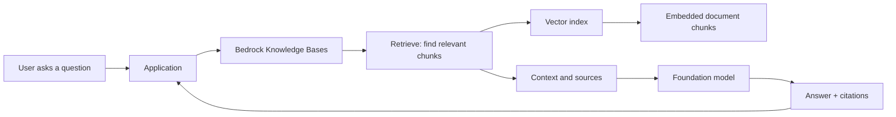
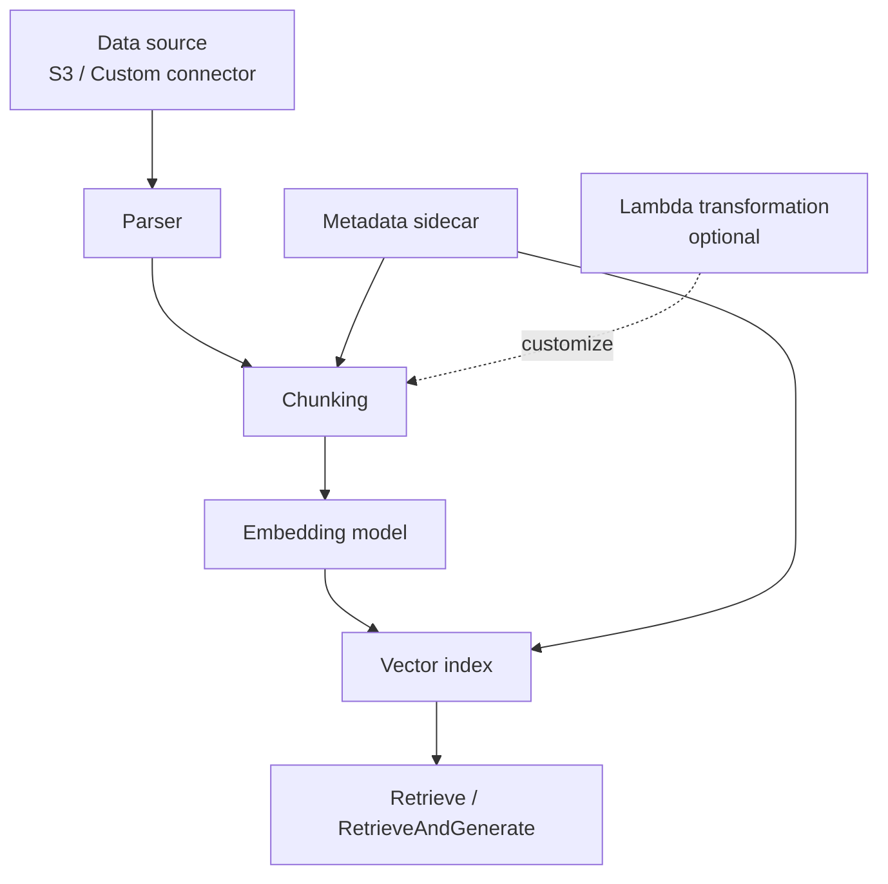
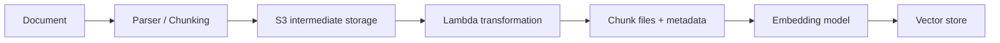

# Bedrock Knowledge Bases and Data Ingestion Workflows

Amazon Bedrock Knowledge Bases provides a knowledge retrieval layer for generative AI applications. The service connects enterprise data with foundation models, converts documents into vector representations, finds content passages relevant to a question, and injects that context into the prompt so the model generates grounded answers. This architecture is commonly known as Retrieval-Augmented Generation (RAG).

RAG quality depends heavily on data and the data ingestion pipeline. A strong model cannot compensate for outdated documents, a parser dropping tables, chunks cut mid-thought, or missing metadata. Therefore, when building a Knowledge Base, you must design data sources, parsing, chunking, embeddings, vector stores, synchronization, and retrieval testing as a single unified pipeline.

## Learning Objectives

After this lesson, you will be able to:

- Explain the role of Bedrock Knowledge Bases in a RAG architecture.
- Distinguish between a Managed Knowledge Base and a customer-managed Knowledge Base.
- Design data sources, service roles, embedding models, and vector stores.
- Choose parsers and chunking strategies suited to document types.
- Manage metadata, retrieval filters, and incremental data synchronization.
- Start, monitor, and troubleshoot ingestion jobs via Console or AWS CLI.
- Use `Retrieve` and `RetrieveAndGenerate` to build cited Q&A applications.
- Evaluate retrieval quality, data security, and operational costs.

## 1. What Problem Does Bedrock Knowledge Bases Solve?

Foundation models possess general knowledge from training data, but do not inherently know internal documents, latest policies, or enterprise-proprietary data. You could stuff everything into the prompt, yet this wastes tokens, is hard to update, and fails to scale when document repositories grow large.

Knowledge Bases helps applications locate the exact relevant content at query time. Instead of sending the entire document repository to the model, the system converts the question into a vector, searches similar document passages in a vector index, and passes a focused set of relevant chunks to the generative model. The application can return answers along with citations so users can verify them.



RAG anchors answers to retrieved data, though it does not guarantee every answer is correct. If source data is wrong, parsers miss content, or queries fail to find matching passages, the model can still answer incompletely or extrapolate. Therefore, you must verify data quality, retrieval results, and final answers alike.

## 2. Two Types of Knowledge Bases

Amazon Bedrock currently offers two primary deployment models. Naming and capabilities may differ across Console, API, and documentation by Knowledge Base type; identify the exact type before following an implementation guide.

| Criterion | Managed Knowledge Base | Customer-managed Knowledge Base |
|---|---|---|
| Ingestion, index, storage, and retrieval infrastructure | Managed by Amazon Bedrock | Customer selects and manages the vector store and related configuration |
| Embeddings and reranking | Can use service-managed models; custom model options where supported | Customer selects the embedding model and configures the vector store |
| Data source connectors | Connectors such as S3, SharePoint, Confluence, Google Drive, OneDrive, and Web Crawler | Depends on data source types supported for the Knowledge Base; S3 and custom data sources are common choices |
| Parsing | Smart Parsing automatically picks processing per document type; supports documents with images, audio, video, and scans per connector capabilities | Customer configures parser, chunking, and multimodal content storage |
| Vector store | Service-managed storage infrastructure | Can use OpenSearch, Aurora, Neptune Analytics, S3 Vectors, or supported third-party vector stores |
| Document-level permissions | Supports ACL filtering at retrieval for supported connectors, except Web Crawler | Does not inherently include equivalent ACL filtering; access controls must be designed separately |
| Operations | Less vector infrastructure and pipeline management overhead | More flexible, but responsible for capacity, indexes, schemas, permissions, and vector store operations |

Managed Knowledge Bases fit when you want to focus on the application, connectors, and retrieval experience. Customer-managed Knowledge Bases fit when you need deep control over the vector database, schemas, embedding strategy, parsing, or integration with existing infrastructure. Never assume APIs, filters, or features of the two types are interchangeable.

For example, when querying a Managed Knowledge Base, retrieval configuration uses `managedSearchConfiguration`; a customer-managed Knowledge Base uses `vectorSearchConfiguration`. Managed Knowledge Bases always use hybrid search and enable managed reranking by default in standard configurations; customer-managed Knowledge Bases depend on the vector store and configuration you choose.

## 3. Ingestion Pipeline from Documents to Vector Index

For a customer-managed Knowledge Base using unstructured data, ingestion typically has four steps:

1. **Parsing:** read files and extract searchable content.
2. **Chunking:** split content into smaller segments for retrieval.
3. **Embedding:** convert each chunk into a vector via an embedding model.
4. **Indexing:** write vectors, text chunks, and metadata to the vector store.



The parser determines what content is retained. Chunking determines context boundaries. The embedding model determines how content is represented in vector space. The vector store determines how data is indexed, filtered, and scaled. Flaws at any step can degrade retrieval recall or precision.

With a Managed Knowledge Base, the service manages most of these steps and provides Smart Parsing, embeddings, reranking, and retrieval under a managed model. You still need to normalize source data, verify connectors, permissions, metadata, and output quality.

## 4. Selecting Data Sources and Preparing Documents

### 4.1 Data Sources

Common unstructured data sources include:

- Amazon S3: documents in buckets or prefixes, suited for data lakes and enterprise-managed repositories.
- Enterprise connectors: e.g., SharePoint, Confluence, Google Drive, OneDrive, or Web Crawler in Managed Knowledge Bases and supported connectors.
- Custom data sources: applications manage content themselves and push documents via appropriate APIs.

If data lives across multiple systems, identify the system of record, who owns updates, and how expired documents are removed. Avoid syncing duplicate copies unless metadata distinguishes versions or sources.

### 4.2 Document Formats

For S3 data sources in customer-managed Knowledge Bases, common document formats include:

| Type | Extensions |
|---|---|
| Plain text UTF-8 | `.txt` |
| Markdown UTF-8 | `.md` |
| HTML UTF-8 | `.html` |
| Microsoft Word | `.doc`, `.docx` |
| CSV | `.csv` |
| Excel | `.xls`, `.xlsx` |
| PDF | `.pdf` |

S3 and custom data sources can also support images, audio, video, and documents with tables, charts, or diagrams when selecting the right multimodal processing approach. Supported formats, file sizes, quotas, and parser capabilities vary by Knowledge Base type and Region; check the quotas page before ingesting production data. For instance, standard S3 documents in certain ingestion flows have a 50 MB per-file limit, while JPEG/PNG files have separate quotas.

### 4.3 S3 Prefix Structure

Organize prefixes by domain, document type, or environment to scope ingestion easily:

```text
s3://company-knowledge/
  finance/
    policies/
    procedures/
    reports/
  hr/
    handbook/
    benefits/
  engineering/
    runbooks/
    architecture/
```

Point data sources to specific prefixes instead of scanning an entire bucket by default. Prefix filters and file patterns can narrow crawl scope. With the customer-managed S3 connector, the bucket must reside in the same Region as the Knowledge Base; the Knowledge Base role must be allowed to read the bucket and objects.

### 4.4 Normalizing Data Before Ingestion

Before uploading, you should:

- Convert text encoding to UTF-8 and fix corrupted characters.
- Remove drafts, duplicates, and expired documents.
- Use stable filenames, avoiding overwriting content without versions or history.
- Preserve meaningful titles, headings, tables, and paragraph structure.
- Convert scanned tables into extractable data if the default parser cannot read them.
- Attach owner, domain, classification, language, and validity period via metadata.
- Define policies for deleting or retaining vectors when deleting a data source.

A PDF file may contain text, tables, and images. Using a text-only parser may fail to extract illustrations or tables accurately. For critical documents, compare parser output against the original before scaling ingestion.

## 5. Parsing: Extracting the Right Content

Parsing converts raw documents into chunkable and embeddable content. Customer-managed Knowledge Bases offer several parser options.

| Parser | Characteristics | Best fit |
|---|---|---|
| Bedrock default parser | Extracts text from supported document formats; no separate parser fee | Documents that are primarily text, Markdown, HTML, Word, Excel, or simple PDFs |
| Bedrock Data Automation (BDA) | Uses a managed service to process multimodal documents, extract content, describe images, or transcribe audio/video per supported capabilities | PDFs with tables/charts, images, audio/video, and documents needing visual extraction |
| Foundation model parser | Uses a foundation model to interpret complex layouts; supports custom parsing prompts | Documents with dense tables, diagrams, images, or complex layouts needing interpretation |

The default parser outputs text only. If PDFs contain charts, diagrams, tables, or images that must be retrieved, consider BDA or the foundation model parser. These options incur separate charges: BDA typically bills per page or processed content; the foundation model parser bills per input/output token. Enabling an advanced parser on a data source may apply it to all PDFs in that source, including text-only PDFs.

Key design considerations:

- Pick the parser based on actual document contents, not just file extensions.
- If using a parser that extracts multimodal content, configure an S3 destination to store extracted artifacts.
- You cannot switch the parsing strategy type of an existing data source (e.g., from default to BDA). To change strategy types, create a new data source.
- For multimodal storage destinations, configure them at Knowledge Base creation time; you cannot add a multimodal storage location after the Knowledge Base is created in that flow.
- Parsers can miss headers/footers, multi-column tables, technical symbols, or scanned text. Inspect sample outputs before bulk ingestion.

## 6. Chunking: Choosing Content Boundaries

Embedding an entire long document into one vector loses precision for retrieving small passages. Chunking divides documents into units with clear enough context to search and inject into prompts.

### 6.1 Default Chunking

Default chunking typically splits content into segments of roughly 300 tokens and attempts to preserve sentence boundaries. It is a simple starting point for standard text documents.

The advantage is minimal tuning. The downside is that the default size may not suit documents with tables, long definitions, source code, or multi-step procedures.

### 6.2 Fixed-Size Chunking

Fixed-size chunking lets you specify `maxTokens` and `overlapPercentage`. Overlap retains part of the end of the previous chunk and start of the next chunk to reduce the risk of losing boundary context.

```json
{
  "chunkingStrategy": "FIXED_SIZE",
  "fixedSizeChunkingConfiguration": {
    "maxTokens": 400,
    "overlapPercentage": 15
  }
}
```

The example above only illustrates configuration. Test multiple sizes against a real question set. Chunks that are too small easily lose conditions or subjects; chunks that are too large mix unrelated topics and degrade vector search accuracy.

### 6.3 Hierarchical Chunking

Hierarchical chunking creates two tiers:

- Smaller child chunks, helping embeddings and search pinpoint relevant locations.
- Larger parent chunks, providing broader context when retrieval matches a child chunk.

During retrieval, the system can substitute child chunks with parent chunks to supply richer context to the model. Because multiple child chunks can point to the same parent, the actual number of returned results may be fewer than requested.

This strategy suits long structured documents such as handbooks, policies, technical manuals, and multi-step procedures. Avoid hierarchical chunking with S3 Vectors without a clear reason; parent/child structures and context metadata can strain metadata limits. When combined parent/child token sizes are too large, vector store metadata limits may be exceeded.

### 6.4 Semantic Chunking

Semantic chunking uses a language model to split segments based on shifts in meaning between sentences. You can tune:

- Maximum tokens: cap on chunk size.
- Buffer size: number of neighboring sentences considered when embedding to detect boundaries.
- Breakpoint percentile threshold: semantic difference threshold for triggering a split.

A larger buffer preserves more context but packs more ideas per chunk. A higher threshold requires stronger semantic divergence before splitting, producing fewer and larger chunks on average. Semantic chunking incurs extra cost because it invokes a foundation model during processing.

Semantic chunking is not currently supported for Managed Knowledge Bases. If choosing a Managed Knowledge Base, use a chunking strategy supported by that service type; semantic chunking is an option in the customer-managed Knowledge Base flow.

### 6.5 No Chunking

With the `NONE` strategy, each document is treated as a single chunk. This fits when documents are already pre-split into small meaningful files or when a custom Lambda creates chunks itself.

No chunking can turn a large file into an overly broad retrieval unit. Additionally, in some customer-managed flows, citations do not show page numbers and cannot be filtered by `x-amz-bedrock-kb-document-page-number` metadata.

### 6.6 Choosing a Strategy by Document Type

| Document type | Starting point | Rationale |
|---|---|---|
| Short FAQs | Default or no chunking | Each Q&A item is already a small self-contained unit |
| Long policies/handbooks | Hierarchical or fixed-size with overlap | Need to match a small passage and return broader clause context |
| Technical guides with headings | Fixed-size or hierarchical | Preserves links between actions, conditions, and outcomes |
| Documents heavy in tables/charts | Suitable parser first, then chunking | Must extract table structures and captions before splitting |
| Content with clear semantic shifts but uneven lengths | Semantic | Keeps topically cohesive sentence groups together |
| Data pre-processed into per-passage files | No chunking | Avoids re-splitting pre-normalized segments |

For content parsed into logical boundaries such as pages or sections, Bedrock may preserve those boundaries and avoid merging across them merely because max tokens increased. Inspect actual outputs rather than assuming the chunker only slices by token count.

## 7. Embedding Models and Vector Stores

### 7.1 Embedding Models

An embedding model converts text or multimodal content into numerical vectors. When a user asks a question, the query is also converted into a vector in the same representation space so the system can find nearest vectors.

Common embedding models in customer-managed Knowledge Bases:

| Model | Considerations |
|---|---|
| Amazon Titan Text Embeddings V2 | Supports multiple vector sizes such as 256, 512, and 1,024; suits many text embedding tasks |
| Cohere Embed Multilingual v3 | Supports multilingual embeddings, suited for multilingual repositories |
| Cohere Embed English v3 | Focused on English content |
| Amazon Titan Multimodal Embeddings G1 | Used for certain supported multimodal text and image flows |
| Amazon Nova Multimodal Embeddings | Directly embeds multimodal content such as images, audio, and video in supported flows |

Supported models, vector dimensions, vector types, and Region availability change over time. Check the Supported models and Regions page before designing. For Vietnamese data, test search quality with Vietnamese queries, proper nouns, mixed English terms, and domain abbreviations.

Vector dimensions in the index must match the chosen embedding model. Changing the model or dimensions can render existing vector indexes incompatible and typically requires creating a matching index/Knowledge Base and re-ingesting data.

### 7.2 Vector Stores

Customer-managed Knowledge Bases support several vector stores, such as:

| Vector store | Considerations |
|---|---|
| Amazon OpenSearch Serverless | Manages vector search collections/indexes; fits when integrated search and metadata filtering are needed |
| Amazon OpenSearch Service Managed Clusters | Fits when the organization already operates OpenSearch clusters |
| Amazon Aurora PostgreSQL | Can use PostgreSQL and the vector extension to store embeddings alongside relational data |
| Amazon Neptune Analytics | Fits workloads combining vector retrieval with graph relationships/GraphRAG in supported flows |
| Amazon S3 Vectors | Stores vectors on S3 Vectors infrastructure; fits when S3-managed vector storage is desired |
| Pinecone, Redis Enterprise Cloud, MongoDB Atlas | Third-party options when the organization already uses or needs features specific to those platforms |

Not every model, dimension, vector type, and feature is compatible with every vector store. For example, binary embeddings are supported only by OpenSearch Serverless and OpenSearch Managed Clusters among the vector stores listed in AWS documentation; S3 Vectors uses floating-point embeddings. Verify compatibility before creating an index.

### 7.3 Creating Your Own Vector Index

When provisioning a vector store yourself, the index typically requires fields for:

- Vector embeddings generated by the model.
- Text chunks extracted from documents.
- Internal metadata managed by Bedrock.
- Custom metadata used for filtering.

For an OpenSearch vector index, configure the appropriate engine and dimensions. AWS documentation requires the `faiss` engine for vector indexes in this Knowledge Base flow; `nmslib` is not supported. For Aurora, prepare the corresponding schema and metadata fields; if using metadata filtering, group metadata into the custom metadata field per guidance and create appropriate indexes.

Conceptual OpenSearch mapping example:

```json
{
  "settings": {
    "index": {
      "knn": true
    }
  },
  "mappings": {
    "properties": {
      "embedding": {
        "type": "knn_vector",
        "dimension": 1024,
        "method": {
          "name": "hnsw",
          "engine": "faiss"
        }
      },
      "AMAZON_BEDROCK_TEXT_CHUNK": {
        "type": "text"
      },
      "AMAZON_BEDROCK_METADATA": {
        "type": "text",
        "index": false
      }
    }
  }
}
```

The mapping above illustrates only the core structure. Use the exact dimensions, vector type, field names, and mapping required by your actual model and configuration. If filterable metadata fields lack `keyword` type or a `keyword` subfield on `text` where needed, filter queries may error or behave unexpectedly.

## 8. Metadata: Filtering the Right Documents at Retrieval

Metadata adds context to each document, for example:

- `department`: finance, hr, engineering.
- `classification`: public, internal, confidential.
- `language`: vi, en.
- `document_type`: policy, procedure, faq.
- `effective_date`: effective start date.
- `owner`: responsible group.

Metadata filters narrow retrieval results. For instance, an HR employee's question searches only HR documents that are still active. Metadata does not alter source content; it attaches attributes so the system can filter or enrich embeddings.

### 8.1 S3 Metadata Sidecar

For S3 data sources in customer-managed Knowledge Bases, you can place a metadata file alongside the source file. The metadata filename takes the form:

```text
employee-handbook.pdf
employee-handbook.pdf.metadata.json
```

Both files must reside in the same location; the metadata file must preserve the exact source filename with the `.metadata.json` suffix. Metadata file size is capped (connector docs currently state a 10 KB maximum).

Example metadata sidecar:

```json
{
  "metadataAttributes": {
    "department": {
      "value": {
        "type": "STRING",
        "stringValue": "hr"
      },
      "includeForEmbedding": false
    },
    "language": {
      "value": {
        "type": "STRING",
        "stringValue": "vi"
      },
      "includeForEmbedding": true
    },
    "effective_year": {
      "value": {
        "type": "NUMBER",
        "numberValue": 2026
      },
      "includeForEmbedding": false
    },
    "is_current": {
      "value": {
        "type": "BOOLEAN",
        "booleanValue": true
      },
      "includeForEmbedding": false
    }
  }
}
```

Common metadata types include `STRING`, `NUMBER`, `BOOLEAN`, and `STRING_LIST`. `includeForEmbedding: false` stores metadata for filtering without appending values to embedded content. `includeForEmbedding: true` prepends key-values to content prior to vectorization, allowing queries mentioning metadata to influence similarity. These key-values are not returned as part of the original text chunk.

If embedding control is not needed, you can use the shorthand format:

```json
{
  "metadataAttributes": {
    "department": "hr",
    "language": "vi"
  }
}
```

The shorthand format stores metadata for filtering and is equivalent to `includeForEmbedding: false`.

### 8.2 Metadata in CSV

CSV has specialized handling: each row is treated as a data unit; one column is designated as the content field, and other columns can become metadata. Bedrock Knowledge Bases currently supports one content field for this CSV configuration. Content column text is chunked and embedded; row metadata is attached to the corresponding chunks.

Example product catalog table:

| description | category | region | price |
|---|---|---|---:|
| Bedroom air purifier | home | VN | 2500000 |
| Office Wi-Fi router | networking | VN | 1800000 |

Selecting `description` as the content field allows `category`, `region`, and `price` to serve as metadata. When a CSV metadata file changes, the file usually must be re-ingested because Bedrock must reprocess the CSV structural configuration.

### 8.3 Metadata Filters and Security

Filters can use operators such as `equals`, `notEquals`, `greaterThan`, `lessThan`, `in`, `notIn`, `startsWith`, or `stringContains` depending on Knowledge Base type and vector store. Conditions can be combined using `andAll` and `orAll`.

Example filter for active Vietnamese HR documents:

```json
{
  "andAll": [
    {
      "equals": {
        "key": "department",
        "value": "hr"
      }
    },
    {
      "equals": {
        "key": "language",
        "value": "vi"
      }
    },
    {
      "equals": {
        "key": "is_current",
        "value": true
      }
    }
  ]
}
```

Some filters are unsupported on Managed Knowledge Bases. For example, `startsWith` and `stringContains` are currently unsupported in managed metadata filters; use operators permitted by that Knowledge Base type's documentation. Service-reserved metadata prefixes also cannot be overwritten.

Reserved metadata conventions differ by Knowledge Base type: customer-managed Knowledge Bases reserve fields prefixed with `x-amz-bedrock`, whereas Managed Knowledge Bases use an underscore prefix for internal fields like `_source_uri` and `_data_source_id`.

Never treat standard metadata filters as a user authentication mechanism. If an application lets clients submit raw filters, a client can tamper with the filter to search outside its intended scope. For sensitive data, use Managed Knowledge Base document-level ACL filtering where supported by the connector, or isolate Knowledge Bases/data sources by tenant and enforce filters on the backend. Always enforce authorization at the application and IAM layers.

## 9. Creating a Knowledge Base and Configuring Service Roles

High-level process to create a customer-managed Knowledge Base:

1. Choose a Region with compatible Knowledge Bases, embedding models, and vector stores.
2. Create an IAM service role for Bedrock Knowledge Bases.
3. Grant permissions to read data sources, invoke the embedding model, access the vector store, and decrypt with KMS where needed.
4. Create or select a vector store and vector index with matching dimensions.
5. Create the Knowledge Base, selecting the embedding model and vector store.
6. Create the data source, configuring S3 prefixes, parser, chunking, and metadata.
7. Run the initial ingestion job.
8. Inspect job status, succeeded/failed file counts, and run test queries.

### 9.1 Service Role Permissions

The service role is assumed by Bedrock to execute ingestion. Depending on configuration, the role typically requires:

- A trust relationship allowing the Bedrock service to assume the role.
- Bucket/object read permissions such as `s3:ListBucket` and `s3:GetObject`.
- Embedding model invocation permission such as `bedrock:InvokeModel`.
- Vector store access permissions: OpenSearch, Aurora, S3 Vectors, or third-party service.
- Appropriate KMS permissions if sources, vector stores, or intermediate storage use a customer managed key.
- Secrets Manager access if a third-party vector store requires credentials.

Scope permissions strictly to required buckets/prefixes and model ARNs. Never grant `s3:*` across the entire account just to make ingestion work.

### 9.2 Operator Permissions

IAM principals managing a Knowledge Base need permissions to create/modify Knowledge Bases, data sources, and ingestion jobs. Principals running queries need permissions to call retrieval/runtime APIs. When creating a Managed Knowledge Base, the principal creating the resource also needs `iam:PassRole` to pass the service role to Bedrock.

An important security consideration with customer-managed Knowledge Bases: `CreateDataSource`, `UpdateDataSource`, and `StartIngestionJob` use the service role attached to the Knowledge Base. Anyone with permissions to manage data sources can cause ingestion to read any location the service role is allowed to access, and then query that content through the Knowledge Base. Therefore, restrict the service role by bucket/prefix and treat data source management permissions as sensitive.

### 9.3 S3 and KMS

If the S3 bucket resides in another account, a bucket policy is required for the Knowledge Base service role. If objects are encrypted with a customer managed KMS key, both the key policy and IAM policy must allow the service role to decrypt. For multimodal storage destinations or intermediate storage, appropriate object write/delete permissions are also needed.

An S3 bucket used as a data source for a customer-managed Knowledge Base must meet the connector's Region requirements. Cross-account access requires coordinating the identity policy in the Knowledge Base account, the bucket policy in the source account, and the key policy if SSE-KMS is used.

## 10. Running Ingestion Jobs

After creating the Knowledge Base and data source, an ingestion job reads documents, parses, chunks, generates embeddings, and writes vectors to the index. For customer-managed Knowledge Bases, you can trigger jobs via Console or API.

AWS CLI example:

```bash
aws bedrock-agent start-ingestion-job \
  --knowledge-base-id KB12345678 \
  --data-source-id DS12345678 \
  --description "Initial ingestion for HR knowledge"
```

The command returns an `ingestionJob` object containing the job ID and status. Use that ID to check progress:

```bash
aws bedrock-agent get-ingestion-job \
  --knowledge-base-id KB12345678 \
  --data-source-id DS12345678 \
  --ingestion-job-id JOB12345678
```

The IDs above are illustrative values only. You can list recent jobs:

```bash
aws bedrock-agent list-ingestion-jobs \
  --knowledge-base-id KB12345678 \
  --data-source-id DS12345678
```

In the output, inspect job status, start/end timestamps, counts of documents added, modified, deleted, failed, and error messages. Do not evaluate a job solely by overall status; a job can complete while still having failed documents that need attention.

## 11. Incremental Data Synchronization

After a data source changes, sync to update the Knowledge Base. With the S3 connector, sync is incremental: Bedrock compares changes and processes documents added, modified, or deleted since the previous sync.

| Change at source | Result on sync |
|---|---|
| No change | Document is skipped |
| New file added | New file is ingested |
| File content modified | File is re-parsed, chunked, embedded, and indexed |
| Metadata sidecar modified | Usually re-ingests the document; in some cases updates metadata only without calling the embedding model |
| Source file deleted | Corresponding content is removed from the vector store on sync |

Metadata-only optimization can apply when only the metadata file changed, the content file is unchanged, the document is not CSV, and the data source does not use a custom transformation Lambda. When conditions are met, Bedrock can fetch existing vector embeddings, update metadata, and rewrite them without calling the embedding model.

### 11.1 Deleting Data Sources and Deletion Policies

When deleting a data source, understand the deletion policy. For customer-managed Knowledge Bases, you can choose `DELETE` or `RETAIN`. Managed Knowledge Bases currently support only `DELETE`, which is also the default.

- `DELETE`: deletes ingested data associated with the data source from the vector store and supplemental storage per policy; the customer-created vector store itself is not deleted. Deletion can fail if the role lost access or the vector store configuration has errors; inspect `DELETE_UNSUCCESSFUL` status and failure reasons.
- `RETAIN`: retains ingested data in the vector store. Content may continue appearing in queries even after the data source is deleted. To remove this content later, actively sync the Knowledge Base via a remaining data source per AWS guidance.

Deleting a Knowledge Base or data source does not automatically delete a vector store you created yourself. With `RETAIN`, data remains; run a sync or cleanup procedure if you want to remove content from retrieval. Verify the deletion policy before deleting a connector to avoid keeping expired documents or accidentally deleting data you meant to keep.

### 11.2 Scheduling Synchronization

If documents change frequently, establish an appropriate sync schedule or event-driven pipeline. S3 event notifications can trigger an orchestration workflow, though you must avoid launching too many concurrent ingestion jobs exceeding quotas. Batch changes together, check for running jobs, and retry cleanly.

## 12. Custom Transformation Lambda

When built-in chunking does not fit, customer-managed Knowledge Bases allow using a Lambda function in the ingestion pipeline. Use cases include:

- Splitting documents by headings, pages, clauses, or custom business structures.
- Attaching custom metadata per chunk.
- Normalizing content formatting before embedding.
- Stripping repeated headers/footers or boilerplate.

For custom chunking, choose the `NONE` strategy, configure S3 intermediate storage, and let Lambda produce chunks and return references to processed files to the Knowledge Base. To keep built-in chunking while adding chunk-level metadata, select a built-in chunking strategy and run Lambda at the post-chunking step.



Lambda must adhere to the input/output contract, timeouts, payload limits, and read/write permissions on the intermediate bucket. Chunk-level metadata can overwrite file-level metadata on key collisions; enforce clear field naming conventions. Lambda increases flexibility, while also increasing ingestion cost, complexity, and failure surface.

## 13. Multimodal Knowledge Bases

A Knowledge Base can process text alongside images, audio, video, tables, charts, and diagrams when choosing the right data source, parser, and embedding model. There are two main approaches.

### 13.1 Native Multimodal Embeddings

With multimodal models such as Amazon Nova Multimodal Embeddings, images, audio, or video can be passed directly to the embedding model to produce corresponding vectors. This preserves visual or acoustic signals that text extraction could lose.

Audio/video chunking duration can be configured from 1 to 30 seconds; the default is typically 5 seconds. For video, the video chunk duration setting applies even when the video contains audio; audio chunk duration applies to standalone audio files.

Native multimodal embeddings suit finding similar images, locating video scenes, or querying based on visual characteristics. However, retrieval/generation capabilities depend on the API and model. For example, `RetrieveAndGenerate` with Nova Multimodal Embeddings restricts RAG to text content; if you need RAG over audio/video transcripts, use BDA to transcribe content into text and embed with a text model in a supported flow.

### 13.2 Bedrock Data Automation or Foundation Model Parser

BDA can convert audio/video into transcripts and scene descriptions, while the foundation model parser can extract text, tables, figures, and document layout per model capabilities. Afterward, content is converted into text and uses standard text chunking.

| Need | Approach to consider |
|---|---|
| Finding images similar to a query image | Native multimodal embeddings |
| Searching content in support calls | BDA to generate transcripts followed by text embeddings |
| Finding video segments by speech and visuals | BDA with transcripts and scene descriptions |
| Understanding charts and technical diagrams in PDFs | Foundation model parser or BDA per supported capabilities |
| Searching standard text documents | Default parser and text embeddings |

Not every connector supports every multimodal format. Features, Regions, and model types must be verified before designing. Structured data sources have different limitations than unstructured data sources; do not assume multimodal support applies to every Knowledge Base type.

## 14. Retrieving Data: Retrieve and RetrieveAndGenerate

After ingestion, applications can query the Knowledge Base through runtime APIs.

### 14.1 Retrieve

`Retrieve` returns the chunks or content most relevant to the question. The application builds the prompt itself and decides how to call the generative model. This fits when you need control over prompts, combining multiple sources, or applying business logic prior to answer generation.

### 14.2 RetrieveAndGenerate

`RetrieveAndGenerate` combines retrieval with invoking a foundation model to generate a natural-language answer. Results can include citations pointing to source documents or chunks. It is a fast way to get started with a standard RAG pipeline.

### 14.3 GenerateQuery and AgenticRetrieveStream

For structured data stores, `GenerateQuery` translates natural-language questions into queries matching the structured data source. `AgenticRetrieveStream` can decompose complex questions into sub-queries, retrieve iteratively across multiple Knowledge Bases, and assess whether enough information has been gathered; this capability depends on the Knowledge Base type and supported APIs.

### 14.4 Reranking

A reranker re-evaluates the relevance of retrieved chunks and reorders results. Reranking can improve result ordering when initial vector similarity is not discriminative enough. Reranking typically applies to text data; verify supported models, Regions, result counts, and API limits. With Managed Knowledge Bases, a managed reranker may be enabled by default; you can choose a custom model or disable it in supported configurations.

### 14.5 Hybrid Search

Hybrid search combines vector-based semantic search with keyword search. Semantic search finds content with the same meaning despite different wording; keyword search excels at product codes, proper names, error codes, and exact terms. Managed Knowledge Bases use hybrid retrieval; customer-managed Knowledge Bases support hybrid retrieval depending on the vector store and configuration.

## 15. Query Example Using AWS CLI

The following example uses a customer-managed Knowledge Base and `vectorSearchConfiguration`. Replace the Knowledge Base ID, model ARN, and metadata filter according to your environment.

```bash
aws bedrock-agent-runtime retrieve-and-generate \
  --input '{"text":"What is the travel expense approval process?"}' \
  --retrieve-and-generate-configuration '{
    "type":"KNOWLEDGE_BASE",
    "knowledgeBaseConfiguration":{
      "knowledgeBaseId":"KB12345678",
      "modelArn":"arn:aws:bedrock:ap-southeast-1::foundation-model/anthropic.claude-3-haiku-20240307-v1:0",
      "retrievalConfiguration":{
        "vectorSearchConfiguration":{
          "numberOfResults":5,
          "filter":{
            "equals":{
              "key":"department",
              "value":"finance"
            }
          }
        }
      }
    }
  }'
```

The model ARN in the example only illustrates format; the model ID and Region must be supported for your account. For a Managed Knowledge Base, use `managedSearchConfiguration` per the corresponding API rather than copying `vectorSearchConfiguration` verbatim from a customer-managed Knowledge Base.

To control prompt assembly and model generation yourself, call `Retrieve` first:

```bash
aws bedrock-agent-runtime retrieve \
  --knowledge-base-id KB12345678 \
  --retrieval-query '{"text":"What is the travel expense approval process?"}' \
  --retrieval-configuration '{
    "vectorSearchConfiguration":{
      "numberOfResults":5
    }
  }'
```

The application can read `retrievalResults`, assemble text chunks into a prompt, and invoke a model via the appropriate runtime API. When assembling prompts manually, cap context token count, preserve source URI/citation metadata, and use only retrieval results authorized for the user.

## 16. Evaluating Ingestion and Retrieval Quality

A successful ingestion job only confirms the pipeline processed documents per configuration. It does not prove documents were parsed cleanly, chunks are meaningful, or queries retrieve the right information.

### 16.1 Ingestion Checks

- Does the number of discovered files match the expected file count in the prefix?
- Did any files fail due to format, size, S3 permissions, KMS, or parser issues?
- Does extracted content preserve headings, tables, error codes, and Vietnamese diacritics?
- Are chunks cut mid-condition, mid-step, or mid-table?
- Is metadata attached to the right files with the right data types?
- Are source deletions or edits reflected after syncing?

### 16.2 Retrieval Checks

Build a benchmark question set with known answers and source documents. Include direct questions, paraphrased questions, questions with proper nouns/error codes, multi-condition questions, and unanswerable questions outside the corpus.

| Metric | Meaning |
|---|---|
| Recall@K | Proportion of questions where at least one correct chunk appears in the top K results |
| Precision@K | Proportion of chunks in the top K that are actually relevant |
| MRR | Average reciprocal rank of the first relevant result |
| Citation accuracy | Whether citations point to the actual documents and passages supporting claims |
| Groundedness | Whether the answer is supported by retrieved content |
| Abstention quality | Whether the system refuses or clearly states when the corpus lacks an answer |

If recall is low, revisit the parser, chunk size, embedding model, query rewriting, and metadata filters. If precision is low, check for duplicate documents, overly broad chunks, metadata, or reranking. If chunks are right yet the answer is wrong, examine the prompt, model, context length, and how conflicting sources are handled.

### 16.3 Testing Vietnamese Documents

For a Vietnamese document corpus, test:

- Vietnamese diacritics and unaccented typing variants.
- English terms mixed into Vietnamese text.
- AWS service names, error codes, ARNs, policy codes, and table names.
- Internal enterprise synonyms and abbreviations.
- Tables with columns/units, dates, and monetary amounts.
- Documents where old and new versions coexist.

When documents have multiple versions, use `effective_date`, `version`, or `is_current` metadata to filter to the right version. Do not rely solely on similarity scores to distinguish expired documents.

## 17. Security, Operations, and Costs

### 17.1 Content Security

- Scope the service role strictly to the data source, model, and vector store.
- Use KMS to encrypt data where needed; configure the key policy for the service role.
- Use Managed Knowledge Base document-level ACL filtering when supported by the connector.
- With customer-managed Knowledge Bases, the backend must verify permissions before querying and enforce server-controlled filters.
- Do not place secrets or personal data into unnecessary metadata.
- Review logs, queries, and citations to prevent cross-tenant content leaks.

Guardrails apply to LLM inputs and generated responses, but do not automatically apply to references returned by retrieval at runtime. Therefore, do not use guardrails as a substitute for authorization. Document contents may also contain prompt injections; applications should treat chunks as untrusted data, not system directives.

### 17.2 Monitoring and Troubleshooting

Monitor ingestion job status, failed document counts, processing duration, vector index size, retrieval latency, model invocation errors, and citation rates. When errors occur, classify by layer:

| Symptom | What to check |
|---|---|
| Files not found | S3 prefix filter, file patterns, Region, connector role, and bucket policy |
| AccessDenied during ingestion | Trust policy, S3 IAM, bucket policy, KMS key policy, model invoke, and vector store permissions |
| Files skipped | Format, size, extension, file filter, and incremental sync state |
| Parser misses tables/images | Parser strategy, multimodal storage destination, and file type |
| Metadata not picked up | Sidecar name, co-location in same folder, JSON schema, and size limits |
| Vector index errors | Dimensions, field mapping, engine, index schema, and service role |
| Wrong retrieval results | Chunking, embeddings, metadata filters, stale data, and reranker |
| Answers lack citations | API configuration, Knowledge Base type, and how the application parses responses |

When changing the parser, embedding model, or chunking, consider creating a new data source/Knowledge Base and re-ingesting in a controlled rollout. Major changes can alter the entire vector index and retrieval quality.

### 17.3 Costs

Main cost components include:

- Embedding model usage for new or re-ingested documents.
- BDA or foundation model parser for PDFs, tables, images, and audio/video.
- Foundation models used for semantic chunking or custom processing.
- Vector store storage, index capacity, throughput, and backups.
- Retrieval, reranking, and generation at query time.
- S3 storage, KMS, Lambda, data transfer, and supporting services.
- Managed Knowledge Base service and model usage per current pricing.

Incremental sync skips unchanged files. Metadata-only optimization can avoid re-embedding in supported cases. However, modifying file content typically triggers re-parsing, chunking, embedding, and indexing. Estimate costs by daily changed file counts, document sizes, chunk counts, query volume, and generation tokens.

## 18. Case Study: HR Policy Repository

An enterprise has a Vietnamese employee handbook, forms, leave policies, and recruitment procedures in S3. Employees ask questions via an internal chatbot. The system must answer according to department, language, and current policy version.

### Step 1: Standardize Sources

```text
s3://company-knowledge/hr/
  handbook/
    employee-handbook-2026.pdf
    employee-handbook-2026.pdf.metadata.json
  leave/
    annual-leave-policy.md
    annual-leave-policy.md.metadata.json
  recruitment/
    interview-process.docx
    interview-process.docx.metadata.json
```

Each sidecar attaches `department=hr`, `language=vi`, `is_current=true`, and `effective_date`. Older files are moved to a separate archive prefix or marked `is_current=false` to keep them out of default answers.

### Step 2: Choose Configuration

- Choose a Managed Knowledge Base if you want service-managed connectors, document ACLs, and vector store operations.
- Choose a customer-managed Knowledge Base if you need to select the vector store yourself or deeply control index configuration.
- Choose an embedding model with solid Vietnamese quality and test mixed Vietnamese/English queries.
- Use the default parser for Markdown/text; use an advanced parser for PDFs with critical tables or charts.
- Start with default or fixed-size chunking, then benchmark hierarchical chunking if answers require context across multiple subsections.

### Step 3: Ingest and Verify

Run the ingestion job, verify succeeded/failed file counts, inspect sample chunks, and confirm metadata. Then run a question suite such as:

- How many days of annual leave do employees receive?
- Who must approve a leave request?
- Which documents are required for the technical interview round?
- When does the policy take effect?

Verify citations point to the right files and passages. Test a question about a non-existent policy to confirm the chatbot does not fabricate answers.

### Step 4: Operate

When HR updates a policy, replace the source file and run incremental sync. When an old policy is retired, update metadata or delete the file and sync so the vector store reflects the change. Monitor failed jobs, citation quality, and per-employee access controls.

## 19. Production Checklist

- [ ] Decide between Managed and customer-managed Knowledge Base.
- [ ] Confirm supported data sources, Region, connectors, and file formats.
- [ ] Standardize documents, deduplicate, and manage versions.
- [ ] Configure the service role with least privilege.
- [ ] Verify bucket policies, KMS key policies, and vector store permissions.
- [ ] Choose a parser appropriate for text, tables, images, audio, or video.
- [ ] Choose a chunking strategy and test sizes/overlaps using real questions.
- [ ] Choose compatible embedding model and vector dimensions.
- [ ] Set up metadata sidecars, filters, and ACL/tenant rules.
- [ ] Define deletion policy and workflow for removing expired documents.
- [ ] Automate ingestion sync with concurrency limits and retries.
- [ ] Monitor job status, file failures, vector store health, and retrieval latency.
- [ ] Evaluate Recall@K, Precision@K, citation accuracy, and groundedness.
- [ ] Test unanswerable queries, prompt injection, and cross-tenant isolation.
- [ ] Budget embedding, parser, vector store, reranking, and generation costs.
- [ ] Test backups, restores, and re-ingestion procedures.

## 20. Common Misconceptions

| Misconception | Accurate understanding |
|---|---|
| Creating a Knowledge Base makes data immediately queryable | You must connect a data source and run ingestion/sync |
| Vector embeddings are verbatim copies of documents | Vectors are numerical representations; text chunks and metadata must still be stored to return results |
| Bigger chunks are always better | Large chunks preserve context but can degrade retrieval precision |
| Smaller chunks are always better | Small chunks easily lose subjects, conditions, and cross-sentence links |
| Metadata filters equal authorization | Filters are retrieval conditions; access rights must be enforced by backend/ACLs |
| Modifying source files automatically updates vectors | You must sync or use direct ingestion APIs where supported by the source |
| Deleting a data source always deletes the vector store | Deletion policy can be DELETE or RETAIN; the customer vector store may persist |
| RetrieveAndGenerate is always better than Retrieve | Retrieve fits when you need direct control over prompts, models, or business logic |
| The default parser reads all tables and images | The default parser primarily extracts text; multimodal content needs appropriate parsers/models |
| A succeeded ingestion job means RAG is accurate | You must evaluate retrieval and answers using a benchmark question set |

## References

- [Amazon Bedrock Knowledge Bases overview](https://docs.aws.amazon.com/bedrock/latest/userguide/knowledge-base.html)
- [Turning data into a knowledge base](https://docs.aws.amazon.com/bedrock/latest/userguide/kb-how-data.html)
- [Supported models and Regions](https://docs.aws.amazon.com/bedrock/latest/userguide/knowledge-base-supported.html)
- [Supported document formats and limits](https://docs.aws.amazon.com/bedrock/latest/userguide/knowledge-base-ds.html)
- [Amazon Bedrock service quotas](https://docs.aws.amazon.com/general/latest/gr/bedrock.html)
- [Managed Knowledge Base quotas](https://docs.aws.amazon.com/bedrock/latest/userguide/kb-managed-quotas.html)
- [Connect to Amazon S3](https://docs.aws.amazon.com/bedrock/latest/userguide/s3-data-source-connector.html)
- [Parsing options](https://docs.aws.amazon.com/bedrock/latest/userguide/kb-advanced-parsing.html)
- [Content chunking](https://docs.aws.amazon.com/bedrock/latest/userguide/kb-chunking.html)
- [Customize ingestion](https://docs.aws.amazon.com/bedrock/latest/userguide/kb-data-source-customize-ingestion.html)
- [Custom transformation Lambda](https://docs.aws.amazon.com/bedrock/latest/userguide/kb-custom-transformation.html)
- [Metadata and filtering](https://docs.aws.amazon.com/bedrock/latest/userguide/kb-metadata.html)
- [Service role permissions](https://docs.aws.amazon.com/bedrock/latest/userguide/kb-permissions.html)
- [Vector store prerequisites](https://docs.aws.amazon.com/bedrock/latest/userguide/knowledge-base-setup.html)
- [Sync data sources](https://docs.aws.amazon.com/bedrock/latest/userguide/kb-data-source-sync-ingest.html)
- [Delete a data source](https://docs.aws.amazon.com/bedrock/latest/userguide/kb-ds-delete.html)
- [Retrieve data](https://docs.aws.amazon.com/bedrock/latest/userguide/kb-test-retrieve.html)
- [Retrieve and generate responses](https://docs.aws.amazon.com/bedrock/latest/userguide/kb-test-retrieve-generate.html)
- [Managed Knowledge Base query configuration](https://docs.aws.amazon.com/bedrock/latest/userguide/kb-managed-test-config.html)
- [Multimodal Knowledge Bases](https://docs.aws.amazon.com/bedrock/latest/userguide/kb-multimodal.html)
