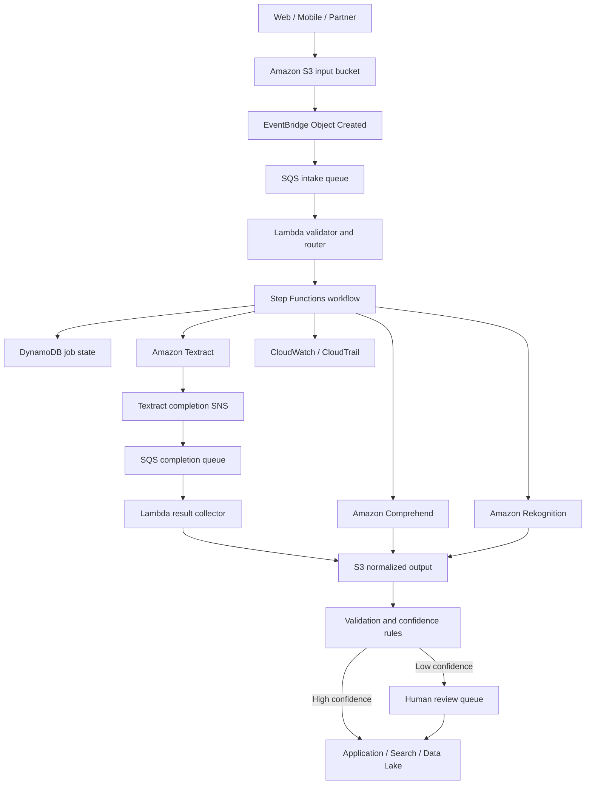

# Textract, Comprehend, Rekognition, and Document and Image Processing

## 1. The Big Picture: From Documents and Images to Usable Data

Enterprise applications frequently receive PDFs, invoices, forms, identity documents, product photos, field photos, or videos. Input data may contain printed text, tables, form fields, objects, text in images, faces, and content needing moderation. Applications must convert them into structured data for searching, reconciliation, classification, moderation, or feeding into downstream workflows.

AWS provides three specialized AI services that are frequently combined:

- **Amazon Textract** extracts text and structure from documents: lines, words, key-value pairs, tables, checkboxes, signatures, and answers to questions about document contents.
- **Amazon Comprehend** performs natural language analysis on text: entities, key phrases, sentiment, language, PII, and custom classification/entity recognition.
- **Amazon Rekognition** analyzes images and videos: object/scene labels, text in images, face detection/analysis, content moderation, face search, and custom labels.

Each service addresses a different signal. Textract turns document layouts into text and relationships; Comprehend analyzes text meaning; Rekognition understands image/video content. A pipeline may use one service or chain multiple services as needed.

For example, for a loan application:
1. Textract reads forms, income tables, and supporting documents.
2. Comprehend classifies text passages or extracts entities if the language is supported.
3. Rekognition can inspect document photos or related imagery per the appropriate use case.
4. The application consolidates results, checks confidence scores, and routes uncertain cases to human reviewers.

No service replaces business validation on its own. AI outputs are confidence-scored signals requiring validation, proper access controls, and human review when decisions affect customers.

## 2. Learning Objectives

After this lesson, you will be able to:

1. Distinguish the responsibilities of Textract, Comprehend, and Rekognition.
2. Choose synchronous or asynchronous APIs based on data type and latency requirements.
3. Use Textract to read text, forms, tables, queries, signatures, expenses, and lending documents.
4. Interpret Block structures, relationships, geometry, and confidence in Textract outputs.
5. Use Comprehend to detect entities, key phrases, sentiment, and PII.
6. Distinguish real-time, batch synchronous, and asynchronous batch modes in Comprehend.
7. Choose Rekognition Image, Video, moderation, face, and custom-label operations.
8. Design pipelines using S3, EventBridge, SQS, SNS, Lambda, and Step Functions.
9. Handle pagination, duplicate notifications, retries, idempotency, and service quotas.
10. Design confidence thresholds, exception queues, and human review.
11. Protect documents, images, PII, and biometric data with IAM, S3, KMS, and retention policies.
12. Measure costs by page, request, image/video, and workflow.
13. Build, test, and operate pipelines using the AWS CLI.

## 3. Choosing the Right Service

| Need | Service/API | Output |
|---|---|---|
| Document OCR, reading lines and words | Textract `DetectDocumentText` | `LINE`, `WORD`, and geometry |
| Extracting key-values, checkboxes | Textract `AnalyzeDocument` with `FORMS` | `KEY_VALUE_SET`, selection elements |
| Extracting tables | Textract `AnalyzeDocument` with `TABLES` | `TABLE`, `CELL`, relationships |
| Finding fields by question | Textract `AnalyzeDocument` with `QUERIES` | `QUERY` and `QUERY_RESULT` |
| Detecting signature locations | Textract with `SIGNATURES` | `SIGNATURE` geometry/confidence |
| Invoices and receipts | Textract `AnalyzeExpense` | Vendor, summary fields, line items |
| Analyzing loan application packages | Textract Analyze Lending | Page classification and results per document type |
| Finding people, organizations, locations | Comprehend `DetectEntities` | Entity, type, offsets, score |
| Summarizing prominent phrases | Comprehend `DetectKeyPhrases` | Key phrases |
| Analyzing text sentiment | Comprehend `DetectSentiment` | Positive, negative, neutral, mixed |
| Detecting PII | Comprehend `DetectPiiEntities` | PII type, offsets, score |
| Detecting objects/scenes | Rekognition `DetectLabels` | Labels and confidence |
| Reading text in images | Rekognition `DetectText` | Text detections and geometry |
| Detecting faces | Rekognition `DetectFaces` | Face boxes, landmarks, attributes |
| Comparing faces | Rekognition `CompareFaces` | Similarity score |
| Moderating images | Rekognition `DetectModerationLabels` | Moderation labels and confidence |
| Analyzing videos stored in S3 | Rekognition Video Start/Get APIs | Asynchronous time-indexed results |
| Detecting enterprise-specific objects | Rekognition Custom Labels | Custom model inference |

Quick selection rules:

- Documents with layouts, tables, or forms: start with Textract.
- Existing text needing content understanding: use Comprehend if the language is supported.
- Image/video inputs needing object, text, face, or moderation analysis: use Rekognition.
- Multi-step, branching, or review workflows: orchestrate with Step Functions and queues.

## 4. Amazon Textract: Structured OCR

Textract does not return only a flat OCR string. For document analysis, the service returns a list of `Block` objects with relationships describing document structure.

Common block types:

- `PAGE`: document page.
- `LINE` and `WORD`: recognized lines and words.
- `KEY_VALUE_SET`: form key/value pairs.
- `TABLE` and `CELL`: tables and cells.
- `SELECTION_ELEMENT`: checkboxes/radio buttons and their selection status.
- `SIGNATURE`: signature regions.
- `QUERY` and `QUERY_RESULT`: questions, aliases, and corresponding answers.
- `LAYOUT` blocks: titles, paragraphs, lists, headers/footers, and supported layout elements.

Each block can include confidence, geometry, page number, and relationships. Applications should follow relationship IDs to reconstruct structure rather than assuming block ordering in the response always matches logical business order.

### 4.1. DetectDocumentText

Use `DetectDocumentText` when you only need OCR lines and words without form/table relationships.

Use cases: extracting text from scanned images; indexing documents for search; extracting raw text as NLP input; quick scan quality checks.

The API returns `LINE`/`WORD` blocks and relative coordinates. Applications can assemble text by page and geometry while keeping metadata to map back to the original image.

### 4.2. AnalyzeDocument

`AnalyzeDocument` is used when relationships between elements are needed. The `FeatureTypes` parameter specifies the analysis types:

- `FORMS`: key-value pairs and selection elements.
- `TABLES`: table/cell structure.
- `QUERIES`: finding fields by natural-language questions.
- `SIGNATURES`: signature locations.
- `LAYOUT`: layout structures such as paragraphs, titles, lists, and headers/footers.

Multiple feature types can be combined in a single request if the use case calls for it. All `LINE`/`WORD` blocks can still appear in results even when not selected as a primary feature.

Synchronous `AnalyzeDocument` fits single-page documents requiring fast responses. For multi-page documents or batch processing, use `StartDocumentAnalysis`/`GetDocumentAnalysis`.

### 4.3. Forms and Key-Value Pairs

On an application form, Textract can detect keys like `Applicant Name` and their corresponding values. Results are represented via `KEY_VALUE_SET` blocks and relationships between `KEY` and `VALUE`.

The application should index blocks by ID, find blocks with entity type `KEY`, follow `VALUE` relationships to locate value blocks, and capture text, confidence, page, and bounding box. Then validate data types and business rules.

Do not assume every label sits immediately next to its value. Multi-column forms, checkboxes, or skewed layouts require relationship reconstruction logic.

### 4.4. Tables and Selection Elements

Textract can extract tables, cells, titles/footers, and selection elements. When processing invoice or report tables, preserve row/column relationships, page numbers, and geometry so context is not lost.

Tables with merged cells, faint borders, rotated text, or busy backgrounds can lower accuracy. If downstream systems require CSV, reconstruct tables from cell relationships and check for missing cells before exporting.

### 4.5. Queries

Queries let you ask Textract for target fields, for example:

- "What is the invoice number?"
- "What is the invoice date?"
- "What is the total amount due?"

Results include `QUERY` and `QUERY_RESULT` linked by ID with a confidence score. Queries should use phrasing close to how fields appear in the document.

Queries are not a general-purpose chatbot and do not perform business reasoning beyond document contents. This feature currently supports English only; do not submit Vietnamese queries expecting the service to understand them if the language matrix does not support it.

### 4.6. Signatures

Textract can detect signature regions and return bounding boxes/confidence. This detects the presence of a signature mark, not signer identity, legal validity, or signature authenticity.

If a workflow requires verifying the signer's identity, use a dedicated identity verification system or separate business process.


## 5. Invoices, Receipts, and Lending Packages

### 5.1. AnalyzeExpense

Textract `AnalyzeExpense` is optimized for invoices and receipts. Outputs can include:

- Vendor name and supplier details.
- Invoice/receipt summary fields.
- Totals, taxes, dates, and payment details.
- Line items such as descriptions, quantities, unit prices, and line totals.
- Geometry and confidence for extracted fields.

Use `AnalyzeExpense` for invoices/receipts rather than rebuilding every field from raw OCR text. Still, validate totals, currency, tax, line-item arithmetic, and vendor identity against business master data.

For multi-page documents, use `StartExpenseAnalysis`/`GetExpenseAnalysis`. Textract processes each invoice/receipt page as an independent document; it does not automatically carry invoice context across multiple pages of the same PDF.

### 5.2. AnalyzeID

`AnalyzeID` extracts information from supported identity documents, such as US passports and US driver's licenses. Do not assume this API reads every national ID card or passport from every country.

When processing Vietnamese identity documents, check documentation and language/region support explicitly; you may need general OCR combined with extraction rules, custom models, or an appropriate vendor.

### 5.3. Analyze Lending

Analyze Lending is a workflow for loan application packages. Textract can classify pages by document type and route them to appropriate operations, returning per-page results or a summary.

Common flow:

- `StartLendingAnalysis` to start the job.
- SNS notifies when the job completes.
- `GetLendingAnalysis` retrieves page-level results.
- `GetLendingAnalysisSummary` retrieves the package summary.

Verify supported document types, Regions, quotas, and languages before deploying.

## 6. Synchronous vs. Asynchronous in Textract

| Criterion | Synchronous | Asynchronous |
|---|---|---|
| APIs | `DetectDocumentText`, `AnalyzeDocument`, `AnalyzeExpense`, `AnalyzeID` | `Start*`/`Get*` operations |
| Use case | Single-page documents, fast response | Multi-page PDF/TIFF, batch processing |
| Input | S3 object or bytes per API | Documents stored in S3 |
| Response | Results returned directly in API response | `JobId` returned; results fetched later |
| Completion | Within the request | SNS notification, SQS/Lambda consumer |
| Pagination | Possible depending on API | Get API returns `NextToken` for large outputs |
| Orchestration | Request/response | Event-driven workflow |

For async operations, do not continuously poll Get APIs to check status. Textract publishes completion status to SNS; subscribe SQS or Lambda, then call the Get API once the job finishes.

Textract retains async results in a service-managed bucket for 7 days by default. You can use `OutputConfig` to write results into your own S3 bucket and configure custom encryption/retention.

### 6.1. ClientRequestToken and Idempotency

Start APIs support `ClientRequestToken`. Resubmitting the same request with the same token within its validity window causes Textract to return the existing `JobId` rather than starting a duplicate job. Tokens have a 7-day lifetime.

Derive a deterministic token from document ID + version + operation + config hash. Never generate a fresh token on each retry when the goal is preventing duplicate jobs.

## 7. Amazon Comprehend: Understanding Text

Comprehend analyzes text using pre-trained or custom models.

Common built-in operations:

- `DetectDominantLanguage`: identifies the dominant language.
- `DetectEntities`: detects people, organizations, locations, dates, quantities, and other entities.
- `DetectKeyPhrases`: finds key phrases.
- `DetectSentiment`: evaluates Positive, Negative, Neutral, or Mixed sentiment.
- `DetectPiiEntities`: locates personally identifiable information.
- `DetectTargetedSentiment`: sentiment linked to specific entities in a sentence; currently English only.
- `DetectToxicContent`: detects toxic content in supported languages/scenarios.

Comprehend returns text, entity types, offsets, and confidence. Offsets identify entity positions within input text; preserve exact encoding and input strings when highlighting or redacting.

### 7.1. Entities and Key Phrases

Example sentence:

```text
Amazon opened a new data center in Singapore in November.
```

Comprehend can identify Amazon as `ORGANIZATION`, Singapore as `LOCATION`, and November as `DATE` when the language is supported.

Key phrases help index or group content. However, entity extraction does not verify factual accuracy; abbreviations, OCR errors, or short text snippets can cause misclassifications.

### 7.2. Sentiment and Targeted Sentiment

`DetectSentiment` classifies the overall sentiment of a text passage. Results are not objective assessments of product quality or the writer's true emotion.

`DetectTargetedSentiment` links sentiment to specific targets/entities—for example, a customer is happy with delivery but unhappy with the product. This feature supports English only per the current language matrix.

Use sentiment as a supporting signal for feedback analysis, not to automatically penalize employees or decide customer entitlements.

### 7.3. PII Detection and Redaction

`DetectPiiEntities` returns PII types, offsets, and confidence. It flags text spans likely containing names, addresses, ID numbers, financial details, or other PII types per the model.

Detection and redaction are two distinct steps:

1. Detect PII to obtain entity types and offsets.
2. Apply policies defining which types require masking.
3. Replace text or run an asynchronous redaction job.
4. Verify outputs and store redacted versions in an appropriately restricted data zone.

Do not treat PII detectors as flawless filters. False positives and false negatives can occur; verify with test sets and human review for sensitive data.

## 8. Comprehend Custom Models

### 8.1. Custom Classification

Custom classifiers categorize text into business labels, such as billing disputes, refund requests, product inquiries, legal review cases, or invoices/contracts.

The workflow includes preparing labeled datasets, training the model, evaluating precision/recall/F1, creating an endpoint or running batch jobs, and monitoring drift.

### 8.2. Custom Entity Recognition

Custom entity recognizers detect domain-specific entities such as contract IDs, equipment codes, internal product names, or clause types.

Create consistently labeled datasets, split train/test, evaluate per entity type, and version models.

### 8.3. Model Endpoints and Batch Jobs

Real-time endpoints fit applications requiring immediate responses, though they incur provisioned/throughput endpoint costs. Async batch fits large S3 datasets and writes results back to S3.

Do not leave custom model endpoints running when idle if billing depends on endpoint uptime.

## 9. Three Processing Modes in Comprehend

| Mode | Volume | Characteristics |
|---|---|---|
| Single-document synchronous | One document | Request returns results directly |
| Multiple-document synchronous | Up to 25 documents/request for Batch APIs | Single request, single language per batch, returns `ResultList`/`ErrorList` |
| Asynchronous batch | File sets in S3 | Start job, monitor status, read output from S3 |

Async jobs fit high volumes. Input and output S3 buckets must reside in the same Region as the Comprehend endpoint invoked; `DataAccessRoleArn` needs permissions to read inputs and write outputs.

For PII batch detection/redaction, supported language codes currently include English and Spanish. Check limits per operation because file size, document count, request TPS, and job concurrency quotas differ.

## 10. Supported Languages: Check Before Deploying

Language support is an architectural constraint, not a minor detail.

### 10.1. Textract

Textract organizes language categories by API/feature. Current lists cover languages such as English, Spanish, French, German, Italian, Portuguese, and many others for certain OCR/table/layout operations. However, not every feature supports the full list:

- Queries, Expense, ID, and Lending are English-only in the language matrix.
- Forms supports English, French, German, Italian, Portuguese, and Spanish.
- Tables, Signatures, Layout, and text detection have broader language coverage.
- Handwriting has separate language limits.

Vietnamese is not in the currently published supported language list. Do not assume Textract reads Vietnamese documents accurately just because the API accepts PDF/JPEG/PNG files.

### 10.2. Comprehend

Currently supported languages for built-in features include German, English, Spanish, Italian, Portuguese, French, Japanese, Korean, Hindi, Arabic, Simplified Chinese, and Traditional Chinese.

- Entities and key phrases support languages on that list.
- PII detection/redaction supports English and Spanish only.
- Targeted sentiment supports English only.
- Plain-text custom classification supports German, English, Spanish, French, Italian, and Portuguese; native document models support English documents only.
- Custom entity recognition supports German, English, Spanish, French, Italian, and Portuguese; PDF/Word processing supports English documents only.
- Syntax analysis and other features maintain separate language lists.
- Vietnamese is not on the current list.

`DetectDominantLanguage` can identify languages from a broader set, but detecting `vi` does not mean other NLP operations support Vietnamese. For Vietnamese text, pick other suitable models/languages, train supported custom solutions, or use another NLP service after security and quality evaluation. Translating text into English can alter proper names, figures, and nuance; never treat machine-translated text as ground truth.

### 10.3. Rekognition

Rekognition Image focuses on JPEG/PNG images and vision tasks such as object labels, text detection, face analysis, and moderation. For `DetectText`, recognition accuracy depends on script/font/image quality and model language coverage. Do not assume images containing Vietnamese text will be OCR'd accurately.

Always test on your enterprise's real data, compute precision/recall per document category, and route failing cases to human review.

## 11. Amazon Rekognition: Image Analysis

Rekognition Image APIs are typically synchronous, accepting JPEG/PNG images from S3 or raw image bytes via SDK and returning JSON.

### 11.1. DetectLabels

`DetectLabels` detects objects, scenes, concepts, and activities—such as car, person, tree, office, beach, or running. The API can return label hierarchies, confidence scores, bounding boxes, and image properties per configuration.

Use cases include categorizing product images, tagging field photos, finding photos containing vehicles or equipment, checking PPE in certain scenarios, and generating search metadata.

Labels are model predictions. Do not use generic labels like "person" to infer identity or sensitive traits.

### 11.2. DetectText

`DetectText` locates text in images and returns detected text, geometry, confidence, and `LINE`/`WORD` relationships when available.

Use it for reading product codes or street signs, finding text on product labels, checking images for watermarks/text overlays, and extracting raw text from images without complex document layouts.

If the image is an invoice, table, or form, Textract is usually a better fit because it returns document structure.

### 11.3. DetectFaces

`DetectFaces` detects faces and can return face bounding boxes, landmarks, pose, quality, and predicted attributes.

Distinguish:
- Face detection: locating face regions.
- Face analysis: predicting visual attributes of a face.
- Face comparison/search: comparing or searching matches against faces stored in a collection.

Predicted attributes such as apparent gender or emotion do not establish gender identity or a person's true emotional state. Never use these predictions to make decisions on benefits, hiring, credit, insurance, or service access.

### 11.4. CompareFaces and Collections

`CompareFaces` compares a source face against target faces and returns similarity/confidence. Collections store face vectors for similarity searching via `SearchFaces` or `SearchFacesByImage`.

This constitutes sensitive biometric data. Before using it, establish a lawful purpose, appropriate notice/consent, retention policies, access logging, deletion workflows, and bias/false-match testing. Similarity scores are not definitive proof of identity.

## 12. Rekognition Content Moderation

`DetectModerationLabels` detects potentially inappropriate visual content against Rekognition's taxonomy. For stored video, use `StartContentModeration`/`GetContentModeration`.

Each label includes a confidence score and taxonomy level. You can set `MinConfidence` to filter results.

Moderation design:

1. Choose thresholds aligned with risk level.
2. Auto-allow low-confidence items if policy permits.
3. Auto-block only for validated label categories and thresholds.
4. Route uncertain regions to a human review queue.
5. Record model version, labels, confidence, and final decision.
6. Monitor false positives/false negatives and update policies.

Rekognition moderation is neither infallible nor exhaustive. Do not use it as the sole basis to certify content as legal/illegal or to replace moderation policies and human review.

## 13. Rekognition Video and Streaming Video

### 13.1. Stored Video

Rekognition Video analyzes videos stored in S3 asynchronously:

1. Call a Start operation such as `StartLabelDetection` or `StartContentModeration`.
2. Store `JobId` and `JobTag`.
3. Rekognition publishes a completion notification to SNS.
4. Consumers receive the notification via SQS/Lambda.
5. Call the Get operation to retrieve results.
6. Process pagination and timestamps/segments.

Use cases include labels, moderation, text detection, face detection/search, celebrity recognition, person tracking, and segment detection depending on API.

Do not poll Get APIs continuously. Use SNS notifications and queues to coordinate concurrent video jobs.

### 13.2. Streaming Video

For video streams, Rekognition integrates with Amazon Kinesis Video Streams via stream processors. Capabilities and outputs vary by stream processor type, such as label detection, face search, or face liveness.

Evaluate ingestion bandwidth, frame sampling, stream retention, latency, throughput, and video costs before deploying.

## 14. Document and Image Processing Pipeline Architecture

A typical event-driven architecture:



The flow can be simplified if using only one service. There is no requirement to invoke all three services for every file.

### 14.1. Ingestion and Validation

When a file is uploaded, verify extension, MIME type, and magic bytes; check size, page count, resolution, and encryption; scan for malware per security policy; generate a document ID and version; record metadata such as tenant, owner, consent, retention class, and source system; and place the object in a raw prefix with restricted access.

Never blindly trust client-supplied file extensions or metadata.

### 14.2. Routing

Lambda or Step Functions routes inputs:

- Multi-page PDF/TIFF: Textract async.
- Single-page image needing OCR: Textract or Rekognition depending on goal.
- Invoices/receipts: Textract Expense.
- Extracted text: Comprehend if language is supported.
- Product images: Rekognition `DetectLabels`/Custom Labels.
- UGC images needing moderation: Rekognition moderation.
- Videos: Rekognition Video async or streaming path.

### 14.3. Consolidating Results

Normalize outputs into an internal schema containing `documentId`, `version`, `sourceUri`, `serviceName`, `operation`, `model/version`, `jobId`, `status`, `startedAt`, `completedAt`, `pageNumber`, `blockType`, `text`, `normalizedValue`, `entityType`, `confidence`, `boundingBox`, `offsets`, `reviewStatus`, `reviewer`, `decision`, `errorCode`, `retryCount`, and `traceId`.

Store raw responses for auditing/reprocessing; store normalized representations for easy downstream consumption.


## 15. Asynchronous Orchestration with SNS and SQS

Textract async and Rekognition Video return a `JobId` and emit completion notifications via SNS. An SQS queue subscribed to SNS decouples completion events from the application and absorbs bursts.

Processing pattern:

1. Worker starts the job and writes `JobId` to DynamoDB.
2. Notification arrives at SNS and is delivered to SQS.
3. Consumer pops the message and looks up job metadata.
4. Consumer calls the Get API once status is `SUCCEEDED`.
5. Consumer reads all result pages using `NextToken`.
6. Consumer writes normalized output.
7. Consumer updates job state to `COMPLETED`.

SQS messages can be delivered more than once. Consumers must be idempotent on `JobId` + operation + result page/token. Configure visibility timeouts, DLQs, and redrive policies.

If a notification arrives before the state record is committed, the consumer can perform a short retry or route to a reconciliation flow. Never assume strict ordering of events across multiple services.

## 16. Pagination and Handling Large Results

`GetDocumentAnalysis`, `GetDocumentTextDetection`, and many Get APIs return paginated results with `NextToken`.

Procedure:

1. Call the Get API with `JobId`.
2. Persist received blocks/results.
3. If `NextToken` is present, call again with that token.
4. Loop until no token remains.
5. Verify page counts, block counts, and status.
6. Mark the job complete only after reading all pages.

Do not hold huge full responses inside Lambda memory or Step Functions state. Write each batch to S3/DynamoDB and pass object keys/`JobId` between steps. Step Functions state payloads have size limits; pass references rather than document bytes or thousands of blocks.

## 17. Confidence, Validation, and Human Review

Confidence reflects a model's certainty for a detection. It is not a calibrated probability across every domain and does not guarantee a field is business-valid.

Invoice examples:

- Vendor name has high confidence, yet the vendor does not exist in master data.
- Total amount has high confidence, yet does not equal subtotal + tax.
- Invoice date is OCR-valid, yet falls outside the accounting period.
- A signature is detected, yet the signer's identity cannot be verified.

Combine confidence with rule validation: required fields, types/ranges/formats, checksums if applicable, master data lookups, arithmetic checks, cross-field consistency, and risk-based thresholds.

Route missing, conflicting, or low-confidence cases to human review. Record both original model outputs and reviewer-corrected values to measure quality.

### 17.1. Human Review and A2I

Textract offers `HumanLoopConfig` integrating Amazon Augmented AI (A2I) in supported flows. However, current AWS documentation notes A2I entered maintenance mode in July 2026 and is closed to new customers; requests using `HumanLoopConfig` may fail if the account is not already an existing A2I customer.

For new workflows, build a custom review queue/UI or use a human review solution currently supported by AWS for your account/Region. Do not assume A2I is a default option for new accounts.

## 18. Idempotency, Retries, and Preventing Duplicate Processing

S3, SNS, SQS, and Lambda events can be delivered multiple times. API retries can also create duplicate jobs without idempotency tokens.

Use document ID + object version/ETag; Textract `ClientRequestToken` for Start operations; `JobId` as the analysis job identifier; idempotency keys per stage and page; DynamoDB conditional writes to claim/complete stages; SQS visibility timeouts and DLQs; retries with exponential backoff and jitter; and dead-letter handling for unrecoverable data errors.

Error classification:

| Error type | Action |
|---|---|
| Throttling/TooManyRequests | Retry with backoff, lower concurrency |
| ServiceUnavailable/InternalServerError | Bounded retries |
| InvalidS3Object/AccessDenied | Fix file, Region, or IAM; never retry infinitely |
| UnsupportedDocument/InvalidParameter | Route to exception queue |
| Low confidence | Human review |
| Output schema mismatch | Quarantine result, fix parser/version |
| Quota exceeded | Queue workload and request a quota increase if needed |

## 19. Securing Document Data, PII, and Images

Documents may contain ID numbers, addresses, bank accounts, contracts, signatures, and biometric data. Design security from ingestion through retention.

### 19.1. S3 and KMS

- Enable Block Public Access on input, output, and review buckets.
- Use SSE-KMS for raw documents, normalized outputs, and result archives.
- Scope bucket policies to specific accounts/principals.
- Separate raw buckets from sanitized/processed buckets.
- Configure lifecycle expiration and retention locks per requirements.
- Never put document bytes or PII into logs.

### 19.2. IAM Roles

Use separate service roles per workflow:

- Textract role reads S3 inputs, publishes to SNS, and writes `OutputConfig` if used.
- Comprehend `DataAccessRole` reads S3 inputs and writes S3 outputs.
- Rekognition role has read access to target objects for analysis.
- Lambda execution role accesses only required queues, DynamoDB tables, and S3 prefixes.
- Step Functions role invokes only required tasks.

Constrain trust policies with `SourceArn`/`SourceAccount` where supported to mitigate confused deputy risks.

### 19.3. Biometric and Face Data

Face collections store sensitive face metadata/templates. Create collections only with a clear use case and legal basis. Define consent/notice and intended purpose, retention and deletion, search/index permissions, audit trails, false-match review, and workflows when users withdraw consent.

Never use face attributes to infer gender identity, true emotional state, or make sensitive entitlement decisions.


## 20. Regions, Quotas, and Throughput Planning

Textract, Comprehend, and Rekognition all enforce quotas per account, Region, and API operation. TPS for sync APIs, start/get async APIs, and concurrent job limits can differ.

Before going to production:

1. Choose the Region where data resides and required APIs exist.
2. Verify service endpoints and feature availability.
3. Inspect Service Quotas for every API called.
4. Estimate pages/images/documents per second and peak hours.
5. Check concurrent async job limits.
6. Use SQS to smooth traffic bursts.
7. Design backpressure and retries.
8. Request quota increases before ramping production traffic.

Never hardcode quotas observed in one Region as universal limits. AWS quota tables can change; check current quotas in the target account and Region.

## 21. Input Quality and Accuracy Optimization

Scan quality directly impacts OCR/vision accuracy.

Recommendations:

- Scan straight, right-side up.
- Use high enough resolution; Textract recommends good-quality images, typically ~150 DPI or higher.
- Avoid blur, glare, shadows, and aggressive compression.
- Do not downsample files already in supported formats unnecessarily.
- Split pages or documents properly.
- Maintain clear contrast and color.
- Avoid cropping off margins, stamps, or signatures.
- Verify language support per feature.
- Preserve immutable original objects for reference.

For Rekognition, JPEG/PNG files and dimensions/resolutions must meet service limits. For video, check codecs/containers and source locations.

## 22. Monitoring and Auditing

Track per stage:

- Accepted files vs. rejected files.
- Count of Textract/Comprehend/Rekognition jobs created.
- Job success/failure/throttling counts.
- End-to-end time from upload to completion.
- Pages/records/images processed.
- Confidence distributions per field/label.
- Human review rate and correction rate.
- SQS backlog, age of oldest message, and DLQ counts.
- Lambda errors/duration/throttles.
- Step Functions failed/timed-out executions.
- Cost by document type, tenant, and workflow.

Use CloudWatch metrics/logs for operations, CloudTrail to audit API activity, and correlation IDs across steps. Log `JobId`, `documentId`, operation, Region, model version, and timestamp. Mask PII in logs and store only necessary text.

## 23. Costs and Optimization

Costs depend on API/feature, page counts, character counts, image/video counts, batch sizes, custom models/endpoints, and Region.

Related cost drivers:

- Textract: page count and operation/feature type.
- Comprehend: text volume/units, real-time vs. batch, custom model training/endpoints.
- Rekognition: image count, video duration/operations, and collection-based features.
- S3: raw inputs, outputs, intermediate results, backups, and lifecycle.
- KMS: cryptographic API requests.
- SNS/SQS/EventBridge: event and message volume.
- Lambda/Step Functions: duration, requests, and state transitions.
- CloudWatch: logs, metrics, and alarms.

Optimize by routing each file to the right operation; batching work where supported; using async jobs for large volumes; preventing duplicates with idempotency; avoiding excessive polling of Get APIs; keeping result files in S3 instead of passing huge payloads through workflows; picking appropriate Rekognition APIs; running custom endpoints only when latency demands them; and tracking cost per successfully processed document.

Never compare only a single API unit price. Price the entire workflow, including retries, human review, storage, and downstream operations.

## 24. Architecture Example: Supplier Invoice Processing

An enterprise receives PDF invoices from multiple suppliers.

| Step | Service | Outcome |
|---|---|---|
| Upload | S3 | Raw invoice |
| Trigger | EventBridge + SQS | Event containing document key |
| Orchestration | Step Functions | Job state and retries |
| Extraction | Textract `StartExpenseAnalysis` | Vendor, totals, line items |
| Result notification | SNS + SQS | Job completion |
| Retrieval | Textract `GetExpenseAnalysis` | Full results, pagination |
| Validation | Lambda | VAT, currency, arithmetic, vendor master |
| NLP | Comprehend if language support fits | Entity/PII classification |
| Review | Internal review queue | Fix missing/incorrect fields |
| Persist | S3 + DynamoDB/RDS | Raw JSON and normalized invoice |
| Audit | CloudWatch/CloudTrail | Traces and decision records |

Never auto-pay an invoice simply because Textract returned high confidence. Reconcile vendor, purchase order, duplicate invoice numbers, amounts, taxes, and approval policies.


## 25. Architecture Example: Product Image Analysis and Moderation

A marketplace receives product photos and user-uploaded images.

1. Images are uploaded to an S3 quarantine prefix.
2. EventBridge/SQS dispatches events to the moderation workflow.
3. Rekognition `DetectModerationLabels` evaluates image content.
4. `DetectLabels` tags objects/scenes if needed.
5. `DetectText` checks for text overlays or product codes if required by the use case.
6. Confidence scores and policy rules decide allow, block, or review.
7. Human moderators resolve ambiguous cases.
8. Only approved images are copied to the published bucket/CDN.
9. Moderation model versions and decision audits are recorded.

Do not rely on a single moderation label to make final decisions for every case. Maintain policies tailored to content types, thresholds, and human review.

## 26. AWS CLI: Textract, Comprehend, and Rekognition

Examples use placeholders. Replace buckets, keys, topic ARNs, and Regions with lab resources. The CLI role requires appropriate permissions.

### 26.1. Starting Asynchronous Textract Document Analysis

Create `textract-request.json`:

```json
{
  "DocumentLocation": {
    "S3Object": {
      "Bucket": "company-doc-input",
      "Name": "invoices/invoice-001.pdf"
    }
  },
  "FeatureTypes": [
    "TABLES",
    "FORMS",
    "QUERIES",
    "SIGNATURES"
  ],
  "QueriesConfig": {
    "Queries": [
      {
        "Text": "What is the invoice number?",
        "Alias": "invoice_number",
        "Pages": ["1"]
      },
      {
        "Text": "What is the total amount due?",
        "Alias": "total_due",
        "Pages": ["1"]
      }
    ]
  },
  "NotificationChannel": {
    "SNSTopicArn": "arn:aws:sns:ap-southeast-1:111122223333:textract-completion",
    "RoleArn": "arn:aws:iam::111122223333:role/TextractPublishRole"
  },
  "ClientRequestToken": "invoice-001-v1-analysis"
}
```

Start the job:

```bash
aws textract start-document-analysis \
  --cli-input-json file://textract-request.json \
  --region ap-southeast-1
```

Once the SNS notification reports `SUCCEEDED`, fetch results:

```bash
aws textract get-document-analysis \
  --job-id JOB_ID_FROM_START_RESPONSE \
  --region ap-southeast-1
```

If the response contains `NextToken`, keep calling `GetDocumentAnalysis` with that token until all result pages are retrieved.

### 26.2. Entity Analysis with Comprehend

English text example:

```bash
aws comprehend detect-entities \
  --text "Amazon opened a new office in Singapore in November." \
  --language-code en \
  --region ap-southeast-1
```

For PII:

```bash
aws comprehend detect-pii-entities \
  --text "Contact Alex at alex@example.com." \
  --language-code en \
  --region ap-southeast-1
```

`LanguageCode` must be on the API's supported list. Do not switch to `vi` if the operation does not support Vietnamese.

### 26.3. Image Labels and Moderation with Rekognition

```bash
aws rekognition detect-labels \
  --image '{"S3Object":{"Bucket":"company-image-input","Name":"products/item-001.jpg"}}' \
  --max-labels 20 \
  --min-confidence 80 \
  --region ap-southeast-1
```

Moderation:

```bash
aws rekognition detect-moderation-labels \
  --image '{"S3Object":{"Bucket":"company-image-input","Name":"ugc/photo-001.jpg"}}' \
  --min-confidence 70 \
  --region ap-southeast-1
```

Thresholds are illustrative only. Tune based on test data, precision/recall, and review policies.

## 27. Hands-On Lab: Invoice and Attachment Processing Pipeline

### 27.1. Objective

Build a pipeline that ingests PDF invoices and attached images, extracts data with Textract, analyzes text with Comprehend when language is supported, and inspects images with Rekognition.

### 27.2. Preparation

- Lab AWS account.
- Dedicated S3 input/output buckets.
- SNS topic and SQS completion queue.
- IAM roles for Textract, Comprehend, Rekognition, and Lambda.
- DynamoDB table storing document/job state.
- Step Functions state machine.
- CloudWatch log groups and alarms.
- Test invoices/images containing no real personal data or properly de-identified.

### 27.3. Steps

1. Create an S3 input bucket with Block Public Access and SSE-KMS.
2. Create an SNS topic for Textract completion.
3. Subscribe an SQS queue to SNS and configure a DLQ.
4. Create a DynamoDB table keyed by `documentId`/`version`.
5. Create a Lambda validator to verify file type, size, Region, and metadata.
6. Create a Step Functions workflow accepting object keys without passing document bytes in state.
7. Route invoices to `StartExpenseAnalysis` or `StartDocumentAnalysis`.
8. Persist `JobId` and `ClientRequestToken`.
9. When notifications arrive, have the consumer call the Get API and handle `NextToken`.
10. Normalize outputs to JSON; retain raw responses in S3.
11. For text in supported languages, call Comprehend to detect entities/PII.
12. For JPEG/PNG images, call Rekognition `DetectLabels` or moderation as appropriate.
13. Apply confidence thresholds and validation rules.
14. Route missing/invalid/low-confidence cases to a review queue.
15. Record decisions, model versions, and audit metadata.
16. Test duplicate notifications, throttling, invalid documents, and service failures.
17. Measure processing duration, review rate, and cost per document.
18. Configure lifecycle rules for input/output/temporary data per retention policy.

### 27.4. Completion Criteria

- Files are validated and routed to the right service.
- Textract jobs receive a `JobId` and completion notifications.
- Get API pagination is handled completely.
- Comprehend runs only on supported languages/features.
- Rekognition returns labels/moderation per policy.
- Duplicate events do not create duplicate business records.
- Low-confidence results enter human review.
- S3/KMS/IAM follow least privilege.
- Dashboards display job status, latency, errors, and review rates.
- Costs are measured per successfully processed document/image.

## 28. Troubleshooting

| Symptom | Possible cause | Resolution |
|---|---|---|
| Textract `InvalidS3Object` | Wrong bucket/key, Region, or read permissions | Check object, Region, and service role |
| Textract `UnsupportedDocument` | Unsupported format or page count | Check PDF/TIFF/JPEG/PNG and operation limits |
| Textract `LimitExceeded` | TPS/concurrent jobs exceeded quota | Queue requests, back off, and request quota increase |
| Textract missing Query results | Unsupported query language/field or poor prompt | Verify English-only and test query phrasing |
| Missing blocks/table cells | Poor scan, complex layout, or missed detection | Improve scan quality, inspect geometry and confidence |
| Comprehend `UnsupportedLanguage` | `LanguageCode` unsupported by operation | Check feature language matrix |
| Comprehend PII returns nothing | Language is not English/Spanish or bad text format | Validate language and input |
| Comprehend batch `FAILED` | IAM role lacks S3 permissions or bad input format | Check `DataAccessRole` and file layout |
| Rekognition `InvalidS3Object` | Bucket/Region/permission mismatch | Check S3 object and Region endpoint |
| Rekognition throttling | TPS exceeded quota | Smooth traffic with SQS, retry/backoff |
| Rekognition false positives | Unsuitable threshold or model fit | Tune using test sets and human review |
| Job completes yet data is missing | `NextToken` not exhausted | Continue pagination loop until done |
| Job processed twice | Duplicate SNS/SQS delivery or retries spawning new jobs | Idempotency keys, `ClientRequestToken`, and conditional writes |

## 29. Common Anti-Patterns

| Anti-pattern | Consequence | Better approach |
|---|---|---|
| Using Textract for all image types | Higher cost and misses vision labels | Pick Rekognition for objects/scenes/moderation |
| Using Rekognition OCR for complex invoices | Loses form/table structure | Use Textract |
| Calling Comprehend on unsupported languages | Unreliable results or API errors | Validate language/feature before calling |
| Treating confidence as calibrated probability | Wrong business decisions | Combine rule validation and human review |
| Continuously polling Textract/Rekognition Get APIs | Throttling and operational overhead | Use SNS/SQS completion notifications |
| Putting PDF/image bytes in Step Functions state | Payload size overflow | Store in S3 and pass keys/references |
| Ignoring `NextToken` | Partial/truncated results | Implement checkpointed pagination loops |
| Lacking idempotency | Duplicate records or business actions | Use job IDs, document versions, and conditional writes |
| Logging raw PII | Data leaks | Mask/redact and enforce retention limits |
| Using face attributes for sensitive decisions | Bias and privacy violations | Restrict to valid use cases with review and governance |
| Using A2I in new accounts without checking availability | Workflow failures | Check A2I status; use supported review workflows |
| Ignoring quotas | Throttling and backlogs | Use SQS, backoff, concurrency caps, and quota planning |

## 30. Production Checklist

### Service Selection and Language

- [ ] Textract/Comprehend/Rekognition chosen according to exact input and output types.
- [ ] Sync/async API matches latency and document size requirements.
- [ ] Language matrix verified per specific operation.
- [ ] Vietnamese is never assumed supported unless explicitly listed.
- [ ] Region and service quotas verified.

### Pipeline Reliability

- [ ] S3 upload events handled idempotently.
- [ ] `JobId`, `documentId`, and object version persisted.
- [ ] Textract/Rekognition completion notifications flow through SNS/SQS.
- [ ] Get API pagination exhausts `NextToken`.
- [ ] Retries use exponential backoff/jitter and DLQs.
- [ ] Step Functions state passes object references only.
- [ ] Reconciliation exists for stuck jobs or lost notifications.

### Accuracy and Review

- [ ] Test dataset represents real production documents/images.
- [ ] Confidence and error rates tracked per field/label.
- [ ] Business validation checks arithmetic, formats, and master data.
- [ ] Low-confidence or conflicting results go to human review.
- [ ] Moderation thresholds calibrated against test data.
- [ ] Face/biometric use cases have policies and legal bases.

### Security and Privacy

- [ ] S3 Block Public Access and SSE-KMS enabled.
- [ ] Least-privilege IAM per service role.
- [ ] SNS topic policies and confused deputy protections configured.
- [ ] PII/biometric data classified with restricted access.
- [ ] Logs contain no raw documents/PII.
- [ ] Retention, deletion, and audit trails configured.
- [ ] Human review tools have access controls and auditing.

### Cost and Operations

- [ ] Cost per processed document/image tracked.
- [ ] SQS smooths traffic within TPS limits.
- [ ] No excessive Get API polling.
- [ ] CloudWatch dashboards and alarms have assigned owners.
- [ ] Runbooks exist for throttling, invalid documents, and failed jobs.
- [ ] Lifecycle cleanup configured for raw/intermediate/output data.
- [ ] Custom model endpoints run only when needed.

## 31. Official References

### Amazon Textract

- [What is Amazon Textract?](https://docs.aws.amazon.com/textract/latest/dg/what-is.html)
- [Analyzing documents](https://docs.aws.amazon.com/textract/latest/dg/how-it-works-analyzing.html)
- [AnalyzeDocument API](https://docs.aws.amazon.com/textract/latest/APIReference/API_AnalyzeDocument.html)
- [Analyzing invoices and receipts](https://docs.aws.amazon.com/textract/latest/dg/analyzing-expense.html)
- [Asynchronous operations](https://docs.aws.amazon.com/textract/latest/dg/api-async.html)
- [Calling asynchronous operations](https://docs.aws.amazon.com/textract/latest/dg/async.html)
- [Supported languages](https://docs.aws.amazon.com/textract/latest/dg/supported-languages.html)
- [Textract quotas](https://docs.aws.amazon.com/textract/latest/dg/limits-quotas-explained.html)
- [Textract data protection](https://docs.aws.amazon.com/textract/latest/dg/data-protection.html)

### Amazon Comprehend

- [What is Amazon Comprehend?](https://docs.aws.amazon.com/comprehend/latest/dg/what-is.html)
- [Supported languages](https://docs.aws.amazon.com/comprehend/latest/dg/supported-languages.html)
- [Document processing modes](https://docs.aws.amazon.com/comprehend/latest/dg/concepts-processing-modes.html)
- [Detect entities](https://docs.aws.amazon.com/comprehend/latest/dg/how-entities.html)
- [Detect PII entities](https://docs.aws.amazon.com/comprehend/latest/dg/how-pii.html)
- [PII asynchronous jobs](https://docs.aws.amazon.com/comprehend/latest/dg/async-pii-api.html)
- [PII redaction](https://docs.aws.amazon.com/comprehend/latest/dg/redact-api-pii.html)
- [Guidelines and quotas](https://docs.aws.amazon.com/comprehend/latest/dg/guidelines-and-limits.html)

### Amazon Rekognition

- [What is Amazon Rekognition?](https://docs.aws.amazon.com/rekognition/latest/dg/what-is.html)
- [Understanding image and video operations](https://docs.aws.amazon.com/rekognition/latest/dg/how-it-works-operations-intro.html)
- [Types of analysis](https://docs.aws.amazon.com/rekognition/latest/dg/how-it-works-types.html)
- [Moderating content](https://docs.aws.amazon.com/rekognition/latest/dg/moderation.html)
- [Stored video analysis](https://docs.aws.amazon.com/rekognition/latest/dg/video.html)
- [Face attribute guidelines](https://docs.aws.amazon.com/rekognition/latest/dg/guidance-face-attributes.html)
- [Image specifications](https://docs.aws.amazon.com/rekognition/latest/dg/images-information.html)
- [Rekognition quotas](https://docs.aws.amazon.com/rekognition/latest/dg/limits.html)

### Architecture and Operations

- [AWS Guidance for Intelligent Document Processing](https://docs.aws.amazon.com/solutions/intelligent-document-processing-on-aws/)
- [Step Functions best practices](https://docs.aws.amazon.com/step-functions/latest/dg/sfn-best-practices.html)
- [Lambda application design and idempotency](https://docs.aws.amazon.com/lambda/latest/dg/concepts-application-design.html)
- [Using Lambda with SQS](https://docs.aws.amazon.com/lambda/latest/dg/with-sqs.html)
