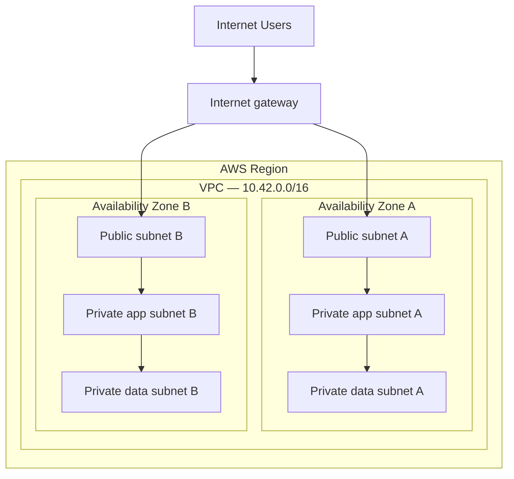
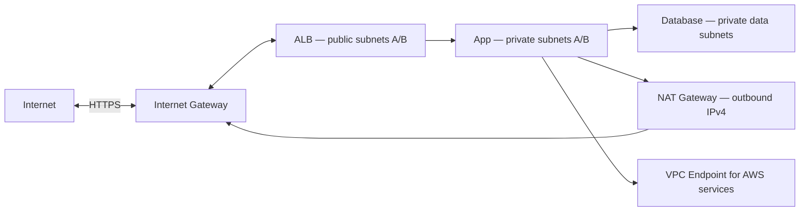

# VPC, CIDR, and IP Address Planning

When deploying applications on AWS, decisions about **which network hosts the application, which address ranges are allocated, and how components are permitted to communicate with one another** must be made before creating EC2, ECS, EKS, RDS, or many other services. Rushed decisions can cause subnets to run out of IPs, prevent VPCs from connecting due to overlapping network ranges, or force costly resource migrations when scaling the system.

This lesson belongs to the **VPC Networking** chapter of the **CLOUD_PROVIDERS_AWS** module. Building on **Region/AZ, IAM, and Amazon VPC**, learners practice selecting **CIDR** blocks, partitioning **subnets across Availability Zones**, sizing IP capacity for compute, storage, database, and serverless services, and laying the foundation for secure connectivity, monitoring, recovery, and cost control.

## 1. Learning Objectives

After completing this lesson, you will be able to:

1. Describe **Amazon VPC**, subnets, Availability Zones, and the roles of related networking components.
2. Explain **CIDR** notation; calculate the first/last addresses, total IPv4 addresses, and assignable IP count in an AWS subnet.
3. Design a scalable, non-overlapping IPv4 allocation scheme spanning at least two AZs.
4. Distinguish **public subnets and private subnets** from **public IPs/private IPs**, and understand the roles of route tables, internet gateways, NAT gateways, and VPC endpoints.
5. Understand how to use **IPv6/dual-stack**, AWS IP Address Manager (IPAM), and operational limits that affect address planning.
6. Validate a design using allocation tables, calculations, example code, and practical scenarios.

## 2. What Is Amazon VPC?

**Amazon Virtual Private Cloud (Amazon VPC)** is a logically isolated virtual network in AWS. You choose the IP range for the VPC, create subnets, and configure traffic routing and access control layers for connected resources.

A **VPC resides within a single Region** and can contain multiple subnets. **Each subnet belongs to exactly one Availability Zone (AZ)**; a single VPC can have subnets across multiple different AZs. AWS provides the underlying networking components, while you design how traffic is segmented and protected.

### 2.1. Distinguishing Key Objects

| Object | Scope / Meaning | Question to Answer |
|---|---|---|
| **AWS account** | Administrative, permission, resource, and billing boundary | Which team owns the network and workloads? |
| **Region** | AWS geographic area | In which Region should data/applications be placed? |
| **Availability Zone (AZ)** | Fault-isolated infrastructure zone within a Region | Across how many AZs do resources need to run for fault tolerance? |
| **VPC** | Virtual network within a Region | What are the system's IP range and connectivity scope? |
| **Subnet** | IP segment of a VPC, tied to one AZ | Where do resources of an application tier reside? |
| **Network interface (ENI)** | Virtual network interface, which can consume IP addresses from a subnet | Which services are consuming IPs? |
| **Route table** | Set of rules determining the next hop for packets by destination address | Which path does internal, Internet, or on-premises traffic take? |
| **Security group** | **Stateful** traffic rule set at the network interface/resource level | Who is allowed to connect to the resource? |
| **Network ACL** | **Stateless** rule set at the subnet boundary | Is traffic filtering needed at the subnet boundary? |

A VPC is not a server; nor is a subnet necessarily a "public" network. Two subnets in different AZs can reside in the same VPC and exchange traffic via the `local` route, though actual connectivity still depends on security groups, NACLs, routing, and service configuration.

### 2.2. Conceptual Diagram



*This diagram illustrates logical layering; it does not imply that all connections are automatically allowed or must be deployed strictly following the arrows. Actual traffic paths require corresponding routes, network policies, and service configurations.*

> **Principle:** Choose CIDR blocks based on projected connectivity over several years, not merely the number of EC2 instances running today. A VPC's network range may later need to connect to other VPCs, on-premises data centers, VPNs, or enterprise networks.

## 3. Understanding IPv4 Addresses and CIDR

**IPv4** consists of 32 bits, represented as four octets from 0 to 255, such as `10.42.16.8`. **CIDR** (*Classless Inter-Domain Routing*) represents an address block using a network address and a **prefix length**, such as `10.42.16.0/24`.

In `/24`, there are **24 bits for the network portion** and **8 bits for the host portion**. The range has a total of `2^8 = 256` addresses, from `10.42.16.0` to `10.42.16.255`.

General formulas for IPv4:

```text
Host bits               = 32 - prefix_length
Total IPv4 addresses    = 2 ^ (32 - prefix_length)
Usable IPs in AWS       ≈ Total addresses - 5
```

The last line holds for a **standard IPv4 subnet** because AWS reserves five addresses. This is not a formula for calculating the total IPv4 addresses of a VPC, nor is it the guaranteed number of EC2 instances you can launch: a single resource can consume multiple IPs, and services have quotas and additional IP requirements. Exceptions to reserved addresses exist for IPv4 ranges brought into AWS via **BYOIP**; check AWS documentation when using that approach.

### 3.1. Quick Reference for IPv4 Block Sizes

| CIDR | Subnet Mask | Total IPv4 | Assignable IPv4 in a Standard AWS Subnet | Common Use Case |
|---|---|---:|---:|---|
| `/16` | `255.255.0.0` | 65,536 | 65,531 | Large range for a VPC or large-scale resource set |
| `/20` | `255.255.240.0` | 4,096 | 4,091 | Relatively large subnet with high ENI/IP demand |
| `/22` | `255.255.252.0` | 1,024 | 1,019 | Application tier with significant scaling needs |
| `/24` | `255.255.255.0` | 256 | 251 | Common subnet for small-to-medium workloads |
| `/26` | `255.255.255.192` | 64 | 59 | Moderate-sized resource group |
| `/27` | `255.255.255.224` | 32 | 27 | Small segment |
| `/28` | `255.255.255.240` | 16 | 11 | Smallest segment supported by AWS for a standard IPv4 subnet |

**Note:** On AWS, allowed IPv4 CIDR prefix lengths when creating a **VPC** and **subnet** are typically between **`/16` and `/28`**; the address block must belong to a valid range and satisfy service requirements. You cannot create a `/29` IPv4 subnet in the standard way.

### 3.2. Network Addresses and Block Boundaries

The range `10.42.16.0/24` contains:

- First address: `10.42.16.0`.
- Last address: `10.42.16.255`.
- Total: 256 addresses.

If split into two `/25` blocks, we get:

| Block | Address Range | Total |
|---|---|---:|
| `10.42.16.0/25` | `10.42.16.0` – `10.42.16.127` | 128 |
| `10.42.16.128/25` | `10.42.16.128` – `10.42.16.255` | 128 |

Dividing a `/24` into four `/26` blocks requires starting addresses of **0, 64, 128, 192** in the last octet.

Therefore, `10.42.16.64/26` is a valid boundary, whereas `10.42.16.70/26` is not the starting address of a `/26` block. Tools/APIs may normalize an input CIDR value to its canonical network address; you should **calculate boundaries beforehand** and avoid relying on automatic normalization.

### 3.3. RFC 1918: Private IPv4 Ranges

Three private ranges commonly used in internal networks:

| Range | Scope | Number of Addresses |
|---|---|---:|
| `10.0.0.0/8` | `10.0.0.0` – `10.255.255.255` | 16,777,216 |
| `172.16.0.0/12` | `172.16.0.0` – `172.31.255.255` | 1,048,576 |
| `192.168.0.0/16` | `192.168.0.0` – `192.168.255.255` | 65,536 |

**A private range does not mean automatic security.** You must still configure routes, SGs, NACLs, IAM, and data protection controls. Conversely, a host using a private IP can still access the Internet along a designed egress path, such as a NAT gateway for IPv4.

## 4. Which Addresses Does AWS Reserve in a Subnet?

In a **standard IPv4 subnet**, AWS reserves the **first four addresses** and the **last one address**. For `10.42.16.0/24`:

| IP | Reason Reserved by AWS |
|---|---|
| `10.42.16.0` | Network address |
| `10.42.16.1` | VPC router |
| `10.42.16.2` | Reserved for DNS according to VPC addressing design |
| `10.42.16.3` | Reserved for future use |
| `10.42.16.255` | Network broadcast address; AWS does not support broadcast in a VPC |

The normally assignable IPv4 addresses in the example above are `10.42.16.4` through `10.42.16.254`, totaling **251 addresses**.

For subnet `10.42.16.0/28`:

- Total `2^(32-28) = 16` addresses, from `10.42.16.0` to `10.42.16.15`.
- Subtracting the five AWS-reserved addresses leaves only **11 assignable IPs**.
- If a service uses extra ENIs or secondary addresses, you can exhaust IPs very quickly. `/28` is usually too tight for an autoscaling application tier.

**Do not confuse "total addresses in a CIDR" with "available addresses remaining" on AWS.** A subnet's `AvailableIpAddressCount` attribute reflects unused IPv4 addresses at query time; the actual number changes as resources are created, deleted, or hold addresses.

Source: [AWS — Subnet CIDR blocks](https://docs.aws.amazon.com/vpc/latest/userguide/subnet-sizing.html).

## 5. CIDR Allocation Rules in a VPC

Before laying out subnets, understand these constraints:

1. **A VPC must have a primary IPv4 CIDR** at creation (unless AWS changes requirements for a specific VPC type); secondary IPv4 blocks can be associated subject to service limits.
2. **Every subnet CIDR must fall within a CIDR block associated with the VPC** and adhere to supported formats.
3. **Subnets in the same VPC must not have overlapping CIDRs**, even if located in different AZs.
4. **Each subnet is tied to a single AZ**, and a subnet's AZ cannot be changed by modifying an attribute.
5. **You cannot directly modify the IPv4 CIDR block of an existing subnet**. When a different segment is needed, you typically must create a new subnet and migrate/redeploy the related resources.
6. **CIDRs associated with the same VPC must not overlap**; adding or removing secondary CIDRs also depends on existing routes and resources.
7. **Avoid overlapping CIDRs between networks that may need to route to one another**, even across different AWS accounts or Regions.

### 5.1. Examples Distinguishing Valid vs. Overlapping CIDRs

Suppose the VPC has `10.42.0.0/16`:

| Proposal | Assessment | Explanation |
|---|---|---|
| `10.42.0.0/24` and `10.42.1.0/24` | Valid | Two contiguous, non-overlapping ranges |
| `10.42.16.0/22` and `10.42.20.0/22` | Valid | `/22` increments by four in the third octet; distinct ranges |
| `10.42.16.0/24` and `10.42.16.128/25` | **Invalid** | `/25` lies inside `/24`, causing an overlap |
| `10.43.0.0/24` | **Invalid** if VPC only has `10.42.0.0/16` | Outside the CIDR range associated with the VPC |
| `10.42.16.0/29` | **Invalid** for a standard IPv4 subnet | Smaller than the minimum supported `/28` size |
| Two subnets both using `10.42.32.0/24` in different AZs | **Invalid** | Different AZs do not allow reusing a range within the same VPC |

### 5.2. Overlapping Ranges Between VPCs: A Hard-to-Fix Mistake When Connectivity Is Needed

For example:

- VPC A (production): `10.60.0.0/16`.
- VPC B (shared services): `10.60.1.0/24`.

Both can exist independently in separate VPCs or accounts, but **the two ranges overlap**. Later, when deploying VPC peering, Transit Gateway, or enterprise connectivity, IP routing across the networks may not work as intended. AWS VPC peering does not support peering VPCs with overlapping IPv4 CIDRs; Transit Gateway also has corresponding restrictions with overlapping CIDRs.

**Better approach:** allocate centrally from the start, for example:

- `10.60.0.0/16`: production.
- `10.61.0.0/16`: staging.
- `10.62.0.0/16`: development.
- `10.63.0.0/16`: shared services.

*The ranges above are illustrative only.* They must be cross-checked against office networks, VPNs, Direct Connect, other cloud providers, and expansion plans so they do not conflict with ranges already used by the organization.

## 6. Designing Subnets Across Two Availability Zones

Suppose a team is building an ordering system with a load balancer, application tier, and database. Choose:

- A Region based on business needs, latency, compliance, and supported services.
- VPC `10.42.0.0/16`.
- Two AZs (labeled **A** and **B**) to reduce the risk of a single-AZ failure.
- Three subnet tiers: **ingress/public**, **application/private**, **database/private**.

### 6.1. Sample Allocation Table

| Subnet | AZ | CIDR | Assignable IPv4 | Intended Use |
|---|---|---|---:|---|
| `public-a` | A | `10.42.0.0/24` | 251 | Public ALB, NAT gateway if needed |
| `public-b` | B | `10.42.1.0/24` | 251 | Public ALB, NAT gateway if needed |
| `app-a` | A | `10.42.16.0/22` | 1,019 | EC2, ECS tasks, ENIs, and application components |
| `app-b` | B | `10.42.20.0/22` | 1,019 | Redundant/scalable application tier in AZ B |
| `data-a` | A | `10.42.32.0/24` | 251 | Data components requiring subnets/ENIs in AZ A |
| `data-b` | B | `10.42.33.0/24` | 251 | Data components requiring subnets/ENIs in AZ B |

**Unallocated space:** reserve `10.42.48.0/20` and several other blocks for future expansion; a "reserved" region is a **planning convention on the diagram**, not an AWS subnet until you create it.

Benefits of this layout:

- Each tier has subnets in **two AZs**, satisfying the baseline prerequisite for many load-balancing and redundancy models.
- The application tier gets `/22` instead of `/28` because additional EC2 instances, container tasks, pods, and endpoints/ENIs may be created.
- Ranges do not overlap and leave room to create new subnets when scaling.
- The scheme is organized into CIDR groups that are easy to read and audit.

**This does not mean all components are automatically HA.** For example, RDS Multi-AZ, multi-AZ ECS deployments, or ALBs require separate configuration; subnets across two AZs only provide the addresses and placement locations to deploy into.

### 6.2. Calculating Address Counts in the Sample

- `10.42.16.0/22`: `2^(32-22) = 1,024` addresses; approximately **1,019 assignable IPv4 addresses** in a standard AWS subnet.
- `10.42.0.0/24`: `2^8 = 256` addresses; approximately **251 assignable IPv4 addresses**.
- Total usable IPv4 addresses across the six sample subnets: `2 × 251 + 2 × 1,019 + 2 × 251 = 3,042` addresses.

The number 3,042 is **not the guaranteed number of runnable resources**: ALBs, NAT gateways, many types of endpoints, EC2 instances with secondary private IPs, containers, and databases can consume addresses in ratios other than one resource per IP.

### 6.3. How to Plan Headroom

Do not simply take "current machine count + 5". Calculate capacity in units of **actual IP addresses consumed by services**:

```text
Peak IPs required
  = IPs attached to primary machines/ENIs
  + Secondary IPs, IPs for pods/tasks/endpoints per architecture
  + IPs required for rollouts, scale-outs, and upgrades
  + Temporary IPs for load balancers/managed services (if any)
  + Growth headroom

Chosen CIDR must satisfy:
  Peak IPs required <= total assignable IPs in subnet
```

For a grounded forecast, determine **per-AZ scale**, ENI counts, and each service's networking mode. For example:

- ECS tasks in `awsvpc` network mode consume ENIs/IPs depending on the execution model and enabled features.
- EKS with the Amazon VPC CNI can consume many addresses for pods and ENIs; consumption depends on CNI configuration, instance types, prefix delegation, and version.
- Application Load Balancers need enough IP addresses in subnets to scale and undergo maintenance; check ELB requirements for the selected subnets.
- Interface VPC endpoints create ENIs in subnets; some managed services create/hold temporary IPs during upgrades.
- AWS enforces quotas and resource constraints, so **a large enough address range alone does not guarantee unlimited scaling**.

**Quantitative example:** if targeting 300 active IPs in a single AZ with at least 25% headroom (`300 × 1.25 = 375`), a `/24` subnet with only 251 IPs will not suffice; a `/23` provides 507 assignable IPs, while a `/22` provides 1,019 IPs. Choosing `/22` may make sense if strong growth is expected, while still balancing organization-wide shared address space.

## 7. Public Subnets, Private Subnets, and Traffic Paths

Whether a subnet is public or private **is not determined solely by its name or CIDR**. For standard IPv4, a **public subnet** has a route to an **internet gateway (IGW)**. An instance needs a **public IPv4/Elastic IP** or a public-facing service in front of it to have an appropriate direct path to the Internet; an IGW route alone does not assign a public IP.

A **private subnet** has no direct route to an IGW. Workloads in private subnets can make outbound Internet connections via a **NAT gateway** (for IPv4), or access AWS services via **VPC endpoints** where appropriate.

### 7.1. Reference Route Tables

**Public subnet route table**:

| Destination | Target | Meaning |
|---|---|---|
| `10.42.0.0/16` | `local` | Intra-VPC communication, if permitted by network policies |
| `0.0.0.0/0` | Internet gateway | IPv4 Internet path |

**Private app subnet route table** (example: AZ A):

| Destination | Target | Meaning |
|---|---|---|
| `10.42.0.0/16` | `local` | Internal VPC communication |
| `0.0.0.0/0` | NAT gateway placed in public subnet AZ A | For outbound IPv4; does not open inbound access from the Internet |

**Private data subnet route table**:

| Destination | Target | Meaning |
|---|---|---|
| `10.42.0.0/16` | `local` | Internal VPC |
| Specific required routes | Corresponding targets, if approved | Connectivity to specific services/networks |

Do not add a default route to the Internet for data subnets unless required. If databases need updates or access to AWS services, evaluate secure egress options, endpoints, proxies, or dedicated designs rather than exposing databases to the Internet by default.

### 7.2. Components That Typically Work Together

| Component | Purpose | What Not to Misunderstand |
|---|---|---|
| **Internet gateway** | Enables Internet traffic given matching routes and addresses | Having an IGW does not mean every machine in the VPC is public |
| **NAT gateway** | Supports outbound connectivity from private IPv4 networks as designed | Incurs hourly and data-processing charges; does not replace a firewall |
| **Gateway endpoint** | Private route to services like S3/DynamoDB in supported Regions | Applies only to supported services and endpoint mechanisms |
| **Interface endpoint / AWS PrivateLink** | Private connectivity to services via an ENI in the VPC | Consumes an IP in the subnet and typically incurs separate charges |
| **Security group** | Stateful inbound/outbound rules on resources/ENIs | Does not determine routing and does not replace subnets |
| **Network ACL** | Stateless rules at the subnet boundary | Must account for both directions and ephemeral ports when using strict rules |
| **VPC Flow Logs** | Captures IP traffic metadata within supported scopes | Not a full packet payload capture and does not replace CloudTrail |

**Suggested traffic flow diagram:**



*NAT gateways, ALBs, and endpoints can have multiple deployment points, routes, and per-AZ considerations. This diagram is simplified to explain the logic.*

### 7.3. Availability and Cost for NAT Gateways

A common pattern is placing a **NAT gateway in each AZ** and routing private subnets in that AZ to the corresponding NAT gateway. The benefit is reducing cross-AZ dependencies when an AZ experiences an outage and potentially limiting cross-AZ traffic. However, cost increases because each NAT gateway carries its own charges; sharing a single NAT gateway can be cheaper but introduces an AZ dependency and may incur cross-AZ data transfer fees.

Evaluate **availability requirements, actual outbound volume, data transfer costs, and endpoints** before choosing.

## 8. IPv6 and Dual-Stack in IP Planning

IPv4 uses 32 bits; **IPv6 uses 128 bits**, expanding address space and enabling many designs that communicate directly using IPv6 addresses. On AWS, you can deploy IPv4-only, **dual-stack** (IPv4 + IPv6), and IPv6-only subnets depending on service support.

### 8.1. Key Points to Remember

- An AWS VPC has an **IPv4 CIDR** and can optionally associate **IPv6** CIDRs; IPv6 allocation depends on the address source (Amazon-provided, IPAM, BYOIP).
- With **Amazon-provided** IPv6 addresses, AWS typically assigns a **`/56` to the VPC**. A common pattern is **`/64` per subnet**, though **AWS now supports other IPv6 subnet prefix lengths in the `/44` to `/64` range, in `/4` increments**, when compatible with the VPC range and allocation rules.
- AWS also reserves the **first four IPv6 addresses and the last one address** in each standard IPv6 subnet.
- IPv6 has separate routes and security group/NACL rules; do not assume IPv6 traffic is allowed just because IPv4 is allowed.
- For outbound-only IPv6 initiated from inside the VPC, you can use an **egress-only internet gateway** with a corresponding `::/0` route. For public IPv6, route `::/0` to an internet gateway combined with appropriate security rules.
- Services within the same application must be checked for dual-stack/IPv6 support; **do not assume every service or client uses IPv6**.

### 8.2. Example Addressing Model

Suppose a VPC is assigned an IPv6 block like `2001:db8:abcd:1200::/56` (*the `2001:db8::/32` prefix is for documentation examples only, not publicly routable addresses*). We can illustrate `/64` subnets:

| Subnet | Illustrative IPv6 CIDR |
|---|---|
| `public-a` | `2001:db8:abcd:1200::/64` |
| `public-b` | `2001:db8:abcd:1201::/64` |
| `app-a` | `2001:db8:abcd:1210::/64` |
| `app-b` | `2001:db8:abcd:1211::/64` |
| `data-a` | `2001:db8:abcd:1220::/64` |
| `data-b` | `2001:db8:abcd:1221::/64` |

These blocks all fit within a single `/56` without overlapping. In real deployments, AWS assigns an actual IPv6 prefix; never enter documentation example ranges into a production VPC.

**Design warning:** You cannot simply equate "having IPv6" with "the application will never run out of IPv4": IPv4-only components, ENI limits, observability tooling, and unsupported services can still create bottlenecks.

Sources: [AWS — VPC CIDR blocks](https://docs.aws.amazon.com/vpc/latest/userguide/vpc-cidr-blocks.html), [AWS — Subnet sizing](https://docs.aws.amazon.com/vpc/latest/userguide/subnet-sizing.html), [AWS — Add IPv6 support for your VPC](https://docs.aws.amazon.com/vpc/latest/userguide/vpc-migrate-ipv6-add.html).

## 9. Step-by-Step IP Address Planning Process

### Step 1 — Gather Constraints

Document:

- **Account, Region, and AZ scope**: how many applications, environments, and shared networks exist?
- **Future connectivity**: on-premises, site-to-site VPN, Direct Connect, VPC peering, Transit Gateway, other clouds?
- **Existing IP ranges**: enterprise IPAM, office networks, user VPNs, default VPCs, and vendor networks.
- **Workload needs**: EC2, ECS, EKS, RDS, Lambda in VPC, ALB/NLB, NAT, endpoints, data services.
- **Operational criteria**: RTO/RPO, two or more AZs, isolated networks, NAT/endpoint costs, growth capacity.

### Step 2 — Allocate Address Space at the Organization Level

Example of a hypothetical plan authorized to use `10.64.0.0/12` (covering second octets 64 through 79):

| Environment | Planned VPC CIDR | Notes |
|---|---|---|
| Production | `10.64.0.0/16` | Only if non-overlapping with active networks and approved by the organization |
| Staging | `10.65.0.0/16` | Connected to production only as needed |
| Development | `10.66.0.0/16` | Expect many experimental resources |
| Shared services | `10.67.0.0/16` | DNS, networking, shared services if applicable |
| Reserve | Subsequent `/16` blocks within `10.64.0.0/12` | For expansion; do not allocate overlapping blocks |

**This is a sample layout, not a default recommendation to use `10.64.0.0/12`.** If the enterprise already has an IP allocation plan, prioritize the existing scheme and coordinate with the network team.

For organizations with multiple accounts/Regions, **Amazon VPC IP Address Manager (IPAM)** helps manage CIDR pools, allocate addresses, and track utilization and overlap/compliance status within configured scopes. IPAM standardizes the process; it does not automatically fix routes or conflicts in already-deployed networks.

### Step 3 — Allocate Subnets by Tier and AZ

Create a table for each subnet:

- Name, account/VPC/Region/AZ, IPv4/IPv6 CIDR.
- Intended consumers (load balancers, applications, databases).
- Current and peak IP forecast.
- Route table, standard security groups, optional NACLs.
- Gateways/endpoints and ownership.
- Owner, allocation status, and adjacent block reserved for expansion.

**Calculate per AZ.** Having 500 total IPs across a VPC does not help if an application needs 350 IPs specifically in AZ A within a `/24` subnet that only has 251 usable IPs.

### Step 4 — Verify Collisions and Boundaries

Before creating VPCs/subnets:

1. Verify every subnet CIDR falls within its VPC CIDR.
2. Ensure no two subnets overlap.
3. Confirm same-tier subnets exist across enough AZs for availability targets.
4. Confirm the VPC does not overlap with networks it needs to connect to.
5. Verify sufficient IPs for ENIs, rollouts, service updates, and growth.
6. Verify routes match the public/private model; no unintended exposure of data subnets.
7. Assign responsibility for updating the IP registry when subnets are created or deleted.

### Step 5 — Validate and Maintain

After deployment, monitor remaining subnet IPs, ENI counts, application metrics/alerts, VPC Flow Logs where appropriate, and network costs. Revisit the design when adopting EKS, adding AZs, adding accounts, or connecting partner networks.

**You cannot "expand a subnet CIDR" with a single edit button**; in many cases you must create new subnets, update resource mappings, routes, subnet groups, and load balancers, and migrate workloads. Therefore, reserve headroom **at design time**.

## 10. Tools for Calculating and Checking CIDRs

### 10.1. Checking with Standard Python (Run Locally)

The standard `ipaddress` library helps verify that subnets belong to a VPC and do not overlap. The following snippet **only performs calculations, makes no AWS API calls, and creates no resources**:

```python
from ipaddress import ip_network

vpc = ip_network("10.42.0.0/16")
subnets = {
    "public-a": ip_network("10.42.0.0/24"),
    "public-b": ip_network("10.42.1.0/24"),
    "app-a": ip_network("10.42.16.0/22"),
    "app-b": ip_network("10.42.20.0/22"),
    "data-a": ip_network("10.42.32.0/24"),
    "data-b": ip_network("10.42.33.0/24"),
}

for name, subnet in subnets.items():
    assert subnet.subnet_of(vpc), f"{name}: outside VPC"
    assert subnet.prefixlen >= 16 and subnet.prefixlen <= 28
    usable_ipv4 = subnet.num_addresses - 5
    print(f"{name:10} {str(subnet):18} usable={usable_ipv4}")

items = list(subnets.items())
for i in range(len(items)):
    name_a, subnet_a = items[i]
    for j in range(i + 1, len(items)):
        name_b, subnet_b = items[j]
        assert not subnet_a.overlaps(subnet_b), (
            f"overlap: {name_a} and {name_b}"
        )

print("CIDR plan: OK")
```

Try changing `app-b` from `10.42.20.0/22` to `10.42.18.0/23` and check the output: the new subnet **overlaps** with `app-a` because `10.42.18.0/23` lies inside `10.42.16.0/22`. This is a planning error, not a VM provisioning error.

The code above subtracts five addresses for standard AWS IPv4 subnets; BYOIP cases have exceptions requiring separate handling.

### 10.2. Inspecting an AWS Account with Read-Only Commands

If you are granted an **AWS CLI profile** with `ec2:DescribeVpcs` and `ec2:DescribeSubnets` permissions, you can inspect deployed CIDRs:

```bash
# List VPCs and primary IPv4 CIDRs in an example Region
aws ec2 describe-vpcs \
  --region ap-southeast-1 \
  --profile learning \
  --query "Vpcs[].[VpcId,CidrBlock]" \
  --output table

# List subnets: AZ, CIDR, and currently available IPv4 addresses
aws ec2 describe-subnets \
  --region ap-southeast-1 \
  --profile learning \
  --query "Subnets[].{Vpc:VpcId,Subnet:SubnetId,AZ:AvailabilityZone,CIDR:CidrBlock,FreeIPv4:AvailableIpAddressCount}" \
  --output table
```

These commands only query resources that the current identity is permitted to view; results reflect **point-in-time information** and do not replace historical utilization metrics or growth forecasts. Substitute the Region/profile appropriate for your authorized environment.

### 10.3. AWS IPAM and Capacity Monitoring

With only a few subnets, a CIDR spreadsheet may suffice for initial design. When scaling across many AWS accounts, Regions, VPCs, and on-premises networks:

- Partition pools by environment, region, and connectivity requirements.
- Allocate from pools instead of letting each team pick CIDRs ad hoc.
- Monitor **overlapping CIDRs**, allocated space, free space, and allocation rules.
- Set alerts for subnet utilization at appropriate thresholds.
- Account for IPAM and related feature costs based on current pricing.

Sources: [AWS — Amazon VPC IP Address Manager](https://docs.aws.amazon.com/vpc/latest/ipam/what-is-it-ipam.html), [Monitor CIDR usage by resource](https://docs.aws.amazon.com/vpc/latest/ipam/monitor-cidr-compliance-ipam.html).

## 11. Common Mistakes and How to Avoid Them

| Mistake | Consequence | Prevention |
|---|---|---|
| Choosing `/28` because there are only a few machines today | Running out of IPs during autoscaling, endpoints, or rollouts | Estimate peak IPs per AZ and reserve growth headroom |
| Using the same CIDR for all dev/prod VPCs | Difficult or impossible to route when connecting networks later | Allocate distinct addresses from a shared pool |
| Confusing a public subnet with an EC2 instance having a public IP | Misconfigured routing or Internet access | Verify route, public IP, SG, and NACL together |
| Using one NAT gateway for all AZs without evaluation | Single-AZ dependency and potential cross-AZ data transfer fees | Compare HA, NAT costs, endpoints, and actual egress |
| Sizing IPs solely by instance count | Overlooking ENIs, pods, tasks, load balancers, VPC endpoints | Size according to how each service consumes IPs |
| Assuming two AZs can share the same subnet CIDR | AWS rejects subnet creation | Every subnet must have a unique, non-overlapping CIDR |
| Packing subnets tightly with no room for expansion | Must migrate resources when larger subnets are needed | Reserve documented expansion blocks |
| Assuming the `local` route automatically allows traffic | Connectivity blocked by SG/NACL or overly broad permissions | Distinguish routing function from policy layers |
| Enabling IPv6 while leaving IPv4-only security policies unchanged | Unreviewed IPv6 traffic exposure | Separately review `::/0` routes and IPv6 rules |
| Creating a VPC without checking office/VPN ranges | Route conflicts when establishing hybrid connectivity | Synchronize CIDR planning with the enterprise networking team |

## 12. Scenario Practice

### Scenario A — Choosing Subnet Size for EKS

A system is projected to need up to **420 IPv4 addresses per AZ** for pods, ENIs, and rollout surges. You are considering:

- Option 1: `/24`.
- Option 2: `/23`.
- Option 3: `/22`.

**Question:** Which options satisfy the IP count in theory? What additional factors must be verified?

**Hint:**

- `/24`: 251 usable IPs → insufficient.
- `/23`: 507 usable IPs → numerically sufficient, though the 87-IP margin (~17% of 507) warrants review.
- `/22`: 1,019 usable IPs → provides more headroom but consumes a larger address block.
- Beyond IP count, check instance type limits, CNI behavior, prefix delegation, scaling behavior, AWS quotas, and per-AZ configuration.

### Scenario B — Choosing a CIDR for a New VPC

The company already has:

- VPC A: `10.50.0.0/16`.
- Office network: `10.51.0.0/16`.
- Planned partner network: `10.52.0.0/16`.

Three proposals for VPC B:

1. `10.50.128.0/17`.
2. `10.53.0.0/16`.
3. `10.51.100.0/24`.

**Question:** If all networks need to interconnect, which option has the least conflict?

**Hint:** Option **2** does not overlap with the three listed ranges; Option 1 lies inside VPC A, and Option 3 lies inside the office network. Even when choosing Option 2, verify any unlisted networks and IPAM policies.

### Scenario C — Auditing a Subnet Table

A VPC has CIDR `10.42.0.0/16` with three planned subnets:

| Subnet | CIDR |
|---|---|
| frontend-a | `10.42.0.0/24` |
| frontend-b | `10.42.1.0/24` |
| app-a | `10.42.0.128/25` |

**Issue:** `app-a` partially overlaps `frontend-a`, making it invalid. You can fix it to `10.42.2.0/25` if that range is unallocated and the capacity fits; the fixed subnet has 123 assignable IPv4 addresses.

### Scenario D — Running Out of IPs Despite Few Running EC2 Instances

A subnet has only 10 running EC2 instances, yet `AvailableIpAddressCount` is near 0.

**Hypotheses to verify:** instances hold secondary IPs; ENIs from endpoints or other services consume addresses; stopped instances still retain private IPs; pods/tasks consume IPs; addresses remain attached to orphaned ENIs; the chosen subnet was too small. Inspect actual ENI/IP allocations and service networking models before scaling the system.

### Self-Check

1. For `10.0.8.0/22`, what is the full address range?
2. How many assignable IPs does a standard AWS `/26` IPv4 subnet have?
3. Why cannot `10.0.8.0/24` and `10.0.8.128/25` coexist in the same VPC?
4. Can two subnets in two different AZs share the same IPv4 CIDR?
5. Does having a `0.0.0.0/0` route to an internet gateway guarantee that an EC2 instance inside can reach the Internet?
6. Why should IP design account for Transit Gateway or VPN even if there is currently only one VPC?
7. What availability issue arises if an application spans two AZs but only uses a NAT gateway in AZ A?
8. When adding IPv6, why must SGs, NACLs, and routes be reviewed again?
9. Why does partitioning subnets thoughtfully at VPC creation save effort when workloads grow rapidly?
10. What problem does AWS IPAM solve that a single AWS account struggles to manage manually?

**Quick answers:** (1) `10.0.8.0`–`10.0.11.255`; (2) 59; (3) overlap; (4) no; (5) not necessarily — public IP and other policy layers also apply; (6) to avoid overlap when interconnecting networks; (7) workloads in AZ B may depend on AZ A for egress; (8) IPv6 uses separate routes/rules; (9) an existing subnet's CIDR cannot be directly modified; (10) pool planning, consistent allocation, and detecting overlaps/underutilization.

## 13. Pre-Deployment VPC Design Checklist

- [ ] Agreed on Region, number of AZs, and account/VPC ownership.
- [ ] VPC IPv4 range does not overlap with current or planned connected networks.
- [ ] Subnet CIDRs fall within the VPC, align with boundaries, and do not overlap.
- [ ] Each workload tier has sufficient subnets/AZs for availability requirements.
- [ ] IP capacity accounts for ENIs, pods/tasks, endpoints, rollouts, and growth.
- [ ] Reserved CIDR blocks exist, with clear ownership of the IP registry/IPAM.
- [ ] Public/private designations match routes and actual access paths.
- [ ] IGW/NAT/VPC endpoint routes along with SGs/NACLs have been verified.
- [ ] Dual-stack/IPv6 capability of services has been evaluated if used.
- [ ] Plans for monitoring IP usage, Flow Logs, connection errors, and cost control are in place.
- [ ] Backup, recovery, and network change requirements have appropriate operational procedures.

## 14. Conclusion

**VPC** establishes the virtual network boundary within a Region; **subnets** allocate addresses and place resources in an AZ; **CIDR** defines the address space that must be partitioned according to real demand. A reliable design begins with agreeing on organization-wide IP ranges, avoiding overlaps, sizing addresses per AZ, and clearly separating routing from security policies.

The next step is applying the CIDR scheme to **route tables, internet gateways, NAT, security groups, NACLs, VPC endpoints, and inter-VPC connectivity**, then validating it when deploying compute, database, storage, integration, and serverless services. Getting addressing right from the start makes scaling, secure operations, and cost control much easier.

### Official AWS Documentation

1. [What is Amazon VPC?](https://docs.aws.amazon.com/vpc/latest/userguide/what-is-amazon-vpc.html)
2. [VPC CIDR blocks](https://docs.aws.amazon.com/vpc/latest/userguide/vpc-cidr-blocks.html)
3. [Subnet CIDR blocks and reserved addresses](https://docs.aws.amazon.com/vpc/latest/userguide/subnet-sizing.html)
4. [Subnets for your VPC](https://docs.aws.amazon.com/vpc/latest/userguide/configure-subnets.html)
5. [Route tables for your VPC](https://docs.aws.amazon.com/vpc/latest/userguide/VPC_Route_Tables.html)
6. [Connect to the internet using an internet gateway](https://docs.aws.amazon.com/vpc/latest/userguide/VPC_Internet_Gateway.html)
7. [NAT gateways](https://docs.aws.amazon.com/vpc/latest/userguide/vpc-nat-gateway.html)
8. [Add IPv6 support for your VPC](https://docs.aws.amazon.com/vpc/latest/userguide/vpc-migrate-ipv6-add.html)
9. [Amazon VPC IP Address Manager](https://docs.aws.amazon.com/vpc/latest/ipam/what-is-it-ipam.html)
