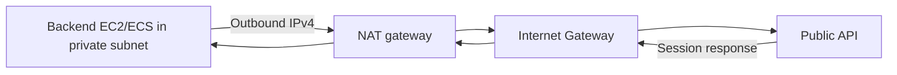
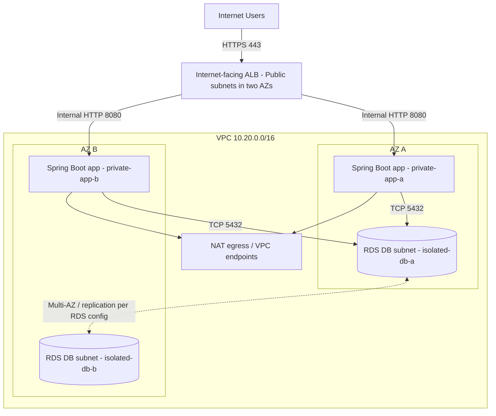

# Public, Private, and Isolated Subnets

> **Chapter:** VPC Networking · **Module:** `CLOUD_PROVIDERS_AWS`

## 1. Why Classify Subnets in an AWS VPC?

A Java application running on AWS typically has three distinct traffic groups: external Internet users accessing the website; application services calling partner APIs or fetching data from S3; and a database receiving requests only from application services. Putting everything under the same connectivity model makes access restriction, troubleshooting, redundancy, and cost calculation harder.

**Amazon VPC (Virtual Private Cloud)** is a virtual private network within an AWS Region. A VPC is partitioned into **subnets** to host resources such as Amazon EC2, Amazon ECS/EKS network interfaces, Application Load Balancers (ALBs), Amazon RDS databases, and compatible services. Subnets can be organized around three common purposes:

| Subnet Type | Routing Indicator | Reachability from the Internet | Appropriate Use Cases |
| --- | --- | --- | --- |
| **Public** | Has a direct route to an **Internet Gateway (IGW)**. | Can receive connections when resources have appropriate IP addresses and policies permit. | Internet-facing ALBs, HTTPS ingress points, certain public-facing hosts. |
| **Private** | Has no direct route to an IGW; may use NAT, egress-only IGW, or private connectivity. | Typically does not accept new inbound connections directly from the Internet. | Backend EC2/ECS/EKS, workers, applications requiring outbound connectivity. |
| **Isolated** | Has no Internet egress path by design; may still have internal routes or designated endpoints. | Does not receive direct connections from the Internet. | Databases, sensitive data components, services needing only internal communication. |

**Key takeaway:** Public/private/isolated describe **route table configuration and architectural intent**, not a built-in `Type` attribute when creating a subnet. Naming a subnet `public-a` or tagging it `Tier=Private` does not turn it into that type. In AWS documentation, a subnet with a direct route to an IGW is public; "isolated" is an architectural term for a subnet without Internet egress, not an absolute security boundary achieved by a single setting.

In the `CLOUD_PROVIDERS_AWS` module, subnet classification supports selecting and deploying AWS services across Regions/AZs, IAM, VPC, compute, storage, databases, integration, and serverless. The target skill is opening the right connectivity paths for applications while controlling attack surface, monitoring, recovery, and cost.

**Learning objectives:**

1. Inspect route tables to distinguish the three subnet types rather than guessing from names or whether EC2 has a public IP.
2. Understand traffic paths through IGWs, NAT gateways, egress-only IGWs, and VPC endpoints for IPv4/IPv6.
3. Design a three-tier application across at least two Availability Zones (AZs).
4. Combine routing with security groups, network ACLs, DNS, IAM, and endpoint policies.
5. Analyze connectivity failures, availability, and networking costs.

## 2. Foundational Concepts Before Classification

### 2.1. Region, AZ, VPC, Subnet, and CIDR

- **VPC** belongs to a single AWS Region and has its own IPv4 address range (and optionally IPv6).
- **Subnet** resides in exactly **one AZ**. A VPC can contain multiple subnets across multiple AZs; for AZ redundancy, resources must be distributed across subnets in different AZs.
- **CIDR** defines an IP range. For example, VPC `10.20.0.0/16` can contain subnets `10.20.0.0/24` and `10.20.10.0/24`, provided subnets do not overlap and stay within the VPC CIDR.
- AWS reserves **5 IPv4 addresses** in each subnet for system purposes. A `/24` subnet has 256 total IPv4 addresses, but all 256 cannot be assigned to workloads.

Example addressing scheme for an application:

| Tier | AZ A | AZ B |
| --- | --- | --- |
| Public | `public-a: 10.20.0.0/24` | `public-b: 10.20.1.0/24` |
| Private app | `private-app-a: 10.20.10.0/24` | `private-app-b: 10.20.11.0/24` |
| Isolated DB | `isolated-db-a: 10.20.20.0/24` | `isolated-db-b: 10.20.21.0/24` |

Subnet CIDRs must account for ENI counts, task/pod counts, and scaling headroom for compute, load balancers, or databases.

### 2.2. Route Tables Are the Actual Classification Mechanism

Each subnet uses **one route table** at a time. It can be explicitly associated; if not explicitly associated, the subnet uses the VPC's **main route table** (implicit association). Each route is a **Destination → Target** pair. For example:

| Destination | Target | Meaning |
| --- | --- | --- |
| `10.20.0.0/16` | `local` | Intra-VPC routing. |
| `0.0.0.0/0` | `igw-...` | Routes IPv4 traffic outside more specific destinations to the IGW. |
| `0.0.0.0/0` | `nat-...` | Routes IPv4 traffic to a NAT gateway. |
| `::/0` | `eigw-...` | Routes outbound-only IPv6 traffic to an egress-only IGW. |

The `local` route is created by AWS so subnets in the VPC can reach each other. **Having a route does not mean connectivity is permitted**: security groups, network ACLs, and application policies can still deny traffic. When multiple routes match a destination, AWS selects the **longest prefix match**. For example, an address inside `10.20.0.0/16` uses the `local` route instead of `0.0.0.0/0`.

**IPv4 and IPv6 have independent default routes:** `0.0.0.0/0` does not cover IPv6; `::/0` does not cover IPv4. In dual-stack setups, evaluate both to avoid unintentionally opening an access path unknown to operations.

### 2.3. IP Addresses and Routing Paths Are Separate Conditions

An EC2 instance has a **private IPv4** such as `10.20.0.25`. To communicate directly with the Internet over an IGW via IPv4, an EC2 instance typically also needs a **public IPv4** or **Elastic IP**, an IGW route, and permitting policies. An EC2 instance with a public IPv4 in a subnet lacking an IGW route still cannot reach the Internet directly via that path. Conversely, a subnet with an IGW route where an instance only has a private IPv4 is also insufficient for direct IPv4 Internet access.

IPv6 uses globally routable addresses; if a resource is assigned IPv6 and a `::/0 → igw` route is added, it can communicate over the IPv6 Internet subject to SG/NACL policies. Never assume IPv6 is "safe just because the subnet uses private IPv4."

## 3. Public Subnets: Direct Connection to an Internet Gateway

An **Internet Gateway (IGW)** is attached to a VPC and serves as the route target for Internet connectivity. A typical public route table:

| Destination | Target |
| --- | --- |
| `10.20.0.0/16` | `local` |
| `0.0.0.0/0` | `igw-example` |
| `::/0` *(if using public IPv6)* | `igw-example` |

For an EC2 instance using IPv4, you need simultaneously: an active IGW route, a public IPv4/EIP, SG/NACL rules permitting the required traffic, and an application actually listening on the target port. The IGW maps between the instance's public IPv4 and private IPv4 when forwarding traffic, but **the IGW does not bypass security policies**.

### 3.1. Appropriate Resources in a Public Subnet

- **Internet-facing ALB:** receives HTTPS 443 from clients and forwards requests to targets in private subnets over the `local` route. Production ALBs are typically configured across multiple AZs.
- **Bastion host when truly needed:** restrict source IPs/admin ports, enforce MFA, and log access; consider **AWS Systems Manager Session Manager** to reduce the need for public SSH/RDP.
- **Public zonal NAT gateway:** a per-AZ NAT type placed in a public subnet with an Elastic IP to provide outbound IPv4 for private resources.

**Do not place RDS or internal backends in a public subnet merely for easier maintenance.** Public traffic ingress should be concentrated at designed and monitored entry points.

### 3.2. A Public Subnet Does Not Mean "Everything Inside Is Public"

A host in a public subnet might lack a public IPv4 or have all inbound traffic blocked by its SG. "Public" describes **direct routability to an IGW**, not that every port is reachable from the Internet. Conversely, if an SG opens TCP 22 to all IPs and the EC2 instance has a public IPv4, the host's port is exposed to the Internet; both routing and policies must be audited.

## 4. Private Subnets: Allowing Egress Without Exposing Backends

A private subnet **has no direct route to an IGW**. For IPv4, backends needing outbound Internet access typically go through a **NAT gateway**; the Internet cannot initiate new sessions to the backend through that NAT alone.



### 4.1. Zonal NAT and Regional NAT Gateways

AWS currently offers two NAT models for Internet egress:

| Attribute | Zonal NAT Gateway | Regional NAT Gateway |
| --- | --- | --- |
| Scope | Operates within **a single AZ**. | Operates at the **Region** level, able to scale automatically across AZs with workloads. |
| Placement for Internet egress | **Public zonal NAT** is created in a public subnet with an Elastic IP attached; the gateway has a path to the IGW. | Created for the VPC, **no public subnet required** to host the NAT; AWS manages the associated routing. |
| Private subnet route | `0.0.0.0/0 → nat-zonal-id` | `0.0.0.0/0 → nat-regional-id` |
| Multi-AZ redundancy | Typically one zonal NAT **per AZ**, with private subnets pointing to the NAT in the same AZ. | Supports automatic scaling and maintains availability based on workload footprint, subject to service limits. |
| Private NAT to VPC/on-prem | Supports **private zonal NAT** variants where appropriate. | **Does not support private NAT**; use zonal when private NAT is needed. |

**Documentation note over time:** The statement "a NAT gateway must always live in a public subnet" applies only to **public zonal NAT**. [Regional NAT Gateway](https://docs.aws.amazon.com/vpc/latest/userguide/nat-gateways-regional.html) is a newer model that does not require a public subnet; verify supported Regions/AZs, expansion timing to new AZs, routes, pricing, and modes before choosing.

In the zonal model, if backends in AZ B use a NAT in AZ A, an AZ A outage can break Internet egress in AZ B. To reduce risk and cross-AZ traffic:

```text
private-app-a (AZ A)  -> NAT zonal A -> IGW
private-app-b (AZ B)  -> NAT zonal B -> IGW
```

NAT gateways incur hourly uptime charges and data-processing charges. Traffic crossing AZ boundaries can incur additional data transfer charges. Sizing must account for actual traffic, availability targets, and VPC endpoints that eliminate unnecessary NAT hops.

### 4.2. Private Subnets Using IPv6

With IPv6, if you need **outbound-only connections initiated toward the Internet**, you can use an **egress-only Internet Gateway**:

```text
::/0 -> eigw-xxxxxxxx
```

An egress-only IGW is a **stateful** component for IPv6. It allows return traffic for connections initiated from inside the VPC while preventing new IPv6 sessions initiated from the Internet from entering through the gateway. For certain IPv6-only scenarios that need to reach IPv4-only destinations, AWS provides **DNS64/NAT64** when a NAT gateway is properly configured; this mechanism differs from standard IPv6 Internet egress. Do not assume NAT64 is automatic in every IPv6 subnet.

### 4.3. Private Subnets Still Need Outbound Controls

Having no public inbound access does not mean absolute safety. If a backend leaks credentials, it can exfiltrate data over open outbound paths. Restrict outbound SGs, IAM, VPC endpoint policies, domain/proxy controls where needed, data controls, and monitor Flow Logs. A private subnet is **one layer of network segmentation**, not a substitute for authentication, encryption, or API authorization.

## 5. Isolated Subnets: No Internet Path by Design

In a data management system, databases usually do not need to initiate requests to the Internet. An **isolated subnet** may have only the `local` route so applications in the same VPC can connect to the database, with no Internet default route configured. Example route table for `isolated-db-a`:

| Destination | Target |
| --- | --- |
| `10.20.0.0/16` | `local` |
| No `0.0.0.0/0` to NAT/IGW | — |
| No `::/0` to IGW/egress-only IGW | — |

Isolated **does not mean disconnected from all networking**. Backends in `private-app-a` can still connect to RDS in `isolated-db-a` using private IPs and the `local` route, provided SGs/NACLs allow it. An isolated subnet can also have specific routes to a VPN, Transit Gateway, corporate network, or VPC endpoints when permitted by the architecture.

Therefore, "no Internet default route" is only one piece of evidence. If a proxy, self-managed NAT, specific route, or forwarding appliance exists in another connected network, traffic can still exit to the Internet **indirectly**. For sensitive data systems, audit all egress paths, restrict policies, IAM, data access permissions, and logs.

### 5.1. VPC Endpoints Route Traffic to AWS Services Without NAT

An application in a private/isolated subnet may still need to read files from Amazon S3, send logs to CloudWatch, or read secrets from AWS Secrets Manager. **VPC endpoints** connect to supported services without traversing an Internet Gateway or NAT gateway.

| Endpoint Type | How It Works | Services / Examples | Cost |
| --- | --- | --- | --- |
| **Gateway endpoint** | Route table entry targeting a service prefix list with target `vpce-id`. | **Amazon S3**, **DynamoDB**. | No gateway endpoint surcharge; underlying service charges still apply. |
| **Interface endpoint (AWS PrivateLink)** | Creates an ENI with a private IP in the subnet; applications connect via private endpoint/DNS. | Secrets Manager, CloudWatch Logs, SSM, or PrivateLink-supported services. | Typically incurs per-AZ hourly endpoint charges and data processing fees. |

For example, an app in `private-app-a` can use an S3 gateway endpoint. The route table contains:

| Destination | Target |
| --- | --- |
| `10.20.0.0/16` | `local` |
| `pl-s3-example` | `vpce-s3-example` |
| `0.0.0.0/0` | `nat-example` |

Destinations matching the S3 prefix list route through the endpoint rather than the default NAT route due to longer prefix matching. An endpoint does not itself grant data read permissions: you still need an **IAM role**, **endpoint policy**, **S3 bucket policy**, and KMS key permissions if objects are encrypted with KMS.

For interface endpoints, configure **Private DNS** per service guidance, choose subnets hosting the endpoint ENIs, and configure security groups allowing the required port (typically TCP 443) from relevant clients. If using **AWS Systems Manager Session Manager** to access EC2 instances without Internet access, ensure the agent, IAM, DNS, and required SSM endpoints are properly configured for the environment. Not every AWS service has a gateway endpoint, and not every endpoint is free.

### 5.2. Example of Data Control in an Isolated Subnet

Suppose a reporting job reads data from S3 and writes to RDS:

1. The job runs in a subnet with no default route to the Internet.
2. Uses an **S3 gateway endpoint** associated with the subnet's route table to read authorized buckets.
3. Connects to RDS via its private IP/DB endpoint over the `local` route; the DB SG allows only the job's SG.
4. Sends logs via a **CloudWatch Logs interface endpoint** if needed and fully configured.
5. Audits IAM policies, endpoint policies, DNS, VPC Flow Logs, and alerting to ensure least-privilege operation.

If the job must call a public partner API, an isolated subnet as defined above is unsuitable; use a private subnet with managed egress or a policy-controlled proxy.

## 6. Identifying the Three Subnet Types from Route Tables

The following tables use VPC `10.20.0.0/16` without IPv6 enabled for simpler comparison. IDs starting with `igw-`, `nat-`, `vpce-`, and `pl-` are placeholders, not real resource IDs.

### 6.1. Public Subnet

| Destination | Target | Conclusion |
| --- | --- | --- |
| `10.20.0.0/16` | `local` | Intra-VPC access subject to policy. |
| `0.0.0.0/0` | `igw-example` | Has a direct IPv4 Internet route; **public** subnet. |

### 6.2. Private App Subnet with Egress

| Destination | Target | Conclusion |
| --- | --- | --- |
| `10.20.0.0/16` | `local` | Can communicate with subnets in the VPC if permitted. |
| `pl-s3-example` *(optional)* | `vpce-s3-example` | S3 via gateway endpoint. |
| `0.0.0.0/0` | `nat-example-a` | Outbound IPv4 via NAT, **not directly via IGW**. |

### 6.3. Isolated DB Subnet

| Destination | Target | Conclusion |
| --- | --- | --- |
| `10.20.0.0/16` | `local` | Intra-VPC path exists. |
| No Internet default route | — | Isolated provided no unintended indirect egress paths exist. |

**Watch both directions:** the source subnet's route table governs outbound request routing, while return paths and firewall state must still allow the connection to complete. Within the same VPC, `local` automatically routes between source and destination subnets; no IGW or NAT is needed.

### 6.4. When the Main Route Table Changes

If `isolated-db-a` has no explicit route table association, it implicitly uses the **main route table**. An administrator accidentally adding `0.0.0.0/0 → nat-...` to the main route table could introduce unintended egress for database subnets. Governance practices should:

1. Name route tables by intended role, e.g., `rt-public-a`, `rt-private-app-a`, `rt-isolated-db`.
2. **Explicitly associate** each subnet with its intended route table.
3. Keep the main route table minimal whenever design permits.
4. Check for drift via IaC review, inventory checks, and periodic IPv4/IPv6 route audits.

### 6.5. Analyzing a Dual-Stack VPC

| Subnet | IPv4 Default Route | IPv6 Default Route | Classification by Internet Path |
| --- | --- | --- | --- |
| A | `0.0.0.0/0 → igw` | None | Public IPv4. |
| B | `0.0.0.0/0 → nat` | `::/0 → eigw` | Private, with outbound IPv4 and IPv6. |
| C | None | None | Isolated if no indirect egress exists. |
| D | None | `::/0 → igw` | **Has a direct IPv6 Internet route**, not isolated. |

A subnet with private IPv4 and global IPv6 does not become isolated merely because IPv4 lacks Internet access. Inspect all IPs, routes, SGs/NACLs, and which protocol the application uses.

## 7. Reference Architecture: Three-Tier Java Application Across Two AZs

A Spring Boot system with HTTPS frontend, business logic backend, and PostgreSQL database. Subnet choices:

- **Public:** Internet-facing ALB in `public-a` and `public-b`; this serves as the monitored entry point.
- **Private:** ECS tasks or EC2 instances running Spring Boot in `private-app-a` and `private-app-b`; no public IPv4 assigned. Backends can call partner APIs through appropriate NAT.
- **Isolated:** RDS PostgreSQL in a DB subnet group spanning `isolated-db-a` and `isolated-db-b` per the chosen RDS/Multi-AZ deployment model; no Internet default route.



This diagram shows logical relationships. Placement of the RDS primary, standby/replica, and failover mechanics are managed by the RDS deployment mode; applications normally connect via the **DB DNS endpoint** rather than hardcoding a node IP. Routes from ALB to app and app to RDS within the same VPC use `local`. NAT egress can use per-AZ zonal NATs or Regional NAT; VPC endpoints can keep compatible AWS service traffic off NAT.

### 7.1. Least-Privilege Security Groups

| Security Group | Required Inbound | Outbound as Needed |
| --- | --- | --- |
| `sg-alb` | TCP 443 from allowed clients; `0.0.0.0/0` only when serving a public website. | TCP 8080 to `sg-app`. |
| `sg-app` | TCP 8080 **only from the ALB's SG**. | TCP 5432 to `sg-db`, TCP 443 to permitted APIs/endpoints. |
| `sg-db` | TCP 5432 **only from `sg-app`**. | Restricted to actual database/workload requirements. |

Set RDS to **not publicly accessible** (`Publicly accessible = No`) when serving only internal apps. When deploying RDS, verify the DB subnet group, required AZ count, engine type, Multi-AZ settings, backups, encryption, and secrets management permissions. Never open database ports to the entire Internet for administrative convenience.

### 7.2. Lifecycle of a Request

1. Client sends HTTPS request to the ALB's DNS name.
2. ALB receives the request in a public subnet and forwards it to an app target in a private subnet.
3. The app's SG permits traffic on the application port only from the ALB SG; app endpoints need no public IPv4.
4. The app queries RDS using its DNS endpoint; the `local` route carries traffic inside the VPC.
5. The RDS SG permits traffic only from the app SG, and the database uses appropriate authentication/managed secrets.
6. If the app needs to call an Internet service, it initiates outbound connections via NAT or a controlled egress solution; for reading S3, prefer evaluating a gateway endpoint.

### 7.3. Why Distribute Across Multiple AZs?

Because each subnet resides in a single AZ, having only one private app subnet leaves the backend vulnerable if that AZ suffers a disruption. High availability requires coordinating:

- ALB operating across multiple AZs with targets actually distributed across those AZs.
- Backend autoscaling/placement with sufficient replicas and health checks.
- Database Multi-AZ/replication and backup/restore procedures with clear RTO/RPO.
- NAT egress that does not rely solely on a single zonal NAT in another AZ; consider per-AZ zonal NAT or Regional NAT under current AWS capabilities.
- Route tables, DNS, SGs, NACLs, and IAM permissions remaining valid during failover.

**Partitioning subnets does not automatically create high availability.** It only provides the structure to deploy workloads and data capable of recovering to target objectives.

## 8. Combining Routing with Security Layers

Route tables answer **"Where should packets be sent?"**. Security groups, network ACLs, and policies at other layers answer **"Are packets or API calls allowed?"**.

| Attribute | Security Group (SG) | Network ACL (NACL) |
| --- | --- | --- |
| Scope | ENI / resource level. | Subnet level. |
| Rules | **Allow** rules only, no explicit deny rules. | Supports **allow** and **deny**; rule evaluation order matters. |
| Statefulness | **Stateful**: return traffic for allowed sessions is automatically permitted. | **Stateless**: both inbound and outbound directions must be permitted; ephemeral ports must be considered. |
| Usage | Application/role-based SG policies. | Additional boundary control by subnet and CIDR/port. |

Suppose a public subnet has `0.0.0.0/0 → igw`, but the EC2 instance's SG does not allow inbound TCP 22. In that case, the EC2 instance will not accept new SSH connections via that SG. Conversely, if the SG opens TCP 22 but no valid network route exists, SSH still will not work. You cannot diagnose connectivity from routing alone or SGs alone.

Related tools and controls:

1. **IAM and resource/endpoint policies** govern AWS API authorization; they do not replace routing or SGs.
2. **VPC Flow Logs** capture traffic metadata—typically source/destination, ports, `ACCEPT`/`REJECT`—without capturing application payloads. They can be published to CloudWatch Logs or S3.
3. **VPC Reachability Analyzer** checks reachability across network configuration to pinpoint blocking hops; real connectivity tests and application logs are still required.
4. **AWS Network Firewall**, egress proxies, and DNS policies when deep outbound inspection/filtering is needed.
5. **CloudWatch metrics, ALB access logs, RDS logs, and VPC Flow Logs** to correlate behavior from routing up to the application layer.

For production environments, manage route tables, security groups, NACLs, VPC endpoints, and DNS via IaC and code review, retaining change history through CloudTrail/governance records. This clarifies blast radius if a subnet unexpectedly gains Internet egress.

## 9. Hands-On Subnet Verification with AWS CLI (Read-Only)

The commands below only **describe** resources; they do not create or modify a VPC. When running against an authorized account, replace `vpc-0123456789abcdef0` with your VPC ID and choose the right Region. You can configure a login profile via IAM Identity Center and verify your account before practicing.

```bash
# 1. Confirm current AWS account
aws sts get-caller-identity

# 2. List subnets, AZs, CIDRs, and auto-assign public IPv4 setting
aws ec2 describe-subnets \
  --region ap-southeast-1 \
  --filters "Name=vpc-id,Values=vpc-0123456789abcdef0" \
  --query "Subnets[].{Subnet:SubnetId,AZ:AvailabilityZone,CIDR:CidrBlock,AutoPublicIPv4:MapPublicIpOnLaunch}" \
  --output table

# 3. Inspect route tables and associations for the entire VPC
aws ec2 describe-route-tables \
  --region ap-southeast-1 \
  --filters "Name=vpc-id,Values=vpc-0123456789abcdef0" \
  --output json

# 4. Check Internet Gateways attached to the VPC
aws ec2 describe-internet-gateways \
  --region ap-southeast-1 \
  --filters "Name=attachment.vpc-id,Values=vpc-0123456789abcdef0" \
  --output json
```

When reading the `describe-route-tables` JSON output, note:

- `RouteTables[].RouteTableId`: the route table ID.
- `Routes[].DestinationCidrBlock` and `Routes[].DestinationIpv6CidrBlock`: IPv4/IPv6 destinations.
- `Routes[].GatewayId`, `Routes[].NatGatewayId`, or corresponding target fields: which gateway, NAT, endpoint, or component the route targets.
- `Routes[].State`: a `blackhole` route is not an active, working route.
- `Associations[].SubnetId`: **explicit** subnet associations; if a subnet has no explicit association, find the VPC's **main route table** via `Associations[].Main`.
- `MapPublicIpOnLaunch`: reflects only automatic public IPv4 assignment when launching EC2 instances; it does **not** determine whether a subnet is public or private.

### 9.1. Building a Summary Table

Record one row per subnet using this template:

| Subnet ID | AZ | Effective Route Table | IPv4 Internet Path | IPv6 Internet Path | Has Public IP? | Classification |
| --- | --- | --- | --- | --- | --- | --- |
| `subnet-example-a` | AZ A | `rtb-example-a` | IGW | None | Check per ENI | Public IPv4 |
| `subnet-example-b` | AZ A | `rtb-example-b` | NAT | Egress-only IGW | No | Private dual-stack |
| `subnet-example-c` | AZ B | `rtb-example-c` | None | None | No | Isolated per configuration |

**Do not equate** "has a route" with "packets can get through." After identifying routes, verify IP addresses, SGs, NACLs, DNS, host-level firewalls, quotas, gateway health, and API permissions if required by the destination service.

### 9.2. Post-Change Verification Workflow

1. **Before changes:** record current routes, associations, SG/NACL policies, impacted resources, latency/error baselines, and cost estimates.
2. **During changes:** apply via IaC/change review; do not modify routes across all production subnets simultaneously without testing.
3. **After changes:** test intended paths such as ALB → app, app → RDS, app → S3 endpoint, app → outbound API; also test paths that **must be blocked**, such as Internet → DB.
4. **Monitoring:** watch ALB target health, DNS errors, TCP timeouts, VPC Flow Logs, NAT metrics, and application alerts.
5. **Closure:** archive verification evidence, review incremental NAT/endpoint costs, and document rollback steps.

## 10. Common Issues and Troubleshooting

| Symptom | Likely Causes to Check | Verification Action |
| --- | --- | --- |
| EC2 in a subnet named "public" cannot reach the IPv4 Internet. | Missing public IPv4/EIP; missing IGW route; blocked by SG/NACL or DNS. | Inspect effective route table, IGW attachment, ENI/public IP, and test connectivity per policy. |
| Private backend cannot download packages or call partner APIs. | Incorrect NAT/default route; unhealthy NAT; missing outbound SG rule; NACL blocking return traffic; proxy/DNS error. | Inspect `0.0.0.0/0`, NAT type and AZ, SGs/NACLs, and connection logs. |
| App fails to call S3 despite creating a gateway endpoint. | Endpoint not associated with route table; denied by IAM/endpoint/bucket policy; mismatched service or Region. | Check prefix list route, endpoint status, and `AccessDenied` logs. |
| App cannot connect to RDS. | Wrong hostname/port; DB SG does not allow app SG; NACL or DNS issue; wrong VPC. | Check DB endpoint, SGs on both sides, internal routes, and RDS status. |
| IPv4 works but IPv6 cannot reach outside. | Missing IPv6 address/CIDR, `::/0` route, IPv6 SG/NACL rules, or DNS configuration. | Check IPv6 routes and IGW/eigw target; verify IPv6 firewall rules. |
| NAT Gateway costs are unexpectedly high. | S3/DynamoDB traffic traversing NAT; cross-AZ traffic; large artifact downloads. | Review Cost Explorer/NAT metrics, consider gateway endpoints, align routing per AZ. |
| Database subnet unexpectedly has Internet egress. | Main route table modified, IPv6 opened, or path via proxy/TGW/VPN. | Audit explicit/implicit associations and all IPv4/IPv6 paths. |
| When AZ A fails, backends in AZ B lose egress. | Both AZs point to a zonal NAT in AZ A. | Consider per-AZ zonal NAT or Regional NAT and check current limits. |
| Reachability Analyzer shows a path, yet the app still fails. | DNS, TLS, credentials, application listener, or target service error. | Correlate application logs, target logs, SGs/NACLs, and timeout/error metrics. |

**Troubleshooting principle:** Never "fix" issues by opening all inbound/outbound traffic to `0.0.0.0/0` or moving everything into public subnets. Identify the exact blocking layer, make a minimal tested change, and keep a rollback plan.

## 11. Reliability and Cost Control

| Component | Cost / Operational Risk | Reasonable Mitigation |
| --- | --- | --- |
| **Internet Gateway** | No separate charge for the IGW itself; data transfer and public IPv4 addresses may incur charges. | Use ALBs as shared entry points; allocate public IPv4s intentionally. |
| **Zonal/Regional NAT Gateway** | Hourly and data-processing charges; cross-AZ hops can add fees. | Choose NAT model based on redundancy needs, measure actual traffic, offload eligible AWS traffic to endpoints. |
| **S3/DynamoDB gateway endpoint** | No separate endpoint fee; underlying data service charges still apply. | Use for compatible S3/DynamoDB traffic to avoid unnecessary NAT fees. |
| **Interface endpoint** | Typically incurs per-AZ hourly charges and data processing fees. | Provision only for services genuinely needed; optimize endpoint/AZ count and DNS. |
| **VPC Flow Logs** | Storage/query costs in CloudWatch Logs, S3, or destination service. | Configure retention, logging granularity, and access controls for monitoring data. |
| **Multi-AZ** | Increases instance count, traffic, and certain network costs. | Balance against SLOs, RTO/RPO, failover plans, and periodic testing. |

When estimating costs, inspect the **entire traffic path**. For example, a backend in a private subnet continuously reading S3: request volume and bytes through NAT can be substantial, so an S3 gateway endpoint is usually more economical. However, if there are only occasional HTTPS calls to a service supporting interface endpoints, the fixed hourly cost of maintaining many interface endpoints should be weighed against NAT data-processing charges. Pricing and availability vary by Region: verify on [AWS VPC pricing](https://aws.amazon.com/vpc/pricing/) and relevant service pricing pages.

In resilient application architectures, cost optimization should not sacrifice AZ redundancy. A single cheaper NAT can become a single point of failure, causing service disruption if one AZ fails. Choose the model based on technical objectives, budget, and downtime impact.

## 12. Hands-On Exercises and Self-Check

### Exercise 1 — Classify from Route Tables

A VPC contains five subnets:

1. `local + 0.0.0.0/0 → igw`.
2. `local + 0.0.0.0/0 → nat`.
3. Only `local`; no Internet default route.
4. `local + pl-s3 → vpce`; no Internet default route.
5. `local + ::/0 → igw`; no IPv4 Internet default route.

Classify each subnet. State whether resources can receive **new** connections from the Internet and what additional IP/SG/NACL conditions apply. Explain why subnet 4 can access S3 while still being considered isolated with respect to Internet egress.

### Exercise 2 — Design a Three-Tier Java Architecture

You are deploying Spring Boot, an ALB, and PostgreSQL RDS in VPC `10.20.0.0/16` across two AZs. Complete the following:

1. Partition six subnets across three tiers without overlapping CIDRs.
2. Outline route tables for each tier, showing how the backend gets outbound Internet access (if needed).
3. Design SGs so the ALB accepts public HTTPS, the app accepts traffic only from the ALB, and the DB accepts traffic only from the app.
4. Propose how to read S3 without traversing NAT.
5. Describe failover if AZ A is disrupted and how to monitor post-incident.

### Exercise 3 — NAT Failure Scenario

Backends in both AZ A and AZ B route to a zonal NAT in AZ A. When AZ A experiences an outage, the application in AZ B keeps running, but connections to a payment API time out. Identify the affected layer, propose two remediation options (per-AZ zonal NAT or Regional NAT where supported), analyze the route changes, and weigh the additional cost.

### Exercise 4 — Isolated Subnet with VPC Endpoints

A job only needs to read S3, call Secrets Manager, write to DynamoDB, and send logs to CloudWatch Logs. It does not need to call public Internet APIs. Design the subnet, routes, gateway/interface endpoints, SGs, and IAM. Identify which endpoints can increase per-AZ hourly costs; describe how to verify DNS and endpoint policies before going to production.

### Self-Check Questions

1. Why might a subnet named `public` fail to reach the Internet?
2. What is the difference between `0.0.0.0/0 → igw` and `0.0.0.0/0 → nat`?
3. Is an isolated subnet completely unable to connect to other subnets? Why or why not?
4. How does the `local` route enable ALB, app, and DB communication?
5. Why must `::/0` be checked even after verifying the IPv4 route table?
6. Why does an S3 endpoint not automatically grant bucket access?
7. When should you have a dedicated NAT per AZ, and when might you consider Regional NAT?
8. Why does `MapPublicIpOnLaunch=true` not prove a subnet is public?
9. How do stateful SGs and stateless NACLs differ when handling return traffic?
10. Why must you inspect each subnet's effective route table rather than only the main route table?

## 13. Official AWS Documentation

- [Amazon VPC — Subnets for your VPC](https://docs.aws.amazon.com/vpc/latest/userguide/configure-subnets.html)
- [Amazon VPC — Subnet route tables](https://docs.aws.amazon.com/vpc/latest/userguide/subnet-route-tables.html)
- [Amazon VPC — Work with route tables](https://docs.aws.amazon.com/vpc/latest/userguide/WorkWithRouteTables.html)
- [Amazon VPC — Internet gateways](https://docs.aws.amazon.com/vpc/latest/userguide/VPC_Internet_Gateway.html)
- [Amazon VPC — NAT gateways](https://docs.aws.amazon.com/vpc/latest/userguide/vpc-nat-gateway.html)
- [Amazon VPC — Regional NAT gateways](https://docs.aws.amazon.com/vpc/latest/userguide/nat-gateways-regional.html)
- [Amazon VPC — Egress-only Internet Gateway](https://docs.aws.amazon.com/vpc/latest/userguide/egress-only-internet-gateway.html)
- [AWS PrivateLink — Gateway endpoints](https://docs.aws.amazon.com/vpc/latest/privatelink/gateway-endpoints.html)
- [AWS PrivateLink — Interface endpoints](https://docs.aws.amazon.com/vpc/latest/privatelink/vpce-interface.html)
- [Amazon VPC — Security groups](https://docs.aws.amazon.com/vpc/latest/userguide/vpc-security-groups.html)
- [Amazon VPC — Network ACLs](https://docs.aws.amazon.com/vpc/latest/userguide/vpc-network-acls.html)
- [Amazon VPC — VPC Flow Logs](https://docs.aws.amazon.com/vpc/latest/userguide/flow-logs.html)
- [Amazon VPC — Example routing options](https://docs.aws.amazon.com/vpc/latest/userguide/route-table-options.html)
- [Amazon VPC — Pricing](https://aws.amazon.com/vpc/pricing/)

**Remember:** A public subnet has a direct route to an IGW; a private subnet has no direct IGW route but can proactively initiate outbound Internet traffic via NAT or an appropriate egress mechanism; an isolated subnet is designed with no Internet egress. When evaluating an AWS application, always review **the actual route table, IPv4/IPv6, public IPs, SGs/NACLs, endpoints, DNS, availability, and cost** together.
