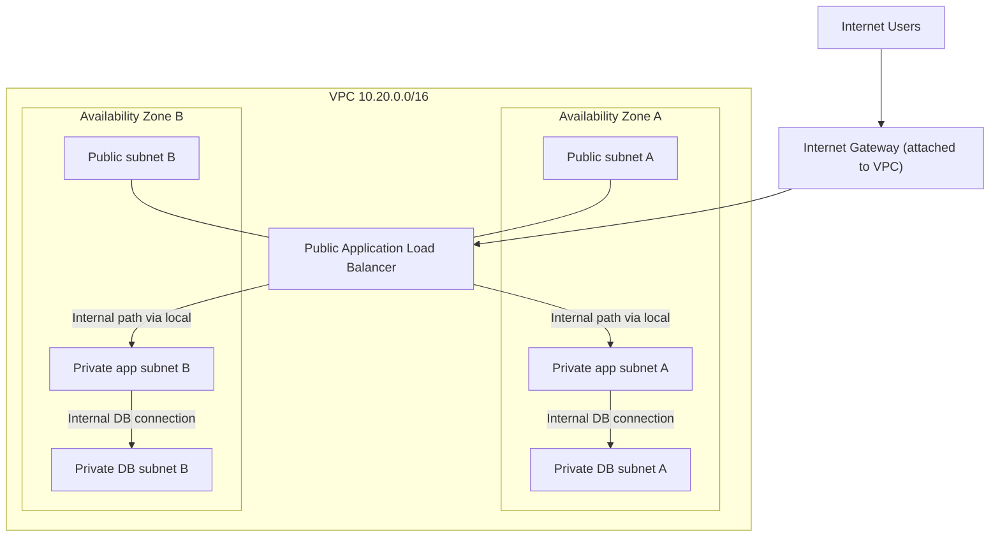

# Route Tables, Local Routes, and Internet Gateways

In AWS, creating a **VPC** and **subnets** defines the application's network space; whether resources can communicate with one another and with the Internet depends on **route tables**, **Internet Gateways (IGWs)**, IP addresses, and access control layers. An EC2 instance placed in a subnet labeled "public" may still fail to reach the Internet if it lacks a public address or appropriate network rules.

This lesson belongs to the **VPC Networking** chapter of the **CLOUD_PROVIDERS_AWS** module, along the path covering Region/AZ, IAM, VPC, compute, storage, databases, integration, and serverless. The ability to read and design route tables is foundational for deploying secure applications, tiering networks, operating across multiple Availability Zones, troubleshooting connectivity incidents, and controlling infrastructure costs.

## 1. Learning Objectives

After completing this lesson, you will be able to:

1. Explain the meaning of **Destination**, **Target**, **Route state**, and **subnet association** in an Amazon VPC route table.
2. Distinguish between the **main route table**, **custom route tables**, and the auto-generated **local route** for VPC CIDRs.
3. Apply the **longest prefix match** rule to predict packet paths.
4. Describe the role of an **Internet Gateway** and the requirements for an EC2 instance to access the Internet over IPv4 or IPv6.
5. Identify public/private subnets from effective route tables; explain the differences among an IGW, a NAT Gateway, and an egress-only Internet Gateway.
6. Design baseline network routing for a multi-tier web application across at least two Availability Zones.
7. Read, create, and inspect route tables/IGWs via the AWS Console or AWS CLI in an authorized hands-on environment.
8. Diagnose common issues without confusing routing with Security Groups, network ACLs, or IP addresses.

## 2. Context: How Does VPC Networking Work?

**Amazon Virtual Private Cloud (Amazon VPC)** is a logically isolated virtual network within an AWS Region. A VPC has an IP address range in **CIDR block** notation, such as `10.20.0.0/16`. Within it, we partition smaller-CIDR subnets and place each in an Availability Zone (AZ).

Key components in this lesson:

| Component | Role | Scope |
| --- | --- | --- |
| **VPC** | Virtual network containing CIDR blocks, subnets, and connectivity components | Single Region |
| **Subnet** | A slice of the CIDR block hosting ENIs/resources in the same AZ | Single Availability Zone |
| **Route table** | Determines traffic paths by destination address | Belongs to a VPC, associated with subnets or supported gateway types |
| **Local route** | Default routing path for the VPC's own CIDR blocks | Present in route tables belonging to the VPC |
| **Internet Gateway** | Connectivity point between the VPC and the Internet for IPv4/IPv6 | Attached to one VPC at a time |
| **Security Group (SG)** | Stateful firewall for ENIs/supported resources | Rules for inbound/outbound traffic |
| **Network ACL (NACL)** | Stateless traffic filter at the subnet boundary | Subnet inbound/outbound rules |

A VPC has an **implicit router** managed by AWS. You do not deploy an "EC2 router" for subnets in the same VPC to talk to one another; you configure **route tables** so the router knows where each destination should go.

### IPv4 Design Example

Consider VPC `10.20.0.0/16` with three subnets:

- **Public subnet** `10.20.1.0/24`: hosts an internet-facing Application Load Balancer or authorized test host.
- **Private application subnet** `10.20.11.0/24`: hosts internal application servers.
- **Private database subnet** `10.20.21.0/24`: hosts databases, with no direct Internet access needed.

Two addresses in the same VPC, such as `10.20.1.10` and `10.20.11.20`, can communicate over the `local` route **if SGs/NACLs and service configurations allow**. To reach `8.8.8.8` or an Internet service, the route table must contain an appropriate route to a network egress point such as an IGW/NAT.

## 3. Route Tables: Structure and Subnet Associations

### 3.1. What Fields Does a Route Have?

Example route table for a public subnet:

| Destination | Target | State | Meaning |
| --- | --- | --- | --- |
| `10.20.0.0/16` | `local` | `active` | Traffic destined for VPC IPs is routed internally |
| `0.0.0.0/0` | `igw-xxxxxxxxxxxxxxxxx` | `active` | IPv4 traffic not matched by more specific routes goes via the Internet Gateway |

**Destination** is the target IP range. CIDR `/16` means the first 16 bits define the network portion, while `/0` matches all IPv4 addresses.

**Target** is the next hop for forwarding packets, such as `local`, `igw-...`, `nat-...`, `pcx-...`, `tgw-...`, or a network interface (ENI) where supported.

**State** typically shows `active` or `blackhole`. `blackhole` indicates the target is no longer valid or available per the route state—for instance, a gateway or attachment was deleted or became unusable. An `active` route also **does not guarantee successful connectivity** if SGs, NACLs, IPs, or the target service blocks traffic.

### 3.2. Main Route Table and Custom Route Tables

The **main route table** is created automatically by AWS when a VPC is created. Any subnet not explicitly associated with another route table **inherits an implicit association** to the main route table.

A **custom route table** is an additional route table created to separate routing behavior—for example, `rtb-public` for public subnets and `rtb-private` for private subnets.

Route table association rules:

- A **subnet has only one effective subnet route table at a time**.
- A **route table can be associated with multiple subnets** in the same VPC.
- Without an **explicit subnet association**, a subnet uses the **main route table**.
- Modifying the main route table can immediately alter routing for all **implicitly** associated subnets. Therefore, prefer custom route tables and review before applying broad changes.
- Creating a new route table **does not automatically** make subnets use it. You must associate them explicitly.

> **Note:** AWS also supports **gateway route tables** to route traffic entering via an Internet Gateway or Virtual Private Gateway, serving specialized scenarios like inserting a network inspection appliance (*middlebox*). Gateway route tables are **distinct** from subnet route tables, with their own association rules and route targets. This lesson focuses on **subnet route tables**.

### 3.3. Classifying Subnets by Route Table

A **public subnet** has a route to an IGW for required Internet traffic (typically `0.0.0.0/0 → igw-...` and/or `::/0 → igw-...`). A **private subnet** has no direct route to an IGW for the corresponding protocol scope.

| Case | IPv4 Route | Classification / Reachability |
| --- | --- | --- |
| Public subnet | `0.0.0.0/0 → igw-...` | Has an IPv4 path to an Internet Gateway |
| Isolated private subnet | Only `VPC-CIDR → local` | Intra-VPC path only; no IPv4 path to the Internet |
| Private subnet needing updates | `0.0.0.0/0 → nat-...` | Private hosts initiate outbound IPv4 Internet connections through a properly configured **public NAT Gateway** |
| Subnet with enterprise connectivity | Specific routes to `vgw-...` or `tgw-...` | Has paths to other networks per routing and connectivity policy |
| Subnet with outbound-only IPv6 | `::/0 → eigw-...` | Reaches Internet via **egress-only Internet Gateway**; prevents Internet-initiated IPv6 sessions to the subnet |

Subnet names like `public-subnet-1` or `private-subnet-1` **do not determine real behavior**; the attached route table is the source of truth. Assigning a public IP to an EC2 instance does not turn a subnet into a public subnet either.

## 4. The Local Route: Intra-VPC Communication

When you create a VPC with CIDR `10.20.0.0/16`, AWS automatically adds a route like this to every route table:

| Destination | Target |
| --- | --- |
| `10.20.0.0/16` | `local` |

This gives subnets using IPs within the VPC CIDR a routing path to one another. For example:

- EC2 A: `10.20.1.10` (public subnet).
- EC2 B: `10.20.11.20` (private subnet).
- Logical path: **EC2 A → VPC router via local route → EC2 B**.
- Internal traffic does not go out to the IGW, even if A's subnet has a default route to the IGW.

If a VPC has **multiple IPv4 CIDR blocks**, route tables contain one `local` route for each CIDR. When an IPv6 CIDR is added to the VPC, AWS also adds a local route for that IPv6 range.

### 4.1. Why Is the `local` Route Chosen Over the Default Route?

Suppose a table contains:

```text
10.20.0.0/16    local
0.0.0.0/0       igw-xxxxxxxxxxxxxxxxx
```

A packet destined for `10.20.11.20` matches **both** routes, but `/16` is more specific than `/0`. AWS applies **longest prefix match**. A packet to `1.1.1.1` does not match `10.20.0.0/16`, so it follows `0.0.0.0/0`.

| Destination IP | Selected Matching Route | Target |
| --- | --- | --- |
| `10.20.11.20` | `10.20.0.0/16` | `local` |
| `10.20.1.50` | `10.20.0.0/16` | `local` |
| `1.1.1.1` | `0.0.0.0/0` | IGW |
| `8.8.8.8` | `0.0.0.0/0` | IGW |

This is the fundamental rule when reading route tables: **find all routes matching the destination IP, pick the most specific route**, then inspect the target and other constraints. When destinations match equally, AWS has additional precedence rules among static routes, prefix list routes, and propagated routes; see the documentation links at the end of this lesson.

### 4.2. Is the Local Route Always Immutable?

**No.** Under current VPC mechanics, you cannot delete the default local route from a route table, but AWS allows **replacing the local route's target** with a supported ENI or endpoint in certain appliance-routing architectures, and later **restoring the target to `local`**. You can also configure more-specific routes pointing to a network appliance where supported by AWS.

This is an advanced feature for **inspection, firewalls, and traffic steering**. In basic labs, keep the target as `local`. Changing the local route on a live system can disrupt inter-subnet connectivity.

### 4.3. The Local Route Is Not a Firewall

The local route provides **reachability potential**, not automatic permission. For an application in a private subnet to receive traffic from a public subnet, all of the following must hold simultaneously:

1. Effective routes exist for both destination IP and return path.
2. The target resource's Security Group permits the exact **source, protocol, and port**.
3. Inbound/outbound Network ACLs on the relevant subnets do not block it.
4. The target service is actively listening and the OS firewall does not block the connection.

For example, EC2 A attempts TCP port `5432` to RDS PostgreSQL B: `local` satisfies only the routing requirement, while the RDS SG should allow port `5432` only from the authorized application SG; **never open a database to `0.0.0.0/0`**.

## 5. What Is an Internet Gateway (IGW)?

An **Internet Gateway** is a horizontally scaled, highly available AWS-managed VPC component supporting **IPv4 and IPv6** connectivity between resources in a VPC and the Internet.

An IGW serves two key roles:

- Acts as the **route target** for eligible Internet traffic, e.g., `0.0.0.0/0 → igw-id` or `::/0 → igw-id`.
- For **IPv4**, the IGW performs 1:1 NAT mapping between the public IPv4/Elastic IP and the private IPv4 of the corresponding network interface. The instance still sees only its private IPv4 inside the network.

For **IPv6**, assigned addresses are globally routable; the IGW does not perform IPv4-style NAT.

### 5.1. Three Minimum Conditions for an EC2 Instance to Access the Internet via an IGW

An EC2 instance reaching the Internet directly via an IGW must have:

1. **An Internet Gateway attached to the right VPC**, and the subnet's effective route table must have a route to the IGW for the target destination.
2. **An appropriate public IP address**: a public IPv4 or Elastic IP for IPv4; an IPv6 address assigned to the ENI for IPv6, with an IPv6 CIDR on both the VPC and subnet.
3. **Security Group, NACL, OS configuration, and service** permitting the required traffic.

For **inbound connections from the Internet**, you also need an SG inbound rule for the protocol/port, matching inbound/outbound NACL rules, and a service actually listening. An IGW does not automatically open ports 22, 80, or 443.

> **Practical rule:** An EC2 instance in a public subnet with only a **private IPv4** **cannot access the Internet directly over IPv4 via an IGW**. It needs a public IPv4/EIP or an architecture using NAT/proxy/another connectivity path.

### 5.2. A Public Subnet Does Not Mean "Every EC2 Instance Is Public"

| EC2 Configuration in a Subnet with an IGW Route | Result |
| --- | --- |
| Public IPv4 + SG allowing only outbound HTTPS | Can **initiate outbound HTTPS connections to the Internet** if other network conditions hold; Internet cannot reach ports not allowed by the SG |
| Public IPv4 + SG allowing inbound 443 from valid sources | Can accept HTTPS from the Internet if the service and NACL permit |
| Private IPv4 only | No direct IPv4 path with the Internet via the IGW for the instance |
| Global IPv6 + `::/0` route to IGW | Can communicate over IPv6 with the Internet per SGs/NACLs; inbound must be explicitly allowed |

A production web architecture typically places a **public Application Load Balancer** in public subnets and **EC2/ECS application servers** in private subnets. Application servers receive internal traffic from the load balancer rather than giving every host a public IPv4.

## 6. Designing a Multi-AZ VPC: Public and Private

Suppose an organization deploys an API and database resilient to a single-AZ failure. Use VPC `10.20.0.0/16` and two illustrative AZs labeled **AZ-A** and **AZ-B** (actual AZ names depend on Region and AWS account).

| Subnet | CIDR | AZ | Purpose | Route Table |
| --- | --- | --- | --- | --- |
| `public-a` | `10.20.1.0/24` | AZ-A | Public ALB or appropriate NAT Gateway | `rtb-public` |
| `public-b` | `10.20.2.0/24` | AZ-B | Public ALB or appropriate NAT Gateway | `rtb-public` |
| `app-private-a` | `10.20.11.0/24` | AZ-A | Internal application tier | `rtb-app-a` |
| `app-private-b` | `10.20.12.0/24` | AZ-B | Internal application tier | `rtb-app-b` |
| `db-private-a` | `10.20.21.0/24` | AZ-A | Database tier | `rtb-db` |
| `db-private-b` | `10.20.22.0/24` | AZ-B | Database tier | `rtb-db` |

### Network Flow Diagram



The diagram shows **logical flows**: route tables and security policies govern actual packet paths. The ALB uses public subnets in the configured AZs; applications and databases must have matching SGs/NACLs.

### 6.1. Route Table for Public Subnets

| Destination | Target |
| --- | --- |
| `10.20.0.0/16` | `local` |
| `0.0.0.0/0` | `igw-xxxxxxxxxxxxxxxxx` |

Associate `public-a` and `public-b` with `rtb-public`. They can share one table because both need a direct Internet path. An IGW attaches to the VPC; you do not create a separate IGW per AZ.

### 6.2. Route Table for Private Subnets Not Needing Internet

| Destination | Target |
| --- | --- |
| `10.20.0.0/16` | `local` |

Associate the DB subnets with `rtb-db`. Without an Internet default route, they have no direct IPv4 path to an IGW or NAT. Services inside the VPC can still communicate with the DB via `local` if allowed.

### 6.3. When Private Apps Need to Download Dependencies from the Internet

If EC2 instances in private subnets need to **initiate outbound IPv4 connections to the Internet** without accepting new inbound connections directly from the Internet, you can use a **public NAT Gateway**. In a multi-AZ model, consider placing a NAT Gateway in each AZ containing outbound-dependent apps to reduce cross-AZ dependency and improve resilience.

For example:

| Route Table | Destination | Target |
| --- | --- | --- |
| `rtb-app-a` | `10.20.0.0/16` | `local` |
| `rtb-app-a` | `0.0.0.0/0` | `nat-a` |
| `rtb-app-b` | `10.20.0.0/16` | `local` |
| `rtb-app-b` | `0.0.0.0/0` | `nat-b` |

Each public NAT Gateway must reside in a public subnet, have an Elastic IP, and have a `0.0.0.0/0` route from that subnet to the IGW. Note that **NAT Gateways incur hourly and data-processing charges**, so the later lab exercise **does not require creating a NAT Gateway**.

### 6.4. Route Tables and High Availability

A single **route table can be associated with multiple subnets in different AZs**. That works well for IGW routes since an IGW is VPC-scoped. However, if two private subnets in different AZs both point to **a single NAT Gateway in one AZ**, the app becomes dependent on the AZ hosting that NAT Gateway and incurs cross-AZ data transfer. Treat route tables, NAT placement, availability, and cost as a unified design.

## 7. Packet Flow Through Route Tables

Consider an EC2 instance in public subnet `10.20.1.0/24`, with private IP `10.20.1.10` and an AWS-assigned public IPv4.

### Case A: EC2 → Internal Application in the VPC

1. EC2 builds a packet destined for `10.20.11.20`.
2. The source subnet's route table has `10.20.0.0/16 → local` and `0.0.0.0/0 → igw`.
3. `10.20.11.20` matches the more specific `/16` route, so it follows **local**.
4. The packet reaches the target ENI if other network and security layers allow it.
5. This traffic **never exits to the Internet Gateway**.

### Case B: EC2 → Public Website over IPv4

1. EC2 connects to the website's public IP.
2. The destination IP is outside the VPC CIDR; `0.0.0.0/0` is chosen if no more specific route exists.
3. The IGW forwards traffic to the Internet, mapping private IPv4 to the appropriate public IPv4/EIP.
4. Responses return to the public IP; the IGW maps back to the corresponding private IP.
5. If SGs, NACLs, and network conditions allow, the session succeeds.

### Case C: Private EC2 → Internet When Route Table Has Only Local

1. A host in `10.20.11.0/24` attempts to reach an Internet IPv4 address.
2. Route table `rtb-app-a` only contains `10.20.0.0/16 → local`.
3. The Internet destination has no matching route.
4. There is no IPv4 path to the Internet. Changing the SG outbound rule to `0.0.0.0/0` **will not fix a missing route**.

### Case D: Internet → EC2 with Public IP, Blocked by SG Inbound

1. The IGW and default route are configured, and the EC2 instance has a public IPv4.
2. An Internet client initiates a connection to port `22` or `443`.
3. The SG inbound rules do not permit that source/port.
4. The connection is blocked. **Having a network route does not grant access permission.**

## 8. IPv4 and IPv6: Choosing Routes per Protocol

IPv4 and IPv6 routes operate independently. `0.0.0.0/0` matches only IPv4; `::/0` matches only IPv6.

| Purpose | Destination | Target |
| --- | --- | --- |
| IPv4 traffic between subnets in the VPC | VPC IPv4 CIDR | `local` |
| IPv6 traffic between subnets in the VPC | VPC IPv6 CIDR | `local` |
| Direct IPv4 Internet in/out in a public subnet | `0.0.0.0/0` | IGW |
| Direct IPv6 Internet in/out in a public subnet | `::/0` | IGW |
| Outbound IPv4 from a private subnet | `0.0.0.0/0` | Properly configured **Public NAT Gateway** |
| Outbound-only IPv6 from a private subnet | `::/0` | **Egress-only Internet Gateway (EIGW)** |

Simply adding an IPv6 CIDR to a VPC causes AWS to add the corresponding IPv6 local route; **it does not mean Internet IPv6 is enabled**. To use an IGW for IPv6, the subnet needs an IPv6 CIDR, the instance needs an IPv6 address, a `::/0 → igw` route must exist, and security rules must permit it.

An **Egress-only Internet Gateway** is for IPv6 only: it allows instances in the VPC to initiate outbound IPv6 connections and receive responses, while blocking the Internet from initiating new IPv6 connections into instances via that gateway. Do not confuse an EIGW with a standard IGW, and do not use an EIGW for IPv4 problems.

> **Deployment note:** AWS NAT Gateway supports certain IPv6 scenarios via NAT64/DNS64; in foundational networking lessons, outbound-only IPv6 is typically illustrated with an EIGW. Confirm protocol and destination requirements before selecting a gateway.

## 9. Inspecting and Configuring in the AWS Console

The steps below apply to a **hands-on VPC you are authorized to administer**. AWS Console labels may vary over time.

### Step 1. Identify the VPC and Subnet

1. Open the [Amazon VPC Console](https://console.aws.amazon.com/vpc/).
2. In the Region selector, verify the Region containing your target VPC is selected.
3. Go to **Your VPCs**, select your assigned VPC, and note the VPC ID and IPv4 CIDR.
4. Go to **Subnets** and select the subnet to inspect. On the **Route table** tab, check the effective route table ID.
5. Note the subnet ID, AZ, and *Auto-assign public IPv4* setting. This setting affects IP assignment for new resources, not the route table.

### Step 2. Inspect the Main Route Table and Associations

1. Go to **Route tables** and filter by the exact **VPC ID**.
2. Locate the row where **Main = Yes**.
3. Open the **Routes** tab to inspect the local route and any other routes.
4. Open the **Subnet associations** tab to view **Explicit subnet associations** and subnets implicitly inheriting the main route table.
5. Select each critical subnet and verify its **effective route table** before making edits.

### Step 3. Create an IGW and Attach It to the VPC

If the VPC does not yet have an IGW and you are authorized to configure it:

1. Go to **Internet gateways → Create internet gateway**.
2. Set a meaningful `Name` tag, such as `training-vpc-igw`, and choose **Create**.
3. Select the newly created gateway → **Actions → Attach to VPC**.
4. Choose the **correct VPC** and confirm attachment.

For a **default VPC**, an IGW and `0.0.0.0/0` route usually already exist. For a **nondefault VPC**, these components do not exist by default if you create a bare VPC, though the **VPC and more** wizard can provision them depending on selected options. Always check first rather than creating an unnecessary extra IGW.

### Step 4. Create a Custom Route Table for Public Subnets

1. Go to **Route tables → Create route table**.
2. Name it `rtb-training-public` and select the corresponding VPC.
3. After creation, verify that `VPC-CIDR → local` is present.
4. On the **Routes → Edit routes → Add route** tab:
   - **Destination:** `0.0.0.0/0`.
   - **Target:** **Internet Gateway** and the exact attached `igw-...` ID.
5. Save changes and verify the route shows `active`.
6. On **Subnet associations → Edit subnet associations**, select **only the public subnets** that need this route and save.

**Do not attach a public route table to private application or database subnets just to test connectivity.** Doing so can immediately change Internet reachability for every resource in those subnets.

### Step 5. Verify the Outcome

For a public subnet, confirm:

- The effective route table has `VPC-CIDR → local` and `0.0.0.0/0 → igw-...`.
- The IGW is attached to the **right VPC**.
- The subnet is **explicitly associated** with the new route table.
- If testing an actual EC2 instance, the instance has a public IPv4/EIP (or appropriate IPv6), SGs/NACLs permit traffic, and the target service is running.
- For private subnets, there is no direct default route to an IGW.

The lab here **does not require launching EC2 instances**. Reading route tables and verifying paths in the Console is sufficient to complete the core objective without incurring VM costs.

## 10. AWS CLI: Inspecting Route Tables and Example Configuration

Use AWS CLI v2 with a login profile via IAM Identity Center/role with appropriate permissions. The `describe` commands below are **read-only**. Replace example IDs with IDs in your lab account and select the right Region.

```bash
# Verify current AWS identity and account.
aws sts get-caller-identity --profile training

# List route tables in the VPC.
aws ec2 describe-route-tables \
  --filters "Name=vpc-id,Values=vpc-0123456789abcdef0" \
  --region ap-southeast-1 \
  --profile training \
  --output table

# Check which IGW is attached to the VPC.
aws ec2 describe-internet-gateways \
  --filters "Name=attachment.vpc-id,Values=vpc-0123456789abcdef0" \
  --region ap-southeast-1 \
  --profile training \
  --output table

# Inspect a specific subnet: VPC, AZ, and public IPv4 auto-assign attribute.
aws ec2 describe-subnets \
  --subnet-ids subnet-0123456789abcdef0 \
  --query "Subnets[].{SubnetId:SubnetId,VpcId:VpcId,AZ:AvailabilityZone,MapPublicIpOnLaunch:MapPublicIpOnLaunch}" \
  --region ap-southeast-1 \
  --profile training
```

Values such as `vpc-...`, `subnet-...`, and `ap-southeast-1` are illustrative. If account/Region/IDs do not match, commands may return `InvalidVpcID.NotFound` or `InvalidSubnetID.NotFound`; that error does not reflect an EC2 instance's network connectivity.

### 10.1. Reference Commands for Modifying Routes

The following commands **modify AWS infrastructure**; run them only on an authorized VPC after reviewing impact. Use **real route table/IGW IDs**, do not copy examples verbatim.

```bash
# Create a new route table inside the VPC.
aws ec2 create-route-table \
  --vpc-id vpc-0123456789abcdef0 \
  --region ap-southeast-1 \
  --profile training

# Add a default IPv4 route to the attached IGW.
aws ec2 create-route \
  --route-table-id rtb-0123456789abcdef0 \
  --destination-cidr-block 0.0.0.0/0 \
  --gateway-id igw-0123456789abcdef0 \
  --region ap-southeast-1 \
  --profile training

# Associate the public subnet with the new route table.
aws ec2 associate-route-table \
  --route-table-id rtb-0123456789abcdef0 \
  --subnet-id subnet-0123456789abcdef0 \
  --region ap-southeast-1 \
  --profile training
```

**Distinguishing the commands:** `create-route` creates a route that does not exist; if a route with the same Destination already exists, **inspect first** and use the proper modification workflow. `associate-route-table` binds a route table to a subnet; if a subnet already has an explicit association to replace, see the **replace-route-table-association** guide. Never run replacement operations in production for learning experiments.

## 11. Routing and Security Are Separate Layers

A route table with `0.0.0.0/0 → igw` **does not mean every packet passes** through SGs/NACLs. Three components are commonly inspected together:

| Component | Responsibility | Blocks by Port / Protocol? | Connection State |
| --- | --- | --- | --- |
| Route table | Selects next hop by destination IP | No | Not a firewall |
| Security Group | Permits inbound/outbound traffic on attached ENIs/resources | Yes | **Stateful**: return traffic for allowed sessions is tracked |
| Network ACL | Permits or denies inbound/outbound traffic at the subnet | Yes | **Stateless**: both outbound and return directions must be controlled |

**Example:** A public EC2 instance makes an outbound HTTPS `443` call to the Internet. Even if the IGW route is valid, if the outbound NACL blocks port 443 or the inbound NACL blocks dynamic response ports (*ephemeral ports*), the connection fails. Conversely, if the SG blocks outbound traffic, editing the route table will not help.

In multi-tier applications, restrict ingress using Security Group references where suitable (e.g., the app accepts its application port only from the ALB's SG, and the DB accepts its DB port only from the app's SG). Avoid `0.0.0.0/0` for databases or administrative SSH/RDP. For SSH/SSM, consider administrative sessions via AWS Systems Manager Session Manager to minimize public inbound ports.

## 12. Common Connectivity Errors and Fixes

| Symptom | Possible Cause | Verification Step |
| --- | --- | --- |
| Public EC2 cannot reach IPv4 Internet | Missing public IPv4/EIP | Check the network interface's public address |
| EC2 has public IPv4 but cannot connect | Route table missing `0.0.0.0/0 → igw` or IGW not attached | Check effective route table and IGW attachment |
| `0.0.0.0/0` route exists but state is `blackhole` | Target is no longer valid/available | Check gateway, attachment configuration, and route |
| Created IGW but subnet remains private | Route not added or wrong route table associated | Check subnet associations and Routes tab |
| Private EC2 cannot install software updates from Internet | Only local route exists; no outbound path | Check NAT Gateway/endpoint/proxy requirements; avoid adding direct IGW routes |
| Public app cannot call private DB in same VPC | SG/NACL/port/target service disallows despite local route | Check source SG, DB SG, NACLs, target IP, and listener |
| IPv4 works, IPv6 fails | Missing IPv6 CIDR/IP or `::/0` route; IPv6 SG not configured | Check IPv6 ranges, IPv6 routes, SGs/NACLs |
| Changed route table but subnet behavior unchanged | Associated wrong subnet or still inheriting main route table | Select the subnet and check its Route table tab |
| Route is valid but cannot reach a specific website | DNS, target service, OS firewall, NACL, or SG | Check name resolution, destination IP, and connection logs |
| Network costs exceed expectations | NAT Gateway, public IPv4, data transfer, or cross-AZ traffic | Check Billing/Cost Explorer and actual topology |

### Ordered Diagnostic Procedure

1. **Identify both endpoints:** which subnet is the source in, is the destination IP inside the VPC, corporate network, or Internet, and is it IPv4 or IPv6?
2. **Find the source subnet's effective route table:** trace explicit/implicit associations.
3. **Apply longest prefix match:** verify which Destination route is selected and whether its Target is `active`.
4. **Verify the target:** is the IGW attached? Are the NAT Gateway/endpoint in the right VPC, subnet, and state?
5. **Check IPs:** if going directly through an IGW, does the EC2 instance have a public IPv4 or global IPv6?
6. **Check SGs and NACLs:** correct source/destination, port, and return path?
7. **Check the application layer:** is the service running, does DNS resolve, does the OS firewall allow it?
8. **Use observability tools if authorized:** VPC Flow Logs show accept/reject traffic metadata; Reachability Analyzer can analyze configured network paths, though check pricing/impact before running.

> **Diagnostic warning:** `ping` uses ICMP, not HTTPS. If ping does not respond, an SG/NACL or target host may simply block ICMP; that **does not prove** there is no Internet route. Always test with the actual protocol your application uses.

## 13. Guided Practice: Analyzing Route Tables for a Three-Tier Application

**Scenario:** A study group has VPC `10.20.0.0/16` with public, private-app, and private-db subnets. The goal is to provide an Internet path for a public ALB while keeping app/database subnets without direct Internet paths.

### Task 1. Determine the Path for Each Destination

Given two tables:

```text
RTB-PUBLIC
  10.20.0.0/16   -> local
  0.0.0.0/0      -> igw-demo

RTB-PRIVATE
  10.20.0.0/16   -> local
```

Determine the selected target and **routing-only** outcome:

| Source | Destination IP | Expected Routing Outcome |
| --- | --- | --- |
| Public `10.20.1.10` | Private app `10.20.11.20` | `local` |
| Public `10.20.1.10` | Website `1.1.1.1` | `igw-demo` |
| Private app `10.20.11.20` | DB `10.20.21.30` | `local` |
| Private app `10.20.11.20` | Website `1.1.1.1` | **No matching route** |
| Private DB `10.20.21.30` | Public app `10.20.1.10` | `local`, still requires SG/NACL permission |

After understanding the routes, explain why **the DB does not automatically become public** even though it can communicate via the local route with a public subnet.

### Task 2. Design for Two Availability Zones

Create a table including:

- `public-a`, `public-b` associated with `rtb-public`.
- `app-a`, `app-b` associated with `rtb-app-a` and `rtb-app-b`.
- `db-a`, `db-b` associated with `rtb-db`.
- `local` route present in every route table.
- Only `rtb-public` has a direct default route to the IGW.
- If apps need to pull Internet updates, propose an appropriate NAT Gateway or AWS service endpoint along with cost and resilience rationale.

### Task 3. Verify via Console or CLI

If you have an authorized AWS sandbox:

1. Locate the VPC and record its VPC ID and CIDR.
2. For each assigned subnet, record the route table ID and association type.
3. Determine whether an IGW is attached and where the default route points.
4. Complete the checklist below using **redacted IDs if the document cannot store full IDs**.
5. If permitted to create custom route tables/IGWs, follow Section 9 and verify readback; **do not launch EC2 instances, NAT Gateways, or paid resources solely to check routes**.

```text
VPC / Region: ...
VPC CIDR: ...
Public subnet / AZ: ...
Public subnet's route table: ...
Main or custom: ...
Subnet association: explicit / implicit
Local route: Present / Missing
IPv4 default route: IGW / NAT / Other / None
Internet Gateway attached: Yes / No
IPv6 support: Enabled / Not enabled
SG/NACL reviewed: Yes / Pending
Potential unintended public subnet: Yes / No
Reviewer / Date: ...
```

**Completion criteria:** the learner correctly identifies the **effective** route table of each subnet; explains the roles of the local route and IGW; identifies when public IPv4/EIP, SGs/NACLs, NAT Gateways, or EIGWs are required; and produces a tiered network diagram with security/cost notes.

## 14. Self-Check Questions

1. When creating a new VPC, which route table does AWS create automatically? Which table does a subnet use if no dedicated route table is associated?
2. Given two routes `10.20.0.0/16 → local` and `0.0.0.0/0 → igw`, which route does `10.20.11.20` take? Why?
3. An EC2 instance is in a public subnet without a public IPv4. Why can it not use the IGW to reach the Internet directly via IPv4?
4. Can setting SG outbound to `0.0.0.0/0` replace a default route to an IGW?
5. If a route table has `local`, can subnets in the same VPC automatically access the database on every port?
6. For a private EC2 instance to reach the IPv4 Internet without accepting direct inbound connections, which component should be used and how is the route configured?
7. Does outbound-only IPv6 use an IGW or EIGW? How do they differ regarding Internet-initiated connections?
8. What happens to implicitly associated subnets when the main route table is changed?
9. When you see a route state of `blackhole`, what should you check?
10. Why does using a single NAT Gateway in AZ-A for workloads in both AZ-A and AZ-B require additional consideration for resilience and cost?

## 15. Official AWS Documentation

- [Route table concepts — Amazon VPC](https://docs.aws.amazon.com/vpc/latest/userguide/RouteTables.html).
- [Subnet route tables and the main route table — Amazon VPC](https://docs.aws.amazon.com/vpc/latest/userguide/subnet-route-tables.html).
- [How route priority works — longest prefix match](https://docs.aws.amazon.com/vpc/latest/userguide/route-tables-priority.html).
- [Example routing options: IGW, NAT, and other targets](https://docs.aws.amazon.com/vpc/latest/userguide/route-table-options.html).
- [Enable internet access for a VPC using an Internet Gateway](https://docs.aws.amazon.com/vpc/latest/userguide/VPC_Internet_Gateway.html).
- [Add internet access to a subnet](https://docs.aws.amazon.com/vpc/latest/userguide/working-with-igw.html).
- [Manage subnet route tables](https://docs.aws.amazon.com/vpc/latest/userguide/WorkWithRouteTables.html).
- [Replace or restore the target for a local route](https://docs.aws.amazon.com/vpc/latest/userguide/replace-local-route-target.html).
- [NAT Gateway concepts and connectivity options](https://docs.aws.amazon.com/vpc/latest/userguide/vpc-nat-gateway.html).
- [Enable outbound IPv6 using an egress-only Internet Gateway](https://docs.aws.amazon.com/vpc/latest/userguide/egress-only-internet-gateway.html).
- [Add IPv6 support for a VPC](https://docs.aws.amazon.com/vpc/latest/userguide/vpc-migrate-ipv6-add.html).
- [Security groups for your VPC](https://docs.aws.amazon.com/vpc/latest/userguide/vpc-security-groups.html).
- [Network ACLs for your VPC](https://docs.aws.amazon.com/vpc/latest/userguide/vpc-network-acls.html).

> **Remember:** **Route tables choose the path; local routes serve intra-VPC traffic; Internet Gateways provide Internet entry/exit for public subnets.** Actual connectivity also requires appropriate IP addresses, SGs/NACLs, and healthy services.
