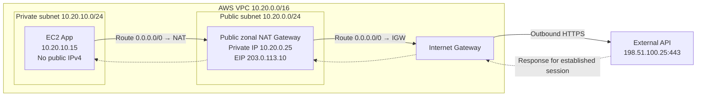
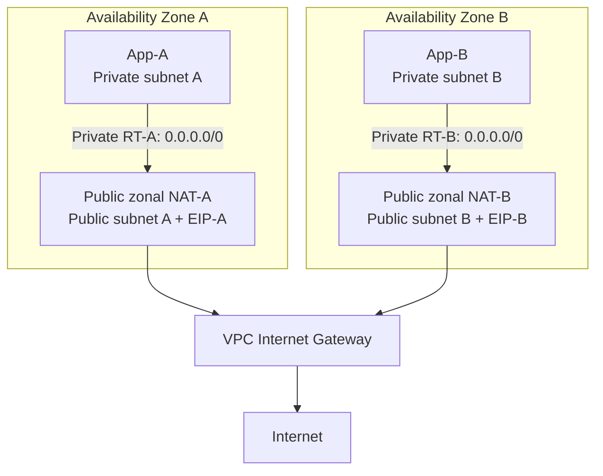
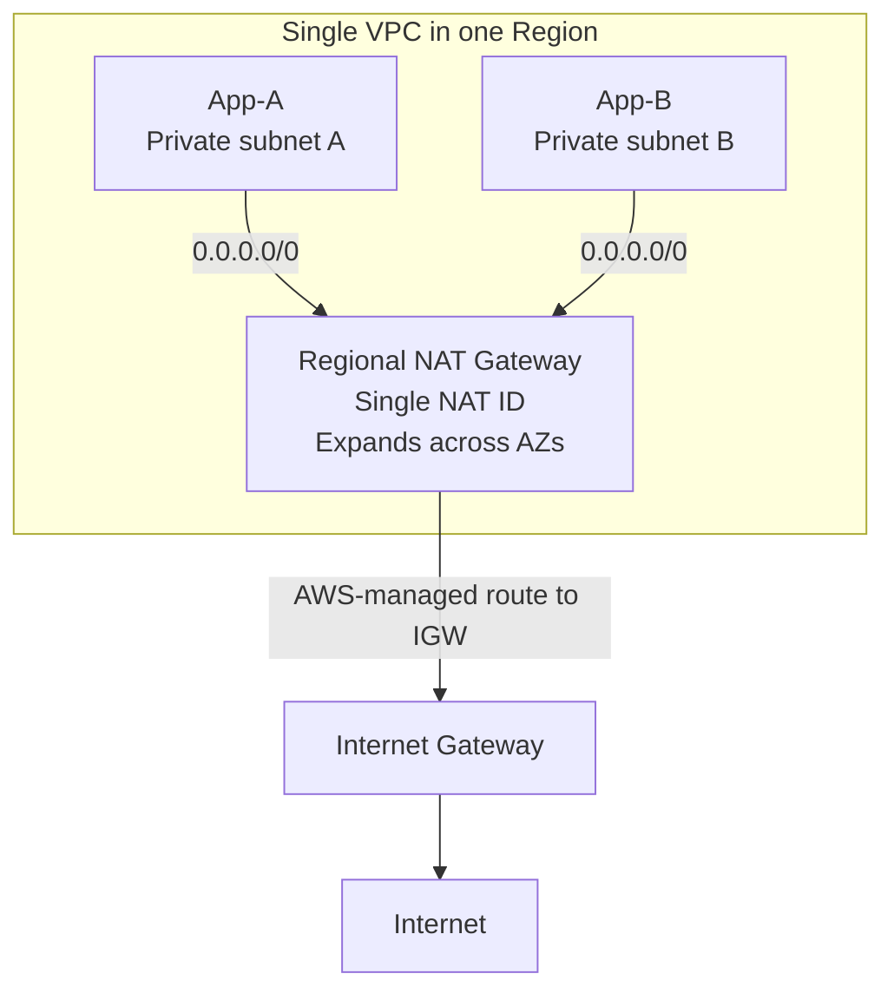

# NAT Gateway and Internet Access from Private Subnets

## Learning Objectives

After completing this lesson, you will be able to:

1. Explain why servers in a **private subnet** still need outbound Internet access and how a NAT Gateway addresses that need.
2. Read route tables to distinguish **public subnets**, **private subnets**, **Internet Gateways (IGWs)**, and **NAT Gateways**.
3. Describe packet flow through a **public NAT Gateway** (IPv4), address translation, and inbound access restrictions.
4. Distinguish **public/private NAT Gateways** from **zonal/regional NAT Gateways**, and select the right option across multiple Availability Zones (AZs).
5. Configure, verify, troubleshoot, and estimate egress costs from private subnets; recognize when to use a **VPC endpoint** or an **egress-only Internet Gateway** for IPv6.

## 1. Why Do Private Subnets Still Need the Internet?

Imagine an e-commerce application running on AWS:

- **Application servers** (EC2 instances or container tasks) reside in private subnets to reduce direct exposure from the Internet.
- **Databases** reside in private subnets and accept connections only from the application tier.
- **An Application Load Balancer** accepts client HTTPS traffic and forwards it to the application over private addresses.
- The application occasionally needs to **call a payment API**, download OS updates, pull libraries, or contact an external service.

Application servers may need to make outbound HTTPS calls to the Internet without having public IPv4 addresses or accepting direct inbound connections from Internet users. A **NAT Gateway** enables such outbound access.

NAT stands for **Network Address Translation**. For outbound IPv4 traffic to the Internet, a NAT Gateway translates the private source IP/port of hosts inside the VPC to an externally usable IP/port. It maintains connection state so return packets are routed back to the exact host that initiated the request.

> **Core idea:** A NAT Gateway enables private resources to **proactively initiate outbound connections and receive responses**. It does not convert a private subnet into a public subnet and does not open ports for the Internet to initiate connections to private hosts.

Within the AWS ecosystem, NAT Gateway is an AWS-managed networking service enabling applications running on EC2, ECS/EKS, VPC-attached Lambda, or other services to reach external destinations according to configured routes and security permissions. **Having a NAT Gateway does not automatically grant Internet access to every app:** route tables, Security Groups, Network ACLs, DNS, and service health must also be properly configured.

## 2. Background: VPC, Subnets, Route Tables, and IGW

| Concept | Role | Relation to NAT |
| --- | --- | --- |
| **VPC** | Your private virtual network within an AWS Region. | Contains subnets, route tables, gateways, and workload resources. |
| **Subnet** | IP address range belonging to one AZ in a VPC. | Workloads reside in subnets; a zonal NAT Gateway resides in a subnet. |
| **Route table** | Rules determining the next hop for packets by destination address. | Private subnets need an appropriate route to NAT to reach external IPv4 destinations. |
| **Internet Gateway (IGW)** | Gateway connecting a VPC to the Internet; supports public IPv4 mapping. | A public NAT Gateway reaches the Internet through an IGW. |
| **Elastic IP (EIP)** | Static public IPv4 address attached to an eligible resource. | A public **zonal** NAT Gateway requires an EIP; partners may allowlist this IP. |
| **NAT Gateway** | AWS-managed NAT service. | Relays outbound flows from resources with private addresses. |
| **Security Group (SG)** | Stateful firewall attached to ENIs/supported resources. | Controls source host access; **SGs cannot be attached directly to a NAT Gateway**. |
| **Network ACL (NACL)** | Stateless traffic control at the subnet boundary. | Can block request or response packets if misconfigured. |

### When Is a Subnet Called Public?

In standard IPv4 designs, a **public subnet** has a default route `0.0.0.0/0 → IGW` in its associated route table. Conversely, a **private subnet** has no direct IPv4 route to an IGW for Internet traffic; it may route via a NAT Gateway or have no Internet egress at all.

**There is no attribute called "private" that guarantees a subnet is protected.** A subnet name is only a label. You must verify routes, resource public IPs, and access control policies. An EC2 instance in a public subnet still requires a public IPv4/EIP (or valid IPv6 path), permitting SGs/NACLs, and an IGW to communicate directly with the Internet over IPv4.

## 3. IPv4 Traffic Flow Through a Public Zonal NAT Gateway

Suppose a VPC has CIDR `10.20.0.0/16` in `ap-southeast-1`:

| Component | Assumed Address |
| --- | --- |
| Application EC2 in private subnet | `10.20.10.15` |
| Zonal NAT Gateway in public subnet | Private IP `10.20.0.25`; illustrative EIP `203.0.113.10` |
| External API server | `198.51.100.25:443` |
| Private subnet route | `0.0.0.0/0 → nat-...` |
| Route of public subnet hosting NAT | `0.0.0.0/0 → igw-...` |

The IPs `203.0.113.10` and `198.51.100.25` belong to documentation example ranges, not real resources.



Processing flow:

1. EC2 at `10.20.10.15` initiates an HTTPS connection to `198.51.100.25:443`, for example from ephemeral source port `53001`.
2. The private subnet's route table selects the NAT Gateway for IPv4 destinations outside the VPC.
3. The NAT Gateway translates the source IP/port to a private IP and port managed by NAT and records the mapping state.
4. Traffic continues to the IGW. With a **public NAT Gateway**, the IGW translates the NAT's private IPv4 to the NAT's **EIP** as the packet exits to the Internet; external systems see the EIP address.
5. Responses sent back to the EIP are reverse-translated by the IGW and NAT Gateway and delivered back to `10.20.10.15` over the established connection.

This is commonly called **source NAT** with port address translation. Private hosts can share a single public EIP to initiate outbound Internet calls; NAT tracks flows to return responses to the right host.

### A NAT Gateway Is Not an Inbound Proxy

An external user cannot initiate a new HTTPS connection to `10.20.10.15` using the NAT Gateway's EIP. A NAT Gateway does not support arbitrary DNAT/port-forwarding rules like a self-managed router.

If an application needs to **receive requests from Internet users**, designs typically use a public **Application Load Balancer**, **API Gateway**, **CloudFront**, or an appropriate entry point, and forward traffic to private workloads under permitted policies. A NAT Gateway does not replace those ingress components.

## 4. Route Tables: The Condition Controlling Outbound Flows

Consider a single-AZ architecture:

- VPC: `10.20.0.0/16`.
- Public subnet: `10.20.0.0/24`, hosting a public **zonal** NAT Gateway.
- Private subnet: `10.20.10.0/24`, hosting application EC2 instances.
- IGW attached to the VPC.

**Public subnet route table** (`rtb-public-a`, illustrative name):

| Destination | Target | Purpose |
| --- | --- | --- |
| `10.20.0.0/16` | `local` | Intra-VPC communication. |
| `0.0.0.0/0` | `igw-xxxxxxxx` | Routes traffic from NAT to the Internet. |

**Private subnet route table** (`rtb-private-a`):

| Destination | Target | Purpose |
| --- | --- | --- |
| `10.20.0.0/16` | `local` | Intra-VPC communication without NAT. |
| `0.0.0.0/0` | `nat-xxxxxxxx` | Routes IPv4 Internet traffic through the NAT Gateway. |

Do not add `0.0.0.0/0 → IGW` to the private route table if the goal is forcing private resources through NAT. Each subnet uses one route table at a time; if not explicitly associated, it uses the VPC's **main route table**.

When a more specific route exists, AWS selects the route using longest prefix match and route priority rules where applicable. For example, a route to an **S3 gateway endpoint** via a prefix list sends S3 traffic through the endpoint rather than following `0.0.0.0/0` to the NAT Gateway.

### Private Subnets Do Not Automatically Have Internet Access

Three possible situations:

| Private Subnet Configuration | Can EC2 Initiate Outbound IPv4 Internet Connections? |
| --- | --- |
| No `0.0.0.0/0` route and no routes to external destinations | No. |
| `0.0.0.0/0 → NAT`, valid NAT, valid IGW/NAT-side routing and security | Can connect outbound for permitted traffic. |
| `0.0.0.0/0 → NAT`, but NAT was deleted, failed, or lacks an Internet path | No; the route may be in `blackhole` state. |

NAT only handles **traffic actually routed to it**. Creating a NAT Gateway and forgetting to update the private route table will not give private instances Internet access.

## 5. Two Dimensions of NAT Gateway Classification

There are **two distinct questions** when choosing NAT:

1. **Connectivity type:** Is NAT used for public Internet access (`public`) or private inter-network connectivity (`private`)?
2. **Availability mode:** Does NAT operate in a single AZ (`zonal`) or manage availability across multiple AZs (`regional`)?

### 5.1. Public NAT vs. Private NAT

| Characteristic | Public NAT Gateway | Private NAT Gateway |
| --- | --- | --- |
| Purpose | Outbound IPv4 Internet access, or reaching other networks via supported routes. | Private communication between VPCs/on-premises via Transit Gateway or Virtual Private Gateway. |
| Public EIP | Has an EIP for Internet egress; required to specify EIP for zonal NAT. | No EIP. |
| Direct Internet access via IGW | Yes, when routes and IGW are properly configured. | **No**: IGW drops traffic from a private NAT Gateway. |
| Example | Private EC2 downloading updates from the Internet. | Workloads requiring address translation when connecting private networks. |

Specifically: if a **public NAT Gateway** sends traffic through a Transit Gateway/Virtual Private Gateway to a private destination, the destination sees the **NAT's private IP**, not its EIP. The EIP is used when public NAT traffic traverses the **IGW in the same VPC**.

Because this lesson focuses on **Internet access from private subnets**, the hands-on examples use a **public NAT Gateway**.

### 5.2. Zonal NAT vs. Regional NAT: Current AWS Capabilities

Since **November 19, 2025**, AWS supports **Regional NAT Gateway** alongside the traditional **Zonal NAT Gateway**. This is an important option when designing modern AWS infrastructure.

| Criterion | Zonal NAT Gateway | Regional NAT Gateway |
| --- | --- | --- |
| Availability scope | Tied to **a single Availability Zone**. | A single NAT Gateway spanning multiple AZs in **one Region**. |
| Deployment placement | Created in a specific subnet; for public zonal NAT, select a **public subnet**. | Created at the **VPC** level; no public subnet required to host NAT. |
| Outbound routing | Private subnets point to the NAT ID in their respective AZ. | Private subnets across multiple AZs can use the **same NAT Gateway ID**. |
| EIP | Public zonal NAT uses an EIP attached at creation. | Supports per-AZ public IP/EIP management, automatic or manual. |
| High availability | AWS provides redundancy within the AZ; to minimize AZ outage risk, deploy one NAT per AZ and route within the same AZ. | Automatically expands/contracts across AZs where workloads exist in automatic mode, maintaining multi-AZ availability. |
| Public/private connectivity | Supports both public and private NAT subject to service conditions. | **Does not support private NAT**; intended for outbound/public NAT use cases. |
| Best fit | Need explicit per-AZ NAT control, private NAT, or specific architectural constraints. | Want fewer NAT IDs, routes, and operational steps when scaling across AZs. |

A Regional NAT Gateway automatically creates **its own route table** with an AWS-configured route to the IGW. Operators must still verify **routes from private subnets to NAT** and the VPC's Internet connectivity setup; creating a regional NAT does not automatically give every subnet outbound access.

Regional NAT offers two AZ/IP management modes:

- **Automatic:** AWS manages AZ coverage and IPs as workloads appear in new AZs; convenient for most use cases.
- **Manual:** you select AZs and EIPs and manually manage expansion/contraction per AZ.

Regional NAT expansion into a new AZ **can take up to 60 minutes**. During that interval, traffic may be processed through an existing AZ, incurring cross-AZ data transfer depending on the scenario. Regional NAT is not supported in certain **constrained AZs**; verify Region/AZ and feature availability before deploying.

> **Note when reading older docs:** The statement "a NAT Gateway always sits in a public subnet and you need one NAT per AZ" applies to traditional **public zonal NAT**; it is **not true for every Regional NAT Gateway**. Also do not confuse **regional** with "a NAT shared across multiple AWS Regions": each regional NAT still belongs to a single Region.

## 6. Multi-AZ Design to Avoid Single Points of Failure

### Option A — Zonal NAT in Each AZ

Suppose an app is deployed across two AZs, each with one public subnet and one private subnet:



Configure **Private-A → NAT-A** and **Private-B → NAT-B**. If AZ A experiences an outage, outbound connectivity for the app in AZ B does not depend directly on NAT-A. This also reduces **cross-AZ** flows and unnecessary cross-AZ data transfer charges.

If both private subnets point to **NAT-A**, the app in AZ B can still reach the Internet normally, but traffic crosses AZ A. When AZ A or NAT-A becomes unavailable, the app in AZ B loses outbound connectivity even while AZ B compute resources remain healthy.

### Option B — A Single Regional NAT Gateway



You do not need to create a dedicated public subnet to **host the regional NAT**. AWS manages per-AZ NAT components matching workload coverage, reducing NAT creation and route-update work whenever adding an AZ. Even when this option fits, monitor expansion into new AZs and check quotas, Region support, egress IPs, and costs.

**Choosing between them:** for new systems needing multi-AZ outbound Internet, evaluate Regional NAT; for **private NAT** requirements or architectural constraints not supported by regional NAT, use Zonal NAT per AZ.

## 7. AWS CLI Hands-On: Configuring a Public Zonal NAT

This section demonstrates the workflow in **a test VPC**. All IDs are illustrative and must be replaced with real IDs. Creating NAT/EIP resources incurs charges until deleted/released; never run mutating commands in production without a change plan.

### 7.1. Assumed Baseline Infrastructure

- VPC `vpc-0123456789abcdef0`, Region `ap-southeast-1`.
- Public subnet `subnet-01111111111111111` and private subnet `subnet-02222222222222222` in the same AZ.
- Public route table `rtb-01111111111111111` associated with the public subnet, containing `0.0.0.0/0 → IGW`.
- Private route table `rtb-02222222222222222` associated with the private subnet, without an Internet route yet.
- Private EC2 instance **with no public IPv4** and an appropriate outbound HTTPS SG rule.
- AWS CLI authenticated to an account with permissions for VPC/EC2/routes/EIPs.

Verify identity and route tables first:

```bash
aws sts get-caller-identity
aws ec2 describe-route-tables \
  --route-table-ids rtb-01111111111111111 rtb-02222222222222222 \
  --region ap-southeast-1
```

### 7.2. Allocate an EIP and Create NAT

```bash
aws ec2 allocate-address \
  --domain vpc \
  --region ap-southeast-1
```

Take the returned `AllocationId` (format `eipalloc-...`) and substitute the placeholder ID below:

```bash
aws ec2 create-nat-gateway \
  --subnet-id subnet-01111111111111111 \
  --allocation-id eipalloc-03333333333333333 \
  --connectivity-type public \
  --availability-mode zonal \
  --region ap-southeast-1
```

Take the returned `NatGatewayId`, then wait until NAT reaches `available`:

```bash
aws ec2 wait nat-gateway-available \
  --nat-gateway-ids nat-04444444444444444 \
  --region ap-southeast-1
aws ec2 describe-nat-gateways \
  --nat-gateway-ids nat-04444444444444444 \
  --region ap-southeast-1
```

If NAT reports `failed`, inspect EIP status, subnet/AZ, quotas, and error details before routing traffic to it.

### 7.3. Add a Route to the Private Subnet

```bash
aws ec2 create-route \
  --route-table-id rtb-02222222222222222 \
  --destination-cidr-block 0.0.0.0/0 \
  --nat-gateway-id nat-04444444444444444 \
  --region ap-southeast-1
```

If a `0.0.0.0/0` route **already exists**, `create-route` fails; check the current target and use `replace-route` if the route change is approved. Do not modify routes on subnets outside the lab scope.

Verify:

```bash
aws ec2 describe-route-tables \
  --route-table-ids rtb-02222222222222222 \
  --query 'RouteTables[].Routes' \
  --region ap-southeast-1
```

Expected result includes `DestinationCidrBlock=0.0.0.0/0` targeting the newly created NAT Gateway with state `active`.

### 7.4. Testing from the Private EC2 Instance

Connect to the EC2 instance via **AWS Systems Manager Session Manager**, EC2 Instance Connect Endpoint, or an appropriate internal administrative path. No public IP or Internet-exposed SSH port is needed for testing.

On the EC2 instance with `curl` available:

```bash
# Test DNS resolution and outbound HTTPS connectivity to the Internet
curl -I --connect-timeout 5 https://example.com

# Check externally observed public IPv4 (returns the NAT IP)
curl -4 --connect-timeout 5 https://checkip.amazonaws.com
```

With a **public zonal NAT**, the IPv4 address returned by the second command is typically the NAT's EIP. With regional NAT, the public IP may come from AWS-managed IPs per AZ depending on the configured addressing mode.

Distinguish clearly:

- **Succeeding** on the HTTPS call proves outbound routing and return traffic work for that destination.
- **Failing** does not always point to NAT; check DNS, SGs, NACLs, OS settings, routes, proxies, and destination firewalls.
- The public IP observed in a test reflects only the egress point for **that connection**; it does not guarantee every Region, AZ, or route uses the same IP.

## 8. Alternative Practice: Creating a Regional NAT Gateway

In a supported VPC and Region where Regional NAT is available, you can create a VPC-level NAT:

```bash
aws ec2 create-nat-gateway \
  --vpc-id vpc-0123456789abcdef0 \
  --availability-mode regional \
  --region ap-southeast-1
```

When manual AZ/EIP lists are omitted, Regional NAT uses automatic scaling mode. Capture the `NatGatewayId`, verify status and configuration with `describe-nat-gateways`, and then point `0.0.0.0/0` in **private subnet route tables** to the **regional NAT ID** similarly to Step 7.3.

```bash
aws ec2 describe-nat-gateways \
  --nat-gateway-ids nat-05555555555555555 \
  --region ap-southeast-1

# Example: add a route for private subnet A using the actual regional NAT ID
aws ec2 create-route \
  --route-table-id rtb-02222222222222222 \
  --destination-cidr-block 0.0.0.0/0 \
  --nat-gateway-id nat-05555555555555555 \
  --region ap-southeast-1
```

**Important difference:** do not pass `--subnet-id` as when creating a zonal NAT. Regional NAT has its own AWS-configured route table and IGW route; operators remain responsible for routing from workloads to NAT, checking VPC/IGW setup, and security controls. If you need specific static IPs assigned per AZ, consult **manual mode** and the `--availability-zone-addresses` option in CLI documentation rather than this automatic example.

## 9. Security: Having NAT Still Requires Access Control

### 9.1. Security Groups

NAT Gateways **do not support attaching Security Groups directly**. SGs are placed on ENIs of source instances, ECS tasks, or corresponding resources:

- An app needing only outbound HTTPS API calls can open **outbound TCP/443** to appropriate destinations; for services supporting prefix lists/endpoints, prefer tight restrictions.
- Inbound SG rules on private EC2 instances **do not need `0.0.0.0/0`** to receive responses for established connections; SGs are **stateful**.
- If the app must be reached via an internal or public ALB in front of it, allow inbound from that front-tier SG or authorized source, never indiscriminately from the entire Internet.

### 9.2. Network ACLs

NACLs are **stateless**, so restrictive rules must account for **both directions**. Beyond application ports, verify **ephemeral ports** for clients and return packets on the relevant subnets. According to AWS documentation, NAT Gateways use ports `1024–65535`; the actual range allowed must align with OS/client behavior and NACL policy.

For example, a NACL allowing outbound TCP/443 while blocking all inbound ephemeral ports on a private subnet will break HTTPS connections even when SGs allow them.

### 9.3. NAT Is Not a Content-Inspecting Firewall

A NAT Gateway handles address translation and connection tracking; by itself it **does not** inspect HTTP payloads, filter URLs/domains, or prevent data exfiltration under business policies. When deep egress inspection is needed, consider architectures with **AWS Network Firewall**, DNS Firewall, managed proxies, or appropriate security appliances; ensure symmetric routing and verify compatibility.

**NAT also does not encrypt data.** Use HTTPS/TLS and application-level authentication for connections to external services.

## 10. Monitoring and Troubleshooting Outbound Traffic

### 10.1. Layered Diagnostic Procedure

When a private EC2 instance cannot reach HTTPS endpoints, check in order:

1. **DNS:** does the domain resolve? Test with `nslookup example.com` or an equivalent tool. Verify VPC DNS settings/DHCP and resolver.
2. **Subnet/route:** is the EC2 instance in the intended subnet? Does its effective route table (or main route table) have `0.0.0.0/0` pointing to the right NAT? Is the route `blackhole`?
3. **NAT:** is its state `available`, in the right VPC/AZ (if zonal), right connectivity/availability mode, and properly configured for public egress?
4. **NAT path to Internet:** does a public zonal NAT have an EIP and a route from its subnet to the IGW? Does a Regional NAT have its AWS-managed route and valid VPC/IGW?
5. **Security:** do outbound SGs, bidirectional NACLs, OS firewall rules, and any intermediate paths allow traffic?
6. **Destination/application:** test another address and endpoint; is the external service blocking the NAT IP, hitting TLS/proxy issues, or rate limiting?
7. **Capacity/metrics:** inspect CloudWatch metrics, throughput, and port allocation errors if failures occur under load.

### 10.2. Common Symptoms

| Symptom | Common Cause | Resolution |
| --- | --- | --- |
| `curl: Could not resolve host` | Incorrect or unreachable DNS/resolver. | Check resolver, VPC DNS settings, and name resolution before NAT. |
| Timeouts on all destinations | Missing route, NAT unavailable, misconfigured IGW/route, or SG/NACL block. | Cross-check EC2 routes and NAT's outbound path. |
| `blackhole` route | NAT Gateway deleted/missing or target invalid. | Verify target and restore the correct route. |
| Only AZ B instances lose Internet when AZ A fails | Both AZs share a zonal NAT in AZ A. | Consider per-AZ NAT or regional NAT. |
| Connections drop under heavy load | Port exhaustion or throughput/connection limits exceeded. | Check NAT metrics, destination distribution, and capacity scaling options. |
| External API rejects IP | Partner allowlists a different egress IP. | Identify the actual egress EIP/address and update the allowlist. |
| Fails only for IPv6 | Wrong IPv6 route or IPv4-only destination. | Distinguish native IPv6, egress-only IGW, and NAT64/DNS64. |

### 10.3. Tracking Metrics and Traffic

NAT Gateway metrics in **Amazon CloudWatch** can include `BytesInFromSource`, `BytesOutToDestination`, `PacketsDropCount`, `ErrorPortAllocation`, and `IdleTimeoutCount`. Verify the exact meaning and mode support for each metric before configuring alarms.

Enable **VPC Flow Logs** on relevant ENIs/subnets/VPCs to inspect source/destination addresses, ports, protocols, ACCEPT/REJECT status, and traffic anomalies. Flow Logs do not record HTTP payloads and do not replace application logs. Combining CloudWatch, Flow Logs, and application logs pinpoints root causes instead of blindly restarting NAT or loosening SGs.

For critical workloads, monitor API error rates, response latency, failed request counts, and timeouts alongside network metrics. This ties directly into system observability and resilience on AWS.

## 11. NAT Gateway, VPC Endpoints, and IPv6: Choosing the Right Solution

Not every connection leaving a subnet needs to traverse the Internet or a NAT Gateway.

| Need | Typically Suitable Solution | Notes |
| --- | --- | --- |
| Private EC2 calling a public IPv4-only API | **Public NAT Gateway** | Requires routes and outbound controls. |
| EC2/ECS accessing **Amazon S3** or **DynamoDB** within supported scope | **Gateway VPC endpoint** | Routes AWS service traffic via endpoint; reduces NAT reliance. |
| Private app calling an AWS service supporting **interface endpoints** | **AWS PrivateLink / interface endpoint** | Endpoint ENI resides inside the VPC; account for per-AZ/hourly and data charges. |
| Native IPv6 workload needing outbound-only Internet | **Egress-only Internet Gateway** | Route IPv6 `::/0` to egress-only IGW; no IPv4 NAT needed for native IPv6 flows. |
| IPv6-only workload calling **IPv4-only** services | **NAT64 with DNS64** on a supported NAT Gateway | Requires routing and resolver setup per AWS documentation. |
| Private VPC/on-premises interconnection needing NAT | **Private zonal NAT Gateway**, Transit Gateway/VGW | Do not use a private NAT Gateway for Internet access via IGW. |
| Resources needing no Internet access | **No NAT route** | Minimizes egress surface and cost. |

**DNS64/NAT64** solves a different problem from traditional IPv4 NAT: an IPv6-only client calling an IPv4-only endpoint. The resolver synthesizes an IPv6 address for the IPv4 target and NAT64 translates the traffic. Do not apply NAT64 when a workload already has a native IPv6 path to an IPv6 target: use native IPv6 routes and an egress-only IGW where appropriate.

For AWS services supporting endpoints, **VPC endpoints are often preferable for frequent or high-volume traffic**, though you should compare service fees, endpoint hours, data volume, and networking requirements. Endpoints do not solve arbitrary public Internet calls.

## 12. Cost, Scale, and Architectural Optimization

### 12.1. Cost Components

With a NAT Gateway, typically account for:

1. **Hourly uptime charge** for the NAT Gateway, based on Region rates and configuration.
2. **Data processing charge** per GB processed by the NAT Gateway.
3. **Cross-AZ data transfer charges**, if traffic traverses a NAT in another AZ depending on the path.
4. **Public IPv4/EIP charges** and **Internet data transfer charges**, per current pricing.
5. Additional charges if using traffic inspection services or interface endpoints.

Illustrative formula **for the two primary NAT components only**:

```text
NAT cost ≈ (active hours × hourly rate)
         + (GB processed by NAT × per-GB processing rate)
         + applicable EIP / cross-AZ / Internet transfer charges
```

For example, a NAT running `730 hours` and processing `200 GB` in a month: if hourly rate is `H` and data processing rate is `D`, the NAT portion is approximately `730 × H + 200 × D`. Do not hardcode a fixed USD figure across all Regions because pricing changes; consult **Amazon VPC Pricing** and the AWS Pricing Calculator.

### 12.2. Optimization Strategies

- **Inspect Cost Explorer** and measure actual NAT traffic before deciding to consolidate or split NAT Gateways.
- With **zonal NAT**, keep NAT and workloads in the same AZ to avoid cross-AZ data transfer where possible.
- Evaluate **regional NAT** to reduce multi-AZ operational overhead; recalculate costs based on regional pricing and actual traffic.
- Use **gateway endpoints** for S3/DynamoDB where applicable; evaluate **interface endpoints** for supported AWS services.
- When downloading packages, container images, or patches repeatedly, consider caching, repository mirrors, image strategies, and intermediate storage to reduce redundant transfers.
- Avoid provisioning NAT in environments that need no outbound access; delete test NATs and release unused EIPs per lifecycle procedures.
- For IP-allowlisted targets, plan your **static EIP** strategy before migrating from zonal to regional; changing NATs or routes can change egress IPs and break active connections.

### 12.3. Connection Limit Considerations

Zonal NAT Gateways scale throughput and connections within quotas; each NAT source IP has a limit on concurrent connections to the same `destination IP + destination port + protocol` tuple. Regional NAT uses per-AZ IP scaling with different limits. If an application opens tens of thousands of connections to **a single endpoint**, monitor `ErrorPortAllocation` and NAT quotas rather than looking only at aggregate bandwidth.

## 13. End-to-End Design Scenario

A company runs an ordering API on ECS in private subnets across two AZs. The API must:

- Call a partner system over public IPv4 HTTPS.
- Access S3 to load application configuration.
- Connect to RDS inside the VPC.
- Accept no direct connections from the Internet to containers.
- Survive a single-AZ outage while controlling costs.

**Proposed architecture:**

1. Place an ALB in public subnets accepting HTTPS; place ECS tasks in private subnets across two AZs, and RDS in private database subnets.
2. Use **per-AZ public zonal NAT** or **Regional NAT Gateway** based on Region support, EIP requirements, quotas, and operational policy. Route `0.0.0.0/0` from private subnets to the appropriate NAT.
3. Add an **S3 gateway endpoint** so S3 traffic avoids NAT; configure IAM and endpoint policies as needed.
4. ECS → RDS connections use the VPC `local` route, **requiring no NAT**; the RDS SG permits traffic only from the ECS SG on the database port.
5. Restrict ECS SGs to allow inbound from the ALB and outbound to required destinations. Collect application logs, NAT metrics, Flow Logs, and alarms for partner API call failures.
6. Validate from each AZ: partner API calls, S3 reads, and RDS connectivity. Then test single-AZ failure recovery according to the design.
7. Review estimates and post-deployment billing: NAT-hours, NAT-GB, endpoints, public IPv4, and cross-AZ transfer.

**Why not place NAT in front of the database?** ECS → RDS traffic within the same VPC uses private addresses and the `local` route. NAT is mainly for destinations that applications reach via NAT routes; inserting NAT adds no meaningful security layer for internal database traffic.

## 14. Common Misconceptions

**Misconception 1: "Placing an EC2 instance in a private subnet makes it impossible to reach the Internet."**  
False. An EC2 instance can initiate outbound connections to the Internet through a NAT Gateway if route tables, services, and security layers allow it.

**Misconception 2: "Creating a NAT automatically gives private subnets Internet access."**  
False. You must configure private route tables to point to the NAT; for public zonal NAT, the NAT's subnet must also have a path to an IGW.

**Misconception 3: "A NAT Gateway lets external users SSH into private hosts."**  
False. NAT does not accept new inbound connections not initiated from the private side. Use dedicated administrative paths or protected ingress tiers.

**Misconception 4: "A NAT Gateway has its own Security Group."**  
False. NAT Gateways do not support attaching SGs; use source SGs, NACLs, and appropriate egress controls.

**Misconception 5: "One zonal NAT is highly available enough for multiple AZs."**  
Not necessarily. If other AZs depend on a zonal NAT in one AZ, an outage in that AZ breaks outbound connectivity. Use per-AZ zonal NAT or Regional NAT depending on requirements.

**Misconception 6: "Every NAT Gateway must live in a public subnet."**  
No longer true. Public **zonal** NAT typically resides in a public subnet; the newer **Regional NAT Gateway** does not require a public subnet to host NAT.

**Misconception 7: "A Private NAT Gateway can browse the Internet if an IGW is added."**  
False. An IGW drops traffic from a private NAT Gateway. For outbound IPv4 Internet access, choose an appropriate **public NAT** solution.

**Misconception 8: "Traffic going through NAT is automatically encrypted and safely filtered."**  
False. NAT does not replace HTTPS, IAM, dedicated firewalls, or security monitoring.

## 15. Self-Check Questions

**Question 1.** An EC2 instance without a public IPv4 in a private subnet needs to download a software package from the Internet. Which IPv4 route must be added to the private route table?

**Answer:** Typically `0.0.0.0/0` pointing to an appropriate **public NAT Gateway**; ensure the NAT has an IGW path and security rules permit traffic. If the service offers a dedicated private endpoint, a different route/endpoint may apply.

**Question 2.** A public zonal NAT has an EIP, but the public subnet hosting the NAT lacks a `0.0.0.0/0 → IGW` route. Can a private EC2 instance call a public API?

**Answer:** No, Internet access will not work under this setup. An EIP and NAT are insufficient; a public zonal NAT requires a route to the IGW.

**Question 3.** Both AZs host private ECS tasks, yet there is only one zonal NAT in AZ A. What is the risk?

**Answer:** AZ B traffic traverses AZ A (increasing dependency and cost); if AZ A suffers an outage, ECS tasks in AZ B lose outbound connectivity. Use per-AZ zonal NAT or evaluate Regional NAT.

**Question 4.** Which object can have a Security Group attached: the NAT Gateway or the EC2 instance sending traffic?

**Answer:** The source EC2/ENI. NAT Gateways do not support attaching SGs directly.

**Question 5.** A native IPv6 workload needs outbound-only IPv6 Internet access without accepting externally initiated connections. Is an IPv4 NAT Gateway mandatory?

**Answer:** No. You can use an **egress-only Internet Gateway** and an appropriate `::/0` route; NAT64/DNS64 is only needed when calling IPv4-only targets in suitable scenarios.

**Question 6.** What is the main difference between public/private NAT and zonal/regional NAT?

**Answer:** Public/private describes the **connectivity type**; zonal/regional describes the **availability scope and deployment model**. Regional NAT currently does not support private NAT.

**Question 7.** How can you reduce GB processed by NAT when EC2 instances frequently access S3?

**Answer:** Where applicable, create an **S3 gateway VPC endpoint** and ensure routes and endpoint policies are configured properly so traffic uses the endpoint instead of NAT.

## Official AWS References

- [Amazon VPC — NAT gateways](https://docs.aws.amazon.com/vpc/latest/userguide/vpc-nat-gateway.html)
- [Amazon VPC — NAT gateway basics](https://docs.aws.amazon.com/vpc/latest/userguide/nat-gateway-basics.html)
- [Regional NAT gateways for automatic multi-AZ expansion](https://docs.aws.amazon.com/vpc/latest/userguide/nat-gateways-regional.html)
- [AWS announcement — Regional NAT Gateway (November 19, 2025)](https://aws.amazon.com/about-aws/whats-new/2025/11/aws-nat-gateway-regional-availability/)
- [Amazon VPC — Internet gateways](https://docs.aws.amazon.com/vpc/latest/userguide/VPC_Internet_Gateway.html)
- [Amazon VPC — Routing for a NAT gateway](https://docs.aws.amazon.com/vpc/latest/userguide/route-table-options.html)
- [Amazon VPC — Egress-only internet gateway](https://docs.aws.amazon.com/vpc/latest/userguide/egress-only-internet-gateway.html)
- [Amazon VPC — Pricing for NAT gateways](https://docs.aws.amazon.com/vpc/latest/userguide/nat-gateway-pricing.html)
- [Amazon VPC — Gateway endpoints](https://docs.aws.amazon.com/vpc/latest/privatelink/gateway-endpoints.html)
- [AWS CLI — create-nat-gateway](https://docs.aws.amazon.com/cli/latest/reference/ec2/create-nat-gateway.html)

**Remember:** IPv4 Internet access from private subnets typically requires **private route → public NAT → Internet Gateway**, where public zonal NAT lives in a public subnet, while Regional NAT operates at the VPC level and expands across AZs automatically. Designing routes, SGs/NACLs, DNS, monitoring, availability zones, and costs properly lets AWS applications **access external services when needed while limiting direct Internet connections into private workloads**.
