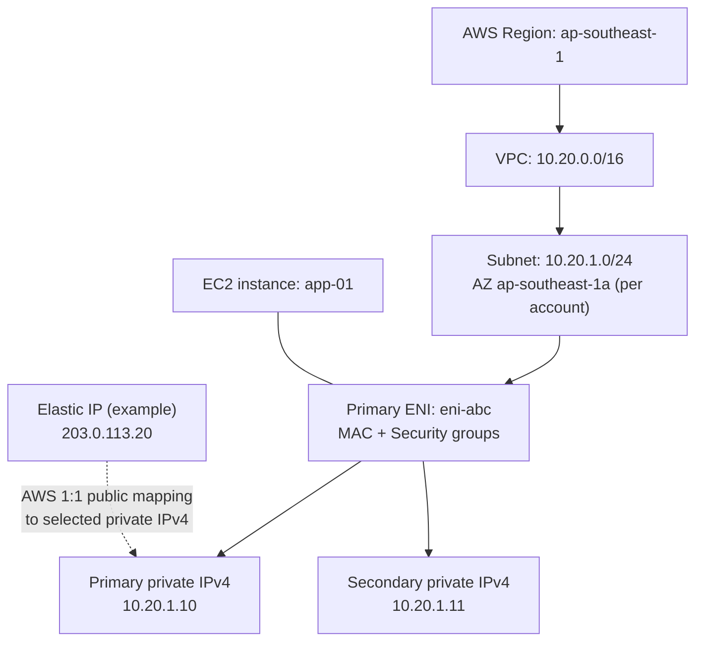
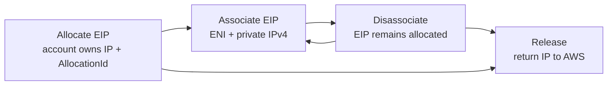
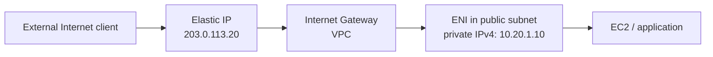
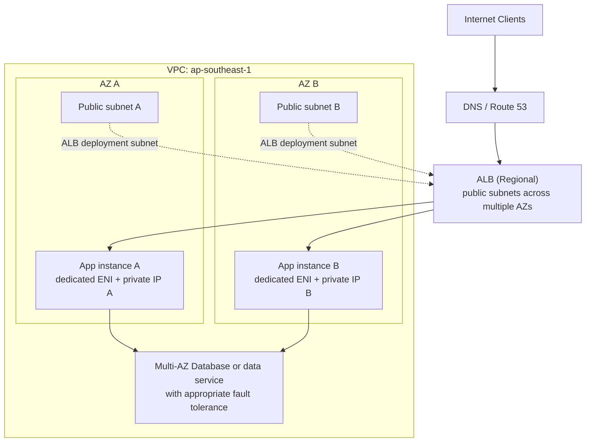

# Elastic Network Interfaces, Private IPs, and Elastic IPs in Amazon VPC

> **Chapter:** VPC Networking  
> **Module:** CLOUD_PROVIDERS_AWS  
> **Goal:** understand how AWS assigns network identity, IP addresses, and reachability to resources in a VPC—enabling secure, monitorable, resilient, and cost-controlled application deployments.

## 1. Why Understanding ENIs and IP Address Types Matters

Within the AWS ecosystem, **Amazon Virtual Private Cloud (VPC)** provides a private network space per **Region**; each **subnet** belongs to one **Availability Zone (AZ)**. When placing an EC2 instance in a VPC, it must connect to the network via an **Elastic Network Interface (ENI)**. The instance's IP addresses are attached to that ENI.

Imagine an ordering application:

- An API running on EC2 needs a **private IP** to talk to databases and internal services.
- An administrative host may need a **stable public IPv4** address for external access; an Elastic IP (EIP) is one option.
- When an EC2 instance fails, operations wants to **shift traffic to a replacement instance** without asking partners to change allowlisted IPs.
- Even with an EIP attached, the application may still fail to reach the Internet if route tables, security groups, or network ACLs block it.
- With many autoscaling instances across multiple AZs, attaching an EIP to each machine is rarely ideal; an **Application Load Balancer (ALB)** or **Network Load Balancer (NLB)** usually meets stable-access needs better.

To handle this properly, separate three concepts:

1. **ENI:** virtual network interface carrying network configuration.
2. **Private IP:** address used for communication across the VPC's private network and connected networks.
3. **Elastic IP:** a **static public IPv4** address allocated by AWS to your account within a service geographic scope and mapped to an ENI's private IPv4.

These three are closely related, but they do not substitute for one another.

## 2. What Is an ENI?

An **Elastic Network Interface** is a virtual network interface inside a VPC. For typical EC2 instances, the ENI is the attachment point between the virtual machine and the VPC network. Some AWS-managed services also use ENIs to attach to your network; in those cases, modification and detachment permissions are governed by the service.

### 2.1. Key Attributes of an ENI

| Attribute | Meaning |
|---|---|
| **Network interface ID** | Identifier formatted as `eni-...`, used for lookup and management |
| **VPC ID / Subnet ID** | An ENI belongs to a specific subnet, and therefore a specific VPC and AZ |
| **Primary private IPv4** | Main private IPv4 address in an IPv4-capable subnet |
| **Secondary private IPv4** | Additional private addresses for hosting multiple apps or shifting IPs when needed |
| **IPv6 addresses** | IPv6 addresses if supported by the subnet/VPC and interface type; IPv6-only subnets differ from IPv4 models |
| **MAC address** | MAC address of the ENI |
| **Security groups** | Stateful traffic filtering rules applied to the ENI inside the VPC |
| **Attachment** | Attached instance info, device index, attachment state |
| **Source/destination check** | Verifies whether the EC2 instance is the source/destination of traffic; normally enabled for application hosts |

An ENI can hold multiple private IPs, but those IPs must come from **the subnet's valid address range**. You cannot arbitrarily attach an IP from another subnet or Region to an ENI.

### 2.2. Relationship Diagram



**Note:** `203.0.113.20` is a sample IPv4 address from a documentation range, not a real allocated EIP. The ID `eni-abc` and private IPs are illustrative only.

An EC2 instance can support multiple ENIs depending on instance family and size networking limits. Each ENI can hold multiple IP addresses subject to quotas and support. Therefore, "one EC2 = one ENI = one private IP" applies only to simple setups, **not as a fixed rule**.

### 2.3. Primary ENI vs. Secondary ENI

**Primary ENI**:

- The interface at device index `0`, typically visible in the OS as `eth0`/`ens...`.
- Created and attached when the EC2 instance launches, and **cannot be detached from the instance** like a secondary ENI.
- When an EC2 instance terminates, the ENI is typically deleted according to the attachment's `DeleteOnTermination` flag; verify this flag when planning resource lifecycles.
- Carries the primary network address for internal instance communication.

**Secondary ENI**:

- Can be attached to an EC2 instance if supported by the instance type and within its limits.
- Can be detached and attached to another EC2 instance **in the same AZ**, provided attachment and compatibility conditions are met.
- Retains ENI-bound network attributes such as private IPs, MAC, and security groups when moved appropriately; useful for certain recovery schemes or virtual network appliances.
- Does not automatically give an instance independent network paths or HA; routes, OS interfaces, and application configs must still be configured properly.

**Scope:** An ENI is a **zonal** resource. Two EC2 instances in the same Region but different AZs **cannot directly move the same ENI back and forth**.

## 3. Private IPs: Workload Internal Addresses

### 3.1. Primary Private IPv4

In an IPv4-capable subnet, the primary private IPv4 is chosen by AWS or specified by the deployer from the subnet range. For example:

- VPC CIDR: `10.20.0.0/16`.
- Subnet A: `10.20.1.0/24`.
- Primary ENI: `eni-abc`.
- Primary private IPv4: `10.20.1.10`.

This address is bound to the **ENI** and is normally retained across EC2 **stop/start** cycles. Moving to a different underlying physical host after stop/start does not remove the primary private IP as long as the ENI remains.

Private IPv4 addresses are not directly routable on the public Internet; Internet communication requires an appropriate mechanism such as **public IPv4 with an Internet Gateway**, a **NAT Gateway**, a proxy, or another network connection depending on traffic direction. Conversely, resources in the same VPC can communicate over private IPs when routes and network filters allow.

### 3.2. Secondary Private IPv4

An ENI can receive **multiple secondary private IPv4 addresses**, such as `10.20.1.11` and `10.20.1.12`. Secondary addresses are useful for:

- Running multiple services that need to bind to distinct IPs on the same host.
- Preparing to shift the destination of an internal address.
- Assigning multiple private IPs to workloads to satisfy network design constraints.
- Associating distinct Elastic IPs with separate private IPv4 addresses on the same ENI, within quota limits.

You can **reassign secondary private IPv4 addresses** between eligible ENIs **within the same subnet** via EC2 mechanics, whereas a primary private IPv4 cannot be moved like a secondary IP.

Do not confuse "AWS assigned a private IP to the ENI" with the guest OS software automatically using that IP. On some OSes or AMIs, check the network interface configuration, secondary addresses, and which IPs applications listen on.

### 3.3. Subnet CIDRs and AWS-Reserved Addresses

In an IPv4 subnet, AWS reserves **5 addresses**: the first 4 and the last address of the range. For example, in `10.20.1.0/24`:

| Address | Role |
|---|---|
| `10.20.1.0` | Network address |
| `10.20.1.1` | VPC router |
| `10.20.1.2` | DNS per AWS subnet/VPC rules |
| `10.20.1.3` | Reserved by AWS for future use |
| `10.20.1.255` | Last address in the range, reserved by AWS |

The remaining addresses **can** be used as private IPv4 addresses depending on allocation state. For instance, `/24` has \(2^{32-24}=256\) total addresses, leaving **251 usable addresses** in principle after subtracting the five reserved ones; actual availability is further constrained by already-used addresses and resource quotas.

Do not divide a subnet's address count to get a maximum EC2 count: one instance can consume multiple private IPs and ENIs, and managed services also consume subnet addresses.

### 3.4. Private IPs and IPv6

AWS supports IPv4, IPv6, and dual-stack configurations depending on VPC/subnet/service capabilities. An **IPv6 global unicast** address is globally routable; whether inbound/outbound traffic is permitted depends on routes, an Internet Gateway or egress-only Internet Gateway, and network filters.

Distinguish clearly:

- **Private IPv4**: e.g., `10.20.1.10`, used for private networking.
- **Public IPv4**: address for public connectivity, either auto-assigned or an EIP.
- **IPv6**: a different addressing model; **do not use IPv4 Elastic IPs** to create static IPv6 addresses.

In an IPv6-only subnet, an ENI can operate without a private IPv4; do not enforce "every ENI has a primary private IPv4" across all IPv6-only setups.

## 4. How Do Auto-Assigned Public IPv4 and Elastic IPs Differ?

An EC2 instance can use an **auto-assigned public IPv4** or an **Elastic IP**. Both are public IPv4 addresses, but they differ in lifecycle and control.

| Criterion | Auto-Assigned Public IPv4 | Elastic IP (EIP) |
|---|---|---|
| Purpose | Provides a public IPv4 address for an eligible resource | Retains a stable public IPv4 address for administration or remapping |
| Address management | Automatically assigned by AWS per subnet setting or at launch | **Allocated** to the account and managed until **released** |
| After EC2 stop/start | Typically assigned a new public address upon start | Keeps the same address while allocated and associated |
| Moving to another instance | Cannot be proactively reassigned like an EIP | Can be **reassociated** to an eligible ENI/private IPv4 within supported scope |
| Scope | Tied to the AWS-managed workload/network interface | **Regional**, subject to network border group |
| Cost | Public IPv4 addresses are billed per current AWS policy | EIP is a public IPv4 and is also billed per current policy |

Since 2024, AWS applies hourly charges to **both in-use and idle public IPv4 addresses**, subject to current terms and exceptions. Do not assume an EIP is "free if attached to EC2." Pricing, free-tier terms, and billing rules can change; check **Amazon VPC Pricing** and **AWS Cost Explorer** for your Region, IP count, and time range.

### 4.1. Elastic IP Lifecycle

An EIP lifecycle can be modeled with four operations:



Explanation:

- **Allocate:** AWS assigns an EIP from an eligible address pool; your account receives an `AllocationId` formatted as `eipalloc-...`.
- **Associate:** maps the EIP to an ENI and corresponding private IPv4, or specifies an instance where supported by the API.
- **Disassociate:** removes the current mapping; the EIP **still belongs to your account**, may incur charges, and has not been returned to the address pool.
- **Release:** returns the EIP to the pool; there is **no guarantee** you can re-acquire the same IP. Treat this as a controlled change for systems relying on IP allowlists.
- **Reassociate:** moves the EIP mapping from one eligible target to another without allocating a new EIP.

**An Elastic IP is not a global resource.** Standard EIPs are allocated within a **Region** and constrained to a **network border group**; you cannot take a Singapore EIP and associate it with an ENI in Tokyo.

### 4.2. How Is an EIP Mapped to a Private IP?

For EC2 instances in a VPC, a public IPv4 maps to a private IPv4 through the AWS network fabric. The EIP **does not necessarily appear as a public IPv4 address on the network interface inside the OS**.



This diagram illustrates the conceptual flow when the VPC has an **Internet Gateway**, the subnet has a valid Internet route, and network policies permit traffic. It does not depict an EIP as a separate NIC attached directly inside the OS.

**Critical condition:** attaching an EIP **does not automatically make a subnet a public subnet**. For direct bidirectional IPv4 Internet access to EC2 via an EIP, verify that the route table has an appropriate route to the **Internet Gateway**, security groups, network ACLs, and a listening service.

In environments with a **NAT Gateway** or **proxy**, outbound paths and public addresses differ. An instance with only a private IP can still initiate outbound access through a properly configured public NAT Gateway **without needing its own EIP**.

## 5. Geographic Scope and Resource Attachment Constraints

This is a frequent source of errors in multi-AZ or multi-Region deployments.

| Object | Scope | What to Remember |
|---|---|---|
| VPC | **Region** | One VPC belongs to one Region |
| Subnet | **AZ** | Each subnet resides in one AZ |
| ENI | **AZ / subnet** | Cannot move an ENI directly to another AZ |
| Primary/secondary private IPv4 | **Subnet/ENI** | Must fall within the subnet's valid IPv4 range |
| Elastic IP | **Region** (and network border group) | Can remap to eligible targets; cannot cross Regions |
| EC2 instance | **AZ** | Attached ENIs must match the AZ and network limits |
| Security group | **VPC / Region** | Attached to ENIs; does not make an ENI global |
| Internet Gateway | **VPC / Region** | Attached to a VPC; route tables and filters govern connectivity |
| Public NAT Gateway | **AZ** | Typically placed in a public subnet and uses an EIP for public outbound addressing |

**Scenario:** ENI `eni-1` resides in `subnet-a` in AZ A, with private IPv4 `10.20.1.10`. A standby EC2 instance sits in AZ B. When AZ A fails:

- You **cannot** detach `eni-1` and attach it directly to the instance in AZ B.
- You **cannot** move private IP `10.20.1.10` as a subnet-A address onto an ENI in subnet B without changing addressing and routing architecture.
- If the EIP belongs to the same Region/network border group, you can **reassociate the EIP** to the private IP of a standby ENI in AZ B. This requires automation, IAM permissions, and health checks; **it does not happen automatically** just because AZ A failed.

This is why you must choose carefully among **moving an ENI**, **reassigning a secondary private IP**, **remapping an EIP**, and **multi-AZ load balancing**.

## 6. Security Groups and Network Paths Attached to ENIs

### 6.1. Where Do Security Groups Sit?

A Security Group is a **stateful** traffic filter attached to ENIs inside a VPC. One ENI can use multiple Security Groups within configuration limits; AWS evaluates the combined rule sets.

Example ordering API running on EC2:

- Inbound: allow TCP 443 from required sources if EC2 accepts HTTPS directly.
- Outbound: allow connections to the database endpoint or dependent services.
- If the database accepts connections only from the API's security group, using a **security group reference** can be cleaner than a broad CIDR.
- If the app sits behind an ALB, EC2 inbound rules typically allow traffic only from the **ALB's security group** on the application port, never `0.0.0.0/0`.

Security Groups **have no explicit Deny rules** in standard ingress/egress evaluation; traffic not matched by a valid Allow rule is blocked. Network ACLs (NACLs) are **stateless** filters with Allow/Deny rules at the subnet level.

### 6.2. Why Does Having an EIP Still Fail to Connect?

When external users visit `https://203.0.113.20`, trace the full path:

1. Is the EIP actually **associated** with the right ENI and application private IPv4?
2. Does the VPC have an attached **Internet Gateway**?
3. Does the subnet's route table have a default route or matching destination route through the Internet Gateway?
4. Does the ENI's security group allow inbound TCP 443 from the expected source?
5. Does the subnet's NACL permit both inbound requests and outbound replies (ephemeral ports)?
6. Does the OS firewall permit it, and is the application running and **listening** on the right port/interface?
7. Are TLS certificates and DNS configured for the domain name? Certificates usually do not validate directly against a sample IP.

Stopping after step 1 and blaming AWS EIPs wastes troubleshooting time. **An EIP is a mapped public address; real connectivity still depends on the entire network path.**

### 6.3. Source/Destination Check

An EC2 instance is normally the **source or destination** of traffic entering or leaving its ENI. AWS enables **source/destination check** by default for most setups.

When an instance is intentionally used as a **router, NAT instance, firewall, or forwarding appliance**, it may handle packets whose final source or destination is not itself. In those cases, understand the implications and **disable source/destination check** on the relevant ENIs alongside configuring route tables, security, and the OS.

Never disable this check on normal application EC2 instances just to "fix a network bug" without evidence.

## 7. Choosing the Right Design: ENI, EIP, NAT, or Load Balancer?

### 7.1. An Administrative Host Needing a Stable IPv4 Address

Suppose a partner allowlists only one static IP. If an administrative host uses direct Internet connectivity, attaching an **Elastic IP** can satisfy the IP allowlist requirement. Harden the host, restrict exposed ports, enable logging, and track public IPv4 costs.

In many enterprise environments, safer alternatives include **AWS Systems Manager Session Manager**, a VPN, or a centrally managed bastion depending on requirements. Having an EIP does not mean opening SSH/RDP to the Internet.

### 7.2. Dozens of Private EC2 Instances Needing Internet for Updates

Do not allocate individual EIPs and open public connectivity for every EC2 instance just for outbound updates. A common design:

- EC2 instances run in **private subnets**.
- Outbound routes point to a **public NAT Gateway** in the corresponding public subnet.
- The NAT Gateway uses an EIP as its public outbound address.
- Use **VPC endpoints** for supported AWS services to reduce NAT traffic and improve control.

For single-AZ fault tolerance, consider **per-AZ NAT Gateways** with matching routes to avoid cross-AZ dependencies; evaluate NAT hourly fees, data processing charges, and cross-AZ transfer costs.

### 7.3. Web API Requiring Multi-AZ HA

An EIP attached to a **single EC2 instance** does not make an API resilient to AZ failures. A more suitable architecture:



ALBs use DNS endpoints and balance traffic via health checks/target groups; use the official DNS name rather than trying to pin a single EIP directly to an ALB. If partners require **static IPs for inbound**, evaluate **NLB** with per-AZ static addressing or **AWS Global Accelerator** depending on the problem. Verify IP count and integration details against configuration and Region support.

### 7.4. Virtual Network Appliance Needing to Move Its Interface Identity

In certain **network appliance** deployments within the same AZ, attaching a secondary ENI to a replacement EC2 instance transfers its private IP, MAC, and security groups. This requires coordinating detach/attach timing, connection state handling, and OS network configuration. In multi-AZ designs, this is no longer directly viable because ENIs are AZ-bound.

### 7.5. Applications Operating Across Two Regions

An EIP is scoped to a Region/network border group; it is not a **Global IP**. To fail over from Singapore to Tokyo, you typically need:

- Application and data stacks deployed in both Regions.
- DNS failover via Route 53 or appropriate routing via Global Accelerator.
- Verified RTO/RPO, replication, health checks, IAM permissions, and network paths in both Regions.

Do not try to move the same ENI/private IPv4/EIP across Regions.

## 8. Address Lifecycle and Common Operations

| Operation | Primary Private IPv4 | Secondary Private IPv4 | EIP |
|---|---|---|---|
| **Stop/start EC2** | Typically preserved with the ENI | Typically preserved with the ENI | Unchanged while allocation/association remain |
| **Reboot EC2** | Unchanged | Unchanged | Unchanged |
| **Terminate EC2** | Lost if the ENI is deleted per lifecycle | Lost with the ENI if deleted | Usually remains allocated to the account; check association |
| **Detach secondary ENI** | IP stays with the detached ENI, not the old EC2 | Remains on the ENI | Mapping must be verified against ENI/association state |
| **Attach ENI to another EC2 in same AZ** | IP follows ENI (if attachment is valid) | IP follows ENI | EIP remains mapped to the associated private IP if mapping state permits |
| **Reassociate EIP to new ENI** | Does not change source/target ENI private IPs | Unchanged unless a separate IP operation occurs | Same public IPv4 shifts to target private IP |
| **Release EIP** | Unchanged | Unchanged | Public address returned to pool; hard or impossible to reclaim the exact IP |

Some operations have detailed rules, quotas, or exceptions depending on the managed resource/service. In live environments serving users, check exact resource states and rollback steps before changing associations.

### 8.1. Distinguishing Two Ways to "Move an IP"

**Moving a secondary private IP within a subnet:**

- Applies to **secondary private IPv4** addresses via eligible reassignment.
- Both ENIs must meet AWS requirements, notably being in the **same subnet**.
- Cannot move an IP from AZ A to a subnet in AZ B.

**Moving an Elastic IP:**

- Changes the **public IPv4** mapping to a target private IPv4.
- Can support failover to an ENI in another AZ **within the same Region/network border group** and service rules.
- Does not automatically transfer sessions, files, databases, or application state. Health checks and failover orchestration are still required.

## 9. Hands-On Inspection with AWS CLI

The commands below are **read-only**. They require AWS CLI v2, credentials/profile with EC2/VPC read permissions, and the active Region. Examples use `ap-southeast-1`; substitute your actual Region.

### 9.1. List ENIs, Subnets, IPs, and Attachments

```bash
aws ec2 describe-network-interfaces \
  --region ap-southeast-1 \
  --query "NetworkInterfaces[].[NetworkInterfaceId,SubnetId,AvailabilityZone,PrivateIpAddress,Status]" \
  --output table
```

Inspect details of a known ENI:

```bash
aws ec2 describe-network-interfaces \
  --region ap-southeast-1 \
  --network-interface-ids eni-0123456789abcdef0 \
  --query "NetworkInterfaces[0].{Id:NetworkInterfaceId,Subnet:SubnetId,AZ:AvailabilityZone,PrimaryIPv4:PrivateIpAddress,PrivateIPv4s:PrivateIpAddresses,IPv6s:Ipv6Addresses,Groups:Groups,Attachment:Attachment,SourceDestCheck:SourceDestCheck}" \
  --output json
```

Fields to read:

- `PrivateIpAddresses`: lists private IPv4 addresses; the `Primary` field identifies the primary address.
- `Association.PublicIp` or related fields: show any public IPv4 currently mapped to the corresponding private IP.
- `Attachment.InstanceId` and `DeviceIndex`: show which EC2 instance holds the ENI and at which device index.
- `Groups`: attached security groups.
- `AvailabilityZone` and `SubnetId`: where the interface resides.

If the sample ID does not exist, the CLI returns an error. Replace with real IDs from your account when practicing.

### 9.2. Inspect EC2 Private IPv4 and Public IPv4

```bash
aws ec2 describe-instances \
  --region ap-southeast-1 \
  --query "Reservations[].Instances[].[InstanceId,Placement.AvailabilityZone,PrivateIpAddress,PublicIpAddress,State.Name]" \
  --output table
```

`PublicIpAddress` may be empty if the instance has no public IPv4. An EC2 instance with multiple ENIs/secondary IPs requires inspecting `NetworkInterfaces` to view all mappings.

### 9.3. Inspect Allocated Elastic IPs

```bash
aws ec2 describe-addresses \
  --region ap-southeast-1 \
  --query "Addresses[].[PublicIp,AllocationId,AssociationId,NetworkInterfaceId,PrivateIpAddress]" \
  --output table
```

Explanation:

- `PublicIp`: Elastic IPv4 address.
- `AllocationId`: account allocation ID.
- `AssociationId`: current association ID; may be absent if unassociated.
- `NetworkInterfaceId` and `PrivateIpAddress`: target currently mapped by the EIP, if any.

To understand costs, do not count only associated EIPs; inspect **all public IPv4 addresses** in use or allocated using current IP/cost management tools.

### 9.4. Inspect Subnets and Route Tables

```bash
aws ec2 describe-subnets \
  --region ap-southeast-1 \
  --query "Subnets[].[SubnetId,VpcId,CidrBlock,AvailabilityZone,AvailableIpAddressCount]" \
  --output table

aws ec2 describe-route-tables \
  --region ap-southeast-1 \
  --query "RouteTables[].[RouteTableId,VpcId,Associations,Routes]" \
  --output json
```

For route tables, inspect subnet associations and the **main route table** if a subnet has no explicit association. Seeing a single route to an Internet Gateway in the VPC does not prove every subnet uses it.

### 9.5. Check How Many ENIs/IPs an EC2 Instance Type Supports

```bash
aws ec2 describe-instance-types \
  --region ap-southeast-1 \
  --instance-types t3.micro \
  --query "InstanceTypes[0].NetworkInfo.{MaxENI:MaximumNetworkInterfaces,IPv4PerENI:Ipv4AddressesPerInterface,IPv6PerENI:Ipv6AddressesPerInterface}" \
  --output json
```

Network capacity depends on instance type, interface type, and practical usage limits. Do not attempt to attach more ENIs or IPs than allowed, as the API will reject the request.

### 9.6. Mutating APIs for Private Labs

Corresponding APIs for hands-on practice include:

- `AllocateAddress`, `AssociateAddress`, `DisassociateAddress`, `ReleaseAddress` for EIPs.
- `CreateNetworkInterface`, `AttachNetworkInterface`, `DetachNetworkInterface`, `DeleteNetworkInterface` for ENIs.
- `AssignPrivateIpAddresses`, `UnassignPrivateIpAddresses` for secondary IPv4s.

Run these only on authorized test resources. **Allocating EIPs and running public IPv4 addresses can incur charges**; remapping EIPs or detaching ENIs on live systems can drop connections and break partner IP allowlists.

## 10. Troubleshooting by Symptom

| Symptom | Hypotheses to Check | Verification Steps |
|---|---|---|
| EC2 in VPC cannot call internal API | Private IP, VPC routes, SG, NACL, DNS | Inspect ENI/subnet/SG and target address; use VPC Reachability Analyzer where appropriate |
| Has EIP but cannot SSH/HTTPS | Missing Internet Gateway route, SG/NACL, OS firewall, app not listening | Check EIP association; subnet's effective route table; inbound ports and return path |
| Public IPv4 changes after stop/start | Using auto-assigned public IPv4 instead of an EIP | `describe-instances` and `describe-addresses` |
| Detaching ENI fails | Attempting to detach primary ENI or an AWS-managed service ENI | Inspect `Attachment.DeviceIndex`, owner, and interface type |
| Attaching ENI to another EC2 fails | Resources in different AZs or quota/compatibility limit hit | Check AZs, instance types, and ENI/IP limits |
| Secondary private IP unusable inside OS | AWS assigned the IP, but guest OS/app is unconfigured | Inspect `PrivateIpAddresses` and OS NIC/routing configuration |
| EIP shows allocated but no connectivity | EIP unassociated or associated with wrong target | Check `AssociationId`, `NetworkInterfaceId`, `PrivateIpAddress` |
| Lambda/managed service has ENI that cannot be detached | ENI owned and managed by the service | Identify source service; adjust service configuration instead of deleting directly |
| Public IPv4 bill increases | Idle EIPs or public IPv4s on instances, NATs/LBs | Use Cost Explorer, IPAM Public IP Insights, and current pricing |
| Remapping EIP leaves old TCP sessions broken | Connection state is not migrated with the EIP | Review retry/reconnect logic; EIP remapping does not sync application state |

### 10.1. Using VPC Flow Logs for Observation

**VPC Flow Logs** capture traffic metadata at the VPC, subnet, or ENI level for network analysis. They show whether flows are accepted or rejected within the logged scope, though they do not replace application logs and do not capture application payloads.

When investigating:

1. Select the right ENI/traffic scope.
2. Inspect timestamps, source/destination IPs, ports, protocols, and actions.
3. Cross-reference with security groups, NACLs, and routes at the time of failure.
4. Also check **CloudWatch metrics, CloudTrail**, and instance/application logs if available.

Do not assume "every packet is captured by Flow Logs"; scope, delay, and excluded traffic types depend on configuration and service behavior. Flow Logs incur ingestion and storage charges.

## 11. Design Exercises and Reference Answers

### Exercise 1 — Private Subnet and Internet Access

EC2 `10.20.2.10` sits in a private subnet; its security group allows outbound TCP 443. Can it reach the Internet on its own?

**Answer:** Insufficient conditions. It needs an outbound route and a mechanism such as a public NAT Gateway, NAT instance/proxy, or endpoint depending on destination type. A Security Group Allow rule does not create an Internet path by itself.

### Exercise 2 — Moving an ENI Across AZs

An application uses a secondary ENI in AZ A. A standby EC2 instance sits in AZ B. Can you detach the ENI and attach it to the standby EC2 instance?

**Answer:** No, an ENI is bound to a specific subnet/AZ. Use an alternative such as provisioning a new ENI in AZ B and remapping an eligible EIP, or using a load balancer and multi-AZ architecture.

### Exercise 3 — EIP vs. Addresses Visible in the OS

An EC2 instance with private IP `10.20.1.10` has EIP `203.0.113.20` attached. Running `ip addr` shows only the private IPv4. Is the EIP misconfigured?

**Answer:** Not necessarily. For EC2 inside a VPC, the EIP is mapped at the AWS network layer to the private IPv4; the OS typically does not see the EIP assigned directly on the NIC.

### Exercise 4 — Static Public IPv4

A partner allowlists only one public IPv4. An EC2 instance uses auto-assigned public IPv4 and is stopped/started during an update. Is this reliable?

**Answer:** No. Auto-assigned public addresses normally change after stop/start. An EIP can provide a static IP within the same Region, or an appropriate endpoint solution can provide stability and fault tolerance.

### Exercise 5 — Moving an Internal IP

Secondary private IPv4 `10.20.1.11` is on ENI A and needs to move to ENI B **in the same subnet**. Is this possible?

**Answer:** Yes, via secondary private IPv4 reassignment when both ENIs and their states satisfy the prerequisites. Verify application bindings, routes, and connectivity afterward. Do not expect the same mechanism to move a primary private IPv4.

### Exercise 6 — Scaling an API Across Multiple AZs

An API runs across two AZs with 10 EC2 instances managed by an Auto Scaling group. Should you publish each EC2 instance's EIP to clients?

**Answer:** Usually no. Instances get replaced and scaled; managing multiple EIPs, costs, and DNS becomes complex. Using an **ALB** with DNS and health checks for HTTP(S) is the standard approach. If partners strictly require static IP allowlisting, evaluate NLB or Global Accelerator for your architecture.

### Exercise 7 — Reducing Public IPv4 Costs

A team discovers many unassociated EIPs that are still allocated. What should they do?

**Answer:** Identify owners, purpose, and whether any are reserved for failover plans, then release genuinely unneeded EIPs through authorized procedures. Disassociating alone does not release the allocation and can still incur charges. Track spending with Cost Explorer.

### Exercise 8 — Single-AZ Failover

An EC2 instance in AZ A holds an EIP; the application already has a standby copy in AZ B. Can EIP remapping alone guarantee RTO = 0?

**Answer:** No. Failure detection, remapping the association, verifying healthy targets, syncing state/data, client reconnection, and testing all take time. Existing connections will drop; never treat EIP remapping as seamless session migration.

## 12. Checklist for Selecting and Operating ENIs/IPs Safely

1. **Identify network scopes:** VPC is Regional, subnet/ENI is zonal (AZ), private IP belongs to subnet, EIP belongs to Region/network border group.
2. **Assign IPs intentionally:** use private IPs for internal traffic; assign public IPv4s only when public connectivity is genuinely required.
3. **Design routes:** verify Internet Gateways, NAT Gateways, route tables, VPC endpoints, security groups, and NACLs.
4. **Verify lifecycles:** distinguish reboot, stop/start, terminate, detach ENI, disassociate, and release EIP.
5. **Choose recovery mechanisms:** secondary ENIs fit same-AZ moves; EIP remapping fits Regional public addresses; ALB/NLB and multi-AZ designs fit HA applications.
6. **Protect access:** minimize inbound exposure, enforce IAM on ENI/EIP administrative actions, and monitor CloudTrail, Flow Logs, and application logs.
7. **Control costs:** audit allocated EIPs and other public IPv4s, NAT Gateways, cross-AZ transfer, and log storage per current pricing.
8. **Verify empirically:** inspect ENI/instance/EIP states, trace paths, and test failover in a controlled environment.

Understanding **ENI – private IP – Elastic IP** turns knowledge of **Regions/AZs, IAM, VPC, EC2, storage, databases, serverless, monitoring, recovery, and cost** into concrete architectural decisions rather than configuring addresses by habit.

## Official AWS References

- [Elastic network interfaces — Amazon EC2 User Guide](https://docs.aws.amazon.com/AWSEC2/latest/UserGuide/using-eni.html)
- [IP addressing for EC2 — Amazon EC2 User Guide](https://docs.aws.amazon.com/AWSEC2/latest/UserGuide/using-instance-addressing.html)
- [Elastic IP addresses — Amazon EC2 User Guide](https://docs.aws.amazon.com/AWSEC2/latest/UserGuide/elastic-ip-addresses-eip.html)
- [Subnet CIDR blocks — Amazon VPC User Guide](https://docs.aws.amazon.com/vpc/latest/userguide/subnet-sizing.html)
- [VPC security groups — Amazon VPC User Guide](https://docs.aws.amazon.com/vpc/latest/userguide/vpc-security-groups.html)
- [Internet gateways — Amazon VPC User Guide](https://docs.aws.amazon.com/vpc/latest/userguide/VPC_Internet_Gateway.html)
- [NAT gateways — Amazon VPC User Guide](https://docs.aws.amazon.com/vpc/latest/userguide/vpc-nat-gateway.html)
- [VPC Flow Logs — Amazon VPC User Guide](https://docs.aws.amazon.com/vpc/latest/userguide/flow-logs.html)
- [Amazon VPC pricing](https://aws.amazon.com/vpc/pricing/)
- [Elastic Load Balancing documentation](https://docs.aws.amazon.com/elasticloadbalancing/)
