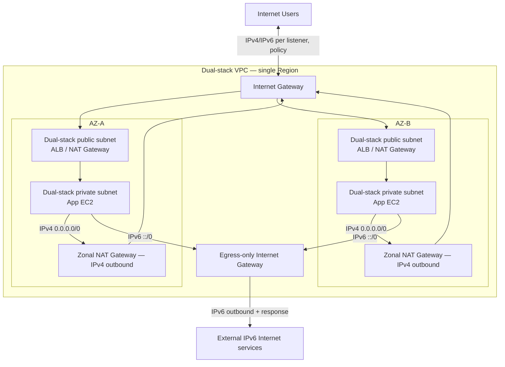

# IPv6, Dual Stack, and Egress-Only Internet Gateways in Amazon VPC

> **Chapter:** VPC Networking  
> **Module:** `CLOUD_PROVIDERS_AWS`  
> **Context:** AWS network architectures can combine IPv4 and IPv6 to deploy secure, scalable, observable, and resilient applications. This lesson focuses on IPv6 addressing in a VPC, dual-stack models, and outbound-only Internet access from a VPC using an **egress-only Internet Gateway**.

## Learning Objectives

After completing this lesson, you will be able to:

1. Explain IPv6 notation, IPv6 CIDRs, and the differences among IPv4-only, dual-stack, and IPv6-only subnets.
2. Design VPCs and subnets with IPv4/IPv6, assign IPv6 addresses to appropriate resources, and understand the roles of DNS `A`/`AAAA` records.
3. Distinguish Internet Gateways, egress-only Internet Gateways, and NAT Gateways by protocol, traffic path, and ability to accept Internet-initiated connections.
4. Properly configure route tables for **dual-stack public subnets** and **dual-stack private subnets**, combined with security groups and network ACLs.
5. Verify configurations with the AWS CLI, diagnose IPv6 connectivity failures, and weigh availability, monitoring, and cost control.

## 1. Why Does a VPC Need IPv6?

IPv4 uses 32-bit addresses, such as `10.20.11.15`. IPv6 uses 128-bit addresses, such as `2001:db8:1234:1211::15`. The IPv6 address space is vastly larger, suiting distributed system connectivity needs and reducing reliance on scarce public IPv4 addresses.

In Amazon VPC, IPv6 helps:

- Assign dedicated IPv6 addresses to many resources without relying on NAT to reach **IPv6 destinations**.
- Provide IPv6 connectivity for clients, load balancers, application servers, and supported AWS services.
- Transition gradually from existing IPv4 applications to **dual stack** before considering IPv6-only workloads.
- Separate the requirement of **blocking Internet-initiated connections to application servers** from still allowing servers to reach external IPv6 services, using an egress-only Internet Gateway.

Key point: **Having an IPv6 address does not automatically mean a resource can connect to the Internet.** Connectivity still depends on CIDRs, addresses assigned to interfaces, route tables, security groups, network ACLs, DNS, and IPv6 support on both endpoints.

### 1.1 How to Read IPv6 Addresses and CIDRs

IPv6 consists of eight 16-bit hexadecimal groups; `::` compresses a single contiguous sequence of `0000` groups and may appear at most once in an address.

```text
Full:     2001:0db8:1234:1211:0000:0000:0000:0015
Short:    2001:db8:1234:1211::15

CIDR:     2001:db8:1234:1211::/64
Default:  ::/0
Loopback: ::1
```

- `/64` means the first 64 bits form the network prefix; it is not equivalent to IPv4 `/24` in address count.
- `::/0` is the default route for IPv6, analogous to `0.0.0.0/0` for IPv4.
- The `2001:db8::/32` range is reserved for **documentation examples**. Addresses in this range **are not real Internet addresses**; all IPv6 CIDRs below are illustrative for diagrams.
- Do not confuse `::/0` (the entire IPv6 space) with `::1` (the host's own loopback address).

### 1.2 Is IPv6 Always "Public"?

With **Amazon-provided public** IPv6 addresses, AWS can advertise the prefix to the Internet. When routing and network policies allow, hosts can be reached over IPv6 **without NAT**. However, AWS also provides **private IPv6** options via VPC IP Address Manager (IPAM) that are not advertised to the Internet by AWS. Therefore, distinguish **address type** from **actual reachability**.

Even when an EC2 instance has a globally routable IPv6 address, routing `::/0` to an egress-only Internet Gateway prevents the Internet from initiating new sessions inward through that gateway. Security groups and network ACLs must still restrict traffic properly.

## 2. How Do IPv4-Only, Dual Stack, and IPv6-Only Differ?

AWS supports IPv4-only, dual-stack, and IPv6-only subnet types. In dual stack, both VPC and subnet carry both CIDR ranges; resources using IPv6 must also have IPv6 on their ENIs and protocol support.

| Subnet Type | Subnet CIDR Ranges | Workload Connectivity |
|---|---|---|
| **IPv4-only** | IPv4 | Uses IPv4; cannot use direct IPv6 paths without adding support |
| **Dual stack** | IPv4 **and** IPv6 | Can use IPv4 or IPv6, depending on assigned addresses, DNS, application, and target |
| **IPv6-only** | IPv6, without a standard IPv4 subnet CIDR | Applications use IPv6; reaching IPv4-only targets typically requires NAT64/DNS64 or compatible solutions |

**Dual stack is not an automatic IPv4 ↔ IPv6 translator.** The two protocols have independent address spaces and routes. A dual-stack host calls IPv4 targets via IPv4 and IPv6 targets via IPv6; the client or library chooses based on DNS and reachability.

Example of a Java application running on a dual-stack EC2 instance:

1. Queries DNS for `api.example.test`.
2. If an `AAAA` record exists, the app may try IPv6; if an `A` record exists, it may try IPv4.
3. Connection selection, preference order, and fallback depend on the OS, Java runtime, HTTP library, and client configuration.
4. If the IPv6 path fails while IPv4 works, some clients fall back; do not assume all clients behave identically.

The name `api.example.test` and the IPs in this lesson are illustrative data, not real production endpoints.

### 2.1 IPv6 Prefixes at the VPC and Subnet Levels

A VPC can receive an IPv6 CIDR provided by AWS, from an IPAM pool, or via Bring Your Own IP (BYOIP) if eligible. With an **Amazon-provided IPv6 CIDR**, a `/56` block is typically assigned to the VPC. Other CIDR options may be available depending on source and IPAM/BYOIP setup; do not assume every VPC must use `/56`.

Documentation-only addressing example:

| Level | IPv4 CIDR | IPv6 CIDR | Meaning |
|---|---|---|---|
| VPC `app-vpc` | `10.20.0.0/16` | `2001:db8:1234:1200::/56` | Address space for a single VPC |
| Public subnet AZ-A | `10.20.1.0/24` | `2001:db8:1234:1201::/64` | Ingress/load balancer, NAT gateway |
| Private subnet AZ-A | `10.20.11.0/24` | `2001:db8:1234:1211::/64` | App servers |
| Public subnet AZ-B | `10.20.2.0/24` | `2001:db8:1234:1202::/64` | Resilience in another AZ |
| Private subnet AZ-B | `10.20.12.0/24` | `2001:db8:1234:1212::/64` | App servers in another AZ |

Subnets must not have overlapping CIDRs within the managed space. `/64` is a common IPv6 subnet size, though AWS supports other IPv6 subnet lengths in certain cases; verify allocation rules when designing IPAM.

**Note:** Assigning IPv6 CIDRs to the VPC and subnets is only the first step. For an ENI/EC2 to receive IPv6, explicitly assign an address or enable auto-assign IPv6 at interface creation where supported; instance/service types and applications must also support it.

### 2.2 Region and Availability Zones

A VPC is **Region**-scoped; a subnet resides in **one AZ**. You can place dual-stack subnets across multiple AZs to improve fault tolerance. Do not treat having multiple AZs as proof of Internet resilience if all IPv4 flows still depend on a single **zonal NAT Gateway** in one AZ; evaluate paths and failure points for each protocol separately.

## 3. Internet Gateway, Egress-Only Internet Gateway, and NAT Gateway

These three components are often confused because all appear in "outbound to the Internet" architectures.

| Component | Protocol Served in This Lesson | Internet Connection Direction | Performs Address Translation? | Suitable Use Case |
|---|---|---|---|---|
| **Internet Gateway (IGW)** | IPv4 and IPv6 | Allows outbound and can allow Internet-initiated inbound to resources when network/policy conditions are met | For IPv4, IGW maps between instance private and public IPv4; for IPv6, typically no NAT is needed | Public subnets, internet-facing load balancers, public EC2 instances |
| **Egress-only Internet Gateway (EIGW)** | **IPv6 only** | VPC resources initiate outbound to Internet and receive return traffic; blocks new Internet-initiated inbound connections | **Does not** perform NAT66 for IPv6 traffic | Private EC2/workloads needing outbound IPv6 |
| **NAT Gateway** | IPv4 outbound; can perform NAT64 for IPv6 → IPv4 when configured | Private resources initiate connections to eligible destinations; allows return traffic | Performs NAT for IPv4; supports NAT64 | IPv4 outbound from private subnets; reaching IPv4-only targets from IPv6-only workloads |

**An EIGW cannot replace a NAT Gateway for IPv4**. Likewise, an IPv4 `0.0.0.0/0` route to a NAT Gateway does not open IPv6 Internet access. Both route paths must be verified independently.

**Two NAT Gateway modes to know:** Zonal NAT Gateway operates within one AZ; multi-AZ designs typically deploy one per AZ to avoid cross-AZ dependency. AWS also supports **Regional NAT Gateway**: a single VPC-level NAT Gateway that automatically scales across AZs with workloads, reducing per-AZ NAT management. Regional NAT Gateway suits many outbound Internet scenarios but has specific limitations (e.g., no private NAT support). Choose based on redundancy, private connectivity needs, availability scope, and cost; see [AWS — Regional NAT gateways](https://docs.aws.amazon.com/vpc/latest/userguide/nat-gateways-regional.html).

### 3.1 What Does an Egress-Only Internet Gateway Actually Do?

An Egress-only Internet Gateway is a **VPC**-attached component managed by AWS for scalability and high availability. It is **stateful**:

- Allows hosts inside the VPC to **initiate** outbound IPv6 connections over a valid route.
- Tracks flow state to forward **return traffic** back to the originating host.
- Prevents external Internet hosts from opening **new IPv6 connections not initiated from inside the VPC** via the EIGW.
- Does not attach Security Groups directly. Security groups protect ENIs/resources; network ACLs filter at the subnet level.

Example of an EC2 instance using `2001:db8:1234:1211::15` to call an external server over HTTPS/IPv6:

```text
Private dual-stack EC2                           IPv6 Internet
2001:db8:1234:1211::15                           2001:db8:abcd::80
         |                                               ^
         |  TCP/443 connection initiated by EC2          |
         +----------> EIGW ------------------------------+
         <---------- EIGW <------------------------------+
                     return traffic

Internet host opens new TCP/22 session to EC2: blocked by EIGW.
```

The IPs here are documentation examples; the diagram illustrates the logical flow. Even though the EIGW blocks Internet-initiated inbound connections, you must still protect resources against access **from inside the VPC**, via peering/VPN/Transit Gateway if present, or other paths.

### 3.2 Does an EIGW Cost Money?

AWS currently charges no separate usage fee for an egress-only Internet Gateway, though traffic from associated resources can still incur **data transfer charges**. NAT Gateways typically incur hourly uptime and data-processing charges, plus data transfer fees depending on the path. When selecting a design, review actual Regional pricing and monitor with AWS Budgets/Cost Explorer; never assume "no EIGW fee" means IPv6 Internet traffic is free.

## 4. Designing Route Tables for a Dual-Stack VPC

A single route table can hold both IPv4 and IPv6 routes; AWS selects routes by **destination address** and prefix matching rules. The two default routes:

```text
0.0.0.0/0   -> IPv4 default destination
::/0        -> IPv6 default destination
```

Internal VPC `local` routes for associated VPC CIDRs are created and managed per AWS rules. When reading examples, remember these internal routes coexist with gateway routes.

### 4.1 Dual-Stack Public Subnet

For workloads requiring bidirectional Internet access per policy (such as an internet-facing Application Load Balancer), the public subnet's route table typically looks like:

| Destination | Target | Explanation |
|---|---|---|
| `10.20.0.0/16` | `local` | Intra-VPC IPv4 traffic |
| `2001:db8:1234:1200::/56` | `local` | Intra-VPC IPv6 traffic |
| `0.0.0.0/0` | `igw-example` | IPv4 Internet |
| `::/0` | `igw-example` | IPv6 Internet |

A route to the IGW **is not enough** for an IPv6 app to accept requests from the Internet. Resources need IPv6 on their interfaces, DNS `AAAA` records (if accessed by hostname), an IPv6-capable listener, and permitting security groups/NACLs. For IPv4, EC2 instances need a public IPv4 or Elastic IP for direct Internet access via IGW; IPv6 does not use that same public IPv4 mapping model.

### 4.2 Dual-Stack Private Subnet

If private app servers need OS updates, external API calls, or outbound messaging to Internet targets, a common architecture is:

| Destination | Target | Explanation |
|---|---|---|
| `10.20.0.0/16` | `local` | Intra-VPC IPv4 |
| `2001:db8:1234:1200::/56` | `local` | Intra-VPC IPv6 |
| `0.0.0.0/0` | `nat-example` | Outbound IPv4 via NAT Gateway |
| `::/0` | `eigw-example` | Outbound IPv6 via egress-only Internet Gateway |

These are separate paths per protocol:



This diagram illustrates the **logical flow** with **per-AZ zonal NAT Gateways**; it does not display every AZ's complete route table and does not require every architecture to deploy NAT this way. With zonal NAT Gateways, placing one per AZ improves fault tolerance and avoids cross-AZ dependency on the IPv4 branch. Regional NAT Gateway is an alternative to evaluate against requirements; EIGW is an AWS-managed VPC-level resource, not a per-AZ NAT Gateway.

A **private** application in this design can still receive connections from an **ALB** or authorized internal VPC sources. "Private" here reflects Internet routing and ingress control, not complete isolation from all internal networks.

### 4.3 Path of an Outbound HTTPS/IPv6 Connection from Private EC2

1. The OS/application selects the target IPv6 address after DNS (`AAAA`) or explicit config.
2. The host already holds an IPv6 address from the subnet.
3. **Outbound security group** allows the traffic (e.g., TCP/443).
4. **Outbound network ACL**, routing rules, and related network policies allow the packet.
5. The private subnet's route table matches `::/0` and forwards to the **EIGW**.
6. The EIGW forwards packets to the Internet, tracks flow state, and returns response packets.
7. **Inbound network ACL** must allow return traffic; the security group is stateful and allows responses for the permitted connection.

If the app uses IPv4 to reach the same target and IPv4 routing is configured, traffic traverses the **IPv4 NAT Gateway** path; having an EIGW does not alter IPv4 behavior.

## 5. Secure Access Control for IPv6

### 5.1 Security Groups: Separate IPv4 and IPv6 Rules

A rule opening port 443 from `0.0.0.0/0` **only** allows IPv4 sources. To accept HTTPS requests from all IPv6 sources, you need a corresponding `::/0` rule. In production, use such broad ranges only on internet-facing components, and prefer source security groups or specific prefixes wherever possible.

For example:

| Resource | Suggested Inbound | Suggested Outbound |
|---|---|---|
| Public ALB | TCP/443 from allowed IPv4/IPv6 client ranges | To app port via target security group |
| Private app EC2 | App port only from the **ALB's security group** | TCP/443 to required destinations, per IPv4/IPv6 |
| Private DB | DB port only from app security group | Only to required destinations per application model |

Security groups are **stateful** and permit return traffic for allowed connections. That does not substitute for selecting the right EIGW/IGW or configuring service policies.

**Avoid** opening `::/0` inbound directly to SSH/22 or admin ports just because IPv4 was locked down. For administration, use appropriate methods such as AWS Systems Manager Session Manager, controlled bastions, or private network access.

### 5.2 Network ACLs: Bidirectional Rules and Return Traffic

Network ACLs (NACLs) are **stateless** and apply at the subnet level. IPv4 and IPv6 rules are evaluated independently; opening IPv4 does not open IPv6.

In the example of an outbound HTTPS call from a private EC2 instance:

- Outbound must allow TCP/443 to the target IPv6 destinations.
- Inbound must allow return packets back to the **ephemeral port** used by the client, per NACL rules.
- When diagnosing intermittent failures, inspect ephemeral port ranges and relevant ICMPv6 rules, especially **Packet Too Big** for Path MTU Discovery.

Do not copy a single fixed ephemeral port range across all operating systems; verify OS behavior, connection mechanics, and actual architecture.

### 5.3 Why Is ICMPv6 Important?

In IPv6, ICMPv6 messages support critical network functions such as error reporting and Path MTU Discovery. Improperly blocking essential messages, especially `Packet Too Big`, can cause **DNS to resolve and TCP handshakes to succeed, while large data transfers hang**.

Distinguish "allowing necessary ICMPv6 for network operation" from "opening all ICMPv6 to every source." Build rules by function and test empirically; do not blanket-disable ICMPv6 as a simplistic troubleshooting step.

### 5.4 An EIGW Does Not Replace Application-Layer Protection

An EIGW does not authenticate users and does not replace IAM, AWS WAF, TLS, or application security. It blocks **new Internet-initiated IPv6 connections entering via the EIGW**; traffic can still arrive over other valid paths such as ALB + IGW, VPN, Direct Connect, private network integrations, or configured services.

## 6. DNS, AWS Services, and Dual-Stack Limitations

### 6.1 A, AAAA Records, and Protocol Selection

| DNS Record | Returns | Example |
|---|---|---|
| `A` | IPv4 | `198.51.100.20` |
| `AAAA` | IPv6 | `2001:db8:abcd::20` |

The addresses above are documentation examples only. A hostname can publish both `A` and `AAAA` so dual-stack clients can choose. However, having an `AAAA` record in DNS does not prove the backend supports the app, routing, TLS, or firewall over IPv6. The application must also have a working IPv6 network path.

Some AWS endpoints use dedicated dual-stack hostnames or require enabling IPv6 options. Never assume every AWS service endpoint, VPC endpoint, load balancer, or backend supports IPv6 identically. Check service and resource documentation before deploying.

### 6.2 IPv6-Only Workloads Accessing IPv4-Only Destinations

An EIGW **does not translate IPv6 to IPv4**. When an IPv6-only application must call an API publishing only IPv4 addresses, you may need to combine:

- **DNS64** (e.g., enabled on subnets using Amazon Route 53 Resolver): synthesizes IPv6 responses when a target has only IPv4 records.
- **NAT64** on a NAT Gateway: translates packets from IPv6 to the corresponding IPv4 destination.
- Route prefix `64:ff9b::/96` to the **NAT Gateway**; route `::/0` to the **EIGW** for normal IPv6 targets.

```text
IPv6-only EC2
  |-- IPv6 website -> ::/0 -> EIGW -> IPv6 Internet
  |
  +-- IPv4-only API -> DNS64 -> synthesized IPv6 (64:ff9b::/96)
                                      |
                                      v
                                NAT Gateway (NAT64)
                                      |
                                      v
                                IPv4 Internet
```

The `64:ff9b::/96` route is more specific than `::/0`, so it is selected for synthesized addresses when properly configured. DNS64/NAT64 must be tested for each application; apps using IPv4 literals, specialized protocols, or custom DNS handling may require changes for compatibility.

**Comparison:** **Dual-stack** EC2 instances can use IPv4 directly via NAT Gateway and IPv6 directly via EIGW. **IPv6-only** EC2 instances require NAT64/DNS64 whenever any target is IPv4-only. Hence dual stack is often a higher-compatibility transition step.

### 6.3 When to Prefer Private Connectivity?

If a private application calls S3, DynamoDB, or another AWS service supporting VPC endpoints, evaluate **gateway endpoints / interface endpoints** to keep traffic on private paths per service support and IP family settings. Not all endpoints support IPv6 or identical DNS options. An EIGW is an IPv6 Internet egress path, not the default best choice for all AWS service communication.

## 7. Deployment Workflow for a Dual-Stack VPC with Outbound IPv6

These are design-level steps; before executing, confirm account, Region, real CIDRs, IAM permissions, and rollback procedures.

### Step 1 — Plan Addresses and Service Support

Determine IPv4 CIDRs, IPv6 CIDRs from a valid source, subnets per AZ, dual-stack/IPv6-only workload groups, and required services. For serverless or managed databases, specifically verify IPv6 support where connections happen; a subnet having IPv6 does not force every service to use IPv6.

### Step 2 — Attach IPv6 CIDRs to VPC and Subnets

In the VPC console, associate an IPv6 CIDR (Amazon-provided/IPAM/BYOIP per design) with the VPC; then allocate non-overlapping IPv6 subnet CIDRs, commonly `/64`. For EC2/ENIs, assign IPv6 addresses or enable auto-assign IPv6 on creation per supported settings.

### Step 3 — Create an EIGW and Configure IPv6 Routing for Private Subnets

Create **one EIGW for the VPC** and record its `eigw-...` ID. In the route table **actually associated with the private subnets**, add:

```text
Destination: ::/0
Target:      eigw-xxxxxxxxxxxxxxxxx
```

If a `::/0` route already exists, inspect the current target and edit intentionally rather than adding duplicate default routes. Public subnets use an IGW for `::/0` when accepting inbound IPv6 Internet connections; private subnets use an EIGW for outbound-only.

### Step 4 — Complete the IPv4 Path if Using Dual Stack

For private subnets needing outbound IPv4, route `0.0.0.0/0` to an appropriate NAT Gateway. For public subnets, route `0.0.0.0/0` to the IGW. In multi-AZ architectures, consider **per-AZ zonal NAT Gateways** with separate route tables, or **regional NAT Gateway** if supported and aligned with requirements.

### Step 5 — Verify Security Groups, Network ACLs, and DNS

Add IPv6 rules matching inbound/outbound requirements; verify source/destination CIDRs, ephemeral return traffic in NACLs, and ICMPv6. Confirm DNS returns `AAAA` records for IPv6 destinations and valid paths exist.

### Step 6 — Monitor, Fault-Test, and Document

Enable VPC Flow Logs appropriately to observe flows, connection errors, and logging/transfer costs. Test IPv4 and IPv6 paths independently; document route tables, EIGW IDs, NAT Gateways, security groups, NACLs, and active endpoints.

## 8. AWS CLI: Inspection and Configuration Examples

> Commands use AWS CLI v2 syntax. IDs like `vpc-xxxxxxxxxxxxxxxxx`, `subnet-xxxxxxxxxxxxxxxxx`, `rtb-xxxxxxxxxxxxxxxxx`, and `eigw-xxxxxxxxxxxxxxxxx` are placeholders. Read queries use read APIs; creation and update commands **modify infrastructure** and should run only after verifying account/Region, addressing plans, and system impact.

### 8.1 Confirm Account and Region

```bash
aws sts get-caller-identity
aws configure get region
```

The first command prevents operating in the wrong account. With multiple AWS profiles, pass `--profile` and `--region` as appropriate.

### 8.2 Inspect VPC and Subnet IPv6 CIDRs

```bash
aws ec2 describe-vpcs \
  --vpc-ids vpc-xxxxxxxxxxxxxxxxx \
  --region ap-southeast-1 \
  --query 'Vpcs[].{VpcId:VpcId,IPv4:CidrBlock,IPv6:Ipv6CidrBlockAssociationSet[].Ipv6CidrBlock}'

aws ec2 describe-subnets \
  --subnet-ids subnet-xxxxxxxxxxxxxxxxx \
  --region ap-southeast-1 \
  --query 'Subnets[].{SubnetId:SubnetId,AZ:AvailabilityZone,IPv6:Ipv6CidrBlockAssociationSet[].Ipv6CidrBlock,AutoAssignIPv6:AssignIpv6AddressOnCreation}'
```

Even if the VPC has an IPv6 CIDR, if the subnet or ENI lacks an IPv6 assignment, a `::/0` route alone will not give the host an IPv6 address.

### 8.3 Inspect the EIGW and Routes

```bash
aws ec2 describe-egress-only-internet-gateways \
  --region ap-southeast-1 \
  --query 'EgressOnlyInternetGateways[].{Id:EgressOnlyInternetGatewayId,Attachments:Attachments}'

aws ec2 describe-route-tables \
  --route-table-ids rtb-xxxxxxxxxxxxxxxxx \
  --region ap-southeast-1 \
  --query 'RouteTables[].Routes[].{IPv4:DestinationCidrBlock,IPv6:DestinationIpv6CidrBlock,Gateway:GatewayId,EIGW:EgressOnlyInternetGatewayId,NAT:NatGatewayId,State:State}' \
  --output table
```

Always check the subnet's **route table association**; inspecting a route table not actually attached to the investigated subnet leads to wrong conclusions.

### 8.4 Mutating Example: Creating an EIGW and Outbound IPv6 Route

```bash
# Create an EIGW for the VPC (replace with real VPC ID)
aws ec2 create-egress-only-internet-gateway \
  --vpc-id vpc-xxxxxxxxxxxxxxxxx \
  --region ap-southeast-1 \
  --query 'EgressOnlyInternetGateway.EgressOnlyInternetGatewayId' \
  --output text

# After obtaining the EIGW ID, add the default IPv6 route
# to the PRIVATE subnet's route table
aws ec2 create-route \
  --route-table-id rtb-xxxxxxxxxxxxxxxxx \
  --destination-ipv6-cidr-block '::/0' \
  --egress-only-internet-gateway-id eigw-xxxxxxxxxxxxxxxxx \
  --region ap-southeast-1
```

`create-route` cannot add a duplicate default route if one already exists. When changing routing, identify affected resources first and apply during an appropriate change window; changing the wrong target can drop active connections.

### 8.5 Inspect IPv6 Addresses on an ENI

```bash
aws ec2 describe-network-interfaces \
  --network-interface-ids eni-xxxxxxxxxxxxxxxxx \
  --region ap-southeast-1 \
  --query 'NetworkInterfaces[].{Eni:NetworkInterfaceId,PrivateIPv4:PrivateIpAddress,IPv6:Ipv6Addresses[].Ipv6Address}'
```

On Linux EC2 instances, inspect further:

```bash
ip -6 addr show
ip -6 route show

# Check DNS for an IPv6-capable hostname
dig AAAA ipv6.google.com

# Run only after confirming target supports IPv6 and access is permitted
curl -6 -I https://ipv6.google.com/
```

This example uses a public hostname supporting IPv6 at test time; substitute an endpoint you manage. `curl -6` forces IPv6; returned errors still require analyzing DNS, TCP/TLS, proxies, routes, and policies.

## 9. Troubleshooting IPv6 Connectivity Issues

| Symptom | Common Cause | How to Check |
|---|---|---|
| EC2 has IPv4 but no IPv6 | Subnet lacks IPv6 CIDR, ENI lacks IPv6 assignment, or resource type unsupported | `describe-subnets`, `describe-network-interfaces`, `ip -6 addr` |
| Has IPv6 but cannot reach IPv6 Internet | Missing `::/0`, wrong subnet route table association, EIGW on wrong VPC, blocked by SG/NACL | `describe-route-tables`, check associations, EIGW, rules |
| IPv4 reaches Internet, `curl -6` fails | `0.0.0.0/0` path works; separate IPv6 path missing or target lacks IPv6 | Check `AAAA`, `ip -6 route`, `::/0`, policies |
| Internet cannot reach private EC2 directly via IPv6 | EIGW is designed to block Internet-initiated sessions | Use ALB/IGW or an appropriate ingress architecture if public access is **truly needed** |
| DNS returns AAAA, TCP still times out | SG/NACL, route, host firewall, or target service | Inspect VPC Flow Logs, app logs, and layer-by-layer tests |
| HTTPS connects, but large file transfers hang | ICMPv6 Packet Too Big blocked, breaking Path MTU Discovery | Check ICMPv6/NACLs, MTU, and network path |
| IPv6-only cannot call IPv4-only API | No direct IPv4 path; missing DNS64/NAT64 or `64:ff9b::/96` route | Verify synthesized AAAA, NAT Gateway, routes, and app compatibility |
| App server receives unexpected traffic | `::/0` points to IGW instead of EIGW, overly broad inbound rule, or another ingress path | Audit all ingress paths, SGs, NACLs, DNS/ALB, and private links |
| NAT Gateway traffic spikes after dual-stack migration | Clients/targets still prefer IPv4 or one hop lacks IPv6 | Inspect DNS A/AAAA, client protocol choice, Flow Logs, and NAT Gateway metrics |

### 9.1 Effective Investigation Order

1. **Identify protocol:** are you testing IPv4 or IPv6? Do not conflate the two results.
2. **Identify addresses:** does the target have an `AAAA` record, and does the source ENI have IPv6?
3. **Inspect routes:** which route table does the subnet use, and does `::/0` point to IGW, EIGW, or elsewhere?
4. **Inspect network permissions:** security groups, NACLs, host firewalls, and return paths; pay attention to ICMPv6.
5. **Inspect application tier:** does the listener bind IPv6, and do TLS/proxies/API endpoints support it?
6. **Inspect operational signals:** VPC Flow Logs, relevant CloudWatch metrics, VPC/ENI quotas, and gateway states where applicable.

VPC Flow Logs help inspect allowed/rejected flows, but **do not replace** packet captures or application logs; full root-cause clarity requires correlating multiple sources.

## 10. Design Scenario: Two-Availability-Zone E-Commerce Website

Consider a website with an Internet-facing ALB and two groups of private application EC2 instances in AZ-A/AZ-B. The site must serve IPv6 clients without allowing direct Internet connections to application servers, while servers still need to reach external package repositories and APIs.

**Proposed design:**

1. VPC has IPv4/IPv6 CIDRs; public/private subnets across both AZs are configured as dual stack as needed.
2. Public ALB supports dual-stack IP address types and HTTPS listeners. Public subnets route both `0.0.0.0/0` and `::/0` to the IGW.
3. App EC2 instances sit in private subnets. Allow ingress only from the ALB security group to the app port; never expose instances directly to the Internet.
4. Private subnets route default IPv4 to an appropriate NAT Gateway (per-AZ zonal or regional per design) and default IPv6 to an EIGW.
5. Website DNS records match the ALB's IP support mode; test actual IPv4/IPv6 paths from clients.
6. Evaluate VPC endpoints when apps call supported AWS services to reduce unnecessary Internet traffic.
7. Monitor errors per protocol, NAT Gateway costs, data transfer, and observability signals.

**Why are two paths needed?** IPv6 from clients to the website is **inbound** via ALB/IGW; IPv6 from apps to the Internet is **outbound** via EIGW. An EIGW alone cannot serve internet-facing traffic for an ALB. Moreover, if dependent ecosystems remain IPv4-only, dual-stack private EC2 instances still need an IPv4 NAT Gateway path or compatible private connectivity.

### 10.1 Resilience and Cost Control

- **Multi-AZ:** distribute apps and public-facing components across AZs; evaluate NAT Gateway mode (zonal/regional), route associations, and health checks under single-AZ outage scenarios.
- **Observability:** ALB metrics, VPC Flow Logs, application error logs, DNS, and NAT Gateway metrics separate IPv4 issues from IPv6 issues.
- **Cost:** audit data transfer, NAT Gateways, VPC endpoints, load balancers, and log storage. Use AWS Budgets/Cost Explorer; do not assume adopting IPv6 automatically makes all networking costs zero.
- **Security:** enforce least privilege in IAM and security groups, TLS encryption, OS patching, and periodic audits of public listeners/routes. IPv6 changes the connectivity surface without removing any other security requirements.

## 11. Practice Exercises and Self-Check Questions

**Exercise 1 — Fill in the route table.** A dual-stack private subnet hosts apps needing both IPv4 and IPv6 Internet egress while blocking direct Internet-initiated connections to the apps. Given an existing `local` route, which targets do you assign to `0.0.0.0/0` and `::/0`?

**Exercise 2 — Address assignment.** The VPC has an IPv6 CIDR, yet an EC2 instance in a private subnet has only IPv4. Before checking the EIGW, which two steps directly involving the subnet and interface should you check?

**Exercise 3 — Security group.** An ALB currently allows HTTPS from `0.0.0.0/0`. Dual stack is enabled on DNS and the ALB. Is that rule sufficient for IPv6 clients?

**Exercise 4 — Connectivity analysis.** After adding an EIGW, private EC2 instances successfully reach IPv6 websites, yet an IPv6-only workload still fails to call an IPv4-only API. Why, and what components can be added?

**Exercise 5 — Fault-tolerant architecture.** Two AZs share a single **zonal NAT Gateway** in AZ-A, while an EIGW serves IPv6 outbound VPC-wide. When AZ-A suffers an outage, which traffic flow is at risk of disruption, and what adjustment fits?

<details>
<summary>Sample answers</summary>

1. `0.0.0.0/0` → NAT Gateway for IPv4 outbound; `::/0` → EIGW for IPv6 outbound.
2. Verify the subnet has an associated IPv6 CIDR; verify the ENI/EC2 has an IPv6 address (explicitly assigned or auto-assigned on creation) and the resource type supports it.
3. No. You need a matching IPv6 inbound rule, such as TCP/443 from `::/0` if genuinely open to all IPv6 clients, along with downstream rules in the chain.
4. EIGW routes IPv6 only to IPv6 targets. For IPv6-only workloads reaching IPv4-only targets, combine DNS64 and NAT64 via a NAT Gateway with route `64:ff9b::/96`.
5. IPv4 outbound from AZ-B relying on AZ-A's zonal NAT Gateway is at risk; consider per-AZ zonal NAT Gateways or a regional NAT Gateway if suitable, along with route tables and failover testing.

</details>

## 12. Deployment Checklist

- [ ] Confirmed Account, Region, VPC, and non-overlapping IPv4/IPv6 CIDRs.
- [ ] Determined IPv4-only, dual-stack, or IPv6-only subnet model per workload.
- [ ] Verified actual IPv6 addresses assigned to ENIs/resources that need them.
- [ ] Public subnets use IGW per inbound needs; private subnets use EIGW when only outbound IPv6 is required.
- [ ] Verified `0.0.0.0/0` and `::/0` routes **independently** on the route tables actually associated with each subnet.
- [ ] Security groups/NACLs contain least-privilege IPv6 rules; ICMPv6 and return traffic are not overlooked.
- [ ] DNS `A`/`AAAA` records, endpoints, and applications actually support required IP families.
- [ ] If IPv6-only → IPv4-only is needed, designed NAT64/DNS64 and specific routes.
- [ ] Tested connectivity per protocol, across AZs, logs/metrics, and behavior during single-path failures.
- [ ] Reviewed NAT Gateway, data transfer, logging costs, and related service quotas.

## Official AWS Documentation

- [Amazon VPC — Compare IPv4 and IPv6](https://docs.aws.amazon.com/vpc/latest/userguide/ipv4-ipv6-comparison.html)
- [Amazon VPC — Subnets for your VPC](https://docs.aws.amazon.com/vpc/latest/userguide/configure-subnets.html)
- [Amazon VPC — Add IPv6 support for your VPC](https://docs.aws.amazon.com/vpc/latest/userguide/vpc-migrate-ipv6-add.html)
- [Amazon VPC — Example dual-stack VPC configuration](https://docs.aws.amazon.com/vpc/latest/userguide/vpc-migrate-ipv6-example.html)
- [Amazon VPC — Enable outbound IPv6 traffic using an egress-only internet gateway](https://docs.aws.amazon.com/vpc/latest/userguide/egress-only-internet-gateway.html)
- [Amazon VPC — Internet gateways](https://docs.aws.amazon.com/vpc/latest/userguide/VPC_Internet_Gateway.html)
- [Amazon VPC — DNS64 and NAT64](https://docs.aws.amazon.com/vpc/latest/userguide/nat-gateway-nat64-dns64.html)
- [Amazon VPC — Regional NAT gateways for automatic multi-AZ expansion](https://docs.aws.amazon.com/vpc/latest/userguide/nat-gateways-regional.html)
- [Amazon VPC — IP addressing for your VPCs and subnets](https://docs.aws.amazon.com/vpc/latest/userguide/vpc-ip-addressing.html)
- [Amazon VPC — Network ACLs](https://docs.aws.amazon.com/vpc/latest/userguide/vpc-network-acls.html)

**Key takeaway:** In a dual-stack VPC, IPv4 and IPv6 have separate addresses, routes, support matrices, and security controls. An Egress-only Internet Gateway solves **outbound IPv6 with return traffic** for VPC workloads, whereas public inbound paths, IPv4 outbound, and cross-protocol translation must be designed with their appropriate components.
