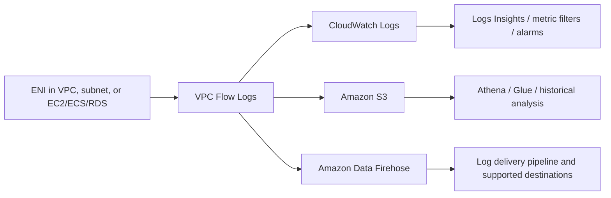
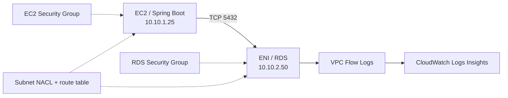
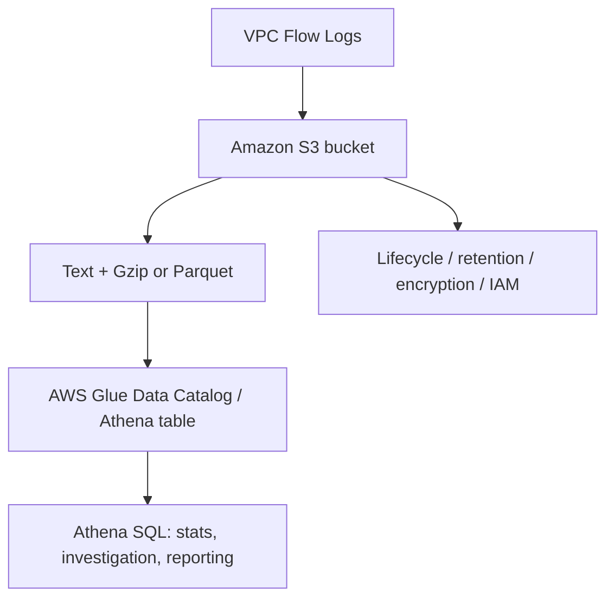
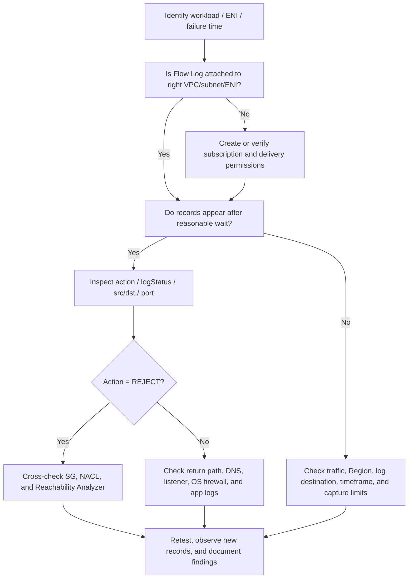

# VPC Flow Logs and Traffic Analysis

> **Module:** CLOUD_PROVIDERS_AWS  
> **Chapter:** VPC Networking  
> **Goal:** Collect, read, and analyze Amazon VPC IP traffic logs to diagnose connectivity, support security controls, monitor applications, and manage observability costs.

## 1. Why Do We Need VPC Flow Logs?

Imagine a Java/Spring Boot application deployed on AWS:

- **Application Load Balancer (ALB)** accepts HTTPS from the Internet in public subnets.
- **EC2** instances or **ECS** tasks run the application in private subnets.
- **Amazon RDS** sits in database subnets, allowing access only from the application tier.
- Workloads call S3, integration services, or the Internet via VPC endpoints or NAT gateways as needed.

The application cannot reach RDS. Developers inspect Spring Boot logs and see connection errors, yet cannot tell whether the cause is a security group, network ACL, route, endpoint configuration, OS firewall, DNS, or the database service itself. That is where **network telemetry** is needed to separate hypotheses.

**Amazon VPC Flow Logs** capture summary metadata about IP traffic **entering and leaving network interfaces (ENIs)** in a VPC. This data is useful when you need to:

1. Identify communicating IP/port pairs and traffic directions.
2. Observe `ACCEPT` or `REJECT` records tied to traffic allow/deny verdicts.
3. Identify sources generating many records, many packets, or high byte volumes.
4. Investigate connectivity changes across multiple subnets and Availability Zones (AZs).
5. Provide supporting evidence for security monitoring, incident troubleshooting, and network architecture optimization.

VPC Flow Logs are **traffic observability**, not a firewall, full packet capture tool, or HTTP/TLS payload analyzer. Enabling Flow Logs **does not alter routing decisions or access control policies**. Collection occurs out-of-band from the packet forwarding path, so by service design it does not reduce throughput or add latency to application flows.

### Learning Outcomes

After completing this lesson, you will be able to:

- Choose the logging scope (**VPC, subnet, or ENI**), traffic filter, and log destination.
- Understand the default record structure and interpret `ACCEPT`, `REJECT`, `NODATA`, and `SKIPDATA`.
- Create Flow Logs delivering to **CloudWatch Logs** and inspect data using **CloudWatch Logs Insights**.
- Read queries that detect rejected IPs/ports, top talkers, and database traffic.
- Understand when to use **Amazon S3 + Amazon Athena** or **Amazon Data Firehose**.
- Isolate connectivity failures by correlating Flow Logs with **Security Groups, NACLs, route tables, Reachability Analyzer, application logs, and CloudWatch**.
- Manage IAM permissions, log retention, access controls, and incurred costs.

## 2. Collection Mechanics and Data Architecture

Flow Logs capture data at the **IP traffic flow** level, typically grouped by a 5-tuple (*5-tuple*) per ENI:

| Component | Example | Meaning |
|---|---|---|
| Source IP | `10.10.1.25` | Source address observed at the capture point. |
| Destination IP | `10.10.2.50` | Destination address observed at the capture point. |
| Source port | `53042` | Source port of the flow. |
| Destination port | `5432` | Destination service port, e.g., PostgreSQL. |
| Protocol | `6` | IANA protocol number; `6` is TCP, `17` is UDP, `1` is ICMP. |

AWS aggregates packets belonging to the same flow over an **aggregation interval**. One Flow Logs line **does not equal one packet**, nor should it be assumed equal to one HTTP request or one complete TCP connection. A long-lived connection can produce multiple records across intervals; the same flow can also be observed on multiple interfaces.

### 2.1. Choosing the Logging Scope

| Scope | Where Is It Captured? | Best Fit |
|---|---|---|
| **VPC** | Monitored ENIs across the VPC. | Broad visibility, investigating cross-tier traffic, or establishing baseline monitoring. |
| **Subnet** | ENIs within the subnet. | Focusing on application, database, or public subnets. |
| **Network interface (ENI)** | One designated ENI. | Targeted analysis of a single workload or network choke point. |

Scope directly affects **log volume and cost**. VPC-wide capture gives broad coverage but generates much more data in high-traffic environments. For small labs, subnet- or ENI-level logging is easier to verify. ENIs may be created and managed by EC2, NAT gateways, load balancers, or other services; identify the target ENI before interpreting records.

### 2.2. Choosing the Traffic Type

When creating Flow Logs, choose:

| Filter | What Is Logged? | Use Case |
|---|---|---|
| **ACCEPT** | Traffic recorded as accepted. | Analyzing permitted communication and observed byte/packet totals. |
| **REJECT** | Traffic recorded as rejected. | Investigating blocked traffic and auditing access attempts. |
| **ALL** | Both ACCEPT and REJECT traffic. | Initial investigations for full context, budget permitting. |

Filtering for `REJECT` **does not prove** every record was blocked by a Security Group: Network ACLs, packets arriving after connection closure, and other network conditions can also produce rejected records. Conversely, `ACCEPT` reflects only that traffic was permitted at the capture point—it **does not prove the target application succeeded** or returned HTTP 200.

### 2.3. Choosing the Publishing Destination



| Destination | Advantages | Considerations |
|---|---|---|
| **CloudWatch Logs** | Easy direct viewing, **Logs Insights** queries, metric filters, and alarms. | Ingestion, storage, and query charges; requires an IAM role for VPC Flow Logs to publish. |
| **Amazon S3** | Long-term storage, lifecycle rules, ideal for multi-day/month analysis via Athena. | Requires bucket policy and access governance; requires table/schema setup for querying. |
| **Amazon Data Firehose** | Streams data into processing pipelines, storage, or supported analytics systems. | Requires delivery stream setup, permissions, and log transport costs. |

For **learning and immediate troubleshooting**, CloudWatch Logs is usually best. S3 + Athena suits **large-scale historical analysis**. You can create multiple Flow Log subscriptions to send logs to multiple systems; watch out for duplicated volume and costs.

### 2.4. Aggregation Interval and Delivery Latency

When creating Flow Logs, you can choose a maximum aggregation interval of **1 minute** or **10 minutes**. Shorter intervals yield finer time granularity at higher log volume. For ENIs attached to **Nitro-based** instances, the actual aggregation interval is always **1 minute or less**, even if you select 10 minutes max.

After collection, the system processes and publishes the logs. AWS notes typical delivery latency of roughly **5 minutes** to CloudWatch Logs and **10 minutes** to S3, though delivery is **best effort** and can take longer. Flow Logs are not a real-time packet monitor with guaranteed response SLAs.

**Practical takeaway:** If you run a connection test and query immediately without seeing records, verify source, destination, and time range, and wait for delivery—do not immediately conclude Flow Logs are broken.

## 3. VPC Flow Logs Record Structure

AWS supports a **default format** and **custom formats**. The default **version 2** fields appear in this order:

```text
version account-id interface-id srcaddr dstaddr srcport dstport protocol packets bytes start end action log-status
```

Illustrative example of an accepted TCP flow:

```text
2 123456789012 eni-0123456789abcdef0 10.10.1.25 10.10.2.50 53042 5432 6 12 1800 1795000000 1795000060 ACCEPT OK
```

**This is a synthetic record.** The Unix timestamps and byte counts in this example are for reading practice only, not real events.

| Field | Example Value | Interpretation |
|---|---|---|
| `version` | `2` | Format field version. |
| `account-id` | `123456789012` | AWS account ID owning the ENI. |
| `interface-id` | `eni-0123456789abcdef0` | Monitored interface. |
| `srcaddr` / `dstaddr` | `10.10.1.25` / `10.10.2.50` | Source/destination IP observed in the record context. |
| `srcport` / `dstport` | `53042` / `5432` | Source port and destination port. |
| `protocol` | `6` | TCP. |
| `packets` | `12` | Number of packets aggregated for the flow. |
| `bytes` | `1800` | Number of bytes recorded in the flow. |
| `start` / `end` | `1795000000` / `1795000060` | Unix timestamps in seconds for the aggregation window. |
| `action` | `ACCEPT` | Traffic was accepted. |
| `log-status` | `OK` | Logging status. |

A concise mnemonic: **who → to whom → which port → which protocol → how much → when → accepted/rejected**.

### 3.1. Distinguishing `action` and `log-status`

**`action`** is the traffic verdict; **`log-status`** reports the logging status.

| Field | Value | Meaning |
|---|---|---|
| `action` | `ACCEPT` | Flow was accepted. |
| `action` | `REJECT` | Flow was rejected; does not yet pinpoint which exact SG or NACL caused it. |
| `log-status` | `OK` | Normal logging. |
| `log-status` | `NODATA` | No traffic observed on the ENI during the aggregation interval. |
| `log-status` | `SKIPDATA` | Some records were skipped due to capacity limits or internal errors during collection. |

With `NODATA` and `SKIPDATA`, many columns appear as `-` because no flow data exists to populate them. **`SKIPDATA` does not mean traffic was blocked**—it means observability data was lost. Do not assert exact accept/reject ratios when significant data was skipped.

Example record with missing data:

```text
2 123456789012 eni-0123456789abcdef0 - - - - - - - 1795000000 1795000060 - NODATA
```

### 3.2. Pay Attention to IPs When Traversing NAT or Middleboxes

With certain secondary IP setups, NAT gateways, middleboxes, or service-managed ENIs, `srcaddr`/`dstaddr` may reflect the address **attached to the monitored ENI**, not always the original packet IP. For deeper analysis, create a **custom format** adding:

- `pkt-srcaddr`, `pkt-dstaddr`: packet-level source and destination addresses, helpful for distinguishing original IPs from intermediary IPs.
- `vpc-id`, `subnet-id`, `instance-id`, `interface-id`: resource correlation.
- `flow-direction`: ingress or egress direction per field-version semantics.
- `traffic-path`: egress traffic path metadata where supported by AWS.
- `tcp-flags`: bitmask of TCP flags supported by Flow Logs.
- `region`, `az-id`: infrastructure geographic context if needed.

Some fields depend on resource type or format version and may appear as `-`. Metadata not read directly from packet headers is **best effort**; cross-reference with ENIs, routes, and service logs.

### 3.3. Using TCP Flags Appropriately

With a custom format, the `tcp-flags` field helps analyze incomplete TCP connections:

| Supported Flag | Typical Bitmask Value |
|---|---|
| FIN | `1` |
| SYN | `2` |
| RST | `4` |
| SYN-ACK | `18` (SYN + ACK as reported by Flow Logs) |

This is a **bitwise aggregate** over the logging window, not a full packet sequence. Flags not tracked separately by Flow Logs (such as ACK/PSH alone) can produce `0` if no tracked flag appeared. Therefore, **never treat `tcp-flags` as a replacement for packet capture**.

## 4. Creating Flow Logs via the AWS Console

Assume VPC `vpc-0123456789abcdef0` in Region `ap-southeast-1`, an application subnet, and an EC2 instance to generate test traffic. All IDs and addresses are illustrative and must be replaced with real resources you are authorized to manage.

### 4.1. VPC-Level Setup Steps

1. Sign in to the **AWS Management Console**, select the right **Region**, and open the **VPC Console**.
2. Go to **Your VPCs** and select the VPC you want to monitor.
3. Open the **Flow logs** tab or choose **Actions → Create flow log** depending on console layout.
4. For **Filter**, pick **ALL** to observe both ACCEPT/REJECT; if investigating only blocked flows, consider **REJECT** to lower volume.
5. For **Maximum aggregation interval**, select **1 minute** or **10 minutes** as appropriate.
6. For **Destination**, select **Send to CloudWatch Logs**.
7. Create or select a log group, e.g., `/aws/vpc/flowlogs/learning-demo`.
8. Select an IAM **service role** authorized for VPC Flow Logs to publish to CloudWatch Logs, or create one following Console guidance.
9. Use the **AWS default format** for the first exercise; create a separate subscription with a **Custom format** later if extra fields are needed.
10. Review tags, create the Flow Log, and record the **Flow log ID**.
11. Open **CloudWatch → Logs → Log groups** in the same Region to view records once traffic arrives.

**Permissions note:** The identity creating Flow Logs needs EC2 permissions such as `ec2:CreateFlowLogs` and `iam:PassRole` on the specified service role. The **service role** needs permissions to write to CloudWatch Logs; creator permissions and service permissions are **two separate layers**.

### 4.2. IAM Conditions for the Publishing Service Role

Reference trust policy for a role delivering logs to CloudWatch:

```json
{
  "Version": "2012-10-17",
  "Statement": [
    {
      "Sid": "AllowVpcFlowLogsService",
      "Effect": "Allow",
      "Principal": {
        "Service": "vpc-flow-logs.amazonaws.com"
      },
      "Action": "sts:AssumeRole",
      "Condition": {
        "StringEquals": {
          "aws:SourceAccount": "123456789012"
        },
        "ArnLike": {
          "aws:SourceArn": "arn:aws:ec2:ap-southeast-1:123456789012:vpc-flow-log/*"
        }
      }
    }
  ]
}
```

Account ID and Region values are examples. `aws:SourceAccount` and `aws:SourceArn` mitigate *confused deputy* risks. Once a Flow log ID exists, consider scoping `aws:SourceArn` to the specific Flow Log.

Suggested permissions policy when the **log group already exists**:

```json
{
  "Version": "2012-10-17",
  "Statement": [
    {
      "Sid": "PublishToVpcFlowLogsGroup",
      "Effect": "Allow",
      "Action": [
        "logs:CreateLogStream",
        "logs:PutLogEvents",
        "logs:DescribeLogStreams"
      ],
      "Resource": "arn:aws:logs:ap-southeast-1:123456789012:log-group:/aws/vpc/flowlogs/learning-demo:*"
    },
    {
      "Sid": "DescribeLogGroups",
      "Effect": "Allow",
      "Action": "logs:DescribeLogGroups",
      "Resource": "*"
    }
  ]
}
```

If Flow Logs must **create a new log group**, the role also needs `logs:CreateLogGroup` with an appropriate resource scope. AWS guides typically list `CreateLogGroup`, `CreateLogStream`, `PutLogEvents`, `DescribeLogGroups`, and `DescribeLogStreams`; tailor them to organizational policies and existing resources. When troubleshooting delivery failures, inspect trust policy, permissions policy, log group, and the configuring identity's `iam:PassRole` permission.

### 4.3. Inspecting with the AWS CLI

The illustrative command below creates a VPC-level Flow Log sending **ALL** traffic to CloudWatch Logs:

```bash
aws ec2 create-flow-logs \
  --resource-type VPC \
  --resource-ids vpc-0123456789abcdef0 \
  --traffic-type ALL \
  --log-destination-type cloud-watch-logs \
  --log-group-name /aws/vpc/flowlogs/learning-demo \
  --deliver-logs-permission-arn arn:aws:iam::123456789012:role/VpcFlowLogsToCwl \
  --max-aggregation-interval 60 \
  --region ap-southeast-1
```

The target log group and service role must exist beforehand if the command relies on them. Do not run literally with the example VPC ID/ARN since they do not belong to your account.

List existing Flow Logs:

```bash
aws ec2 describe-flow-logs \
  --region ap-southeast-1 \
  --query 'FlowLogs[].{Id:FlowLogId,Resource:ResourceId,Status:FlowLogStatus,Delivery:DeliverLogsStatus}' \
  --output table
```

**Execute only when authorized.** If IAM errors occur, inspect the Flow Logs service role as well as the caller's EC2/PassRole permissions.

### 4.4. Generating Safe Test Traffic

Perform in an authorized lab environment with existing resources:

- From an application EC2 instance, run a TCP check to an authorized endpoint you manage.
- Run `curl -I https://example.com` if the subnet has Internet egress and working DNS.
- Send a request to an authorized internal service, such as a test app's HTTP port.
- For REJECT tests, probe ports only against resources **owned by your team** using approved test changes/flows; never scan out-of-scope addresses or systems.

Then open CloudWatch Logs, select the log group and relevant ENI log stream, and compare timestamps. Notice the gap between request time and log arrival time.

## 5. Analyzing Traffic with CloudWatch Logs Insights

Console path: **CloudWatch → Logs Insights → select the Flow Logs log group**. Pick a narrow time window covering the test, such as the last 15–60 minutes.

With the **default format** of VPC Flow Logs in a supported log group, Logs Insights automatically discovers fields such as:

```text
@timestamp, @message, interfaceId, srcAddr, dstAddr,
srcPort, dstPort, protocol, packets, bytes, action, logStatus
```

Field names in **CloudWatch Logs Insights** use camelCase like `srcAddr`, `dstPort`, `logStatus`, whereas the raw record format uses `srcaddr`, `dstport`, `log-status`. **Do not mix the two naming styles** in queries. With custom formats or unrecognized logs, **parse `@message`** or normalize fields first.

### 5.1. Query 1 — View the Latest Records

```sql
fields @timestamp, interfaceId, srcAddr, dstAddr,
       srcPort, dstPort, protocol, packets, bytes, action, logStatus
| sort @timestamp desc
| limit 50
```

**Goal:** Verify whether logs are arriving and match expected ENIs and addresses. Before drawing security conclusions, confirm **which interface**, direction, and timeframe each record belongs to.

### 5.2. Query 2 — Find Top Rejected Traffic

```sql
filter action = "REJECT" and logStatus = "OK"
| stats count(*) as rejectedRecords, sum(packets) as packetCount
  by srcAddr, dstAddr, dstPort
| sort rejectedRecords desc
| limit 20
```

**How to read:** Shows which IP/port tuples produced the most **flow log records** with action REJECT; `count(*)` is **not failed login attempts** or distinct TCP connections. Follow up with Security Groups, NACLs, endpoints, and app logs to determine root cause.

Notable destination ports to watch: `22` (SSH), `3389` (RDP), `3306` (MySQL), `5432` (PostgreSQL), `443` (HTTPS). Port numbers hint at a service; they **do not prove** that exact service is running.

### 5.3. Query 3 — Sources/Destinations with High Byte Volumes

```sql
filter logStatus = "OK" and action = "ACCEPT"
| stats sum(bytes) as observedBytes, sum(packets) as observedPackets
  by srcAddr, dstAddr
| sort observedBytes desc
| limit 20
```

**Goal:** Identify high-volume source–destination pairs, such as an application continuously calling a data endpoint.

**Do not convert `sum(bytes)` directly into an AWS data transfer bill.** Flow Logs observe bytes per record; billing depends on service, transfer direction, AZ/Region, Internet egress, and other rules. One packet may be logged at multiple ENIs, so summing VPC-wide risks **double counting**. For billing, use **AWS Cost Explorer / Cost and Usage Report**.

### 5.4. Query 4 — Traffic to Database Ports

```sql
filter dstPort in [3306, 5432] and logStatus = "OK"
| stats count(*) as flowRecords, sum(bytes) as observedBytes
  by interfaceId, srcAddr, dstAddr, dstPort, action
| sort flowRecords desc
| limit 50
```

Cross-check results against the ENI inventory of your app/RDS instances to confirm source and destination IPs match the intended architecture. An `ACCEPT` record to the PostgreSQL port still does not prove the app authenticated to the database or executed SQL successfully.

### 5.5. Query 5 — Traffic Volume Over Time

```sql
filter logStatus = "OK"
| stats sum(bytes) as observedBytes, count(*) as flowRecords
  by bin(5m) as timeBucket, action
| sort timeBucket asc
```

Use the Logs Insights visualization tab to spot sudden spikes. During sudden incidents, correlate with deployment timestamps, route/security group changes, instance scale-outs, or cross-AZ traffic shifts. **Chart resolution** remains bounded by aggregation intervals and delivery latency.

### 5.6. Do Not Equate Record Count with User Count

Suppose an aggregation yields `rejectedRecords = 900` for one source IP. That means **900 flow log records within the query window**, not 900 HTTP requests, 900 users, 900 packets, or 900 attacks. It could be one application retrying aggressively, an authorized internal scanner, or records across multiple ENIs and aggregation intervals.

Good analysis always asks: **who is this source, what protocol, which target ENI, over what timeframe, and were any policies changed recently?**

## 6. Analyzing a Real Incident: EC2 Cannot Connect to RDS

### 6.1. Lab Context

A Spring Boot app on EC2 sits in private subnet `10.10.1.0/24`. PostgreSQL RDS sits in another private subnet `10.10.2.0/24`. Illustrative addresses:

| Component | IP or Port |
|---|---|
| EC2 application | `10.10.1.25` |
| RDS endpoint (IP at test time) | `10.10.2.50` |
| PostgreSQL port | `5432/TCP` |
| VPC CIDR | `10.10.0.0/16` |

This example illustrates IP correlation. In real RDS setups, applications should connect via the **RDS DNS endpoint** rather than hardcoding an IP, as actual IPs can change during failover or maintenance.



### 6.2. Gathering Evidence

1. Confirm the application is actually attempting TCP connections to the RDS endpoint and port `5432`.
2. Confirm endpoint DNS resolves to a valid IP within the VPC and Region.
3. Inspect Security Groups on source and destination ENIs; RDS inbound typically restricts sources to the **application Security Group**, never the public Internet.
4. Inspect Network ACLs on both subnets. NACLs are **stateless**, so inspect both forward and return flows including **ephemeral ports**; Security Groups are **stateful**.
5. Inspect route tables on both subnets; within the same VPC, the `local` route normally handles internal traffic unless a middlebox/special routing is configured.
6. Enable/collect Flow Logs on the relevant subnets/ENIs and query port `5432`.

Example focused query:

```sql
filter logStatus = "OK"
  and srcAddr = "10.10.1.25"
  and dstAddr = "10.10.2.50"
  and dstPort = 5432
| fields @timestamp, interfaceId, srcAddr, dstAddr,
         srcPort, dstPort, protocol, packets, bytes, action
| sort @timestamp desc
| limit 50
```

If flows are observed across multiple ENIs, inspect the **log stream/ENI** to avoid confusing return records or intermediary device records.

### 6.3. Interpreting Possible Outcomes

| Outcome | What Can Be Inferred | Next Checks |
|---|---|---|
| `REJECT` to RDS IP/port | Traffic was denied at the capture point. | Security Groups, NACLs, rule order/direction, and connection state. |
| `ACCEPT` to RDS, yet app times out | Traffic was allowed at the capture point; does not prove bidirectional completion. | Return flow, ephemeral ports, DB listener, routing, middleboxes, CPU/RDS logs. |
| No records found | Wrong scope, no traffic generated, wrong IP/Region/time, or logs not yet delivered. | Check ENI, Flow Log status, DNS, CloudWatch log group, and latency. |
| `SKIPDATA` appears | Some log data was dropped. | Do not conclude zero traffic; broaden checks with other tools. |

A `REJECT` **does not directly identify the exact Rule ID**. To isolate the cause, compare SG/NACL configs and run **VPC Reachability Analyzer** on the testable path, alongside OS, firewall, and application logs if needed.

### 6.4. Especially Important for Network ACLs

Security Groups track connection state, whereas NACLs evaluate rules independently per ingress/egress direction and **do not automatically open return paths** for permitted outbound flows.

For instance, a NACL may allow the app subnet to send TCP `5432` to the RDS subnet while accidentally blocking ephemeral ports on the return path. Flow Logs on interfaces at both ends, paired with NACL inspection and Reachability Analyzer, pinpoint **"requests sent, responses dropped"** issues.

## 7. Long-Term Analysis with Amazon S3 and Athena

When you need multi-week or multi-month retention, multi-VPC analysis, and lifecycle control, publish to **Amazon S3** and query via **Amazon Athena**.

### 7.1. Processing Pipeline



When configuring an S3 destination for Flow Logs:

1. Select a bucket matching Region, permissions, and data governance requirements.
2. Verify the **bucket policy** for log delivery; check `aws:SourceAccount` and `aws:SourceArn` where applicable.
3. Choose **plain text** or **Parquet** file format per needs. Parquet is columnar and generally efficient for large-scale analytics.
4. Consider **Hive-compatible S3 prefixes** and **hourly partitions** to minimize scanned data in Athena queries.
5. Configure encryption and lifecycle policies to cap storage costs per retention requirements.
6. Create the Athena table with a **schema matching the exact Flow Log field order and format**. Never apply the version 2 schema to a custom format with different fields.
7. Filter by time range/partition in SQL to avoid full-bucket scans.

The SQL example below assumes **an Athena table `vpc_flow_logs` already exists** with columns `srcaddr`, `dstaddr`, `dstport`, `action` and a partition column `day` formatted as `YYYY-MM-DD`:

```sql
SELECT
  srcaddr,
  dstaddr,
  dstport,
  COUNT(*) AS rejected_flow_records
FROM vpc_flow_logs
WHERE day = '2026-11-20'
  AND action = 'REJECT'
GROUP BY srcaddr, dstaddr, dstport
ORDER BY rejected_flow_records DESC
LIMIT 20;
```

**Note:** `day` and the table name are illustrative designs; actual partition names depend on your table structure. With default prefixes or custom tables, adjust the `WHERE` predicate accordingly. For S3 destinations, you can use AWS's **Athena integration for VPC Flow Logs** to generate resources and sample queries instead of authoring schemas from scratch.

### 7.2. CloudWatch Logs vs. S3 + Athena?

| Criterion | CloudWatch Logs Insights | S3 + Athena |
|---|---|---|
| Near-incident troubleshooting | Convenient for fast queries on a log group. | Usable, though subject to S3 delivery timing and schema/partition setup. |
| Large volumes and long retention | Must budget for ingest, retention, and query charges. | Ideal for lifecycle-managed archival and historical analytics. |
| Alarm integration | Easy CloudWatch integration. | Typically requires separate processing/alerting pipelines. |
| Schema management | Many default-format fields auto-discovered. | Must define matching schema, format, and partitions. |
| Cost optimization | Narrow time ranges and scanned log volume per query. | Use Parquet, partition pruning, lifecycle rules, and optimized queries. |

**Do not assume S3 is always cheaper or CloudWatch is always faster** at every scale; compare based on log volume, retention, query frequency, Region, and current service pricing.

## 8. Limitations of VPC Flow Logs and Common Misconceptions

VPC Flow Logs contain only **IP flow metadata**, never packet payloads. You cannot read Spring Boot JSON request bodies, full HTTP URLs, HTTP status codes, SQL statements, TLS handshake internals, or high-level application details from Flow Logs alone.

Certain AWS traffic types **are not captured by VPC Flow Logs**. Typical examples from AWS documentation:

- Traffic from instances to **Amazon-provided DNS**; if you run self-managed DNS, traffic to that DNS may be logged.
- **DHCP** traffic.
- Traffic to/from **EC2 instance metadata** `169.254.169.254`.
- Traffic to/from **Amazon Time Sync Service** `169.254.169.123`.
- Other specialized traffic such as Windows license activation or VPC reserved router addresses.

Not seeing those flows **does not mean** DNS, time sync, or metadata stopped working. AWS may update this exclusions list; check current documentation when analyzing edge cases.

### 8.1. Key Limitations

1. **Not packet capture:** cannot reconstruct exact packet sequences or request payloads.
2. **Not strictly real-time:** subject to aggregation intervals and publishing latency.
3. **Data may be missing:** `SKIPDATA`; some metadata fields are best effort and may show `-`.
4. **Cannot isolate exact SG vs. NACL from a single `REJECT` line**; cross-check policies, Reachability Analyzer, and connection state.
5. **Does not explain all application errors:** `ACCEPT` does not mean the endpoint succeeded.
6. **Cannot edit an existing Flow Log's format in place:** to change destination, role, or record fields, create a new Flow Log with the desired config.
7. **Do not assume original packet IPs at every capture point:** check `pkt-srcaddr`/`pkt-dstaddr` when secondary IPs or NAT/middleboxes are involved.
8. **Does not replace app metrics or billing:** logged flow bytes do not equal billed data transfer bytes.

**Quick tool comparison:**

| Tool | Question It Answers |
|---|---|
| VPC Flow Logs | What metadata and accept/reject status did IP flows to/from ENIs have? |
| VPC Reachability Analyzer | Does current network configuration provide a logical path from source to destination? |
| Traffic Mirroring | Need deep packet-level inspection from supported sources? |
| CloudWatch metrics | Are CPU, latency, network metrics, or service performance shifting? |
| CloudTrail | Who modified Security Groups, route tables, Flow Logs, or AWS resources? |
| Application/RDS/ALB logs | What error did the app return, or where did DB queries or HTTP requests fail? |
| AWS Cost Explorer | How much actual cost accrued by service, account, and Region? |

## 9. Security, Monitoring, Retention, and Cost Control

Enabling Flow Logs in production is an **observability and data-operations** decision. IP/port metadata reveals network topology, database connections, internal services, and usage patterns, so enforce proper access controls.

### 9.1. Deployment Principles

- **IAM least privilege:** Flow Log creators get scoped EC2 permissions; the service role gets permission to publish only to the target log group/bucket.
- **Separate admins from analysts:** application teams can read needed logs without having permission to alter or delete log collection.
- **Protect destinations:** enforce encryption, bucket policies, IAM, and CloudWatch log group retention; prohibit public read access.
- **Tag and document purpose:** e.g., `Environment=dev`, `Owner=platform`, `Purpose=network-observability`.
- **Monitor delivery health:** watch Flow Log status/delivery status and `SKIPDATA` occurrences.
- **Scope queries tightly:** query narrow time windows and specific log groups/partitions first, expanding only when needed.
- **Avoid over-retention:** configure retention/lifecycle rules aligned with operational, investigative, and compliance requirements.

### 9.2. Example Volume and Cost Estimate

Assume **2 million flow log records/day** at an assumed average of **150 bytes/record** uncompressed text:

```text
Assumed raw data / day
= 2,000,000 × 150 bytes
= 300,000,000 bytes
≈ 300 MB (decimal)
```

This number is an **illustrative calculation**, not typical AWS traffic and not a billing quota. Actual costs depend on Region, collection/delivery rates, storage, retention, compression, Athena/Logs Insights query scans, and destination services. A VPC-wide `ALL` Flow Log generates significantly more data than a single-subnet `REJECT` Flow Log.

When budgeting, look beyond S3 or CloudWatch storage: account for log ingestion/delivery, queries, Amazon Athena, Firehose, KMS, and data collection charges depending on configuration. Compare against current **AWS Pricing** and **Cost Explorer**.

### 9.3. Suggested Alert Signals

A dashboard or alert can track:

1. Ratio of **REJECT records** on an ENI/subnet compared to baseline over a window.
2. Count of distinct source IPs rejected on administrative or database ports.
3. Sudden spikes in bytes per source–destination pair or VPC.
4. Signals of broken delivery pipelines, missing logs, or elevated `SKIPDATA`.

These metrics are **investigative signals**, not automatic proof of security incidents. When building CloudWatch metric filters or alarms, verify log parsing, normalize baselines, and avoid false alerts during legitimate traffic growth.

## 10. Troubleshooting Missing Logs or Unexpected Results

| Symptom | Possible Cause | Diagnostic Steps |
|---|---|---|
| Flow Log created, but log group has no records | No traffic yet, wrong Region/VPC, or delivery delay | Generate valid lab traffic; check ENI, timeframe, and Region |
| Flow Log status shows delivery error | Service role/bucket policy/KMS/log group blocks delivery | Check `DeliverLogsStatus`, trust policy, and destination permissions |
| Insights query returns empty despite raw logs existing | Wrong field names, wrong log group/time range, or unparsed custom format | Inspect `@message` and discovered fields; fix query |
| Many `REJECT` records, yet the app works normally | Rejected flows may be scans, retries, or late packets outside main flows | Correlate src/dst, ports, ENIs, timestamps, and app metrics |
| No traffic seen to Amazon-provided DNS | Excluded from VPC Flow Logs by design | Use DNS observability tools; do not mistake for broken logging |
| Total `bytes` query exceeds expectations | Same flow observed on multiple ENIs, or differing format/aggregation | Pick one observation point or separate ingress/egress before summing |
| Changed format, yet records still arrive in old format | Existing subscription configs cannot be edited in place | Create a new Flow Log and migrate pipelines/queries after verifying |
| Logging costs jump unexpectedly | Broad VPC-wide `ALL` scope, long retention, large query scans, duplicate subscriptions | Re-evaluate scope, retention, compression/Parquet, partitions, and query habits |

### 10.1. Ordered Troubleshooting Flowchart



## 11. Practice Exercise: Investigating Multi-AZ App Connectivity

**Scenario:** An AWS study team deploys a Spring Boot application with two EC2 instances across two Availability Zones behind an ALB. A PostgreSQL database runs on Amazon RDS. A background job accesses Amazon S3. The team needs to investigate intermittent API slowness while some clients report service timeouts.

**Tasks:**

1. Diagram the VPC with public/private subnets, two AZs, ALB, EC2, RDS, and an appropriate S3 access path. Specify which **ENIs or subnets** need Flow Logs to inspect both inbound and outbound traffic.
2. Explain why to pick **ALL** initially or **REJECT** once narrowed down, and the cost impact.
3. Create a Flow Log in an authorized sandbox targeting CloudWatch Logs and record the Flow Log ID, scope, log group, and aggregation interval.
4. Inspect a default record and explain the fields: `interface-id`, `srcaddr`, `dstaddr`, `dstport`, `packets`, `bytes`, `action`, `log-status`.
5. Write a Logs Insights query finding **REJECT** records to port `5432` over a 30-minute test window, and another query finding top source/destination pairs by bytes.
6. If Flow Logs show `ACCEPT` yet the API still times out, list at least **four follow-up checks**, covering return traffic, NACLs, the application, and the target service.
7. Propose an **S3 + Athena** architecture if 90-day retention is required; explain partitioning, access permissions, and lifecycle management.
8. Distinguish data from VPC Flow Logs, CloudTrail, and application logs during an incident investigation.
9. Identify at least **three logging cost components** that must be controlled.

**Evaluation criteria:** A strong solution identifies the right scope/ENI, distinguishes `log-status` from `action`, accounts for delivery latency and capture exclusions, writes meaningful queries, and never claims `REJECT` pinpoints an exact rule or `ACCEPT` proves application success.

### Self-Check Questions

**1. Do Flow Logs reveal URLs or HTTP request payloads?**  
No. Flow Logs contain only aggregated IP flow metadata and related attributes.

**2. Is one Flow Logs line equivalent to one packet?**  
No. A record normally aggregates packets belonging to the same flow over a time interval on an ENI.

**3. When `log-status=SKIPDATA`, can we conclude packets were blocked by a Security Group?**  
No. SKIPDATA means logging data was incomplete, not an access verdict.

**4. Can Flow Logs be enabled on a subnet without enabling them on the entire VPC?**  
Yes. AWS allows creation at the VPC, subnet, or ENI scope.

**5. Does `ACCEPT` mean the database executed the SQL statement successfully?**  
No. You must inspect the application, bidirectional connectivity, DB listener, and database logs.

**6. Logs Insights queries `srcaddr` and returns empty results; why?**  
For auto-discovered fields in the default format, Logs Insights uses `srcAddr`. Verify exact field names and log format.

**7. Can you calculate your exact AWS data transfer bill by summing `bytes` across the entire VPC?**  
No. Flows can be double-counted across multiple ENIs, and data transfer billing logic differs from Flow Logs byte counts.

## 12. AWS Reference Documentation

Official documentation for verifying current service behavior and console interfaces:

- [Amazon VPC — Logging IP traffic using VPC Flow Logs](https://docs.aws.amazon.com/vpc/latest/userguide/flow-logs.html)
- [Amazon VPC — Flow logs basics](https://docs.aws.amazon.com/vpc/latest/userguide/flow-logs-basics.html)
- [Amazon VPC — Flow log records and available fields](https://docs.aws.amazon.com/vpc/latest/userguide/flow-log-records.html)
- [Amazon VPC — Flow log record examples](https://docs.aws.amazon.com/vpc/latest/userguide/flow-logs-records-examples.html)
- [Amazon VPC — Flow log limitations](https://docs.aws.amazon.com/vpc/latest/userguide/flow-logs-limitations.html)
- [Amazon VPC — Create a flow log to CloudWatch Logs](https://docs.aws.amazon.com/vpc/latest/userguide/flow-logs-cwl-create-flow-log.html)
- [Amazon VPC — IAM role for publishing Flow Logs to CloudWatch](https://docs.aws.amazon.com/vpc/latest/userguide/flow-logs-iam-role.html)
- [Amazon CloudWatch — Supported logs and discovered fields](https://docs.aws.amazon.com/AmazonCloudWatch/latest/logs/CWL_AnalyzeLogData-discoverable-fields.html)
- [Amazon CloudWatch — Logs Insights query language](https://docs.aws.amazon.com/AmazonCloudWatch/latest/logs/CWL_QuerySyntax.html)
- [Amazon VPC — Query flow logs using Athena](https://docs.aws.amazon.com/vpc/latest/userguide/flow-logs-athena.html)
- [Amazon VPC — Flow log files in S3](https://docs.aws.amazon.com/vpc/latest/userguide/flow-logs-s3-path.html)
- [Amazon VPC — Troubleshooting Flow Logs](https://docs.aws.amazon.com/vpc/latest/userguide/flow-logs-troubleshooting.html)

> **Remember:** VPC Flow Logs provide **visibility into IP traffic traces**; you must combine multiple layers of evidence to determine incident root causes or security significance. Prioritize scoped observation, log data protection, and sensible retention so AWS systems remain secure, resilient, and cost-controlled.
