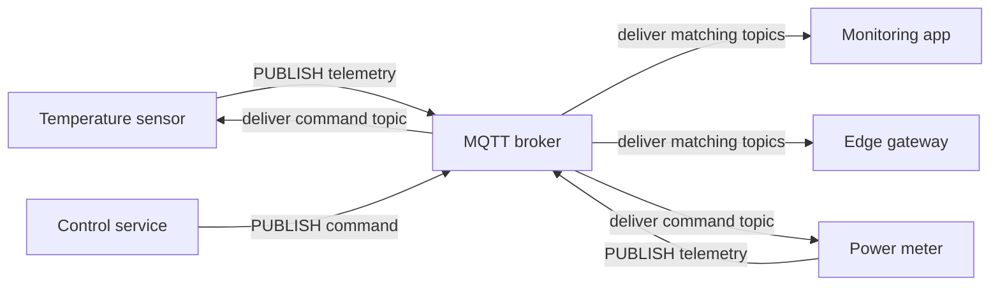
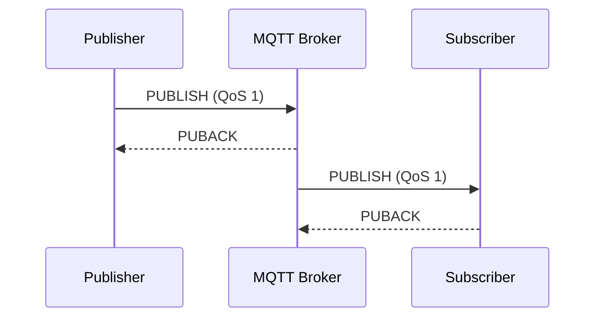
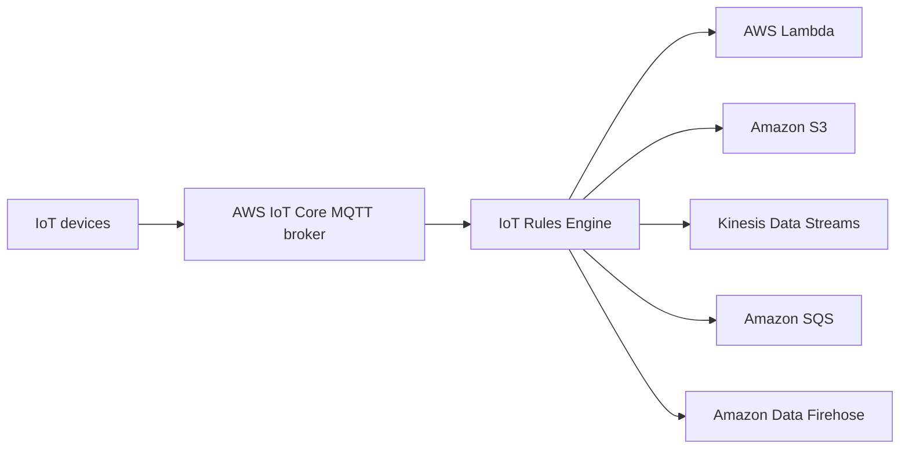
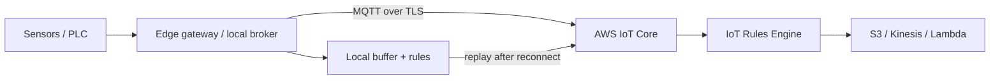

# MQTT Topics, Publish, Subscribe, and Quality of Service

MQTT (Message Queuing Telemetry Transport) is a lightweight messaging protocol based on the publish/subscribe model, designed for resource-constrained devices and unreliable network connections. A sensor device can publish data to a topic; a gateway, application, or cloud service subscribes to that topic to receive the data without needing to know the address of each recipient. The broker sits in the middle to receive messages, check permissions, and route them to matching subscribers.

In AWS, AWS IoT Core provides a managed MQTT message broker that authenticates devices, enforces topic-level permissions, stores retained messages and persistent sessions, emits connection lifecycle events, and routes messages via the Rules Engine to other services. MQTT is well suited for telemetry, device state, alerts, and control commands; however, the system must carefully design the topic namespace, QoS, sessions, retries, and authorization to prevent data loss, duplicates, or overly broad permissions.

This lesson belongs to the `CLOUD_PROVIDERS_AWS` module, connecting concepts across IoT, edge computing, IAM, VPC, streaming, storage, and serverless. After this lesson, you will be able to:

- Explain the broker, client, topic, publish, subscribe, and message flow.
- Design a topic hierarchy, topic filters, and wildcards for a device fleet.
- Distinguish QoS 0, QoS 1, and QoS 2 in the MQTT specification, and understand AWS IoT Core QoS limits.
- Choose retained messages, persistent sessions, Last Will, and Device Shadow based on use cases.
- Grant publish, subscribe, and receive permissions using least-privilege AWS IoT policies.
- Use the MQTT Test Client, AWS IoT Device SDK, or Mosquitto to test connectivity.
- Route messages using AWS IoT Rules Engine to Lambda, S3, Kinesis, SQS, or other supported targets.
- Design idempotent consumers, monitor connectivity, and handle offline devices.

## 1. MQTT and the Publish/Subscribe Model

MQTT is an application-layer protocol running over a stateful network connection. A client connects to a broker, then publishes messages or subscribes to topic filters. The broker receives messages from publishers and delivers them to subscribers with matching filters, according to QoS and granted permissions.

Key components:

| Component | Role |
|---|---|
| MQTT client | Software on a device, gateway, application, or service connecting to the broker |
| MQTT broker | Accepts connections, authenticates, checks permissions, and routes messages |
| Publisher | Client sending messages to a topic |
| Subscriber | Client registering a topic filter to receive messages |
| Topic | Hierarchical name identifying a message type or data stream |
| Topic filter | Topic pattern a subscriber wants to receive, optionally using wildcards |
| QoS | Delivery guarantee level for each hop of MQTT communication |
| Session | Logical connection state, subscriptions, and messages queued for redelivery |

A single client can both publish and subscribe. For example, an industrial gateway publishes telemetry from sensors and subscribes to configuration commands from the cloud.



Publishers and subscribers do not need to know about each other. Publishers only need to know the topic; the broker handles distribution. This decoupling makes it possible to add subscribers without modifying publisher code, as long as the topic contract and permissions are cleanly designed.

## 2. MQTT Messages and Payloads

An MQTT PUBLISH packet carries a topic name, payload, and protocol attributes such as QoS, RETAIN flag, and DUP flag. With MQTT 5, packets can also carry properties such as message expiry, content type, payload format indicator, response topic, correlation data, and user properties.

MQTT does not require payloads to be JSON. Payloads can be:
- JSON for human-readable events and telemetry.
- CBOR or MessagePack for bandwidth-constrained devices.
- Protobuf or Avro when schema enforcement and compact payloads are needed.
- Binary payloads for images, firmware chunks, or specialized data.

Example telemetry JSON:

```json
{
  "schemaVersion": 1,
  "deviceId": "sensor-001",
  "timestamp": "2026-11-20T08:15:30Z",
  "sequence": 1842,
  "temperatureC": 28.4,
  "humidityPct": 71.2,
  "batteryPct": 92
}
```

The topic identifies which stream the message belongs to; the payload holds the content. Avoid stuffing all routing metadata into the payload if the broker or policies need to make decisions based on the topic. Also, never include passwords, private keys, tokens, or unnecessary personal data in payloads, as messages may be stored, logged, or forwarded to multiple services.

## 3. Topics as the IoT System Namespace

MQTT topics are hierarchical strings with levels separated by forward slashes (`/`). Topic names are case-sensitive. For example, the following two topics are distinct:

- `factory/site-01/device/pump-07/telemetry`
- `factory/site-01/device/Pump-07/telemetry`

A topic is neither a URL nor an ARN. In AWS IoT Core, the topic namespace is scoped by AWS account and Region; the same topic name in another account or Region is a separate namespace.

### 3.1. Designing the Topic Hierarchy

A reference structure:

```text
org/{tenantId}/site/{siteId}/device/{thingName}/telemetry
org/{tenantId}/site/{siteId}/device/{thingName}/event
org/{tenantId}/site/{siteId}/device/{thingName}/state
org/{tenantId}/site/{siteId}/device/{thingName}/command
org/{tenantId}/site/{siteId}/device/{thingName}/command/ack
org/{tenantId}/site/{siteId}/device/{thingName}/config
org/{tenantId}/site/{siteId}/device/{thingName}/availability
```

The topic hierarchy should reflect how the system authorizes and consumes data. Key principles:

- Place tenant, site, and device in consistent positions.
- Separate telemetry, events, commands, state, and acknowledgements.
- Keep topic level names stable over the device lifecycle.
- Choose a balanced depth; overly flat topics are hard to authorize, while overly deep topics are hard to manage.
- Never use topics to store secrets or sensitive information.
- Avoid changing topics frequently because policies, rules, and subscribers depend on the contract.
- Define who owns each namespace and who is allowed to introduce new topics.

### 3.2. Topic Contract

A topic contract should document:
- Topic name pattern.
- Allowed publishers.
- Allowed subscribers.
- Schema/payload version.
- Required QoS.
- Whether RETAIN is permitted.
- Expected message expiry or retention.
- Message frequency and payload size.
- Rules for handling duplicates and out-of-order messages.
- Owner and downstream consumers.

For example, devices are only permitted to publish their own telemetry; the control service is only permitted to publish commands; devices only subscribe to their own commands; and the monitoring service subscribes to telemetry for an entire site within its approved scope.

## 4. Publish and Subscribe

### 4.1. Publish

A publisher sends a PUBLISH packet with a topic name and payload. The broker authenticates the client, checks publish permissions, accepts the message, and routes it to subscribers matching the filter.

The publisher does not need to know how many subscribers exist. Broker acceptance of a message does not mean all subscribers have successfully completed business processing. QoS acknowledgement confirms delivery at the corresponding MQTT hop; it does not replace application-level transaction confirmation.

### 4.2. Subscribe

A subscriber sends a SUBSCRIBE packet containing one or more topic filters and the maximum QoS it wants to receive. The broker checks subscribe permissions and then delivers matching messages as they are published.

A client can subscribe to multiple filters. For example:
- One filter receiving telemetry for a single device.
- One filter receiving all devices at a site.
- One filter receiving all alerts within a tenant.

When messages are no longer needed, the client can unsubscribe from the filter. In a persistent session, subscriptions can be saved by the broker to be restored when the client reconnects.

### 4.3. How Does the Broker Route Messages?

Suppose a publisher sends a message to:

```text
org/acme/site-01/device/pump-07/telemetry
```

The following subscribers may match:

| Topic Filter | Match? | Reason |
|---|---|---|
| `org/acme/site-01/device/pump-07/telemetry` | Yes | Exact match |
| `org/acme/site-01/device/+/telemetry` | Yes | `+` matches one device level |
| `org/acme/site-01/#` | Yes | `#` matches all remaining levels |
| `org/+/site-01/device/+/telemetry` | Yes | Each `+` matches one level |
| `org/acme/site-02/#` | No | Different site |
| `org/acme/site-01/device/pump-07/event` | No | Different message type |

## 5. Wildcards in MQTT Topic Filters

MQTT has two wildcards in topic filters: `+` and `#`. They are only used when subscribing; publishers must send to a specific topic name and must not use wildcards in topic names.

| Wildcard | Meaning | Example |
|---|---|---|
| `+` | Matches exactly one topic level | `site/+/temperature` |
| `#` | Matches the current level and all subsequent levels | `site/site-01/#` |

Rules:
- `+` must occupy an entire topic level.
- `#` must occupy an entire level and may only appear at the end of the filter.
- Multiple `+` wildcards can be combined in a filter.
- The filter `sensor/#` matches `sensor/`, `sensor/temp`, `sensor/temp/room-1`, but does not match the topic `sensor` without a trailing slash after `sensor`.
- A wildcard at the first level does not match topics starting with `$` according to MQTT rules.

Examples:
- `factory/+/device/+/telemetry`: telemetry from all devices across all sites.
- `factory/site-01/device/+/command/ack`: acknowledgements from all devices in `site-01`.
- `factory/site-01/#`: all topics under `site-01`.

Do not grant `#` to every device if it only needs specific topics. Overly broad filters can expose data from other tenants, increase traffic, and make it harder for consumers to classify messages.

## 6. Topic Names, Topic Filters, and ARNs in AWS IoT Core

AWS IoT Core uses distinct ARN formats for topic names and topic filters:

- Topic ARN: `arn:aws:iot:region:account-id:topic/topic-name`
- Topic filter ARN: `arn:aws:iot:region:account-id:topicfilter/topic-filter`
- Client ARN: `arn:aws:iot:region:account-id:client/client-id`

Example:
- Topic: `org/acme/device/pump-07/telemetry`
- Topic filter: `org/acme/device/+/telemetry`

These are two different resource types. In an IoT policy:
- `iot:Publish` uses a `topic` resource.
- `iot:Receive` uses a `topic` resource.
- `iot:Subscribe` uses a `topicfilter` resource.
- `iot:Connect` uses a `client` resource.

A subscriber generally needs both `Subscribe` permission on the filter and `Receive` permission on the actual topic being delivered. Granting `Subscribe` without `Receive` allows the client to register the filter without receiving messages.

### 6.1. Policy Wildcards Are Not MQTT Wildcards

This is a common misconfiguration:

| Character | MQTT Topic Filter | AWS IoT Policy Resource |
|---|---|---|
| `+` | Single-level wildcard | Literal character, not a policy wildcard |
| `#` | Multi-level wildcard | Literal character, not a policy wildcard |
| `*` | Not an MQTT wildcard | Policy wildcard |
| `?` | Not an MQTT wildcard | Single-character policy wildcard |

For example, the MQTT topic filter `factory/+/telemetry` must be expressed in the policy resource in accordance with IAM ARN wildcard rules; do not assume `+` in a policy ARN behaves like MQTT. Always review policy examples and test against real topics.

## 7. MQTT Quality of Service (QoS)

QoS (Quality of Service) defines the message delivery guarantee over MQTT. MQTT defines three levels: QoS 0, QoS 1, and QoS 2.

| QoS | Common Name | Protocol Guarantee | Trade-off |
|---|---|---|---|
| 0 | At most once | Sent at most once; may not arrive | Low overhead, low latency |
| 1 | At least once | Retransmitted until PUBACK is received; duplicates possible | Higher reliability, requires idempotency |
| 2 | Exactly once | Four-step handshake to prevent protocol-level duplicates | More packets and overhead |

AWS IoT Core supports QoS 0 and QoS 1; QoS 2 is not supported. Do not configure AWS IoT Core clients with QoS 2 and do not interpret QoS 1 as business-level exactly-once processing.

### 7.1. QoS 0 — At Most Once

With QoS 0, the publisher sends PUBLISH without waiting for PUBACK. If the packet is lost due to a network drop or client/broker unavailability, the message may never arrive.

Appropriate for:
- Continuously streamed telemetry where losing a few samples is acceptable.
- High-frequency sensor data where the next reading quickly supersedes the previous one.
- Non-critical information or data recoverable from another source.

Avoid using QoS 0 for critical control commands, billing events, or alerts requiring confirmation unless the system has a compensation mechanism.

### 7.2. QoS 1 — At Least Once

With QoS 1, the sender transmits PUBLISH and waits for PUBACK. If no acknowledgement arrives within the timeout, the sender may retransmit. This increases the chance of delivery but can introduce duplicates.

Basic flow:



PUBACK from the broker to the publisher indicates the broker received PUBLISH on the publisher-to-broker hop. It does not prove a subscriber processed it successfully. PUBACK from the subscriber confirms the broker-to-subscriber hop at the protocol level; it also does not prove a database or business action committed if the client library sends ACK before application processing finishes.

Consumers must:
- Have a stable event ID or sequence number.
- Record processed markers.
- Use transactions or unique constraints when updating data.
- Avoid repeating side effects upon duplicate message receipt.
- Monitor duplicates and out-of-order arrivals.

### 7.3. QoS 2 — Exactly Once

Standard MQTT defines QoS 2 with a four-step handshake: PUBLISH, PUBREC, PUBREL, and PUBCOMP. Its goal is to guarantee single delivery at the protocol level between MQTT endpoints.

However, AWS IoT Core does not support QoS 2. Even when a broker supports QoS 2, that alone does not guarantee an end-to-end transaction happens once in a database, payment API, or external system. Applications still need idempotency and transaction boundaries.

### 7.4. QoS Across Publisher, Broker, and Subscriber

QoS is negotiated/applied per hop:
- The publisher chooses the QoS for the message sent to the broker.
- The subscriber chooses the maximum QoS for the subscription.
- The broker forwards the message at a supported QoS bounded by both the publish QoS and subscription QoS.

Therefore, a publisher sending at QoS 1 does not mean every subscriber receives it at QoS 1 if its subscription was registered with QoS 0. Configure and verify QoS on both producers and subscribers.

## 8. Choosing QoS by Business Requirement

| Message Type | Recommended QoS | Reason |
|---|---|---|
| Per-second temperature telemetry | 0 or 1 | Choose 0 if minor sample loss is acceptable; 1 if fuller collection is needed |
| Threshold-breach alert | 1 | Needs higher reliability, consumer handles duplicates |
| Machine start/stop command | 1 | Needs confirmation and device-side idempotency |
| Periodic battery status | 0 | Newer readings supersede older ones |
| Maintenance or critical fault event | 1 | Needs retry and reliable delivery |
| Latest configuration | 1 combined with retained message | Newly connected devices receive the latest config state |

Higher QoS increases traffic, state overhead, and costs. Choose QoS based on the impact of losing a message, frequency, bandwidth, and ability to handle duplicates. Do not set QoS 1 on all telemetry if millions of devices send high-frequency readings and the business tolerates minor sample loss.

## 9. Retained Messages

A retained message is stored by the broker per topic when the publisher sets the RETAIN flag. New subscribers registering for that exact topic immediately receive the latest retained message, even if it was published before the subscriber connected.

Use cases:
- Latest configuration for a device.
- Last-known state of a sensor.
- Current status of a gateway.
- Information on the currently deployed firmware version.

AWS IoT Core supports retained messages. Each topic stores only one retained message; a new retained message replaces the previous one on that topic.

### 9.1. Creating and Updating Retained Messages

The publisher sends a message with the RETAIN flag set. Current subscribers receive the message normally; the broker stores the latest copy so future subscribers can receive it.

To delete a retained message, the publisher sends an empty (0-byte) payload with the RETAIN flag set to that exact topic. The empty message is also delivered to current subscribers of the topic.

Key notes for AWS IoT Core:
- Subscribers must subscribe to the exact topic name to receive the retained message immediately upon subscribing.
- Wildcard filters can receive subsequent new messages, but retained messages are not necessarily sent immediately when subscribing with a wildcard.
- Delivery ordering between a retained message and new messages is not guaranteed.
- MQTT 5 supports Message Expiry Interval; expired retained messages are not sent to new subscribers.
- MQTT 3 retained messages lack a standard expiry interval like MQTT 5; manage updates/deletions procedurally.
- Do not publish retained messages to AWS IoT Core reserved topics.

### 9.2. Retained Messages vs. Persistent Sessions

| Feature | Retained Message | Persistent Session |
|---|---|---|
| Goal | Provide the latest value of a topic | Keep subscriptions and QoS 1 messages while client is offline |
| What is stored? | One latest message per topic | Subscriptions and unacknowledged/queued QoS 1 messages during offline period |
| New subscriber | Receives retained message when subscribing to exact topic | Does not receive historical messages prior to session creation |
| Reconnecting device | Resubscribes and receives retained message if present | Can restore subscriptions and queued messages |
| Expiry | MQTT 5 Message Expiry; no expiry interval in MQTT 3 | Session expiry per configuration |

Retained messages suit the latest state/config; persistent sessions suit offline devices needing QoS 1 messages sent while disconnected. Neither is a long-term storage repository.

### 9.3. Retained Messages vs. AWS IoT Device Shadow

Device Shadow provides a structured JSON document tied to a Thing, supporting desired/reported state, versions, timestamps, and deltas. A retained message is a free-form message per topic, not automatically tied to a Thing and without equivalent versioning/state reconciliation.

Use retained messages when you only need the latest topic value. Use Device Shadow when the cloud and device must synchronize desired/actual state, handle offline devices, and compute deltas.

## 10. Persistent Sessions and Offline Devices

IoT devices can lose connectivity due to mobility, weak signal, power-saving sleep, or network errors. Persistent sessions let the broker store subscription state and some messages while a client is offline for redelivery upon reconnect.

In AWS IoT Core:
- MQTT 3 uses `cleanSession = 0` to create/resume a persistent session.
- MQTT 5 uses Clean Start and Session Expiry Interval.
- Sessions store subscriptions and eligible QoS 1 messages; QoS 0 messages are not stored for persistent-session delivery.
- Sessions have message storage limits and expiry durations; messages exceeding limits may be dropped.
- On reconnect, the client can inspect `sessionPresent` in CONNACK to see whether the session was restored.
- MQTT 3 and MQTT 5 persistent sessions cannot be resumed across protocol versions.

### 10.1. When to Use Persistent Sessions

Use when:
- Devices frequently go offline but must receive queued QoS 1 commands.
- Devices need to keep subscriptions across reconnects.
- Cellular or satellite networks experience long outages.
- Devices wake radios periodically to save power.

Do not use persistent sessions as an unlimited message queue. AWS IoT Core enforces quotas and message storage limits; if devices stay offline for extended periods or critical commands must persist long-term, store commands in a stateful backend and send only notifications over MQTT.

### 10.2. Reconnect Strategy

A device should:
1. Detect connection loss.
2. Wait using exponential backoff with jitter.
3. Reconnect with a stable client ID and session configuration.
4. Check `CONNACK`/`sessionPresent`.
5. Resubscribe only if the session was not restored.
6. Process queued messages and check sequence/expiry.
7. Publish online status or heartbeat.
8. Monitor reconnect loops and prevent connection storms.

Do not reconnect repeatedly every few milliseconds when the broker or network is down. Millions of devices reconnecting at once can cause a connection storm and overload the system.

## 11. Last Will and Testament (LWT)

LWT is a message registered by the client when sending CONNECT. If the client disconnects ungracefully, the broker publishes the Will Message to the Will Topic to notify subscribers.

Example:
- Device connects and registers Will payload `{"status":"offline"}`.
- Device operates normally.
- Device loses power or network without sending DISCONNECT.
- Broker publishes LWT so subscribers know the device may be offline.

LWT is useful as an availability signal, but it is not absolute proof that the device is broken. Intermittent networks or timeouts can also trigger ungraceful disconnects.

In AWS IoT Core:
- LWT is sent when the broker detects an ungraceful disconnect.
- If the client disconnects cleanly using MQTT DISCONNECT, the broker does not send the Will.
- Will Retain can be set to store the latest offline state.
- Ordering between LWT and reconnect events is not guaranteed due to asynchronous processing.

To determine connection state more accurately, combine LWT with AWS IoT lifecycle events, timestamps, versions, and heartbeats. Consumers should ignore older events if a version/timestamp indicates they arrived after a newer state.

## 12. MQTT 5 and Additional Features

AWS IoT Core supports MQTT 3.1.1 and MQTT 5. MQTT 5 introduces features for better management of sessions, expiry, errors, and metadata.

Key features:
- Clean Start and Session Expiry Interval.
- Message Expiry Interval.
- Reason codes on acknowledgements.
- Topic Aliases to reduce repeated topic string sizes.
- User Properties to pass custom metadata.
- Response Topic and Correlation Data for request/response patterns.
- Shared subscriptions.
- Subscription Identifiers and other features as supported by AWS IoT Core.

Not every MQTT 5 feature in the specification behaves identically in AWS IoT Core. Always review the supported features and differences documentation before relying on a property. MQTT 3 and MQTT 5 clients can communicate through the broker, but persistent sessions cannot resume across versions.

### 12.1. Message Expiry

Message Expiry Interval defines how long a message remains valid. If a control command has a 30-second expiry, the device should not execute that command if it reconnects hours later.

Expiry is useful for:
- Time-sensitive control commands.
- Telemetry that loses value after a certain window.
- Notifications with deadlines.
- Avoiding stale message backlogs.

Expiry does not replace application-level timestamp validation. For safety-critical or industrial actions, the device must independently verify that a command is still valid before executing it.

### 12.2. Request/Response over MQTT

MQTT 5 includes Response Topic and Correlation Data to build request/response patterns. For example, the cloud publishes a command with a dedicated response topic; the device processes it and publishes the result with the correlation ID. Restrict publish/subscribe permissions on response topics and handle timeouts/duplicates like any application protocol.

## 13. Shared Subscriptions

Shared subscriptions allow a group of subscribers to load-balance messages. Instead of every subscriber receiving a copy of every message, the broker distributes each message to one subscriber in the group according to supported semantics.

Common syntax:

```text
$share/{groupName}/{topicFilter}
```

Example:

```text
$share/telemetry-workers/factory/+/device/+/telemetry
```

Use cases:
- Multiple workers processing telemetry concurrently.
- Scaling consumers horizontally.
- Distributing tasks where each message only needs one worker.

Shared subscriptions differ from broadcast subscriptions. If every consumer must receive every message, use separate subscriptions or a fan-out architecture. AWS IoT Core supports shared subscriptions in MQTT 5; verify quotas, session behavior, and policy topic filters before deploying.

## 14. AWS IoT Core Message Broker

AWS IoT Core provides a managed broker for devices, gateways, and applications to exchange messages via MQTT. The service supports MQTT 3.1.1 and MQTT 5, MQTT over WSS, device authentication, IoT policies, retained messages, persistent sessions, and integration with AWS services.

An MQTT connection typically requires:
- The AWS IoT data endpoint for the right account/Region.
- A unique client ID across active connections.
- An X.509 certificate and private key, or another supported authentication method.
- An IoT policy attached to the certificate/identity.
- TLS and SNI as required by the endpoint.
- Appropriate topic namespace and publish/subscribe permissions.

AWS IoT Device SDK is a strong choice for managing TLS, MQTT sessions, and reconnects on devices. MQTT over WSS with an appropriate authentication mechanism can be used when applications run in web environments.

### 14.1. Client ID

The Client ID identifies an MQTT connection. AWS IoT Core does not allow two clients to be connected concurrently with the same client ID; a second connection can cause the existing connection to be closed. Therefore:
- Use a unique client ID per device.
- Do not share one client ID across multiple gateway replicas.
- Protect client IDs with policies so devices cannot spoof other devices.
- When replacing hardware, follow a controlled workflow to transfer identity and client ID.

Client ID is not an authentication mechanism. A client may know a device name, yet it still needs valid certificates/credentials and a matching policy.

## 15. AWS IoT Policies for Connect, Publish, Subscribe, and Receive

AWS IoT policies control MQTT actions. Four foundational actions:

| Action | Meaning | Resource ARN |
|---|---|---|
| `iot:Connect` | Connect to the broker with a client ID | `client/...` |
| `iot:Publish` | Publish to a topic | `topic/...` |
| `iot:Subscribe` | Subscribe to a topic filter | `topicfilter/...` |
| `iot:Receive` | Receive messages on a topic | `topic/...` |

These permissions are separate. Allowing a subscription filter does not automatically grant receive permission on all matching topics. AWS IoT Core checks `Subscribe` permission when the client sends SUBSCRIBE and checks `Receive` when a message is delivered to the client.

### 15.1. Example Policy Scoped by Thing

The illustrative policy below allows a device attached to its corresponding Thing to connect using `ThingName`, publish its own telemetry, and subscribe/receive its own commands.

```json
{
  "Version": "2012-10-17",
  "Statement": [
    {
      "Effect": "Allow",
      "Action": "iot:Connect",
      "Resource": "arn:aws:iot:ap-southeast-1:111122223333:client/${iot:Connection.Thing.ThingName}",
      "Condition": {
        "Bool": {
          "iot:Connection.Thing.IsAttached": "true"
        }
      }
    },
    {
      "Effect": "Allow",
      "Action": "iot:Publish",
      "Resource": "arn:aws:iot:ap-southeast-1:111122223333:topic/factory/site-01/device/${iot:Connection.Thing.ThingName}/telemetry"
    },
    {
      "Effect": "Allow",
      "Action": "iot:Subscribe",
      "Resource": "arn:aws:iot:ap-southeast-1:111122223333:topicfilter/factory/site-01/device/${iot:Connection.Thing.ThingName}/command"
    },
    {
      "Effect": "Allow",
      "Action": "iot:Receive",
      "Resource": "arn:aws:iot:ap-southeast-1:111122223333:topic/factory/site-01/device/${iot:Connection.Thing.ThingName}/command"
    }
  ]
}
```

Replace the account, Region, site, and Thing registration to match your real environment. This is a conceptual example and should be tested against actual certificates, Thing attachments, and device policy variables. Never grant `iot:*` or namespace-wide wildcards to all certificates without a clear justification.

### 15.2. Retained Message Permissions

AWS IoT Core provides dedicated policy actions such as:
- `iot:RetainPublish`: allows publishing messages with the RETAIN flag; also requires matching `iot:Publish`.
- `iot:GetRetainedMessage`: reads the content of a specific retained message.
- `iot:ListRetainedMessages`: lists retained message metadata.

Do not grant retained message permissions broader than regular publish/receive permissions if the device does not need them.

## 16. MQTT Test Client and Topic Verification

The AWS IoT Console provides an MQTT test client for testing publish and subscribe without installing a separate client. It is a fast way to verify:
- Whether topic filters match.
- Whether payloads match the expected schema.
- Whether QoS is set properly.
- Whether retained messages are stored/delivered.
- Whether policies allow subscribe/receive.

Workflow:
1. Open the AWS IoT Core Console in the target Region.
2. Select MQTT test client.
3. Subscribe to a specific topic filter.
4. Publish a message from another tab or client.
5. Inspect topic, payload, QoS, and timestamp.
6. Test single-level and multi-level wildcards.
7. Verify permissions using a test identity with a restricted policy.
8. Test reconnects and retained/session behavior in a test environment.

Do not use the test client on sensitive production topics if payloads contain customer data or real control commands.

## 17. Example Using the Mosquitto Client

Mosquitto is a useful open-source MQTT toolkit for testing brokers. With AWS IoT Core, you need the endpoint, CA certificate, client certificate, private key, and a policy permitting the connection/topics.

Subscribe to telemetry:

```bash
mosquitto_sub \
  -h <aws-iot-data-endpoint> \
  -p 8883 \
  --cafile AmazonRootCA1.pem \
  --cert device-certificate.pem.crt \
  --key device-private.pem.key \
  -i sensor-001-monitor \
  -t 'factory/site-01/device/+/telemetry' \
  -q 1
```

Publish telemetry:

```bash
mosquitto_pub \
  -h <aws-iot-data-endpoint> \
  -p 8883 \
  --cafile AmazonRootCA1.pem \
  --cert device-certificate.pem.crt \
  --key device-private.pem.key \
  -i sensor-001 \
  -t 'factory/site-01/device/sensor-001/telemetry' \
  -m '{"temperatureC":28.4,"timestamp":"2026-11-20T08:15:30Z"}' \
  -q 1
```

Notes:
- Retrieve the endpoint from AWS IoT account settings; do not guess it.
- The certificate must be active, have an appropriate policy attached, and be attached to the Thing if the policy uses Thing context.
- Client ID must match the resource in `iot:Connect`.
- Never share private keys or commit them to repositories.
- The Mosquitto client must support TLS and the options required by the endpoint.
- When using MQTT over WSS, connection and authentication differ from the TCP/TLS port 8883 example.

## 18. AWS IoT Rules Engine: Message Routing

AWS IoT Rules Engine filters messages by topic and content, then routes them to AWS services or supported endpoints. This allows devices to simply publish to the broker; the cloud backend does not need to maintain dedicated connections to individual devices.

Example flow:



An SQL rule can select fields and filter events:

```sql
SELECT
  deviceId,
  timestamp,
  temperatureC,
  humidityPct
FROM 'factory/+/device/+/telemetry'
WHERE temperatureC > 80
```

This rule filters telemetry whose temperature exceeds the threshold. The topic pattern and fields must match actual messages. Rule actions can write to S3, invoke Lambda, or send to Kinesis, SQS, SNS, or other supported destinations.

### 18.1. Error Actions and Error Handling

If a rule action fails, you need mechanisms to detect and handle it:
- Configure an error action when appropriate.
- Monitor rule CloudWatch metrics/logs.
- Design idempotent downstream consumers.
- Separate parse/schema errors from transient errors.
- Configure a DLQ or error destination if the action supports it.
- Establish a replay workflow from durable storage if needed.

Do not assume the rule engine will retain all messages indefinitely when downstream services are unavailable. If high durability is required, route data into a stream/queue or archive storage by design.

## 19. Command and Acknowledgement Design

Device control requires distinguishing between a sent command, a received command, and an executed command. QoS 1 only assists with delivery at the MQTT layer; it does not prove the device executed the action.

A topic pattern:

```text
factory/site-01/device/pump-07/command
factory/site-01/device/pump-07/command/ack
```

A command payload can include:
- A unique `commandId`.
- Action and parameters.
- `issuedAt` and `expiresAt`.
- Expected device state/version.
- `correlationId`.
- Authenticated issuer or source metadata.

Device flow:
1. Receive command.
2. Check if `commandId` has already been processed.
3. Validate expiry and safety state.
4. Execute if valid.
5. Persist execution result durably.
6. Publish acknowledgement with `commandId` and result.
7. Upon receiving a duplicate command, return the prior result or safely ignore.

For industrial machinery, control commands need local interlocks and safety logic at the device/PLC. Never rely on the MQTT broker or cloud to guarantee physical safety during network outages.

## 20. MQTT Security in AWS IoT Core

A secure MQTT system must govern identity, connections, topics, and payloads.

- Use a unique X.509 certificate per device or appropriate identity.
- Protect private keys in a secure element/TPM when hardware supports it.
- Use TLS and validate server certificates.
- Grant least-privilege IoT policies scoped by Thing/client/topic.
- Separate permissions to publish telemetry from permissions to publish commands.
- Do not let devices subscribe to an entire tenant if they only need their own topics.
- Rotate/revoke certificates when devices are lost or compromise is suspected.
- Never treat client ID as proof of authentication.
- Enforce limits on message size and publish rate.
- Never log private keys, tokens, or sensitive payloads.
- Audit policies, certificates, Thing attachments, and connections via CloudTrail/IoT logs.

### 20.1. Topic ACLs and Tenant Isolation

For multi-tenant fleets, the topic namespace should include tenant or site to simplify authorization. Policies must ensure a tenant A device cannot:
- Publish data into tenant B's namespace.
- Subscribe to commands for another device.
- Spoof another device's client ID.
- Receive messages from internal or admin topics.

Test both positive and negative cases. Verify that a device can publish to its own topic and is denied when publishing elsewhere; verify a subscriber receives commands for its own device and is denied out-of-scope topics.

## 21. Observability and Fleet Management

Monitor MQTT across connection, message, and business layers.

| Category | Signals to Monitor | Meaning |
|---|---|---|
| Connectivity | Connect/disconnect count, connection duration | Are devices staying stably connected? |
| Message flow | Publish/subscribe count, message size/rate | Is traffic volume abnormal? |
| QoS | Delivery failures, retry/duplicate patterns | Are messages being retransmitted or failing? |
| Session | Persistent session count, queued messages, expiry | Do offline devices have backlogs? |
| Rules Engine | Rule successes/failures, action errors | Is data reaching the backend? |
| Device health | Heartbeat, battery, firmware, last seen | Are devices operating normally? |
| Security | Authorization denials, certificate status | Are there policy errors or anomalous behavior? |

AWS IoT Core provides CloudWatch metrics/logs and lifecycle events to track connectivity. You can use Fleet Indexing, Device Defender, and fleet management features as needed. Distinguish between clean disconnects, timeouts, network errors, and client ID collisions from another location.

### 21.1. Last Seen and Heartbeat

Devices can publish periodic heartbeats, for example every 60 seconds. The backend records the last timestamp and marks devices stale when thresholds are exceeded. Thresholds should account for:
- Device sleep cycles.
- Cellular or satellite network latency.
- Maintenance windows.
- Retries/backoff.
- Clock drift.

Do not conclude a device is offline from a single delayed heartbeat. Combine lifecycle events, LWT, and heartbeats to reduce false positives.

## 22. Performance, Backpressure, and Cost

MQTT is lightweight, yet large fleets can still generate substantial load. Estimate:
- Concurrent connected devices.
- Messages per second and payload size.
- QoS distribution.
- Subscribers/filters per topic.
- Reconnect frequency.
- Number of retained messages.
- Persistent session duration and offline queue size.
- Rule actions and downstream throughput.

Mitigation measures:
- Batch telemetry when appropriate.
- Shrink payloads and remove unnecessary fields.
- Use QoS 0 for loss-tolerant data.
- Use jitter on reconnects.
- Partition topics and consumers by site/tenant.
- Buffer at the edge during cloud disconnects.
- Set expiry on stale commands.
- Use downstream queues/streams to absorb bursts.
- Monitor quotas and request throttling.

QoS 1, retained messages, persistent sessions, and LWT all increase message traffic or costs. Enable them only when the use case demands it. Persistent sessions in particular require expiration and backlog management; messages stored for offline clients are bounded and may be dropped if quotas are exceeded.

## 23. Edge Architecture During Connectivity Loss

Edge devices can keep collecting data when connectivity to AWS IoT Core drops. A local gateway can:
- Receive sensor data over MQTT or industrial protocols.
- Buffer messages to disk.
- Attach timestamps/sequences.
- Deduplicate messages.
- Apply local rules for rapid alerting.
- Replay data in batches once connectivity is restored.



When replaying buffered data, preserve original timestamps and distinguish event time from ingestion time. Consumers should handle duplicates and out-of-order arrivals. For commands, enforce expiry and safety validation so stale commands are not executed upon reconnect.

## 24. Real-World Scenario: Industrial Pump Monitoring System

A factory has 500 pumps, each publishing temperature, vibration, and pressure. The system needs dashboards, alerts, control commands, and analytics storage.

### 24.1. Topic Design

- Telemetry: `factory/plant-01/device/pump-007/telemetry`
- Alarm: `factory/plant-01/device/pump-007/alarm`
- Command: `factory/plant-01/device/pump-007/command`
- Acknowledgement: `factory/plant-01/device/pump-007/command/ack`
- Availability: `factory/plant-01/device/pump-007/availability`

### 24.2. QoS Strategy

- Periodic temperature/vibration: QoS 0 if brief sample loss is acceptable; QoS 1 if higher collection completeness is needed.
- Threshold-breach alarms: QoS 1 with idempotent consumers.
- Commands: QoS 1 with `commandId`, expiry, and acknowledgement.
- Availability: retained LWT combined with heartbeats/lifecycle events.
- Latest configuration: retained message or Device Shadow depending on state sync requirements.

### 24.3. Routing

AWS IoT Rules Engine:
- Sends telemetry to Kinesis Data Streams for near-real-time analytics.
- Sends alarms to SNS/SQS or Lambda for processing.
- Archives historical data to S3 via Data Firehose.
- Writes device status to DynamoDB or an appropriate state store.

### 24.4. Failure Handling

If the factory loses network connectivity:
- The gateway continues buffering data.
- Devices reconnect using backoff.
- Persistent sessions retain subscriptions and eligible QoS 1 messages within limits.
- The gateway replays data in sequence order.
- The backend deduplicates using `deviceId` + `sequence`/`eventId`.
- Expired commands are rejected.
- The dashboard displays `last seen` and stale indicators.

## 25. Common Mistakes

| Mistake | Consequence | Fix |
|---|---|---|
| Using QoS 1 without idempotency | Duplicates cause repeated side effects | Event ID, inbox/unique constraint |
| Assuming PUBACK means business completion | Sender receives ACK before backend commits | Dedicated business acknowledgement |
| Granting overly broad topic wildcards | Devices read/write other tenants' data | Topic namespace and least-privilege IoT policies |
| Confusing `+`/`#` with `*`/`?` in policies | Policy does not match as intended | Distinguish MQTT filters from IAM ARN wildcards |
| Sharing one client ID across multiple devices | Existing connection is dropped when new client connects | Unique client ID |
| Enabling persistent sessions for every device | Higher backlog, storage/message charges, and quota pressure | Enable only for devices needing offline delivery |
| Using retained messages as event history | Only the last message per topic is kept | Use Kinesis/S3/archives for history |
| Treating LWT as absolute state | May arrive out of order or report offline late | Combine with heartbeats and lifecycle events |
| Commands without expiry | Reconnecting devices execute stale commands | Message expiry and `expiresAt` checks |
| Subscribing with broad wildcards for retained messages | Retained messages not delivered immediately per AWS IoT behavior | Subscribe to exact topics or use proper state retrieval |
| Ignoring reconnect storms | Fleet creates sudden connection load spikes | Exponential backoff + jitter |
| Relying on MQTT for physical safety | Network loss can cause unsafe control behavior | Local interlocks and safety logic |

## 26. MQTT Design Checklist on AWS IoT Core

- [ ] Topic hierarchy reflects tenant, site, device, and message type.
- [ ] Topic contract defines owner, schema, QoS, and retention/expiry.
- [ ] Publishers publish only to specific topics without wildcards.
- [ ] Subscribers use the narrowest required filters.
- [ ] QoS 0/1 chosen based on the impact of message loss.
- [ ] QoS 2 is not designed for AWS IoT Core.
- [ ] Consumers are idempotent and track event/command IDs.
- [ ] Persistent sessions enabled only when needed with an expiration policy.
- [ ] Retained messages used solely for latest state/config.
- [ ] LWT combined with heartbeats/lifecycle events.
- [ ] Device Shadow considered for desired/reported state.
- [ ] IoT policy separates Connect, Publish, Subscribe, and Receive.
- [ ] Topic ARN and topicfilter ARN use the correct resource types.
- [ ] MQTT wildcards and IAM policy wildcards are properly distinguished.
- [ ] Certificates/private keys are protected with a revocation workflow.
- [ ] IoT Rules Engine has error handling and CloudWatch monitoring.
- [ ] Device reconnects use exponential backoff and jitter.
- [ ] Edge gateways implement buffering/replay during cloud disconnects.
- [ ] Commands include expiry, acknowledgements, and safety validation.
- [ ] Duplicates, out-of-order messages, offline, reconnect, and policy denials are tested.

## 27. Summary

MQTT is a lightweight publish/subscribe protocol. Publishers send messages to topics; subscribers register topic filters; the broker enforces permissions and routes messages. The topic hierarchy is part of the API contract because it governs authorization, routing, scalability, and how consumers discover data. Wildcard `+` matches a single level, `#` matches remaining levels, and both are only used in subscription filters.

QoS 0 delivers at most once and may lose messages; QoS 1 delivers at least once and may duplicate; QoS 2 provides MQTT protocol-level exactly-once delivery, which AWS IoT Core does not support. QoS acknowledgements do not mean a business transaction has committed, so consumers and command handlers require idempotency.

Retained messages store the latest value of a topic; persistent sessions retain subscriptions and eligible QoS 1 messages for offline clients; LWT signals ungraceful disconnects; Device Shadow manages versioned desired/reported state. Each mechanism serves a distinct goal and requires bounds on retention, access permissions, and cost.

On AWS, AWS IoT Core combines the MQTT broker, X.509 identities, IoT policies, Rules Engine, CloudWatch, and storage/streaming services. A secure system separates Connect/Publish/Subscribe/Receive permissions, scopes topics per Thing, protects certificates, handles duplicates, and monitors the fleet. For edge computing, local buffering and controlled replay ensure data collection continues even when cloud connectivity drops.

## References

- [MQTT protocol overview in AWS IoT Core](https://docs.aws.amazon.com/iot/latest/developerguide/mqtt.html)
- [AWS IoT Core MQTT QoS options](https://docs.aws.amazon.com/iot/latest/developerguide/mqtt.html#mqtt-qos)
- [MQTT persistent sessions](https://docs.aws.amazon.com/iot/latest/developerguide/mqtt.html#mqtt-persistent-sessions)
- [MQTT retained messages](https://docs.aws.amazon.com/iot/latest/developerguide/mqtt.html#mqtt-retain)
- [MQTT Last Will and Testament](https://docs.aws.amazon.com/iot/latest/developerguide/mqtt.html#mqtt-will)
- [MQTT topics and topic filters](https://docs.aws.amazon.com/iot/latest/developerguide/topics.html)
- [AWS IoT Core policy actions](https://docs.aws.amazon.com/iot/latest/developerguide/iot-policy-actions.html)
- [Publish/Subscribe policy examples](https://docs.aws.amazon.com/iot/latest/developerguide/pub-sub-policy.html)
- [AWS IoT Core MQTT 5 supported features](https://docs.aws.amazon.com/iot/latest/developerguide/mqtt.html#mqtt5-features)
- [AWS IoT Rules Engine](https://docs.aws.amazon.com/iot/latest/developerguide/iot-rules.html)
- [AWS IoT Device Shadows](https://docs.aws.amazon.com/iot/latest/developerguide/iot-device-shadows.html)
- [AWS IoT lifecycle events](https://docs.aws.amazon.com/iot/latest/developerguide/life-cycle-events.html)
- [AWS IoT Device SDKs](https://docs.aws.amazon.com/iot/latest/developerguide/iot-sdks.html)
